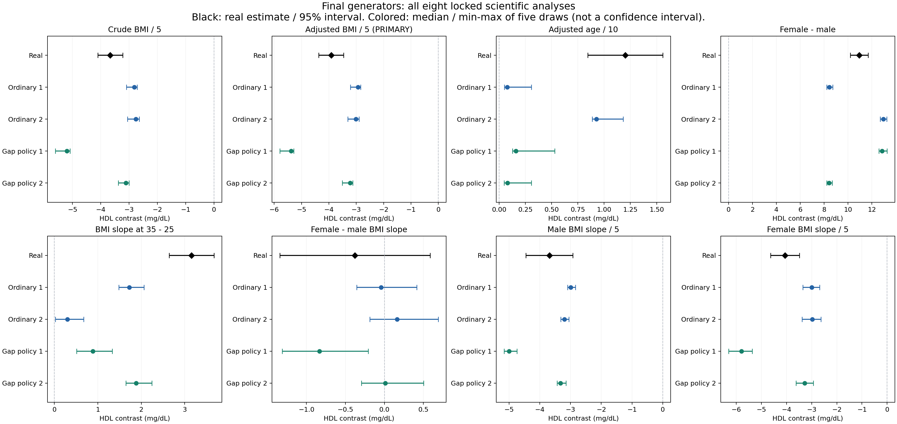

# Evidence-gap Agent loop: completed public HDL pilot

28 October 2026. All construction and revision finished before the target results were opened. No generator or scientific parameter was changed after evaluation.

## Decision

**The evidence/retrieval/review/revision workflow is implemented and executed, but this pilot does not demonstrate that the explicit gap/action policy produces better virtual data than a capable ordinary Agent.**

All four constructions preserved several useful broad scientific relationships. Performance on other analyses varied by construction. Both gap-policy builders completed their reviews and evidence actions but retained exactly the same numerical generators. Their final datasets are therefore identical to their initial datasets at each scheduled seed. Better evidence documentation must not be reported as improved generated data.

One ordinary Agent independently acquired more relevant cross-sectional evidence and revised its generator. This modestly improved some numerical comparisons and worsened others. The ordinary comparator was capable of useful retrieval and revision; those actions were not unique to the explicit policy.

Keep the audited tools and failure record. Do not expand this version as an established generation-quality improvement or turn this result into a superiority claim. A subsequent experiment would need a more specific, falsifiable evidence-to-generator change and a new protected test, not a retrofit to the HDL answers now revealed.

## 1. What was implemented

The [controller](loop_control.py) manages typed evidence, parameter provenance, candidate freezing, independent review, versioned revision, and output integrity. The [literature gateway](tools/README.md) provides separate builder sessions, cumulative budgets, screened primary texts, source-linked supplementary-material discovery, supported-format retrieval and an acceptance registry. A source file merely placed in an `approved` folder is not accepted without a corresponding gateway record.

The gap policy adds an explicit map of consequential evidence gaps and linked actions: retrieve, re-extract, check source statistics, revise, examine sensitivity, retain or stop. Final gaps need a stated disposition and action. This verifies that an action record exists and refers to real artifacts; scientific adequacy still requires review and empirical evaluation.

The ordinary workflow has the same tools, library access, model freedom, literature caps and review/revision opportunities. It may identify gaps and improve its model freely. The intervention does not receive target outcomes or extra scientific coefficients from the coordinator.

LLM work was performed by fresh Codex collaboration agents. Python handled durable artifacts, access screening, numerical sampling and evaluation. This is an executed workflow, not yet a standalone model-API application. No LLM was trained. All four builders independently selected conditional lognormal programs; that family, relationship directions, slopes, subgroup effects and noise scales were not prescribed by the controller.

Supported supplement formats are text, XML, CSV/TSV, strict HTML and XLSX. PDF and several other formats remain explicitly unsupported. Live checks verified metadata, maintext and supplement listing; supported supplement-download/parser behavior was tested with fabricated fixtures. One builder encountered an unsupported PDF and recorded it without bypassing the gateway. The tools should not be described as universal document readers.

## 2. Fresh case and locked design

The custodian selected **NHANES 2013-2014 serum HDL cholesterol** using metadata, access and prior-case inventory, before computing outcome associations. The official [HDL codebook](https://wwwn.cdc.gov/Nchs/Data/Nhanes/Public/2013/DataFiles/HDL_H.htm) specifies the direct assay, mg/dL scale and examination-weight use. Demographic and examination inputs came from the official [DEMO_H](https://wwwn.cdc.gov/Nchs/Data/Nhanes/Public/2013/DataFiles/DEMO_H.htm) and [BMX_H](https://wwwn.cdc.gov/Nchs/Data/Nhanes/Public/2013/DataFiles/BMX_H.htm) releases.

The staged cohort contains 4,885 eligible adults aged 20-79 with valid BMI, sex, positive examination weights and valid HDL, with the documented pregnancy exclusions. Builders received only BMI, age, sex, randomized nonsemantic IDs and population/measurement metadata. The entire HDL column and original identifiers stayed with the custodian. The full positive-weight MEC design spine contains 9,813 records, 15 strata and 30 PSUs.

The fixed analysis uses raw HDL in mg/dL, survey-weighted linear models and full-spine Taylor covariance. Models cover crude BMI, adjusted BMI/age/sex, a quadratic BMI contrast and BMI-by-sex interaction. The shape contrast compares the modeled BMI slope at BMI 35 with that at 25; it is not a claim about every part of the exposure range. Associations are cross-sectional and descriptive.

Two independently initialized builders per workflow each supplied an initial and final candidate. Five fixed seeds per version produced **40 scheduled dataset files**, each with 4,885 rows. There are 25 distinct file contents because three constructions retained identical initial/final outputs at each seed. These are four Agent constructions, not forty independent Agents or newly observed clinical cohorts. All observed values were preserved exactly.

Each builder had a total cap of 12 searches and 12 document-download attempts across both turns, one scientific feedback round and final implementation verification. The same model configuration was inherited. Actual search/download usage was recorded; exact model token totals and provider revision were not available. Equal caps must not be described as exact compute matching.

All NHANES-derived outcome evidence was excluded from literature retrieval across cycles. The filter also rejects some independent papers that mention NHANES in references. It is conservative and imperfect. Fresh contexts and explicit file scopes are procedural isolation on a shared filesystem, not OS-enforced access control or proof of no pretrained knowledge.

## 3. What the Agents actually did

| Construction | Initial to final searches | Initial to final downloads | Scientific response | Numerical generator changed? |
|---|---:|---:|---|---|
| Ordinary 1 | 6 to 8 | 5 to 7 | Retrieved a cross-sectional, age/sex-adjusted BMI>30 coefficient in an approved paper's embedded author-response table; replaced the longitudinal tail proxy. | Yes |
| Ordinary 2 | 10 to 12 | 7 to 7 | Sought better conditional estimates, corrected interpretation of adjusted age-group means, and examined alternative covariance/age/tail assumptions. | No |
| Gap policy 1 | 6 to 6 | 3 to 3 | Re-extracted eight already available U.S. subgroup moments, exposed discrepancies hidden by pooled-moment matching, and ran closure/age/BMI-representative sensitivities. | No |
| Gap policy 2 | 6 to 8 | 3 to 7 | Re-extracted age-by-BMI information, retrieved two more primary sources, checked conditional-variance and severe-BMI assumptions, and recorded access failures. | No |

All three no-ops were explicit and independently verified. They retained the initial generator and specification byte-for-byte, so identical seeds produced identical final records. They were not counted as numerical revisions. Gap policy 1 retained unused search budget; its stop was a judgment that available follow-ups did not identify a justified replacement, not evidence that the literature had been exhaustively searched.

The source checks did find substantive issues. For example, a candidate matching pooled source moments did not reproduce several subgroup moments in the same source. This is useful diagnosis. It does not by itself select a better target conditional model when subgroup composition and joint covariate distributions are unavailable.

Ordinary 1's new source was [PMC7644056](https://pmc.ncbi.nlm.nih.gov/articles/PMC7644056/). Its BMI>30 estimate was closer to the intended cross-sectional estimand than the original longitudinal proxy, but still came from a selected clinical population. Source relevance improved; target transport remained an assumption.

## 4. All final scientific analyses

Generated entries below are medians across five scheduled draws. They are not pooled patient estimates. The [complete table](report/ALL_ANALYSES.md) includes all generated ranges and conditional interval patterns, and the [aggregate CSV](report/all_analysis_interpretations.csv) retains every initial/final endpoint.

The adjusted BMI contrast is the prespecified primary endpoint. All target estimates were held out, but source-informed BMI, sex, age and shape relationships are not newly discovered effects. The additional locked analyses test their generated implications in this target cohort, with the nature and strength of source support varying by construction. A primary endpoint is not automatically a previously unknown relationship.

| Endpoint, HDL contrast in mg/dL | Real reference [95% interval] | Ordinary 1 | Ordinary 2 | Gap 1 | Gap 2 |
|---|---:|---:|---:|---:|---:|
| Crude BMI, per 5 kg/m2 | -3.664 [-4.104, -3.224] | -2.818 | -2.756 | -5.197 | -3.108 |
| **Adjusted BMI, per 5 kg/m2: primary** | **-3.916 [-4.369, -3.464]** | **-2.935** | **-3.008** | **-5.380** | **-3.224** |
| Adjusted age, per 10 years | 1.201 [0.843, 1.558] | 0.077 | 0.926 | 0.159 | 0.079 |
| Adjusted female minus male | 10.936 [10.196, 11.676] | 8.436 | 12.949 | 12.859 | 8.408 |
| BMI slope at 35 minus slope at 25, per 5 units | 3.156 [2.640, 3.672] | 1.728 | 0.303 | 0.885 | 1.879 |
| Female minus male BMI slope, per 5 units | -0.378 [-1.342, 0.586] | -0.044 | 0.163 | -0.835 | 0.012 |
| Male BMI slope, per 5 units | -3.686 [-4.450, -2.922] | -2.996 | -3.197 | -4.996 | -3.325 |
| Female BMI slope, per 5 units | -4.064 [-4.639, -3.489] | -2.998 | -2.981 | -5.789 | -3.274 |

Several useful conclusions survive generation:

- Every construction produces a negative adjusted BMI association in every draw, as well as negative sex-specific BMI associations. Exact coefficient equality was not required.
- Every construction retains higher adjusted HDL in women than men. This broad relationship is compatible with external evidence used during construction; it is not a newly discovered biological finding.
- Ordinary 1 and Gap 2 show a clearer weakening of the negative BMI slope over the prespecified BMI contrast than Ordinary 2. All four median shape contrasts are positive, but the amplitudes and support differ.

There are also scientifically relevant limitations:

- The real adjusted age association is positive and materially larger than the near-flat age profiles in Ordinary 1 and both gap-policy constructions. Ordinary 2 retains substantially more of it. The issue is not a requirement for identical decimal values: an analysis of the nearly flat profiles provides much weaker support for that relationship.
- Gap 1 produces a stronger BMI association than the real reference while the other three are weaker. Its source calibration did not make it uniformly better for the target cohort.
- The real sex-by-BMI interaction interval spans zero. That is unresolved evidence, not proof of no interaction. Gap 1 gives negative conditional intervals in three of five draws; this is not confirmed by the target reference and cannot be labeled a validated interaction. Nor should it be declared definitively false solely from the reference interval.

Synthetic intervals condition on a chosen generator and the retained survey design. They do not include all source, structure and transport uncertainty. Matching significance is not the success definition. The plot deliberately distinguishes real statistical intervals from the range of five generated point estimates.

## 5. Did revision improve the data?

For the explicit gap/action policy, **no numerical revision effect occurred** in this pilot. Both builders changed evidence records, diagnostics and qualifications, but their generated datasets remained identical. Their analytical results therefore did not improve through the review/revision step.

Ordinary 1 changed the tail model. Its adjusted BMI median moved from -2.747 to -2.935 toward the real -3.916. The BMI direction was already retained initially. Other movements were mixed: the female-minus-male median moved from 8.704 to 8.436 against the real 10.936, and the shape contrast moved from 1.859 to 1.728 against 3.156. Its descriptive median absolute discrepancy declined on five endpoints and rose on three, without a composite score or inferential improvement claim. The interaction comparison remains unresolved even when its point estimate moves closer.

Final differences between the workflows mainly reflect their initial evidence/model choices. They cannot be attributed to successful numerical gap-driven revision. The best candidate varies by analytical question; one selected favorable endpoint would be a misleading method comparison.

## 6. Implementation and numerical verification

Before construction, 18 independent artificial-data tests checked state transitions, source registration, parameter references, output preservation, repeated seeds, survey algebra and a complete forty-output release fixture. Six concrete implementation weaknesses were corrected before the framework freeze, including accepting fake approved files, unbound parameter provenance and a release gate that initially checked labels rather than actual execution receipts. The validation-only evaluator amendment preserved the statistical rules and data preparation; its history is retained.

Each initial and final candidate underwent source/code review on approved literature and invented inputs. No blocking extraction or execution defect remained in the released candidates. Such approval means the declared model was implemented consistently; it does not validate its biological or target-population assumptions.

The release bound 189 artifacts and all forty output slots before the evaluator read the locked outcome. Independent post-run QR reconstruction checked 164 fits and 328 endpoints. The reconstruction found no numerical discrepancies at absolute tolerance 1e-9 plus relative tolerance 1e-10; maximum coefficient difference was approximately 6.47e-13 and maximum covariance difference 2.20e-14. All forty observed-preservation checks passed. The final [post-run audit](review/postrun/AUDIT.md) contains the complete audit record. The real case contains target-domain members in every PSU, so its covariance comparison does not itself exercise an empty-domain PSU; that edge case was checked with artificial fixtures.

One builder reported temporarily writing a new diagnostic script at the study root, then moving it into its own run before execution. This is retained as a procedural note. The transient history cannot be reconstructed from final state alone; committed common and frozen files remained unchanged, and the retained script was reviewed. No target-result feedback was provided to any builder.

The eight-panel figure was visually inspected: all panels and labels are visible; the black real intervals and colored simulation ranges are distinguished. No outcomes, endpoints or failed constructions were dropped for presentation.

## 7. Interpretation and next decision

The broad enrichment use case remains feasible in a limited sense: external-evidence-driven generators can supply a completely unobserved column and preserve useful scientific relationships in an independent local benchmark. This result does not establish novel biology, individual-level recovery, calibrated inference for every new variable, or replacement of patient measurements.

The stronger claim about this specific policy is not supported. A detailed gap map can expose underdetermination without telling the Agent how to make a justified numerical change. In these two builds, that is where the loop stopped. This may reflect evidence limitations, a conservative decision rule, or both; the pilot does not distinguish them. We must not assert that a better model was impossible or that more retrieval would necessarily solve it.

Further work should not force a change merely to make the loop look active. If continuing, the discriminating question is narrower: **can a newly acquired, applicable source constraint justify revising a specific part of the generator, and does that change improve a fresh reserved analysis without degrading other supported relationships?** This does not require unique identification of the entire joint distribution. A source-supported candidate comparison would need to be frozen before its new target test. This HDL cohort is now exposed development evidence.

Two independent builds per workflow in one cohort are insufficient for broad superiority or inferiority. Exact model compute was not observed, source access is limited, and all builders share a model family and configuration. Keep this as a completed diagnostic pilot with mixed analytical performance and no demonstrated gap-policy revision benefit.

## Reproducibility

- [Protocol](protocol.json), [reporting plan](reporting_plan.json), [framework freeze](framework_freeze.json), and [all-output freeze](all_outputs_freeze.json).
- [Common construction instructions](BUILDER_GUIDE.md), [ordinary policy](policies/ordinary.md), [gap/action policy](policies/gap_policy.md), and [review rubric](REVIEW_GUIDE.md).
- [Implementation audit](review/implementation_audit.txt), [independent tests](review/synthetic_test_report.json), and [actual process summary](report/process_summary.json).
- [Every endpoint-draw result](custodian/results/all_endpoint_draws.csv), [initial/final changes](custodian/results/initial_final_changes.csv), and [complete analytical report](report/ALL_ANALYSES.md).
- [Figure PDF](report/final_analysis_comparison.pdf).

Participant-level original, masked and generated data and downloaded fulltexts remain local. The private repository receives code, aggregate results and reproducibility metadata through the sanitized export procedure.
