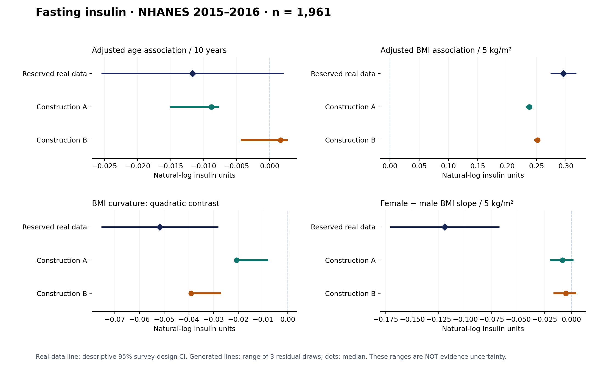
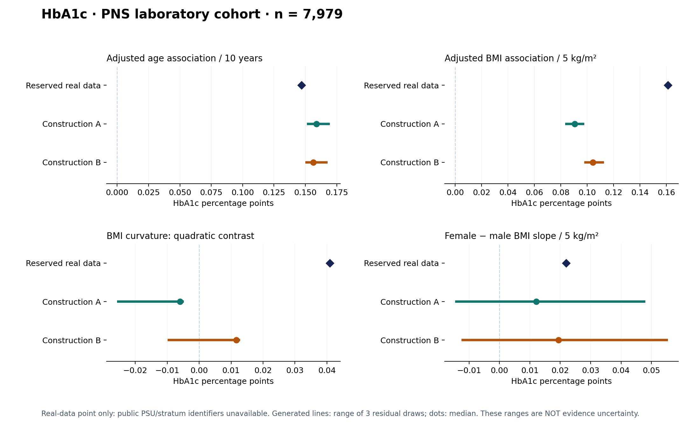

# M10 — Feasibility of evidence-guided biomarker enrichment

Completed 30 October 2026 UTC (29 October in the local study workspace). The research question is whether Agent-generated data support useful subsequent scientific analyses. An ordinary capable Agent is a valid implementation; superiority over another Agent is not the claim.

## Finding

The method showed **partial analytical feasibility** in two reserved public-data cases. Both independent insulin constructions preserved positive adjusted BMI association and negative quadratic BMI curvature in all six residual draws. Both HbA1c constructions preserved positive age and BMI associations in all six draws. Sex-by-BMI relationships were unstable, and HbA1c curvature was wrong or unstable. Effect magnitudes also differed. These results support selected analytical uses, not unrestricted substitution for measured biomarkers.

All four constructions were retained. No generator was changed after target outcomes were released. This stage tests entirely unmeasured-variable enrichment; it does not newly validate whole-cohort synthesis or missing-cell completion.

## What ran

| Case | Reserved real participants | Visible variables | Generated variable | Independent constructions | Final tables |
|---|---:|---|---|---:|---:|
| NHANES 2015–2016 | 1,961 | Age, sex, BMI, fasting glucose | Fasting insulin | 2 | 6 |
| PNS laboratory cohort | 7,979 | Baseline age, sex, measured BMI | Later HbA1c | 2 | 6 |

Two fresh-context Agents per case chose scientific structures, parameters and explicit assumptions using the same admitted evidence and observed rows. Each produced a reusable Python generator, evidence/specification, source-replay recipe, decision record and frozen artifacts. Three fixed residual seeds per construction produced twelve final tables. Agents were not given real biomarker values, reserved analysis answers or a required coefficient direction. Their general tools were procedurally restricted; only generator execution was OS-sandboxed. Model pretraining contamination cannot be excluded. The exact backend identifier and token/cost accounting were unavailable and are not invented.

This was curated evidence use, not autonomous literature search. NHANES and PNS source studies were excluded from both source packets. All copies retained the prepared input bytes. The generator, rather than a controller-authored scientific equation, determined each synthetic outcome. The controller supplied contracts, execution, integrity checks and the common evaluation protocol.

Candidate selection used source information only and preceded final executions. All four constructions retained their initial scientific code/specification; final versions bound actual feedback. One insulin construction also repaired a source-check identifier schema. Thus the study does **not** demonstrate a benefit from scientific revision or from multi-Agent collaboration. Independent workers are experimental repetitions, not a required multi-Agent architecture.

There were 24 successful source-replay calls. The second insulin construction had two contexts per call; the other constructions had one, giving 30 source-context executions. These used invented source covariates and remain approximate checks. The second insulin construction's MACAD medians remained about 21–24% low and were retained under its predeclared selection rule. Source numerical adequacy was not universal.

## Scientific analyses

The same frozen estimator analyzed each real and generated table. Four primary descriptive quantities were fixed before generation: adjusted age association per ten years, adjusted BMI association per five kg/m², a quadratic BMI contrast, and the female-minus-male BMI slope difference. Models additionally adjusted sex, and insulin models adjusted log fasting glucose. Eighteen age–sex–BMI cell means, the adjusted sex contrast and arithmetic means were also retained. HOMA1-IR was a derived-use demonstration, not an independent biomarker validation.

Values below are generated medians across three residual draws. Insulin coefficients use natural-log insulin units; HbA1c coefficients use percentage points. These are descriptive scientific estimates, not interchangeable numerical scales or an overall leaderboard.

| Case / analysis | Real estimate | Construction A | Construction B | Direction agreement A / B |
|---|---:|---:|---:|---|
| Insulin: age / 10 years | −0.0117 | −0.0088 | +0.0017 | 3/3; 1/3 — real CI includes zero |
| Insulin: BMI / 5 kg/m² | +0.2959 | +0.2379 | +0.2517 | 3/3; 3/3 |
| Insulin: BMI curvature contrast | −0.0517 | −0.0206 | −0.0391 | 3/3; 3/3 |
| Insulin: female − male BMI slope | −0.1193 | −0.0081 | −0.0051 | 2/3; 2/3 — markedly attenuated |
| HbA1c: age / 10 years | +0.1470 | +0.1589 | +0.1563 | 3/3; 3/3 |
| HbA1c: BMI / 5 kg/m² | +0.1610 | +0.0906 | +0.1043 | 3/3; 3/3 |
| HbA1c: BMI curvature contrast | +0.0409 | −0.0060 | +0.0116 | 0/3; 2/3 |
| HbA1c: female − male BMI slope | +0.0219 | +0.0121 | +0.0194 | 2/3; 2/3 |

Each 3/3 refers to dependent residual draws from one construction, not three independent biological replications. Four primary quantities across twelve tables produce 48 comparison records, not 48 independent experiments. No clinical equivalence margin was prespecified. Correct direction therefore does not establish effect-size adequacy or clinical equivalence.

NHANES reference uncertainty uses full-design Taylor linearization: 2,743 positive-fasting-weight design records, 30 PSUs and 15 strata, with zero influence outside the 1,961-person analysis domain. The real insulin age interval is −0.0255 to +0.0021; a point-sign reversal is not a contradiction of an established age effect. Real BMI, curvature and interaction intervals exclude zero descriptively. PNS lacks public PSU/stratum fields in this package, so its results are provided-weight participant estimates with a complete unweighted sensitivity analysis and no manufactured survey confidence intervals. Baseline anthropometry and later HbA1c do not necessarily describe the same visit.

The figures distinguish reference confidence intervals from generated residual ranges. Generated ranges do not quantify source, structure or transport uncertainty.

## Evidence and assumptions

Insulin A mainly used compatible Taiwan moments and reconstructed within-source joint structure under explicit assumptions. Insulin B combined Taiwan moments with MACAD-informed BMI structure and separate MACAD diagnostics. Both HbA1c constructions principally used SHIP-Trend's compatible age coefficients and central distribution summaries; incompatible Hoorn adjustments and DIRECT prospective coefficients were not blindly transferred. Therefore this experiment establishes neither comprehensive cross-study fusion nor successful reconciliation of all research contexts.

Age–HbA1c and related age/BMI–insulin information already appeared in the source papers. Agreement in the new target is transport feasibility, not discovery of a previously unknown relationship. Neither packet directly identified the exact reserved target curvature or sex-by-BMI interaction. Some generated curvature is induced by the Agent's assumed log-BMI, saturation or tail function. Withheld exact coefficients alone do not make these independent biological discoveries.

The principal useful observation is that **the same generated table can preserve some downstream analyses while failing others, despite acceptable source checks**. HbA1c A used a saturating BMI assumption and produced the opposite curvature direction; HbA1c B used a linear BMI assumption and produced an unstable projected curvature. Both retained age and positive BMI directions. This demonstrates an applicability boundary within a table, but does not by itself establish a novel mechanism or a calibrated applicability classifier.

## Audit and failures

All twelve final generation and verification receipts succeeded. Original observed values, identifiers/order and table contracts were preserved. No target outcomes entered source-based selection. A campaign release manifest bound 71 code/protocol/input/receipt artifacts before reference parsing; reference bytes were checked against the original preparation seals.

The evaluator passed 16 invented-data tests, including hand-computed multivariate/domain covariance, full-design zero-PSU retention, alignment, transformation parity and gate-before-reference parsing. An independent blind code review covered the evaluator/controller and the first construction in each case; the controller separately reviewed the second constructions. The audit corrected optimized-Python assertion handling before release. No target-based scientific correction occurred.

Preserved failures include one source-replay metadata rejection (nonportable statistic ID), one console-display error, one HbA1c controller helper shadowing a standard-library module, and the evaluator's first temporary-directory setup errors. None was silently converted to a scientific success. All scientific models remained unchanged through source-only retention.

The evaluator implementer reported that a thread-inventory check exposed unrelated historical HDL summaries. No reserved insulin/PNS outcome values or new generator artifacts were exposed through that event; the event limits broad claims of complete project-history blindness. Builders used fresh restricted task contexts. No adversarial or cryptographic blindness guarantee is claimed.

## Decision and next experiment

Continue a focused data-method study because several useful unprovided target analyses survived generation in both cases. Keep failures and source/assumption distinctions as part of the result. An ordinary Agent successfully producing these data is a valid method implementation. The current experiment does not establish a superior Agent framework, universal data quality, replacement of clinical measurement, autonomous evidence recovery or publication-level novelty by itself.

The next experiment should test **evidence coverage and analytical applicability**: before viewing a fresh target, specify which requested analyses require additional joint evidence, let the Agent document unresolved alternatives, and test whether the resulting data preserve those analyses. The present failed relations are now development observations. Any repair informed by them needs fresh confirmation data and a new freeze; these targets cannot be called untouched validation again.

For planning, prioritize compatible age–sex–BMI joint biomarker evidence and clinical/measurement context over adding more Agent roles or increasing residual sample size. A later study can test evidence retrieval, whole-cohort synthesis and missing-cell completion separately. HPC is not needed for this completed pilot; isolated generator computation was small compared with evidence review and implementation work.

See the [curated reproducibility package](reports/analysis_utility_feasibility_2026-10-30/README.md), including all aggregate results, frozen scientific specifications, limitations and audit records. Participant-level observed, reference and generated tables remain local.
