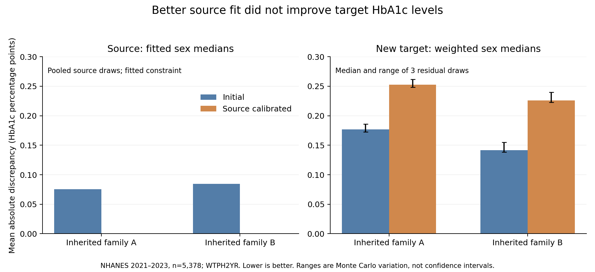
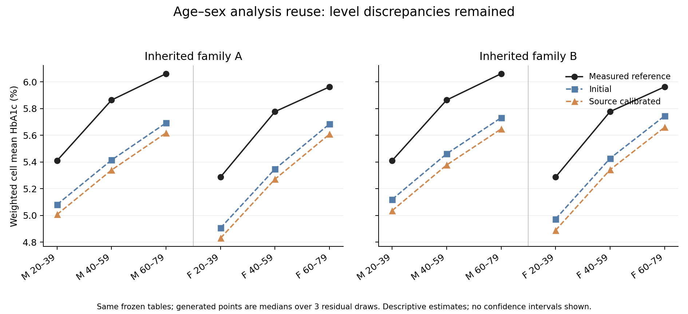

# M11 — Source calibration did not improve target analytical utility

Completed 30 October 2026 UTC (29 October local). This is a bounded mechanism experiment within evidence-guided virtual biomarker generation, not an ordinary-Agent superiority comparison.

## Result

**Correctly calibrating source marginal medians improved the fitted source statistics but worsened target-level and subgroup analysis discrepancies.** Positive adjusted age and BMI relationships remained, but their preservation was expected from the restricted additive-location intervention. M11 does not establish a new correlation-recovery mechanism or a method-performance advantage.

The result is useful for deciding where to invest next: source fit alone is an inadequate selection objective for target-population data generation. This is a concrete negative transfer result in the tested setting, not a new general statistical discovery or a rejection of the whole data-generation direction.

## What ran

- New HbA1c evaluation endpoint: NHANES August 2021–August 2023, 5,378 eligible participants aged 20–79 with observed age, sex and BMI. The entire HbA1c column was hidden from construction.
- Two inherited Agent-authored scientific families, with identical code across their initial and revised versions. These are not two newly independent Agent constructions.
- Each family had an initial version and three source-calibrated versions: a primary source-population approximation and two sensitivity alternatives.
- Three fixed residual seeds per version produced 24 frozen target tables. All were retained and successfully executed through the existing WSL/bubblewrap adapter.
- Before target execution, 36 isolated source executions produced 24 verified source-replay reports. No scientific generator execution failed.

The source Agent found published SHIP-Trend covariate information, designed source-population scenarios, prepared evidence and specifications, and derived the numerical revisions from actual source feedback. The controller supplied contracts, source admission, execution and a separate reference evaluator. Source checks drove an actual scientific parameter revision this time; the revision did not improve target utility.

The target uses official **WTPH2YR phlebotomy weights**, not MEC weights. This weight distinction was corrected during metadata review before preparation. Descriptive weighted estimates refer to the eligible measured-outcome domain; selection/missingness and transport limit population generalization. Design fields remain available locally, but this narrow evaluation does not supply survey confidence intervals or clinical equivalence tests.

The bounded freshness audit found prior HbA1c use for 2017–2018 and excluded it. No prior GHB_L file or HbA1c evaluation was found for 2021–2023. That survey cycle, and potentially some participants/covariates, had already been used for other outcomes. M11 is a new endpoint evaluation, not a wholly new participant cohort. The custodian saw public codebook frequency/range sections while checking metadata; those summaries were not passed to the builder or used for calibration. General model pretraining exposure cannot be ruled out.

## Scientific intervention

The inherited generators used source male/female HbA1c marginal medians, 5.3% and 5.2%, as conditional locations at assumed reference age/BMI values. M11 tested the explicit source-mixture correction:

`new location = initial location + published source median − pooled generated source median`.

Pooling used all three prespecified source seeds within each sex, with a type-7 median. The Agent retained the original age effects, BMI functions, residual distributions and generator bytes. All arms received the same expanded evidence packet. This isolates the location-calibration operation within each inherited family; it is not an added-information comparison against M10.

Source covariates used published sex-specific age-bin counts from the same SHIP-Trend cohort and pooled BMI quartiles. The primary approximation assumed within-sex age/BMI independence. One sensitivity used a positive Gaussian-copula dependence; another changed BMI tails while retaining the quartile anchors. Open-ended older ages were approximated within the inherited 20–79 support. Sex-specific BMI laws and source dependence remain unobserved. All versions were fixed and retained; no target-based scenario selection occurred.

The primary corrections were −0.0748/−0.0764 HbA1c percentage points for family A men/women, and −0.0840/−0.0849 for family B. The two sensitivity scenarios produced slightly larger downward corrections. The source medians then matched the input values to numerical precision. This agreement is mechanical fitting to rounded reported statistics, not independent validation or that level of scientific precision. Source IQR and age-slope discrepancies remained unchanged.

Sources: [Masuch et al., 2019](https://doi.org/10.1186/s12902-019-0338-7) supplied biomarker statistics and pooled covariate summaries; [Völzke et al., 2015](https://doi.org/10.3238/arztebl.2015.0185) supplied sex-specific age-bin counts. [Großmann et al., 2024](https://doi.org/10.3390/ijms25031485) supplied unfitted context checks. These publications overlap in the same cohort and are not independent biological evidence. Their analysis subsets and some weighting definitions differ; those differences were retained, not silently pooled.

## Target results

All entries below are medians across three dependent residual draws. Errors are in HbA1c percentage points, lower is better. No clinical adequacy threshold is implied.

| Target analysis | Family A initial | Family A calibrated | Family B initial | Family B calibrated |
|---|---:|---:|---:|---:|
| Mean absolute error of the two sex medians | 0.1769 | 0.2525 | 0.1417 | 0.2261 |
| Mean absolute error of six age–sex cell means | 0.3714 | 0.4469 | 0.3174 | 0.4019 |
| Absolute error of overall 90th percentile | 0.4282 | 0.5030 | 0.3064 | 0.3904 |

The real weighted male/female medians were 5.5%/5.4%. Primary calibrated medians were approximately 5.2283%/5.1574% in A and 5.2510%/5.1838% in B. Both initial constructions already underestimated target levels; source calibration shifted them further downward. This arithmetic explains the observed worsening. It does not identify the biological or measurement cause of the source–target discrepancy.

Every one of the 18 paired calibrated-versus-initial output comparisons worsened each of the three error summaries. Those comparisons share structures, data and residual draws; they are not 18 independent replications. Sensitivity scenarios did not change the qualitative conclusion. The three error families are related consequences of the same shifts, not three independent proofs of a transport failure.

Adjusted age and BMI point directions were positive in every generated table, as in the reference. Real age association per decade was +0.1661; generated medians were +0.1826 and +0.1810. Real BMI association per five kg/m² was +0.1522; generated medians were +0.0662 and +0.1044. BMI effect magnitudes remained attenuated.

The maximum paired slope change from the main evaluator was 4.44e−16, below the prespecified 1e−10 numerical identity tolerance. Sex-specific additive shifts lie in the regression's sex/intercept columns, so age/BMI slope preservation is expected in this setting. It is a control check, not new evidence that the revision learned a relationship. Clipping could break this identity; no such violation appeared here.

## Implementation and audit

All eight candidate freezes, the complete 24-output schedule, code, source plan, visible inputs and sealed reference hashes were bound before target evaluation. The release gate verified mandatory bindings, original preparation hashes, all successful receipts, candidate/seed associations, and canonical row/covariate equality before the evaluator parsed the reference. Authorized custody preparation had already parsed outcome availability and created the sealed file; this is explicitly distinguished from evaluator release.

Eighteen invented-data tests passed. Custodian/code review identified and corrected missing mandatory-binding enforcement, pre-reference canonical alignment, and missing paired slope-preservation outputs. Earlier review also corrected finite-input mean overflow. Pytest's default Windows temporary-directory permissions caused setup errors; new workspace scratch directories resolved them without changing scientific inputs. Custodian preparation preserved an initial decoder self-test failure and a documented repair before participant parsing.

The controller independently recomputed all twelve sex/scenario source offsets from the verified source outputs. A separate custodian postrun audit reimplemented weighted quantiles, compensated weighted means and centered/scaled normal equations without importing the evaluator, and checked all 24 tables. It found no mismatches beyond rounding (maximum analytical estimate difference 6.22e−15). This was an independent arithmetic implementation by the data custodian, not an outcome-blind external reproduction.

Only generated-program execution is OS-sandboxed; Agent tool access is procedurally restricted. The source scientist did not receive target outcomes or results during construction. Runtime backend/token-cost details for the LLM were unavailable. No new training or HPC was needed. Participant-level observed, reference and generated target tables remain local.

## Decision

Stop this scalar source-calibration branch at its prespecified budget. Do not add the revealed target offset to the generator or call that an independent improvement. The current target is now development information.

Continue the broader data-generation direction around analytical usefulness, retaining the positive basic associations and the negative transfer result. The next candidate should distinguish **transportable conditional relationships from population-specific biomarker levels**, using external evidence that can actually inform that distinction. Several papers from one source cohort are insufficient to establish cross-population transport. If no compatible independent evidence exists, retain explicit sensitivity alternatives or narrow the supported use, rather than claiming that a more accurate source fit resolves the missing information.

A next experiment must name the relation being improved, the compatible new evidence and fresh confirmation data before execution. This result does not justify adding Agent roles, more residual seeds or a source-fit leaderboard. It also does not establish publication-level novelty by itself.

See the [curated record](reports/source_location_transfer_2026-10-30/README.md) for the frozen constructions, protocol, aggregate outcomes and audit code. The broader [scientific analysis plan](docs/SCIENTIFIC_ANALYSIS_UTILITY_PLAN.md) remains the project scope.
