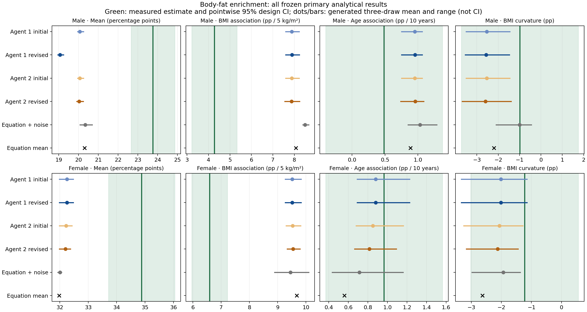
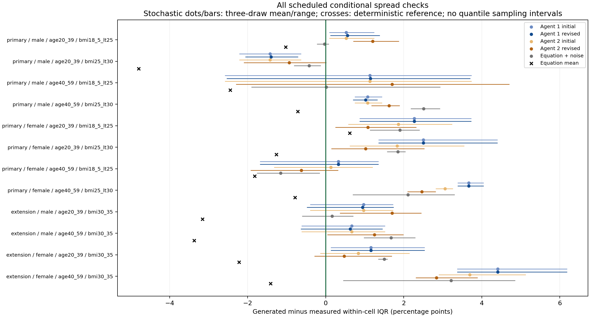

# M13-B: real-target analytical utility of source-built body-fat generators

30 October 2026. **The frozen generation and evaluation cycle completed. Some association directions transferred, but the present generators have substantial target-level and BMI-effect errors. Better agreement with the source studies did not translate into consistent target improvement.** This is a mixed feasibility/negative-transfer result, not evidence that the source-feedback method improves general biomedical data quality.

## What was actually run

Two independently instantiated Agents had built body-fat generators from two screened non-NHANES papers in [M13-A](MILESTONE_13A_RESULTS.md). Each initial and source-reviewed generator/specification was preserved byte-for-byte. This phase ran those four versions at three fixed seeds: **12 isolated Agent executions**, plus one deterministic published-equation reference and three stochastic published-equation references. All **16 scheduled tables** completed successfully and served the same 62-estimand panel. No target-based scientific revision, best-seed selection or analysis-specific regeneration occurred.

The target was official NHANES 2017–2018 DXA total body-fat percentage (`DXDTOPF`). Inputs contained only opaque ID, age, sex, BMI, fixed non-Asian indicator and deterministic transformations of those covariates. Race, weights, survey design, scan flags, other DXA variables and measured body fat stayed outside generator inputs. The same frozen estimator evaluated measured and generated responses after all tables were generated.

The positive-MEC-weight design frame contained **8,704 records**, 15 strata and 30 nested PSUs. The admitted White/Black, age20–59, valid-scan domain contained **842 participants**: primary BMI18.5–<30 **n=612** and separate BMI30–35 extension **n=230**. Of 1,206 participants in the age/race/sex/BMI sampling frame, 842 had valid available endpoints: 69.82% unweighted and 71.83% weighted. Primary completeness was 72.43% unweighted/73.58% weighted; extension was 63.71%/67.33%. No additional nonresponse model was fitted. Results concern this complete-covariate, valid-scan domain, not all adults.

Every scheduled endpoint passed its frozen reporting gates. The smallest distribution cell had 51 participants; the smallest Kish weight diagnostic was21.83. There are 992 generated/reference endpoint records, plus62 measured records: **1,054 aggregate rows**, not1,054 independent experiments. This is a new endpoint in a previously used survey cycle, not a globally fresh cohort.

## Primary analytical results

Values below are percentage points, or percentage points per specified covariate increment. Generated values are arithmetic means over the three fixed draws, **not confidence intervals**. Real intervals are pointwise95% design intervals. All draws, paired differences and uncertainty are retained in the aggregate files.

| Analysis | Measured estimate (95% design CI) | Agent1 source-reviewed | Agent2 source-reviewed | Published equation mean |
|---|---:|---:|---:|---:|
| Men: mean body fat |23.764 (22.658,24.870)|19.064|20.034|20.308|
| Women: mean body fat |34.879 (33.711,36.047)|32.250|32.197|31.977|
| Men: adjusted BMI association, per5kg/m² |4.275 (3.221,5.330)|7.894|7.870|8.070|
| Women: adjusted BMI association, per5kg/m² |6.589 (5.960,7.218)|9.520|9.546|9.681|
| Men: adjusted age association, per10years |0.486 (-0.401,1.372)|0.954|0.960|0.887|
| Women: adjusted age association, per10years |0.966 (0.368,1.564)|0.881|0.816|0.559|
| Men: BMI curvature contrast |-0.987 (-3.724,1.751)|-2.562|-2.598|-2.204|
| Women: BMI curvature contrast |-1.229 (-3.017,0.559)|-2.015|-2.124|-2.628|

The adjusted BMI association remained positive in every generated primary table, but its magnitude was too large. For both final candidates, both sexes and all three draws, the paired generated-minus-measured BMI difference was positive with a pointwise95% conditional design interval excluding zero. Primary means were too low under the same complete set of comparisons, with paired intervals below zero. These are consistent discrepancies in this pilot; no simultaneous-family significance claim is made.

The female age association is a useful partial agreement: measured0.966pp/decade, final generators0.881 and0.816 on average. Its existence and the positive BMI direction are not newly discovered by the Agent: age/BMI structure was supplied in the published equation. They support limited transport feasibility, not unidentified-relationship discovery or general data replacement.

**The curvature result must not be described as confirmed recovery of the true direction.** Both measured curvature point estimates were negative, as were all generated primary curvature estimates, but both measured confidence intervals include zero. The primary male age interval also includes zero. Agreement of point signs here is weaker evidence than confirmation of the underlying population sign.

There is also an inferential discrepancy: the primary male age interval spans zero in measured data, whereas the generated-table age interval is positive for both final builders in every draw. These generated intervals condition on the imposed model and omit source/transport uncertainty. Their apparent certainty is therefore not additional evidence about the real population. Preserving a point direction does not ensure that the same analysis supports the same strength of scientific conclusion.

## Did source-only revision help?

The source fitting losses had decreased from1.0702 to0.6681 in Agent1, and0.6951 to0.6238 in Agent2. On this target the revisions had much narrower effects than a new generative framework:

- **Agent1:** the non-Asian target receives a male location change of -1pp; the Asian blending change is inactive. Primary male mean fell from20.066 to19.064 against measured23.764, increasing absolute error from3.698 to4.700pp. Female outputs/estimands stayed unchanged. Of62 scheduled descriptive mean-absolute-error comparisons,5 improved,26 worsened and31 were unchanged.
- **Agent2:** target conditional mean structure is unchanged; male residual SD rises4.31→4.81 and female SD falls4.31→3.81. There are27 improved and35 worsened descriptive endpoint comparisons. By sex: male8 improved/23 worsened; female19 improved/12 worsened. This is a trade-off, not overall superiority.

These counts use the mean of absolute per-draw errors, not the absolute error of the mean draw; the definitions differ when draw errors cross zero. Endpoints are dependent and differently meaningful, so these bookkeeping counts are neither votes, independent replications, a significance test nor a prespecified aggregate success metric.

There is a specific distributional observation worth retaining: **Agent2's female within-cell IQR error decreased in all six scheduled female cells**, while male IQR error worsened in five of six male cells. For women age40–59/BMI25–<30, measuredIQR4.10pp, Agent2 initial meanIQR7.16, revised6.56; for women age40–59/BMI30–35, measured4.20, initial7.89, revised7.04. The narrowing moved these estimates closer but left material excess spread. It did not repair the conditional mean or BMI slope. These are descriptive coarse-bin spread checks; they include within-bin covariate variation and have no formal quantile intervals in this pilot.

The published-equation references show similar level and BMI-strength deficiencies. Thus numerical generation and use of an Agent are not sufficient explanations for those errors. The inherited published conditional relationship also fails to transport quantitatively under the current assumptions. This does not isolate whether population selection, device/software differences, functional form, omitted covariates or their combination caused the mismatch.

## Separate BMI30–35 extension

| Analysis | Measured (95% design CI) | Agent1 final, draw mean | Agent2 final, draw mean |
|---|---:|---:|---:|
| Men mean |30.259 (29.308,31.210)|28.689|29.681|
| Women mean |42.356 (40.911,43.800)|43.884|43.957|
| Men BMI association /5kg/m² |3.627 (1.123,6.132)|4.764|4.803|
| Women BMI association /5kg/m² |4.419 (0.069,8.769)|7.991|7.461|
| Men age association /10years |-0.166 (-1.273,0.942)|0.880|0.883|
| Women age association /10years |0.865 (0.285,1.445)|0.531|0.528|

This extension has smaller samples and wider intervals/draw ranges; for example Agent2's female BMI slope spans3.525–9.996 across three draws. The male age point sign differs but the measured interval spans zero, so a confirmed population sign reversal is not established. The extension remains separate and does not rescue the primary-domain failures.

## Implementation review and retained technical failure

Before outcome acquisition, the protocol, exact16-table roster, source model identities, evaluator, custody code and reviews were hash-frozen. Checks comprised22 evaluator tests,17 custody tests and3 controller tests on invented data, plus51 independently calculated checks. Full-frame survey scores retained zero-domain PSUs; nested PSU identifiers, paired difference covariance, curvature multiplier, tied weighted quantiles, sparse gates, roster completeness and information boundaries were checked. R survey cross-validation was unavailable and is not claimed.

The first public-file read exposed a **pandas3.0.3 SAS XPORT zero-decoding defect**:550 true zero MEC weights appeared as the tiny positive number2^-260. This incorrectly admitted interview-only records to the positive-weight design frame. Independent raw-byte IBM-float decoding confirmed all550 were exactly eight zero bytes; installed pyreadstat1.3.7 returned the correct zeros. All8,704 nonzero weights matched exactly. There were also357 zero age values decoded incorrectly; these infants were outside the target domain.

A separately documented technical adapter reread the original hashed XPT files with pyreadstat, then called the unchanged frozen transformation. No small-weight threshold, data re-download, scientific exclusion change or generator adjustment was introduced. The original acquisition and all19 frozen artifacts remain intact. Independent repair review passed13 decoder and30 correction/binding/domain checks before generation. The eligible842 participants and permitted covariates were unchanged; corrected opaque IDs and a new execution binding were recorded. No outcome associations were used to make this repair.

Post-run independent review recomputed all1,054 estimand rows and224 paired linear intervals:8,492 numerical comparisons agreed to a maximum absolute difference of6.09e-13. It also verified all12 isolated execution receipts, four reference calculations/random streams, original19 frozen artifacts and four deployed scientific identities. This verifies the reported computation, not biological transport. Participant-level inputs, measured outcomes and generated tables remain local; the private GitHub review archive contains code, protocols, hash/provenance records and aggregate results only.

## Decision and next discriminating step

**Stop further source-loss tuning on this exposed body-fat target.** The current candidates are unsuitable for an unqualified claim that augmented data preserve quantitative scientific analyses. Retain the positive association-use evidence, the distributional trade-off, the failed transport and the complete implementation record.

The next useful unit is an evidence-portability audit before another generation experiment: identify whether external non-NHANES studies actually anchor the target-relevant conditional BMI strength, sex/age-specific residual spread and DXA measurement mapping. Match each proposed revision to such an external observation and identify the analyses it could affect. A population/device difference is a hypothesis to test, not an automatic explanation or permission to fit a correction using this target.

If the needed bridge or conditional evidence exists, a fresh Agent can propose a source-supported revision, freeze it, and test on a separately reserved public target. If it does not exist, record the relevant analyses as unsupported and stop this case's calibration branch. Expanding the number of generated participants, seeds, Agents or fitted source moments will not by itself supply missing transport evidence.

The general research objective remains evidence-guided reusable virtual data. This phase establishes an executable, audited workflow and a specific limitation: **source compatibility and target analytical utility are distinct, and improvements can be relationship-specific.** It does not yet establish novel methodology, reliable clinical substitution, actual avoided data-collection costs or readiness for a high-impact methods paper.

## Complete artifacts

- [Protocol and schedule](reports/m13_target_validation_2026-10-30/PROTOCOL.md).
- [All measured/generated results](reports/m13_target_validation_2026-10-30/results/aggregate.json), [1,054-row CSV](reports/m13_target_validation_2026-10-30/results/aggregate.csv).
- [All three-draw summaries](reports/m13_target_validation_2026-10-30/results/seed_comparison.csv) and [all initial/final changes](reports/m13_target_validation_2026-10-30/results/revision_changes.csv).
- [Pre-access independent review](reports/m13_target_validation_2026-10-30/audits/preaccess_review.md) and [decoder repair review](reports/m13_target_validation_2026-10-30/postaccess_review/technical_decoder_review.md).
- [Reproduction and archive boundary](reports/m13_target_validation_2026-10-30/README.md).
