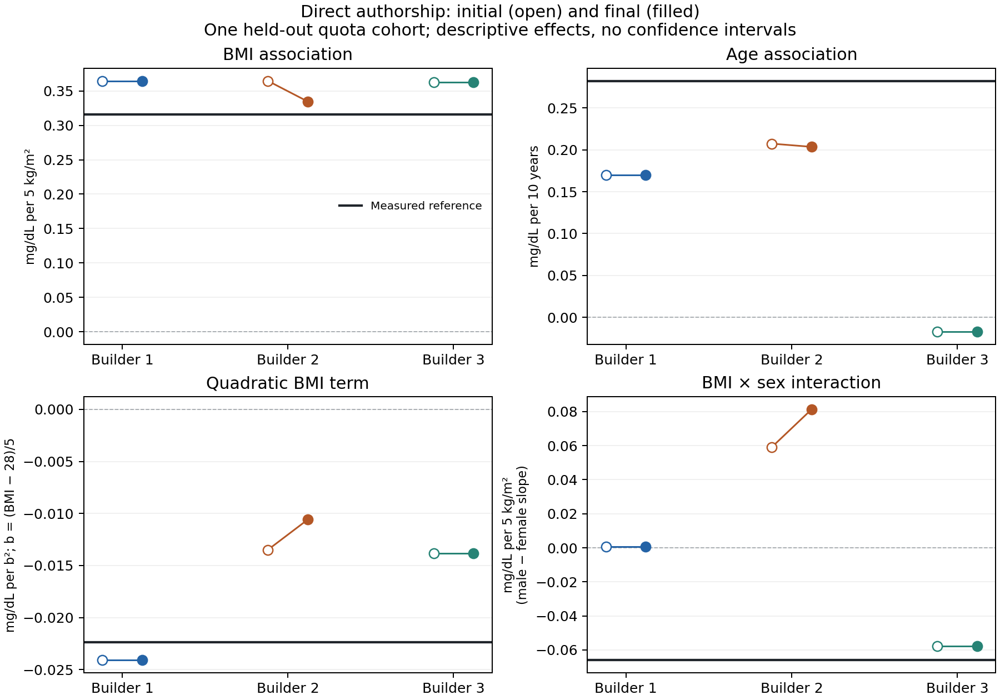

# M16 — Direct Agent authorship, diagnostic repair and a new real-data evaluation

Protocol started 30 October 2026; evaluation and reporting completed 31 October 2026. **Completed; the revealed target is closed to further tuning or fresh confirmation.**

Three fresh-context scientific Agents directly authored an unmeasured urate column for the same 200 fixed participants. All three final tables preserved a positive adjusted BMI association and a negative quadratic BMI term in a new reserved real-data comparison. Two preserved the positive age direction; one did not. One Agent made a genuine 12-value repair after source and own-construction feedback. The repair improved some downstream analyses and worsened others. Independent arithmetic and artifact verification passed.

This adds evidence of selected analytical usefulness and an actual repair path. It does not establish general scientific equivalence, universal revision benefit, superiority over another method, or publication readiness.

## What was implemented

The new [self-consistency checker](docs/SELF_CONSISTENCY.md) compares a directly authored table with a construction declared before that table exists. The Agent specifies a location guide and an optional scale guide using bounded arithmetic expressions over observed covariates. The tool computes deviations, standardized deviations, subgroup summaries, tails, ties and associations between deviations and the covariates. It cannot populate the missing outcome or choose biological coefficients.

All three Agents chose the explicitly weaker `working_guides` interpretation. These guides are not identified conditional expectations or a calibrated sampling distribution. A standardized spread near one therefore means closer expression of a declared guide, not proof of biological accuracy. No normal tail probability was assumed.

The orchestration sequence was:

1. Give each fresh Agent the same observed table, initial full external sources, task and retrieval budget.
2. Allow literature retrieval and explicit context/provenance assessment. Source populations, measurement definitions, adjustments and overlap stay visible.
3. Submit evidence, model, construction and revision plan **before** creating the outcome table. Independently review and bind their hashes.
4. Have the Agent literally author the urate values. Programs check contracts, observed-cell preservation and statistics; they do not sample or assign these outcomes.
5. Freeze the table and issue actual source-statistic and own-construction feedback. Permit retention, limited row repair, model revision or stopping, with at most two feedback revisions.
6. Precommit any next plan, preserve parent feedback and freeze every candidate. Never require a favorable change.
7. Close all three runs, independently audit the full chain, then open the reserved real outcome once for canonical evaluation and once for independent recomputation. No revealed result returns to a builder.

Noninitial diagnostics retain both the current and original construction reference. This prevents a changed guide from silently making an old discrepancy disappear. The current run did not change any of the three models after initial commitment.

This is host-orchestrated Agent work with reusable deterministic tools. It is not a new trained model or an unattended production service. Recorded boundaries and hashes are procedural safeguards, not an OS sandbox around every LLM tool.

## Data and evidence

The reserved case is NHANES 2017–2018 serum urate. Selection was committed before raw-file acquisition: examined adults aged 20–56, specified Black/White race categories and female/male groups, no self-reported diabetes, valid observed BMI, native examination weight and survey-design metadata, and an available urate result. Only outcome availability, not magnitude, was used for selection. A fixed hash ordering selected 50 participants per group. Observed columns were `sample_id`, `race`, `sex`, `age` and `bmi`; the entire urate column was hidden from the builders.

The 200-person equal-group quota is deliberately a finite evaluation sample. Native `WTMEC2YR` was preserved privately but not used in these unweighted analyses. Results are not estimates for the US national population. The cycle was audited as unused for this project's prior urate evaluation; this does not establish absence from model pretraining or from previous work on other indicators.

Initial evidence comprised full Yun 2021, Sun 2014 and Bonaccorsi 2019 originals and relevant supplementary material. Yun and Sun share Bogalusa recruitment and are not independent corroborations. B2 additionally admitted the independent Korean Lee study (PMC4750804); b3 admitted the Japanese Ohyama study (PMC7803020) and its supplement. B1's requested CARDIA acquisition failed and stayed recorded as unavailable. Incidental NHANES mentions in independent originals were disclosed; NHANES-derived statistics were not admitted as independent generation evidence.

| Construction | Gateway queries / cap | Acquisition attempts / cap, including failures and assistance | Source checks | Final action | Outcome cells changed from initial |
|---|---:|---:|---:|---|---:|
| b1 | 2 / 8 | 3 / 4 | 33 | Retain initial | 0 |
| b2 | 3 / 8 | 3 / 4 | 23 | Repair once, then retain revision1 | 12 |
| b3 | 4 / 8 | 2 / 4 | 27 | Retain initial | 0 |

These are three fresh contexts under the same model configuration and starting evidence/access policy. Their acquired evidence and assumptions subsequently differ. They are not three model brands, identically conditioned Monte Carlo draws, or three independent patient cohorts.

Source checks applied to the target-shaped authored table remain approximate comparisons. A different observed BMI/age distribution cannot be repaired by changing the observed data. Missing adjustment variables and menopausal status remained `not_computable`; no reduced model was silently substituted. Source agreement is distinct from replaying the original study population and from target analytical agreement.

## What the Agents actually did

B1 and b3 identified source-regression discrepancies, limited dispersion/tails and uncertain transport assumptions, then retained their original tables with explicit limitations. They demonstrate feedback-informed retention, not a numerical improvement.

B2 diagnosed compressed deviations around its unchanged working guide. It committed a repair of at most 12 values, literally changed exactly 12, and reviewed new feedback before stopping. Evidence, model, construction, all 23 source-check recipes and every observed cell remained unchanged. Its overall standardized-deviation SD changed from **0.87658 to 0.99298**; counts beyond two guide scales changed from **0 to 10**. These are descriptive implementation diagnostics, not normality or biological validity tests.

There are four unique table versions: b1 initial, b2 initial, b2 repaired/final and b3 initial. Six scheduled initial/final stage records produce 144 comparison rows; retained duplicates do not create additional independent evidence. B2 revision1 and final are identical.

## Locked downstream analyses

All 24 analyses were retained: four global coefficients, four group-specific reverse regressions and 16 group summaries (mean, sample SD, median and 90th percentile). With `b=(BMI−28)/5`, `a=(age−40)/10`, `m=male` and `r=Black`, the base model is `urate ~ 1+b+a+m+r`. The quadratic and BMI-by-male terms are tested in separate extensions. Reverse models use `BMI ~ 1+urate+age` within each group.

These outcome analyses were not supplied as target feedback. Several test relationships also appeared in the external literature or in declared structural assumptions; their target evaluation tests transfer, **not discovery of an unknown biological relationship**. In particular, all constructions attenuated the BMI response at high BMI before target access. Their negative quadratic estimates are not independent discoveries of curvature.

| Global analysis | Measured reference | b1 final | b2 initial → final | b3 final |
|---|---:|---:|---:|---:|
| BMI association, mg/dL per 5 kg/m² | 0.316165 | 0.363935 | 0.364479 → 0.334604 | 0.362292 |
| Age association, mg/dL per decade | 0.282147 | 0.169686 | 0.207335 → 0.203520 | −0.017153 |
| Quadratic BMI term, mg/dL per b² | −0.022385 | −0.024097 | −0.013484 → −0.010589 | −0.013828 |
| BMI × male slope difference | −0.066011 | 0.000746 | 0.059068 → 0.081255 | −0.057769 |

BMI direction and quadratic-term direction transfer in all three final constructions. Age direction transfers in two; b3 is weakly negative against a positive reference. The interaction is negative in the reference and b3, near zero in b1, and positive in b2. Matching directions do not alone establish effect-size equivalence or preservation of all downstream conclusions.

The reference contains 29 observed joint stratum/PSU groups. Leaving each out once gives these descriptive ranges:

| Reference coefficient | Minimum | Maximum | Direction unchanged in all deletions |
|---|---:|---:|---|
| BMI | 0.282537 | 0.358771 | Positive |
| Age | 0.225365 | 0.323381 | Positive |
| Quadratic BMI | −0.031106 | −0.009463 | Negative |
| BMI × male | −0.112339 | −0.001001 | Negative |

These are sensitivity ranges, not confidence intervals or significance tests. The interaction approaches zero in one deletion. This diagnostic applies to the real reference only; it does not establish generated-table stability across resampling or new cohorts.

## The informative repair trade-off

B2's BMI coefficient moves closer to the real result: absolute discrepancy **0.048314 → 0.018438 mg/dL per 5 kg/m²**. Age discrepancy increases slightly; quadratic-term and interaction discrepancies also increase. Their point directions remain unchanged.

The repair makes **all four target group SDs closer**, and three of four target reverse-regression slopes closer. The Black-female reverse slope instead moves away: **3.545406 → 2.840129**, against real **3.845699**.

The same repair makes **all four Yun source-SD discrepancies larger**. It reduces all four Sun source reverse-slope discrepancies, while worsening that Black-female reverse slope against the target. Thus source fit, expression of a declared guide and target analytical agreement demonstrably do not move together in this instance. This is a useful observed limitation, not a general law or a validated new optimization objective.

Across b2's 24 correlated endpoints, 12 absolute discrepancies decrease, 9 increase and 3 are unchanged. Different endpoints have different units and scientific importance. These counts are not a pooled quality score, an equivalence test or evidence of overall superiority.

Full values, including every group and both directions of change, are in the [24-analysis appendix](reports/m16_direct_repair_2026-10-30/results/analysis_tables.md), [six-stage aggregate ledger](reports/m16_direct_repair_2026-10-30/results/estimands.csv) and [initial/final changes](reports/m16_direct_repair_2026-10-30/results/initial_final_changes.csv).

## Verification and scope of confidence

- The self-consistency implementation passed 56 invented tests and 477 independently calculated numeric comparisons.
- The locked evaluator passed 18 invented tests. The independently written recomputation adapter passed 22, including missing/duplicate analyses, CSV/JSON agreement, retained and failed runs, rank failure, native weight metadata and reference-access ordering.
- Pre-release review checked 3,988 core assertions plus sealing guards and 318 artifact bindings. The separate source-exposure audit reconciled all retrieval/admission attempts, including failures.
- Actual independent recomputation passed **2,863 checks**, including every scheduled coefficient/summary, 116 reference deletion fits, changed-row counts, record coverage and CSV serialization. Maximum absolute numerical difference was **1.794×10⁻¹⁴**; none exceeded the relative/absolute `1e-9` tolerance.
- Early implementation gaps in the independent adapter's endpoint coverage, serialization checks, failure-status vocabulary and access gate were repaired using invented data before target release. Frozen scientific arithmetic and prelaunch-bound engines were unchanged.

These checks establish computational consistency and recorded execution boundaries. They do not turn a weak transport assumption into a valid biological relationship. A generated value is an assumed possible measurement, not recovery of the person's true measurement. More synthetic rows would not create additional measured participants or justify ordinary measurement-based inferential certainty.

The [actual-data audit](reports/m16_direct_repair_2026-10-30/review/ACTUAL_TARGET_AUDIT.md), [closure review](reports/m16_direct_repair_2026-10-30/review/FINAL_RELEASE_AUDIT.md), [adapter review](reports/m16_direct_repair_2026-10-30/review/INDEPENDENT_ADAPTER_REVIEW.md) and [source-exposure record](reports/m16_direct_repair_2026-10-30/review/SOURCE_EXPOSURE_CLOSURE.json) preserve the supporting details. Patient and generated rows and full original-source files remain local.

## Research decision

Keep the broader evidence-to-virtual-data idea. This unit supports directly authored data for selected analyses and shows an actual, auditable source/own-guide revision with mixed utility. It does **not** justify claiming that direct authorship generally replaces a generator, that more source matching produces better target data, or that the repair mechanism is already a new superior method.

The useful separation is now concrete: source evidence constrains a model; a table may depart from that model; and even a well-realized model may transport poorly. B2 addresses its declared realization discrepancy. B3's age mismatch highlights unresolved assumption/transport risk, with realization effects not separately isolated. A unified scalar source-fit target would hide that distinction.

Do not scale up row generation or tune these revealed outcomes. A next bounded design can compare literal realization with a declared stochastic realization of the **same frozen Agent-authored structures**, explicitly fixing its residual law and dependence assumptions. Such a source-only control could quantify sensitivity to the declared realization mechanism; its sampling law would remain an assumption, and this would not be fresh clinical validation. Any further target utility claim requires a separately specified, unopened case and all analyses retained. No next dataset acquisition, training, HPC job, paid API run or recurring automation was launched by completing M16.

## Reproduction bindings

| Artifact | SHA-256 |
|---|---|
| Prelaunch | `a7afedd93b3d60128964fa263c69d92b767b7fce209a2a773a7998feaa3e264a` |
| Target release | `989bd13c6f35655df1fddb7ce9245d399aab122d4f78f901b728b6ad388fddad` |
| Canonical aggregate result | `89ad70a294faf6a0869cf5b1f4286bbb51858b718f9b6826602c1336b0de0a53` |
| Independent actual audit | `bfb1cabef74003d9d341f122f817ca1a5ad0d70da5ee3dad8afc962e6e7eafba` |

Local protocol, orchestration scripts, admissions and immutable candidates are under `work/m16_direct_repair_2026-10-30`. The existing private GitHub review repository receives only reviewed code, documentation and aggregate artifacts. Source acquisition failures and negative scientific results remain part of the record.
