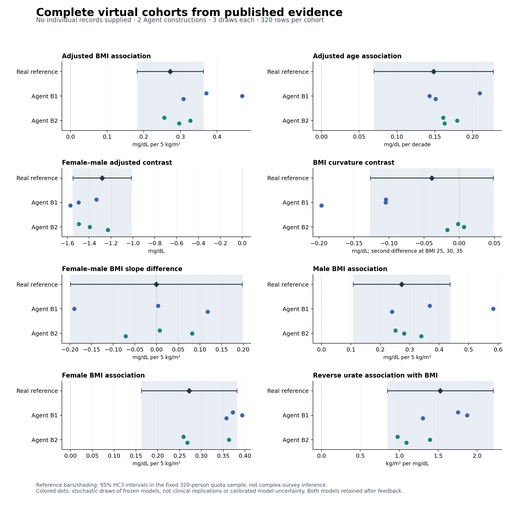

# M17-B: scientific analysis with evidence-only complete virtual cohorts

31 October 2026. **Completed small scientific feasibility screen.** No individual source or target records were supplied to either builder. This advances beyond M17-A's artificial engineering fixture.

Two fresh-context Agents independently constructed all age, sex, BMI and serum-urate variables from the same three external publications and a prospective age/sex quota specification. On a newly admitted 320-person NHANES 2007–2008 reference, all six generated draws preserved the positive adjusted BMI and age associations and the negative female contrast. Effect magnitudes were mixed; BMI levels were systematically low. The reference does not establish a nonzero curvature or interaction direction at this sample size. This supports selected analytical feasibility, not a generally equivalent replacement for measured data or a demonstrated method advantage.

Reference bars and shading are 95% HC3 intervals conditional on the selected quota sample/model. Colored dots are three stochastic draws from each frozen model; they are not independent clinical replications or calibrated model uncertainty.

## Design and actual execution

- [Prospective protocol](docs/M17B_WHOLE_COHORT_PROTOCOL.md): 320 adults, 40 in each female=0/1 × age [20,35), [35,50), [50,65), [65,80) cell. Quotas are design inputs, not hidden-data summaries. The target is a standardized cohort, not a national prevalence estimate.
- Inputs: three original non-NHANES studies, their aggregate statistics and measurement/population context. No observed table, target coefficients, target means or target age/BMI rows were supplied. All four substantive columns were generated.
- A custodian froze the evaluator and selection rule before acquiring the reference. Target analysis occurred once, after both models, source-feedback decisions, analytical outputs and [endpoint-exposure classification](reports/m17b_whole_cohort_2026-10-31/ENDPOINT_EXPOSURE.md) were committed.
- Each Agent authored a generator and specification, received one verified source-only feedback draw (seed 17110), and chose retention. Program/specification bytes remained identical between initial and final.
- Both final programs ran in the existing WSL/bubblewrap isolation on seeds 17111, 17112 and 17113. Six unique 320-row analytical tables resulted. Initial/final retention labels refer to the same six tables: 12 scheduled stage entries, 48 unique generated endpoint combinations, and 96 scheduled comparisons. There are two Agent constructions and one reference cohort.
- Two additional source-feedback executions are separate from the six analytical draws. Source feedback contained 39 computable approximate comparisons and 22 explicitly unavailable checks across the two constructions.
- All eight scheduled analyses completed for every table. No failed output, inconvenient seed or negative finding was removed. No paid API, model training or HPC was used.

The [construction record](reports/m17b_whole_cohort_2026-10-31/CONSTRUCTION_RECORD.md) distinguishes the Agent's scientific choices from the controller's study design and execution. Whole-cohort output is not literal LLM row emission in this pilot: both Agents freely selected the program route. No direct-table comparison or ordinary-Agent superiority experiment is claimed.

## Evidence and model choices

| Input study | Admitted information | Main limitation |
|---|---|---|
| [Bogalusa Heart Study](https://pmc.ncbi.nlm.nih.gov/articles/PMC4208749/) | Adult sex/race means and SDs; age-adjusted BMI-on-urate coefficients | Selected younger US community; reverse regression direction; missing conditional covariance |
| [Korean health-examination study](https://pmc.ncbi.nlm.nih.gov/articles/PMC4750804/) | Age-bin BMI and urate summaries, sex composition | Different geography/selection; open-ended age bins; sex-pooled summaries |
| [Cardiovascular Health Study](https://pmc.ncbi.nlm.nih.gov/articles/PMC2906633/) | Older-adult pre-matching summaries by urate group | Includes ages 80+; rounded values; threshold groups do not identify sex-specific marginal distributions |

The [source manifest](reports/m17b_whole_cohort_2026-10-31/source_packet/SOURCE_MANIFEST.json) and [remaining unknowns](reports/m17b_whole_cohort_2026-10-31/source_packet/unknowns_and_transport.json) retain provenance, source overlap considerations and gaps, including US ages 55–64. The curator's incidental exposure to excluded search snippets is disclosed; those numbers were not admitted as evidence. Model pretraining exposure cannot be ruled out.

Both Agents independently selected age/sex-conditional bivariate lognormal models and nearly identical marginal anchors. Both translated the reported **BMI-on-urate** relationship through a covariance identity rather than taking its reciprocal. They documented the unreported distribution family, age interpolation, source-to-target transport and older sex allocation as assumptions. These are not source-reported biological mechanisms.

B1 keeps a sex-specific latent correlation fixed with age. B2 interpolates the raw BMI-on-urate projection slope, including an explicitly assumed older anchor. Random-number stream layout also differs. Therefore this is limited construction variability; observed cross-builder differences do not isolate a causal effect of dependence transport or demonstrate broad model-family diversity.

## All locked results

Intervals below are reference HC3 intervals. Generated ranges span three draws, not confidence intervals. Forward BMI effects are mg/dL per 5 kg/m2; age effects are mg/dL per decade; reverse effects are kg/m2 per mg/dL. The other quantities follow the protocol's fixed contrasts.

| Analysis | Real reference [95% interval] | B1 generated range | B2 generated range |
|---|---:|---:|---:|
| Adjusted BMI | 0.2722 [0.1819, 0.3625] | 0.3083–0.4684 | 0.2561–0.3266 |
| Adjusted age | 0.1485 [0.0694, 0.2275] | 0.1430–0.2098 | 0.1613–0.1799 |
| Female contrast | −1.2817 [−1.5498, −1.0136] | −1.5712–−1.3330 | −1.4950–−1.2288 |
| BMI curvature | −0.0391 [−0.1267, 0.0485] | −0.1962–−0.1044 | −0.0168–0.0068 |
| BMI×sex | −0.0004 [−0.1985, 0.1977] | −0.1899–0.1179 | −0.0712–0.0823 |
| Male BMI | 0.2724 [0.1077, 0.4372] | 0.2397–0.5836 | 0.2515–0.3392 |
| Female BMI | 0.2721 [0.1627, 0.3815] | 0.3576–0.3938 | 0.2588–0.3631 |
| Reverse urate | 1.5277 [0.8475, 2.2078] | 1.3031–1.8735 | 0.9768–1.3951 |

The complete [custodian report](reports/m17b_whole_cohort_2026-10-31/custodian/results/RESULTS_SUMMARY.md) includes all means, SDs, quantiles, correlations, effect standard errors and signed discrepancies. [Machine-readable comparisons](reports/m17b_whole_cohort_2026-10-31/custodian/results/comparisons.csv) preserve every initial/final stage.

### What the results support

1. **Selected relationship directions transfer without participant inputs.** Both constructions preserve adjusted BMI, age and sex directions across all three draws; age magnitude is also close in this case. This is a real analytical-use result for the fully generated cohort regime.
2. **One useful relation does not imply a generally accurate cohort.** Both underestimate overall and female BMI means, and female BMI dispersion. B1 overstates the adjusted forward BMI coefficient. B2 has smaller forward discrepancies in this case but understates the reverse coefficient. Matching one orientation is not sufficient evidence for joint fidelity.
3. **Unprovided shape remains uncertain.** B1 induces stronger negative curvature; B2 is near zero and changes curvature sign across draws. The measured reference interval spans zero. Neither a stable negative synthetic sign nor inclusion in a broad reference interval proves curvature recovery. The same caution applies to interaction.
4. **No repair improvement occurred.** Both Agents retained their models. All initial/final effects and changes in absolute discrepancy are exactly zero by byte-identical retention; narrative refinement is not data improvement.

Several relationships were supplied or indirectly encoded in the source evidence and assumptions. The prerelease exposure table distinguishes transfer of known relationships from analyses not directly calibrated. No target outcome was fed back to the builders. This is not a claim that the Agent discovered previously unknown BMI/urate biology.

## Independent implementation and numerical audit

The [independent review](reports/m17b_whole_cohort_2026-10-31/independent_audit/INITIAL_STATIC_REVIEW.md) checked source direction, pooling/latent-correlation algebra, parameter provenance, quota logic and source-check semantics before execution. The root's initial private-helper check used a relative path incorrectly; the path guard rejected it. The corrected absolute-path call passed, with no model change or bypass. That controller mistake is retained in [its record](reports/m17b_whole_cohort_2026-10-31/PRE_FREEZE_RECIPE_CHECK.json).

After release, a separate formula-based statsmodels implementation recomputed the actual tables rather than importing the custodian's array-based evaluator. **All 1,482 compared fields matched**, with maximum absolute discrepancy 3.69e-14. Frozen input checks passed. See [final audit](reports/m17b_whole_cohort_2026-10-31/independent_audit/FINAL_AUDIT.md).

The original audit retained `review_required` because its schedule checker expected `program`, while the harness correctly records `generator.py`. Four resulting false schedule flags were separately [adjudicated against actual receipts and seeds](reports/m17b_whole_cohort_2026-10-31/independent_audit/AUDIT_ADJUDICATION.json). Numerical results were already matching; no generator, target evaluation, frozen file or unfavorable estimate was changed to resolve this interface issue.

## Decision and bounded next step

**Continue this research direction as a feasibility study, with mixed outcomes retained.** M17-B substantiates selected scientific use when even the covariates are generated. It does not establish general scientific equivalence, calibrated uncertainty, superiority over same-information statistical synthesis, a novel algorithm, collection-cost savings or publication readiness.

The next useful scientific extension is a separately admitted case with stronger age/sex-conditional marginal and joint evidence, preferably a different study family or biomarker. Prespecify sufficient precision for shape/subgroup analyses, retain all endpoints, and compare supported versus assumption-dependent analytical use. A competent statistical synthesis comparison will be needed for a later comparative method claim; it is not a substitute for first demonstrating useful generated data. No baseline can be selected after viewing its target performance.

The M17-B reference is now exposed and closed. Do not tune these models to its BMI levels or curvature, enlarge this revealed sample and present it as fresh confirmation, or declare B2 a general winner. No next target or recurring job was launched. Patient records, generated tables and full original papers remain local; repository exports contain our code, decisions and aggregate results only.
