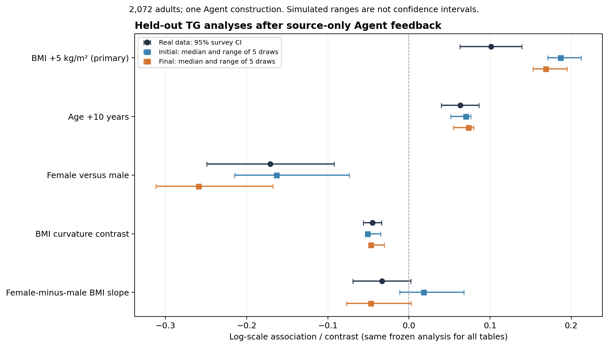

# Source feedback, Agent revision, and reserved public-data analyses

28 October 2026 · v0.3.0 · One exploratory clinical-data case, not a method-superiority result.

## Outcome

The source-statistic feedback loop now runs end to end: a frozen Agent-written generator executes under declared source covariates, numerical diagnostics return to the Agent, and the Agent freezes a revision or retention. A fictional task produced justified retention. A new real-data task produced an Agent-selected revision, followed by one locked evaluation against withheld triglyceride data.

Generated data retained the BMI, age and curvature directions. Revision reduced the primary BMI association's median absolute log-scale error by 21.3%, but still overstated its magnitude. The sex contrast became less accurate. The reference interaction remained uncertain. This is a signal worth replicating, not universal improvement or clinical-data replacement.

Black intervals are real-data survey 95% confidence intervals. Colored intervals are ranges across five residual simulation draws, not confidence intervals or calibrated evidence uncertainty.

## Framework and Agent responsibilities

The new `source-replay` command accepts a frozen recipe with covariate-only source tables. It derives source execution tasks changing only row count and population description, then executes byte-identical generator code and model specification through WSL/bubblewrap. Feedback binds the parent candidate, recipe, child execution, output bytes and recomputed statistics. Supplied output tables and failed executions cannot receive this verified linkage.

The harness contains no BMI–TG coefficient, sign, distribution, sex interaction or scientific success threshold. The Agent selected scientific choices from the supplied papers and explicit assumptions. The controller prepared inputs, admitted sources, fixed seeds, executed tools and maintained the evaluation boundary. It did not edit scientific coefficients after feedback or target results.

Replay currently covers enrichment programs with identity measurement mapping. Other task contracts and direct-row generation remain available elsewhere, but do not automatically gain this capability. Source-population reconstruction still requires substantive review; hashes do not establish that an assumed joint distribution is correct.

## Controlled loop

One fresh Agent constructed a conditional lognormal model from two explicitly fictional sources. Original instrument-unit statistics and derived task-unit statistics remained distinct. Twelve mean/SD checks were executed. Maximum relative discrepancies were about 0.49% and 1.17% respectively.

The Agent assessed conditional Monte Carlo scales and chose **retain**, recognizing that shared source seeds make discrepancies dependent. Code, specification and source recipes stayed unchanged; initial/final outputs were byte-identical for each of three fixed seeds. The 128-row task has no hidden biological truth and establishes workflow behavior only.

## Real-data design

The target contains 2,072 eligible NHANES 2017–2018 adults aged 20–79. The Agent saw opaque IDs, age, sex and BMI; the entire reference-method serum TG column was withheld. Evaluation used `WTSAF2YR`, strata and PSUs, with the complete-case adult domain retained within the full positive-weight design. See [CDC TG documentation](https://wwwn.cdc.gov/Nchs/Data/Nhanes/Public/2017/DataFiles/TRIGLY_J.htm) and [variance guidance](https://wwwn.cdc.gov/nchs/nhanes/tutorials/varianceestimation.aspx).

Construction used two external primary studies, excluding NHANES-derived construction evidence:

- [Oh et al., 2019, Healthy Twin Study](https://pmc.ncbi.nlm.nih.gov/articles/PMC6911291.1/): sex-specific summaries, age/BMI strata and an age/sex-adjusted BMI coefficient. Arithmetic/geometric reporting ambiguity, family sampling and specimen wording remained explicit. A source-only audit found that count-weighted arithmetic aggregation of Table 2 reproduced Table 1 means to reported precision, supporting the arithmetic interpretation without resolving every methods ambiguity.
- [Bansal et al., 2007, Women's Health Study](https://jamanetwork.com/journals/jama/fullarticle/208018): fasting-women summaries, TG-category proportions and conditional covariate summaries. Median/IQR and Spearman quantities remained explicitly unreplayed; they were not relabelled as means or Pearson correlations.

Sources were curated before construction; autonomous gap retrieval was not tested. Population selection, unreported joint dependence, plasma/serum transfer and omitted variables remain limitations.

The analysis protocol was frozen before XPORT reads. Preparation caught a pandas 3.0.3 decoding issue: 325 documented zero fasting weights appeared as tiny positive numbers. ReadStat 1.3.7 recovered 325 zero and 2,711 positive weights, matching official documentation. Rejected v1 was retained; only validated v2 reached the builder. No target effects or distributions informed that correction.

## Agent-selected revision and source diagnostics

The initial conditional lognormal construction used an arithmetic-scale mean, sex-specific anchors, a common BMI slope, sex-specific age patterns and a declared high-BMI extrapolation rule. Unreported functional shapes were labelled assumptions.

After one source-feedback round, the Agent replaced the common BMI slope of 6.8 with male/female slopes of 8.0/5.0 mg/dL per kg/m² and changed female residual log SD from 0.48 to 0.50. These revised conditional slopes are **Agent assumptions**, not directly reported source statistics. All source covariate files and check definitions remained byte-identical.

| Source analysis | Reported | Initial | Final |
|---|---:|---:|---:|
| Oh male low-BMI TG, mg/dL | 91.8 | 100.05 | 93.57 |
| Oh female high-BMI TG, mg/dL | 127.3 | 157.08 | 142.38 |
| Bansal low-TG group BMI, kg/m² | 24.2 | 23.37 | 24.02 |
| Bansal high-TG group BMI, kg/m² | 27.6 | 28.33 | 27.89 |
| Oh adjusted BMI coefficient | 6.813 | 7.062 | 6.420 |

Of 21 outcome-involving diagnostics, 13 absolute discrepancies decreased and eight increased. Eight covariate-only diagnostics were unchanged. These dependent checks mix units; their counts are not an overall scientific performance score. [All source diagnostics](reports/source_feedback_2026-10-28/source_diagnostic_comparison.csv) are retained.

## Reserved target results

Both candidate freezes and all ten target outputs were verified and committed before evaluation. There was one initial construction, one revision and five fixed residual draws per stage—not ten independent Agent builds or cohorts. No post-evaluation builder revision was allowed.

The same survey-weighted analyses were applied to real and generated TG. The primary model regressed natural-log TG on BMI per 5 kg/m², age per ten years and sex. Four reserved endpoints covered age, sex, fixed BMI curvature and BMI-by-sex interaction.

| Log-scale endpoint | Real estimate (95% CI) | Initial median | Final median |
|---|---:|---:|---:|
| Adjusted BMI /5 | 0.1012 (0.0630, 0.1393) | 0.1870 | 0.1687 |
| Adjusted age /10 | 0.0631 (0.0397, 0.0865) | 0.0702 | 0.0733 |
| Female minus male | −0.1708 (−0.2494, −0.0922) | −0.1630 | −0.2593 |
| BMI curvature contrast | −0.0448 (−0.0562, −0.0335) | −0.0511 | −0.0471 |
| Female minus male BMI slope | −0.0334 (−0.0690, 0.0022) | 0.0180 | −0.0468 |

The primary reference association corresponds to **10.65% higher TG per 5 kg/m² higher BMI**, versus 20.56% initially and 18.38% finally. This is an adjusted observational association, not an intervention effect. Absolute log-scale error decreased in all five matched draws; median error fell from 0.08584 to 0.06755. The final association remained too strong.

BMI, age and curvature directions agreed across every draw. Sex point estimates were negative in both stages, but final magnitude was exaggerated. Initial sex intervals included zero once; final intervals were negative in all draws. Generated intervals condition on the generated table and omit source/model/transport uncertainty; these counts are not calibrated discovery rates.

The reference interaction interval includes zero. Initial generated intervals were inconclusive in four draws and positive in one; final intervals were inconclusive in three and negative in two. A closer final point estimate does not prove an interaction, equivalence or a calibrated null.

Median absolute error across draws decreased for four of five endpoints. This differs from the distance of the median estimate: the age median moved slightly farther from the reference, and three of five paired age errors worsened, even though its median absolute error declined slightly. No combined endpoint score is used.

Secondary intervals are unadjusted and exploratory. Reference/generated estimates share participants; no independent-sample difference interval or significance-based equivalence claim is made. Sources already describe broad BMI/age/sex relationships: this tests transfer to unprovided target analyses, not discovery of globally unknown biology.

## Implementation review

- Full software suite: **171 passed, one skipped** because Windows denied a symlink fixture. Tests cover lineage, input boundaries, tampering and failures; separate real isolated runs establish actual execution.
- Independent code review found no blocking issue within the trusted-host, generator-only scope. Outer Agent file/tool access remained procedurally restricted, not OS-isolated.
- Source review checked numerical extraction, scale/type distinctions, conditioning direction, parameter use and observed-input preservation.
- Survey formulas were checked on invented data, including clustered sandwich variance, zero domain contributions and fixed contrasts. R `survey` cross-validation was unavailable.
- A pre-evaluation guard amendment bound protocol, input-manifest and preparation-receipt digests. The original evaluator and statistical calculations were preserved. Seven guard checks passed.
- All ten outputs and five endpoints were evaluated once without failure. Independent postrun review verified aggregation, chronology and unchanged commitments; no participant tables are included in the review export.

## Interpretation and next experiment

An Agent now makes substantive construction and revision choices in an executed loop. The real-data case provides limited evidence that source-only feedback can improve some unprovided target analyses, while also damaging another relationship. That trade-off should remain part of the result.

The pilot does not isolate feedback benefit from equal-budget ordinary self-review, demonstrate generalization across builds/providers/cohorts, identify unsupported joint relationships, calibrate multiple-imputation uncertainty or establish measurement replacement.

The next discriminating experiment is matched-budget source feedback versus ordinary self-review on fresh cases and multiple independent Agent constructions. Freeze comparisons before outcomes are opened; report analytical conclusion preservation alongside magnitude and uncertainty limits. This exposed case must not be tuned until it looks better or reused as fresh confirmation.

## Artifacts

- [Aggregate results](reports/source_feedback_2026-10-28/aggregate_results.json)
- [All generated analyses](reports/source_feedback_2026-10-28/endpoint_comparison.csv)
- [Matched-seed changes](reports/source_feedback_2026-10-28/initial_final_changes.csv)
- [Review package and inspection boundary](reports/source_feedback_2026-10-28/README.md)
- [M3 hashes and validation](m3_validation.json)
- [Replay API](docs/SOURCE_REPLAY.md)

M1/M2 reports and validation manifests remain historical snapshots. Earlier code hashes are not rewritten to appear current.
