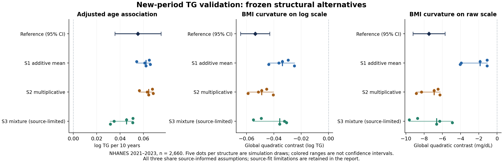

# M5 — Frozen structural alternatives on a new public-data period

28 October 2026 (America/Chicago; execution receipts use 29 October UTC).

## Finding

All three frozen Agent-proposed generators, across all five prespecified target draws each, reproduced the positive adjusted age association and negative global quadratic BMI contrast in a new NHANES August 2021–August 2023 analysis. Negative BMI curvature also appeared on the raw TG scale. This is a useful temporal-replication result for these analytical directions, within this particular set of source-informed structural assumptions.

It is not evidence of generally interchangeable synthetic and real data. Adjusted BMI effects were too large in every generated table, the sex interaction was unstable, and source-distribution discrepancies remained. The three structures are one Agent's alternatives, not three independent Agent builds. They share substantive assumptions and do not span all distributions compatible with the papers. S3 is explicitly source-challenged, rather than certified as evidence-compatible.

Black intervals are real-data design-based 95% confidence intervals. Colored points are five simulation draws per structure; colored ranges are not confidence intervals. The same real covariates are preserved in each generated table.

## Question and information boundary

Can an Agent construct several distinct generators from the same published partial evidence, use only source-statistic feedback for one revision decision per structure, and support unprovided age and BMI-curvature analyses in a new population period?

The builder received age, sex and BMI, the target measurement context, and approved source papers. It did not receive the target TG column, target associations, target analysis answers, or previous target results. Its visible task described general analytical enrichment without prescribing the desired age or curvature signs. Source statistics were available for construction and feedback; the exact reserved target analyses and their answers were not.

The approved sources were Oh et al.'s Korean Healthy Twin Study and Bansal et al.'s Women's Health Study. Cohort overlap and repeated statistics within each paper were retained as dependencies. NHANES-derived relationship evidence was excluded. The CDC assay documentation was a measurement-context exception, not target association evidence.

The builder chose functional forms, biological coefficients, residual distributions and the revision. The controller scheduled execution and checked commitments; it did not supply an age coefficient, a BMI coefficient, a curvature target, or post-result parameter corrections. Generator programs use age, sex, BMI, assay context and the RNG seed, not participant IDs or hidden outcomes. The source-derived and assumed numerical parameters are explicit in each specification; avoiding controller-imposed relationships does not mean a generator can be parameter-free.

Agent information separation was procedural. The generator process was isolated using the existing WSL/bubblewrap adapter with no network or broad workspace mount. This does not establish OS isolation of the outer Agent or absence of model pretraining knowledge.

## Three scientific constructions

| Structure | Generation mechanism | Source-feedback decision | Important assumption or limitation |
|---|---|---|---|
| S1: additive arithmetic mean | Sex-specific mean anchors; additive BMI/age response; positive mean regularization; mean-one lognormal individual noise | Revise BMI slopes by sex and residual CV, keeping age coefficients unchanged | Log transformation of an affine positive mean can itself produce concavity. New slopes are derived/assumed, not directly reported conditional effects. |
| S2: multiplicative | Sex-specific log-scale BMI response with saturation, sex-specific age forms and lognormal residual variation | Retain | Saturation width and age shape are incompletely identified; source BMI rank association remains too strong. |
| S3: latent mixture | Age/BMI/sex change the probability of two gamma-distributed latent components | Retain as a source-challenged sensitivity | Latent components are not established biological subtypes. Source median and distribution are materially mismatched. |

The three use different mean/median/noise constructions. All nevertheless share source-informed positive BMI relationships, selected sex-specific age tendencies, approximated source covariate distributions and assay-transfer assumptions. Agreement is therefore robustness within these alternatives, not independent discovery of the direction from unconstrained models.

For S1, the Agent changed the female BMI slope to 5.2 mg/dL per kg/m² and derived the male slope (approximately 9.5573) using the source sex counts and BMI variances to approximately preserve the pooled reported slope 6.813. The derivation assumes the constructed source joint distribution. Residual CVs were recalculated using `Var(Y) = Var(mu) + CV² × [E(mu)² + Var(mu)]`. The age coefficients were unchanged. Independent review checked that this equation, the program's arithmetic-mean interpretation, and the specification agreed. No target result informed the change.

## Frozen schedule and implementation review

1. Freeze the analysis protocol and preparation methods before reading new target outcomes for analysis. Prepare an opaque-ID covariate-only builder input.
2. Freeze all three initial structures and their common evidence/source recipes before any source execution.
3. Replay each initial candidate at source seeds 76101–76103 against both source contexts. Return all source diagnostics together.
4. Allow one revise/retain decision per structure. Freeze all three final candidates before any final source execution.
5. Replay all final candidates on the same source grid. Run all three final programs on target seeds 76201–76205.
6. Commit all six candidate freezes, all 18 source replays and all 15 target outputs. Verify exact grids, provenance, chronology, shared evidence, parentage, successful execution, output hashes and preserved covariates.
7. Only then open the hidden reference outcome and evaluate every frozen output once. No candidate or parameter was revised after this release.

The release guard verified **6 candidate versions, 18 source replays and 15 target outputs**. The 18 replays include **36 source-context executions**; together with target generation, 51 isolated executions completed. There were no omitted target seeds, failed target analyses or nonestimable calibration sensitivities. The evaluator additionally checked every generated table's row order, positive finite TG and unchanged observed values before parsing the hidden table.

The primary release commitment is `f41fd145f0b566d3332419b3f65e78d5e774bc44434c6dc313bd167846ff4f65`. The released aggregate result-manifest hash is `2ac641ce62a0a7231411d66e2c3435444c17fb79dc389c20897f702a20589809`.

Two new local verification suites passed: 32 invented-record release-guard checks and 11 custodian gate/estimator checks. The 32 checks mock the existing harness verifiers to isolate the new gate; they do not revalidate process isolation. Additional review inspected generator algebra, frozen method code, all source summaries, target aggregate arithmetic and provenance. The prior M4 core-suite result of 258 passed/1 skipped is historical and was not rerun for this unchanged core engine. The custom survey estimator has invented-fixture checks but has not been independently matched to an R survey-package implementation.

A DEMO_L metadata-label decoding error occurred during preparation, before outcome analysis. The initial script/freeze were retained, an explicit Windows-1252 label-decoding amendment was recorded, and analytical definitions were unchanged. This was not a data-dependent change to the analysis.

## Source checks: real improvement with real trade-offs

Each candidate has 46 supported diagnostics: **12 fixed-input age/BMI checks** and **34 TG-dependent checks**. The input checks confirm the declared covariate reconstruction; they are not independent successes of TG generation. Another 23 unsupported or ambiguous statistics remain explicitly unreplayed. Unknown arithmetic/geometric interpretations, full adjustment sets and co-twin estimands were not silently replaced by simpler operators.

The constructed source contexts contain 160,320 Oh-context rows and 80,472 Bansal-context rows. These are numerical integration/Monte Carlo populations, not enlarged clinical samples. Unknown age–BMI joint dependence was approximated, including conditional independence. Source simulations and source checks cannot validate that approximation. Three seeds estimate residual simulation variability, excluding evidence and transport uncertainty.

| Source statistic | Reported | S1 initial → final | S2 final | S3 final |
|---|---:|---:|---:|---:|
| Oh adjusted BMI OLS slope, mg/dL per kg/m² | 6.813 | 6.834 → 6.840 | 6.274 | 5.764 |
| Bansal BMI–TG Spearman correlation | 0.330 | 0.4395 → 0.3464 | 0.4684 | 0.4607 |
| Bansal age–TG Spearman correlation | 0.180 | 0.1403 → 0.1440 | 0.1815 | 0.1418 |
| Bansal Q25, mg/dL | 81 | 79.039 → 76.685 | 77.527 | 70.021 |
| Bansal median, mg/dL | 115 | 115.560 → 111.585 | 113.948 | 99.931 |
| Bansal Q75, mg/dL | 169 | 168.450 → 162.296 | 167.480 | 182.092 |

Values are means over the three prespecified source seeds. S1's BMI rank dependence and extreme-tertile BMI means improved in every paired seed, while all three TG quantiles and all six cumulative category fractions worsened in every paired seed. S2 and S3 retained identical code/specifications and exactly reproduced their initial source outputs for each matched seed. Retention preserves known discrepancies; it does not confer compatibility.

No mixed-unit aggregate score or automatic winner was used. No calibrated source acceptance threshold was prespecified, so the experiment does not certify that all three constructions satisfy the papers statistically. See [all 46 source diagnostics](reports/structure_robustness_2026-10-28/review/COMPLETE_SOURCE_DIAGNOSTICS.md) and [the independent audit](reports/structure_robustness_2026-10-28/POSTRUN_AUDIT.md).

## New target and locked analyses

The new target is **NHANES August 2021–August 2023**, using DEMO_L, BMX_L and reference-method fasting triglycerides TRIGLY_L/LBXTLG. Adults aged 20–79 with complete positive BMI/TG, positive fasting-subsample weights and complete design identifiers formed the **2,660-person domain**. Ages 80+ were excluded because of topcoding. The full positive-weight variance design contained 3,361 participants, 15 strata and 30 PSUs; design degrees of freedom were 15. Out-of-domain scores were zero, retaining the complete positive-weight design for variance estimation.

This is temporal replication within the same survey program, not an independent external cohort. Complete-case selection has no additional item-nonresponse correction, so the sample is not guaranteed to fully represent the target population despite using the correct fasting weights.

Primary analyses were fixed before target analysis:

- Adjusted age: weighted regression of log(TG) on age, BMI and sex; age coefficient is per 10 years.
- BMI curvature: add `B²` to the same basis, where `B=(BMI−25)/5`, and report `2 × coefficient(B²)`.

The curvature is the full-domain quadratic projection contrast, equivalently the fitted value at BMI 35 minus twice the fitted value at 30 plus the fitted value at 25. It is not a local empirical curvature test, a threshold estimate, a causal effect or a reconstruction of the entire dose-response curve. Exponentiating the log contrast gives a ratio of ratios, not a TG level ratio.

Four secondary endpoints were locked: the same curvature contrast in raw TG, adjusted BMI per 5 kg/m², adjusted female-versus-male contrast, and BMI×sex interaction. Real-data uncertainty uses Taylor linearization over the survey design with t intervals. Generated data receive point estimates only; repeated draws are simulation sensitivity, not calibrated evidence or transport uncertainty.

### Native-scale results

Generated entries are the median of five draws with the full min–max range in brackets. Every draw is retained in the linked aggregate table.

| Endpoint | Real reference [95% design CI] | S1 | S2 | S3 |
|---|---:|---:|---:|---:|
| Age, log TG per 10 years | 0.05528 [0.03550, 0.07506] | 0.06208 [0.05420, 0.06588] | 0.06446 [0.05644, 0.06821] | 0.04541 [0.03166, 0.05103] |
| BMI curvature, log TG | −0.05366 [−0.06437, −0.04294] | −0.03376 [−0.04377, −0.02497] | −0.04897 [−0.05889, −0.04049] | −0.03580 [−0.05495, −0.03070] |
| BMI curvature, raw TG mg/dL | −7.471 [−9.238, −5.704] | −1.876 [−4.047, −1.099] | −6.912 [−8.872, −6.268] | −6.639 [−9.639, −4.906] |
| BMI, log TG per 5 kg/m² | 0.08316 [0.06397, 0.10234] | 0.16958 [0.16852, 0.19301] | 0.11783 [0.11618, 0.14093] | 0.15210 [0.14783, 0.15353] |
| Female versus male, log TG | −0.10994 [−0.15803, −0.06185] | −0.22762 [−0.24923, −0.20088] | −0.09893 [−0.12092, −0.07242] | −0.16617 [−0.17895, −0.12579] |
| BMI×female interaction | −0.02456 [−0.07733, 0.02821] | −0.03179 [−0.07458, 0.00008] | 0.03229 [−0.00965, 0.06451] | −0.02222 [−0.04611, 0.00542] |

Both primary directions agree in **15/15 outputs**; raw BMI curvature, positive adjusted BMI and the negative female contrast also agree in 15/15. The latter agreements coexist with magnitude mismatch. All 15 adjusted BMI point estimates exceed the reference 95% CI upper bound; this is a descriptive discrepancy, not a separately calibrated test comparing two estimators. S1 substantially understates raw curvature magnitude and overstates the female contrast. The interaction has nine negative and six positive generated estimates; its real-data CI includes zero. It is unresolved rather than a known null or a validated sign.

Negative raw-scale curvature in the reference shows that this particular projection result is not solely a consequence of taking logs. It still does not prove universal/local biological concavity. S1's small raw quadratic contrast can arise from projecting its sex-dependent mean onto the limited common-coefficient analysis basis, even without an explicit raw BMI-squared term.

### Prespecified assay sensitivity

The new NHANES TG method is non-glycerol-blanked. The builder used the CDC forward bridge `new = 12.45 + 1.022 × old` under an explicit assumption that source TG can serve as a legacy-assay proxy. That proxy is better supported for Bansal's glycerol-corrected assay than for Oh's incompletely specified measurement. Neither paper establishes exact interchangeability with the old NHANES assay.

The frozen evaluator also applied the separately published CDC backward equation `old = −12.19 + 0.9785 × new` identically to every real/generated table. Both primary directions and raw-curvature direction remained unchanged in all 15 draws. Backward-reference age was 0.06642 [0.04333, 0.08951], log curvature −0.06155 [−0.07418, −0.04893], and raw curvature −7.311 [−9.040, −5.582]. All transformed tables remained estimable; no clipping or selective dropping was used.

These two rounded regression equations are not exact inverses. The raw auxiliary curvature is mechanically 0.9785 times the native raw curvature, so it is not another independent validation. Bridge-coefficient uncertainty and source-assay equivalence uncertainty are not propagated.

## What this milestone establishes

The framework can keep scientific construction in the Agent, return execution-linked source diagnostics, preserve a documented revision/retention decision, freeze a complete multi-structure output grid, and test previously unprovided analyses on new public data. This pilot adds evidence that the age and global BMI-curvature directions survive these selected structural alternatives and residual draws in a new NHANES period.

It does not establish superiority over an ordinary Agent or statistical generator, a general benefit from iteration, calibrated synthetic-data uncertainty, individual outcome recovery, clinical measurement replacement, causal mechanism discovery or publication readiness. Only final structures were evaluated on this new target; no claim about S1's target improvement over its own initial candidate is supported. S2's comparatively close target estimates do not erase its source dependence error or justify post-hoc selection as a winner.

## Next discriminating experiment

1. Treat this target's released results as development knowledge from now on. Do not retune on it and call the outcome fresh validation.
2. Test whether materially different relationship shapes can satisfy the same source evidence. Prespecify a source-diagnostic compatibility rule using reported uncertainty where available, alongside sensitivity bounds for missing joint covariates. A generic tolerance chosen after viewing target results would not solve identification.
3. Use a new locked target or independent cohort to test source-admissible alternatives. Keep the primary focus on unprovided analytical conclusions and explicitly report analyses that disagree across alternatives. Add independent Agent constructions before interpreting structural agreement as broader reproducibility.
4. In a separate preregistered comparison, allocate equal evidence and feedback budgets to ordinary generation and source-check-assisted revision. Do not infer that advantage from this structural-sensitivity experiment. Expand only after the source-fit/magnitude tension is addressed; more random seeds alone will not resolve it.

No model training or HPC allocation was required for this bounded experiment.

## Artifacts and references

- [Curated inspection package](reports/structure_robustness_2026-10-28/README.md): all six candidate programs/specifications, source feedback, frozen protocols, aggregate outcomes, reviews and provenance.
- [All 180 analysis rows](reports/structure_robustness_2026-10-28/evaluation/endpoint_comparison.csv): 15 draws × 6 endpoints × 2 measurement scales; not participant rows.
- [All 36 structure summaries](reports/structure_robustness_2026-10-28/summaries/structure_summary.csv), [figure PDF](reports/structure_robustness_2026-10-28/summaries/structural_robustness.pdf), and [independent audit](reports/structure_robustness_2026-10-28/POSTRUN_AUDIT.md).
- [Validation manifest](m5_validation.json) binds the report, code and curated manifest. Original frozen files remain local; copied metadata may normalize filesystem prefixes as documented. The inspection export excludes row-level data/full papers/runtime inputs and is not a portable executable bundle.
- [Oh et al., 2019](https://pmc.ncbi.nlm.nih.gov/articles/PMC6911291.1/), DOI 10.1186/s12944-019-1134-0; [Bansal et al., 2007](https://jamanetwork.com/journals/jama/fullarticle/208018), DOI 10.1001/jama.298.3.309.
- [CDC TRIGLY_L data and assay documentation](https://wwwn.cdc.gov/Nchs/Data/Nhanes/Public/2021/DataFiles/TRIGLY_L.htm), [DEMO_L](https://wwwn.cdc.gov/Nchs/Data/Nhanes/Public/2021/DataFiles/DEMO_L.htm), [BMX_L](https://wwwn.cdc.gov/Nchs/Data/Nhanes/Public/2021/DataFiles/BMX_L.htm), [survey weighting](https://wwwn.cdc.gov/nchs/nhanes/tutorials/weighting.aspx), and [variance estimation](https://wwwn.cdc.gov/nchs/nhanes/tutorials/varianceestimation.aspx). Download receipts and hashes are retained in the curated provenance.
