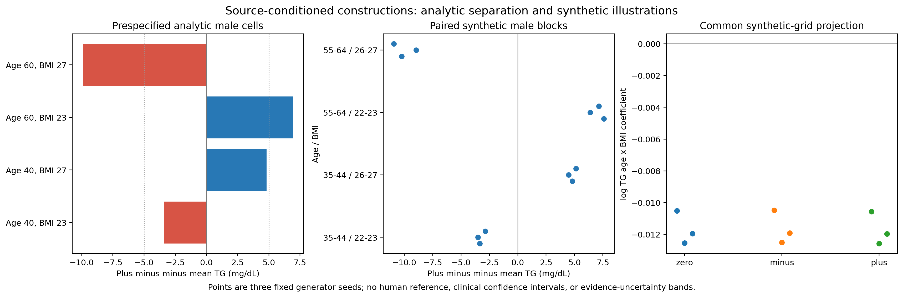

# M6 — A constructive check of what source summaries leave unresolved

29 October 2026, America/Chicago. This milestone uses published source summaries and synthetic covariate probes only. No new real-patient outcome validation was performed.

## Result and its scope

The Agent constructed two bounded conditional TG laws around the same inherited reference. Under the declared product source covariate distribution, the alternatives preserve both the age–TG and BMI–TG bivariate laws, while changing an age-by-BMI conditional interaction. All three frozen programs ran successfully. All **276** same-seed alternative-versus-reference source comparisons passed the prespecified descriptive screen; **252 were exactly unchanged**. Conditional-mean differences nevertheless appeared in the prespecified synthetic probe blocks, including **8.94–10.92 mg/dL** between alternatives for men aged 55–64 with BMI 26–27.

This is a deliberately constructed stress test, not a biological discovery or a blinded external validation. The approximately 9.91 mg/dL analytical separation was known from the design before execution. Successful execution checks that the implementation realizes the intended construction. It does not turn the inherited, imperfect source fit into evidence compatibility, and it does not establish clinical importance.

The experiment **did not find a reversal of the positive adjusted-age or negative log-BMI-curvature directions** on its synthetic probe. Those global summaries changed very little. The narrower finding is that stable source summaries and global projections can coexist with different joint subgroup means. This supports analysis-specific scrutiny of virtual data; it does not invalidate the previous M5 temporal-replication result.

The left panel shows prespecified analytical differences; the middle panel shows paired results from three generator seeds; the right panel shows that a global interaction projection can remain similar. There is no real-patient reference or clinical confidence interval in this figure.

## Why this experiment was needed

M5 reproduced two target analytical directions using three different generator families. However, the families shared assumptions. Their agreement did not establish that all other analyses on the generated data were supported. This milestone examines a concrete limitation: papers can constrain age–TG and BMI–TG relationships separately without determining their full joint conditional relationship.

An initial proposal to rotate an age-related latent residual was rejected during design review. It could preserve one pairwise law while altering the paper's reported age-stratum pattern. An unsupported replay operator does not make that evidence disappear. The final construction preserves both relevant pairwise laws in the assumed product source population, including both arithmetic and geometric age/BMI-stratum summaries. The original anchor's discrepancies remain.

## Agent decisions and fixed construction

The fresh builder used the admitted Oh2019 and Bansal2007 papers, historical **source-only** diagnostics, and the existing S1 source specification. It received no previous target outcome results or desired target coefficient/sign. It chose the mathematical family, support regions, centering constants and bounded amplitude. The controller provided the synthetic probe grid, fixed schedule, output contracts and reviewed release rules.

Three labels were frozen: `zero`, `minus`, and `plus`. Their programs, evidence, source recipes, synthetic source covariates, assumptions and certificates are identical. Their specifications differ only in the sign of one density-interaction term. `Zero` retains the inherited S1 conditional law algebraically; it is not a newly fitted reference or a validated winner.

For men, the alternative conditional density is:

`f_s(y | age, BMI) = f_0(y | age, BMI) + s × delta × h_A(age) × h_B(BMI) × h_T(y)`

where `s` is −1, 0 or +1. The female law is unchanged.

- `h_A = (9103/18693) × I(age 35–44) − I(age 55–64)`.
- `h_B = (10388/14851) × I(22 ≤ BMI < 24) − I(26 ≤ BMI < 28)`.
- `h_T` is the density of Uniform[70,120] minus the density of Uniform[140,190], in mg/dL.

The age and BMI contrasts are separately centered using the declared male Oh source marginal counts. Each vanishes outside its stated support. The outcome contrast integrates to zero. Thus, under the **assumed product** age/BMI distribution, integrating out BMI removes the perturbation from the age–TG law, and integrating out age removes it from the BMI–TG law. This also preserves the TG marginal and the available age-adjusted BMI OLS coefficient under that product design. No claim is made about models requiring unavailable metabolic variables, family structure or co-twin relationships.

Independent scalar calculations verified the conditional-mean bounds 114.64249–177.78632 mg/dL over the active cells. Checking analytical density extrema at the relevant mean/outcome endpoints gives a minimum reference density of 0.00176925545. The Agent chose `delta = 0.8 × 50 × minimum_density = 0.07077021813`, so the modified density remains at least 0.2 times the reference density. The proof uses analytical extrema, not a sampled grid minimum.

These compact piecewise interactions are deliberate mathematical stress cases. Their abrupt boundaries are not established physiological thresholds, and the amplitude is not estimated as a true biological interaction. A future clinically credible sensitivity family would need separate plausibility and source-evidence checks.

## Sampling and implementation checks

The program first draws the same baseline normals for all three labels. Only active male rows whose baseline TG falls strictly between 70 and 190 mg/dL undergo a paired inverse-CDF transformation. The altered CDF has the same endpoints and is strictly increasing by the positivity certificate. Forty bisection steps bound the bracket width by `120 / 2^40` mg/dL.

This construction leaves female rows, rows outside the active covariate rectangles, and rows with baseline outcomes outside that interval exactly unchanged. The indicators TG<200 and TG<500 are also unchanged. No participant identifier, row order, row count or assay label chooses a biological relationship. The inherited assay map remains a measurement transform; all M6 source/probe rows use the declared legacy proxy.

All three candidates were statically validated, frozen and independently reviewed before execution. Then the controller froze the protocol, analysis code, source-screen thresholds, task, input hashes and candidate hashes. Generators ran only through the existing WSL/bubblewrap adapter; no local execution fallback was used. There were zero scientific revisions or seed substitutions.

The complete schedule comprised **9 source replays / 18 source-context executions**, followed after the source screen by **9 synthetic-probe executions**. All 27 isolated executions succeeded. Four invented-data tests of the frozen analysis code passed. The historical M4 core-suite result (258 passed, one skipped) is not represented as a new M6 test run; the core harness and previous bound files were unchanged.

## Source screen: a descriptive comparison, not admissibility

The source evidence contains 71 extracted items. Among the 46 replayed checks, only the Oh age/sex-adjusted BMI OLS coefficient has a reported sampling interval: 6.813, 95% CI [5.853,7.774]. The other replayed means, SDs, quantiles, ranks and proportions lack the required reported sampling uncertainties. Individual SDs are not standard errors. The source populations also require assumptions about joint covariates, assay equivalence and family structure.

Consequently, no calibrated source-compatibility test was invented. The frozen rule compared each alternative with the newly replayed zero reference at each identical seed: absolute change must not exceed **three times that check's historical S1 generator-seed SD**, calculated from three earlier source-only draws. Zero historical SD required exact equality. This is a descriptive simulation-scale screen, not a paired standard error, coverage probability, clinical tolerance or equivalence test.

| Audit item | Result |
|---|---:|
| New source records, 3 labels × 3 seeds × 46 checks | 414 |
| Alternative-versus-zero comparisons | 276 |
| Screen failures | 0 |
| Exactly unchanged comparison values | 252 |
| Largest ratio of change to its descriptive limit | 0.39185 |
| Source input-preservation records | 18 passed |
| Paired source row-invariant sets | 12 passed |
| Oh Table2 arithmetic/geometric records | 360, complete and finite |

The 46 checks contain 12 fixed-input diagnostics and 34 TG-dependent diagnostics. Matching the fixed covariates is not an additional success of TG generation. All 27 Bansal checks remain identical between labels because that context contains only women.

The reference simulation scale itself was unstable across these small seed sets. For the Oh BMI OLS statistic, the new zero-seed SD was 0.098252 versus the historical 0.012991 (7.56 times larger). For the male TG sample-SD statistic, it was 1.040306 versus 0.183557 (5.67 times larger). Each estimate uses only three draws. These observations reinforce why the frozen three-SD screen is descriptive, not a calibrated probability statement; its limits were not changed after execution. They concern simulation variation, not uncertainty in the original clinical studies.

The original source-fit weaknesses remain visible. Across the new zero draws, Bansal Q25/median/Q75 are approximately **76.684/111.933/162.567**, compared with reported **81/115/169**. Age Spearman is about **0.13967**, compared with **0.18**. The male Oh fraction below 150 is about **0.66260**, compared with **0.68416**. All nine new Oh OLS values fall within the reported interval, but interval location under an approximate source reconstruction is not a general validation certificate.

All 20 Oh age/BMI/sex Table2 summaries were additionally calculated under both arithmetic and geometric interpretations. Neither was silently declared the true estimand. The largest alternative-versus-zero drift among these 360 records was approximately **0.04891 mg/dL**. This small drift preserves, rather than resolves, pre-existing disagreement with the reported strata. Three differently adjusted or paired estimands remain unassessed. A possible FBS-row reporting/alignment anomaly is retained as unresolved; it is not used to revise source values.

See [all source comparisons](reports/source_identifiability_2026-10-29/results/source_checks_all.csv) and [both Table2 interpretations](reports/source_identifiability_2026-10-29/results/oh_table2_both_interpretations.csv).

## Exact population identity versus finite source reconstruction

The algebra assumes independent age and BMI conditional on sex. The fixed source tables were constructed by independent permutation, so they are only approximately product tables. For men in the Oh reconstruction, empirical `mean(h_A × h_B)` is approximately **5.8487×10^-5**, implying an expected plus-minus overall mean drift of **−0.00057948 mg/dL**. Conditional stratum drifts are also retained. Exact population invariance must therefore not be described as exact equality of all finite-sample summaries.

The source contexts contain 160,320 Oh rows and 80,472 Bansal rows for numerical integration/Monte Carlo, not additional clinical participants. Their size reduces simulation noise without resolving the unknown source joint distribution or creating clinical evidence. The interaction regions are inside the declared source reconstruction support; the actual empirical joint support of the original studies is unavailable.

## Prespecified synthetic probe results

The probe contains 27,600 artificial covariate rows: both sexes, ages 20–79, integer BMI 18–40, and ten replicate rows per cell. Three fixed seeds were used per label. This equally weighted grid is not a representative US population or a new human validation cohort.

The predeclared operational materiality rule was **maximum absolute analytical plus-minus mean difference ≥5 mg/dL across four named male cells**. All four cells and flags are reported; the rule was never changed to require all four cells or to select a favorable new cell. The anticipated design values were already written before any execution.

| Male age / BMI | Analytical plus-minus mean difference, mg/dL | Absolute difference ≥5? |
|---|---:|---|
| 40 / 23 | −3.37490 | No |
| 40 / 27 | +4.82485 | No |
| 60 / 23 | +6.93034 | Yes |
| 60 / 27 | −9.90783 | Yes |

The generated data also showed the intended differences in all four predeclared male blocks. The table reports same-seed plus-minus differences; ranges are simulation ranges, not confidence intervals.

| Male block | Three generated differences, mg/dL |
|---|---|
| Age35–44, BMI22–23 | −3.350, −3.505, −2.859 |
| Age35–44, BMI26–27 | +4.810, +4.470, +5.128 |
| Age55–64, BMI22–23 | +7.575, +6.373, +7.136 |
| Age55–64, BMI26–27 | −10.226, −8.942, −10.925 |

These empirical differences verify the numerical generator. The analytical separation is a designed property, not a post-hoc discovery or a recovered patient effect. The frozen source checks do not determine which alternative, if either, is correct for a real target.

### Global regressions remained similar

The frozen analysis also reported all seven global regression endpoints, using unweighted projections on the artificial grid. Means over three draws are:

| Endpoint | Zero | Minus | Plus |
|---|---:|---:|---:|
| Adjusted age, log TG per10 years | 0.057340 | 0.057384 | 0.057297 |
| Adjusted BMI, log TG per5 kg/m² | 0.245722 | 0.245764 | 0.245684 |
| Female-minus-male, log TG | −0.197737 | −0.197815 | −0.197651 |
| Global BMI curvature, log TG | −0.059093 | −0.059276 | −0.058912 |
| Global BMI curvature, raw TG mg/dL | 0.893792 | 0.870790 | 0.916339 |
| BMI×female coefficient, log TG | −0.074186 | −0.074269 | −0.074110 |
| Age×BMI coefficient, log TG | −0.011668 | −0.011635 | −0.011701 |

Positive adjusted age and negative log-BMI curvature remained in all nine probe outputs. The overall age×BMI coefficient also retained its sign; a single global interaction projection can miss compact conditional differences. Raw-curvature estimates varied around a small value and changed sign across seeds. That artificial-grid result is not comparable to M5's weighted NHANES raw-curvature estimate: the covariate population, weighting and purpose differ.

All **63 endpoint rows**, **36 block records** and **24,840 grid-cell summaries** are retained. No endpoint or seed was discarded because it did not change direction.

## Framework implication and next action

The result supports a specific improvement: an evidence gap should be defined relative to the analysis the researcher wants to perform. Evidence for separate age–TG and BMI–TG summaries does not automatically support age-by-BMI subgroup comparisons. A useful Agent should identify the missing joint evidence, retrieve or request it when available, and retain multiple scenarios when it remains unresolved.

The immediate next development should be a task-level evidence map linking requested contrasts to the source observations that actually constrain them, with explicit records for unassessed evidence and unresolved transport assumptions. A future source addition must be chosen through that general process, not by looking at a known target answer and hand-tuning a coefficient. Any claimed benefit then needs a new locked real case or an equal-budget ordinary-Agent comparison.

This construction is not, by itself, an established novel method or publication-ready finding. It illustrates an identification issue and verifies a concrete failure mode of overly broad validation claims. The previous age/BMI directional result remains useful within its scope. The next experiment should test whether the proposed evidence-gap process improves unprovided analyses, rather than merely generating more mathematical alternatives.

## Audit, boundaries and artifacts

The protocol commitment is `0990cd1bf0d0e4b4190e81a0a376012e9b69d376a625d0c493da0eef7886f1a1`; source release is `ec3b3b17dddc1f23d8fa28e5b8439dd7b19650624ae998d60184ae2be48f6ac7`; full probe release is `e4026d7e1186f521b17a5b645e6d3343f303c97efbe9841d009cbdb21091fc86`. The final aggregate report SHA-256 is `dc3e8b60f83cd247c0065b378cbf1ee4845fa51c8e73b21bc3722cd5e0e698e7`.

Information separation was procedural, not OS isolation of the outer Agent. The fresh builder was restricted to approved sources and source-only artifacts. An Agent-inventory call accidentally displayed unrelated historical aggregate summaries to the reviewer and analyst; this was disclosed and those facts were not used. No associated files, patient rows or new real-target outcomes were opened. This experiment makes no blinded clinical-validation claim.

- [Independent postrun audit](reports/source_identifiability_2026-10-29/POSTRUN_AUDIT.md), [curated inspection package](reports/source_identifiability_2026-10-29/README.md) and [validation manifest](m6_validation.json).
- [All endpoint summaries](reports/source_identifiability_2026-10-29/results/probe_endpoint_summary.csv), [all paired block gaps](reports/source_identifiability_2026-10-29/results/probe_block_plus_minus_gaps.csv) and [figure PDF](reports/source_identifiability_2026-10-29/results/constructive_separation.pdf).
- [Oh et al., 2019](https://pmc.ncbi.nlm.nih.gov/articles/PMC6911291.1/), DOI 10.1186/s12944-019-1134-0, and [Bansal et al., 2007](https://jamanetwork.com/journals/jama/fullarticle/208018), DOI 10.1001/jama.298.3.309. Exact admitted source versions and hashes are retained in the evidence records.

The inspection export excludes full papers, runtime settings and row-level synthetic execution tables. Path normalization of copied metadata is recorded with both original and copied hashes; original frozen files remain unchanged locally. No one-command replay from the reduced inspection archive is claimed. No model training or HPC was needed.
