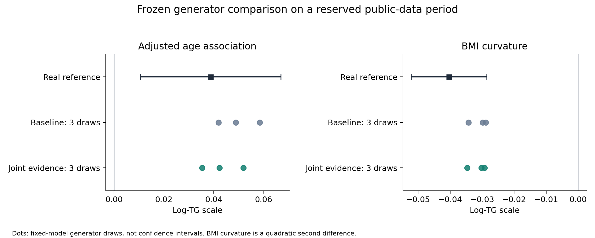

# M8 — Joint source evidence, reviewed generator revision and a reserved-data test

29 October 2026. The source-informed revision **preserved both priority scientific directions** on a reserved NHANES period: positive adjusted age association and negative BMI curvature. Both directions were also preserved by the inherited baseline. The new revision moved the average age estimate closer to the real-data estimate and changed BMI curvature only slightly. Other analyses showed trade-offs. This supports feasibility of generating data that retain selected unprovided conclusions; it does not establish an overall improvement or superiority over an equally informed ordinary Agent.

## What actually ran

Two frozen programs—`baseline` and `joint_evidence`—were run with the same three source seeds and the same three separate target seeds. There were six successful source replays, each covering two approximate source populations: 12 isolated source generator executions. Six target tables were generated for **1,575 NHANES 2009–2010 participants aged 40–79**. The target's real TG column was withheld from construction; only age, sex, BMI, opaque identifiers and assay context were supplied. All 67 predeclared analytical endpoints were evaluated on every generated table, yielding 402 comparisons and zero nonestimable endpoint records. No seed, subgroup or unfavorable analysis was removed.

This is enrichment of an entirely unmeasured variable, not a recovery of individual TG measurements. The real reference is fasting glycerol-blanked `LBXTR`, with fasting-subsample `WTSAF2YR` weights and the original survey design. Eligibility and the 67 endpoints were prepared in M7 before this generator revision. The new period is a temporal holdout within NHANES, not a different external study or protection against pretrained model knowledge. [CDC TG documentation](https://wwwn.cdc.gov/Nchs/Data/Nhanes/Public/2009/DataFiles/TRIGLY_F.htm).

## The evidence gap was genuinely resolved

The previous milestone could not obtain the Tromsø supplementary table. The source-only researcher found the documented current PMC public distribution service and recovered the original DOCX. Its MD5 matches official article metadata. Independent parsing of the DOCX XML verified every table cell against the extraction. The table supplies 30 age–BMI–sex cells: two references and **28 nonreference adjusted ratios with 95% CIs**. No digitization or invented coefficient was used. [Primary paper](https://pmc.ncbi.nlm.nih.gov/articles/PMC10308115/), [original supplement](https://pmc-oa-opendata.s3.amazonaws.com/PMC10308115.1/Table_1.DOCX).

These are back-transformed coefficients from sex-specific adjusted log-TG models in a Norwegian nonfasting population. They are not arithmetic subgroup means. The source has unresolved male sample-count and adjustment-set discrepancies; one unusually asymmetric reported CI is preserved exactly. Shared-reference coefficient covariance is unavailable. The admission permits evidence use with these limitations; it does not certify transport to the US fasting target. The China-PAR standardized longitudinal coefficients remain context only and do not determine a numerical parameter.

External retrieval was a source-curation phase followed by registry admission. The builder used the admitted local artifacts. This was not a demonstration that the task-bound literature adapter itself automatically recovered supplements or autonomously selected the research gap.

## The Agent's scientific decision and the review correction

The builder selected an interaction-only contrast from the joint source ratios. Within each sex, let `R(a,b)` denote the reported joint ratio, and let `a0,b0` be the reference categories. Define

`D(a,b) = log R(a,b) − log R(a,b0) − log R(a0,b) + log R(a0,b0)`.

The first unexecuted draft multiplied the inherited conditional mean by `exp(D)`. Review identified a substantive issue: an additive **arithmetic** mean already has a nonzero interaction on the **log** scale. That overlay would add both interactions. Before freeze and any output access, the builder changed the construction to

`m(a,b) = g(a,b0) × g(a0,b) / g(a0,b0) × exp(D(a,b))`,

where `g` is the inherited positive conditional mean. This preserves the two inherited reference-line curves and makes the model's legacy-scale conditional log cross-ratio equal to the supplied source surface. It does not replace the full source age/BMI main effects or reproduce the complete source ratio table. The correction was a scientific design choice after review, not uniquely dictated by the source.

The Agent chose bilinear interpolation at age 44.5, 54.5, 64.5, 74.5 and 84.5, and BMI 22.5, 27.5 and 32.5. These coordinates—especially for open-ended groups—are assumptions. The interaction surface is clamped outside the knots; the reference curves continue under their inherited model. Transfer strength is fixed at 1; no strength sweep or output-based tuning occurred. Existing numeric baseline parameters, residual CV and assay coefficients are unchanged. Off-reference-line means and marginal moments can nevertheless change.

A second review correction restricted geometric/arithmetic ratio equality to the legacy scale with constant within-sex lognormal variance. The nonzero-intercept conversion for the alternative unblanked assay does not preserve that equality. The current target uses the legacy proxy. Nonfasting-to-fasting, adjustment-to-available-covariate, population and laboratory transport remain explicit hypotheses.

The Agent therefore participated in evidence interpretation, structural choice, parameter provenance, code construction and correction. The deterministic harness performed validation, freezing and execution. This is not evidence that the particular contrast formula is novel, or that a multi-Agent system is necessary.

## The two priority analytical conclusions

The real reference uses survey Taylor-linearized 95% t intervals. Synthetic results below are means and ranges of three fixed-model draws, **not confidence intervals**. Age is scaled per 10 years. BMI curvature is the second difference from the predeclared quadratic model using BMI scaled in 5 kg/m² units, on log TG.

| Analysis | Real estimate [95% CI] | Baseline: three-draw mean [range] | Joint evidence: three-draw mean [range] |
|---|---:|---:|---:|
| Adjusted age association | 0.03873 [0.01056, 0.06690] | 0.04965 [0.04184, 0.05834] | 0.04309 [0.03528, 0.05179] |
| BMI curvature | −0.04033 [−0.05211, −0.02854] | −0.03101 [−0.03430, −0.02888] | −0.03134 [−0.03464, −0.02922] |

Every generated draw has the same direction as the real reference for both priority endpoints. All six estimates per endpoint lie inside its real-data interval. That descriptive containment is **not an equivalence test**, nor a synthetic uncertainty calibration. The age estimate moves closer in two of the three paired draws; its mean absolute discrepancy decreases from about 0.01091 to 0.00666. One draw moves slightly farther away. BMI curvature improves only by about 0.000335 on this scale in each paired draw. These small changes are not evidence of broad method superiority.

The negative curvature is a property of the fitted quadratic summary; it does not mean TG decreases with BMI everywhere. The adjusted BMI association remains positive in both real and synthetic data.

## Analyses that limit the claim

The baseline already reproduces the directions of all seven global coefficient/curvature point estimates and all 24 ordered BMI contrasts in each of the three draws. The revised candidate does the same. Thus **there is no added directional success on this test**. Only 16 of the 24 real ordered contrasts have marginal intervals excluding zero; point-sign agreement on the others must not be promoted to a confirmed nonzero effect. The 31 endpoints and three seeds are dependent, not 93 independent validations. Positive cell means/proportions are excluded from directional success counting.

The adjusted BMI effect remains too strong: real 0.09415 per 5 BMI units, baseline three-draw mean 0.20395, revised 0.20740. This discrepancy slightly worsens. Raw-scale BMI curvature also remains too weak in magnitude: real −5.7667, baseline −2.7254, revised −2.5692. Raw and log curvature directions remain negative, but magnitude fidelity is incomplete.

Subgroup changes are heterogeneous. For men aged 60–79 with BMI≥30, the average absolute discrepancy in arithmetic mean TG decreases by approximately 16.82 mg/dL. For women aged 60–79 with BMI 25–<30 it increases by approximately 7.33 mg/dL; for women aged 40–59 with BMI≥30 it increases by approximately 5.97 mg/dL. These are descriptive examples from the complete retained subgroup table, not selected endpoints defining a winner. Source context differences, omitted covariates, the boundary curves and interpolation/transport assumptions are possible explanations; this experiment does not distinguish them.

## Source feedback also shows trade-offs

All 46 source diagnostics are retained: 12 covariate-only checks and 34 TG-related checks. The former are exactly unchanged and are not evidence of TG validity. Across two candidates and three seeds, all 276 check-runs are finite, approximate and linked to actual generator output.

The revised Bansal-context median moves from 111.785 to 113.415 mg/dL against the reported 115; the quartiles and cumulative bins also move closer. But BMI Spearman correlation moves from 0.34274 to 0.37713 against 0.33, and reverse-conditional BMI separation worsens. The Oh pooled BMI coefficient moves from 6.83363 to 6.71186 against 6.813, increasing discrepancy. The source-only Agent reviewed every diagnostic and recommended retaining the frozen candidates for exploratory comparison without tuning. These checks do not replay the new adjusted Tromsø ratios; the unavailable operator/covariate requirements are explicitly recorded as noncomputable.

## Implementation review and chronology

- Independent source audit verified all 30 ratios, 28 CIs, source locators, array orientation, final formula and limitations before freeze.
- Nine invented evaluator tests passed, with an independent nonmutating rerun. On valid fixtures all 67 outputs exactly equal the previous evaluator. Rank failures now preserve nonestimable endpoints instead of aborting unrelated analyses; survey mathematics and endpoint definitions are unchanged.
- After source execution, an independent scalar/nested-interpolation calculation checked 1,028 paired synthetic rows in each of two source contexts. Same-seed output ratios agree with the prescribed mean-ratio formula to a maximum relative discrepancy of 6.7×10⁻¹⁶. No scientific generator code was imported on the host for this check. This is implementation fidelity, not biological validity.
- The first source-replay attempt failed during deep file copying because of Windows path length, before generator execution. Its partial artifacts and log remain. A short physical execution directory was created, all 69 input files were hash-verified identical, and a controller-location amendment was committed before successful execution. Scientific choices, seeds and endpoints were unchanged. Generator execution remained in WSL/bubblewrap; no host fallback was used.
- Candidate, core/runtime, evaluator, input and output hashes and chronology were checked before the reference was parsed. No candidate was revised after target results. The original M7 custody files remain unchanged.

Outer Agent tools were procedurally restricted, not OS-isolated. During evaluator preparation, an agent-inventory call incidentally exposed historical aggregate summaries from another experiment. This incident is recorded; it did not expose this target's outcomes, and the original endpoint definitions and valid-fixture inference remained unchanged. Neither this audit nor hash checks prove absence of pretrained knowledge.

## What this stage justifies next

The useful result is that a reviewed, source-informed structural change can be executed and tested while retaining the two priority unprovided conclusions. The stronger claim—that the evidence-gap/revision framework consistently improves generated data—remains unproven. We should not scale up this particular interaction correction or tune it on the now-released target.

The next discriminating step is a second prespecified enrichment case, preferably in a genuinely different public cohort, with the same evidence available to an ordinary Agent and this evidence-gap/review workflow. Retain simple statistical generation as a relevant comparator when its information requirements can be met. Compare unprovided analytical conclusions, unsupported claims, implementation corrections and cost; keep task scales and uncertain/absent reference effects explicit. A source-informed modification should earn continuation through reproducible gains rather than the number of Agents, models or figures.

No HPC or new model training is required for this pilot scale. No clinical replacement, reduction of necessary patient measurements, calibrated uncertainty, new biological mechanism or publication readiness has been demonstrated.

See the [inspection package](reports/joint_evidence_pilot_2026-10-29/README.md) and [validation manifest](m8_validation.json). Participant rows, full source articles, runtime settings and caches remain local.
