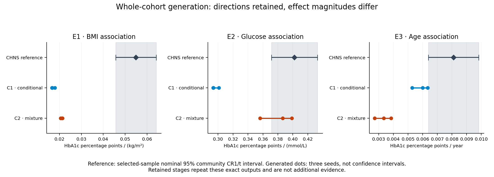
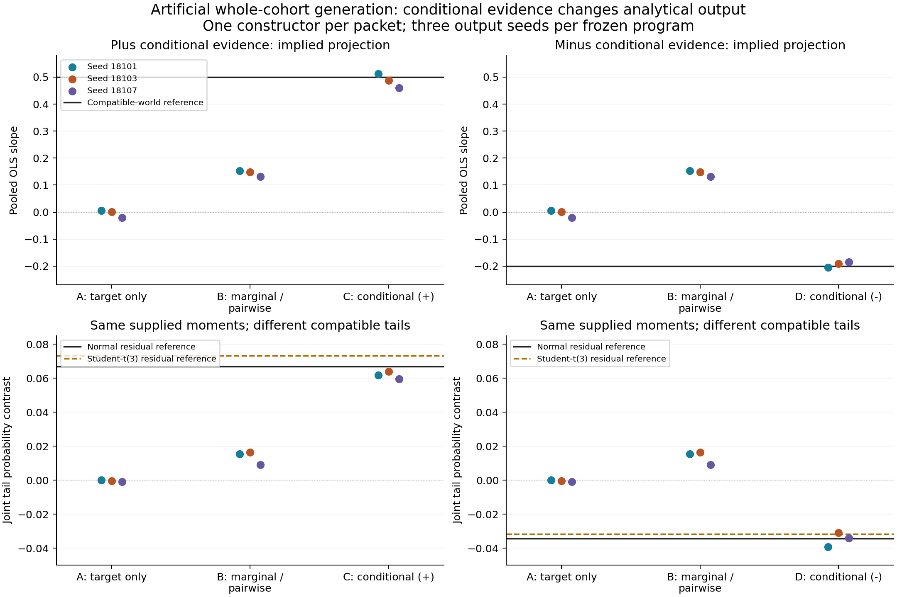

# From Published Evidence to Virtual Cohorts for Scientific Analysis

Working manuscript v0.1, 1 November 2026. This revision incorporates the completed CHNS whole-cohort evaluation and the conditional-evidence illustration. It preserves `DRAFT_v0.md` as the earlier version. The CHNS implementation adds reviewed semantic and conditional-feedback interfaces to the earlier core reference profile; historical pilots are not relabelled as evaluations of one unchanged implementation. Author declarations and the final bibliography remain submission tasks.

## Abstract

Biomedical researchers may lack individual records or measurements required for an analysis, while related studies report distributions and associations. We present an Agent-assisted procedure that translates such published evidence and a target-population specification into a documented stochastic generator and reusable virtual data. The procedure retains study conditions, separates reported quantities from derivations and assumptions, checks permitted source diagnostics, and evaluates scientific analyses after freezing the generated release. We evaluated complete-cohort generation without individual input against 6,631 adults in the China Health and Nutrition Survey. Two independently initialized Agent constructions generated age, sex, BMI, serum glucose and HbA1c. All three prespecified association directions were preserved across three draws per construction, but BMI coefficients were only 30–39% of the measured-reference estimate and glycemic variability was reduced. Both constructions retained their initial model after source feedback. In a separate artificial experiment, group-conditional evidence produced the expected change in target regression coefficients under a stipulated composition shift; an unreported tail analysis remained unidentified. These results demonstrate selected analytical feasibility and an inspectable evidence-to-generation procedure, while showing why source compatibility and agreement in association direction do not establish quantitative interchangeability with measured data.

## Introduction

Scientific analyses often require combinations of measurements that are unavailable in an accessible participant table. A researcher may have a population description and published results, but no individual records; alternatively, an existing cohort may omit a biomarker needed for a new question. Published evidence is therefore a potential input to virtual-data construction. The useful output is a dataset that researchers can analyze using familiar statistical procedures, together with a clear account of how its relationships were constructed.

The difficulty lies in forming a joint distribution from partial evidence. A marginal distribution, an age-adjusted regression and a subgroup comparison answer different statistical questions. They may also come from different age ranges, eligibility rules, assays and populations. Combining them requires decisions about measurement, dependence and transport. A generator can reproduce some supplied summaries while producing inaccurate results for another analysis of the same table.

Recent LLM systems already address important parts of generation and simulation. G-Sim combines LLM-designed simulator structures with empirical calibration and diagnostic refinement [1]. LLMSynthor uses discrepancy-guided proposals to generate records aligned with supplied aggregate statistics [2]. Thus, program-based sampling and a generation–diagnosis loop are established approaches. Our focus is the operational use of heterogeneous biomedical study results when target individual measurements are withheld, and the subsequent analytical usefulness of the resulting virtual data. This information setting motivates the study; it does not by itself establish algorithmic novelty.

We describe a procedure in which a scientific Agent selects the generative structure, parameters and assumptions, while deterministic tools execute sampling and statistical checks. Source conditions remain attached to each reported quantity. A frozen virtual release is then used for several analyses, with a separately held measured reference when available. We distinguish consistency with supplied evidence, transfer to the evaluation sample, and use for analyses that depend on additional assumptions.

The study contributes an implemented evidence-to-generator procedure, a complete-cohort evaluation without individual input, and an analysis of which scientific uses are retained or unresolved. The main empirical question is whether one virtual release supports the specified analyses. Optional variable enrichment and missing-cell completion share the broader interface but are not newly validated by the whole-cohort experiment reported here.

## Methods

### Task, evidence and scientific construction

A task specifies the intended population, variables and units, permitted individual observations, and scientific uses. Complete-cohort construction receives no individual table. In the optional enrichment and completion settings, previously observed values are retained and the generator supplies new variables or missing cells. These settings provide different information and require separate evaluation.

Each evidence item records its source locator, population and selection conditions, measurement definition, statistical operator and adjustment set, reported quantity, and available uncertainty. Reported values, algebraic transformations and modelling assumptions are distinguished. The record also identifies possible source overlap and unresolved applicability. For example, two coefficients from separate regressions cannot be inserted as though they were coefficients from one joint model. An individual-level SD cannot be interpreted as uncertainty in a reported mean. A change of measurement scale may be algebraically valid without resolving assay or population differences.

In the reported biomedical case, evidence extraction and admission were curated and reviewed before Agent construction. A scientific Agent received the approved packet and task in a fresh context. It authored a model specification, parameter-provenance record, assumptions and a program implementing `generate(observed, spec, seed)`. With `observed=None`, the program jointly generated all substantive variables. The coordinator supplied the information boundaries and technical interface; the Agent selected the scientific structure and numerical settings. No target coefficients or desired target signs were supplied as coordinator-written model parameters.

The program route lets the Agent define the probability model while numerical software produces the rows. Direct row authorship is another implemented route with separate development records; it was not used in either experiment reported here. An ordinary scientific Agent is sufficient for this procedure. Independent construction contexts provide alternative models, rather than a required multi-Agent collaboration mechanism.

### Source diagnostics and bounded revision

Candidate specifications, source interpretations and code were checked before freezing. Generated programs ran in the existing isolated execution environment. Source checks retained the meaning of the declared statistic, units, adjustment and population conditions. A statistic that could not be justified as a source comparison remained unavailable. Explicitly approved approximations were reported separately.

The CHNS controller used the versioned semantic interface and a reviewed conditional-interpretation interface. These check declared semantic consistency; they do not certify original extraction or population transport. The whole-cohort implementation did not regenerate every original source population. In this case, two additional correlation diagnostics were calculated as equally weighted task-population proxies, rather than faithful source-population replays.

Each construction had one source-feedback opportunity after three initial draws. The Agent could revise, retain, or report insufficient evidence for a correction. The feedback and decision were linked to the frozen parent. A retention preserved the scientific program and specification. All planned outputs, including unchanged and failed outputs, were eligible for reporting. There was no target-dependent candidate selection or additional generator fitting after reference disclosure.

### Biomedical evidence and reference population

The evidence packet contained sixteen items from five sources: Bao's Shanghai Diabetes Study II report, Wang's MIND-China report, contextual adjusted associations from Jansen and Pani, and NGSP measurement-scale guidance [3–7]. Source populations and measurements differed. Bao contributed a plasma-glucose/HbA1c Pearson association; MIND contributed a serum-glucose/HbA1c Spearman association. Jansen's separately adjusted associations and Pani's weighted association supplied context under explicit applicability restrictions. CHNS-derived scientific findings were excluded as external generation evidence. A contradictory MIND kappa result was quarantined. Different cohort names do not prove individual-level non-overlap.

The measured reference was the released CHNS 2009 sample, restricted prospectively to adults aged 35–74 with documented sex and complete age, BMI, central-serum glucose and HbA1c measurements. The target was this selected released sample, not a nationally representative Chinese population. Diabetes, treatment and pregnancy exclusions were not imposed. The constructors received the population/measurement specification and evidence, but no participant rows, eligible sample size, target moments or target effects. Age and sex composition were consequently model assumptions.

Four checksum-bound files were linked using the documented person and wave keys. Height and weight used centimetres and kilograms; BMI was weight divided by squared height in metres. Measurements with the documented height/weight cleaning code 9 were treated as unavailable, while other released corrections were retained. Native missing values were preserved, with no generic recoding of numeric values as missing. Glucose was measured in mmol/L and HbA1c in percentage units. The final common complete-case denominator was 6,631 people across 218 communities. Measurement timing, fasting adherence and residual release-quality uncertainties remain relevant limitations. Full eligibility and processing definitions are in the [frozen protocol](../reports/chns_admission_2026-11-01/f2/PROTOCOL.md).

### Scientific analyses and reference uncertainty

The same three unweighted OLS analyses, each with an intercept, were applied to the measured reference and every generated table:

| Analysis | Model | Reported coefficient |
|---|---|---|
| Adiposity-associated glycation | HbA1c ~ age + female + BMI | BMI, percentage points per kg/m² |
| Glycemia-associated glycation | HbA1c ~ age + female + glucose | Glucose, percentage points per mmol/L |
| Age-associated glycation beyond the other variables | HbA1c ~ female + BMI + glucose + age | Age, percentage points per year |

The reference used nominal 95% community-clustered CR1 intervals with a small-sample correction and a t distribution with 217 degrees of freedom. No national survey weights were used. These intervals characterize the selected-sample analysis under its inferential assumptions; they are not intervals for marginal means or a proof of population representativeness.

The reference direction was considered supported when its interval excluded zero. Directional stability for a construction required agreement across all three planned seeds. We also reported coefficient magnitudes, signed differences and necessary marginal/dependence diagnostics. No post-result equivalence margin or global success score was introduced. Across-seed variation represents sampling from a fixed generator and does not quantify uncertainty in the source evidence, model structure or transport assumptions.

The three regressions were withheld from numerical revision feedback and target calibration. Related associations and directions were present in external evidence. Accordingly, these were not entirely unseen scientific relationships. The source knowledge potentially present in the foundation model's pretraining was not verifiable.

### Construction and evaluation schedule

Two fresh construction contexts, C1 and C2, each produced an initial program and had at most one source-feedback revision opportunity. Each stage used seeds 1701, 1702 and 1703 and 3,000 virtual rows per table. The row count was fixed for computation before the eligible reference count was known. Twelve execution slots were allowed, with failures retaining their slots. Clinical values were accessed for evaluation only after the construction decisions and complete output inventory were committed.

The primary evaluator and an independent implementation used the same fixed analysis definitions. The independent implementation separately prepared the linked sample and used statsmodels for regression and cluster inference. Numerical agreement verifies processing and calculation, rather than providing an additional biological replication. All frozen outputs and complete aggregate results are retained in the [case record](../reports/chns_admission_2026-11-01/f2/CASE_RESULTS.md).

### Controlled conditional-evidence illustration

A separate, explicitly artificial experiment examined whether conditional evidence changed complete-cohort construction. Four fresh Agents received a common task and different evidence packets: target description alone; nine source marginal/pairwise quantities; those same quantities plus ten group-conditional quantities; or an alternative conditional packet with the same pooled source quantities. No individual table, trial generation or numerical revision feedback was supplied. Each frozen program generated three 3,000-row tables.

The source group probability was 0.5 and the target probability 0.75. Transport of the within-group joint laws was stipulated. Conditional summaries implied a target pooled coefficient of 0.50 or -0.20 in `y ~ 1 + x`, depending on the packet. This coefficient was an algebraic translation check. A separate joint-tail contrast, `P(x>1,y>2) - P(x<-1,y>2)`, was not determined by the supplied moments. Normal and standardized Student-t(3) residual laws provided two compatible examples with different tail contrasts, not a complete identification interval. Source checks recombined within-group moments using equal source weights. Reference laws and all analyses were committed before construction and disclosed after all outputs were fixed. The [prospective protocol](../reports/evidence_value_2026-11-01/PROTOCOL.md) defines this experiment; the [complete results](../reports/evidence_value_2026-11-01/RESULTS.md) retain all output seeds and compatible-world comparisons.

## Results

### Whole-cohort construction produced two different scientific models

C1 selected conditional lognormal glucose and HbA1c models with age/BMI effects and a glucose-dependent HbA1c response. C2 selected a two-component bivariate lognormal glycemic mixture with covariate-dependent membership. The mixture's higher-valued component was not a diagnosed-diabetes group. Covariate composition and dependence, conditional effect magnitudes, component behavior and residual variation included unverified assumptions in both constructions.

Both programs executed successfully. Both Agents subsequently retained their original model. The retained-stage outputs exactly matched the initial output at each seed, yielding twelve successful slots but **six unique tables**. The unit of empirical construction was two Agent-authored models in one biomedical reference case, not twelve independent validations.

### Association directions were retained, while quantitative agreement varied by analysis

All three measured-reference intervals excluded zero, and all eighteen coefficients from the six unique virtual tables were positive. Table 1 reports all primary coefficient ranges and reference intervals.

**Table 1. Scientific associations from the measured reference and virtual cohorts.** Ranges summarize the three output seeds for each fixed construction; they are not confidence intervals.

| Analysis | CHNS estimate [nominal 95% CI] | C1 range | C2 range |
|---|---:|---:|---:|
| BMI coefficient, percentage points/(kg/m²) | 0.05495 [0.04573, 0.06417] | 0.01654–0.01793 | 0.02049–0.02133 |
| Glucose coefficient, percentage points/(mmol/L) | 0.40209 [0.37129, 0.43290] | 0.29347–0.30109 | 0.35606–0.39879 |
| Age coefficient, percentage points/year | 0.008107 [0.006387, 0.009827] | 0.005284–0.006337 | 0.002714–0.003843 |

The generated BMI coefficients were approximately 30–39% of the reference estimate. C2 was closer on the glucose coefficient, whereas C1 was closer on the age coefficient. Thus a construction's better agreement on one relation did not imply better agreement on all analyses. These results establish directional agreement for the selected uses, with substantial quantitative discrepancies. They do not establish that the virtual and measured data are interchangeable.

**Figure 1. Scientific-analysis comparison for the whole-cohort case.** The existing case figure displays every unique output's primary associations and the measured-reference intervals. Retained-stage copies add no independent evidence. The reference is an uncertain selected-sample estimate.

### Similar means did not ensure appropriate variability or joint behavior

The reference HbA1c mean was 5.675%, compared with 5.738–5.744% for C1 and 5.695–5.723% for C2. However, reference HbA1c SD was 0.954 percentage points, compared with 0.719–0.736 and 0.534–0.578 percentage points, respectively. Glucose SD was 1.545 mmol/L in the reference, 1.292–1.339 in C1, and 0.984–0.992 in C2. Both constructions therefore compressed glycemic variation relative to the measured sample.

The reference glucose–HbA1c Pearson and Spearman correlations were 0.6610 and 0.3615. C2's Pearson association was comparatively close while its rank association was higher and its BMI/age coefficients remained attenuated. These descriptive results identify limitations of the completed constructions; the design does not isolate a particular model component as their cause.

### Source feedback led to retention, without demonstrated improvement

The strict semantic collector did not report numerical source discrepancies for the two correlation items because essential source semantics, including original analytic weighting, were unresolved. Separately approved task-population proxies were available. Against Bao's reported Pearson value of 0.619, C1 yielded 0.5329–0.5541 and C2 0.6657–0.6851. Against MIND's Spearman value of 0.529, C1 yielded 0.5164–0.5452 and C2 0.4780–0.4828.

The Agents judged that population, selection and measurement differences did not justify a specific correction from those diagnostics. Both retained their models. The source-feedback pathway therefore executed, but this case demonstrated no numerical-revision benefit. The proxy discrepancies also cannot be interpreted as calibrated source-population losses.

### Conditional evidence changed the artificial target projection

All twelve artificial tables executed successfully. The marginal/pairwise-only construction produced target slopes of 0.1313–0.1526. With the first conditional packet, slopes were 0.4595–0.5125 against the implied value 0.50; with the opposite packet, they were -0.2045 to -0.1856 against -0.20. Both conditional constructions had lower absolute projection errors than the marginal-only construction at every planned seed label, and changed in the expected opposite directions. In the negative-target world, the marginal-only construction was farther from the target than the target-description-only construction, preserving an adverse result.

The compatible normal and Student-t(3) laws yielded tail contrasts of 0.066966 versus 0.073304 in the positive world and -0.034322 versus -0.031626 in the negative world. Every Agent had chosen Gaussian completion. Matching the supplied moments did not identify which tail law applied. One constructor per packet confounds packet differences with author variation; the three seeds assess conditional simulation variability. This illustration establishes successful translation in the constructed task, not a general causal effect of adding evidence or a new statistical principle.

**Figure 2. Conditional-evidence illustration.** Every plotted point is an output from one of four frozen artificial generators. The upper panels compare the algebraically implied target projection; the lower panels show the assumption-dependent tail contrast against both compatible residual laws. No world-weighted aggregate score is used. This display may be placed in the supplement without altering the paper's biomedical primary question.

### Independent verification and resources

Independent CHNS processing and numerical recomputation matched all predefined comparisons. An initial import-path failure occurred before the independent evaluation gate and was preserved; an environment-only correction allowed the unchanged implementation to run. No scientific candidate was changed. The artificial experiment's independent recomputation matched 1,710 numerical fields with a maximum absolute discrepancy of 1.33e-15.

CHNS execution receipts summed to 8.406 seconds for twelve slots, and the artificial receipts to 8.439 seconds for twelve slots. These are execution times, excluding Agent authoring, curation, review and orchestration. Exact model-backend identifiers, temperature and token costs were not exposed by the surrounding Agent interface. No new paid API, training or HPC job was used for these executions. These records do not quantify recruitment or overall research-cost savings.

## Discussion

The study shows how published biomedical evidence can be made operational as a complete virtual dataset and evaluated through ordinary scientific analyses. No input participant table was needed for the principal case. The resulting data retained the directions of three specified associations, while the joint representation supported applying the same analysis code to every frozen release. This is the demonstrated capability underlying the method.

The main limitation appeared in the analytical results themselves: effect scales and glycemic variability did not consistently match the measured reference. Several consequential numerical choices remained assumptions. Source-semantic checking makes those choices inspectable, but does not resolve missing evidence or establish transport. Likewise, a source-feedback interface does not constitute an effective repair mechanism when both constructions retain their original model. These findings constrain the data's quantitative scientific uses, even where association directions agree.

The controlled illustration explains one aspect of that boundary. Pooled summaries can be identical while group-conditional relationships imply different projections after a composition shift. Conditional evidence enabled the Agents to represent that difference in generated data. Yet even the richer packet permitted different tail behavior. Increasing the number of generated rows would improve simulation precision under a selected law without determining the law itself. The illustration supports this interpretation of evidence sufficiency; it does not identify the cause of every discrepancy in the biomedical case.

The practical contribution is a documented route from available evidence to an analyzable joint-data object, with its assumptions and tested uses visible. The evidence should guide whether the output is appropriate for a particular exploratory analysis or model scenario. This study does not establish calibrated confirmatory inference, recovered individual laboratory measurements, causal conclusions or replacement of participant data collection.

Generalization is limited by one principal biomedical reference family, two constructions, selected complete cases and a restricted variable set. Reference inference was unweighted and community-clustered, with sampling and measurement assumptions. Cross-study population and assay differences, incomplete source statistics and unverified pretraining exposure remain. Uncertainty in evidence, model structure and transport was not calibrated. Neither a same-information generation comparator nor independent model-family replication was included. Consequently, broad fidelity, algorithmic superiority and general Agent reproducibility are unestablished. Optional enrichment, completion, direct-row generation and automated retrieval retain their separate development status.

These boundaries allow the paper to retain its central data-generation contribution without promising every possible variable or analysis. Improvement claims should be attached to a specific implemented operation and an appropriate comparison. The present findings support a bounded methods-and-feasibility account; they do not justify enlarging the architecture or expanding experiments without a contribution-specific question.

## Data and code availability

The [public research repository](https://github.com/ziwang11112/evidence-guided-virtual-cohorts-2026) contains reviewed methods, authored generator code, protocols, evidence summaries, aggregate analyses and independent checks. CHNS release identifiers are [biomarker data](https://doi.org/10.15139/S3/GQ9GPP) and [individual-level data](https://doi.org/10.15139/S3/9PQ5KV), both version 1.0 in the completed acquisition record. Access remains subject to each source's terms. Patient-level and generated row tables, full third-party papers/codebooks, credentials and host execution artifacts are not redistributed. The snapshot therefore supports inspection but is not a self-contained historical replay bundle; the [case export boundary](../reports/chns_admission_2026-11-01/f2/PUBLIC_SNAPSHOT.md) describes the omitted artifacts. No privacy guarantee follows merely from generating virtual data.

## References used in this working revision

1. Holt S, Ruiz Luyten M, Berthon A, van der Schaar M. G-Sim: Generative Simulations with Large Language Models and Gradient-Free Calibration. ICML, PMLR 267, 2025. [Published paper](https://proceedings.mlr.press/v267/holt25b.html).
2. Tang Y, Kong M, He J, Nie T, Ma W, Sun L. LLMSynthor: Macro-Aligned Micro-Records Synthesis with Large Language Models. KDD 2026; arXiv v3 examined in the project. [DOI](https://doi.org/10.1145/3770855.3818965).
3. Bao et al. Glycated haemoglobin A1c for diagnosing diabetes in Chinese population: cross sectional epidemiological survey. BMJ. 2010;340:c2249. [DOI](https://doi.org/10.1136/bmj.c2249).
4. Wang et al. Comparing glycemic traits in defining diabetes among rural Chinese older adults. PLOS ONE. 2024. [DOI](https://doi.org/10.1371/journal.pone.0296694).
5. Jansen et al. Lifelines adjusted-association source, 2013. [DOI](https://doi.org/10.1111/joim.12010). The [audited source record](../reports/chns_admission_2026-11-01/f2/sources/JANSEN_2013.md) identifies the exact projections used; full bibliographic metadata remains to be completed.
6. Pani et al. Age-association source, 2008. [DOI](https://doi.org/10.2337/dc08-0577). The [audited source record](../reports/chns_admission_2026-11-01/f2/sources/PANI_2008.md) identifies the retained weighted result; full bibliographic metadata remains to be completed.
7. NGSP. The IFCC and NGSP, Table 2. [Official measurement-scale guidance](https://ngsp.org/ifccngsp.asp).

## Author completion notes

This section is removed before submission. The [contribution-to-evidence map](CONTRIBUTION_EVIDENCE_MAP_2026-11-01.md) records the present claim boundaries and display choices. Complete the statistical prior-work comparison, source bibliography, participant-data ethics/access declarations, author information, and the runtime/reproduction statement using actual available records. Unavailable model metadata must remain disclosed. Earlier development studies may be summarized in a version-labelled supplement; their output counts must not be pooled as independent confirmations of this implementation. No new experiment is required merely to complete this bounded draft. New experiments require a named essential claim gap under the [current research-focus policy](../docs/CURRENT_RESEARCH_FOCUS.md); this manuscript revision launches none.
