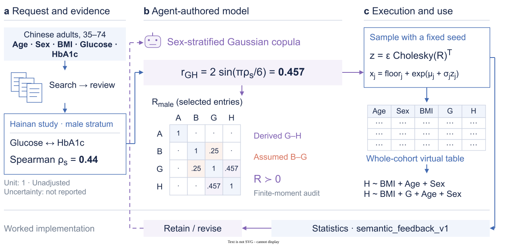
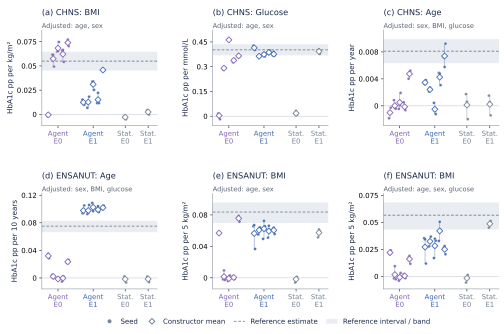
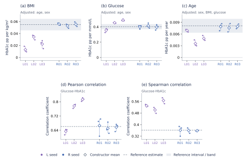
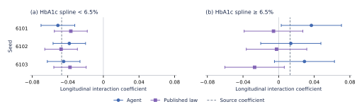
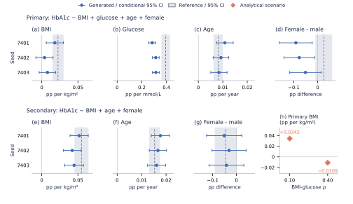

# From Published Evidence to Analyzable Biomedical Data with a Scientific Agent

Working conference-style draft v0.12 — 4 November 2026. Native-unit scientific figures and a concrete implementation overview; the scientific body, tables and results remain unchanged.

## Abstract

Biomedical studies often lack measurements needed for a new analysis, while relevant distributions and associations already appear in the literature. We study whether a scientific Agent can turn this partial evidence into useful virtual data without individual-level construction records. The Agent interprets findings under their study populations and analysis definitions, chooses a joint generating law, translates usable statistics into numerical constraints and records assumptions for missing relationships. Statistical tools execute the model and return diagnostic feedback. In a developmental study with CHNS and ENSANUT references, 20 Agent and four statistical constructions produced 72 complete tables. Additional relational evidence reduced mean absolute discrepancy for five of six specified coefficients. Separate summary-assisted and published-model experiments supported closer joint-statistic reconstruction and longitudinal analysis of 11,509 virtual subjects. An open-search case connected independently retrieved evidence to three complete 3,000-person tables, with useful agreement for several requested relationships and remaining conditional discrepancies. A pre-generation sensitivity analysis identified an unreported dependence that could reverse one conditional coefficient while leaving other relationships unchanged. These results establish concrete scientific uses of evidence-guided virtual data and show how Agent-authored models can expose the missing evidence that limits an intended analysis.

## 1. Introduction

A research question can be well defined before the necessary biomedical records are available. A cohort may never have measured a biomarker, another study's individual records may be inaccessible, or no accessible dataset may contain the required combination of variables. Published means, distributions, adjusted associations and subgroup findings nevertheless contain relevant information. A researcher could use a virtual dataset assembled from that evidence to run an intended analysis, inspect its implications and plan subsequent data collection. The practical output is a table that ordinary scientific software can analyze, accompanied by the assumptions that make the table possible.

The difficult step lies between a published finding and a joint data-generating process. An age-adjusted regression coefficient, a marginal correlation and a grouped contrast describe different statistical quantities. Their populations, measurements and adjustment sets also differ. Even two correctly extracted coefficients cannot generally be inserted unchanged into one joint model. Further relationships needed to generate a complete table may never have been reported. An automated system therefore has to make scientific modeling decisions, in addition to extracting numbers or sampling rows.

We investigate an evidence-guided Agent workflow for this task. Given a population description, requested variables and scientific analyses, the Agent acquires or receives relevant studies, chooses the numerical role of each finding, authors a joint model and inspects the resulting data. Deterministic tools perform calculations and sampling. A request may lead to a different generator when the target population, available evidence or intended analysis changes. The scientific question is whether the resulting data preserve useful properties for the requested analysis, and which properties still depend on unsupported completion or transport assumptions.

This focus builds on established synthesis methods. Filshtein et al. generate complete cohorts using source-specific models estimated by collaborating analysts [1]. SynthIPD constructs survival records and categorical covariates from published trial material [2]. Multilevel network meta-regression relates aggregate findings to individual-level models under population assumptions [3]. LLM-based systems additionally automate consequential construction decisions: G-Sim combines simulator authorship, numerical calibration and structural refinement [4]; LLMSynthor plans micro-record generation from aggregate information and uses discrepancy feedback [5]; SynthCraft supports synthetic-data workflows in healthcare [6]. SPADA separates an LLM-induced dependency graph from statistical sampling fitted to an observed table [15]. Our investigation concerns the scientific work required to connect a biomedical analysis request, study-qualified partial evidence and an analyzable joint dataset when individual construction records are absent.

The paper makes three contributions. **First**, it implements an Agent workflow in which the scientific author selects and numerically uses evidence, chooses the generating law and makes a documented retain-or-revise decision. **Second**, it makes evidence-to-model decisions inspectable: we demonstrate the translation of separate adjusted projections into joint coefficients and the identification of a missing dependence that controls a requested conditional effect. **Third**, it evaluates the resulting data through ordinary scientific analyses under external-evidence, supplied-summary and published-model information settings, together with a completed open-search construction.

The experiments provide complementary evidence rather than one pooled benchmark. The larger study uses curated literature to evaluate an information contrast. Other settings ask whether accessible summaries can become useful joint data, whether a published model can support a longitudinal analysis, and whether an actual search can lead to a complete data product. The outcome is a practical evidence-to-data procedure with demonstrated analysis-specific uses and explicit boundaries. Ordinary Agents are valid implementations; specialized training and multi-Agent collaboration are not prerequisites.

## 2. Problem: evidence-conditioned data for a scientific request

Let a request contain the target population, eligibility and measurement definitions, desired variables, permitted observations and intended analyses. A study evidence record identifies its population, measurement scale, statistical operator and adjustment set, reported estimate, available uncertainty and provenance. A set of such records provides only partial information about the joint law needed by the request.

The Agent's construction is an executable generator and its scientific specification:

```text
(generator, evidence uses, completion assumptions) = Agent(request, evidence, optional observations)
virtual data = generator(number of rows, fixed random seed)
analysis results = requested scientific analyses(virtual data).
```

This notation describes the implemented procedure; it does not introduce a trained conditional model or a new optimization objective. In complete-cohort generation, the optional observations are empty and the generator supplies every requested variable. In enrichment, observed covariates remain fixed while an unmeasured variable is generated. The present principal experiments concern complete cohorts. Earlier enrichment experiments are supporting evidence under their own versions; missing-cell completion remains an unevaluated mode.

We distinguish three legitimate uses of evidence. A reported statistic can constrain the model numerically, provide a check on its implications, or remain contextual when its meaning or applicability is insufficiently resolved. Algebraic consequences of accepted statistics are derived evidence, whereas unspecified dependence and source-to-target transport remain assumptions. A numerical constraint from another population does not automatically identify the corresponding target coefficient.

Quality is assessed at the level of scientific analysis. For an analysis statistic, such as an adjusted regression coefficient, we report the generated estimate alongside the relevant sample reference, effect direction, magnitude and available uncertainty. Source-summary agreement measures reconstruction of supplied information. Agreement with a target result not supplied to the author addresses a different question. Neither requires individual-row recovery or exact agreement with one real sample. A complete virtual table can support more than one analysis, but different uses may have different evidential support.

This problem is generally underidentified. Several joint laws can reproduce available margins and associations while implying different conditional or subgroup effects. The system consequently delivers a data product together with its construction assumptions. More generated rows improve Monte Carlo precision under a law; they do not establish unreported biological relationships. Identifying which missing relationship matters for a requested use is itself a useful outcome of constructing an explicit model.

## 3. Method

### 3.1. Qualify evidence against the request

The workflow begins with a structured task containing population, era, measurements, units, eligibility and visible scientific questions. It accepts curated evidence and Agent-directed acquisition. When retrieval is enabled, the Agent can formulate queries and select primary studies relevant to its evidence gaps. The retained record distinguishes original full text, partial access and bibliographic metadata, and records study overlap or exclusions.

Each extracted finding is interpreted through its original analysis definition. Logistic disease coefficients cannot silently become continuous-biomarker slopes; grouped contrasts cannot become per-unit effects; Pearson and Spearman associations require different numerical treatment. Likewise, a change of measurement scale supplies an algebraic conversion, not additional information about transport. Source comparisons are classified as directly supported calculations, explicitly assumption-qualified approximations or unavailable operations. Reconstructing every original study population is not a prerequisite for generating a target dataset.

In the principal study, researchers supplied audited source packets and the Agent selected their scientific use. In the open-search case, one Agent acquired a five-study packet without bibliographic seeds, and a fresh constructor used that reviewed packet. These are observed implementations of the shared procedure, not claims that every historical experiment used autonomous retrieval. The host dispatched Agents and a coordinator managed tool access, execution and closure.

### 3.2. Author a joint law and explain its numerical use

The scientific Agent chooses a probability family, dependencies, numerical parameters and any unreported completion assumptions. It supplies generator code, a model specification, evidence-use records and a decision explanation. A cited relationship counts as numerical use only when the implemented law or an explicit calculation shows how it enters a constraint or check. The coordinator does not insert target-derived coefficients or desired signs into the scientific model.

A worked construction illustrates the distinction. Jansen et al. report separate age/sex-adjusted HbA1c projections for BMI and glucose [9]. For residual BMI and glucose variables with SDs `sB` and `sG` and assumed correlation `r`, a joint response equation with coefficients `thetaB` and `thetaG` implies

```text
cB = thetaB + thetaG * r * sG/sB
cG = thetaG + thetaB * r * sB/sG.
```

CHNS E1 constructor A01, selected by ordinal identifier rather than performance, solved these equations using reported slopes `cB = 0.13` and `cG = 2.29`, residual SDs 4.07611 and 0.49694, and the declared assumption `r = 0.25`. The resulting coefficients were 0.0642173 and 2.1583154 in IFCC response units. Multiplying by 0.09148 gave 0.00587460 and 0.19744269 in HbA1c percentage-point units [11]. Thus the Agent used both projections without assigning them unchanged to one joint equation. Residual correlation, factor distributions, age/sex contributions and target transport remained assumptions.

The [worked trace](SUPPLEMENT_SOURCE_AND_ASSUMPTIONS_v05.md) links this derivation to frozen code, an unfitted source-correlation check and the constructor's target BMI mismatch. The mathematical identities are established statistics. The implemented contribution is the Agent's evidence-specific selection, derivation and use of them within data construction, with the consequences made inspectable.

### 3.3. Execute, inspect and finalize

Deterministic tools execute the authored program through an isolated WSL/bubblewrap adapter, calculate the allowed statistics and return source/generated-data feedback. Semantic checks assess the declared measurement, operator and role. Separate reviews inspect numerical calculations, support and required finite moments. These checks establish implementation properties; source extraction, biological plausibility and population transfer require their own evidence.

The Agent can revise or retain its model within the task budget. A valid no-op ends the construction; the process does not require an extra revision to manufacture improvement. Each candidate, final seed allocation and evaluation contract is fixed before the corresponding execution or comparison. The final data and model assumptions are delivered together, so the intended analyses can be run in standard software. Author access boundaries are procedural even though generator execution is isolated.

The shared scientific procedure has separately frozen experimental implementations, source packets, feedback opportunities and evaluators. Main-study requests generated complete age, sex, BMI, glucose and HbA1c tables. The longitudinal case used a separate native mixed-model evaluator. The latest controller bound one specific complete-cohort request; general standalone interpretation and execution of arbitrary natural-language requests are not established by these experiments.



**Figure 1. A worked evidence-to-generator implementation.** The completed whole-cohort case connects a reviewed study result to actual model parameters and sampling operations. The Agent selects a sex-stratified Gaussian copula and converts the Hainan male glucose–HbA1c Spearman coefficient 0.44 to latent correlation 0.457. The matrix shows selected entries only: A/B/G/H denote age/BMI/glucose/HbA1c; dots omit other entries, and the BMI–glucose value 0.25 is an explicit assumption. With standard-normal noise ε, Cholesky sampling and the displayed shifted-lognormal transform generate BMI, glucose and HbA1c; age uses a separate bounded-integer transform. The table cells are schematic placeholders. Positive-definiteness and finite-moment audits precede execution; runtime statistics and semantic_feedback_v1 inform the retain-or-revise decision. This instance retained its model after 11 approximate comparisons and 23 unavailable checks per execution. Search, evidence review and fresh-context construction were host-dispatched stages. The figure illustrates an implemented construction, not a mandatory copula for all requests or a demonstrated revision gain.

## 4. Experiments

We organize evaluation around four questions: **Q1**, does additional relational evidence support useful target analyses? **Q2**, can accessible summaries become a coherent joint dataset? **Q3**, can the procedure construct longitudinal data for a published analysis? **Q4**, can open evidence acquisition lead to an analyzable cohort and reveal an analysis-sensitive evidence gap? Table 1 separates their information conditions. Individual-level records were not supplied to any constructor in these settings.

**Table 1. Evaluation questions and information conditions.** A construction is an authored model; seeds sample that model. Reused CHNS analyses are not additional target families.

| Question and setting | Construction inputs | Constructions and final data | Reference role |
|---|---|---|---|
| Q1: external evidence, CHNS and ENSANUT | Population/measurement requests; E0 basic/marginal evidence or E1 additional relational evidence | 20 Agent + 4 statistical constructions; 72 tables of 3,000 rows | Previously exposed selected-sample references; target coefficients not supplied to fresh authors |
| Q2: CHNS summary assistance | Literature in L; literature plus 30 target summaries and metadata in R | 6 Agent constructions; 18 distinct final tables of 3,000 rows | Reconstruction of explicitly supplied information in R |
| Q3: HRS published model | Published model artifacts and requested longitudinal analysis | 1 Agent + 1 reconstructed published law; 6 valid tables, each 11,509 subjects at 4 visits | Published-model reconstruction; no HRS participant records |
| Q4: open search and construction | Five Agent-retrieved, reviewed studies and a population/analysis request | 1 fresh constructor; 3 final tables of 3,000 rows | Reused CHNS aggregates after closure; one developmental workflow case |

### 4.1. Evaluation design

CHNS included 6,631 selected adults aged 35–74 with complete age, recorded sex, BMI, central glucose and HbA1c. Analyses were unweighted selected-sample estimates; diabetes/treatment exclusions were not imposed and individual fasting adherence was unverified. ENSANUT included 6,931 selected adults aged 25–79 under fixed fasting, prior-diagnosis, glucose and anthropometry criteria. It assigned equal mass to eight sex-by-age cells rather than estimating national survey effects. These populations, measurement units and estimators remain distinct.

Q1 allocated five fresh Agent contexts to each case/condition and one fixed statistical specification to each case/condition. Each construction had three 3,000-row final attempts, seeds 5101–5103, and at most two exploratory row-producing attempts. The fixed statistical specifications used the same admitted numerical information and explicit completion assumptions. One prescribed specification versus five independently authored Agent laws is an asymmetric descriptive comparison. Matching author labels across E0/E1 do not imply pairing.

All constructions closed before common reference evaluation. Each case retained three focal regressions and 27 CHNS or 28 ENSANUT marginal/joint diagnostics. Four focal analyses had source-analogous projections; CHNS conditional age and ENSANUT conditional BMI were neither directly supplied as target coefficients nor identified by the admitted packet. For each focal statistic, absolute reference discrepancy was averaged over three seeds within each constructor, then across five Agent constructors. E1–E0 compared these arm means. Three-seed ranges quantify sampling under a fixed law. CHNS community-cluster CR1-t intervals and ENSANUT prespecified cluster-resampling stability bands contextualize their sample estimates; neither defines equivalence.

Both target families had been exposed during earlier development. Fresh author contexts restrict construction inputs but do not restore untouched clinical validation. Separately written numerical audits checked generated statistics and frozen reference mappings. Complete eligibility, formulas, reference intervals, allocations, failures and diagnostics are preserved in the [extended methods and results](DRAFT_v0_9.md). The principal comparison, summary study, longitudinal example and later workflow units are not pooled into a single success score.

### 4.2. Q1: external relations improve several requested analyses

All 24 Q1 constructions produced their three scheduled final tables. The 72 final tables were distinct and supported every requested regression and diagnostic; seven exploratory tables brought physical executions to 79. Additional relational evidence reduced constructor-averaged mean absolute discrepancy for five of the six designated coefficients (Table 2). CHNS glucose discrepancy decreased from 0.134019 to 0.024079 HbA1c percentage points per mmol/L. All three ENSANUT contrasts improved. CHNS BMI discrepancy increased from 0.020380 to 0.031557.

**Table 2. Complete main-study information contrast.** Discrepancies retain the units of each row; they are not pooled. The reference response is HbA1c percentage points. E1–E0 uses unrounded quantities before display rounding.

| Case / focal analysis | Predictor increment | E0 mean absolute discrepancy | E1 mean absolute discrepancy | E1 − E0 |
|---|---|---:|---:|---:|
| CHNS BMI, adjusted age/sex | 1 kg/m² | 0.020380 | 0.031557 | +0.011178 |
| CHNS glucose, adjusted age/sex | 1 mmol/L | 0.134019 | 0.024079 | −0.109939 |
| CHNS age, adjusted sex/BMI/glucose | 1 year | 0.007281 | 0.004854 | −0.002426 |
| ENSANUT age, adjusted sex/BMI/glucose | 10 years | 0.063944 | 0.024670 | −0.039274 |
| ENSANUT BMI, adjusted age/sex | 5 kg/m² | 0.056883 | 0.023732 | −0.033151 |
| ENSANUT BMI, adjusted age/sex/glucose | 5 kg/m² | 0.048797 | 0.025649 | −0.023147 |



**Figure 2. External evidence and six scientific analyses.** All six coefficients use native units and the indicated adjustment sets. E0 supplies basic/marginal evidence; E1 adds relational evidence. Each Agent condition contains five independently authored generators, ordered A01–A05; each statistical condition contains one prescribed generator. Dots show three final seed estimates, open diamonds constructor means, and vertical segments seed min–max ranges. Author labels do not pair E0 and E1. Dashed lines denote selected-sample reference estimates; gray regions are CHNS 95% community-cluster CR1-t intervals or ENSANUT cluster-resampling stability bands. Neither is a within-generator seed interval or an equivalence margin. All 24 constructions, 72 tables and 216 coefficient estimates appear. Additional evidence lowers mean absolute reference discrepancy for five endpoints, while CHNS BMI worsens; endpoint-specific contrasts are reported in the text. The reference populations were exposed during development.

The effect displays explain what these changes mean. CHNS E1 glucose constructor means were 0.363363–0.414189 around the 0.402093 reference. Its BMI means were positive but lower, 0.012400–0.045757 versus 0.054946. Conditional-age means ranged from −0.000509 to 0.007393 versus 0.008107; one author retained a negative mean and two negative seeds. All ENSANUT E1 focal coefficients were positive, although its age means of 0.097769–0.102452 per decade exceeded 0.075132 and its BMI means remained below their references. Preserving a direction and recovering its magnitude are distinct aspects of usefulness.

Every E1 author used at least one relationship as a numerical constraint. The complete uptake records include constraints, unfitted analytic checks and contextual uses, including the projection calculation in Section 3.2. Statistical references also achieved useful results: under E1, the prescribed constructions had lower seed-averaged discrepancies than every corresponding Agent for CHNS glucose and ENSANUT conditional BMI. Other comparisons favored Agent constructions. The evidence therefore supports scientific utility and the value of additional information, rather than a universal algorithmic ranking.

### 4.3. Q2: accessible summaries become useful joint data

The separate CHNS experiment gave three authors external literature (L) and three authors that literature plus 30 target summaries and their metadata (R). Each author delivered three tables and had one additional diagnostic-review opportunity. All six retained their models. There were 42 physical executions: six trials and 36 initial/final deliveries. Final bytes duplicated their matching initial outputs, leaving 24 distinct tables overall and 18 distinct delivery tables. The identical stages are displayed once.

R supported close reconstruction of all five highlighted scientific analyses (Table 3; Figure 3). These values were legitimate construction inputs; their agreement measures reconstruction rather than prediction of hidden coefficients. The L/R packet and authors differ from Q1, so those two information comparisons are kept separate.

**Table 3. Joint-statistic reconstruction with available summaries.** Ranges span three constructor means over three fixed seeds, not confidence intervals. Regression units are HbA1c percentage points per kg/m², mmol/L and year, respectively.

| Analysis | Supplied reference | External literature L | Literature + summaries R |
|---|---:|---:|---:|
| BMI coefficient, age/sex adjusted | 0.054946 | 0.013001–0.034287 | 0.052821–0.055789 |
| Glucose coefficient, age/sex adjusted | 0.402093 | 0.356064–0.487815 | 0.396941–0.413715 |
| Age coefficient, sex/BMI/glucose adjusted | 0.008107 | 0.003552–0.006910 | 0.007569–0.007947 |
| Glucose–HbA1c Pearson correlation | 0.660968 | 0.633764–0.813170 | 0.650561–0.666438 |
| Glucose–HbA1c Spearman correlation | 0.361457 | 0.501339–0.566477 | 0.357571–0.360983 |



**Figure 3. Supplied summaries become jointly analyzable data.** The five panels show three adjusted regression coefficients and the glucose–HbA1c Pearson and Spearman correlations. L01–L03 use literature evidence; R01–R03 additionally receive 30 target summaries and metadata. Dots are all three final seed statistics, diamonds constructor means and thin segments seed ranges. Labels denote independently authored generators, not paired versions. Dashed lines mark reference summaries available to R; gray bands are the available 95% community-cluster CR1-t intervals for regression references. No correlation interval is supplied. All six constructors, 18 distinct delivery tables and 90 statistics are shown once; retained initial/final outputs are identical. Closer R agreement demonstrates supplied-information reconstruction, not prediction of hidden reference results or a revision benefit.

Agreement extended beyond central values. R constructor-mean BMI SDs were 3.38965–3.40243 versus 3.40632, glucose SDs were 1.48817–1.58968 versus 1.54455, and HbA1c SDs were 0.95208–0.96554 versus 0.95357. A separate three-table statistical calibration supplement also closely reconstructed the regression summaries, with mean coefficients 0.055726, 0.412568 and 0.007679. That purpose-built family was developed with coding-Agent assistance and is not an Agent-removal ablation. Both approaches demonstrated the usefulness of constructing a joint table from accessible aggregate information.

### 4.4. Q3: a published model supports longitudinal analysis

The HRS recipient-stage example [1] tested a different data product. A fresh Agent received published model exports, a variable specification and the intended mixed-model analysis. It authored the recursive conditional generating family with parameter provenance. A separate implementation reconstructed the published law. Each generated 11,509 subjects at 0, 2, 4 and 6 years, producing 46,036 rows per table. No HRS individual records were used, and the source analysis coefficients were construction inputs.

All three Agent and three corrected-law tables supported the native R/lme4 model with 16 fixed effects, individual intercepts/slopes and piecewise HbA1c terms around 6.5%, with age centered at 60 and scaled per decade. The below-threshold HbA1c-by-age interaction averaged −0.044635 in Agent data, with range −0.051059 to −0.038247, against the supplied −0.046837. The reconstructed law averaged −0.040500. Both preserved its negative direction in all three draws (Figure 4).



**Figure 4. Longitudinal analysis of reconstructed cohorts.** Panels show the interactions of memory-score change per decade with HbA1c splines below and at or above 6.5%. Blue circles are Agent-generated and violet squares published-law reconstruction estimates for three fixed seeds; bars are all 12 stored model-conditional 95% Wald intervals. Dashed lines mark supplied source coefficients and solid lines mark zero; source standard errors are not plotted. Each table has 11,509 synthetic subjects at four visits (46,036 records). Both constructions receive source-model exports and method code. The negative lower-branch interaction is retained; upper-branch point estimates and significance decisions vary. All 16 effects, the high-HbA1c spread discrepancy and three invalid initial comparator attempts remain in the supporting record. This is source-rich reconstruction, not independent clinical confirmation.

The weaker above-threshold interaction was less stable: Agent estimates averaged 0.026485 against 0.012867, while corrected-law estimates averaged −0.011691. Overall Agent HbA1c mean/SD was 5.8725/0.9676 versus the original published 5.9/1.0. The high-HbA1c subgroup had mean/SD 7.1515/0.5630, compared with original 7.7/1.4 and published synthetic 7.2/0.6. Thus useful source-model behavior coexisted with inadequate upper-group spread.

A CRLF-sensitive parser initially overwrote seven coefficient/SE pairs in our comparator preparation. A separately reviewed source-bound repair produced the three corrected comparator tables without changing the frozen Agent outputs. The full record contains nine physical generations, six valid comparison tables and three invalid initial comparator attempts. This was our implementation defect, not a failure of the published method. The [incident record](../reports/hrs_public_example_2026-11-03/recovery_v1/INCIDENT_AND_CORRECTION.md) and complete effects retain the correction and all outcomes.

### 4.5. Q4: open search leads to data and a precise evidence gap

The open-search request concerned `HbA1c ~ BMI + glucose + age + female` among Chinese adults aged 35–74 around 2009. A fresh acquisition Agent received no bibliographic seeds, desired signs or generator family. Ten recorded queries led to five seriously reviewed originals, with CHNS-derived numerical evidence excluded. The source review distinguished continuous conditional coefficients [9] from grouped contrasts [14], unclear-scale coefficients [13] and diabetes logistic effects [12]. Pani supplied complementary age evidence [10]. Population and adjustment differences remained visible.

A new scientific constructor used that packet to choose a sex-stratified Gaussian copula, bounded integer age and positive lognormal/shifted-lognormal margins. It converted Pearson and Spearman evidence under the selected marginal laws, used source summaries with explicit transport assumptions and retained less directly applicable conditional findings as context. No scientific parameter or target answer was supplied by the controller. One trial and three fixed deliveries succeeded, each with 3,000 complete rows. Each execution returned 11 approximate and 23 unavailable source comparisons; after feedback the Agent retained its model.

The resulting data supported useful secondary analyses without glucose adjustment. BMI coefficients were 0.04217–0.05176 versus 0.05495 in the reused CHNS reference, and age coefficients were 0.01613–0.01771 versus 0.01530. Primary age was also close at 0.00842–0.01084 versus 0.00811. Primary BMI and glucose were attenuated, and the primary female point direction differed from its uncertain reference. Figure 5 retains all seven nonintercept coefficients, their uncertainty labels and every fixed seed. Distributional differences also remained, including excess female proportion and a higher HbA1c 90th percentile; the full diagnostic table is preserved.



**Figure 5. Analysis-specific usefulness and an unresolved joint dependence.** Panels (a–d) show all primary-model nonintercept effects and (e–g) all secondary-model effects. Blue points are three fixed 3,000-person draws with conditional 95% HC3-t intervals. Gray dashed lines and bands are exposed CHNS reference estimates and 95% community-cluster CR1-t intervals; solid lines mark zero. All effects retain native units (pp: HbA1c percentage points), with shared limits for matching predictors. Generated intervals omit source, structural and transport uncertainty; overlap is not equivalence. Panel (h) displays two pre-generation analytical scenarios: latent BMI–glucose correlations 0.10 and 0.40 imply conditional BMI coefficients +0.03422 and −0.01095 while leaving marginal laws, other bivariate laws and the secondary projection unchanged. The delivered model used 0.25. These are not new draws, a fitted curve or a causal intervention. Retained initial/final stages alias the same three tables.

The sensitivity was identified before generation or target comparison. The delivered model's dependence of 0.25 was an explicit assumption. Both alternative covariance structures were valid, and independent calculation reproduced the sign change. This identifies the particular missing relationship that affects the requested conditional analysis even when other fitted relationships stay unchanged. It does not establish that one assumption explains every observed discrepancy.

Real-sample variation provides additional context. A separately frozen analysis partitioned the existing CHNS communities into disjoint halves 100 times and sampled 3,000 people per side. For statistic T, it compared `|T(R1)−T(R2)|` with the symmetric generated discrepancy `(|T(G)−T(R1)|+|T(G)−T(R2)|)/2`, retaining all 36 metrics. For secondary BMI, the real-real median was 0.007239 versus generated symmetric medians of 0.004383–0.012727 across the three tables; for secondary age, the corresponding values were 0.001705 and 0.001055–0.002387. Primary glucose and female discrepancies were substantially larger than their resplit context. These nonexchangeable finite-sample comparisons help interpret analysis-specific usefulness without defining a retrospective equivalence threshold. The [complete table](../reports/real_real_calibration_2026-11-04/COMPLETE_METRIC_TABLE.md) and [seven-term supplement](integrated_figures_v09_2026-11-04/supplement_real_real_context.svg) retain every result.

## 5. Discussion

The experiments support a concrete role for a scientific Agent: construct data that researchers can analyze by selecting and numerically reconciling partial biomedical evidence. The important output is a joint data product, not a predicted answer to one regression. Cross-sectional and longitudinal examples show that this product can preserve useful analytical relationships under several information conditions. The source-to-model traces explain what the Agent contributed between a paper's result and a generated table.

The strongest methodological lesson is that scientific use depends on the relationship being asked about. External relations improved five of six main-study contrasts, and provided summaries supported close joint reconstruction. Yet a model matching several margins or pairwise relations can still imply a different conditional effect. The copula sensitivity makes this gap explicit and suggests a focused next action: acquire joint or subgroup evidence for the dependence that controls the requested analysis. This diagnostic use of an executable model can guide research even when the available evidence does not identify a unique target distribution.

The framework's statistical operations build on established mathematics and related LLM construction methods [3–6]. Its applied contribution connects a biomedical request to qualified evidence, scientific model authorship, data generation and analysis-centered evaluation. The current experiments demonstrate particular uses; they do not establish uniform superiority over task-specific statistics. G-Sim and LLMSynthor also delegate consequential model or data-construction choices to LLMs, so the presence of an Agent or a feedback loop alone is not a field-priority claim.

Three limits determine the scope of the evidence. First, CHNS and ENSANUT are exposed developmental references with partly shared sources; later CHNS work reuses that reference. Summary-assisted R and the HRS model intentionally receive the relevant numerical answers. These information settings remain distinct from independent transport validation. Second, generated seed ranges and conditional model intervals omit source-estimation, extraction, structural and transport uncertainty. The real-real analysis describes variation within one selected sample, not between populations. Third, actual workflow integration remains host-dispatched and coordinator-managed. Autonomous execution for arbitrary requests, preparation-time savings and broad-domain scalability have not been measured.

Feedback is operational but its scientific benefit is unresolved. Seven main-study authors reviewed exploratory outputs and retained their laws; thirteen finalized without exploration. All six L/R authors and the latest constructor retained their models after review. Earlier live authors likewise retained their outputs, although a coordinator-detected divergent-moment defect was repaired by the author before freeze. Those records establish meaningful inspection and valid retention, not a general revision-gain result. Earlier enrichment, direct-row construction, failed transport criteria, tail defects and revision trade-offs remain in the [historical supplement](SUPPLEMENT_HISTORICAL_RESULTS_v05.md); missing-cell completion is unvalidated.

The next discriminating extension is a prospectively frozen request-to-data workflow across independently defined tasks and unexposed references, with actual effort and uncertainty recorded. It should test specific claims about additional evidence or workflow reuse. The present paper already establishes a narrower useful capability: published evidence can be made executable as virtual biomedical data, and an Agent can expose the assumptions that determine which scientific analyses those data support.

## Supporting results, code and reproducibility

The [public repository](https://github.com/ziwang11112/evidence-guided-virtual-cohorts-2026) provides original code, protocols, aggregate results and independent checks. The [complete v0.9 extended record](DRAFT_v0_9.md) preserves all six original numerical tables and full methods/results. Its Table 2 supplies every main endpoint's adjustment set, units and reference interval; Tables 3–4 retain the main and summary-assisted values; Table 5 retains all latest seven effects; Table 6 retains the real-real comparison values. No result was discarded by this narrative condensation.

The [main study](../reports/main_study_freeze_2026-11-03/RESULTS.md), [summary-assisted study](../reports/information_revision_ablation_2026-11-03/RESULTS.md), [statistical supplement](../reports/summary_comparator_2026-11-03/RESULTS.md), [HRS example](../reports/hrs_public_example_2026-11-03/RESULTS.md), [open search](../reports/gap_search_2026-11-04/RESULTS.md) and [latest construction](../reports/evidence_to_generation_2026-11-04/RESULTS.md) preserve separate frozen identities. Earlier live A/B results, including the conditioned BMI mismatch and source-replay unavailability, remain in the extended record. Numerical and visual reproduction is aggregate-only and does not constitute a new scientific experiment.

Individual real/generated tables, third-party originals and credentials remain local; clinical reruns require lawful access and the appropriate environment. Historical model identifiers and token costs are incompletely metered. Author/affiliation/funding/conflict/ethics/access/AI declarations and final submission formatting remain to be completed. No manuscript has been submitted.

## References

1. Filshtein TJ, Li X, Zimmerman SC, Ackley SF, Glymour MM, Power MC. Proof of concept example for use of simulation to allow data pooling despite privacy restrictions. *Epidemiology*. 2021;32(5):638–647. [DOI and full text](https://pmc.ncbi.nlm.nih.gov/articles/PMC8338788/).
2. Zhao Z et al. SynthIPD: training-free synthetic individual patient data generation. arXiv:2509.16466v2, 24 July 2026. [Versioned full text](https://arxiv.org/html/2509.16466v2). Publication beyond this preprint was not established in the positioning audit.
3. Phillippo DM et al. Multilevel network meta-regression for population-adjusted treatment comparisons. *Journal of the Royal Statistical Society: Series A*. 2020;183(3):1189–1210. [DOI/full text](https://rss.onlinelibrary.wiley.com/doi/full/10.1111/rssa.12579).
4. Holt S, Ruiz Luyten M, Berthon A, van der Schaar M. G-Sim: Generative Simulations with Large Language Models and Gradient-Free Calibration. *Proceedings of ICML*. PMLR 267;2025:23513–23561. [Published record](https://proceedings.mlr.press/v267/holt25b.html).
5. Tang Y, Kong M, He J, Nie T, Ma W, Sun L. LLMSynthor: Macro-Aligned Micro-Records Synthesis with Large Language Models. KDD 2026. [DOI](https://doi.org/10.1145/3770855.3818965); [full text v4](https://arxiv.org/html/2505.14752v4).
6. Callender T, Boyd A, Davis R, Ruhrberg Estevez S, Lavista Ferres JM, van der Schaar M. SynthCraft: An AI partner for synthetic data generation to support data access and augmentation in healthcare. *PLOS Digital Health*. 2026;5(3):e0001290. [Published article](https://journals.plos.org/digitalhealth/article?id=10.1371/journal.pdig.0001290).
7. Bao Y, Ma X, Li H, Zhou M, Hu C, Wu H, Tang J, Hou X, Xiang K, Jia W. Glycated haemoglobin A1c for diagnosing diabetes in Chinese population: cross sectional epidemiological survey. *BMJ*. 2010;340:c2249. [DOI](https://doi.org/10.1136/bmj.c2249); [bibliographic record](https://pubmed.ncbi.nlm.nih.gov/20478961/).
8. Wang P, Li Y, Wang M, Song L, Dong Y, Han X, Tuomilehto J, Wang Y, Du Y, Qiu C. Comparing glycemic traits in defining diabetes among rural Chinese older adults. *PLOS ONE*. 2024;19(1):e0296694. [Published article](https://journals.plos.org/plosone/article?id=10.1371/journal.pone.0296694).
9. Jansen H, Stolk RP, Nolte IM, Kema IP, Wolffenbuttel BHR, Snieder H. Determinants of HbA1c in nondiabetic Dutch adults: genetic loci and clinical and lifestyle parameters, and their interactions in the lifelines cohort study. *Journal of Internal Medicine*. 2013;273(3):283–293. [Published article](https://onlinelibrary.wiley.com/doi/10.1111/joim.12010).
10. Pani LN, Korenda L, Meigs JB, Driver C, Chamany S, Fox CS, Sullivan L, D'Agostino RB, Nathan DM. Effect of aging on A1C levels in individuals without diabetes: evidence from the Framingham Offspring Study and the National Health and Nutrition Examination Survey 2001-2004. *Diabetes Care*. 2008;31(10):1991–1996. [DOI](https://doi.org/10.2337/dc08-0577); [bibliographic record](https://pubmed.ncbi.nlm.nih.gov/18628569/).
11. NGSP. The IFCC and NGSP, Table 2. [Official measurement-scale guidance](https://ngsp.org/ifccngsp.asp).
12. Li T, Quan H, Zhang H, Lin L, Lin L, Ou Q, Chen K. Type 2 diabetes is more predictable in women than men by multiple anthropometric and biochemical measures. *Scientific Reports*. 2021;11:6062. [DOI](https://doi.org/10.1038/s41598-021-85581-z); [original full text](https://pmc.ncbi.nlm.nih.gov/articles/PMC7960723/).
13. Sakane N, Sato J, Tsushita K, Tsujii S, Kotani K, Tominaga M, Kawazu S, Sato Y, Usui T, Kamae I, Yoshida T, Kiyohara Y, Sato S, Tsuzaki K, Nirengi S, Takahashi K, Kuzuya H, JDPP Research Group. Determinants of Glycated Hemoglobin in Subjects With Impaired Glucose Tolerance: Subanalysis of the Japan Diabetes Prevention Program. *Journal of Clinical Medicine Research*. 2017;9(4):360–365. [DOI](https://doi.org/10.14740/jocmr2928w); [original full text](https://pmc.ncbi.nlm.nih.gov/articles/PMC5330780/).
14. Wisgerhof W, Ruijgrok C, den Braver NR, Borgonjen—van den Berg KJ, van der Heijden AAWA, Elders PJM, Beulens JWJ, Alssema M. Phenotypic and lifestyle determinants of HbA1c in the general population–The Hoorn Study. *PLOS ONE*. 2020;15(6):e0233769. [DOI](https://doi.org/10.1371/journal.pone.0233769); [original full text](https://pmc.ncbi.nlm.nih.gov/articles/PMC7272077/).

15. Yang S, Zhang Z, Prenkaj B, Kasneci G. Doubling Your Data in Minutes: Ultra-fast Tabular Data Generation via LLM-Induced Dependency Graphs. *Proceedings of the 2025 Conference on Empirical Methods in Natural Language Processing*. 2025:10337–10358. [Official article and PDF](https://aclanthology.org/2025.emnlp-main.525/); [DOI](https://doi.org/10.18653/v1/2025.emnlp-main.525).
