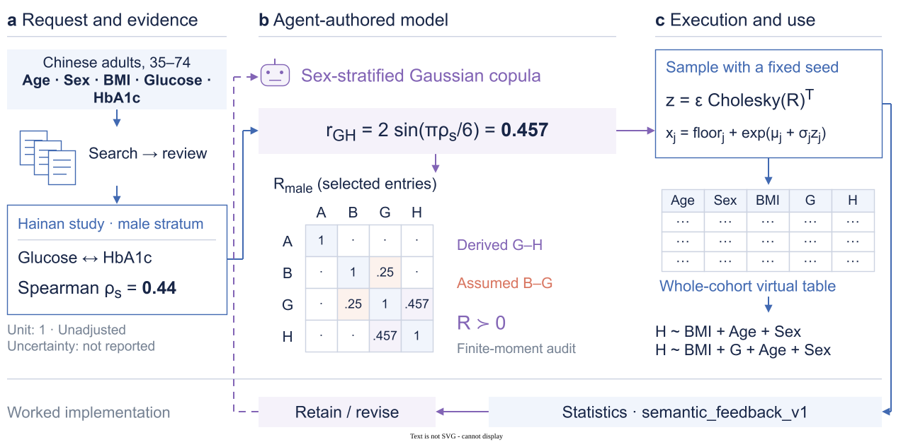
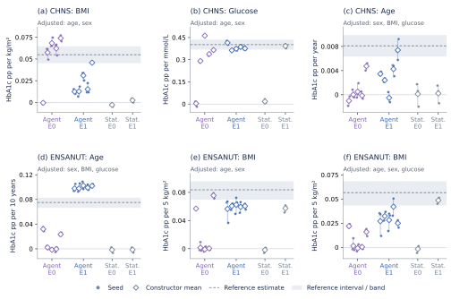
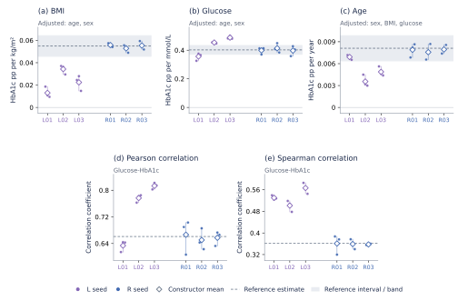
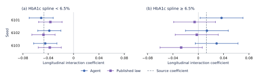
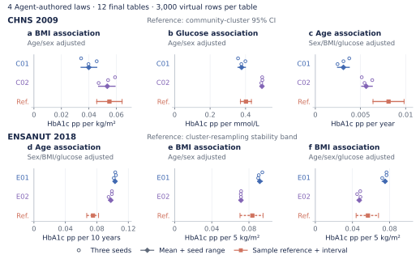
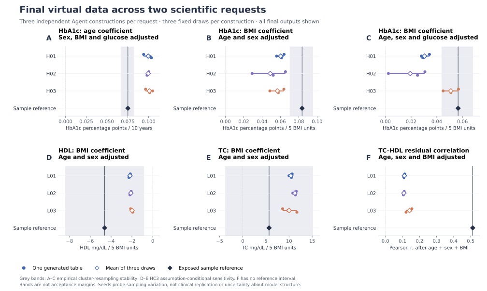
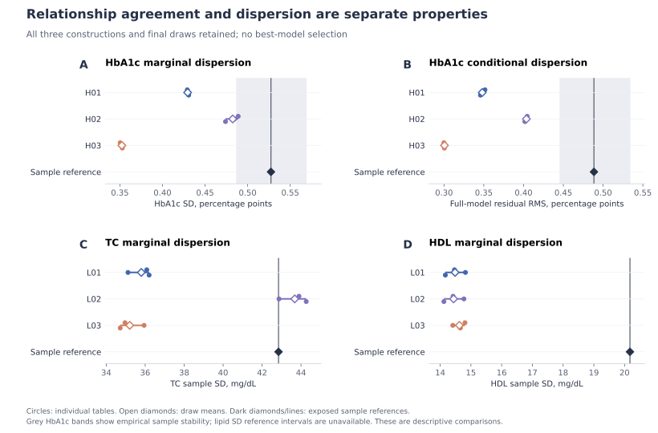
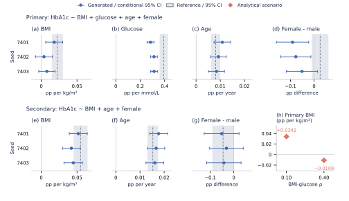

# Evidence-Guided Agents for Analyzable Virtual Biomedical Cohorts

Working conference-style draft v0.14, 5 November 2026. Reading copy for scientific review; submission preparation remains incomplete.

## Abstract

Individual biomedical records may be inaccessible or omit variables needed for a scientific analysis, while relevant summaries and associations are available in published studies. We investigate an Agent-controlled workflow that turns this partial evidence into complete, analyzable virtual cohorts without individual-level construction records. The Agent interprets study-qualified findings, chooses a joint generating law, derives numerical constraints and records assumptions for unreported relationships; numerical tools execute and inspect the construction. In a developmental study using CHNS and ENSANUT references, 20 Agent and four statistical constructions produced 72 tables; additional relational evidence reduced mean absolute discrepancy for five of six specified coefficients. Separate experiments demonstrated supplied-summary reconstruction, longitudinal analysis from published models and four open-retrieval constructions. A new cross-task study generated 18 distinct 3,000-row tables from six fresh constructions for HbA1c and lipid analyses. All 54 primary point estimates agreed in direction with cached sample estimates, but effect magnitudes, residual dependence and dispersion showed substantial discrepancies; the total-cholesterol reference interval also crossed zero. All six initial laws were retained, so this batch demonstrates no feedback-driven improvement. An earlier analytical sensitivity showed how an unreported dependence can reverse a conditional coefficient despite unchanged marginal relationships. The contribution is an inspectable evidence-to-joint-law-to-data workflow using established statistical families. The current outputs support analysis-specific, assumption-dependent scenario use; repeated construction on previously exposed references does not establish quantitative cohort substitution or independent clinical replication.

## 1. Introduction

A research question can be well defined before the necessary biomedical records are available. A cohort may never have measured a biomarker, another study's individual records may be inaccessible, or no accessible dataset may contain the required combination of variables. Published means, distributions, adjusted associations and subgroup findings nevertheless contain relevant information. A researcher could use a virtual dataset assembled from that evidence to run an intended analysis, inspect its implications and plan subsequent data collection. The practical output is a table that ordinary scientific software can analyze, accompanied by the assumptions that make the table possible.

The difficult step lies between a published finding and a joint data-generating process. An age-adjusted regression coefficient, a marginal correlation and a grouped contrast describe different statistical quantities. Their populations, measurements and adjustment sets also differ. Even two correctly extracted coefficients cannot generally be inserted unchanged into one joint model. Further relationships needed to generate a complete table may never have been reported. An automated system therefore has to make scientific modeling decisions, in addition to extracting numbers or sampling rows.

We investigate an evidence-guided Agent workflow for this task. Given a population description, requested variables and scientific analyses, the Agent acquires or receives relevant studies, chooses the numerical role of each finding, authors a joint model and inspects the resulting data. The researcher specifies the scientific request and access conditions; the Agent takes responsibility for the task-specific equations, distributions and parameter derivations that otherwise require manual model specification. Deterministic tools perform calculations and sampling. A request may lead to a different generator when the target population, available evidence or intended analysis changes. The scientific question is whether the resulting data preserve useful properties for the requested analysis, and which properties still depend on unsupported completion or transport assumptions.

This focus builds on established synthesis methods. Filshtein et al. generate complete cohorts using source-specific models estimated by collaborating analysts [1]. SynthIPD constructs survival records and categorical covariates from published trial material [2]. Multilevel network meta-regression relates aggregate findings to individual-level models under population assumptions [3]. LLM-based systems additionally automate consequential construction decisions: G-Sim combines simulator authorship, numerical calibration and structural refinement [4]; LLMSynthor plans micro-record generation from aggregate information and uses discrepancy feedback [5]; SynthCraft supports synthetic-data workflows in healthcare [6]. SPADA separates an LLM-induced dependency graph from statistical sampling fitted to an observed table [15]. Our investigation concerns the scientific work required to connect a biomedical analysis request, study-qualified partial evidence and an analyzable joint dataset when individual construction records are absent.

The paper makes three contributions. **First**, it implements and repeatedly exercises an Agent-controlled path from biomedical evidence to a joint law and useful scientific data, including complete-cohort generation without individual inputs or researcher-specified generator equations. **Second**, it makes scientific modeling decisions inspectable, including reconciliation of separate adjusted projections, distinctions between marginal and residual variation, and explicit assumptions for missing dependence; a worked sensitivity shows how such a dependence changes a conditional conclusion. **Third**, it evaluates the resulting data through ordinary scientific analyses under complementary information conditions: an external-evidence contrast, supplied-summary reconstruction, a published longitudinal model, repeated open retrieval, and a six-construction study spanning glycemia and lipids. The contribution is a reusable scientific modeling and data-generation workflow. Its laws use established statistical families, and usefulness is assessed separately for the analyses each dataset is intended to support.

The experiments answer successive questions: does more informative evidence improve analysis results; can accessible summaries support joint data; can the data structure extend to repeated follow-up; can Agents complete new constructions while selecting their sources and model families; and how does the common evidence-use workflow behave across different biomedical analytes? They are complementary experiments with distinct information boundaries, not one pooled benchmark. Ordinary Agents are valid implementations; specialized training and multi-Agent collaboration are not prerequisites.

## 2. Problem: evidence-conditioned data for a scientific request

Let a request contain the target population, eligibility and measurement definitions, desired variables, permitted observations and intended analyses. A study evidence record identifies its population, measurement scale, statistical operator and adjustment set, reported estimate, available uncertainty and provenance. A set of such records provides only partial information about the joint law needed by the request.

The Agent's construction is an executable generator and its scientific specification:

```text
(generator, evidence uses, completion assumptions) = Agent(request, evidence, optional observations)
virtual data = generator(number of rows, fixed random seed)
analysis results = requested scientific analyses(virtual data).
```

This notation describes the implemented procedure; it does not introduce a trained conditional model or a new optimization objective. In complete-cohort generation, the optional observations are empty and the generator supplies every requested variable. In enrichment, observed covariates remain fixed while an unmeasured variable is generated. The present principal experiments concern complete cohorts. Earlier enrichment experiments are supporting evidence under their own versions; missing-cell completion remains an unevaluated mode.

We distinguish three legitimate uses of evidence. A reported statistic can constrain the model numerically, provide a check on its implications, or remain contextual when its meaning or applicability is insufficiently resolved. Algebraic consequences of accepted statistics are derived evidence, whereas unspecified dependence and source-to-target transport remain assumptions. A numerical constraint from another population does not automatically identify the corresponding target coefficient.

Quality is assessed at the level of scientific analysis. For an analysis statistic, such as an adjusted regression coefficient, we report the generated estimate alongside the relevant sample reference, effect direction, magnitude and available uncertainty. Source-summary agreement measures reconstruction of supplied information. Agreement with a target result not supplied to the author addresses a different question. Neither requires individual-row recovery or exact agreement with one real sample. A complete virtual table can support more than one analysis, but different uses may have different evidential support.

This problem is generally underidentified. Several joint laws can reproduce available margins and associations while implying different conditional or subgroup effects. The system consequently delivers a data product together with its construction assumptions. More generated rows improve Monte Carlo precision under a law; they do not establish unreported biological relationships. Identifying which missing relationship matters for a requested use is itself a useful outcome of constructing an explicit model.

## 3. Method

### 3.1. Qualify evidence against the request

The workflow begins with a structured task containing population, era, measurements, units, eligibility and visible scientific questions. It accepts curated evidence and Agent-directed acquisition. When retrieval is enabled, the Agent can formulate queries and select primary studies relevant to its evidence gaps. The retained record distinguishes original full text, partial access and bibliographic metadata, and records study overlap or exclusions.

Each extracted finding is interpreted through its original analysis definition. Logistic disease coefficients cannot silently become continuous-biomarker slopes; grouped contrasts cannot become per-unit effects; Pearson and Spearman associations require different numerical treatment. Likewise, a change of measurement scale supplies an algebraic conversion, not additional information about transport. Source comparisons are classified as directly supported calculations, explicitly assumption-qualified approximations or unavailable operations. Reconstructing every original study population is not a prerequisite for generating a target dataset.

In the principal information-contrast study, researchers supplied audited source packets and measurement guidance [7,8,9,10,11], and the Agent selected their scientific use. An initial open-search example separated acquisition from construction. In the subsequent unified workflow, each of four fresh authors selected its own queries and sources, proposed a scientific law, received independent source/implementation review, and executed that law. Acquisition used a fixed Europe PMC/PMC gateway, at most eight query credits and four original papers per author, without bibliographic seeds. Source retrieval closed at the first candidate freeze. The host dispatched authors and the coordinator managed access, review, execution and closure; this is implemented bounded retrieval, not unrestricted standalone autonomy.

### 3.2. Author a joint law and explain its numerical use

The scientific Agent chooses a probability family, dependencies, numerical parameters and any unreported completion assumptions. It supplies generator code, a model specification, evidence-use records and a decision explanation. A cited relationship counts as numerical use only when the implemented law or an explicit calculation shows how it enters a constraint or check. The coordinator does not insert target-derived coefficients or desired signs into the scientific model.

In the cross-task implementation, a common evidence-use record connects each relationship, dispersion choice, scenario, check-only use or retained assumption to its source and the relevant part of the executable specification. This preserves distinctions that matter numerically: arithmetic and geometric summaries, marginal and conditional effects, rank and Pearson dependence, and individual variation versus uncertainty in an estimate. Scientific review checks those translations and their code implementation before execution. The Agent remains responsible for the law, while researchers retain control of the request, permitted evidence and evaluation contract. We did not measure the resulting reduction in human preparation time.

A worked construction illustrates the distinction. Jansen et al. report separate age/sex-adjusted HbA1c projections for BMI and glucose [9]. For residual BMI and glucose variables with SDs `sB` and `sG` and assumed correlation `r`, a joint response equation with coefficients `thetaB` and `thetaG` implies

```text
cB = thetaB + thetaG * r * sG/sB
cG = thetaG + thetaB * r * sB/sG.
```

CHNS E1 constructor A01, selected by ordinal identifier rather than performance, solved these equations using reported slopes `cB = 0.13` and `cG = 2.29`, residual SDs 4.07611 and 0.49694, and the declared assumption `r = 0.25`. The resulting coefficients were 0.0642173 and 2.1583154 in IFCC response units. Multiplying by 0.09148 gave 0.00587460 and 0.19744269 in HbA1c percentage-point units [11]. Thus the Agent used both projections without assigning them unchanged to one joint equation. Residual correlation, factor distributions, age/sex contributions and target transport remained assumptions.

The [worked trace](SUPPLEMENT_SOURCE_AND_ASSUMPTIONS_v05.md) links this derivation to frozen code, an unfitted source-correlation check and the constructor's target BMI mismatch. The mathematical identities are established statistics. The implemented contribution is the Agent's evidence-specific selection, derivation and use of them within data construction, with the consequences made inspectable.

### 3.3. Execute, inspect and finalize

Deterministic tools execute the authored program through an isolated WSL/bubblewrap adapter, calculate the allowed statistics and return source/generated-data feedback. Semantic checks assess the declared measurement, operator and role. Separate reviews inspect numerical calculations, support and required finite moments. These checks establish implementation properties; source extraction, biological plausibility and population transfer require their own evidence.

After inspecting the available diagnostics, the Agent records its decision to keep or revise the model within the task budget. Each candidate, final seed allocation and evaluation contract is fixed before the corresponding execution or comparison. Researchers receive the final tables with the model assumptions and can run the intended analyses in standard software. Author access boundaries are procedural, and generator execution is isolated.

The shared procedure has separately frozen implementations, evidence budgets, feedback opportunities and evaluators. The glycemia requests generated all five variables: age, recorded sex, BMI, glucose and HbA1c. The later lipid request generated age, recorded sex, BMI, total cholesterol (TC) and HDL cholesterol. The longitudinal case used a separate native mixed-model evaluator. The unified controller applied the same construction/review policy to two prespecified population requests and explicitly connected semantic_feedback_v1. The cross-task implementation reused this inspection policy with curated evidence and optional retrieval. Source comparisons retained original statistic definitions and qualified target/source differences; unavailable operations were not relabelled as successful checks. General interpretation and execution of arbitrary requests remain outside the demonstrated scope.



**Figure 1. A worked evidence-to-generator implementation.** The completed whole-cohort case connects a reviewed study result to actual model parameters and sampling operations. The Agent selects a sex-stratified Gaussian copula and converts the Hainan male glucose–HbA1c Spearman coefficient 0.44 to latent correlation 0.457. The matrix shows selected entries only: A/B/G/H denote age/BMI/glucose/HbA1c; dots omit other entries, and the BMI–glucose value 0.25 is an explicit assumption. With standard-normal noise ε, Cholesky sampling and the displayed shifted-lognormal transform generate BMI, glucose and HbA1c; age uses a separate bounded-integer transform. The table cells are schematic placeholders. Positive-definiteness and finite-moment audits precede execution; runtime statistics and semantic_feedback_v1 inform the retain-or-revise decision. This instance retained its model after 11 approximate comparisons and 23 unavailable checks per execution. Search, evidence review and fresh-context construction were host-dispatched stages.

## 4. Experiments

We organize evaluation around five questions: **Q1**, does additional relational evidence support useful target analyses? **Q2**, can accessible summaries become a coherent joint dataset? **Q3**, can the procedure construct longitudinal data for a published analysis? **Q4**, can one bounded open-retrieval workflow repeatedly construct analysable cohorts across population requests? **Q5**, can the common evidence-use workflow produce useful complete data for glycemia and lipid requests, and which analytical properties does it preserve? A preceding open-search example additionally investigates an analysis-sensitive evidence gap. Table 1 separates these conditions. Individual-level records were not supplied to any constructor in these settings.

**Table 1. Evaluation questions and information conditions.** A construction is an authored model; seeds sample that model. Reused CHNS analyses are not additional target families.

| Question and setting | Construction inputs | Constructions and final data | Reference role |
|---|---|---|---|
| Q1: external evidence, CHNS and ENSANUT | Population/measurement requests; E0 basic/marginal evidence or E1 additional relational evidence | 20 Agent + 4 statistical constructions; 72 tables of 3,000 rows | Previously exposed selected-sample references; target coefficients not supplied to fresh authors |
| Q2: CHNS summary assistance | Literature in L; literature plus 30 target summaries and metadata in R | 6 Agent constructions; 18 distinct final tables of 3,000 rows | Reconstruction of explicitly supplied information in R |
| Q3: HRS published model | Published model artifacts and requested longitudinal analysis | 1 Agent + 1 reconstructed published law; 6 valid tables, each 11,509 subjects at 4 visits | Published-model reconstruction; no HRS participant records |
| Q4: repeated open-retrieval workflow | Population/analysis requests; self-selected external studies; no DOI seeds | 4 fresh Agent constructions; 12 final tables of 3,000 rows | Existing CHNS/ENSANUT aggregates read after all constructions closed; developmental replication |
| Q5: cross-task evidence use, HbA1c and lipids | Population/analysis requests; reviewed external articles and optional retrieval; no participant inputs | 6 fresh Agent constructions; 18 final tables of 3,000 rows | Cached ENSANUT/Turkana aggregates read after all constructions closed; exposed developmental references |
| Supporting open-search example | Five Agent-retrieved, reviewed studies and a population/analysis request | 1 fresh constructor; 3 final tables of 3,000 rows | Reused CHNS aggregates; pre-generation analytical dependence sensitivity |

### 4.1. Evaluation design

CHNS included 6,631 selected adults aged 35–74 with complete age, recorded sex, BMI, central glucose and HbA1c. Analyses were unweighted selected-sample estimates; diabetes/treatment exclusions were not imposed and individual fasting adherence was unverified. ENSANUT included 6,931 selected adults aged 25–79 under fixed fasting, prior-diagnosis, glucose and anthropometry criteria. It assigned equal mass to eight sex-by-age cells rather than estimating national survey effects. These populations, measurement units and estimators remain distinct.

Q1 allocated five fresh Agent contexts to each case/condition and one fixed statistical specification to each case/condition. Each construction had three 3,000-row final attempts, seeds 5101–5103, and at most two exploratory row-producing attempts. The fixed statistical specifications used the same admitted numerical information and explicit completion assumptions. One prescribed specification versus five independently authored Agent laws is an asymmetric descriptive comparison. Matching author labels across E0/E1 do not imply pairing.

All constructions closed before common reference evaluation. Each case retained three focal regressions and 27 CHNS or 28 ENSANUT marginal/joint diagnostics. Four focal analyses had source-analogous projections; CHNS conditional age and ENSANUT conditional BMI were neither directly supplied as target coefficients nor identified by the admitted packet. For each focal statistic, absolute reference discrepancy was averaged over three seeds within each constructor, then across five Agent constructors. E1–E0 compared these arm means. Three-seed ranges quantify sampling under a fixed law. CHNS community-cluster CR1-t intervals and ENSANUT prespecified cluster-resampling stability bands contextualize their sample estimates; neither defines equivalence.

Both target families had been exposed during earlier development. Fresh author contexts restrict construction inputs but do not restore untouched clinical validation. Separately written numerical audits checked generated statistics and frozen reference mappings. Complete eligibility, formulas, reference intervals, allocations, failures and diagnostics are preserved in the [extended methods and results](DRAFT_v0_9.md). The principal comparison, summary study, longitudinal example and later workflow units are not pooled into a single success score.

### 4.2. Q1: external relations improve several requested analyses

All 24 Q1 constructions produced their three scheduled final tables. The 72 final tables were distinct and supported every requested regression and diagnostic; seven exploratory tables brought physical executions to 79. Additional relational evidence reduced constructor-averaged mean absolute discrepancy for five of the six designated coefficients (Table 2). CHNS glucose discrepancy decreased from 0.134019 to 0.024079 HbA1c percentage points per mmol/L. All three ENSANUT contrasts improved. CHNS BMI discrepancy increased from 0.020380 to 0.031557.

**Table 2. Complete main-study information contrast.** Discrepancies retain the units of each row; they are not pooled. The reference response is HbA1c percentage points. E1–E0 uses unrounded quantities before display rounding.

| Case / focal analysis | Predictor increment | E0 mean absolute discrepancy | E1 mean absolute discrepancy | E1 − E0 |
|---|---|---:|---:|---:|
| CHNS BMI, adjusted age/sex | 1 kg/m² | 0.020380 | 0.031557 | +0.011178 |
| CHNS glucose, adjusted age/sex | 1 mmol/L | 0.134019 | 0.024079 | −0.109939 |
| CHNS age, adjusted sex/BMI/glucose | 1 year | 0.007281 | 0.004854 | −0.002426 |
| ENSANUT age, adjusted sex/BMI/glucose | 10 years | 0.063944 | 0.024670 | −0.039274 |
| ENSANUT BMI, adjusted age/sex | 5 kg/m² | 0.056883 | 0.023732 | −0.033151 |
| ENSANUT BMI, adjusted age/sex/glucose | 5 kg/m² | 0.048797 | 0.025649 | −0.023147 |



**Figure 2. External evidence and six scientific analyses.** All six coefficients use native units and the indicated adjustment sets. E0 supplies basic/marginal evidence; E1 adds relational evidence. Each Agent condition contains five independently authored generators, ordered A01–A05; each statistical condition contains one prescribed generator. Dots show three final seed estimates, open diamonds constructor means, and vertical segments seed min–max ranges. Author labels do not pair E0 and E1. Dashed lines denote selected-sample reference estimates; gray regions are CHNS 95% community-cluster CR1-t intervals or ENSANUT cluster-resampling stability bands. Neither is a within-generator seed interval or an equivalence margin. All 24 constructions, 72 tables and 216 coefficient estimates appear. Additional evidence lowers mean absolute reference discrepancy for five endpoints, while CHNS BMI worsens; endpoint-specific contrasts are reported in the text. The reference populations were exposed during development.

The effect displays explain what these changes mean. CHNS E1 glucose constructor means were 0.363363–0.414189 around the 0.402093 reference. Its BMI means were positive but lower, 0.012400–0.045757 versus 0.054946. Conditional-age means ranged from −0.000509 to 0.007393 versus 0.008107; one author retained a negative mean and two negative seeds. All ENSANUT E1 focal coefficients were positive, although its age means of 0.097769–0.102452 per decade exceeded 0.075132 and its BMI means remained below their references. Preserving a direction and recovering its magnitude are distinct aspects of usefulness.

Every E1 author used at least one relationship as a numerical constraint. The complete uptake records include constraints, unfitted analytic checks and contextual uses, including the projection calculation in Section 3.2. Statistical references also achieved useful results: under E1, the prescribed constructions had lower seed-averaged discrepancies than every corresponding Agent for CHNS glucose and ENSANUT conditional BMI. Other comparisons favored Agent constructions. The evidence therefore supports scientific utility and the value of additional information, rather than a universal algorithmic ranking.

### 4.3. Q2: accessible summaries become useful joint data

The separate CHNS experiment gave three authors external literature (L) and three authors that literature plus 30 target summaries and their metadata (R). Each author delivered three tables and had one additional diagnostic-review opportunity. All six retained their models. There were 42 physical executions: six trials and 36 initial/final deliveries. Final bytes duplicated their matching initial outputs, leaving 24 distinct tables overall and 18 distinct delivery tables. The identical stages are displayed once.

R supported close reconstruction of all five highlighted scientific analyses (Table 3; Figure 3). These values were legitimate construction inputs; their agreement measures reconstruction rather than prediction of hidden coefficients. The L/R packet and authors differ from Q1, so those two information comparisons are kept separate.

**Table 3. Joint-statistic reconstruction with available summaries.** Ranges span three constructor means over three fixed seeds, not confidence intervals. Regression units are HbA1c percentage points per kg/m², mmol/L and year, respectively.

| Analysis | Supplied reference | External literature L | Literature + summaries R |
|---|---:|---:|---:|
| BMI coefficient, age/sex adjusted | 0.054946 | 0.013001–0.034287 | 0.052821–0.055789 |
| Glucose coefficient, age/sex adjusted | 0.402093 | 0.356064–0.487815 | 0.396941–0.413715 |
| Age coefficient, sex/BMI/glucose adjusted | 0.008107 | 0.003552–0.006910 | 0.007569–0.007947 |
| Glucose–HbA1c Pearson correlation | 0.660968 | 0.633764–0.813170 | 0.650561–0.666438 |
| Glucose–HbA1c Spearman correlation | 0.361457 | 0.501339–0.566477 | 0.357571–0.360983 |



**Figure 3. Supplied summaries become jointly analyzable data.** The five panels show three adjusted regression coefficients and the glucose–HbA1c Pearson and Spearman correlations. L01–L03 use literature evidence; R01–R03 additionally receive 30 target summaries and metadata. Dots are all three final seed statistics, diamonds constructor means and thin segments seed ranges. Labels denote independently authored generators, not paired versions. Dashed lines mark reference summaries available to R; gray bands are the available 95% community-cluster CR1-t intervals for regression references. No correlation interval is supplied. All six constructors, 18 distinct delivery tables and 90 statistics are shown once; retained initial/final outputs are identical. Agreement with the supplied summaries measures how closely the final tables reproduce those regressions and correlations together.

Agreement extended beyond central values. R constructor-mean BMI SDs were 3.38965–3.40243 versus 3.40632, glucose SDs were 1.48817–1.58968 versus 1.54455, and HbA1c SDs were 0.95208–0.96554 versus 0.95357. A separate three-table statistical calibration supplement also closely reconstructed the regression summaries, with mean coefficients 0.055726, 0.412568 and 0.007679. That purpose-built family was developed with coding-Agent assistance and is not an Agent-removal ablation. Both approaches demonstrated the usefulness of constructing a joint table from accessible aggregate information.

### 4.4. Q3: a published model supports longitudinal analysis

The HRS recipient-stage example [1] tested a different data product. A fresh Agent received published model exports, a variable specification and the intended mixed-model analysis. It authored the recursive conditional generating family with parameter provenance. A separate implementation reconstructed the published law. Each generated 11,509 subjects at 0, 2, 4 and 6 years, producing 46,036 rows per table. No HRS individual records were used, and the source analysis coefficients were construction inputs.

All three Agent and three corrected-law tables supported the native R/lme4 model with 16 fixed effects, individual intercepts/slopes and piecewise HbA1c terms around 6.5%, with age centered at 60 and scaled per decade. The below-threshold HbA1c-by-age interaction averaged −0.044635 in Agent data, with range −0.051059 to −0.038247, against the supplied −0.046837. The reconstructed law averaged −0.040500. Both preserved its negative direction in all three draws (Figure 4).



**Figure 4. Longitudinal analysis of reconstructed cohorts.** Panels show the interactions of memory-score change per decade with HbA1c splines below and at or above 6.5%. Blue circles are Agent-generated and violet squares published-law reconstruction estimates for three fixed seeds; bars are all 12 stored model-conditional 95% Wald intervals. Dashed lines mark supplied source coefficients and solid lines mark zero; source standard errors are not plotted. Each table has 11,509 synthetic subjects at four visits (46,036 records). Both constructions receive source-model exports and method code. The negative lower-branch interaction is retained; upper-branch point estimates and significance decisions vary. All 16 effects, the high-HbA1c spread discrepancy and three invalid initial comparator attempts remain in the supporting record. This is source-rich reconstruction, not independent clinical confirmation.

The weaker above-threshold interaction was less stable: Agent estimates averaged 0.026485 against 0.012867, while corrected-law estimates averaged −0.011691. Overall Agent HbA1c mean/SD was 5.8725/0.9676 versus the original published 5.9/1.0. The high-HbA1c subgroup had mean/SD 7.1515/0.5630, compared with original 7.7/1.4 and published synthetic 7.2/0.6. Thus useful source-model behavior coexisted with inadequate upper-group spread.

A CRLF-sensitive parser initially overwrote seven coefficient/SE pairs in our comparator preparation. A separately reviewed source-bound repair produced the three corrected comparator tables without changing the frozen Agent outputs. The full record contains nine physical generations, six valid comparison tables and three invalid initial comparator attempts. This was our implementation defect, not a failure of the published method. The [incident record](../reports/hrs_public_example_2026-11-03/recovery_v1/INCIDENT_AND_CORRECTION.md) and complete effects retain the correction and all outcomes.

### 4.5. Q4: repeated open retrieval produces useful complete cohorts

The unified workflow allocated two fresh scientific authors to each of the existing CHNS and ENSANUT requests. Each author received the intended analyses, population/measurement definitions, task interface and retrieval budget, but no target coefficients, desired signs, individual records or prior construction. CHNS- and ENSANUT-derived studies were excluded as generating evidence. Across 24 query credits, the authors selected sixteen paper uses representing twelve distinct originals. Independent review checked the original statistical definitions, numerical derivations, source applicability and required finite moments before execution. Sources could overlap across authors; four constructions do not imply four independent bodies of clinical evidence.

The Agents chose materially different laws. C01 used an age-conditioned multivariate-lognormal mixture informed by Chinese population summaries [7,16] and contextual age/body-size findings [10,17]. C02 combined copula predictors with an affine HbA1c conditional mean using Pinggu summaries and Singapore coefficients [18,19], with other populations as applicability context [14,20]. E01 used bounded beta predictors and a conditional gamma response [10,17,21,22]. E02 combined lognormal BMI, conditional truncated-normal glucose and a positive conditional-mean lognormal response [10,21,23,24]. Their unreported dependencies, population transfers and residual choices remained declared assumptions. The shared controller did not prescribe these families or insert target coefficients.

Each author completed one 3,000-row trial, inspected generated-only diagnostics and source feedback, then selected its final model before three fixed draws. All four retained the initial law. The sixteen physical executions comprised four trials and twelve unique final tables, or 36,000 final virtual rows. Feedback contained 29 qualified approximate comparisons and 39 unavailable checks across the four trials, not source-population replays or 29 passed constraints. After all sessions closed, the evaluator reused the fixed sample references. A separate numerical implementation reproduced all 366 final coefficient/diagnostic values; no clinical data were downloaded or refitted.

All 36 primary seed estimates had the same positive directions as their corresponding references (Figure 5). These are repeated measurements of six analysis definitions across four laws, not 36 independent confirmations. Magnitude recovery varied by analysis. CHNS C01/C02 means were 0.03992/0.05338 for BMI against 0.05495, 0.37754/0.49241 for glucose against 0.40209, and 0.00311/0.00563 for age against 0.00811. Units are respectively HbA1c percentage points per kg/m², mmol/L and year. C02 was closer for BMI and age, while C01 was closer for glucose; no construction dominated all analyses.



**Figure 5. Repeated open-retrieval construction across two biomedical requests.** All six prespecified primary analyses are shown for four Agent-authored laws and twelve final 3,000-row virtual tables. Blue and purple identify the two constructions within each request. Open circles show seeds 8101–8103, ordered top to bottom within each author row; vertical spacing is solely for legibility. Diamonds and horizontal segments below the circles show the three-seed mean and minimum–maximum range. Coral squares in separate reference rows show previously exposed selected-sample estimates. Solid coral intervals are CHNS community-cluster CR1-t 95% confidence intervals; dashed coral intervals are ENSANUT empirical cluster-resampling stability bands from 399 attempts. These reference intervals have different meanings and neither is an acceptance or equivalence threshold. Axes retain native effect units and zero; pp denotes HbA1c percentage points. All generated coefficients are positive, while both CHNS age estimates are weaker and both ENSANUT age estimates stronger than their references. Seed ranges describe sampling under each fixed law, not confidence intervals or uncertainty over evidence, model choice or transport. The four constructions provide developmental workflow replication on two existing references, not independent clinical replication.

For ENSANUT, E01/E02 means were 0.10308/0.09772 for adjusted age against 0.07513 pp/decade, 0.09165/0.07140 for age/sex-adjusted BMI against 0.08364 pp per 5 kg/m², and 0.07509/0.04733 after additionally adjusting for glucose against 0.05664. Every draw retained the reduction of the BMI coefficient after glucose adjustment, an association pattern rather than causal mediation. Both authors built an age coefficient near 0.10 pp/decade and shared some sources; their agreement does not establish independent evidence convergence.

The complete diagnostics reveal remaining limits. CHNS C01 glucose–HbA1c Pearson correlation was approximately 0.666 versus 0.661, but Spearman correlation was 0.635 versus 0.361. ENSANUT residual HbA1c RMS was approximately 0.295/0.324 versus 0.488, and total SD was 0.362/0.406 versus 0.527. Correct directions and a close Pearson coefficient therefore coexisted with rank and dispersion mismatches. The [complete replication report](../reports/core_workflow_replication_2026-11-04/RESULTS.md), every diagnostic and Supplementary Table S1 retain the full results. A scalar-type interface defect in the original evaluator was corrected additively on unchanged frozen tables, with its failed output and independent audit preserved; no scientific model was adjusted after comparison.

### 4.6. A worked evidence gap explains analysis-specific sensitivity

The preceding open-search example acquired five seriously reviewed studies [9,10,12,13,14] without bibliographic seeds or desired signs. A fresh constructor selected a sex-stratified Gaussian copula with positive biomarker margins and generated one trial plus three complete 3,000-person tables. It retained the model after eleven approximate and 23 unavailable source comparisons per execution. Secondary BMI coefficients were 0.04217–0.05176 versus 0.05495 in the reused CHNS reference, secondary age was 0.01613–0.01771 versus 0.01530, and primary age was 0.00842–0.01084 versus 0.00811. Primary BMI/glucose were attenuated, and the female point direction and distributional tails remained imperfect. Supplementary Figure S1 retains all seven nonintercept effects and their uncertainty labels.

Before generating data or comparing targets, the source review identified an unreported BMI–glucose dependence. Two valid latent correlations, 0.10 and 0.40, implied conditional BMI coefficients of +0.03422 and −0.01095 while retaining the same margins, other bivariate laws and secondary projection. The delivered model used the declared assumption 0.25. This is an analytical sensitivity, not additional generated cohorts or a causal intervention. It demonstrates why an explicit data-generating law can identify which missing relationship matters to an intended use.

A separate analysis contextualized the same three tables with 100 community-disjoint resplits of the existing CHNS sample, drawing 3,000 people per side and retaining all 36 metrics. Secondary BMI and age discrepancies were on scales comparable with within-sample variation, while primary glucose/female and several joint/tail discrepancies were larger. The [complete table](../reports/real_real_calibration_2026-11-04/COMPLETE_METRIC_TABLE.md) preserves the nonexchangeable real-real and generated comparisons. These are descriptive interpretation aids, not a new population or retrospectively selected equivalence cutoff.

### 4.7. Q5: evidence use across glycemia and lipid requests

The next study applied the common workflow to HbA1c analyses in the ENSANUT2018 analytical design and BMI-related TC/HDL analyses in the Turkana study context. Three fresh Agent contexts constructed a law for each request, using reviewed external articles, population/measurement metadata and optional literature tools. No participant inputs, target coefficients, target means or prior generators were supplied. The six contexts used the same model service and shared some source evidence. This study therefore tests repeated construction across two requests, with the law chosen by each author, rather than independent clinical replication or a controlled comparison of workflow components.

The HbA1c analyses retained the existing age and BMI estimands and equal allocation to eight sex-by-age cells. The lipid analyses used unweighted age/sex-adjusted BMI coefficients for TC and HDL, plus the Pearson correlation of their residuals after age, sex and BMI adjustment. Lipid eligibility required adults with recognized recorded sex and finite, positive BMI and lipid values. Generated lipid concentrations were converted from mmol/L to mg/dL using the frozen factor 38.67. The reference represents a selected Turkana/Laikipia study sample; fasting, assay transfer and population composition remained qualified in the evidence record. No new participant records were read, downloaded or refitted for this study.

The Agents made different scientific choices within the common interface. H01 combined bounded predictors, conditionally truncated glucose and a shifted gamma HbA1c innovation; H02 used bounded beta conditional laws. H03 solved cross-source moment equations under declared dependence and dispersion assumptions, then used conditional beta laws. Their source records included overlapping age, body-size and glycemia evidence [10,17,21,22], with additional check-only/contextual evidence for H01 [14]. The lipid authors combined Gaussian copulas and lognormal margins using geometric summaries from Greiner et al. [25], rural Ashanti rank correlations [26] and arithmetic moments from Agongo et al. [27,28]. Choices about arithmetic versus geometric location, transfer of coefficients of variation, sex strata and age dependence differed among L01–L03. These are applications of established probability families whose numerical use was selected and explained by the Agent.

Independent source and implementation reviews checked the statistical meanings, specification/code consistency and finite moments before isolated execution. Each constructor completed one scheduled trial, inspected generated diagnostics and source feedback, and could revise once. All six retained their initial laws. Three fixed final seeds, 9101–9103, produced 18 distinct 3,000-row tables: 54,000 fictional rows from 24 successful physical attempts, including the six trials. No final execution failed and no seed was replaced. Reference comparison began after all six author sessions closed and reused previously exposed aggregate results.

All 54 primary point estimates had the same direction as their corresponding sample estimates, with quantitative agreement varying by analysis (Figure 6; Table S3). HbA1c age effects averaged 0.09954–0.10091 percentage points per decade versus 0.07513 in the reference; age/sex-adjusted BMI effects averaged 0.04892–0.06030 versus 0.08364 per 5 kg/m². With glucose additionally adjusted, H03 averaged 0.05098 versus 0.05664, whereas H01 and H02 averaged 0.03047 and 0.01936. Thus the shared age direction and attenuation after glucose adjustment did not imply recovery of each effect magnitude.



**Figure 6. Cross-task evidence use and all primary analyses.** The six panels retain all six constructions and all 54 primary estimates from 18 final tables. Circles show individual tables, open diamonds their three-seed mean, and dark diamonds the existing sample estimate. HbA1c coefficients are percentage points per 10 years or 5 kg/m²; lipid slopes are mg/dL per 5 kg/m², and residual correlation is dimensionless. Gray bands are empirical cluster-resampling stability bands for HbA1c and HC3 assumption-conditional sensitivity intervals for lipid slopes; no interval is available for residual correlation. The TC reference interval crosses zero. These bands are not equivalence margins or acceptance thresholds. Seed ranges describe sampling under a frozen law, not uncertainty about evidence, structure or transport. The two reference families were exposed earlier in development.

For lipids, mean HDL BMI coefficients ranged from −2.1865 to −1.9868 mg/dL per 5 kg/m² versus −4.6230 in the reference, while TC coefficients ranged from 10.0151 to 11.2609 versus 5.6831. The TC reference sensitivity interval was −3.7535 to 15.1197, so matching its positive point estimate does not establish replication of a definite positive population effect. Residual TC–HDL correlations averaged 0.10828–0.14134 versus 0.51207. The generators preserved the directions of these focal point estimates while substantially underrepresenting the lipid dependence remaining after the specified adjustment.

Dispersion changes the assessment of usefulness (Figure 7). H03's closer glucose-adjusted BMI coefficient accompanied lower HbA1c marginal SD and full-model residual RMS, 0.3523 and 0.3006 percentage points versus 0.5274 and 0.4885. H02 retained more variation, with corresponding values 0.4825 and 0.4036, but smaller BMI coefficients. L02's TC SD was close to the reference, 43.6778 versus 42.8466 mg/dL, although its residual TC–HDL correlation remained weak. All three lipid laws had HDL SDs below the reference. No construction uniformly dominated across focal effects, dependence and dispersion.



**Figure 7. Dispersion across all cross-task constructions.** Panels show marginal HbA1c SD, HbA1c full-model residual RMS, and marginal TC and HDL SDs for each construction and its three final draws. HbA1c uses the population-SD diagnostic; lipids use sample SD. These quantities measure individual or residual spread, not uncertainty in a regression coefficient. H03's relatively close adjusted BMI effect in Figure 6 coexists with reduced HbA1c spread, and L02's close TC SD coexists with weak adjusted lipid dependence. Seed ranges reflect Monte Carlo variation conditional on the selected law. No reference interval is supplied for lipid SDs.

The evaluation retained all 513 prespecified estimates and diagnostics, including the 54 primary outputs. Independent recomputation verified every value and all 324 matched reference comparisons; the maximum numerical difference was 5.33 × 10⁻¹⁴. The remaining 189 diagnostics lacked matching cached reference estimators and remained generated-only results. Across authors, eight original studies supplied 22 author–paper uses, including context/check-only uses; optional retrieval consumed seven query credits and one original download. All 132 declared source-check entries were unavailable under the implemented semantic rules because weighting or essential operator definitions were unresolved or unsupported (Table S4). Numerical source values still informed reviewed parameter derivations, but this batch provides neither measured numerical source-fit feedback nor a before/after revision benefit. The [complete results and reviews](../reports/evidence_use_cross_task_2026-11-05/RESULTS.md) retain every endpoint, unavailable comparison and implementation incident, including correction of the independent auditor's identifier parser without changing any generated table.

## 5. Discussion

These experiments demonstrate a practical path from incomplete biomedical evidence to complete tables that ordinary scientific software can analyze. The Agent makes the consequential modeling choices: which findings can be used numerically, how their definitions relate to the request, how to combine them into a joint law and which missing relationships require assumptions. This transfers much of the task-specific model specification to the Agent while keeping the resulting choices inspectable. Statistical transformations and simulation are established tools [3–6]; the contribution lies in their evidence-specific scientific use within a reusable workflow. G-Sim and LLMSynthor also give LLMs construction and feedback roles, so Agent participation alone is not a priority claim.

The distinct experiments show why the information condition and intended analysis matter. Additional relational evidence reduced the main study's average discrepancy for five coefficients but increased it for CHNS BMI. Supplied summaries supported close reconstruction, and published model artifacts enabled longitudinal analysis. Open retrieval completed additional laws with differing effect, rank-dependence and dispersion behavior. The cross-task study extended the same evidence-use procedure to lipids and exposed a particularly weak residual TC–HDL association despite agreement in focal point directions. H03's adjusted BMI result and L02's TC spread further show that closeness on one statistic does not establish general joint-distribution fidelity. More generated rows improve precision under the chosen law; they do not resolve these scientific differences.

The general objective remains to produce useful scientific data when required observations are unavailable, including whole-cohort generation, enrichment and, eventually, missing-cell completion. For the current cross-task outputs, the supported use is analysis-specific, assumption-dependent scenario data for qualitative association exploration and analytical workflow inspection. Quantitative replacement of measured target cohorts and calibrated design or power conclusions require further evidence. This is the present empirical scope, while the broader workflow can be evaluated for stronger uses as evidence and validation improve.

Three boundaries determine the interpretation. First, CHNS, ENSANUT and Turkana are previously exposed developmental references; summary-assisted R and the HRS example intentionally receive relevant numerical information. Fresh contexts, common-model authors and delayed reference reads preserve construction boundaries without creating independent clinical confirmation. Second, seed ranges and conditional model intervals omit source-estimation, extraction, structural and transport uncertainty. Different author laws demonstrate modeling flexibility, not a calibrated uncertainty ensemble. Third, the workflow is host-dispatched and reviewed, and the cross-task batch retained every initial law with all source checks unavailable. It establishes neither a numerical benefit of feedback nor overall quantitative superiority over statistical generation. Arbitrary-request autonomy and total human preparation-time savings remain unmeasured.

Quality control nevertheless has a concrete implementation role. An earlier coordinator identified a divergent-moment defect before freeze and the author repaired it; the cross-task review distinguished source statistics from assumptions and verified finite-moment implementations. The [historical supplement](SUPPLEMENT_HISTORICAL_RESULTS_v05.md) retains earlier enrichment and direct-row construction, failed transport criteria, tail defects and revision trade-offs. Evidence for missing-cell completion remains open.

A prospective evaluation against a previously unexposed sample would test whether the requested analyses remain useful in another population. Where external evidence leaves a dependence unspecified, varying that assumption while holding the evidence fixed can show which conclusions rely on it, as the worked sensitivity demonstrated. Each delivered cohort should therefore identify the analyses examined, the evidence available during construction and the relationships whose interpretation depends on an assumption.

## Supporting results, code and reproducibility

The [public repository](https://github.com/ziwang11112/evidence-guided-virtual-cohorts-2026) provides original code, protocols, aggregate results and independent checks. The [complete v0.9 extended record](DRAFT_v0_9.md) preserves all six original numerical tables and full methods/results. Its Table 2 supplies every main endpoint's adjustment set, units and reference interval; Tables 3–4 retain the main and summary-assisted values; Table 5 retains all latest seven effects; Table 6 retains the real-real comparison values. No result was discarded by this narrative condensation.

The [main study](../reports/main_study_freeze_2026-11-03/RESULTS.md), [summary-assisted study](../reports/information_revision_ablation_2026-11-03/RESULTS.md), [statistical supplement](../reports/summary_comparator_2026-11-03/RESULTS.md), [HRS example](../reports/hrs_public_example_2026-11-03/RESULTS.md), [preceding open-search construction](../reports/evidence_to_generation_2026-11-04/RESULTS.md), [unified workflow replication](../reports/core_workflow_replication_2026-11-04/RESULTS.md) and [cross-task evidence-use study](../reports/evidence_use_cross_task_2026-11-05/RESULTS.md) preserve separate frozen identities and complete endpoint outputs. The cross-task [protocol](../reports/evidence_use_cross_task_2026-11-05/PROTOCOL.json), [complete endpoint table](../reports/evidence_use_cross_task_2026-11-05/evaluation/ALL_ENDPOINTS.csv), [independent numerical review](../reports/evidence_use_cross_task_2026-11-05/review/INDEPENDENT_NUMERICAL_REVIEW.md) and [scientific interpretation](../reports/evidence_use_cross_task_2026-11-05/review/SCIENTIFIC_RESULT_INTERPRETATION.md) document the new unit. Earlier live A/B results, including the conditioned BMI mismatch and source-replay unavailability, remain in the extended record. Figure updates and added tables consume reviewed aggregates only; manuscript integration creates no cohorts or clinical fits. In the main study, seven authors inspected exploratory outputs and kept their laws, and thirteen finalized without exploration. The two earlier live authors both kept their models after the available review.

Individual real/generated tables, third-party originals and credentials remain local; clinical reruns require lawful access and the appropriate environment. Historical model identifiers and token costs are incompletely metered. Author/affiliation/funding/conflict/ethics/access/AI declarations and final submission formatting remain to be completed. No manuscript has been submitted.

## References

1. Filshtein TJ, Li X, Zimmerman SC, Ackley SF, Glymour MM, Power MC. Proof of concept example for use of simulation to allow data pooling despite privacy restrictions. *Epidemiology*. 2021;32(5):638–647. [DOI and full text](https://pmc.ncbi.nlm.nih.gov/articles/PMC8338788/).
2. Zhao Z et al. SynthIPD: training-free synthetic individual patient data generation. arXiv:2509.16466v2, 24 July 2026. [Versioned full text](https://arxiv.org/html/2509.16466v2). Publication beyond this preprint was not established in the positioning audit.
3. Phillippo DM et al. Multilevel network meta-regression for population-adjusted treatment comparisons. *Journal of the Royal Statistical Society: Series A*. 2020;183(3):1189–1210. [DOI/full text](https://rss.onlinelibrary.wiley.com/doi/full/10.1111/rssa.12579).
4. Holt S, Ruiz Luyten M, Berthon A, van der Schaar M. G-Sim: Generative Simulations with Large Language Models and Gradient-Free Calibration. *Proceedings of ICML*. PMLR 267;2025:23513–23561. [Published record](https://proceedings.mlr.press/v267/holt25b.html).
5. Tang Y, Kong M, He J, Nie T, Ma W, Sun L. LLMSynthor: Macro-Aligned Micro-Records Synthesis with Large Language Models. KDD 2026. [DOI](https://doi.org/10.1145/3770855.3818965); [full text v4](https://arxiv.org/html/2505.14752v4).
6. Callender T, Boyd A, Davis R, Ruhrberg Estevez S, Lavista Ferres JM, van der Schaar M. SynthCraft: An AI partner for synthetic data generation to support data access and augmentation in healthcare. *PLOS Digital Health*. 2026;5(3):e0001290. [Published article](https://journals.plos.org/digitalhealth/article?id=10.1371/journal.pdig.0001290).
7. Bao Y, Ma X, Li H, Zhou M, Hu C, Wu H, Tang J, Hou X, Xiang K, Jia W. Glycated haemoglobin A1c for diagnosing diabetes in Chinese population: cross sectional epidemiological survey. *BMJ*. 2010;340:c2249. [DOI](https://doi.org/10.1136/bmj.c2249); [bibliographic record](https://pubmed.ncbi.nlm.nih.gov/20478961/).
8. Wang P, Li Y, Wang M, Song L, Dong Y, Han X, Tuomilehto J, Wang Y, Du Y, Qiu C. Comparing glycemic traits in defining diabetes among rural Chinese older adults. *PLOS ONE*. 2024;19(1):e0296694. [Published article](https://journals.plos.org/plosone/article?id=10.1371/journal.pone.0296694).
9. Jansen H, Stolk RP, Nolte IM, Kema IP, Wolffenbuttel BHR, Snieder H. Determinants of HbA1c in nondiabetic Dutch adults: genetic loci and clinical and lifestyle parameters, and their interactions in the lifelines cohort study. *Journal of Internal Medicine*. 2013;273(3):283–293. [Published article](https://onlinelibrary.wiley.com/doi/10.1111/joim.12010).
10. Pani LN, Korenda L, Meigs JB, Driver C, Chamany S, Fox CS, Sullivan L, D'Agostino RB, Nathan DM. Effect of aging on A1C levels in individuals without diabetes: evidence from the Framingham Offspring Study and the National Health and Nutrition Examination Survey 2001-2004. *Diabetes Care*. 2008;31(10):1991–1996. [DOI](https://doi.org/10.2337/dc08-0577); [bibliographic record](https://pubmed.ncbi.nlm.nih.gov/18628569/).
11. NGSP. The IFCC and NGSP, Table 2. [Official measurement-scale guidance](https://ngsp.org/ifccngsp.asp).
12. Li T, Quan H, Zhang H, Lin L, Lin L, Ou Q, Chen K. Type 2 diabetes is more predictable in women than men by multiple anthropometric and biochemical measures. *Scientific Reports*. 2021;11:6062. [DOI](https://doi.org/10.1038/s41598-021-85581-z); [original full text](https://pmc.ncbi.nlm.nih.gov/articles/PMC7960723/).
13. Sakane N, Sato J, Tsushita K, Tsujii S, Kotani K, Tominaga M, Kawazu S, Sato Y, Usui T, Kamae I, Yoshida T, Kiyohara Y, Sato S, Tsuzaki K, Nirengi S, Takahashi K, Kuzuya H, JDPP Research Group. Determinants of Glycated Hemoglobin in Subjects With Impaired Glucose Tolerance: Subanalysis of the Japan Diabetes Prevention Program. *Journal of Clinical Medicine Research*. 2017;9(4):360–365. [DOI](https://doi.org/10.14740/jocmr2928w); [original full text](https://pmc.ncbi.nlm.nih.gov/articles/PMC5330780/).
14. Wisgerhof W, Ruijgrok C, den Braver NR, Borgonjen—van den Berg KJ, van der Heijden AAWA, Elders PJM, Beulens JWJ, Alssema M. Phenotypic and lifestyle determinants of HbA1c in the general population–The Hoorn Study. *PLOS ONE*. 2020;15(6):e0233769. [DOI](https://doi.org/10.1371/journal.pone.0233769); [original full text](https://pmc.ncbi.nlm.nih.gov/articles/PMC7272077/).

15. Yang S, Zhang Z, Prenkaj B, Kasneci G. Doubling Your Data in Minutes: Ultra-fast Tabular Data Generation via LLM-Induced Dependency Graphs. *Proceedings of the 2025 Conference on Empirical Methods in Natural Language Processing*. 2025:10337–10358. [Official article and PDF](https://aclanthology.org/2025.emnlp-main.525/); [DOI](https://doi.org/10.18653/v1/2025.emnlp-main.525).

16. Wu et al. Effect of age on the diagnostic efficiency of HbA1c for diabetes in a Chinese middle-aged and elderly population: The Shanghai Changfeng Study. *PLoS ONE*. 2017. [Admitted original](https://pmc.ncbi.nlm.nih.gov/articles/PMC5591004/).
17. Skogberg et al. The association between anthropometric measures and glycated haemoglobin (HbA1c) is different in Russian, Somali and Kurdish origin migrants compared with the general population in Finland: a cross-sectional population-based study. *BMC Public Health*. 2019. [Admitted original](https://pmc.ncbi.nlm.nih.gov/articles/PMC6458679/).
18. Zhang et al. The Association of Retinopathy and Plasma Glucose and HbA1c: A Validation of Diabetes Diagnostic Criteria in a Chinese Population. *Journal of Diabetes Research*. 2016. [Admitted original](https://pmc.ncbi.nlm.nih.gov/articles/PMC5078665/).
19. Venkataraman et al. Ethnicity modifies the relation between fasting plasma glucose and HbA1c in Indians, Malays and Chinese. *Diabetic Medicine*. 2012. [Admitted original](https://pmc.ncbi.nlm.nih.gov/articles/PMC3504343/).
20. Liu et al. Ideal glycated hemoglobin cut-off points for screening diabetes and prediabetes in a Chinese population. *Journal of Diabetes Investigation*. 2016. [Admitted original](https://pmc.ncbi.nlm.nih.gov/articles/PMC5009131/).
21. Huang et al. Hemoglobin A1c Levels Associated with Age and Gender in Taiwanese Adults without Prior Diagnosis with Diabetes. *International Journal of Environmental Research and Public Health*. 2021. [Admitted original](https://pmc.ncbi.nlm.nih.gov/articles/PMC8038122/).
22. Ghazanfari et al. A Comparison of HbA1c and Fasting Blood Sugar Tests in General Population. *International Journal of Preventive Medicine*. 2010. [Admitted original](https://pmc.ncbi.nlm.nih.gov/articles/PMC3075530/).
23. Masuch et al. Preventing misdiagnosis of diabetes in the elderly: age-dependent HbA1c reference intervals derived from two population-based study cohorts. *BMC Endocrine Disorders*. 2019. [Admitted original](https://pmc.ncbi.nlm.nih.gov/articles/PMC6371438/).
24. Marini et al. Association between hemoglobin glycation index with insulin resistance and carotid atherosclerosis in non-diabetic individuals. *PLoS ONE*. 2017. [Admitted original](https://pmc.ncbi.nlm.nih.gov/articles/PMC5398507/).
25. Greiner et al. Associations between low HDL, sex and cardiovascular risk markers are substantially different in sub-Saharan Africa and the UK: analysis of four population studies. *BMJ Global Health*. 2021;6:e005222. [DOI](https://doi.org/10.1136/bmjgh-2021-005222); [published correction to author names](https://gh.bmj.com/content/6/6/e005222corr1).
26. Obirikorang et al. Obesity and Cardio-Metabolic Risk Factors in an Urban and Rural Population in the Ashanti Region-Ghana: A Comparative Cross-Sectional Study. *PLOS ONE*. 2015;10:e0129494. [DOI](https://doi.org/10.1371/journal.pone.0129494); [admitted original](https://journals.plos.org/plosone/article?id=10.1371/journal.pone.0129494).
27. Agongo et al. The burden of dyslipidaemia and factors associated with lipid levels among adults in rural northern Ghana: An AWI-Gen sub-study. *PLOS ONE*. 2018;13:e0206326. [DOI](https://doi.org/10.1371/journal.pone.0206326); [admitted original](https://journals.plos.org/plosone/article?id=10.1371/journal.pone.0206326).
28. Agongo et al. Correction: The burden of dyslipidaemia and factors associated with lipid levels among adults in rural northern Ghana: An AWI-Gen sub-study. *PLOS ONE*. 2019;14:e0213233. [DOI](https://doi.org/10.1371/journal.pone.0213233); [correction](https://pmc.ncbi.nlm.nih.gov/articles/PMC6392312/). The correction concerns hip/waist entries and a citation; those entries were not used in the lipid constructions.

## Supplementary results

The supporting displays preserve all results under their own information conditions. They add no generated table, patient analysis or empirical replication.



**Figure S1. Analysis-specific usefulness and an unresolved joint dependence.** Panels (a–d) show all primary-model nonintercept effects and (e–g) all secondary-model effects. Blue points are three fixed 3,000-person draws with conditional 95% HC3-t intervals. Gray dashed lines and bands are exposed CHNS reference estimates and 95% community-cluster CR1-t intervals; solid lines mark zero. All effects retain native units (pp: HbA1c percentage points), with shared limits for matching predictors. Generated intervals omit source, structural and transport uncertainty; overlap is not equivalence. Panel (h) displays two pre-generation analytical scenarios: latent BMI–glucose correlations 0.10 and 0.40 imply conditional BMI coefficients +0.03422 and −0.01095 while leaving marginal laws, other bivariate laws and the secondary projection unchanged. The delivered model used 0.25. These are not new draws, a fitted curve or a causal intervention. Retained initial/final stages alias the same three tables.

**Table S1. Complete Q4 open-retrieval primary summaries.** Means and ranges summarize three final seeds under each fixed construction. Units are HbA1c percentage points per stated predictor increment. No row is omitted; ranges are not confidence intervals.

| Request / analysis | Author | Increment | Reference | Generated mean | Seed min–max |
|---|---|---|---:|---:|---|
| CHNS BMI | C01 | 1 kg/m² | 0.054946 | 0.039923 | 0.034342–0.045708 |
| CHNS glucose | C01 | 1 mmol/L | 0.402093 | 0.377538 | 0.357560–0.398892 |
| CHNS adjusted age | C01 | 1 year | 0.008107 | 0.003109 | 0.002461–0.003755 |
| CHNS BMI | C02 | 1 kg/m² | 0.054946 | 0.053375 | 0.047088–0.059055 |
| CHNS glucose | C02 | 1 mmol/L | 0.402093 | 0.492412 | 0.488649–0.494875 |
| CHNS adjusted age | C02 | 1 year | 0.008107 | 0.005628 | 0.005137–0.006301 |
| ENSANUT adjusted age | E01 | 10 years | 0.075132 | 0.103084 | 0.101546–0.104315 |
| ENSANUT BMI | E01 | 5 kg/m² | 0.083643 | 0.091651 | 0.089940–0.094413 |
| ENSANUT glucose-adjusted BMI | E01 | 5 kg/m² | 0.056638 | 0.075089 | 0.072005–0.076661 |
| ENSANUT adjusted age | E02 | 10 years | 0.075132 | 0.097724 | 0.094947–0.099135 |
| ENSANUT BMI | E02 | 5 kg/m² | 0.083643 | 0.071399 | 0.071232–0.071563 |
| ENSANUT glucose-adjusted BMI | E02 | 5 kg/m² | 0.056638 | 0.047325 | 0.045022–0.048592 |

CHNS BMI/glucose analyses adjust for age and sex; CHNS age adjusts for sex, BMI and glucose. ENSANUT age adjusts for sex, BMI and glucose; its BMI analyses adjust for age/sex, with or without glucose. All Q4 diagnostic values remain in the [complete diagnostic table](../reports/core_workflow_replication_2026-11-04/display/ALL_DIAGNOSTICS.md).

**Table S2. Original-source inventory for Q4 open retrieval.** Twelve unique originals supplied sixteen author-specific paper uses. Sharing a source is not independent clinical evidence; source populations are not the target populations.

| Original | Reference | Constructing authors |
|---|---|---|
| Wu et al., 2017 | [16]; PMC5591004 | C01 |
| Bao et al., 2010 | [7]; PMC2871988 | C01 |
| Pani et al., 2008 | [10]; PMC2551641 | C01, E01, E02 |
| Skogberg et al., 2019 | [17]; PMC6458679 | C01, E01 |
| Zhang et al., 2016 | [18]; PMC5078665 | C02 |
| Venkataraman et al., 2012 | [19]; PMC3504343 | C02 |
| Liu et al., 2016 | [20]; PMC5009131 | C02 |
| Wisgerhof et al., 2020 | [14]; PMC7272077 | C02 |
| Huang et al., 2021 | [21]; PMC8038122 | E01, E02 |
| Ghazanfari et al., 2010 | [22]; PMC3075530 | E01 |
| Masuch et al., 2019 | [23]; PMC6371438 | E02 |
| Marini et al., 2017 | [24]; PMC5398507 | E02 |

The reviewed evidence/specification files distinguish reported statistics, algebraic derivations and assumed relations. The public experiment record includes per-source eligibility, measurement, adjustment, overlap and reporting-quality notes; full third-party originals and participant-like rows remain local.


**Table S3. Complete Q5 cross-task primary summaries.** Each row summarizes three fixed final draws from one law. All 18 author–analysis combinations are retained. HbA1c entries are percentage points (pp); lipid slopes are mg/dL per 5 kg/m². Ranges are seed minima and maxima, not confidence intervals or evidence/model uncertainty.

| Request / analysis | Author | Units / increment | Reference | Generated mean | Seed min–max |
|---|---|---|---:|---:|---|
| HbA1c adjusted age | H01 | pp / 10 years | 0.075132 | 0.099545 | 0.094075–0.103606 |
| HbA1c BMI | H01 | pp / 5 kg/m² | 0.083643 | 0.060295 | 0.055769–0.063938 |
| HbA1c glucose-adjusted BMI | H01 | pp / 5 kg/m² | 0.056638 | 0.030469 | 0.027956–0.034291 |
| HbA1c adjusted age | H02 | pp / 10 years | 0.075132 | 0.099539 | 0.098162–0.100396 |
| HbA1c BMI | H02 | pp / 5 kg/m² | 0.083643 | 0.048923 | 0.029090–0.065499 |
| HbA1c glucose-adjusted BMI | H02 | pp / 5 kg/m² | 0.056638 | 0.019363 | 0.002308–0.030777 |
| HbA1c adjusted age | H03 | pp / 10 years | 0.075132 | 0.100912 | 0.096356–0.105015 |
| HbA1c BMI | H03 | pp / 5 kg/m² | 0.083643 | 0.056649 | 0.048449–0.063758 |
| HbA1c glucose-adjusted BMI | H03 | pp / 5 kg/m² | 0.056638 | 0.050978 | 0.044994–0.056901 |
| HDL BMI | L01 | mg/dL / 5 kg/m² | −4.623004 | −2.186526 | −2.286805–−2.118624 |
| TC BMI | L01 | mg/dL / 5 kg/m² | 5.683108 | 10.393977 | 9.992186–10.676486 |
| TC–HDL residual correlation | L01 | dimensionless | 0.512070 | 0.111234 | 0.108517–0.113140 |
| HDL BMI | L02 | mg/dL / 5 kg/m² | −4.623004 | −2.100390 | −2.194806–−2.035712 |
| TC BMI | L02 | mg/dL / 5 kg/m² | 5.683108 | 11.260864 | 10.811415–11.565687 |
| TC–HDL residual correlation | L02 | dimensionless | 0.512070 | 0.108283 | 0.105395–0.110194 |
| HDL BMI | L03 | mg/dL / 5 kg/m² | −4.623004 | −1.986781 | −2.122835–−1.913541 |
| TC BMI | L03 | mg/dL / 5 kg/m² | 5.683108 | 10.015112 | 8.617345–11.698752 |
| TC–HDL residual correlation | L03 | dimensionless | 0.512070 | 0.141343 | 0.121087–0.155368 |

HbA1c age adjusts for sex, BMI and glucose. HbA1c BMI adjusts for age/sex, with glucose added in the third analysis. Lipid BMI slopes adjust for age/sex; the residual correlation removes age/sex/BMI projections from both lipids on the same rows. H01–H03 belong only to this Q5 HbA1c request, and L01–L03 only to this Q5 lipid request; the L labels do not refer to the earlier Q2 literature arm. All 54 individual primary outputs and all 513 prespecified estimates/diagnostics remain in the [complete endpoint table](../reports/evidence_use_cross_task_2026-11-05/evaluation/ALL_ENDPOINTS.csv). The 324 matched reference comparisons and 189 generated-only diagnostics retain their original availability labels.

**Table S4. Q5 original-source uses and unavailable feedback.** Eight distinct originals supplied 22 author–paper uses, including context/check-only evidence. All six authors retained their initial laws. The 132 source-check entries were unavailable, not successful numerical comparisons or failed generators. The inventory counts the three lipid originals, with the Agongo correction [28] attached to its source rather than counted as a separate original study.

| Author | Original-source references | Paper uses | Unavailable source checks |
|---|---|---:|---:|
| H01 | Pani [10]; Wisgerhof [14]; Skogberg [17]; Huang [21]; Ghazanfari [22] | 5 | 13 |
| H02 | Pani [10]; Skogberg [17]; Huang [21]; Ghazanfari [22] | 4 | 18 |
| H03 | Pani [10]; Skogberg [17]; Huang [21]; Ghazanfari [22] | 4 | 32 |
| L01 | Greiner [25]; Obirikorang [26]; Agongo [27,28] | 3 | 29 |
| L02 | Greiner [25]; Obirikorang [26]; Agongo [27,28] | 3 | 19 |
| L03 | Greiner [25]; Obirikorang [26]; Agongo [27,28] | 3 | 21 |
| Total | 8 distinct original studies | 22 | 132 |

The [evidence-use inventory](../reports/evidence_use_cross_task_2026-11-05/evaluation/EVIDENCE_USAGE_SUMMARY.json) and [source/code review](../reports/evidence_use_cross_task_2026-11-05/review/SOURCE_AND_CODE_REVIEW.md) retain the source IDs, numerical roles, unresolved definitions and actual retrieval activity. Unresolved weighting and unsupported or incompletely specified operators were not replaced with different statistics. Parameter derivations can therefore use reviewed source information while the corresponding runtime source comparison remains unavailable.
