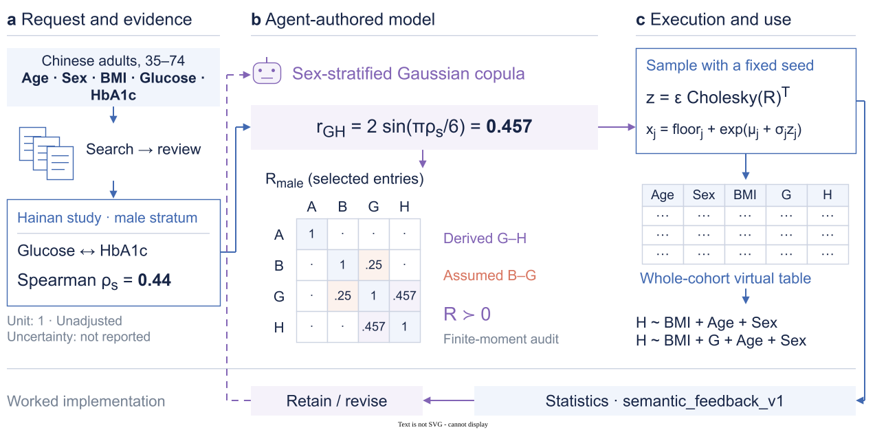
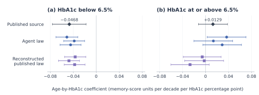
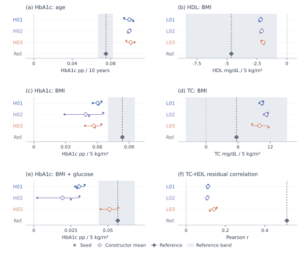
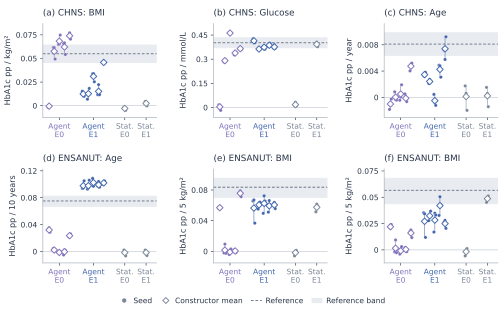
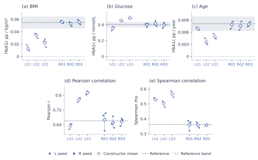
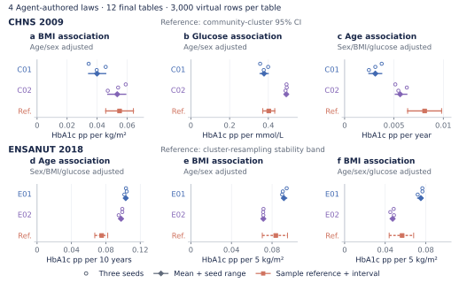
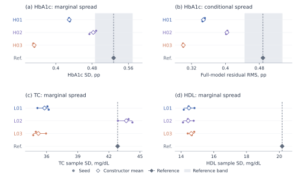
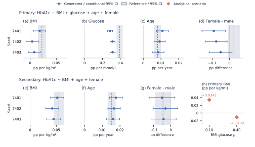

# From Published Evidence to Analyzable Biomedical Cohorts with Scientific Agents

Working conference-style draft v0.16, 5 November 2026. Scientific reading copy; venue-specific preparation remains incomplete.

## Abstract

Biomedical studies often report the distributions and associations needed for a new analysis while access to individual records remains limited. We study whether a scientific agent can use this evidence to generate an entire cohort on which researchers can run their intended analyses. The agent identifies what each study measured, translates reported statistics into parameters of a joint model, and records assumptions for relationships the studies leave open. We first tested the workflow where the source model was available. In a longitudinal memory analysis, the agent and a reconstruction of the published generator both recovered a negative interaction below the HbA1c threshold, while their mean estimates for the weaker upper-branch interaction differed in sign. We then evaluated generation from external studies of glycemia and lipids. Six agent constructions produced 18 tables. All six requested quantities agreed in point direction with sample references across the draws, yet the three construction means for residual lipid correlation ranged from 0.108 to 0.141, compared with 0.512 in the reference sample. In a separate evidence comparison, adding published relationships reduced mean absolute discrepancy for five of six regression coefficients. These results show which scientific analyses partial evidence can support and where the consequences of an assumed joint relationship remain substantial.

## 1. Introduction

A scientific question may be ready before the necessary biomedical data are available. A cohort may not have measured a biomarker, individual records from another study may be inaccessible, or no accessible dataset may contain the requested combination of variables. Yet relevant evidence can exist in published means, distributions, adjusted coefficients and subgroup findings. Turning those findings into a complete virtual table would let researchers execute the intended analysis, examine the implications of the evidence and identify what additional information matters. The desired product is scientific data accompanied by an explicit account of how they were constructed.

The difficult step is forming a joint law from heterogeneous evidence. A marginal correlation and an adjusted regression coefficient describe different quantities. Findings also depend on eligibility, measurement, population and adjustment sets. Two correctly extracted coefficients cannot generally be inserted unchanged into one joint equation, and the dependence needed to connect them may be unreported. Consequently, evidence-based generation requires scientific modeling decisions beyond document retrieval and row sampling. Those decisions determine which analyses the resulting dataset can support.

We investigate a workflow in which a scientific agent makes these decisions. The researcher supplies the population, variables, available observations and intended analyses. The agent acquires or receives studies, determines their numerical roles, authors a joint generating law and inspects the resulting data. Numerical tools perform calculations, sampling and analysis; reviews check the statistical meaning and implementation of the specification. The scientific question remains visible to the agent throughout construction. Complete-cohort generation is central: the main experiments supply no individual construction records, and the agent generates every requested variable.

This division of work moves task-specific equations, distribution choices and parameter derivations into the agent's construction process. It also leaves a concrete object to inspect. A researcher can trace a generated association back to a reported statistic, a mathematical derivation or an explicitly assumed relationship. When an assumption changes a scientific conclusion, the workflow can expose the missing evidence instead of hiding it inside a completed table. The approach uses established probability families, allowing the model to change with the request and available evidence.

We formulate cohort construction around a scientific request: the target population, available measurements, admissible studies and proposed analysis. Our method assigns a numerical role to each finding, constructs a joint model, and exposes the assumptions needed to sample complete records. We evaluate the resulting data through the scientific analyses for which they were generated, including adjusted associations, repeated-measures interactions and residual dependence.

We begin with a case in which the generating model is available. In the Health and Retirement Study (HRS) example, the agent and a reconstruction of the published generator receive the same model exports and their simulated cohorts undergo the same longitudinal analysis. The glycemia and lipid studies pose a different problem: they supply evidence from external populations, and the agent must choose how to connect the variables in a joint law. A separate comparison varies which published relationships are supplied. Together these settings distinguish the ability to execute a known scientific model from the ability to construct one when the target relationship is only partly specified.

## 2. Related work and problem definition

### 2.1. From available information to analyzable records

Filshtein et al. share fitted study models so a recipient can simulate complete cohorts for epidemiological analyses [1]. SynthIPD uses published survival curves and trial summaries to reconstruct time-to-event records with covariates [2]. SynDI combines internal individual data with external regression information across populations to fit a target regression [29]. Multilevel network meta-regression likewise relates aggregate evidence to individual-level models under population assumptions [3]. These approaches differ in what the recipient knows. Filshtein et al. supply the comparison for our HRS experiment because the published exports and the scientific analysis can be matched. In our external-evidence experiments, the agent must also choose the joint dependence structure needed to perform the requested analyses.

G-Sim combines LLM-authored simulators with numerical calibration and structural refinement [4]. LLMSynthor uses aggregate discrepancies to guide proposals for new records and evaluates mobility, e-commerce and household population synthesis [5]. SynthCraft studies healthcare synthetic-data workflows [6], and SPADA samples from a dependency graph fitted with observed tabular data [15]. Our methodological question concerns the preceding biomedical decision: how findings with different populations, scales and adjustment sets constrain one generator, and which analyses the resulting data support.

### 2.2. Evidence-conditioned cohort construction

A request specifies the target population, eligibility and measurements, desired variables, permitted observations and intended analyses. Each evidence record identifies its source population, measurement scale, statistical operator, adjustment set, estimate, available uncertainty and provenance. The agent returns an executable generator, the numerical uses of that evidence and the assumptions needed to complete the model:

```text
(generator, evidence uses, completion assumptions)
    = agent(scientific request, evidence, optional observations)
virtual data = generator(number of rows, random seed)
scientific results = requested analyses(virtual data).
```

In whole-cohort construction, optional observations are empty and all requested variables are generated. In enrichment, supplied covariates remain fixed while an unmeasured variable is generated. These modes share the evidence-to-law problem; the principal experiments here concern complete cohorts.

A finding may constrain the law numerically, provide a check on its implications, or remain contextual. Algebraic consequences of accepted findings are derived evidence. Unreported dependence and transfer from a source population to the request are completion assumptions. Several laws can satisfy the available information while implying different conditional results, so the output includes both the table and its construction specification.

We evaluate usefulness at the level of scientific analysis. For an adjusted coefficient, correlation or dispersion statistic, the generated estimate is compared with the relevant sample reference in its native units. Reproducing a supplied summary measures reconstruction; agreement with a target result not supplied to the author addresses a different question. A table can support several analyses with different degrees of evidential support. These distinctions guide both construction and evaluation.

## 3. Agent-controlled evidence-to-cohort construction

### 3.1. Qualify evidence against the scientific request

The workflow begins with the population, era, measurements, units, eligibility and scientific analyses. It accepts curated evidence and agent-directed acquisition. With retrieval enabled, the agent selects queries and primary studies to address evidence gaps; the retained record distinguishes full text, partial access and bibliographic metadata and records overlap or exclusions. Researchers supply the request and access conditions, while the agent chooses how the admitted evidence enters the model.

Qualification preserves each finding's original statistical meaning. Logistic disease coefficients cannot become continuous-biomarker slopes, grouped contrasts cannot become per-unit effects, and rank correlations require different treatment from Pearson correlations. Source and requested adjustment sets must also be reconciled. Unit conversion supplies an algebraic transformation rather than evidence of population or assay equivalence. A finding with unresolved definitions can remain useful context without being promoted to a numerical constraint.

In the external-evidence study, researchers supplied audited source packets and measurement guidance [7–11]. Other implementations combined reviewed articles with optional retrieval or allowed authors to select their own sources through a bounded Europe PMC/PMC gateway. The host dispatched authors and coordinated access, review and execution. These implementations share the scientific decision sequence while preserving their separate evidence budgets and input conditions.

### 3.2. Translate findings into numerical model constraints

The agent authors a model specification, generator code, evidence-use records and a decision explanation. A relationship counts as numerical evidence use when its role is visible in the implemented law or in an explicit calculation. The common evidence-use record connects relationship, dispersion, scenario, check-only and retained-assumption decisions to sources and specification locations. It distinguishes arithmetic from geometric summaries, marginal from conditional effects, rank from Pearson dependence, and individual variation from uncertainty in an estimate.

A worked example shows why this step requires modeling. Jansen et al. report separate age/sex-adjusted HbA1c projections for BMI and glucose [9]. For residualized BMI and glucose with SDs `sB` and `sG` and correlation `r`, a joint response law with coefficients `thetaB` and `thetaG` implies:

```text
cB = thetaB + thetaG * r * sG/sB
cG = thetaG + thetaB * r * sB/sG.
```

CHNS E1 constructor A01, selected by ordinal identifier, used reported slopes `cB = 0.13` and `cG = 2.29`, residual SDs 4.07611 and 0.49694, and the declared assumption `r = 0.25`. Solving the equations gave 0.0642173 and 2.1583154 in IFCC response units. Multiplication by 0.09148 yielded 0.00587460 and 0.19744269 in HbA1c percentage-point units [11]. The source projections therefore informed the joint law through their mathematical relationship, with residual dependence and population transfer remaining explicit assumptions. The [worked trace](SUPPLEMENT_SOURCE_AND_ASSUMPTIONS_v05.md) connects the derivation to frozen code, an unfitted correlation check and the resulting target BMI discrepancy.

### 3.3. Complete an executable joint law

The agent chooses the probability family, dependencies, parameters and remaining completion assumptions. These choices must support complete rows and the requested scientific analyses. Means and SDs alone do not determine residual dependence, tails or subgroup structure, so the specification records how those properties were supplied. Reviews inspect source meaning, numerical derivations, specification/code consistency and required finite moments before execution.

Figure 1 presents a completed construction using a sex-stratified Gaussian copula and positive biomarker margins. The agent converted a reported glucose–HbA1c Spearman relationship into a latent Gaussian correlation, declared the missing BMI–glucose dependence and implemented sampling and measurement transforms. Other requests led to bounded conditional laws, gamma innovations, lognormal mixtures or a recursive longitudinal family. The scientific contribution lies in choosing and connecting these components to the evidence, rather than introducing a new distribution family.



**Figure 1. A completed evidence-to-cohort construction.** The agent converts the Hainan male glucose–HbA1c Spearman coefficient 0.44 into latent Gaussian correlation 0.457. Selected entries of the sex-stratified copula matrix distinguish the derived glucose–HbA1c relation from the assumed BMI–glucose value 0.25. Standard-normal noise, Cholesky sampling and shifted-lognormal transforms generate BMI, glucose and HbA1c; age has a bounded-integer transform. Table cells are schematic. The scientific law, assumptions, execution checks and requested regressions form one inspectable path. This worked case is separate from the information-contrast and cross-task experiments below.

### 3.4. Execute and inspect the resulting analyses

Deterministic tools execute the authored program through an isolated WSL/bubblewrap adapter and return allowed source and generated-data diagnostics. Semantic checks retain the declared measurement, operator and role; unsupported comparisons remain unavailable. The author records whether to retain or revise the model within the task budget. Candidate versions, final seeds and evaluation contracts are fixed before the corresponding execution or comparison.

Researchers receive the complete tables and their scientific specification, then apply ordinary regression, correlation or longitudinal-analysis software. This separates model authorship from reproducible numerical execution while keeping the analysis request central to both. Independent numerical implementations check final statistics and reference mappings. The workflow reduces the need for researchers to hand-author each generator equation, although human preparation-time savings were not measured.

## 4. Evaluation design

Table 1 identifies what each study makes available. HRS supplies fitted model terms, so we can test whether a generated dataset supports the published longitudinal analysis. ENSANUT glycemia and Turkana lipids supply external study evidence, so agreement also depends on the agent's unmeasured dependence and population-transfer assumptions. A construction denotes one authored law. Three final draws from that law describe sampling variation under a fixed model.

**Table 1. Information conditions and scientific evaluation.** All principal constructions generate complete cohorts without individual-level construction inputs. Historical study identities Q1–Q5 are retained across the main paper and supplement.

| Study | Information available to the constructor | Constructions / final data | Scientific assessment |
|---|---|---|---|
| Q3: longitudinal reconstruction | Published model artifacts and a mixed-model analysis | 1 agent + 1 reconstructed law; 6 valid tables of 11,509 subjects × 4 visits | Published longitudinal effects and subgroup spread |
| Q5: glycemia and lipid requests | Reviewed external articles, population metadata and optional retrieval | 6 agent laws; 18 × 3,000 rows | HbA1c/TC/HDL effects, residual dependence and dispersion |
| Q1: relational-evidence contrast | Basic/marginal evidence E0; additional relational evidence E1 | 20 agent + 4 statistical laws; 72 × 3,000 rows | Six CHNS/ENSANUT regression coefficients and complete diagnostics |
| Q2: summary reconstruction | Literature L; literature plus 30 target summaries R | 6 agent laws; 18 distinct final tables × 3,000 rows | Joint reconstruction of supplied regression and correlation summaries |
| Q4: open retrieval | Requests and bounded retrieval; no bibliographic seeds | 4 agent laws; 12 × 3,000 rows | Repeated CHNS/ENSANUT construction and scientific analyses |
| Supporting dependence example | Five retrieved studies and an analysis request | 1 agent law; 3 × 3,000 rows | Complete effects and a pre-generation analytical sensitivity |

CHNS references describe 6,631 selected adults aged 35–74 with complete age, recorded sex, BMI, glucose and HbA1c; analyses are unweighted selected-sample estimates. ENSANUT uses 6,931 selected adults aged 25–79 under fixed eligibility criteria and equal mass across eight sex-by-age cells. The lipid request uses the existing Turkana/Laikipia context: age/sex-adjusted BMI slopes for TC and HDL, plus their residual Pearson correlation after age, sex and BMI adjustment. Frozen unit conversion maps generated lipids to mg/dL. Complete eligibility, analysis definitions and diagnostics are retained in the linked study records and supplement.

Q1 assigns five fresh agent contexts and one prescribed statistical specification to each case/evidence condition, with three final 3,000-row draws per law. Its statistical constructions use the same admitted numerical information and explicit completion assumptions; the asymmetric five-to-one comparison is descriptive. Q5 assigns three fresh contexts to each request. All author sessions close before final reference comparison. Analyses use native units, with seed-averaged absolute discrepancy computed within each Q1 constructor and then averaged across its arm.

The common interpretation boundary is developmental evaluation: CHNS, ENSANUT and Turkana references were previously exposed at project level; fresh contexts and delayed reads do not restore untouched external validation. Q2 deliberately supplies target summaries, and Q3 supplies source-model artifacts. The six cross-task authors share a model service and some sources, while seeds describe sampling under frozen laws. CHNS cluster intervals, ENSANUT cluster-resampling stability bands and lipid HC3 sensitivity intervals describe different reference properties and are not acceptance margins. These conditions permit analysis-specific comparisons, rather than a universal accuracy score.

## 5. Results

### 5.1. A shared longitudinal model tests reconstruction

Filshtein et al. distributed fitted HRS model parameters so other researchers could simulate data for longitudinal analysis [1]. We supplied those exports and method code to the agent and separately reconstructed the published recipient-stage generator. Each law produced three complete tables with 11,509 synthetic subjects observed at four visits. We fitted the same mixed model of memory in every table. Its two prespecified interactions estimate how the age slope of standardized memory, per decade, changes per percentage point of HbA1c on each side of the 6.5% spline knot.

Below the knot, the published coefficient was −0.04684. The agent and reconstructed-law estimates averaged −0.04464 and −0.04050 respectively, with all six draws negative (Figure 2). On the upper branch, the published coefficient was +0.01287. All three agent estimates were positive (mean +0.02649) and all three reconstructed-law estimates were negative (mean −0.01169). Five of the six upper-branch model-conditional intervals included zero. Agreement on a slope did not guarantee agreement on individual variation. The agent's upper-group HbA1c SD was 0.563 percentage points, close to the published synthetic summary of 0.6 but lower than the published original-sample SD of 1.4.



**Figure 2. Two prespecified age–HbA1c interactions in a longitudinal memory model.** Diamonds show the supplied coefficients; circles and squares show estimates from three draws per law (seeds 6101–6103, top to bottom). Bars show approximate 95% Wald intervals calculated from the exported source standard errors or from the generated-table fits. Units are standardized memory-score change per decade per percentage point of HbA1c within the indicated branch. Each table contains 11,509 synthetic subjects and four visits per subject. The upper-branch signs differed between constructions. The six tables describe sampling under two frozen generating laws.

The comparison uses six valid tables. Our first three comparator attempts were invalid because our parser misread seven HbA1c coefficient and standard-error pairs. We corrected the parser inputs and reran only the affected comparator draws. The supplement retains all nine attempts. This benchmark measures preservation of supplied model information. The next study asks what can be recovered when the joint model itself must be inferred from the literature.

### 5.2. External studies constrain some glycemic and lipid analyses

The cross-task study used the common evidence-use interface for HbA1c and TC/HDL requests. All six agent laws completed an initial trial and three final draws, producing 18 distinct 3,000-row tables, or 54,000 fictional rows. H01–H03 chose different bounded conditional laws and HbA1c innovations. L01–L03 combined Gaussian copulas and lognormal margins with differing uses of geometric summaries, arithmetic moments, coefficients of variation and age dependence [25–28]. These choices were authored by the agents, with their derivations and assumptions recorded before execution.

All 54 primary point estimates agreed in direction with their corresponding cached sample estimates (Figure 3; Table S5), while magnitudes varied. HbA1c age effects averaged 0.09954–0.10091 percentage points per decade versus 0.07513 in the reference. Age/sex-adjusted BMI effects averaged 0.04892–0.06030 versus 0.08364 per 5 kg/m². After adding glucose, H03 averaged 0.05098 versus 0.05664, whereas H01/H02 averaged 0.03047/0.01936. The tables therefore supported the intended regressions and retained the attenuation pattern after glucose adjustment, with unequal quantitative agreement.

Lipid results made the distinction between separate effects and joint dependence especially clear. HDL BMI effects averaged −2.1865 to −1.9868 mg/dL per 5 kg/m² versus −4.6230; TC effects averaged 10.0151–11.2609 versus 5.6831. The TC reference sensitivity interval crossed zero, so its positive sample point is not an established positive population direction. Across constructors, mean adjusted residual TC–HDL correlations ranged from 0.10828 to 0.14134 versus 0.51207. The laws reproduced focal point directions while substantially underrepresenting this remaining joint association.



**Figure 3. Analysis-specific behavior across glycemia and lipid requests.** HbA1c panels in the left column show age adjusted for sex/BMI/glucose (a), BMI adjusted for age/sex (c), and BMI additionally adjusted for glucose (e). The right column shows age/sex-adjusted HDL and TC BMI slopes (b,d) and residual Pearson correlation after age/sex/BMI adjustment (f). All six laws and 54 estimates from 18 tables are retained. Circles show seeds, open diamonds means and thin segments seed ranges; dark diamonds and dashed lines mark sample references. HbA1c units are percentage points per 10 years or 5 kg/m²; lipid slopes are mg/dL per 5 kg/m². Bands are ENSANUT empirical cluster-resampling stability bands and lipid HC3 assumption-conditional sensitivity intervals. The TC band crosses zero; no residual-correlation interval is available. Seed ranges describe sampling under each frozen law. Table S5 supplies all numerical summaries and Figure S3 the dispersion results.

Dispersion further distinguished the analyses these tables might support. H03's relatively close glucose-adjusted BMI effect coexisted with HbA1c marginal SD/residual RMS of 0.3523/0.3006 versus 0.5274/0.4885. H02 retained more spread but smaller BMI effects. L02's TC SD was close to the reference, 43.6778 versus 42.8466 mg/dL, while its residual lipid correlation remained weak. No law uniformly dominated focal effects, dependence and dispersion. Independent recomputation verified all 513 prespecified estimates and diagnostics, including 324 matched cached-reference comparisons; 189 diagnostics lacked matching references and remained generated-only results.

### 5.3. Relational evidence improves analysis agreement

All 24 Q1 constructions produced their three final tables, yielding 72 distinct tables and all 216 focal coefficient estimates. Additional relational evidence reduced constructor-averaged mean absolute discrepancy for five of six analyses (Figure 4; Table S1). For CHNS glucose, discrepancy fell from 0.134019 to 0.024079 HbA1c percentage points per mmol/L. All three ENSANUT contrasts improved. CHNS BMI instead worsened, from 0.020380 to 0.031557, showing that additional information did not improve every requested effect.

The individual laws explain the aggregate contrast. CHNS E1 glucose means spanned 0.363363–0.414189 around the 0.402093 reference; BMI means were positive but lower than the reference. Conditional-age means ranged from −0.000509 to 0.007393 versus 0.008107, including one negative constructor mean. Every E1 author used at least one relation numerically, yet useful source information did not uniquely determine the target joint law. The prescribed E1 statistical constructions also had lower discrepancies than every corresponding agent for CHNS glucose and ENSANUT conditional BMI; other comparisons favored agent laws. The result supports the value of relational information and inspectable model construction without an overall algorithmic ranking.



**Figure 4. Relational evidence and scientific analysis agreement.** CHNS panels show BMI adjusted for age/sex (a), glucose adjusted for age/sex (b), and age adjusted for sex/BMI/glucose (c). ENSANUT panels show age adjusted for sex/BMI/glucose (d), BMI adjusted for age/sex (e), and BMI additionally adjusted for glucose (f). All six analyses retain native units. E0 contains basic/marginal evidence; E1 adds relations. Each agent arm has five independently authored laws and each statistical arm one prescribed law, with all three final draws retained: 24 constructions, 72 tables and 216 coefficient estimates. Dots show seeds, open diamonds constructor means and thin segments seed ranges; dashed lines mark sample references. Reference bands are CHNS community-cluster CR1-t intervals or ENSANUT cluster-resampling stability bands. Author indices do not pair E0 with E1. Table S1 gives every endpoint's mean absolute discrepancy and E1–E0 contrast.

### 5.4. Supplied summaries enable joint reconstruction

The summary-assisted study tests a different information condition: three authors received literature alone (L), while three received that literature plus 30 target summaries and their metadata (R). Each delivered three final tables. R closely reconstructed all five highlighted regression and correlation analyses together (Figure S1; Table S2). Constructor-mean BMI coefficients ranged from 0.052821 to 0.055789 around the supplied 0.054946; glucose coefficients ranged from 0.396941 to 0.413715 around 0.402093. Both Pearson and Spearman glucose–HbA1c correlations were also close, preserving joint features that differed in several external-evidence constructions.

Agreement extended to spread: R constructor-mean HbA1c SDs were 0.95208–0.96554 versus 0.95357. A separate purpose-built statistical calibration supplement likewise closely reconstructed the regression summaries. These results show that available aggregate information can become useful joint data. They measure reconstruction of supplied information and remain separate from Q1's external-evidence comparison.

### 5.5. Retrieval and sensitivity to an unreported relationship

Four open-retrieval authors selected sixteen paper uses representing twelve originals and produced twelve complete CHNS/ENSANUT tables (Figure S2; Tables S3–S4). All 36 primary points retained their reference directions, while rank and residual-spread discrepancies remained.

The supporting dependence example illustrates another useful outcome of explicit construction. Before generation, two admissible BMI–glucose latent correlations, 0.10 and 0.40, implied conditional BMI coefficients +0.03422 and −0.01095 while preserving margins and the secondary projection (Figure S4). Making the law explicit identified an unreported relationship capable of changing the requested conditional conclusion.

## 6. Discussion

Scientific requests and study-qualified partial evidence can become executable joint laws and analyzable virtual cohorts without individual-level construction records. The agent's central role is choosing how evidence enters that law: qualifying study findings, deriving compatible numerical constraints and completing unreported relationships. The table makes those choices usable by ordinary scientific software; the specification makes their consequences inspectable. Established distributions and deterministic numerical tools provide the implementation, while the agent supplies the task-specific scientific model.

The HRS reconstruction shows what happens when a published study supplies the model terms. Both constructions preserved the lower-branch interaction, yet the weaker upper-branch point estimates differed in sign. Under external evidence, a similarly interpretable distinction emerged: an ENSANUT generator could approximate the glucose-adjusted BMI coefficient while understating HbA1c variation, and a Turkana generator could approximate total cholesterol dispersion while understating residual dependence. Each comparison evaluates a specific use of the generated data. More synthetic rows would narrow Monte Carlo variation under the chosen law while leaving the omitted dependence unresolved.

For the present cross-task outputs, supported use is assumption-dependent scenario data for qualitative association exploration and analytical workflow inspection. Quantitative cohort replacement, calibrated design/power use and broad population transfer remain unestablished. These are limits of the present evidence, while the general method continues to address whole-cohort generation, enrichment and eventual missing-cell completion. The latter remains unevaluated. A prospective, previously unexposed reference would test stronger transport claims; sensitivity to unreported dependence can identify which additional evidence is most consequential.

The current studies also leave component-level questions open. All six cross-task authors retained their initial laws, and all 132 runtime source-check entries were unavailable under the semantic rules (Table S6). Numerical evidence still entered reviewed parameter derivations, but this batch demonstrates no numerical source-fit feedback or revision gain. Likewise, the studies do not isolate a benefit of retrieval, review or a particular probability family. Fresh contexts share model services and some sources, and neither seeded draws nor conditional intervals quantify evidence, extraction or structural uncertainty. Human time savings and arbitrary-request autonomy require separate assessment. The strongest current result is a completed, inspectable scientific workflow with observable analytical successes and failures.

## Supporting materials and reproducibility

The [public repository](https://github.com/ziwang11112/evidence-guided-virtual-cohorts-2026), [extended methods](DRAFT_v0_9.md) and supplementary results retain all frozen study identities, numerical endpoints, source inventories, implementation incidents and independent audits. This revision changes exposition and display placement only. Individual real/generated tables and third-party originals remain local. The study links below preserve complete records; author, affiliation, funding, conflict, ethics, access and AI declarations and final venue formatting remain to be completed. No manuscript has been submitted.

## References


1. Filshtein TJ, Li X, Zimmerman SC, Ackley SF, Glymour MM, Power MC. Proof of concept example for use of simulation to allow data pooling despite privacy restrictions. *Epidemiology*. 2021;32(5):638–647. [DOI and full text](https://pmc.ncbi.nlm.nih.gov/articles/PMC8338788/).
2. Zhao Z et al. SynthIPD: training-free synthetic individual patient data generation. arXiv:2509.16466v2, 24 July 2026. [Versioned full text](https://arxiv.org/html/2509.16466v2). Publication beyond this preprint was not established in the positioning audit.
3. Phillippo DM et al. Multilevel network meta-regression for population-adjusted treatment comparisons. *Journal of the Royal Statistical Society: Series A*. 2020;183(3):1189–1210. [DOI/full text](https://rss.onlinelibrary.wiley.com/doi/full/10.1111/rssa.12579).
4. Holt S, Ruiz Luyten M, Berthon A, van der Schaar M. G-Sim: Generative Simulations with Large Language Models and Gradient-Free Calibration. *Proceedings of ICML*. PMLR 267;2025:23513–23561. [Published record](https://proceedings.mlr.press/v267/holt25b.html).
5. Tang Y, Kong M, He J, Nie T, Ma W, Sun L. LLMSynthor: Macro-Aligned Micro-Records Synthesis with Large Language Models. KDD 2026. [DOI](https://doi.org/10.1145/3770855.3818965); [full text v4](https://arxiv.org/html/2505.14752v4).
6. Callender T, Boyd A, Davis R, Ruhrberg Estevez S, Lavista Ferres JM, van der Schaar M. SynthCraft: An AI partner for synthetic data generation to support data access and augmentation in healthcare. *PLOS Digital Health*. 2026;5(3):e0001290. [Published article](https://journals.plos.org/digitalhealth/article?id=10.1371/journal.pdig.0001290).
7. Bao Y, Ma X, Li H, Zhou M, Hu C, Wu H, Tang J, Hou X, Xiang K, Jia W. Glycated haemoglobin A1c for diagnosing diabetes in Chinese population: cross sectional epidemiological survey. *BMJ*. 2010;340:c2249. [DOI](https://doi.org/10.1136/bmj.c2249); [bibliographic record](https://pubmed.ncbi.nlm.nih.gov/20478961/).
8. Wang P, Li Y, Wang M, Song L, Dong Y, Han X, Tuomilehto J, Wang Y, Du Y, Qiu C. Comparing glycemic traits in defining diabetes among rural Chinese older adults. *PLOS ONE*. 2024;19(1):e0296694. [Published article](https://journals.plos.org/plosone/article?id=10.1371/journal.pone.0296694).
9. Jansen H, Stolk RP, Nolte IM, Kema IP, Wolffenbuttel BHR, Snieder H. Determinants of HbA1c in nondiabetic Dutch adults: genetic loci and clinical and lifestyle parameters, and their interactions in the lifelines cohort study. *Journal of Internal Medicine*. 2013;273(3):283–293. [Published article](https://onlinelibrary.wiley.com/doi/10.1111/joim.12010).
10. Pani LN, Korenda L, Meigs JB, Driver C, Chamany S, Fox CS, Sullivan L, D'Agostino RB, Nathan DM. Effect of aging on A1C levels in individuals without diabetes: evidence from the Framingham Offspring Study and the National Health and Nutrition Examination Survey 2001-2004. *Diabetes Care*. 2008;31(10):1991–1996. [DOI](https://doi.org/10.2337/dc08-0577); [bibliographic record](https://pubmed.ncbi.nlm.nih.gov/18628569/).
11. NGSP. The IFCC and NGSP, Table 2. [Official measurement-scale guidance](https://ngsp.org/ifccngsp.asp).
12. Li T, Quan H, Zhang H, Lin L, Lin L, Ou Q, Chen K. Type 2 diabetes is more predictable in women than men by multiple anthropometric and biochemical measures. *Scientific Reports*. 2021;11:6062. [DOI](https://doi.org/10.1038/s41598-021-85581-z); [original full text](https://pmc.ncbi.nlm.nih.gov/articles/PMC7960723/).
13. Sakane N, Sato J, Tsushita K, Tsujii S, Kotani K, Tominaga M, Kawazu S, Sato Y, Usui T, Kamae I, Yoshida T, Kiyohara Y, Sato S, Tsuzaki K, Nirengi S, Takahashi K, Kuzuya H, JDPP Research Group. Determinants of Glycated Hemoglobin in Subjects With Impaired Glucose Tolerance: Subanalysis of the Japan Diabetes Prevention Program. *Journal of Clinical Medicine Research*. 2017;9(4):360–365. [DOI](https://doi.org/10.14740/jocmr2928w); [original full text](https://pmc.ncbi.nlm.nih.gov/articles/PMC5330780/).
14. Wisgerhof W, Ruijgrok C, den Braver NR, Borgonjen—van den Berg KJ, van der Heijden AAWA, Elders PJM, Beulens JWJ, Alssema M. Phenotypic and lifestyle determinants of HbA1c in the general population–The Hoorn Study. *PLOS ONE*. 2020;15(6):e0233769. [DOI](https://doi.org/10.1371/journal.pone.0233769); [original full text](https://pmc.ncbi.nlm.nih.gov/articles/PMC7272077/).

15. Yang S, Zhang Z, Prenkaj B, Kasneci G. Doubling Your Data in Minutes: Ultra-fast Tabular Data Generation via LLM-Induced Dependency Graphs. *Proceedings of the 2025 Conference on Empirical Methods in Natural Language Processing*. 2025:10337–10358. [Official article and PDF](https://aclanthology.org/2025.emnlp-main.525/); [DOI](https://doi.org/10.18653/v1/2025.emnlp-main.525).

16. Wu et al. Effect of age on the diagnostic efficiency of HbA1c for diabetes in a Chinese middle-aged and elderly population: The Shanghai Changfeng Study. *PLoS ONE*. 2017. [Admitted original](https://pmc.ncbi.nlm.nih.gov/articles/PMC5591004/).
17. Skogberg et al. The association between anthropometric measures and glycated haemoglobin (HbA1c) is different in Russian, Somali and Kurdish origin migrants compared with the general population in Finland: a cross-sectional population-based study. *BMC Public Health*. 2019. [Admitted original](https://pmc.ncbi.nlm.nih.gov/articles/PMC6458679/).
18. Zhang et al. The Association of Retinopathy and Plasma Glucose and HbA1c: A Validation of Diabetes Diagnostic Criteria in a Chinese Population. *Journal of Diabetes Research*. 2016. [Admitted original](https://pmc.ncbi.nlm.nih.gov/articles/PMC5078665/).
19. Venkataraman et al. Ethnicity modifies the relation between fasting plasma glucose and HbA1c in Indians, Malays and Chinese. *Diabetic Medicine*. 2012. [Admitted original](https://pmc.ncbi.nlm.nih.gov/articles/PMC3504343/).
20. Liu et al. Ideal glycated hemoglobin cut-off points for screening diabetes and prediabetes in a Chinese population. *Journal of Diabetes Investigation*. 2016. [Admitted original](https://pmc.ncbi.nlm.nih.gov/articles/PMC5009131/).
21. Huang et al. Hemoglobin A1c Levels Associated with Age and Gender in Taiwanese Adults without Prior Diagnosis with Diabetes. *International Journal of Environmental Research and Public Health*. 2021. [Admitted original](https://pmc.ncbi.nlm.nih.gov/articles/PMC8038122/).
22. Ghazanfari et al. A Comparison of HbA1c and Fasting Blood Sugar Tests in General Population. *International Journal of Preventive Medicine*. 2010. [Admitted original](https://pmc.ncbi.nlm.nih.gov/articles/PMC3075530/).
23. Masuch et al. Preventing misdiagnosis of diabetes in the elderly: age-dependent HbA1c reference intervals derived from two population-based study cohorts. *BMC Endocrine Disorders*. 2019. [Admitted original](https://pmc.ncbi.nlm.nih.gov/articles/PMC6371438/).
24. Marini et al. Association between hemoglobin glycation index with insulin resistance and carotid atherosclerosis in non-diabetic individuals. *PLoS ONE*. 2017. [Admitted original](https://pmc.ncbi.nlm.nih.gov/articles/PMC5398507/).
25. Greiner et al. Associations between low HDL, sex and cardiovascular risk markers are substantially different in sub-Saharan Africa and the UK: analysis of four population studies. *BMJ Global Health*. 2021;6:e005222. [DOI](https://doi.org/10.1136/bmjgh-2021-005222); [published correction to author names](https://gh.bmj.com/content/6/6/e005222corr1).
26. Obirikorang et al. Obesity and Cardio-Metabolic Risk Factors in an Urban and Rural Population in the Ashanti Region-Ghana: A Comparative Cross-Sectional Study. *PLOS ONE*. 2015;10:e0129494. [DOI](https://doi.org/10.1371/journal.pone.0129494); [admitted original](https://journals.plos.org/plosone/article?id=10.1371/journal.pone.0129494).
27. Agongo et al. The burden of dyslipidaemia and factors associated with lipid levels among adults in rural northern Ghana: An AWI-Gen sub-study. *PLOS ONE*. 2018;13:e0206326. [DOI](https://doi.org/10.1371/journal.pone.0206326); [admitted original](https://journals.plos.org/plosone/article?id=10.1371/journal.pone.0206326).
28. Agongo et al. Correction: The burden of dyslipidaemia and factors associated with lipid levels among adults in rural northern Ghana: An AWI-Gen sub-study. *PLOS ONE*. 2019;14:e0213233. [DOI](https://doi.org/10.1371/journal.pone.0213233); [correction](https://pmc.ncbi.nlm.nih.gov/articles/PMC6392312/). The correction concerns hip/waist entries and a citation; those entries were not used in the lipid constructions.
29. Gu T, Taylor JMG, Mukherjee B. A synthetic data integration framework to leverage external summary-level information from heterogeneous populations. *Biometrics*. 2023;79:3831–3845. [DOI](https://doi.org/10.1111/biom.13852).

## Supplementary results

The supplement retains the complete numerical comparisons and supporting displays under their original study identities. Figure and table numbers follow their new placement; no construction, primary result or unavailable comparison is removed by the shorter main narrative. Q1–Q5 remain distinct experiments with their original information conditions.

### S1. Complete external-evidence contrast

All 24 Q1 constructions produced their three scheduled final tables. The 72 final tables were distinct and supported every requested regression and diagnostic; seven exploratory tables brought physical executions to 79. Additional relational evidence reduced constructor-averaged mean absolute discrepancy for five of the six designated coefficients (Table S1). CHNS glucose discrepancy decreased from 0.134019 to 0.024079 HbA1c percentage points per mmol/L. All three ENSANUT contrasts improved. CHNS BMI discrepancy increased from 0.020380 to 0.031557.

**Table S1. Complete main-study information contrast.** Discrepancies retain the units of each row; they are not pooled. The reference response is HbA1c percentage points. E1–E0 uses unrounded quantities before display rounding.

| Case / focal analysis | Predictor increment | E0 mean absolute discrepancy | E1 mean absolute discrepancy | E1 − E0 |
|---|---|---:|---:|---:|
| CHNS BMI, adjusted age/sex | 1 kg/m² | 0.020380 | 0.031557 | +0.011178 |
| CHNS glucose, adjusted age/sex | 1 mmol/L | 0.134019 | 0.024079 | −0.109939 |
| CHNS age, adjusted sex/BMI/glucose | 1 year | 0.007281 | 0.004854 | −0.002426 |
| ENSANUT age, adjusted sex/BMI/glucose | 10 years | 0.063944 | 0.024670 | −0.039274 |
| ENSANUT BMI, adjusted age/sex | 5 kg/m² | 0.056883 | 0.023732 | −0.033151 |
| ENSANUT BMI, adjusted age/sex/glucose | 5 kg/m² | 0.048797 | 0.025649 | −0.023147 |

The effect displays explain what these changes mean. CHNS E1 glucose constructor means were 0.363363–0.414189 around the 0.402093 reference. Its BMI means were positive but lower, 0.012400–0.045757 versus 0.054946. Conditional-age means ranged from −0.000509 to 0.007393 versus 0.008107; one author retained a negative mean and two negative seeds. All ENSANUT E1 focal coefficients were positive, although its age means of 0.097769–0.102452 per decade exceeded 0.075132 and its BMI means remained below their references. Preserving a direction and recovering its magnitude are distinct aspects of usefulness.

Every E1 author used at least one relationship as a numerical constraint. The complete uptake records include constraints, unfitted analytic checks and contextual uses, including the projection calculation in Section 3.2. Statistical references also achieved useful results: under E1, the prescribed constructions had lower seed-averaged discrepancies than every corresponding agent for CHNS glucose and ENSANUT conditional BMI. Other comparisons favored agent constructions. The evidence therefore supports scientific utility and the value of additional information, rather than a universal algorithmic ranking.

### S2. Complete supplied-summary reconstruction



**Figure S1. Supplied summaries become jointly analyzable data.** Five panels show BMI, glucose and age regression coefficients plus glucose–HbA1c Pearson and Spearman correlations. L01–L03 use literature; R01–R03 additionally receive 30 target summaries and metadata. Points show all three final draws, diamonds constructor means and segments seed ranges. Dashed lines mark reference summaries available to R; regression bands are CHNS community-cluster CR1-t intervals, with no supplied correlation interval. All six constructors, 18 distinct delivery tables, 30 means and 90 seed statistics appear once. Initial and final deliveries were identical after retention; Table S2 gives the complete five-analysis numerical comparison.

The separate CHNS experiment gave three authors external literature (L) and three authors that literature plus 30 target summaries and their metadata (R). Each author delivered three tables and had one additional diagnostic-review opportunity. All six retained their models. There were 42 physical executions: six trials and 36 initial/final deliveries. Final bytes duplicated their matching initial outputs, leaving 24 distinct tables overall and 18 distinct delivery tables. The identical stages are displayed once.

R supported close reconstruction of all five highlighted scientific analyses (Table S2; Figure S1). These values were legitimate construction inputs; their agreement measures reconstruction rather than prediction of hidden coefficients. The L/R packet and authors differ from Q1, so those two information comparisons are kept separate.

**Table S2. Joint-statistic reconstruction with available summaries.** Ranges span three constructor means over three fixed seeds, not confidence intervals. Regression units are HbA1c percentage points per kg/m², mmol/L and year, respectively.

| Analysis | Supplied reference | External literature L | Literature + summaries R |
|---|---:|---:|---:|
| BMI coefficient, age/sex adjusted | 0.054946 | 0.013001–0.034287 | 0.052821–0.055789 |
| Glucose coefficient, age/sex adjusted | 0.402093 | 0.356064–0.487815 | 0.396941–0.413715 |
| Age coefficient, sex/BMI/glucose adjusted | 0.008107 | 0.003552–0.006910 | 0.007569–0.007947 |
| Glucose–HbA1c Pearson correlation | 0.660968 | 0.633764–0.813170 | 0.650561–0.666438 |
| Glucose–HbA1c Spearman correlation | 0.361457 | 0.501339–0.566477 | 0.357571–0.360983 |

Agreement extended beyond central values. R constructor-mean BMI SDs were 3.38965–3.40243 versus 3.40632, glucose SDs were 1.48817–1.58968 versus 1.54455, and HbA1c SDs were 0.95208–0.96554 versus 0.95357. A separate three-table statistical calibration supplement also closely reconstructed the regression summaries, with mean coefficients 0.055726, 0.412568 and 0.007679. That purpose-built family was developed with coding-agent assistance and is not an agent-removal ablation. Both approaches demonstrated the usefulness of constructing a joint table from accessible aggregate information.

### S3. Open retrieval across population requests

The unified workflow allocated two fresh scientific authors to each of the existing CHNS and ENSANUT requests. Each author received the intended analyses, population/measurement definitions, task interface and retrieval budget, but no target coefficients, desired signs, individual records or prior construction. CHNS- and ENSANUT-derived studies were excluded as generating evidence. Across 24 query credits, the authors selected sixteen paper uses representing twelve distinct originals. Independent review checked the original statistical definitions, numerical derivations, source applicability and required finite moments before execution. Sources could overlap across authors; four constructions do not imply four independent bodies of clinical evidence.

The agents chose materially different laws. C01 used an age-conditioned multivariate-lognormal mixture informed by Chinese population summaries [7,16] and contextual age/body-size findings [10,17]. C02 combined copula predictors with an affine HbA1c conditional mean using Pinggu summaries and Singapore coefficients [18,19], with other populations as applicability context [14,20]. E01 used bounded beta predictors and a conditional gamma response [10,17,21,22]. E02 combined lognormal BMI, conditional truncated-normal glucose and a positive conditional-mean lognormal response [10,21,23,24]. Their unreported dependencies, population transfers and residual choices remained declared assumptions. The shared controller did not prescribe these families or insert target coefficients.

Each author completed one 3,000-row trial, inspected generated-only diagnostics and source feedback, then selected its final model before three fixed draws. All four retained the initial law. The sixteen physical executions comprised four trials and twelve unique final tables, or 36,000 final virtual rows. Feedback contained 29 qualified approximate comparisons and 39 unavailable checks across the four trials, not source-population replays or 29 passed constraints. After all sessions closed, the evaluator reused the fixed sample references. A separate numerical implementation reproduced all 366 final coefficient/diagnostic values; no clinical data were downloaded or refitted.

All 36 primary seed estimates had the same positive directions as their corresponding references (Figure S2). These are repeated measurements of six analysis definitions across four laws, not 36 independent confirmations. Magnitude recovery varied by analysis. CHNS C01/C02 means were 0.03992/0.05338 for BMI against 0.05495, 0.37754/0.49241 for glucose against 0.40209, and 0.00311/0.00563 for age against 0.00811. Units are respectively HbA1c percentage points per kg/m², mmol/L and year. C02 was closer for BMI and age, while C01 was closer for glucose; no construction dominated all analyses.



**Figure S2. Repeated open-retrieval construction across two biomedical requests.** All six prespecified primary analyses are shown for four agent-authored laws and twelve final 3,000-row virtual tables. Blue and purple identify the two constructions within each request. Open circles show seeds 8101–8103, ordered top to bottom within each author row; vertical spacing is solely for legibility. Diamonds and horizontal segments below the circles show the three-seed mean and minimum–maximum range. Coral squares in separate reference rows show previously exposed selected-sample estimates. Solid coral intervals are CHNS community-cluster CR1-t 95% confidence intervals; dashed coral intervals are ENSANUT empirical cluster-resampling stability bands from 399 attempts. These reference intervals have different meanings and neither is an acceptance or equivalence threshold. Axes retain native effect units and zero; pp denotes HbA1c percentage points. All generated coefficients are positive, while both CHNS age estimates are weaker and both ENSANUT age estimates stronger than their references. Seed ranges describe sampling under each fixed law, not confidence intervals or uncertainty over evidence, model choice or transport. The four constructions provide developmental workflow replication on two existing references, not independent clinical replication.

For ENSANUT, E01/E02 means were 0.10308/0.09772 for adjusted age against 0.07513 pp/decade, 0.09165/0.07140 for age/sex-adjusted BMI against 0.08364 pp per 5 kg/m², and 0.07509/0.04733 after additionally adjusting for glucose against 0.05664. Every draw retained the reduction of the BMI coefficient after glucose adjustment, an association pattern rather than causal mediation. Both authors built an age coefficient near 0.10 pp/decade and shared some sources; their agreement does not establish independent evidence convergence.

The complete diagnostics reveal remaining limits. CHNS C01 glucose–HbA1c Pearson correlation was approximately 0.666 versus 0.661, but Spearman correlation was 0.635 versus 0.361. ENSANUT residual HbA1c RMS was approximately 0.295/0.324 versus 0.488, and total SD was 0.362/0.406 versus 0.527. Correct directions and a close Pearson coefficient therefore coexisted with rank and dispersion mismatches. The [complete replication report](../reports/core_workflow_replication_2026-11-04/RESULTS.md), every diagnostic and Supplementary Table S3 retain the full results. A scalar-type interface defect in the original evaluator was corrected additively on unchanged frozen tables, with its failed output and independent audit preserved; no scientific model was adjusted after comparison.

**Table S3. Complete Q4 open-retrieval primary summaries.** Means and ranges summarize three final seeds under each fixed construction. Units are HbA1c percentage points per stated predictor increment. No row is omitted; ranges are not confidence intervals.

| Request / analysis | Author | Increment | Reference | Generated mean | Seed min–max |
|---|---|---|---:|---:|---|
| CHNS BMI | C01 | 1 kg/m² | 0.054946 | 0.039923 | 0.034342–0.045708 |
| CHNS glucose | C01 | 1 mmol/L | 0.402093 | 0.377538 | 0.357560–0.398892 |
| CHNS adjusted age | C01 | 1 year | 0.008107 | 0.003109 | 0.002461–0.003755 |
| CHNS BMI | C02 | 1 kg/m² | 0.054946 | 0.053375 | 0.047088–0.059055 |
| CHNS glucose | C02 | 1 mmol/L | 0.402093 | 0.492412 | 0.488649–0.494875 |
| CHNS adjusted age | C02 | 1 year | 0.008107 | 0.005628 | 0.005137–0.006301 |
| ENSANUT adjusted age | E01 | 10 years | 0.075132 | 0.103084 | 0.101546–0.104315 |
| ENSANUT BMI | E01 | 5 kg/m² | 0.083643 | 0.091651 | 0.089940–0.094413 |
| ENSANUT glucose-adjusted BMI | E01 | 5 kg/m² | 0.056638 | 0.075089 | 0.072005–0.076661 |
| ENSANUT adjusted age | E02 | 10 years | 0.075132 | 0.097724 | 0.094947–0.099135 |
| ENSANUT BMI | E02 | 5 kg/m² | 0.083643 | 0.071399 | 0.071232–0.071563 |
| ENSANUT glucose-adjusted BMI | E02 | 5 kg/m² | 0.056638 | 0.047325 | 0.045022–0.048592 |

CHNS BMI/glucose analyses adjust for age and sex; CHNS age adjusts for sex, BMI and glucose. ENSANUT age adjusts for sex, BMI and glucose; its BMI analyses adjust for age/sex, with or without glucose. All Q4 diagnostic values remain in the [complete diagnostic table](../reports/core_workflow_replication_2026-11-04/display/ALL_DIAGNOSTICS.md).

**Table S4. Original-source inventory for Q4 open retrieval.** Twelve unique originals supplied sixteen author-specific paper uses. Sharing a source is not independent clinical evidence; source populations are not the target populations.

| Original | Reference | Constructing authors |
|---|---|---|
| Wu et al., 2017 | [16]; PMC5591004 | C01 |
| Bao et al., 2010 | [7]; PMC2871988 | C01 |
| Pani et al., 2008 | [10]; PMC2551641 | C01, E01, E02 |
| Skogberg et al., 2019 | [17]; PMC6458679 | C01, E01 |
| Zhang et al., 2016 | [18]; PMC5078665 | C02 |
| Venkataraman et al., 2012 | [19]; PMC3504343 | C02 |
| Liu et al., 2016 | [20]; PMC5009131 | C02 |
| Wisgerhof et al., 2020 | [14]; PMC7272077 | C02 |
| Huang et al., 2021 | [21]; PMC8038122 | E01, E02 |
| Ghazanfari et al., 2010 | [22]; PMC3075530 | E01 |
| Masuch et al., 2019 | [23]; PMC6371438 | E02 |
| Marini et al., 2017 | [24]; PMC5398507 | E02 |

The reviewed evidence/specification files distinguish reported statistics, algebraic derivations and assumed relations. The public experiment record includes per-source eligibility, measurement, adjustment, overlap and reporting-quality notes; full third-party originals and participant-like rows remain local.

### S4. Longitudinal reconstruction from published artifacts

The HRS recipient-stage example [1] tested a different data product. A fresh agent received published model exports, a variable specification and the intended mixed-model analysis. It authored the recursive conditional generating family with parameter provenance. A separate implementation reconstructed the published law. Each generated 11,509 subjects at 0, 2, 4 and 6 years, producing 46,036 rows per table. No HRS individual records were used, and the source analysis coefficients were construction inputs.

All three agent and three corrected-law tables supported the native R/lme4 model with 16 fixed effects, individual intercepts/slopes and piecewise HbA1c terms around 6.5%, with age centered at 60 and scaled per decade. The below-threshold HbA1c-by-age interaction averaged −0.044635 in agent data, with range −0.051059 to −0.038247, against the supplied −0.046837. The reconstructed law averaged −0.040500. Both preserved its negative direction in all three draws (Figure 2).

Figure 2 shows the estimates and their per-table Wald intervals. The [longitudinal analysis record](../reports/hrs_public_example_2026-11-03/RESULTS.md) gives all 16 fixed effects and the comparator correction.

The weaker above-threshold interaction was less stable: agent estimates averaged 0.026485 against 0.012867, while corrected-law estimates averaged −0.011691. Overall agent HbA1c mean/SD was 5.8725/0.9676 versus the original published 5.9/1.0. The high-HbA1c subgroup had mean/SD 7.1515/0.5630, compared with original 7.7/1.4 and published synthetic 7.2/0.6. Thus useful source-model behavior coexisted with inadequate upper-group spread.

A CRLF-sensitive parser initially overwrote seven coefficient/SE pairs in our comparator preparation. A separately reviewed source-bound repair produced the three corrected comparator tables without changing the frozen agent outputs. The full record contains nine physical generations, six valid comparison tables and three invalid initial comparator attempts. This was our implementation defect, not a failure of the published method. The [incident record](../reports/hrs_public_example_2026-11-03/recovery_v1/INCIDENT_AND_CORRECTION.md) and complete effects retain the correction and all outcomes.

### S5. Cross-task construction, dispersion and source uses

The next study applied the common workflow to HbA1c analyses in the ENSANUT2018 analytical design and BMI-related TC/HDL analyses in the Turkana study context. Three fresh agent contexts constructed a law for each request, using reviewed external articles, population/measurement metadata and optional literature tools. No participant inputs, target coefficients, target means or prior generators were supplied. The six contexts used the same model service and shared some source evidence. This study therefore tests repeated construction across two requests, with the law chosen by each author, rather than independent clinical replication or a controlled comparison of workflow components.

The HbA1c analyses retained the existing age and BMI estimands and equal allocation to eight sex-by-age cells. The lipid analyses used unweighted age/sex-adjusted BMI coefficients for TC and HDL, plus the Pearson correlation of their residuals after age, sex and BMI adjustment. Lipid eligibility required adults with recognized recorded sex and finite, positive BMI and lipid values. Generated lipid concentrations were converted from mmol/L to mg/dL using the frozen factor 38.67. The reference represents a selected Turkana/Laikipia study sample; fasting, assay transfer and population composition remained qualified in the evidence record. No new participant records were read, downloaded or refitted for this study.

The agents made different scientific choices within the common interface. H01 combined bounded predictors, conditionally truncated glucose and a shifted gamma HbA1c innovation; H02 used bounded beta conditional laws. H03 solved cross-source moment equations under declared dependence and dispersion assumptions, then used conditional beta laws. Their source records included overlapping age, body-size and glycemia evidence [10,17,21,22], with additional check-only/contextual evidence for H01 [14]. The lipid authors combined Gaussian copulas and lognormal margins using geometric summaries from Greiner et al. [25], rural Ashanti rank correlations [26] and arithmetic moments from Agongo et al. [27,28]. Choices about arithmetic versus geometric location, transfer of coefficients of variation, sex strata and age dependence differed among L01–L03. These are applications of established probability families whose numerical use was selected and explained by the agent.

Independent source and implementation reviews checked the statistical meanings, specification/code consistency and finite moments before isolated execution. Each constructor completed one scheduled trial, inspected generated diagnostics and source feedback, and could revise once. All six retained their initial laws. Three fixed final seeds, 9101–9103, produced 18 distinct 3,000-row tables: 54,000 fictional rows from 24 successful physical attempts, including the six trials. No final execution failed and no seed was replaced. Reference comparison began after all six author sessions closed and reused previously exposed aggregate results.

All 54 primary point estimates had the same direction as their corresponding sample estimates, with quantitative agreement varying by analysis (Figure 3; Table S5). HbA1c age effects averaged 0.09954–0.10091 percentage points per decade versus 0.07513 in the reference; age/sex-adjusted BMI effects averaged 0.04892–0.06030 versus 0.08364 per 5 kg/m². With glucose additionally adjusted, H03 averaged 0.05098 versus 0.05664, whereas H01 and H02 averaged 0.03047 and 0.01936. Thus the shared age direction and attenuation after glucose adjustment did not imply recovery of each effect magnitude.

For lipids, mean HDL BMI coefficients ranged from −2.1865 to −1.9868 mg/dL per 5 kg/m² versus −4.6230 in the reference, while TC coefficients ranged from 10.0151 to 11.2609 versus 5.6831. The TC reference sensitivity interval was −3.7535 to 15.1197, so matching its positive point estimate does not establish replication of a definite positive population effect. Residual TC–HDL correlations averaged 0.10828–0.14134 versus 0.51207. The generators preserved the directions of these focal point estimates while substantially underrepresenting the lipid dependence remaining after the specified adjustment.

Dispersion changes the assessment of usefulness (Figure S3). H03's closer glucose-adjusted BMI coefficient accompanied lower HbA1c marginal SD and full-model residual RMS, 0.3523 and 0.3006 percentage points versus 0.5274 and 0.4885. H02 retained more variation, with corresponding values 0.4825 and 0.4036, but smaller BMI coefficients. L02's TC SD was close to the reference, 43.6778 versus 42.8466 mg/dL, although its residual TC–HDL correlation remained weak. All three lipid laws had HDL SDs below the reference. No construction uniformly dominated across focal effects, dependence and dispersion.



**Figure S3. Dispersion across all cross-task constructions.** Panels show marginal HbA1c SD, HbA1c full-model residual RMS, and marginal TC and HDL SDs for each construction and its three final draws, retaining all 36 diagnostic values from the same 18 tables. HbA1c uses the population-SD diagnostic; lipids use sample SD. These quantities measure individual or residual spread, not uncertainty in a regression coefficient. H03's relatively close adjusted BMI effect in Figure 3 coexists with reduced HbA1c spread, and L02's close TC SD coexists with weak adjusted lipid dependence. Seed ranges reflect Monte Carlo variation conditional on the selected law. Gray HbA1c bands are empirical cluster-resampling stability bands; no reference interval is supplied for lipid SDs.

The evaluation retained all 513 prespecified estimates and diagnostics, including the 54 primary outputs. Independent recomputation verified every value and all 324 matched reference comparisons; the maximum numerical difference was 5.33 × 10⁻¹⁴. The remaining 189 diagnostics lacked matching cached reference estimators and remained generated-only results. Across authors, eight original studies supplied 22 author–paper uses, including context/check-only uses; optional retrieval consumed seven query credits and one original download. All 132 declared source-check entries were unavailable under the implemented semantic rules because weighting or essential operator definitions were unresolved or unsupported (Table S6). Numerical source values still informed reviewed parameter derivations, but this batch provides neither measured numerical source-fit feedback nor a before/after revision benefit. The [complete results and reviews](../reports/evidence_use_cross_task_2026-11-05/RESULTS.md) retain every endpoint, unavailable comparison and implementation incident, including correction of the independent auditor's identifier parser without changing any generated table.

**Table S5. Complete Q5 cross-task primary summaries.** Each row summarizes three fixed final draws from one law. All 18 author–analysis combinations are retained. HbA1c entries are percentage points (pp); lipid slopes are mg/dL per 5 kg/m². Ranges are seed minima and maxima, not confidence intervals or evidence/model uncertainty.

| Request / analysis | Author | Units / increment | Reference | Generated mean | Seed min–max |
|---|---|---|---:|---:|---|
| HbA1c adjusted age | H01 | pp / 10 years | 0.075132 | 0.099545 | 0.094075–0.103606 |
| HbA1c BMI | H01 | pp / 5 kg/m² | 0.083643 | 0.060295 | 0.055769–0.063938 |
| HbA1c glucose-adjusted BMI | H01 | pp / 5 kg/m² | 0.056638 | 0.030469 | 0.027956–0.034291 |
| HbA1c adjusted age | H02 | pp / 10 years | 0.075132 | 0.099539 | 0.098162–0.100396 |
| HbA1c BMI | H02 | pp / 5 kg/m² | 0.083643 | 0.048923 | 0.029090–0.065499 |
| HbA1c glucose-adjusted BMI | H02 | pp / 5 kg/m² | 0.056638 | 0.019363 | 0.002308–0.030777 |
| HbA1c adjusted age | H03 | pp / 10 years | 0.075132 | 0.100912 | 0.096356–0.105015 |
| HbA1c BMI | H03 | pp / 5 kg/m² | 0.083643 | 0.056649 | 0.048449–0.063758 |
| HbA1c glucose-adjusted BMI | H03 | pp / 5 kg/m² | 0.056638 | 0.050978 | 0.044994–0.056901 |
| HDL BMI | L01 | mg/dL / 5 kg/m² | −4.623004 | −2.186526 | −2.286805–−2.118624 |
| TC BMI | L01 | mg/dL / 5 kg/m² | 5.683108 | 10.393977 | 9.992186–10.676486 |
| TC–HDL residual correlation | L01 | dimensionless | 0.512070 | 0.111234 | 0.108517–0.113140 |
| HDL BMI | L02 | mg/dL / 5 kg/m² | −4.623004 | −2.100390 | −2.194806–−2.035712 |
| TC BMI | L02 | mg/dL / 5 kg/m² | 5.683108 | 11.260864 | 10.811415–11.565687 |
| TC–HDL residual correlation | L02 | dimensionless | 0.512070 | 0.108283 | 0.105395–0.110194 |
| HDL BMI | L03 | mg/dL / 5 kg/m² | −4.623004 | −1.986781 | −2.122835–−1.913541 |
| TC BMI | L03 | mg/dL / 5 kg/m² | 5.683108 | 10.015112 | 8.617345–11.698752 |
| TC–HDL residual correlation | L03 | dimensionless | 0.512070 | 0.141343 | 0.121087–0.155368 |

HbA1c age adjusts for sex, BMI and glucose. HbA1c BMI adjusts for age/sex, with glucose added in the third analysis. Lipid BMI slopes adjust for age/sex; the residual correlation removes age/sex/BMI projections from both lipids on the same rows. H01–H03 belong only to this Q5 HbA1c request, and L01–L03 only to this Q5 lipid request; the L labels do not refer to the earlier Q2 literature arm. All 54 individual primary outputs and all 513 prespecified estimates/diagnostics remain in the [complete endpoint table](../reports/evidence_use_cross_task_2026-11-05/evaluation/ALL_ENDPOINTS.csv). The 324 matched reference comparisons and 189 generated-only diagnostics retain their original availability labels.

**Table S6. Q5 original-source uses and unavailable feedback.** Eight distinct originals supplied 22 author–paper uses, including context/check-only evidence. All six authors retained their initial laws. The 132 source-check entries were unavailable, not successful numerical comparisons or failed generators. The inventory counts the three lipid originals, with the Agongo correction [28] attached to its source rather than counted as a separate original study.

| Author | Original-source references | Paper uses | Unavailable source checks |
|---|---|---:|---:|
| H01 | Pani [10]; Wisgerhof [14]; Skogberg [17]; Huang [21]; Ghazanfari [22] | 5 | 13 |
| H02 | Pani [10]; Skogberg [17]; Huang [21]; Ghazanfari [22] | 4 | 18 |
| H03 | Pani [10]; Skogberg [17]; Huang [21]; Ghazanfari [22] | 4 | 32 |
| L01 | Greiner [25]; Obirikorang [26]; Agongo [27,28] | 3 | 29 |
| L02 | Greiner [25]; Obirikorang [26]; Agongo [27,28] | 3 | 19 |
| L03 | Greiner [25]; Obirikorang [26]; Agongo [27,28] | 3 | 21 |
| Total | 8 distinct original studies | 22 | 132 |

The [evidence-use inventory](../reports/evidence_use_cross_task_2026-11-05/evaluation/EVIDENCE_USAGE_SUMMARY.json) and [source/code review](../reports/evidence_use_cross_task_2026-11-05/review/SOURCE_AND_CODE_REVIEW.md) retain the source IDs, numerical roles, unresolved definitions and actual retrieval activity. Unresolved weighting and unsupported or incompletely specified operators were not replaced with different statistics. Parameter derivations can therefore use reviewed source information while the corresponding runtime source comparison remains unavailable.

### S6. Dependence sensitivity and the supporting construction

The preceding open-search example acquired five seriously reviewed studies [9,10,12,13,14] without bibliographic seeds or desired signs. A fresh constructor selected a sex-stratified Gaussian copula with positive biomarker margins and generated one trial plus three complete 3,000-person tables. It retained the model after eleven approximate and 23 unavailable source comparisons per execution. Secondary BMI coefficients were 0.04217–0.05176 versus 0.05495 in the reused CHNS reference, secondary age was 0.01613–0.01771 versus 0.01530, and primary age was 0.00842–0.01084 versus 0.00811. Primary BMI/glucose were attenuated, and the female point direction and distributional tails remained imperfect. Supplementary Figure S4 retains all seven nonintercept effects and their uncertainty labels.

Before generating data or comparing targets, the source review identified an unreported BMI–glucose dependence. Two valid latent correlations, 0.10 and 0.40, implied conditional BMI coefficients of +0.03422 and −0.01095 while retaining the same margins, other bivariate laws and secondary projection. The delivered model used the declared assumption 0.25. This is an analytical sensitivity, not additional generated cohorts or a causal intervention. It demonstrates why an explicit data-generating law can identify which missing relationship matters to an intended use.

A separate analysis contextualized the same three tables with 100 community-disjoint resplits of the existing CHNS sample, drawing 3,000 people per side and retaining all 36 metrics. Secondary BMI and age discrepancies were on scales comparable with within-sample variation, while primary glucose/female and several joint/tail discrepancies were larger. The [complete table](../reports/real_real_calibration_2026-11-04/COMPLETE_METRIC_TABLE.md) preserves the nonexchangeable real-real and generated comparisons. These are descriptive interpretation aids, not a new population or retrospectively selected equivalence cutoff.



**Figure S4. Analysis-specific usefulness and an unresolved joint dependence.** Panels (a–d) show all primary-model nonintercept effects and (e–g) all secondary-model effects. Blue points are three fixed 3,000-person draws with conditional 95% HC3-t intervals. Gray dashed lines and bands are exposed CHNS reference estimates and 95% community-cluster CR1-t intervals; solid lines mark zero. All effects retain native units (pp: HbA1c percentage points), with shared limits for matching predictors. Generated intervals omit source, structural and transport uncertainty; overlap is not equivalence. Panel (h) displays two pre-generation analytical scenarios: latent BMI–glucose correlations 0.10 and 0.40 imply conditional BMI coefficients +0.03422 and −0.01095 while leaving marginal laws, other bivariate laws and the secondary projection unchanged. The delivered model used 0.25. These are not new draws, a fitted curve or a causal intervention. Retained initial/final stages alias the same three tables.

### S7. Full records and retained implementation incidents

The [public repository](https://github.com/ziwang11112/evidence-guided-virtual-cohorts-2026) provides original code, protocols, aggregate results and independent checks. The [complete v0.9 extended record](DRAFT_v0_9.md) preserves all six original numerical tables and full methods/results. Its Table 2 supplies every main endpoint's adjustment set, units and reference interval; Tables 3–4 retain the main and summary-assisted values; Table 5 retains all latest seven effects; Table 6 retains the real-real comparison values. No result was discarded by this narrative condensation.

The [main study](../reports/main_study_freeze_2026-11-03/RESULTS.md), [summary-assisted study](../reports/information_revision_ablation_2026-11-03/RESULTS.md), [statistical supplement](../reports/summary_comparator_2026-11-03/RESULTS.md), [HRS example](../reports/hrs_public_example_2026-11-03/RESULTS.md), [preceding open-search construction](../reports/evidence_to_generation_2026-11-04/RESULTS.md), [unified workflow replication](../reports/core_workflow_replication_2026-11-04/RESULTS.md) and [cross-task evidence-use study](../reports/evidence_use_cross_task_2026-11-05/RESULTS.md) preserve separate frozen identities and complete endpoint outputs. The cross-task [protocol](../reports/evidence_use_cross_task_2026-11-05/PROTOCOL.json), [complete endpoint table](../reports/evidence_use_cross_task_2026-11-05/evaluation/ALL_ENDPOINTS.csv), [independent numerical review](../reports/evidence_use_cross_task_2026-11-05/review/INDEPENDENT_NUMERICAL_REVIEW.md) and [scientific interpretation](../reports/evidence_use_cross_task_2026-11-05/review/SCIENTIFIC_RESULT_INTERPRETATION.md) document the new unit. Earlier live A/B results, including the conditioned BMI mismatch and source-replay unavailability, remain in the extended record. Figure updates and added tables consume reviewed aggregates only; manuscript integration creates no cohorts or clinical fits. In the main study, seven authors inspected exploratory outputs and kept their laws, and thirteen finalized without exploration. The two earlier live authors both kept their models after the available review.

Individual real/generated tables, third-party originals and credentials remain local; clinical reruns require lawful access and the appropriate environment. Historical model identifiers and token costs are incompletely metered. Author/affiliation/funding/conflict/ethics/access/AI declarations and final submission formatting remain to be completed. No manuscript has been submitted.

The [historical supplement](SUPPLEMENT_HISTORICAL_RESULTS_v05.md) retains earlier enrichment and direct-row construction, the divergent-moment repair, failed transport criteria, tail defects and revision trade-offs. The [v0.15 reading draft](DRAFT_v0_15.md) and [v0.14 draft](DRAFT_v0_14.md) preserve the earlier narrative and display arrangements.
