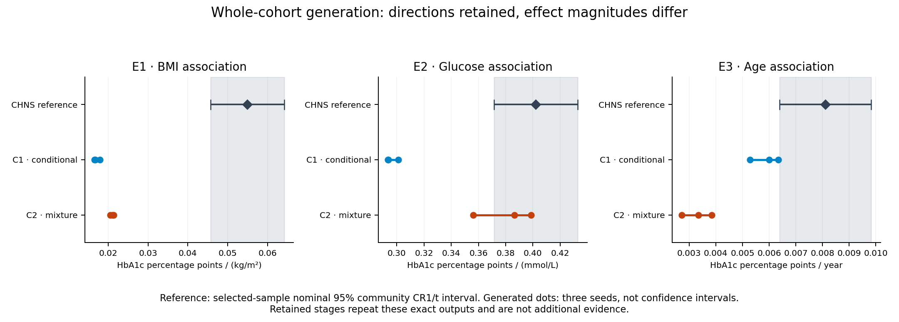
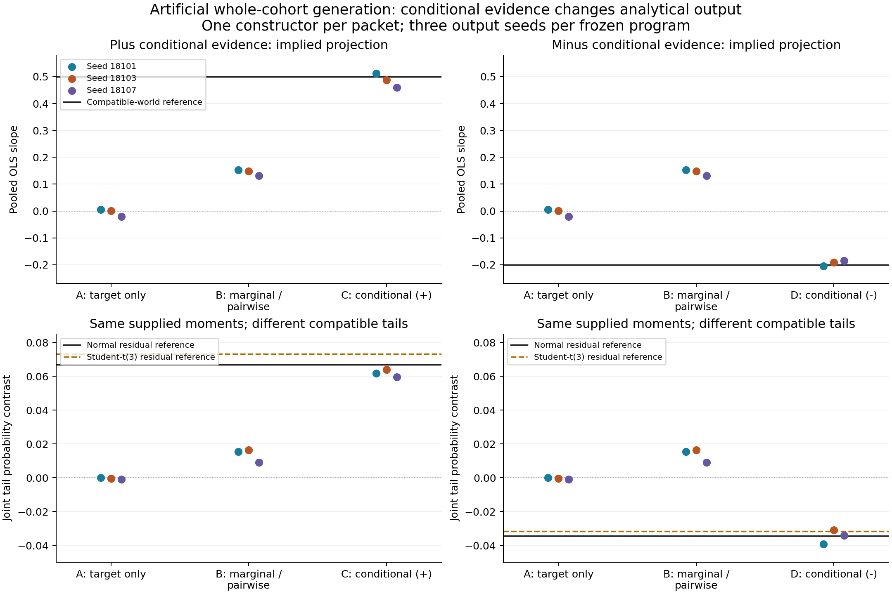

# From Published Evidence to Virtual Cohorts for Scientific Analysis

Working manuscript v0.2, 1 November 2026. This revision centers the biomedical data-generation problem and its methodological contribution, incorporating the reviewed G-Sim/LLMSynthor comparison. It uses exactly the same completed experiments and preserves the Results section of v0.1. Earlier drafts and frozen scientific records remain unchanged. Bibliographic completion, author declarations and submission preparation remain outstanding.

## Abstract

Biomedical research may require combinations of measurements that are unavailable because individual records cannot be accessed or relevant indicators were not collected. Published studies contain distributions and associations that could help address these gaps, but their results do not directly form an analyzable joint dataset. We present an evidence-guided virtual-cohort method that combines published findings, a target-population specification and optional observations. A scientific Agent constructs a joint stochastic model, records the evidence and assumptions behind its choices, and receives statistical diagnostics with explicit source-interpretation boundaries. The output is a reusable virtual dataset for specified scientific analyses. We evaluated complete-cohort generation without individual input against 6,631 adults in the China Health and Nutrition Survey. Two constructions generated age, sex, BMI, serum glucose and HbA1c. All three prespecified association directions were preserved across three draws per construction, while BMI coefficients were only 30–39% of the measured-reference estimate and glycemic variability was reduced. Both constructions retained their initial model after source feedback. An artificial conditional-evidence experiment illustrated translation under a stipulated population-composition shift and exposed an unidentified tail relationship. The study provides an implemented route from published biomedical evidence to joint virtual data and characterizes its analytical usefulness. The current evidence supports selected directional analyses, with substantial limits on quantitative substitution for measured data.

## Introduction

The measurements required for a biomedical question are not always jointly available to the researcher asking it. A study may have measured BMI but omitted a laboratory indicator; individual records from related studies may be inaccessible; or only a target-population description and published findings may be available. These situations create a gap between the evidence already reported and the data needed to execute a new analysis. Addressing that gap requires a way to construct joint records from the available information while keeping their model-dependent status explicit.

For example, an investigator interested in adiposity and glycemia might need age, sex, BMI, glucose and HbA1c in the same table. Published studies may report some distributions, pairwise associations or adjusted coefficients, yet no accessible source supplies the complete joint measurements. A virtual cohort would allow the investigator to apply ordinary regression and other analysis tools to a coherent set of modelled records. Its usefulness depends on which relationships the construction preserves, rather than solely on whether its rows appear plausible or its marginal means match selected reports.

The scientific difficulty is that published findings are conditional on the studies that produced them. An age-adjusted regression, a subgroup mean and a correlation answer different questions and may reflect different eligibility rules, assays and population compositions. Separate adjusted coefficients cannot automatically become the coefficients of one joint generative equation. Even compatible results may leave important dependencies unidentified. A practical method must therefore explain how evidence constrains the generator, how additional relationships are completed, and what assumptions are needed when applying it to a different population.

LLM-assisted generation provides useful precedents. G-Sim combines language-model construction of stochastic simulators with numerical calibration and diagnostic refinement, with a formulation admitting multiple data sources and aggregate summaries [1]. LLMSynthor generates micro-records from macro-statistics through dependency inference and discrepancy-guided sampling proposals, including mixed-source and downstream-use demonstrations [2]. These capabilities motivate the present biomedical application. We focus on turning published study results with differing measurement and analysis conditions into joint virtual data, then assessing the resulting data through scientific analyses in a separately reserved measured cohort.

We present an Agent-assisted biomedical data-generation method for this task. A scientific Agent selects a stochastic joint structure, numerical settings and explicit completion assumptions from a curated evidence packet and population request. Deterministic tools sample the data and check supported statistical declarations. Source agreement, assumption-defined target diagnostics and independent target evaluation remain distinct. The same frozen virtual release is subsequently used for the declared analyses, without regenerating it for each desired result.

Our contributions are threefold. First, we implement a procedure that turns published biomedical findings and a target description into complete virtual cohorts without individual inputs, while retaining optional observation regimes in the broader interface. Second, we make the evidence interpretation operational through documented scientific model choices and statistic-compatible feedback, explicitly separating unsupported source checks from assumption-defined target proxies. Third, we evaluate reuse of the resulting joint data for three prespecified biomedical analyses, together with a bounded conditional-evidence illustration, and report both retained relationships and consequential discrepancies.

The principal empirical question is whether virtual data constructed under this information constraint support useful scientific analyses. Complete-cohort generation is the setting evaluated here. Variable enrichment, missing-cell completion and direct row authorship remain broader capabilities with separate development records. The contribution of this study is the implemented biomedical construction method and its analytical characterization; the evaluation does not establish comparative algorithmic superiority.

## Methods

### Task, evidence and scientific construction

A task specifies the intended population, variables and units, permitted individual observations, and scientific uses. Complete-cohort construction receives no individual table. In the optional enrichment and completion settings, previously observed values are retained and the generator supplies new variables or missing cells. These settings provide different information and require separate evaluation.

Each evidence item records its source locator, population and selection conditions, measurement definition, statistical operator and adjustment set, reported quantity, and available uncertainty. Reported values, algebraic transformations and modelling assumptions are distinguished. The record also identifies possible source overlap and unresolved applicability. For example, two coefficients from separate regressions cannot be inserted as though they were coefficients from one joint model. An individual-level SD cannot be interpreted as uncertainty in a reported mean. A change of measurement scale may be algebraically valid without resolving assay or population differences.

In the reported biomedical case, evidence extraction and admission were curated and reviewed before Agent construction. A scientific Agent received the approved packet and task in a fresh context. It authored a model specification, parameter-provenance record, assumptions and a program implementing `generate(observed, spec, seed)`. With `observed=None`, the program jointly generated all substantive variables. The coordinator supplied the information boundaries and technical interface; the Agent selected the scientific structure and numerical settings. No target coefficients or desired target signs were supplied as coordinator-written model parameters.

The program route lets the Agent define the probability model while numerical software produces the rows. Direct row authorship is another implemented route with separate development records; it was not used in either experiment reported here. An ordinary scientific Agent is sufficient for this procedure. Independent construction contexts provide alternative models, rather than a required multi-Agent collaboration mechanism.

### Source diagnostics and bounded revision

Candidate specifications, source interpretations and code were checked before freezing. Generated programs ran in the existing isolated execution environment. Source checks retained the meaning of the declared statistic, units, adjustment and population conditions. A statistic that could not be justified as a source comparison remained unavailable. Explicitly approved approximations were reported separately.

The CHNS controller used the versioned semantic interface and a reviewed conditional-interpretation interface. These check declared semantic consistency; they do not certify original extraction or population transport. The CHNS whole-cohort implementation generated no source-context tables. Both strict correlation checks remained unavailable because original analytic weighting was unreported. Separately approved, equally weighted task-population proxies supplied the numerical correlation diagnostics; they did not reconstruct source populations or resolve measurement and transport differences.

Each construction had one source-feedback opportunity after three initial draws. The Agent could revise, retain, or report insufficient evidence for a correction. The feedback and decision were linked to the frozen parent. A retention preserved the scientific program and specification. All planned outputs, including unchanged and failed outputs, were eligible for reporting. There was no target-dependent candidate selection or additional generator fitting after reference disclosure.

### Biomedical evidence and reference population

The evidence packet contained sixteen items from five sources: Bao's Shanghai Diabetes Study II report, Wang's MIND-China report, contextual adjusted associations from Jansen and Pani, and NGSP measurement-scale guidance [3–7]. Source populations and measurements differed. Bao contributed a plasma-glucose/HbA1c Pearson association; MIND contributed a serum-glucose/HbA1c Spearman association. Jansen's separately adjusted associations and Pani's weighted association supplied context under explicit applicability restrictions. CHNS-derived scientific findings were excluded as external generation evidence. A contradictory MIND kappa result was quarantined. Different cohort names do not prove individual-level non-overlap.

The measured reference was the released CHNS 2009 sample, restricted prospectively to adults aged 35–74 with documented sex and complete age, BMI, central-serum glucose and HbA1c measurements. The target was this selected released sample, not a nationally representative Chinese population. Diabetes, treatment and pregnancy exclusions were not imposed. The constructors received the population/measurement specification and evidence, but no participant rows, eligible sample size, target moments or target effects. Age and sex composition were consequently model assumptions.

Four checksum-bound files were linked using the documented person and wave keys. Height and weight used centimetres and kilograms; BMI was weight divided by squared height in metres. Measurements with the documented height/weight cleaning code 9 were treated as unavailable, while other released corrections were retained. Native missing values were preserved, with no generic recoding of numeric values as missing. Glucose was measured in mmol/L and HbA1c in percentage units. The final common complete-case denominator was 6,631 people across 218 communities. Measurement timing, fasting adherence and residual release-quality uncertainties remain relevant limitations. Full eligibility and processing definitions are in the [frozen protocol](../reports/chns_admission_2026-11-01/f2/PROTOCOL.md).

### Scientific analyses and reference uncertainty

The same three unweighted OLS analyses, each with an intercept, were applied to the measured reference and every generated table:

| Analysis | Model | Reported coefficient |
|---|---|---|
| Adiposity-associated glycation | HbA1c ~ age + female + BMI | BMI, percentage points per kg/m² |
| Glycemia-associated glycation | HbA1c ~ age + female + glucose | Glucose, percentage points per mmol/L |
| Age-associated glycation beyond the other variables | HbA1c ~ female + BMI + glucose + age | Age, percentage points per year |

The reference used nominal 95% community-clustered CR1 intervals with a small-sample correction and a t distribution with 217 degrees of freedom. No national survey weights were used. These intervals characterize the selected-sample analysis under its inferential assumptions; they are not intervals for marginal means or a proof of population representativeness.

The reference direction was considered supported when its interval excluded zero. Directional stability for a construction required agreement across all three planned seeds. We also reported coefficient magnitudes, signed differences and necessary marginal/dependence diagnostics. No post-result equivalence margin or global success score was introduced. Across-seed variation represents sampling from a fixed generator and does not quantify uncertainty in the source evidence, model structure or transport assumptions.

The three regressions were withheld from numerical revision feedback and target calibration. Related associations and directions were present in external evidence. Accordingly, these were not entirely unseen scientific relationships. The source knowledge potentially present in the foundation model's pretraining was not verifiable.

### Construction and evaluation schedule

Two fresh construction contexts, C1 and C2, each produced an initial program and had at most one source-feedback revision opportunity. Each stage used seeds 1701, 1702 and 1703 and 3,000 virtual rows per table. The row count was fixed for computation before the eligible reference count was known. Twelve execution slots were allowed, with failures retaining their slots. Clinical values were accessed for evaluation only after the construction decisions and complete output inventory were committed.

The primary evaluator and an independent implementation used the same fixed analysis definitions. The independent implementation separately prepared the linked sample and used statsmodels for regression and cluster inference. Numerical agreement verifies processing and calculation, rather than providing an additional biological replication. All frozen outputs and complete aggregate results are retained in the [case record](../reports/chns_admission_2026-11-01/f2/CASE_RESULTS.md).

### Controlled conditional-evidence illustration

A separate, explicitly artificial experiment examined whether conditional evidence changed complete-cohort construction. Four fresh Agents received a common task and different evidence packets: target description alone; nine source marginal/pairwise quantities; those same quantities plus ten group-conditional quantities; or an alternative conditional packet with the same pooled source quantities. No individual table, trial generation or numerical revision feedback was supplied. Each frozen program generated three 3,000-row tables.

The source group probability was 0.5 and the target probability 0.75. Transport of the within-group joint laws was stipulated. Conditional summaries implied a target pooled coefficient of 0.50 or -0.20 in `y ~ 1 + x`, depending on the packet. This coefficient was an algebraic translation check. A separate joint-tail contrast, `P(x>1,y>2) - P(x<-1,y>2)`, was not determined by the supplied moments. Normal and standardized Student-t(3) residual laws provided two compatible examples with different tail contrasts, not a complete identification interval. Source checks recombined within-group moments using equal source weights. Reference laws and all analyses were committed before construction and disclosed after all outputs were fixed. The [prospective protocol](../reports/evidence_value_2026-11-01/PROTOCOL.md) defines this experiment; the [complete results](../reports/evidence_value_2026-11-01/RESULTS.md) retain all output seeds and compatible-world comparisons.

## Results

### Whole-cohort construction produced two different scientific models

C1 selected conditional lognormal glucose and HbA1c models with age/BMI effects and a glucose-dependent HbA1c response. C2 selected a two-component bivariate lognormal glycemic mixture with covariate-dependent membership. The mixture's higher-valued component was not a diagnosed-diabetes group. Covariate composition and dependence, conditional effect magnitudes, component behavior and residual variation included unverified assumptions in both constructions.

Both programs executed successfully. Both Agents subsequently retained their original model. The retained-stage outputs exactly matched the initial output at each seed, yielding twelve successful slots but **six unique tables**. The unit of empirical construction was two Agent-authored models in one biomedical reference case, not twelve independent validations.

### Association directions were retained, while quantitative agreement varied by analysis

All three measured-reference intervals excluded zero, and all eighteen coefficients from the six unique virtual tables were positive. Table 1 reports all primary coefficient ranges and reference intervals.

**Table 1. Scientific associations from the measured reference and virtual cohorts.** Ranges summarize the three output seeds for each fixed construction; they are not confidence intervals.

| Analysis | CHNS estimate [nominal 95% CI] | C1 range | C2 range |
|---|---:|---:|---:|
| BMI coefficient, percentage points/(kg/m²) | 0.05495 [0.04573, 0.06417] | 0.01654–0.01793 | 0.02049–0.02133 |
| Glucose coefficient, percentage points/(mmol/L) | 0.40209 [0.37129, 0.43290] | 0.29347–0.30109 | 0.35606–0.39879 |
| Age coefficient, percentage points/year | 0.008107 [0.006387, 0.009827] | 0.005284–0.006337 | 0.002714–0.003843 |

The generated BMI coefficients were approximately 30–39% of the reference estimate. C2 was closer on the glucose coefficient, whereas C1 was closer on the age coefficient. Thus a construction's better agreement on one relation did not imply better agreement on all analyses. These results establish directional agreement for the selected uses, with substantial quantitative discrepancies. They do not establish that the virtual and measured data are interchangeable.

**Figure 1. Scientific-analysis comparison for the whole-cohort case.** The existing case figure displays every unique output's primary associations and the measured-reference intervals. Retained-stage copies add no independent evidence. The reference is an uncertain selected-sample estimate.

### Similar means did not ensure appropriate variability or joint behavior

The reference HbA1c mean was 5.675%, compared with 5.738–5.744% for C1 and 5.695–5.723% for C2. However, reference HbA1c SD was 0.954 percentage points, compared with 0.719–0.736 and 0.534–0.578 percentage points, respectively. Glucose SD was 1.545 mmol/L in the reference, 1.292–1.339 in C1, and 0.984–0.992 in C2. Both constructions therefore compressed glycemic variation relative to the measured sample.

The reference glucose–HbA1c Pearson and Spearman correlations were 0.6610 and 0.3615. C2's Pearson association was comparatively close while its rank association was higher and its BMI/age coefficients remained attenuated. These descriptive results identify limitations of the completed constructions; the design does not isolate a particular model component as their cause.

### Source feedback led to retention, without demonstrated improvement

The strict semantic collector did not report numerical source discrepancies for the two correlation items because essential source semantics, including original analytic weighting, were unresolved. Separately approved task-population proxies were available. Against Bao's reported Pearson value of 0.619, C1 yielded 0.5329–0.5541 and C2 0.6657–0.6851. Against MIND's Spearman value of 0.529, C1 yielded 0.5164–0.5452 and C2 0.4780–0.4828.

The Agents judged that population, selection and measurement differences did not justify a specific correction from those diagnostics. Both retained their models. The source-feedback pathway therefore executed, but this case demonstrated no numerical-revision benefit. The proxy discrepancies also cannot be interpreted as calibrated source-population losses.

### Conditional evidence changed the artificial target projection

All twelve artificial tables executed successfully. The marginal/pairwise-only construction produced target slopes of 0.1313–0.1526. With the first conditional packet, slopes were 0.4595–0.5125 against the implied value 0.50; with the opposite packet, they were -0.2045 to -0.1856 against -0.20. Both conditional constructions had lower absolute projection errors than the marginal-only construction at every planned seed label, and changed in the expected opposite directions. In the negative-target world, the marginal-only construction was farther from the target than the target-description-only construction, preserving an adverse result.

The compatible normal and Student-t(3) laws yielded tail contrasts of 0.066966 versus 0.073304 in the positive world and -0.034322 versus -0.031626 in the negative world. Every Agent had chosen Gaussian completion. Matching the supplied moments did not identify which tail law applied. One constructor per packet confounds packet differences with author variation; the three seeds assess conditional simulation variability. This illustration establishes successful translation in the constructed task, not a general causal effect of adding evidence or a new statistical principle.

**Figure 2. Conditional-evidence illustration.** Every plotted point is an output from one of four frozen artificial generators. The upper panels compare the algebraically implied target projection; the lower panels show the assumption-dependent tail contrast against both compatible residual laws. No world-weighted aggregate score is used. This display may be placed in the supplement without altering the paper's biomedical primary question.

### Independent verification and resources

Independent CHNS processing and numerical recomputation matched all predefined comparisons. An initial import-path failure occurred before the independent evaluation gate and was preserved; an environment-only correction allowed the unchanged implementation to run. No scientific candidate was changed. The artificial experiment's independent recomputation matched 1,710 numerical fields with a maximum absolute discrepancy of 1.33e-15.

CHNS execution receipts summed to 8.406 seconds for twelve slots, and the artificial receipts to 8.439 seconds for twelve slots. These are execution times, excluding Agent authoring, curation, review and orchestration. Exact model-backend identifiers, temperature and token costs were not exposed by the surrounding Agent interface. No new paid API, training or HPC job was used for these executions. These records do not quantify recruitment or overall research-cost savings.

## Discussion

This study addresses a biomedical data-access and measurement-coverage problem: how to produce joint data for scientific analysis when the required participant measurements are unavailable. The implemented method combines external published evidence with a population request and Agent-authored stochastic models. In the principal case, it produced complete five-variable cohorts without any input participant table or target numerical calibration. Each virtual table was used for all three prespecified regression analyses, and both constructions preserved their association directions. This demonstrates a concrete evidence-to-data capability for the selected biomedical questions.

The methodological contribution is the operational connection between study evidence, joint-data construction and downstream analysis. Evidence retains its measurement and estimator context; the Agent chooses a coherent joint representation and identifies additional assumptions; supported diagnostics have explicit interpretation boundaries; and a frozen release can be analyzed using ordinary statistical tools. The workflow makes previously unavailable joint records accessible as model-based scenarios. This practical biomedical contribution does not depend on inventing a new probability family or a new foundation model. It does depend on describing the actual construction and demonstrating what its outputs can support.

### Analytical usefulness is specific to the question

The three primary analyses interrogated different aspects of the same joint table. The BMI analysis asked whether greater adiposity was associated with HbA1c after adjustment for age and sex; the glucose analysis assessed an age/sex-adjusted glycemic relationship; and the age analysis assessed the association remaining after adjustment for BMI, glucose and sex. All three directions transferred in these constructions. Quantitative agreement varied substantially: the BMI coefficients were approximately 30–39% of the reference estimate, and the construction with closer glucose coefficients had poorer agreement on age. Thus, success on one association did not establish general analytical interchangeability.

The generated data support examining these modelled relationships and applying the specified analysis procedures. They are not additional independently observed biomedical evidence. Using them to quantify an effect, estimate prevalence, determine a sample size or make a clinical decision would require validation appropriate to that use; those decision benefits were not demonstrated here. More generated rows can reduce Monte Carlo error under a selected model, but cannot increase the amount of measured evidence or identify missing relationships.

Distribution diagnostics helped interpret analytical usefulness. Similar HbA1c means coexisted with reduced glycemic variability and attenuated coefficients. Checking only marginal means would therefore miss important limitations, while checking only coefficient signs would overstate quantitative support. The appropriate evaluation follows the intended analysis and includes the distributional features that materially affect its interpretation.

### Evidence interpretation matters, but does not remove assumptions

The completed CHNS case illustrates why source interpretation is part of the method rather than a numerical matching exercise. Source populations, measurements and estimator details differed, and original weighting for the two feedback correlations was unreported. Strict comparisons remained unavailable; separately approved task-population proxies provided qualified diagnostics. No source-context cohorts were generated. This prevented those proxy values from being described as exact source reproduction, but did not identify the correct target coefficients or guarantee a beneficial update. Both Agents retained their initial models, so the feedback pathway's execution is established while repair benefit is not.

The artificial illustration supplies a more controlled account of one evidence-to-data operation. Identical pooled source summaries can coexist with different group-conditional relationships, implying different target projections after composition changes. Given the conditional summaries and stipulated transport, the Agents generated the corresponding target relationships. This is a successful translation of supplied information, not an independently discovered biological relationship. Different residual laws remained compatible with the same moment constraints and implied different tails. The example clarifies evidence sufficiency without establishing the cause of the CHNS discrepancies or a general benefit of adding evidence.

### Relationship to prior methods and scope of the contribution

G-Sim and LLMSynthor establish important mechanisms for language-model-assisted calibrated generation [1,2]. Their general formulations could accommodate additional biomedical operators and context; aggregate-only input, multiple sources and downstream utility are not unique to our method. The present contribution concerns their intersection with a specific biomedical information problem: published quantities with differing study conditions must inform a joint generator, and the generated data must be evaluated for their intended scientific uses. The existing implementation provides an inspectable, restricted procedure for this task. Its value as a biomedical method and the stronger claim of improved generation relative to another method are separate questions; only the former receives preliminary empirical support here.

The principal empirical limits are one biomedical reference family, two constructions, selected complete cases and five variables. Several important parameters remain assumptions, and the observed effect-scale and variability discrepancies restrict quantitative uses. Reference inference was unweighted and community-clustered, with sampling and measurement assumptions. Cross-study differences, incomplete source reporting and unverifiable pretraining exposure remain. Source-estimation, structural and transport uncertainty were not calibrated. Generic source-population reconstruction, arbitrary assay conversion, automated evidence acquisition and reliable repair were not demonstrated. There was no same-information generator comparison or independent model-family replication. The artificial illustration uses one constructor per packet, so it does not isolate evidence from author variation.

These findings support a focused biomedical methods-and-feasibility account: published evidence can be organized into analyzable virtual joint data, with specific demonstrated directional uses and explicit quantitative limitations. Broader clinical validity, participant-measurement replacement, recruitment savings, causal conclusions and calibrated confirmatory inference require additional evidence. Further work should be chosen for an essential analytical-use or construction claim, rather than for the number of models, cohorts or system components it adds.

## Data and code availability

The [public research repository](https://github.com/ziwang11112/evidence-guided-virtual-cohorts-2026) contains reviewed methods, authored generator code, protocols, evidence summaries, aggregate analyses and independent checks. CHNS release identifiers are [biomarker data](https://doi.org/10.15139/S3/GQ9GPP) and [individual-level data](https://doi.org/10.15139/S3/9PQ5KV), both version 1.0 in the completed acquisition record. Access remains subject to each source's terms. Patient-level and generated row tables, full third-party papers/codebooks, credentials and host execution artifacts are not redistributed. The snapshot therefore supports inspection but is not a self-contained historical replay bundle; the [case export boundary](../reports/chns_admission_2026-11-01/f2/PUBLIC_SNAPSHOT.md) describes the omitted artifacts. No privacy guarantee follows merely from generating virtual data.

## References used in this working revision

1. Holt S, Ruiz Luyten M, Berthon A, van der Schaar M. G-Sim: Generative Simulations with Large Language Models and Gradient-Free Calibration. ICML, PMLR 267, 2025. [Published paper](https://proceedings.mlr.press/v267/holt25b.html).
2. Tang Y, Kong M, He J, Nie T, Ma W, Sun L. LLMSynthor: Macro-Aligned Micro-Records Synthesis with Large Language Models. KDD 2026; arXiv v4, 8 June 2026, checked for the current positioning. [DOI](https://doi.org/10.1145/3770855.3818965); [versioned full text](https://arxiv.org/html/2505.14752v4).
3. Bao et al. Glycated haemoglobin A1c for diagnosing diabetes in Chinese population: cross sectional epidemiological survey. BMJ. 2010;340:c2249. [DOI](https://doi.org/10.1136/bmj.c2249).
4. Wang et al. Comparing glycemic traits in defining diabetes among rural Chinese older adults. PLOS ONE. 2024. [DOI](https://doi.org/10.1371/journal.pone.0296694).
5. Jansen et al. Lifelines adjusted-association source, 2013. [DOI](https://doi.org/10.1111/joim.12010). The [audited source record](../reports/chns_admission_2026-11-01/f2/sources/JANSEN_2013.md) identifies the exact projections used; full bibliographic metadata remains to be completed.
6. Pani et al. Age-association source, 2008. [DOI](https://doi.org/10.2337/dc08-0577). The [audited source record](../reports/chns_admission_2026-11-01/f2/sources/PANI_2008.md) identifies the retained weighted result; full bibliographic metadata remains to be completed.
7. NGSP. The IFCC and NGSP, Table 2. [Official measurement-scale guidance](https://ngsp.org/ifccngsp.asp).

## Author completion notes

This section is removed before submission. The [contribution-to-evidence map](CONTRIBUTION_EVIDENCE_MAP_2026-11-01.md) records the supporting results and display choices, and the [G-Sim/LLMSynthor positioning](POSITIONING_GSIM_LLMSYNTHOR_2026-11-01.md) documents the corrected predecessor comparison. Contribution is assessed as a biomedical construction method with demonstrated analytical uses; a new loss or superiority to a direct-analysis Agent is not a prerequisite for this paper. The current Results do not establish broad quantitative validity or superiority to another generator. Complete the statistical prior-work comparison, source bibliography, participant-data ethics/access declarations, author information, and the runtime/reproduction statement using actual available records. Unavailable model metadata must remain disclosed. Earlier development studies may be summarized in a version-labelled supplement; their output counts must not be pooled as independent confirmations of this implementation. No new experiment is required merely to complete this bounded draft. New experiments require a named essential claim gap under the [current research-focus policy](../docs/CURRENT_RESEARCH_FOCUS.md); this manuscript revision launches none.
