# From Published Evidence to Analyzable Biomedical Cohorts with Scientific Agents

Working conference draft v0.21, 6 November 2026. Scientific reading copy.

## Abstract

A biomedical study can report how often two biomarkers are low without releasing the paired measurements that a researcher needs for a new analysis. We ask which scientific uses a virtual cohort can support when the available evidence consists of published statistics. Given a target population and the researcher's questions, a scientific agent builds a model of how the requested measurements vary together and records the assumptions it adds. Sampling this model produces a table on which several analyses can be run. For iron status, two agents received the same evidence. One model came closer to the US survey estimate of how often hemoglobin and ferritin were both low. The other came closer on their continuous rank correlation. Both underestimated the target threshold odds ratio. Across two glycemia tasks, adding published relationship evidence reduced mean absolute discrepancy for five of six regression coefficients. In an earlier evaluation with reference results withheld until generation ended, neither case met its prespecified overall criterion. The construction record lets a researcher trace these differences to scientific modeling choices and identify which uses need additional paired measurements.

## 1. Introduction

A researcher wants to study iron status among US women aged 20–44. A published study provides hemoglobin bands, geometric mean ferritin concentrations within those bands, and counts of women jointly classified by the two biomarker thresholds [33]. These counts give the proportion with both biomarkers low and the strength of their association in the source sample. What if the researcher also wants to know how the two concentrations vary together across their full ranges? Two women in the same hemoglobin band can have different ferritin values. The published counts leave their ordering open. A change of study population raises another question about how much of the source relationship will carry over.

With the paired measurements in hand, the researcher could answer all three questions on the same records. Our aim is to make that workflow possible when the individual measurements are unavailable. The product is a virtual cohort accompanied by a description of how its records were constructed. The common structure matters. A decision to weaken the pairing between the two biomarkers changes the results of several analyses at once. Writing that decision down gives a researcher a way to examine its consequences.

We give a scientific agent the population, intended analyses, variable definitions and admissible evidence. The agent determines which findings can enter a numerical model, chooses how to connect the measurements where the evidence leaves room, and writes a sampling program. Each row generated from the program contains a set of measurements for one synthetic participant. Different requests can call for different models. The iron study uses a published cross-tabulation and concentrations by band. A glycemia study supplies BMI and glucose slopes from separate regressions adjusted for age and sex. In both settings, researchers can examine which parts of an analysis follow from the literature and which depend on choices made during construction.

The experiments follow the researcher's questions. We first use the same continuous iron records to estimate co-occurrence, a threshold association and continuous correlation. We then ask whether adding external evidence about variable relationships changes the accuracy of adjusted regressions in two glycemia cases. Finally, we examine which findings extend to lipid and glucose requests, including earlier cases whose reference results were withheld until the models and tables were frozen.

## 2. Related work and problem definition

### 2.1. From available information to analyzable records

Filshtein et al. share fitted study models so a recipient can simulate complete cohorts for epidemiological analyses [1]. SynthIPD uses published survival curves and trial summaries to reconstruct time-to-event records with covariates [2]. SynDI combines internal individual data with external regression information across populations to fit a target regression [29]. Multilevel network meta-regression likewise relates aggregate evidence to individual-level models under population assumptions [3]. These approaches differ in what the recipient knows. Filshtein et al. supply the comparison for our HRS experiment because the published exports and the scientific analysis can be matched. In our external-evidence experiments, the agent must also choose the joint dependence structure needed to perform the requested analyses.

G-Sim combines LLM-authored simulators with numerical calibration and structural refinement [4]. LLMSynthor uses aggregate discrepancies to guide proposals for new records and evaluates mobility, e-commerce and household population synthesis [5]. SynthCraft studies healthcare synthetic-data workflows [6], and SPADA samples from a dependency graph fitted with observed tabular data [15]. Our methodological question concerns the preceding biomedical decision: how findings with different populations, scales and adjustment sets constrain one generator, and which analyses the resulting data support.

### 2.2. System architecture

Figure 1 shows how a research request moves between the coordinator, scientific agent, numerical worker and evaluator. The coordinator gives a fresh agent the target population, requested columns and analyses, and the evidence it may use. Some protocols supply a reviewed evidence packet. Others permit bounded literature search. The agent writes a sampling program, a specification of the model and a record linking its choices to reported statistics or assumptions. The coordinator tracks versions and manages the review and execution budget.

The numerical worker runs the submitted program in isolation with network access disabled. A trial can return summaries of generated values and, where the study permits a comparable source calculation, discrepancies from published statistics. The agent can keep or revise its program within the study budget. The selected program then produces the final tables at fixed seeds. For the sealed studies shown here, the evaluator opens the measured reference after the deliveries are recorded. This comparison is separate from the information returned to the agent during construction.

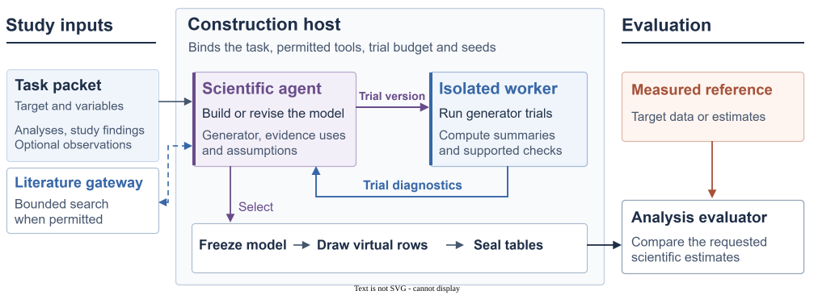

**Figure 1. Architecture of the evidence-guided virtual cohort system.** The coordinator manages evidence access, versions and study budgets. The agent authors the scientific model and executable generator. The worker returns permitted trial diagnostics to inform a retain-or-revise decision. The evaluator uses the sealed tables and measured reference to run the downstream comparisons. Study protocols determine whether external search, source replay and revision are available. Supplement S12 identifies the corresponding implementation paths.

When no individual data are supplied, the program samples every requested column. For enrichment it can condition a new variable on observed covariates, or preserve observed entries when filling specified gaps. The main experiments evaluate complete-cohort generation. Figure 2 follows one such request from source evidence to paired records and scientific analyses.

## 3. Constructing a virtual cohort for a scientific question

### 3.1. Read each finding in its study context

The investigator fixes the population, requested measurements and intended analyses. What evidence the agent receives depends on the protocol. Researchers prepared the source packets in Q1 and the iron study. In Q4 each author searched Europe PMC/PMC and chose original papers within a budget of eight query credits and four original articles. Q5 supplied reviewed papers and permitted additional search.

Qualification means deciding what a paper actually measured and which part of the generator that finding can inform. Zhu et al. reported the frequency of low raw ferritin within hemoglobin bands and the geometric mean ferritin concentration in each band [33]. A Cuban study reported an association after correcting ferritin for inflammation [34]. The iron study packet identified the latter result as contextual. The remaining scientific decisions were how to pair continuous values within the bands and how to use the source relationships in a different population. Table 1 identifies who made each decision.

**Table 1. Who decided how to construct the iron-status cohort?** The two authors received the same request and evidence packet.

| Contribution | Iron-status example |
|---|---|
| Investigator | Defines US eligibility, two requested measurements and three analyses. Identifies the corrected-ferritin result as contextual. |
| Published study | Supplies joint threshold counts and ferritin geometric means for three hemoglobin bands [33]. |
| Agent A | Chooses a continuous model for each band. In the target law, it reduces the relative weight of low ferritin and independently redraws hemoglobin in one fifth of rows. |
| Agent B | Chooses a dependence model for ranks within bands. Carries the source joint distribution into the target context. |
| Numerical tools | Sample paired measurements from each frozen model. Apply all three analyses to each delivered table. |

### 3.2. Choose how measurements will vary together

Consider how one row is produced under model B. The program first chooses a hemoglobin band with the frequency reported for that band in the source. It draws a continuous hemoglobin value inside the band. It then draws a ferritin value whose rank is linked to the hemoglobin rank. The published band summaries constrain ferritin levels and the proportion of low values. B chose the rule linking the ranks, a copula, because the source did not report individual pairings. Both measurements go into the same row. Repeating these draws produces a cohort. Model A used a different within-band construction and altered the pairing for the target population. Section 5.1 traces the consequences of those decisions.

The modeling choices depend on what a study reports. In the glycemia example, the input contained two separately adjusted regression slopes. One constructor supplied an assumption about the relation between the predictors to use those slopes in a joint model. Supplement S11 gives the derivation for that particular constructor. In the longitudinal example the input included fitted model terms and the author generated repeated visits for each person. Each program is accompanied by a record of its numerical constraints, its checks and the assumptions it uses to complete the requested measurements.

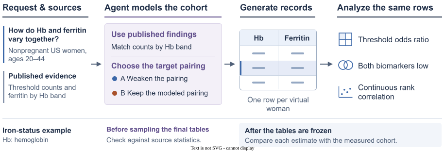

**Figure 2. The iron-status request through the system.** Study findings constrain the model that the agent builds. The agent also chooses how to pair measurements and how to apply the source evidence in the requested population. Each virtual row pairs hemoglobin with ferritin, so the three analyses use the same records. In the sealed iron evaluation the measured target biomarkers became available only after generation.

### 3.3. Check, freeze and analyze the records

When the protocol permits source replay, the worker draws records under the source population rules and applies the statistic used in the paper. Each iron author had one opportunity to review a source draw of 100,000 records. The check prompted A to revise a ferritin tail with infinite variance. B retained its program. Some published analyses cannot be replayed with the available information. All 132 proposed source comparisons in Q5 were unavailable under their declared definitions, and authors could inspect summaries of their generated records.

The worker then draws tables for the requested population from the final program. In the iron study each author delivered three tables of 5,000 rows, which were sealed before the target biomarkers were accessed. The evaluator calculated the joint-low proportion, the threshold odds ratio and the continuous rank correlation from the same two columns of each table, and independently estimated the corresponding survey quantities. Ordinary analysis software can operate on the delivered records. The program, seeds and analysis code specify how to repeat numerical sampling and evaluation. A fresh author given the same request may choose another model.

## 4. Evaluation design

Each experiment specifies what the constructor can see and which analyses the delivered table should support (Table 2). We summarize the iron case first because it asks three questions of one dataset. The glycemia evidence contrast then varies one input to construction. Across studies, a construction is a separately authored model. Repeated draws quantify sampling variation within that model. We report discrepancies in the units of the intended scientific analysis and preserve each study's original decision rule.

**Table 2. What the constructor could know, and what the evaluation can establish.** Q1–Q5 are the identifiers of the frozen experiments. The iron study and the earlier prospective tests have separate protocols. All listed tasks generate complete cohorts.

| Study | Construction inputs | Constructions and final deliveries | Analysis |
|---|---|---|---|
| Iron status | External evidence; target eligibility; no target biomarkers | 2 agent; 6 tables of 5,000 | Threshold association, joint burden and continuous ranks |
| Q1: CHNS and ENSANUT | Basic evidence (E0); E0 plus external relations (E1) | 20 agent + 4 prescribed; 72 tables of 3,000 | Six adjusted glycemia coefficients |
| Q5: glycemia and lipids | Reviewed external papers, population description, optional retrieval | 6 agent; 18 tables of 3,000 | Six requested effects or correlations |
| Earlier prospective wave | External summaries and population description; exact target results withheld | 5 agent + 1 prescribed per case; 36 tables of 5,000 | HAALSI glucose and Turkana lipid analyses |
| Q3: longitudinal reconstruction | Published HRS fitted-model artifacts | 1 agent + 1 reconstructed; 6 valid tables, 11,509 subjects × 4 visits each | Age–HbA1c interactions in memory trajectories |
| Q2 / Q4: supporting conditions | Q2: with or without 30 target summaries; Q4: open paper retrieval without bibliographic seeds | Q2: 6 agent laws / 18 distinct tables; Q4: 4 / 12 | Reconstruction of supplied summaries; repeated open retrieval |

CHNS (6,631 adults, ages 35–74) uses unweighted estimates for the selected sample. ENSANUT (6,931 adults, ages 25–79) assigns equal mass to eight sex-by-age cells. In Q1, each case and information condition has five fresh agent authors and one prescribed statistical law. We average absolute discrepancy over three draws within each law, then across laws within the arm. E0 and E1 authors are not paired. The prescribed law illustrates a statistical completion from the same information; it is not a competitive search over statistical methods.

The reference conditions differ. Q1–Q5 reused project-level references where applicable. For iron status we sealed the protocol and the six deliveries before acquiring the target biomarkers; NHANES was already known to the project. In the earlier prospective wave, a custodian withheld the exact HAALSI and Turkana results, although investigators knew related Turkana findings. We distinguish target sampling intervals, resampling stability bands and model-conditional intervals in the figures. None makes a sample estimate the true population value.

## 5. Results

### 5.1. Which analyses can use the same iron-status records?

Zhu et al. studied 1,671 parous women who used IUDs in northern China, two to four years postpartum [33]. The source counts imply a crude odds ratio of 6.65. The agents' source replays gave 6.58 and 6.73. Both programs used the hemoglobin bands and their ferritin summaries. The Cuban study used inflammation-corrected ferritin [34]. As specified in the shared packet, its odds ratio supplied context for the transfer assumptions (Table 1).

Figure 3 traces the implications of the frozen code. In A, giving low-ferritin observations a relative weight of two thirds preserves the threshold odds ratio, since the factor cancels in the cross-product of counts. It reduces the joint-low proportion from 10.35% to 7.67%. For one fifth of rows A then draws hemoglobin independently from the same target hemoglobin distribution. The resulting model implies a joint-low proportion of 6.73% and an odds ratio of 4.65. B retains the source joint-low proportion of 10.35% and odds ratio of 6.65. These values follow from the two authored models. The colored markers in panels c to e show estimates from the six previously sealed tables.

The survey reference included 979 eligible women with both measurements [35]. Comparison on the log-odds-ratio scale was primary. All six delivered odds ratios (A 4.835–4.866, B 6.011–6.565) fell below the survey's lower confidence limit of 9.28 (estimate 17.79, 95% CI 9.28–34.11). A came closer on the joint-low proportion (6.66–6.88% versus 7.63%), while B came closer on the continuous Spearman correlation (0.391–0.430 versus 0.398). For B the joint-low proportion was 10.02–10.44%, and for A the correlation was 0.156–0.195. The sources reported no continuous rank coefficient. Their ferritin summaries by hemoglobin band constrain ranks indirectly, leaving within-band dependence to the author. The same two columns in each delivery supplied all three estimates.

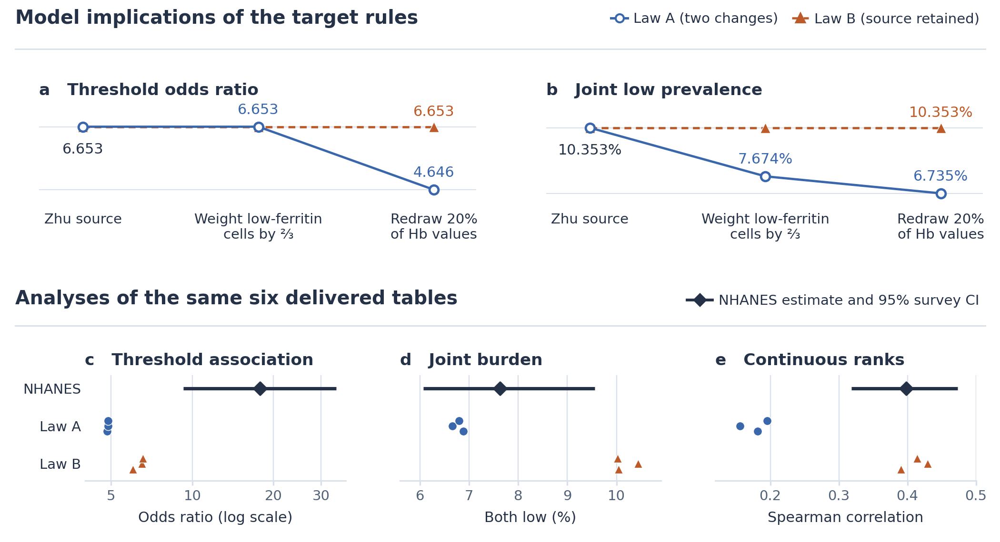

**Figure 3. How two transfer choices affect analyses on the same iron-status records.** Panels a and b are a post hoc calculation from the source counts and frozen rules. Panels c to e show three sealed tables of 5,000 rows per law and the NHANES estimate with its design-based 95% interval. Low hemoglobin is below 12 g/dL and low raw ferritin below 15 µg/L. The two secondary analyses had no prespecified equivalence margin.

### 5.2. Which regressions improve with additional relationship evidence?

The iron case illustrates what a fixed source packet leaves open. The next comparison asks whether adding published associations to basic evidence helps constrain a model. Across CHNS and ENSANUT, the agent arms given these additional relationships (E1) had smaller mean absolute discrepancies than the basic-evidence arms (E0) for five of six regression coefficients (Figure 4). For the CHNS glucose slope the error fell from 0.134019 to 0.024079 HbA1c percentage points per mmol/L. The CHNS BMI error increased from 0.020380 to 0.031557 percentage points per kg/m². All three ENSANUT discrepancies decreased. Some E1 endpoints were closer under the prescribed statistical construction, including CHNS glucose and ENSANUT BMI adjusted for glucose (Table S1).

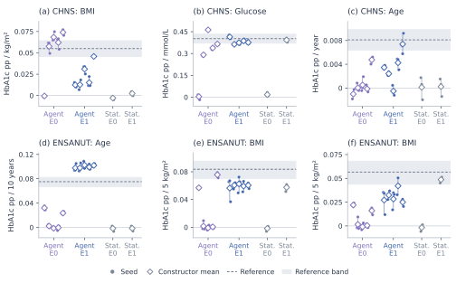

**Figure 4. Relational evidence and scientific analysis agreement.** CHNS panels show BMI adjusted for age/sex (a), glucose adjusted for age/sex (b), and age adjusted for sex/BMI/glucose (c). ENSANUT panels show age adjusted for sex/BMI/glucose (d), BMI adjusted for age/sex (e), and BMI additionally adjusted for glucose (f). All six analyses retain native units. E0 contains basic/marginal evidence; E1 adds relations. Each agent arm has five independently authored laws and each statistical arm one prescribed law, with all three final draws retained: 24 constructions, 72 tables and 216 coefficient estimates. Dots show seeds, open diamonds constructor means and thin segments seed ranges; dashed lines mark sample references. Reference bands are CHNS community-cluster CR1-t intervals or ENSANUT cluster-resampling stability bands. Author indices do not pair E0 with E1. Table S1 gives every endpoint's mean absolute discrepancy and E1–E0 contrast.

### 5.3. Which findings carry across requests and reference conditions?

For glycemia and lipids, three authors per request generated 18 tables in total. All 54 primary estimates agreed in point direction with the corresponding sample estimates across six distinct analyses (Figure 5). The tables supported age- and sex-adjusted BMI models and further adjustment for glucose. The three constructor-mean correlations of total and HDL cholesterol after adjustment for age, sex and BMI were 0.108–0.141, against 0.512 in the measured sample. The total-cholesterol slope's reference interval crossed zero. A post hoc check of the sealed lipid tables found HDL above total cholesterol in 69 of 27,000 synthetic rows (0.256%). Both concentrations were expressed in mmol/L. This check measures the biological consistency of individual pairs separately from the prespecified association results.

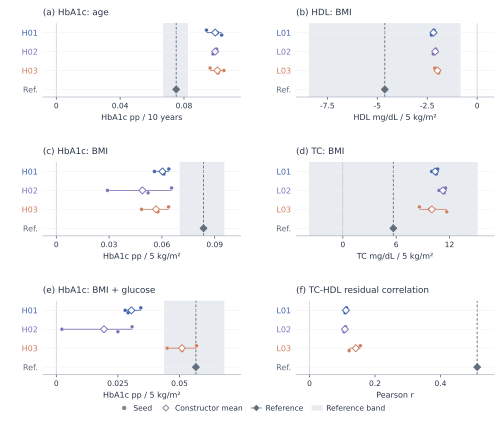

**Figure 5. Analysis-specific behavior across glycemia and lipid requests.** HbA1c panels in the left column show age adjusted for sex/BMI/glucose (a), BMI adjusted for age/sex (c), and BMI additionally adjusted for glucose (e). The right column shows age/sex-adjusted HDL and TC BMI slopes (b,d) and residual Pearson correlation after age/sex/BMI adjustment (f). All six laws and 54 estimates from 18 tables are retained. Circles show seeds, open diamonds means and thin segments seed ranges; dark diamonds and dashed lines mark sample references. HbA1c units are percentage points per 10 years or 5 kg/m²; lipid slopes are mg/dL per 5 kg/m². Bands are ENSANUT empirical cluster-resampling stability bands and lipid HC3 assumption-conditional sensitivity intervals. The TC band crosses zero; no residual-correlation interval is available. Seed ranges describe sampling under each frozen law. Table S5 supplies all numerical summaries and Figure S3 the dispersion results.

The earlier prospective wave tested a stricter question. In HAALSI adults aged 40 or older [30,31], all 15 agent draws recovered the positive directions of the adjusted BMI and age associations with capillary glucose; only eight recovered the negative difference between female and male BMI slopes. The rule required four of five laws per case to meet all prespecified margins on every seed. Three passed in HAALSI and none in Turkana [32], so the planned expansion stopped. Even a zero-effect rule met the HAALSI margin for all three endpoints. The earlier method and its gate remain a separate prospective result, not a fresh evaluation of the later workflow on the same Turkana participants.

### 5.4. What changes when the scientific relationship is already supplied?

In the HRS longitudinal benchmark both methods received the published model exports [1]. Below the 6.5% HbA1c knot, the age–HbA1c interaction in memory trajectories averaged −0.04464 for agent tables and −0.04050 for the reconstructed published generator, against the supplied −0.04684. Above the knot the mean signs differed; five of six intervals included zero (Figure S6). This is a matched reconstruction check, not transfer from partial evidence. Similarly, supplying 30 target summaries in Q2 allowed joint reconstruction of the five highlighted regression and correlation analyses (Table S2). In Q4, open retrieval yielded twelve distinct original studies across four authors and twelve complete tables (Tables S3–S4); the design did not isolate the effect of retrieval. HRS and Q2 test reconstruction when target-model information is supplied; Q4 instead demonstrates a way to obtain external evidence without supplying more information about the target.

## 6. Discussion

For the researcher who asked about iron status, the same virtual cohort can yield a joint proportion, an odds ratio and a rank correlation. These results have different foundations. Published counts determine the threshold association in the source sample. The target odds ratio depends on how the agent changes the pairing across populations. For continuous correlation, concentrations within hemoglobin bands also matter. In this case, the law closer to the measured joint proportion differed from the law closer on continuous ranks. A researcher planning to study those ranks would gain information from paired concentrations within the bands in a comparable population. The lipid results point to an analogous need for joint measurements under the intended adjustment. These case comparisons show how to interpret results after evaluation. Assessing whether the method can flag a reliable use before seeing the reference would require a separate test.

## Limitations and Ethical Considerations

The evidence cannot identify every joint relationship. Sources differ in eligibility, age, geography, specimen handling and adjustment; reference samples have sampling uncertainty. A small number of agent constructions share a model service, and repeated draws do not represent independent clinical cohorts. The protocols differ across studies. No held-out trial shows that review improves outcomes or that the workflow saves a measured amount of human time. For research planning, the source-based and assumed parts should travel with the records. Values must be labeled synthetic and must not be presented as measured individual biomarkers, clinical diagnoses or substitutes for independent patient evidence. Original cohort access and reuse conditions continue to apply; the public artifacts contain code and aggregate results rather than participant-level tables.

## Generative AI Usage

Language models participated in research planning and manuscript editing and were an object of the experiments. In the scientific workflow, agent authors interpreted evidence, selected or received studies according to protocol, proposed statistical models, and wrote or revised generator code. Deterministic tools sampled the records and computed the reported analyses; separate implementations checked the numerical results where specified. Study protocols and source records document these roles. The final author list, study-specific declarations, and applicable oversight and data-use statements must be confirmed before submission.

## Supporting materials and reproducibility

The [public research repository](https://github.com/ziwang11112/evidence-guided-virtual-cohorts-2026) contains protocols, executable code and aggregate audits. The iron [protocol seal](https://github.com/ziwang11112/evidence-guided-virtual-cohorts-2026/commit/bedd845768c1c938768f58fce685f53cbf97f3df) and [delivery seal](https://github.com/ziwang11112/evidence-guided-virtual-cohorts-2026/commit/c88192edeb0bc63b60d0bfe6e3a7282ced9d2975) precede target evaluation. Supplements retain all prespecified outcomes, unfavorable cases and implementation incidents. No new cohort was generated for this revision.

## References

1. Filshtein TJ, Li X, Zimmerman SC, Ackley SF, Glymour MM, Power MC. Proof of concept example for use of simulation to allow data pooling despite privacy restrictions. *Epidemiology*. 2021;32(5):638–647. [DOI and full text](https://pmc.ncbi.nlm.nih.gov/articles/PMC8338788/).
2. Zhao Z et al. SynthIPD: training-free synthetic individual patient data generation. arXiv:2509.16466v2, 24 July 2026. [Versioned full text](https://arxiv.org/html/2509.16466v2). Publication beyond this preprint was not established in the positioning audit.
3. Phillippo DM et al. Multilevel network meta-regression for population-adjusted treatment comparisons. *Journal of the Royal Statistical Society: Series A*. 2020;183(3):1189–1210. [DOI/full text](https://rss.onlinelibrary.wiley.com/doi/full/10.1111/rssa.12579).
4. Holt S, Ruiz Luyten M, Berthon A, van der Schaar M. G-Sim: Generative Simulations with Large Language Models and Gradient-Free Calibration. *Proceedings of ICML*. PMLR 267;2025:23513–23561. [Published record](https://proceedings.mlr.press/v267/holt25b.html).
5. Tang Y, Kong M, He J, Nie T, Ma W, Sun L. LLMSynthor: Macro-Aligned Micro-Records Synthesis with Large Language Models. KDD 2026. [DOI](https://doi.org/10.1145/3770855.3818965); [full text v4](https://arxiv.org/html/2505.14752v4).
6. Callender T, Boyd A, Davis R, Ruhrberg Estevez S, Lavista Ferres JM, van der Schaar M. SynthCraft: An AI partner for synthetic data generation to support data access and augmentation in healthcare. *PLOS Digital Health*. 2026;5(3):e0001290. [Published article](https://journals.plos.org/digitalhealth/article?id=10.1371/journal.pdig.0001290).
7. Bao Y, Ma X, Li H, Zhou M, Hu C, Wu H, Tang J, Hou X, Xiang K, Jia W. Glycated haemoglobin A1c for diagnosing diabetes in Chinese population: cross sectional epidemiological survey. *BMJ*. 2010;340:c2249. [DOI](https://doi.org/10.1136/bmj.c2249); [bibliographic record](https://pubmed.ncbi.nlm.nih.gov/20478961/).
8. Wang P, Li Y, Wang M, Song L, Dong Y, Han X, Tuomilehto J, Wang Y, Du Y, Qiu C. Comparing glycemic traits in defining diabetes among rural Chinese older adults. *PLOS ONE*. 2024;19(1):e0296694. [Published article](https://journals.plos.org/plosone/article?id=10.1371/journal.pone.0296694).
9. Jansen H, Stolk RP, Nolte IM, Kema IP, Wolffenbuttel BHR, Snieder H. Determinants of HbA1c in nondiabetic Dutch adults: genetic loci and clinical and lifestyle parameters, and their interactions in the lifelines cohort study. *Journal of Internal Medicine*. 2013;273(3):283–293. [Published article](https://onlinelibrary.wiley.com/doi/10.1111/joim.12010).
10. Pani LN, Korenda L, Meigs JB, Driver C, Chamany S, Fox CS, Sullivan L, D'Agostino RB, Nathan DM. Effect of aging on A1C levels in individuals without diabetes: evidence from the Framingham Offspring Study and the National Health and Nutrition Examination Survey 2001-2004. *Diabetes Care*. 2008;31(10):1991–1996. [DOI](https://doi.org/10.2337/dc08-0577); [bibliographic record](https://pubmed.ncbi.nlm.nih.gov/18628569/).
11. NGSP. The IFCC and NGSP, Table 2. [Official measurement-scale guidance](https://ngsp.org/ifccngsp.asp).
12. Li T, Quan H, Zhang H, Lin L, Lin L, Ou Q, Chen K. Type 2 diabetes is more predictable in women than men by multiple anthropometric and biochemical measures. *Scientific Reports*. 2021;11:6062. [DOI](https://doi.org/10.1038/s41598-021-85581-z); [original full text](https://pmc.ncbi.nlm.nih.gov/articles/PMC7960723/).
13. Sakane N, Sato J, Tsushita K, Tsujii S, Kotani K, Tominaga M, Kawazu S, Sato Y, Usui T, Kamae I, Yoshida T, Kiyohara Y, Sato S, Tsuzaki K, Nirengi S, Takahashi K, Kuzuya H, JDPP Research Group. Determinants of Glycated Hemoglobin in Subjects With Impaired Glucose Tolerance: Subanalysis of the Japan Diabetes Prevention Program. *Journal of Clinical Medicine Research*. 2017;9(4):360–365. [DOI](https://doi.org/10.14740/jocmr2928w); [original full text](https://pmc.ncbi.nlm.nih.gov/articles/PMC5330780/).
14. Wisgerhof W, Ruijgrok C, den Braver NR, Borgonjen—van den Berg KJ, van der Heijden AAWA, Elders PJM, Beulens JWJ, Alssema M. Phenotypic and lifestyle determinants of HbA1c in the general population–The Hoorn Study. *PLOS ONE*. 2020;15(6):e0233769. [DOI](https://doi.org/10.1371/journal.pone.0233769); [original full text](https://pmc.ncbi.nlm.nih.gov/articles/PMC7272077/).

15. Yang S, Zhang Z, Prenkaj B, Kasneci G. Doubling Your Data in Minutes: Ultra-fast Tabular Data Generation via LLM-Induced Dependency Graphs. *Proceedings of the 2025 Conference on Empirical Methods in Natural Language Processing*. 2025:10337–10358. [Official article and PDF](https://aclanthology.org/2025.emnlp-main.525/); [DOI](https://doi.org/10.18653/v1/2025.emnlp-main.525).

16. Wu et al. Effect of age on the diagnostic efficiency of HbA1c for diabetes in a Chinese middle-aged and elderly population: The Shanghai Changfeng Study. *PLoS ONE*. 2017. [Admitted original](https://pmc.ncbi.nlm.nih.gov/articles/PMC5591004/).
17. Skogberg et al. The association between anthropometric measures and glycated haemoglobin (HbA1c) is different in Russian, Somali and Kurdish origin migrants compared with the general population in Finland: a cross-sectional population-based study. *BMC Public Health*. 2019. [Admitted original](https://pmc.ncbi.nlm.nih.gov/articles/PMC6458679/).
18. Zhang et al. The Association of Retinopathy and Plasma Glucose and HbA1c: A Validation of Diabetes Diagnostic Criteria in a Chinese Population. *Journal of Diabetes Research*. 2016. [Admitted original](https://pmc.ncbi.nlm.nih.gov/articles/PMC5078665/).
19. Venkataraman et al. Ethnicity modifies the relation between fasting plasma glucose and HbA1c in Indians, Malays and Chinese. *Diabetic Medicine*. 2012. [Admitted original](https://pmc.ncbi.nlm.nih.gov/articles/PMC3504343/).
20. Liu et al. Ideal glycated hemoglobin cut-off points for screening diabetes and prediabetes in a Chinese population. *Journal of Diabetes Investigation*. 2016. [Admitted original](https://pmc.ncbi.nlm.nih.gov/articles/PMC5009131/).
21. Huang et al. Hemoglobin A1c Levels Associated with Age and Gender in Taiwanese Adults without Prior Diagnosis with Diabetes. *International Journal of Environmental Research and Public Health*. 2021. [Admitted original](https://pmc.ncbi.nlm.nih.gov/articles/PMC8038122/).
22. Ghazanfari et al. A Comparison of HbA1c and Fasting Blood Sugar Tests in General Population. *International Journal of Preventive Medicine*. 2010. [Admitted original](https://pmc.ncbi.nlm.nih.gov/articles/PMC3075530/).
23. Masuch et al. Preventing misdiagnosis of diabetes in the elderly: age-dependent HbA1c reference intervals derived from two population-based study cohorts. *BMC Endocrine Disorders*. 2019. [Admitted original](https://pmc.ncbi.nlm.nih.gov/articles/PMC6371438/).
24. Marini et al. Association between hemoglobin glycation index with insulin resistance and carotid atherosclerosis in non-diabetic individuals. *PLoS ONE*. 2017. [Admitted original](https://pmc.ncbi.nlm.nih.gov/articles/PMC5398507/).
25. Greiner et al. Associations between low HDL, sex and cardiovascular risk markers are substantially different in sub-Saharan Africa and the UK: analysis of four population studies. *BMJ Global Health*. 2021;6:e005222. [DOI](https://doi.org/10.1136/bmjgh-2021-005222); [published correction to author names](https://gh.bmj.com/content/6/6/e005222corr1).
26. Obirikorang et al. Obesity and Cardio-Metabolic Risk Factors in an Urban and Rural Population in the Ashanti Region-Ghana: A Comparative Cross-Sectional Study. *PLOS ONE*. 2015;10:e0129494. [DOI](https://doi.org/10.1371/journal.pone.0129494); [admitted original](https://journals.plos.org/plosone/article?id=10.1371/journal.pone.0129494).
27. Agongo et al. The burden of dyslipidaemia and factors associated with lipid levels among adults in rural northern Ghana: An AWI-Gen sub-study. *PLOS ONE*. 2018;13:e0206326. [DOI](https://doi.org/10.1371/journal.pone.0206326); [admitted original](https://journals.plos.org/plosone/article?id=10.1371/journal.pone.0206326).
28. Agongo et al. Correction: The burden of dyslipidaemia and factors associated with lipid levels among adults in rural northern Ghana: An AWI-Gen sub-study. *PLOS ONE*. 2019;14:e0213233. [DOI](https://doi.org/10.1371/journal.pone.0213233); [correction](https://pmc.ncbi.nlm.nih.gov/articles/PMC6392312/). The correction concerns hip/waist entries and a citation; those entries were not used in the lipid constructions.
29. Gu T, Taylor JMG, Mukherjee B. A synthetic data integration framework to leverage external summary-level information from heterogeneous populations. *Biometrics*. 2023;79:3831–3845. [DOI](https://doi.org/10.1111/biom.13852).

30. Gómez-Olivé FX et al. Cohort Profile: Health and Ageing in Africa: A Longitudinal Study of an INDEPTH Community in South Africa (HAALSI). *International Journal of Epidemiology*. 2018;47:689–690j. [Cohort profile](https://doi.org/10.1093/ije/dyx247).
31. Harvard Center for Population and Development Studies. HAALSI Baseline Survey. Harvard Dataverse, 2016, version 3.0. [Dataset](https://doi.org/10.7910/DVN/F5YHML).
32. Lea AJ, Martins D, Kamau J, Gurven M, Ayroles JF. Urbanization and market integration have strong, nonlinear effects on cardiometabolic health in the Turkana. *Science Advances*. 2020;6:eabb1430. [Article](https://doi.org/10.1126/sciadv.abb1430). [Dataset](https://doi.org/10.5061/dryad.2z34tmpjk).

33. Zhu JH et al. Iron, folate, and B12 deficiencies and their associations with anemia among women of childbearing age in a rural area in northern China. International Journal for Vitamin and Nutrition Research. 2010;80:144–154. [Article](https://doi.org/10.1024/0300-9831/a000014).
34. Pita-Rodríguez GM et al. Prevalence of Anemia and Iron Deficiency in Women of Reproductive Age in Cuba and Associated Factors. International Journal of Environmental Research and Public Health. 2023;20:5110. [Article](https://doi.org/10.3390/ijerph20065110).
35. National Center for Health Statistics. NHANES, August 2021–August 2023: Ferritin (FERTIN_L); Complete Blood Count (CBC_L); Demographic Variables and Sample Weights (DEMO_L). [Ferritin and phlebotomy weights](https://wwwn.cdc.gov/Nchs/Data/Nhanes/Public/2021/DataFiles/FERTIN_L.htm); [complete blood count](https://wwwn.cdc.gov/Nchs/Data/Nhanes/Public/2021/DataFiles/CBC_L.htm); [demographics](https://wwwn.cdc.gov/Nchs/Data/Nhanes/Public/2021/DataFiles/DEMO_L.htm).

## Supplementary results

The supplement retains the complete numerical comparisons and supporting displays under their original study identities. Figure and table numbers follow their new placement; no construction, primary result or unavailable comparison is removed by the shorter main narrative. Q1–Q5 remain distinct experiments with their original information conditions.

### S1. Complete external-evidence contrast

All 24 Q1 constructions produced their three scheduled final tables. The 72 final tables were distinct and supported every requested regression and diagnostic; seven exploratory tables brought physical executions to 79. Additional relational evidence reduced constructor-averaged mean absolute discrepancy for five of the six designated coefficients (Table S1). CHNS glucose discrepancy decreased from 0.134019 to 0.024079 HbA1c percentage points per mmol/L. All three ENSANUT contrasts improved. CHNS BMI discrepancy increased from 0.020380 to 0.031557.

**Table S1. Complete main-study information contrast.** Discrepancies retain the units of each row; they are not pooled. The reference response is HbA1c percentage points. E1–E0 uses unrounded quantities before display rounding.

| Case / focal analysis | Predictor increment | E0 mean absolute discrepancy | E1 mean absolute discrepancy | E1 − E0 |
|---|---|---:|---:|---:|
| CHNS BMI, adjusted age/sex | 1 kg/m² | 0.020380 | 0.031557 | +0.011178 |
| CHNS glucose, adjusted age/sex | 1 mmol/L | 0.134019 | 0.024079 | −0.109939 |
| CHNS age, adjusted sex/BMI/glucose | 1 year | 0.007281 | 0.004854 | −0.002426 |
| ENSANUT age, adjusted sex/BMI/glucose | 10 years | 0.063944 | 0.024670 | −0.039274 |
| ENSANUT BMI, adjusted age/sex | 5 kg/m² | 0.056883 | 0.023732 | −0.033151 |
| ENSANUT BMI, adjusted age/sex/glucose | 5 kg/m² | 0.048797 | 0.025649 | −0.023147 |

The effect displays explain what these changes mean. CHNS E1 glucose constructor means were 0.363363–0.414189 around the 0.402093 reference. Its BMI means were positive but lower, 0.012400–0.045757 versus 0.054946. Conditional-age means ranged from −0.000509 to 0.007393 versus 0.008107; one author retained a negative mean and two negative seeds. All ENSANUT E1 focal coefficients were positive, although its age means of 0.097769–0.102452 per decade exceeded 0.075132 and its BMI means remained below their references. Preserving a direction and recovering its magnitude are distinct aspects of usefulness.

Every E1 author used at least one relationship as a numerical constraint. The complete uptake records include constraints, unfitted analytic checks and contextual uses, including the case-specific projection calculation in Supplement S11. Statistical references also achieved useful results: under E1, the prescribed constructions had lower seed-averaged discrepancies than every corresponding agent for CHNS glucose and ENSANUT conditional BMI. Other comparisons favored agent constructions. The evidence therefore supports scientific utility and the value of additional information, rather than a universal algorithmic ranking.

### S2. Complete supplied-summary reconstruction

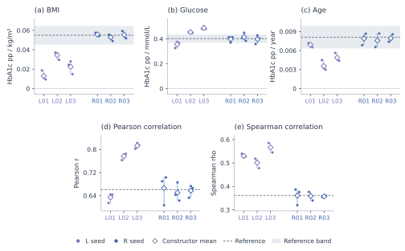

**Figure S1. Supplied summaries become jointly analyzable data.** Five panels show BMI, glucose and age regression coefficients plus glucose–HbA1c Pearson and Spearman correlations. L01–L03 use literature; R01–R03 additionally receive 30 target summaries and metadata. Points show all three final draws, diamonds constructor means and segments seed ranges. Dashed lines mark reference summaries available to R; regression bands are CHNS community-cluster CR1-t intervals, with no supplied correlation interval. All six constructors, 18 distinct delivery tables, 30 means and 90 seed statistics appear once. Initial and final deliveries were identical after retention; Table S2 gives the complete five-analysis numerical comparison.

The separate CHNS experiment gave three authors external literature (L) and three authors that literature plus 30 target summaries and their metadata (R). Each author delivered three tables and had one additional diagnostic-review opportunity. All six retained their models. There were 42 physical executions: six trials and 36 initial/final deliveries. Final bytes duplicated their matching initial outputs, leaving 24 distinct tables overall and 18 distinct delivery tables. The identical stages are displayed once.

R supported close reconstruction of all five highlighted scientific analyses (Table S2; Figure S1). These values were legitimate construction inputs; their agreement measures reconstruction rather than prediction of hidden coefficients. The L/R packet and authors differ from Q1, so those two information comparisons are kept separate.

**Table S2. Joint-statistic reconstruction with available summaries.** Ranges span three constructor means over three fixed seeds, not confidence intervals. Regression units are HbA1c percentage points per kg/m², mmol/L and year, respectively.

| Analysis | Supplied reference | External literature L | Literature + summaries R |
|---|---:|---:|---:|
| BMI coefficient, age/sex adjusted | 0.054946 | 0.013001–0.034287 | 0.052821–0.055789 |
| Glucose coefficient, age/sex adjusted | 0.402093 | 0.356064–0.487815 | 0.396941–0.413715 |
| Age coefficient, sex/BMI/glucose adjusted | 0.008107 | 0.003552–0.006910 | 0.007569–0.007947 |
| Glucose–HbA1c Pearson correlation | 0.660968 | 0.633764–0.813170 | 0.650561–0.666438 |
| Glucose–HbA1c Spearman correlation | 0.361457 | 0.501339–0.566477 | 0.357571–0.360983 |

Agreement extended beyond central values. R constructor-mean BMI SDs were 3.38965–3.40243 versus 3.40632, glucose SDs were 1.48817–1.58968 versus 1.54455, and HbA1c SDs were 0.95208–0.96554 versus 0.95357. A separate three-table statistical calibration supplement also closely reconstructed the regression summaries, with mean coefficients 0.055726, 0.412568 and 0.007679. That purpose-built family was developed with coding-agent assistance and is not an agent-removal ablation. Both approaches demonstrated the usefulness of constructing a joint table from accessible aggregate information.

### S3. Open retrieval across population requests

The unified workflow allocated two fresh scientific authors to each of the existing CHNS and ENSANUT requests. Each author received the intended analyses, population/measurement definitions, task interface and retrieval budget, but no target coefficients, desired signs, individual records or prior construction. CHNS- and ENSANUT-derived studies were excluded as generating evidence. Across 24 query credits, the authors selected sixteen paper uses representing twelve distinct originals. Independent review checked the original statistical definitions, numerical derivations, source applicability and required finite moments before execution. Sources could overlap across authors; four constructions do not imply four independent bodies of clinical evidence.

The agents chose materially different laws. C01 used an age-conditioned multivariate-lognormal mixture informed by Chinese population summaries [7,16] and contextual age/body-size findings [10,17]. C02 combined copula predictors with an affine HbA1c conditional mean using Pinggu summaries and Singapore coefficients [18,19], with other populations as applicability context [14,20]. E01 used bounded beta predictors and a conditional gamma response [10,17,21,22]. E02 combined lognormal BMI, conditional truncated-normal glucose and a positive conditional-mean lognormal response [10,21,23,24]. Their unreported dependencies, population transfers and residual choices remained declared assumptions. The shared controller did not prescribe these families or insert target coefficients.

Each author completed one 3,000-row trial, inspected generated-only diagnostics and source feedback, then selected its final model before three fixed draws. All four retained the initial law. The sixteen physical executions comprised four trials and twelve unique final tables, or 36,000 final virtual rows. Feedback contained 29 qualified approximate comparisons and 39 unavailable checks across the four trials, not source-population replays or 29 passed constraints. After all sessions closed, the evaluator reused the fixed sample references. A separate numerical implementation reproduced all 366 final coefficient/diagnostic values; no clinical data were downloaded or refitted.

All 36 primary seed estimates had the same positive directions as their corresponding references (Figure S2). These are repeated measurements of six analysis definitions across four laws, not 36 independent confirmations. Magnitude recovery varied by analysis. CHNS C01/C02 means were 0.03992/0.05338 for BMI against 0.05495, 0.37754/0.49241 for glucose against 0.40209, and 0.00311/0.00563 for age against 0.00811. Units are respectively HbA1c percentage points per kg/m², mmol/L and year. C02 was closer for BMI and age, while C01 was closer for glucose; no construction dominated all analyses.

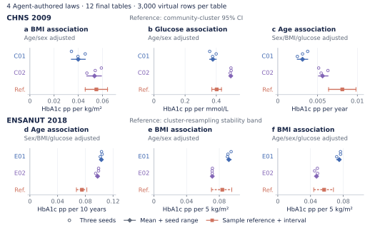

**Figure S2. Repeated open-retrieval construction across two biomedical requests.** All six prespecified primary analyses are shown for four agent-authored laws and twelve final 3,000-row virtual tables. Blue and purple identify the two constructions within each request. Open circles show seeds 8101–8103, ordered top to bottom within each author row; vertical spacing is solely for legibility. Diamonds and horizontal segments below the circles show the three-seed mean and minimum–maximum range. Coral squares in separate reference rows show previously exposed selected-sample estimates. Solid coral intervals are CHNS community-cluster CR1-t 95% confidence intervals; dashed coral intervals are ENSANUT empirical cluster-resampling stability bands from 399 attempts. These reference intervals have different meanings and neither is an acceptance or equivalence threshold. Axes retain native effect units and zero; pp denotes HbA1c percentage points. All generated coefficients are positive, while both CHNS age estimates are weaker and both ENSANUT age estimates stronger than their references. Seed ranges describe sampling under each fixed law, not confidence intervals or uncertainty over evidence, model choice or transport. The four constructions provide developmental workflow replication on two existing references, not independent clinical replication.

For ENSANUT, E01/E02 means were 0.10308/0.09772 for adjusted age against 0.07513 pp/decade, 0.09165/0.07140 for age/sex-adjusted BMI against 0.08364 pp per 5 kg/m², and 0.07509/0.04733 after additionally adjusting for glucose against 0.05664. Every draw retained the reduction of the BMI coefficient after glucose adjustment, an association pattern rather than causal mediation. Both authors built an age coefficient near 0.10 pp/decade and shared some sources; their agreement does not establish independent evidence convergence.

The complete diagnostics reveal remaining limits. CHNS C01 glucose–HbA1c Pearson correlation was approximately 0.666 versus 0.661, but Spearman correlation was 0.635 versus 0.361. ENSANUT residual HbA1c RMS was approximately 0.295/0.324 versus 0.488, and total SD was 0.362/0.406 versus 0.527. Correct directions and a close Pearson coefficient therefore coexisted with rank and dispersion mismatches. The [complete replication report](../reports/core_workflow_replication_2026-11-04/RESULTS.md), every diagnostic and Supplementary Table S3 retain the full results. A scalar-type interface defect in the original evaluator was corrected additively on unchanged frozen tables, with its failed output and independent audit preserved; no scientific model was adjusted after comparison.

**Table S3. Complete Q4 open-retrieval primary summaries.** Means and ranges summarize three final seeds under each fixed construction. Units are HbA1c percentage points per stated predictor increment. No row is omitted; ranges are not confidence intervals.

| Request / analysis | Author | Increment | Reference | Generated mean | Seed min–max |
|---|---|---|---:|---:|---|
| CHNS BMI | C01 | 1 kg/m² | 0.054946 | 0.039923 | 0.034342–0.045708 |
| CHNS glucose | C01 | 1 mmol/L | 0.402093 | 0.377538 | 0.357560–0.398892 |
| CHNS adjusted age | C01 | 1 year | 0.008107 | 0.003109 | 0.002461–0.003755 |
| CHNS BMI | C02 | 1 kg/m² | 0.054946 | 0.053375 | 0.047088–0.059055 |
| CHNS glucose | C02 | 1 mmol/L | 0.402093 | 0.492412 | 0.488649–0.494875 |
| CHNS adjusted age | C02 | 1 year | 0.008107 | 0.005628 | 0.005137–0.006301 |
| ENSANUT adjusted age | E01 | 10 years | 0.075132 | 0.103084 | 0.101546–0.104315 |
| ENSANUT BMI | E01 | 5 kg/m² | 0.083643 | 0.091651 | 0.089940–0.094413 |
| ENSANUT glucose-adjusted BMI | E01 | 5 kg/m² | 0.056638 | 0.075089 | 0.072005–0.076661 |
| ENSANUT adjusted age | E02 | 10 years | 0.075132 | 0.097724 | 0.094947–0.099135 |
| ENSANUT BMI | E02 | 5 kg/m² | 0.083643 | 0.071399 | 0.071232–0.071563 |
| ENSANUT glucose-adjusted BMI | E02 | 5 kg/m² | 0.056638 | 0.047325 | 0.045022–0.048592 |

CHNS BMI/glucose analyses adjust for age and sex; CHNS age adjusts for sex, BMI and glucose. ENSANUT age adjusts for sex, BMI and glucose; its BMI analyses adjust for age/sex, with or without glucose. All Q4 diagnostic values remain in the [complete diagnostic table](../reports/core_workflow_replication_2026-11-04/display/ALL_DIAGNOSTICS.md).

**Table S4. Original-source inventory for Q4 open retrieval.** Twelve unique originals supplied sixteen author-specific paper uses. Sharing a source is not independent clinical evidence; source populations are not the target populations.

| Original | Reference | Constructing authors |
|---|---|---|
| Wu et al., 2017 | [16]; PMC5591004 | C01 |
| Bao et al., 2010 | [7]; PMC2871988 | C01 |
| Pani et al., 2008 | [10]; PMC2551641 | C01, E01, E02 |
| Skogberg et al., 2019 | [17]; PMC6458679 | C01, E01 |
| Zhang et al., 2016 | [18]; PMC5078665 | C02 |
| Venkataraman et al., 2012 | [19]; PMC3504343 | C02 |
| Liu et al., 2016 | [20]; PMC5009131 | C02 |
| Wisgerhof et al., 2020 | [14]; PMC7272077 | C02 |
| Huang et al., 2021 | [21]; PMC8038122 | E01, E02 |
| Ghazanfari et al., 2010 | [22]; PMC3075530 | E01 |
| Masuch et al., 2019 | [23]; PMC6371438 | E02 |
| Marini et al., 2017 | [24]; PMC5398507 | E02 |

The reviewed evidence/specification files distinguish reported statistics, algebraic derivations and assumed relations. The public experiment record includes per-source eligibility, measurement, adjustment, overlap and reporting-quality notes; full third-party originals and participant-like rows remain local.

### S4. Longitudinal reconstruction from published artifacts

The HRS recipient-stage example [1] tested a different data product. A fresh agent received published model exports, a variable specification and the intended mixed-model analysis. It authored the recursive conditional generating family with parameter provenance. A separate implementation reconstructed the published law. Each generated 11,509 subjects at 0, 2, 4 and 6 years, producing 46,036 rows per table. No HRS individual records were used, and the source analysis coefficients were construction inputs.

All three agent and three corrected-law tables supported the native R/lme4 model with 16 fixed effects, individual intercepts/slopes and piecewise HbA1c terms around 6.5%, with age centered at 60 and scaled per decade. The below-threshold HbA1c-by-age interaction averaged −0.044635 in agent data, with range −0.051059 to −0.038247, against the supplied −0.046837. The reconstructed law averaged −0.040500. Both preserved its negative direction in all three draws (Figure S6).

Figure S6 shows the estimates and their per-table Wald intervals. The [longitudinal analysis record](../reports/hrs_public_example_2026-11-03/RESULTS.md) gives all 16 fixed effects and the comparator correction.

The weaker above-threshold interaction was less stable: agent estimates averaged 0.026485 against 0.012867, while corrected-law estimates averaged −0.011691. Overall agent HbA1c mean/SD was 5.8725/0.9676 versus the original published 5.9/1.0. The high-HbA1c subgroup had mean/SD 7.1515/0.5630, compared with original 7.7/1.4 and published synthetic 7.2/0.6. Thus useful source-model behavior coexisted with inadequate upper-group spread.

A CRLF-sensitive parser initially overwrote seven coefficient/SE pairs in our comparator preparation. A separately reviewed source-bound repair produced the three corrected comparator tables without changing the frozen agent outputs. The full record contains nine physical generations, six valid comparison tables and three invalid initial comparator attempts. This was our implementation defect, not a failure of the published method. The [incident record](../reports/hrs_public_example_2026-11-03/recovery_v1/INCIDENT_AND_CORRECTION.md) and complete effects retain the correction and all outcomes.

### S5. Cross-task construction, dispersion and source uses

A [post hoc biological consistency check](Q5_LIPID_ORDER_POST_HOC_v19.md) reports the HDL and total cholesterol ordering counts by frozen law and seed. The comparison uses generated pairs in their original common units.

The next study applied the common workflow to HbA1c analyses in the ENSANUT2018 analytical design and BMI-related TC/HDL analyses in the Turkana study context. Three fresh agent contexts constructed a law for each request, using reviewed external articles, population/measurement metadata and optional literature tools. No participant inputs, target coefficients, target means or prior generators were supplied. The six contexts used the same model service and shared some source evidence. This study therefore tests repeated construction across two requests, with the law chosen by each author, rather than independent clinical replication or a controlled comparison of workflow components.

The HbA1c analyses retained the existing age and BMI estimands and equal allocation to eight sex-by-age cells. The lipid analyses used unweighted age/sex-adjusted BMI coefficients for TC and HDL, plus the Pearson correlation of their residuals after age, sex and BMI adjustment. Lipid eligibility required adults with recognized recorded sex and finite, positive BMI and lipid values. Generated lipid concentrations were converted from mmol/L to mg/dL using the frozen factor 38.67. The reference represents a selected Turkana/Laikipia study sample; fasting, assay transfer and population composition remained qualified in the evidence record. No new participant records were read, downloaded or refitted for this study.

The agents made different scientific choices within the common interface. H01 combined bounded predictors, conditionally truncated glucose and a shifted gamma HbA1c innovation; H02 used bounded beta conditional laws. H03 solved cross-source moment equations under declared dependence and dispersion assumptions, then used conditional beta laws. Their source records included overlapping age, body-size and glycemia evidence [10,17,21,22], with additional check-only/contextual evidence for H01 [14]. The lipid authors combined Gaussian copulas and lognormal margins using geometric summaries from Greiner et al. [25], rural Ashanti rank correlations [26] and arithmetic moments from Agongo et al. [27,28]. Choices about arithmetic versus geometric location, transfer of coefficients of variation, sex strata and age dependence differed among L01–L03. These are applications of established probability families whose numerical use was selected and explained by the agent.

Independent source and implementation reviews checked the statistical meanings, specification/code consistency and finite moments before isolated execution. Each constructor completed one scheduled trial, inspected generated diagnostics and source feedback, and could revise once. All six retained their initial laws. Three fixed final seeds, 9101–9103, produced 18 distinct 3,000-row tables: 54,000 fictional rows from 24 successful physical attempts, including the six trials. No final execution failed and no seed was replaced. Reference comparison began after all six author sessions closed and reused previously exposed aggregate results.

All 54 primary point estimates had the same direction as their corresponding sample estimates, with quantitative agreement varying by analysis (Figure 5; Table S5). HbA1c age effects averaged 0.09954–0.10091 percentage points per decade versus 0.07513 in the reference; age/sex-adjusted BMI effects averaged 0.04892–0.06030 versus 0.08364 per 5 kg/m². With glucose additionally adjusted, H03 averaged 0.05098 versus 0.05664, whereas H01 and H02 averaged 0.03047 and 0.01936. Thus the shared age direction and attenuation after glucose adjustment did not imply recovery of each effect magnitude.

For lipids, mean HDL BMI coefficients ranged from −2.1865 to −1.9868 mg/dL per 5 kg/m² versus −4.6230 in the reference, while TC coefficients ranged from 10.0151 to 11.2609 versus 5.6831. The TC reference sensitivity interval was −3.7535 to 15.1197, so matching its positive point estimate does not establish replication of a definite positive population effect. Residual TC–HDL correlations averaged 0.10828–0.14134 versus 0.51207. The generators preserved the directions of these focal point estimates while substantially underrepresenting the lipid dependence remaining after the specified adjustment.

Dispersion changes the assessment of usefulness (Figure S3). H03's closer glucose-adjusted BMI coefficient accompanied lower HbA1c marginal SD and full-model residual RMS, 0.3523 and 0.3006 percentage points versus 0.5274 and 0.4885. H02 retained more variation, with corresponding values 0.4825 and 0.4036, but smaller BMI coefficients. L02's TC SD was close to the reference, 43.6778 versus 42.8466 mg/dL, although its residual TC–HDL correlation remained weak. All three lipid laws had HDL SDs below the reference. No construction uniformly dominated across focal effects, dependence and dispersion.

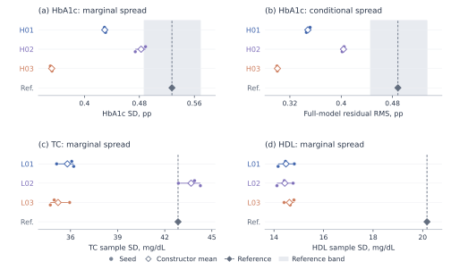

**Figure S3. Dispersion across all cross-task constructions.** Panels show marginal HbA1c SD, HbA1c full-model residual RMS, and marginal TC and HDL SDs for each construction and its three final draws, retaining all 36 diagnostic values from the same 18 tables. HbA1c uses the population-SD diagnostic; lipids use sample SD. These quantities measure individual or residual spread, not uncertainty in a regression coefficient. H03's relatively close adjusted BMI effect in Figure 5 coexists with reduced HbA1c spread, and L02's close TC SD coexists with weak adjusted lipid dependence. Seed ranges reflect Monte Carlo variation conditional on the selected law. Gray HbA1c bands are empirical cluster-resampling stability bands; no reference interval is supplied for lipid SDs.

The evaluation retained all 513 prespecified estimates and diagnostics, including the 54 primary outputs. Independent recomputation verified every value and all 324 matched reference comparisons; the maximum numerical difference was 5.33 × 10⁻¹⁴. The remaining 189 diagnostics lacked matching cached reference estimators and remained generated-only results. Across authors, eight original studies supplied 22 author–paper uses, including context/check-only uses; optional retrieval consumed seven query credits and one original download. All 132 declared source-check entries were unavailable under the implemented semantic rules because weighting or essential operator definitions were unresolved or unsupported (Table S6). Numerical source values still informed reviewed parameter derivations, but this batch provides neither measured numerical source-fit feedback nor a before/after revision benefit. The [complete results and reviews](../reports/evidence_use_cross_task_2026-11-05/RESULTS.md) retain every endpoint, unavailable comparison and implementation incident, including correction of the independent auditor's identifier parser without changing any generated table.

**Table S5. Complete Q5 cross-task primary summaries.** Each row summarizes three fixed final draws from one law. All 18 author–analysis combinations are retained. HbA1c entries are percentage points (pp); lipid slopes are mg/dL per 5 kg/m². Ranges are seed minima and maxima, not confidence intervals or evidence/model uncertainty.

| Request / analysis | Author | Units / increment | Reference | Generated mean | Seed min–max |
|---|---|---|---:|---:|---|
| HbA1c adjusted age | H01 | pp / 10 years | 0.075132 | 0.099545 | 0.094075–0.103606 |
| HbA1c BMI | H01 | pp / 5 kg/m² | 0.083643 | 0.060295 | 0.055769–0.063938 |
| HbA1c glucose-adjusted BMI | H01 | pp / 5 kg/m² | 0.056638 | 0.030469 | 0.027956–0.034291 |
| HbA1c adjusted age | H02 | pp / 10 years | 0.075132 | 0.099539 | 0.098162–0.100396 |
| HbA1c BMI | H02 | pp / 5 kg/m² | 0.083643 | 0.048923 | 0.029090–0.065499 |
| HbA1c glucose-adjusted BMI | H02 | pp / 5 kg/m² | 0.056638 | 0.019363 | 0.002308–0.030777 |
| HbA1c adjusted age | H03 | pp / 10 years | 0.075132 | 0.100912 | 0.096356–0.105015 |
| HbA1c BMI | H03 | pp / 5 kg/m² | 0.083643 | 0.056649 | 0.048449–0.063758 |
| HbA1c glucose-adjusted BMI | H03 | pp / 5 kg/m² | 0.056638 | 0.050978 | 0.044994–0.056901 |
| HDL BMI | L01 | mg/dL / 5 kg/m² | −4.623004 | −2.186526 | −2.286805–−2.118624 |
| TC BMI | L01 | mg/dL / 5 kg/m² | 5.683108 | 10.393977 | 9.992186–10.676486 |
| TC–HDL residual correlation | L01 | dimensionless | 0.512070 | 0.111234 | 0.108517–0.113140 |
| HDL BMI | L02 | mg/dL / 5 kg/m² | −4.623004 | −2.100390 | −2.194806–−2.035712 |
| TC BMI | L02 | mg/dL / 5 kg/m² | 5.683108 | 11.260864 | 10.811415–11.565687 |
| TC–HDL residual correlation | L02 | dimensionless | 0.512070 | 0.108283 | 0.105395–0.110194 |
| HDL BMI | L03 | mg/dL / 5 kg/m² | −4.623004 | −1.986781 | −2.122835–−1.913541 |
| TC BMI | L03 | mg/dL / 5 kg/m² | 5.683108 | 10.015112 | 8.617345–11.698752 |
| TC–HDL residual correlation | L03 | dimensionless | 0.512070 | 0.141343 | 0.121087–0.155368 |

HbA1c age adjusts for sex, BMI and glucose. HbA1c BMI adjusts for age/sex, with glucose added in the third analysis. Lipid BMI slopes adjust for age/sex; the residual correlation removes age/sex/BMI projections from both lipids on the same rows. H01–H03 belong only to this Q5 HbA1c request, and L01–L03 only to this Q5 lipid request; the L labels do not refer to the earlier Q2 literature arm. All 54 individual primary outputs and all 513 prespecified estimates/diagnostics remain in the [complete endpoint table](../reports/evidence_use_cross_task_2026-11-05/evaluation/ALL_ENDPOINTS.csv). The 324 matched reference comparisons and 189 generated-only diagnostics retain their original availability labels.

**Table S6. Q5 original-source uses and unavailable feedback.** Eight distinct originals supplied 22 author–paper uses, including context/check-only evidence. All six authors retained their initial laws. The 132 source-check entries were unavailable, not successful numerical comparisons or failed generators. The inventory counts the three lipid originals, with the Agongo correction [28] attached to its source rather than counted as a separate original study.

| Author | Original-source references | Paper uses | Unavailable source checks |
|---|---|---:|---:|
| H01 | Pani [10]; Wisgerhof [14]; Skogberg [17]; Huang [21]; Ghazanfari [22] | 5 | 13 |
| H02 | Pani [10]; Skogberg [17]; Huang [21]; Ghazanfari [22] | 4 | 18 |
| H03 | Pani [10]; Skogberg [17]; Huang [21]; Ghazanfari [22] | 4 | 32 |
| L01 | Greiner [25]; Obirikorang [26]; Agongo [27,28] | 3 | 29 |
| L02 | Greiner [25]; Obirikorang [26]; Agongo [27,28] | 3 | 19 |
| L03 | Greiner [25]; Obirikorang [26]; Agongo [27,28] | 3 | 21 |
| Total | 8 distinct original studies | 22 | 132 |

The [evidence-use inventory](../reports/evidence_use_cross_task_2026-11-05/evaluation/EVIDENCE_USAGE_SUMMARY.json) and [source/code review](../reports/evidence_use_cross_task_2026-11-05/review/SOURCE_AND_CODE_REVIEW.md) retain the source IDs, numerical roles, unresolved definitions and actual retrieval activity. Unresolved weighting and unsupported or incompletely specified operators were not replaced with different statistics. Parameter derivations can therefore use reviewed source information while the corresponding runtime source comparison remains unavailable.

### S6. Dependence sensitivity and the supporting construction

The preceding open-search example acquired five seriously reviewed studies [9,10,12,13,14] without bibliographic seeds or desired signs. A fresh constructor selected a sex-stratified Gaussian copula with positive biomarker margins and generated one trial plus three complete 3,000-person tables. It retained the model after eleven approximate and 23 unavailable source comparisons per execution. Secondary BMI coefficients were 0.04217–0.05176 versus 0.05495 in the reused CHNS reference, secondary age was 0.01613–0.01771 versus 0.01530, and primary age was 0.00842–0.01084 versus 0.00811. Primary BMI/glucose were attenuated, and the female point direction and distributional tails remained imperfect. Supplementary Figure S4 retains all seven nonintercept effects and their uncertainty labels.

Before generating data or comparing targets, the source review identified an unreported BMI–glucose dependence. Two valid latent correlations, 0.10 and 0.40, implied conditional BMI coefficients of +0.03422 and −0.01095 while retaining the same margins, other bivariate laws and secondary projection. The delivered model used the declared assumption 0.25. This is an analytical sensitivity, not additional generated cohorts or a causal intervention. It demonstrates why an explicit data-generating law can identify which missing relationship matters to an intended use.

A separate analysis contextualized the same three tables with 100 community-disjoint resplits of the existing CHNS sample, drawing 3,000 people per side and retaining all 36 metrics. Secondary BMI and age discrepancies were on scales comparable with within-sample variation, while primary glucose/female and several joint/tail discrepancies were larger. The [complete table](../reports/real_real_calibration_2026-11-04/COMPLETE_METRIC_TABLE.md) preserves the nonexchangeable real-real and generated comparisons. These are descriptive interpretation aids, not a new population or retrospectively selected equivalence cutoff.

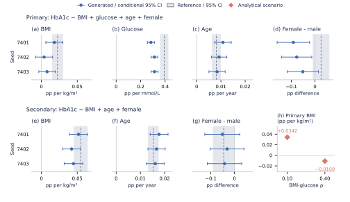

**Figure S4. Analysis-specific usefulness and an unresolved joint dependence.** Panels (a–d) show all primary-model nonintercept effects and (e–g) all secondary-model effects. Blue points are three fixed 3,000-person draws with conditional 95% HC3-t intervals. Gray dashed lines and bands are exposed CHNS reference estimates and 95% community-cluster CR1-t intervals; solid lines mark zero. All effects retain native units (pp: HbA1c percentage points), with shared limits for matching predictors. Generated intervals omit source, structural and transport uncertainty; overlap is not equivalence. Panel (h) displays two pre-generation analytical scenarios: latent BMI–glucose correlations 0.10 and 0.40 imply conditional BMI coefficients +0.03422 and −0.01095 while leaving marginal laws, other bivariate laws and the secondary projection unchanged. The delivered model used 0.25. These are not new draws, a fitted curve or a causal intervention. Retained initial/final stages alias the same three tables.

### S7. Prospective evaluation under the earlier method

In HAALSI, eligible ages started at 40 years and the analysis used the released capillary point-of-care glucose measurement. Fasting was not an eligibility requirement. The fixed BMI and age contrasts were taken from the same additive glucose model with recorded sex. A second model estimated the difference in the BMI slope between women and men, adjusting for age. In Turkana, the two BMI slopes were adjusted for age and recorded sex. The correlation uses the residuals after adjusting both lipid measurements for age, sex and BMI.

Each case had five separately authored agent laws and one prespecified statistical generator (S01). The experiment produced 48 source-context and 36 target-context tables of 5,000 rows each. All authors retained their initial laws after source-only feedback. Initial and final labels therefore refer to the same 36 target tables. The [public checkpoint preceding disclosure](../../../reports/scaleup_2026-11-01/production_release/PRE_REVEAL_CHECKPOINT.json) records work in progress. The [final evaluation record](../../../reports/scaleup_2026-11-01/production_release/RESULTS.md) documents the complete inventory, one reveal and independent recomputation of 6,704 checks. HAALSI had a prospectively withheld target. Turkana's exact estimates were withheld, with prior investigator exposure to adjacent findings. Later Q5 reused the same 397-person Turkana reference.

**Table S7. Six prespecified analyses under the earlier workflow.** The columns report the measured-sample estimate, the minimum and maximum across 15 agent draws, the number agreeing in point sign, and the range of the three draws of the prescribed statistical law. The ranges describe draws under the candidate models. HAALSI glucose contrasts are in mmol/L, lipid slopes in mg/dL and the adjusted correlation is unitless.

| Analysis | Measured | Agent range | Same sign | S01 range |
|---|---:|---|---:|---|
| HAALSI glucose, BMI per 5 kg/m² | 0.3138 | 0.3285 to 0.5698 | 15/15 | −0.0174 to 0.0180 |
| HAALSI glucose, age per 10 years | 0.2322 | 0.1136 to 0.3005 | 15/15 | −0.0170 to 0.0077 |
| HAALSI female-minus-male BMI slope per 5 kg/m² | −0.2440 | −0.2487 to 0.1903 | 8/15 | −0.0524 to 0.0046 |
| Turkana HDL, BMI per 5 kg/m² | −4.6230 | −3.5509 to −1.8173 | 15/15 | −0.1120 to 0.0710 |
| Turkana TC, BMI per 5 kg/m² | 5.6831 | 10.2822 to 15.0413 | 15/15 | −0.4657 to 0.0334 |
| Turkana residual TC–HDL correlation | 0.5121 | 0.1162 to 0.5361 | 15/15 | 0.3625 to 0.3840 |

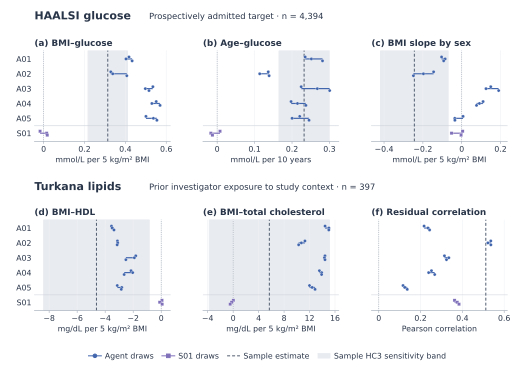

**Figure S5. Earlier prospective evaluation of whole-cohort generation.** Blue circles show the three draws of each agent law and purple squares the three draws of the prescribed statistical law (S01). Short segments span draws. Dashed lines mark measured-sample estimates, and shaded bands give approximate 95% HC3 sensitivity intervals for the five slopes. The residual correlation has no reference interval. HAALSI glucose main effects were directionally stable across agent draws. The sex difference in the BMI slope varied by construction. Turkana's total cholesterol point estimate had a reference interval that included zero. Its quantitative estimates were withheld before generation despite prior exposure to related published findings.

The primary rule divided the absolute difference in each slope by the measured outcome's sample SD and used the absolute correlation difference directly. A construction passed when all nine comparisons (three analyses by three seeds) were at most 0.10. The agent counts at thresholds 0.05, 0.10, 0.20 and 0.30 were 1, 3, 5 and 5 of five for HAALSI and 0, 0, 1 and 4 for Turkana. Both S01 laws missed the primary criterion. For HAALSI, the discrepancies for three zero-valued effects were 0.0990, 0.0733 and 0.0770. The [frozen decision](../../../reports/scaleup_2026-11-01/production_release/CLAIM_LOCK.md) closed the expansion. The prospective study predates the later interface for documenting numerical evidence use and supplies a separate evaluation of the underlying construction approach.

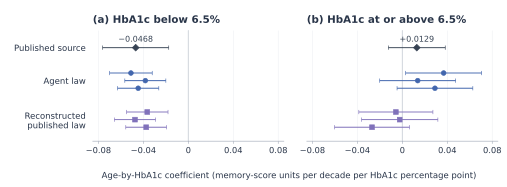

**Figure S6. Two prespecified age–HbA1c interactions in a longitudinal memory model.** Diamonds show the supplied coefficients; circles and squares show estimates from three draws per law (seeds 6101–6103, top to bottom). Bars show approximate 95% Wald intervals calculated from the exported source standard errors or from the generated-table fits. Units are standardized memory-score change per decade per percentage point of HbA1c within the indicated branch. Each table contains 11,509 synthetic subjects and four visits per subject. The upper-branch signs differed between constructions. The six tables describe sampling under two frozen generating laws.

### S8. Full records and retained implementation incidents

The [public repository](https://github.com/ziwang11112/evidence-guided-virtual-cohorts-2026) provides original code, protocols, aggregate results and independent checks. The [complete v0.9 extended record](DRAFT_v0_9.md) preserves all six original numerical tables and full methods/results. Its Table 2 supplies every main endpoint's adjustment set, units and reference interval; Tables 3–4 retain the main and summary-assisted values; Table 5 retains all latest seven effects; Table 6 retains the real-real comparison values. These archived tables preserve the earlier analyses alongside the separately sealed iron study.

The [main study](../reports/main_study_freeze_2026-11-03/RESULTS.md), [summary-assisted study](../reports/information_revision_ablation_2026-11-03/RESULTS.md), [statistical supplement](../reports/summary_comparator_2026-11-03/RESULTS.md), [HRS example](../reports/hrs_public_example_2026-11-03/RESULTS.md), [preceding open-search construction](../reports/evidence_to_generation_2026-11-04/RESULTS.md), [unified workflow replication](../reports/core_workflow_replication_2026-11-04/RESULTS.md) and [cross-task evidence-use study](../reports/evidence_use_cross_task_2026-11-05/RESULTS.md) preserve separate frozen identities and complete endpoint outputs. The cross-task [protocol](../reports/evidence_use_cross_task_2026-11-05/PROTOCOL.json), [complete endpoint table](../reports/evidence_use_cross_task_2026-11-05/evaluation/ALL_ENDPOINTS.csv), [independent numerical review](../reports/evidence_use_cross_task_2026-11-05/review/INDEPENDENT_NUMERICAL_REVIEW.md) and [scientific interpretation](../reports/evidence_use_cross_task_2026-11-05/review/SCIENTIFIC_RESULT_INTERPRETATION.md) document the new unit. Earlier live A/B results, including the conditioned BMI mismatch and source-replay unavailability, remain in the extended record. Figure updates and added tables consume reviewed aggregates only; manuscript integration creates no cohorts or clinical fits. In the main study, seven authors inspected exploratory outputs and kept their laws, and thirteen finalized without exploration. The two earlier live authors both kept their models after the available review.

Individual real/generated tables, third-party originals and credentials remain local; clinical reruns require lawful access and the appropriate environment. Historical model identifiers and token costs are incompletely metered. Author/affiliation/funding/conflict/ethics/access/AI declarations and final submission formatting remain to be completed. No manuscript has been submitted.

The [historical supplement](SUPPLEMENT_HISTORICAL_RESULTS_v05.md) retains earlier enrichment and direct-row construction, the divergent-moment repair, failed transport criteria, tail defects and revision trade-offs. The [v0.16 reading draft](DRAFT_v0_16.md) preserves the earlier layout.

### S9. Iron-status analysis and independent verification

All six deliveries used two continuous columns, with three target analyses per delivery. The target survey comparison used the phlebotomy weight and 15 design degrees of freedom; 979 of 1,065 eligible positive-weight women had both measurements. A separate implementation reproduced all 21 point estimates (three reference, eighteen generated), the six target interval endpoints and the four unweighted cell counts. The [study report](../reports/iron_breadth_2026-11-05/RESULTS.md) gives all seed values and the [evaluation protocol](../reports/iron_breadth_2026-11-05/PROTOCOL.md) specifies the source replay, primary log-odds-ratio comparison and secondary analyses.

### S10. Reproducing a program and tracing an agent decision

In the iron task each fresh author received the same target description, source packet and clarification about a source summary. Only external source materials were allowed. The protocol specified numpy and pandas, a supplied random generator, the separate source and target contexts, and one source-only retain-or-revise opportunity. The [task](../reports/iron_breadth_2026-11-05/admission/TASK.md), [evidence packet](../reports/iron_breadth_2026-11-05/admission/SOURCE_PACKET.md), [A's final program](../reports/iron_breadth_2026-11-05/candidates/A/final/generator.py) and [B's final program](../reports/iron_breadth_2026-11-05/candidates/B/final/generator.py) document the handoff. Run the programs with the [recorded seeds and worker](../reports/iron_breadth_2026-11-05/EXECUTION.md). The published code and aggregates support computational verification. Historical author-model snapshots and per-construction token counts are incompletely recorded, which limits reproduction of the original model-authoring sessions.

For the analytic part of Figure 3, let the four source counts be 173 (both low), 85 (low hemoglobin only), 331 (low ferritin only) and 1,082 (neither). Weight the first and third cells by two thirds and renormalize. Under A the final joint-low probability equals 0.8 times the reweighted joint-low probability plus 0.2 times the product of the two reweighted marginal probabilities. B keeps the original probabilities. This calculation describes the selected models and can be reproduced from published counts without sampling. The figure retains the original sealed deliveries and reference analysis alongside these model implications.

### S11. A regression calculation used by one glycemia constructor

This derivation belongs to CHNS Q1, arm E1, constructor A01, selected by ordinal identifier. Jansen et al. reported two age- and sex-adjusted regressions of HbA1c [9]. One used BMI as its predictor and the other used fasting glucose. The curated packet explicitly identified them as separate regressions. The constructor wanted to draw all three variables together. A slope from a regression on BMI alone can include part of the glucose association when BMI and glucose vary together, even after their age and sex terms are removed.

Let $c_B$ and $c_G$ be the two reported slopes. Let $s_B$ and $s_G$ be the residual standard deviations of BMI and glucose after accounting for age and sex, and let $r$ be their residual correlation. The constructor assumed a linear HbA1c response to both residual predictors, with joint slopes $\theta_B$ and $\theta_G$ and an independent error. Projecting this response onto each predictor separately gives

$$
c_B = \theta_B + \theta_G r\,s_G/s_B
$$

$$
c_G = \theta_G + \theta_B r\,s_B/s_G
$$

The reported slopes were 0.13 mmol/mol per kg/m² of BMI and 2.29 mmol/mol per mmol/L of fasting glucose. A01 used residual standard deviations of 4.07611 kg/m² and 0.49694 mmol/L and assumed a residual correlation of 0.25. Solving for the joint slopes gave 0.0642173 and 2.1583154 in the respective IFCC response units. Multiplication by 0.09148 converted these slopes to 0.00587460 and 0.19744269 in HbA1c percentage-point units [11]. This construction recovers the two source projections under its own assumptions. The target model adds a separate glucose heterogeneity component. The [source-to-model trace](SUPPLEMENT_SOURCE_AND_ASSUMPTIONS_v05.md) provides the response law, the source check and the ensuing target BMI discrepancy.

### S12. Implementation of the system overview

Each study uses a host coordinator to dispatch agent sessions and bind the research request to a dedicated execution path. Q4 describes the [bounded open-retrieval workflow](../reports/core_workflow_replication_2026-11-04/RESULTS.md). Q5 provides a [controller that binds the candidate files](../reports/evidence_use_cross_task_2026-11-05/controller_evidence_use.py) and a [session runner](../reports/evidence_use_cross_task_2026-11-05/runner.py) that records trial feedback, decisions and closure. Its [evaluator](../reports/evidence_use_cross_task_2026-11-05/evaluator.py) checks the closed state before reading pinned reference estimates.

In the iron study a [case-specific adapter](../reports/iron_breadth_2026-11-05/iron_runner.py) runs the agent's program with a source or target context using the [isolated execution worker](../cohort_harness/execution.py). The [seal](../reports/iron_breadth_2026-11-05/seal.py) verifies the model and delivery hashes. The [target analysis](../reports/iron_breadth_2026-11-05/reveal.py) checks the sealed record before accessing the survey measurements. The [execution notes](../reports/iron_breadth_2026-11-05/EXECUTION.md) document which checks were implemented in this adapter. The two studies share the separation of scientific authorship, numerical execution and evaluation, with different retrieval and feedback interfaces.
