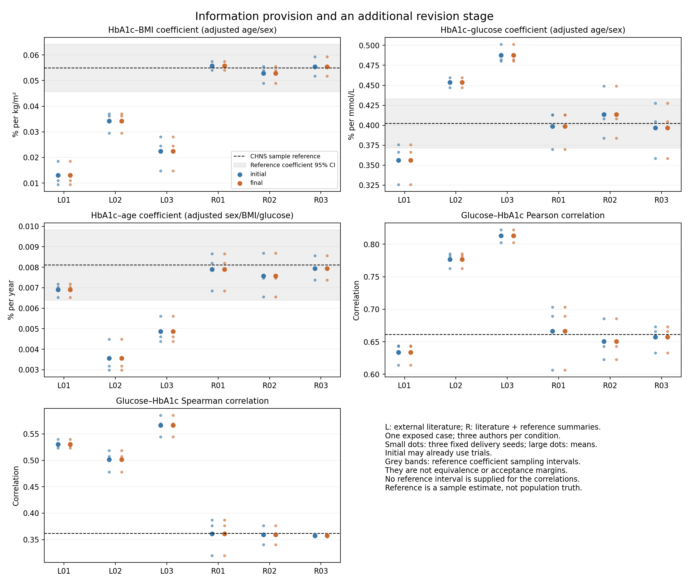

# Evidence-Guided Generation of Virtual Biomedical Data for Task-Specific Scientific Analysis

Working manuscript v0.3, 3 November 2026. This is a dated consolidation of the implemented adaptive procedure and completed developmental evidence. Earlier drafts and frozen experiments remain unchanged. The newly planned two-case main experiment is **not executed** and contributes no results to this draft. Bibliographic completion, statistical predecessors, author declarations and submission formatting remain outstanding.

## Abstract

Biomedical researchers may lack individual-level records or measurements required for a scientific analysis, while related distributions and associations are available in published studies. We study an Agent-assisted procedure that translates study-qualified evidence, a target-population description and a visible analytical request into virtual biomedical data. A scientific Agent selects a stochastic model and its parameters, records evidence and assumptions, and uses deterministic execution and explicitly scoped diagnostics. The procedure permits task-specific models and optional revision or retention. Whole-cohort synthesis requires no individual inputs. In a developmental information experiment, six fresh construction contexts generated age, sex, BMI, glucose and HbA1c under external-literature-only or additional reference-summary conditions. Forty-two executions succeeded, producing twenty-four distinct tables; 1,260 statistics agreed with independent recomputation. All three regression directions were retained, but literature-only BMI coefficients and rank associations differed substantially from the observed reference. Supplying the reference summaries produced closer agreement with those same quantities. All six constructions retained their scientific models, so the additional review stage produced no numerical change. Together with earlier completed mixed and negative evaluations, these results establish an executable route from evidence to analyzable virtual data and characterize its current limits. They do not establish independent transport, clinical interchangeability or a general advantage over statistical synthesis.

## Introduction

Scientific questions often require combinations of biomedical measurements that are not jointly accessible. Individual records may be unavailable, an indicator may never have been measured in the target study, or only published summaries and a population description may be available. A method that turns this information into a coherent virtual table would let investigators apply familiar analytical procedures and explore explicitly modelled scenarios. The relevant product is data with a defined analytical use, rather than a numerical prediction alone.

Published quantities are conditioned on the studies that produced them. A distribution, an age-adjusted coefficient and a subgroup contrast have different meanings and may reflect different eligibility rules, assays and population compositions. Agreement with several such quantities does not identify every feature of a joint distribution. A construction method must therefore preserve the statistical meaning of each input, disclose assumptions completing the joint model, and evaluate its outputs for the requested use.

LLM-assisted simulator design and discrepancy-guided synthetic-data generation already have close precedents, including G-Sim and LLMSynthor [1,2]. Our contribution candidate is a biomedical, task-adaptive evidence-to-data procedure and its empirical characterization. Aggregate inputs, multiple sources, numerical calibration and iterative generation are not claimed as new in themselves. A more specific mechanism or superiority claim requires separate evidence under comparable inputs and budgets.

We organize the work around three questions: can a scientific Agent construct complete joint data from available evidence; which analyses are supported under different information regimes; and does an additional review/revision opportunity improve those outputs? The procedure permits a different model for a different request. Reuse of one table for several analyses is a separately testable capability, rather than a universal restriction on the system.

## Methods

### Task and information regimes

A request specifies the intended population, variables, units, available observations and scientific analyses. Whole-cohort synthesis has no individual-level input. Indicator augmentation and missing-cell completion preserve permitted observations and generate only the requested variables or cells; these broader modes have separate development records and are not pooled with the whole-cohort experiments here.

Published findings, observed summaries and real analysis results can be admitted construction inputs. Their role is explicit. Agreement with supplied information assesses calibration consistency. Comparison with information not used in construction assesses additional analytical performance under the recorded exposure conditions. An exposed development sample cannot become untouched confirmation merely by starting a new author context. Research questions need not be hidden from the author.

### Study-qualified evidence and numerical use

Evidence records preserve the original locator, population and selection criteria, measurement definition, unit and transformation, statistical operator, adjustment set, estimate, available uncertainty and possible source overlap. Reported values, mathematical derivations and assumptions are distinguished. Individual variability is not treated as uncertainty in a mean, and separate adjusted regressions are not silently combined into one joint regression equation.

For a quantitative relation, the construction record states whether it is used as a numerical model constraint, an assumption-qualified projection, contextual evidence, or an unavailable operation. Numerical use is demonstrated by its calculation or executable operator, not by citation alone. Source/population reconstruction is supported only by the adapter and contextual information actually supplied. Unknown original weighting and unreported selection remain unresolved unless a qualified approximation is explicitly declared.

### Scientific author and execution

One scientific Agent selects a stochastic law, parameters and scientific assumptions from the admitted task and evidence. It submits executable generator code, a model specification, provenance and concise decision/check records. In the implemented program route, numerical software samples the authored law; the language model does not emit every row directly. Independent author contexts measure construction variability and are not a required multi-Agent collaboration mechanism.

The coordinator attaches the approved diagnostics, checks the contract and freezes the candidate before execution. The coordinator does not insert target-derived scientific parameters. The generator is executed through the isolated runtime. General author tools are procedurally scoped; this is not a claim of host-enforced information isolation. Actual software versions and observable orchestration settings are retained. Unavailable model-snapshot and token metadata are reported as unavailable.

Static review examines distributional support, finite-moment properties and consistency with the declared model. Runtime review verifies the complete requested table, preserved observations when applicable, and output linkage. These checks establish technical properties rather than biological validity. Versioned semantic feedback checks declared operator meanings and roles; a semantically matched operation does not imply that its numerical value matches evidence.

### Diagnostics, revision and final delivery

The author may use bounded diagnostic feedback to revise, retain or stop. Source approximation, model mismatch and conditional simulation variation are distinguished. All row-producing trials consume a declared budget. Old candidates, failed attempts and no-op decisions remain in the record. The final delivered configuration is fixed before final evaluation; favorable authors, seeds or earlier versions cannot replace an unfavorable final output after inspection.

An extra mandatory post-initial revision stage is not part of the consolidated default. Earlier and current experiments show that an operational review loop does not guarantee a numerical improvement. Task-specific construction and optional bounded correction remain available. Generic source replay, automatic evidence acquisition, arbitrary measurement conversion and universal model uncertainty calibration are not asserted.

### Completed information and revision experiment

Six fresh scientific contexts constructed complete 3,000-row cohorts. Three received the research request, target description and external evidence; three additionally received all thirty existing CHNS developmental reference statistics. The variables were age, sex, BMI, central-serum glucose and HbA1c. CHNS had already been exposed to the research team. This was an explicit information-provision experiment on one development case, not a new independent clinical validation.

Every author used one initial trial and delivered three fixed seeds, then reviewed the permitted diagnostics and selected a final revised or retained version. Initial delivery was allowed feedback-bearing trials, so the stage contrast concerns an additional review opportunity rather than no feedback versus feedback. The three requested regression operators were HbA1c on BMI adjusted for age and sex; HbA1c on glucose adjusted for age and sex; and HbA1c on age adjusted for sex, BMI and glucose. Twenty-seven distribution/joint diagnostics were also evaluated.

All six final inventories closed before common reference evaluation. The literature-only provider did not load the reference summary; the reference-assisted condition received the declared comparisons. External source-population numerical replay was unavailable in this particular unit and was not replaced by a mislabeled comparison of unlike populations. The complete record retains all operators, all values, all failures and all author decisions.

### Evaluation and uncertainty

Evaluation follows the scientific use: direction, effect magnitude, relevant conditional/joint structure and necessary distribution diagnostics. Reference estimates retain their appropriate sampling uncertainty. A reference coefficient interval is neither an interval for a marginal mean nor an equivalence margin for synthetic data. Repeated generator seeds characterize conditional simulation variation, not evidence, model or transport uncertainty.

All analyses are reported at the construction and case levels. Generated rows, repeated outputs and seeds do not create new clinical replications. An independent implementation recomputes the prescribed statistics and verifies reported summaries and lineage. Its numerical agreement does not authenticate original source extraction or establish source applicability.

## Completed Results

### Historical development and earlier failures

The earlier CHNS case demonstrated complete-cohort construction and preserved the three association directions, while BMI coefficients were approximately 30–39% of the observed reference estimate and glycemic variability was reduced. Those findings remain reported with their original method version and exposure conditions [development record: `work/chns_admission_2026-11-01/f2/CASE_RESULTS.md`].

Wave A subsequently evaluated HAALSI glucose and Turkana lipids using ten fresh Agent constructions and two prescribed statistical constructions. All eighty-four scheduled source/target tables executed, and 6,704 independent comparisons agreed. The frozen positive criterion failed: three of five Agent constructions passed the HAALSI case and none passed the Turkana case at the specified resolution. The HAALSI zero anchors also passed that resolution, limiting its discrimination. These results do not support general quantitative usefulness or comparative superiority. No Wave B was started [complete results and claim lock: `work/scaleup_2026-11-01/production_release/`].

A completed CHNS marginal-versus-relational evidence comparison also preceded the present study. The overall joint improvement criterion failed; a construction audit found predominantly qualitative relationship use and infinite population moments in seven proposed laws. Finite-table results were retained. Later versions repaired and audited the relevant mathematical construction properties; historical failures are not retrospectively reclassified as valid positive results [record: `work/existing_data_benchmark_2026-11-02/`].

### Reference-assisted pilot

A separate single-author developmental pilot generated nine distinct tables. A dependence revision improved rank agreement in all three paired seeds, while regression absolute discrepancies increased slightly. This selected improvement is retained as a separate observation; it is not pooled with the later experiment to manufacture a general revision benefit [record: `work/adaptive_reference_pilot_2026-11-03/`].

### Information provision and additional revision

The latest experiment completed forty-two executions: six trials and thirty-six initial/final deliveries. All succeeded. Because every author retained the same model, eighteen final delivery tables exactly duplicated their paired initial tables. There were twenty-four distinct tables overall and eighteen distinct delivery tables. Independent recomputation agreed for all 1,260 statistic values; the largest numerical difference was 7.11 × 10⁻¹⁵.

All three coefficients were positive in every distinct delivery table. Quantitative performance differed substantially by information regime. The following ranges are across the three authors' three-seed means; they are descriptive ranges, not confidence intervals.

| Analysis | CHNS sample estimate | External literature | Literature + reference summaries |
|---|---:|---:|---:|
| Adjusted BMI coefficient | 0.054946 | 0.013001–0.034287 | 0.052821–0.055789 |
| Adjusted glucose coefficient | 0.402093 | 0.356064–0.487815 | 0.396941–0.413715 |
| Adjusted age coefficient | 0.008107 | 0.003552–0.006910 | 0.007569–0.007947 |
| Glucose–HbA1c Pearson correlation | 0.660968 | 0.633764–0.813170 | 0.650561–0.666438 |
| Glucose–HbA1c Spearman correlation | 0.361457 | 0.501339–0.566477 | 0.357571–0.360983 |

Reference-assisted constructions were closer to the supplied quantities. This demonstrates consistency with admitted calibration information. Literature-only constructions preserved directions but attenuated the BMI projection and overstated the rank association. Six retention decisions, unchanged code/specifications and eighteen identical paired output hashes establish exactly zero additional-stage numerical change in this experiment.

The complete thirty-statistic results and independent audit are in `work/information_revision_ablation_2026-11-03/`. No renewed infinite-moment defect was identified in its six scientific laws. This supports mathematical consistency of those constructions, not biological authenticity of every generated relationship.

### Planned common-protocol main run — no results yet

The prospective main-run specification uses existing CHNS and ENSANUT development references, external/basic versus additional qualified relational evidence, five fresh authors per case/condition and three final seeds. Sixty Agent final deliveries and twelve planned same-information statistical-reference deliveries are proposed. Case/operator/comparator/evaluation bindings and independent pre-execution review remain pending. These allocations are not reported as completed experiments. Neither reference becomes untouched confirmation under this reuse plan.

## Discussion

The implemented procedure can turn admitted evidence and explicit assumptions into complete virtual tables on which standard scientific analyses can be run. The current results also show why technical execution, plausible distributions and agreement in association direction are insufficient to establish quantitative usefulness. The same nominal biological relationship may change after adjustment, selection or transport; these differences must remain part of the evidence interpretation.

The reference-assisted condition answers a practical calibration question. When appropriate summaries are available, scientific Agents can construct data that reproduce those functionals without individual input. Because those quantities were supplied, their recovery does not demonstrate discovery or independent transfer. The stronger question—whether partial applicable evidence supports useful analyses not directly calibrated—remains the priority for the common-protocol main experiment.

Optional revision is scientifically appropriate, but its benefit is empirical. The single-author pilot showed a targeted trade-off, whereas all six later authors retained their models. The current method therefore keeps a bounded review and stopping policy without making extra iteration the headline contribution. A request-adaptive generator may legitimately differ across analytical requests; a fixed unchanged law across all requests is not necessary to the data-generation objective.

The principal limitations include researcher-exposed development references, restricted variables, overlapping source literature, incompletely identified joint relationships, measurement and population differences, and uncalibrated structural/transport uncertainty. Partial failures in primary relationships constrain the main claim and remain in Results. Historical methods and case versions are not pooled as independent confirmations. The work does not establish general superiority, participant-specific measurement recovery, causal validity, clinical substitution or observed recruitment-cost savings.

## Data and code availability

Reviewed source summaries, original code, protocols, aggregate results and independent checks are available in the [public research repository](https://github.com/ziwang11112/evidence-guided-virtual-cohorts-2026). Real and generated individual tables, full third-party papers/codebooks and credentials remain local. Public review packages are selected artifacts, not complete portable copies of every frozen runtime bundle. Source access conditions and exact exclusions must be retained in the final data-availability statement.

## References and submission items still to complete

References [1,2] and the existing biomedical source bibliography are carried from the previously audited [v0.2 reference list](DRAFT_v0_2.md#references-used-in-this-working-revision). This revision does not claim a new literature search. Complete the statistical predecessors, full bibliographic metadata, source/data ethics and access statements, author information, observable runtime and reproduction details, and final contribution-to-evidence table before submission. Main-run Results and final abstract claims must be updated only from the complete locked outcomes.

