# From Published Evidence to Analyzable Biomedical Cohorts with Scientific Agents

Methods working draft v0.31, 11 November 2026. Editorial integration of completed experiments; no new generation, model call or clinical-reference analysis was performed for this revision.

## Abstract

Biomedical researchers need jointly measured variables that may be inaccessible or were never collected together. Published studies provide partial statistical evidence, but using those findings in a new analysis requires a joint model. We develop a scientific-Agent workflow that turns a population, variables and research questions into virtual biomedical cohorts without target individual-level training records. The Agent retrieves or receives studies, interprets their measurement and analysis conditions, authors a joint sampling program, and records scientific sources and assumptions. We evaluate the resulting data by holding the analysis procedure fixed and changing its input. In a source-rich lifestyle application, two fresh Agents produced six complete cohorts. The adjusted urban-versus-pastoralist BMI difference was 1.882 kg/m² in the real sample and 1.700-2.251 across virtual draws. Total-cholesterol elevation was retained, while rural lipid contrasts and dispersion were less well reproduced. Separate request-only experiments used no prepared papers: all twelve ordinary and workflow-guided GPT sessions delivered generators, with variable analytical agreement and no consistent policy advantage. Glycemia experiments retained conditioning patterns, and additional relationship evidence reduced discrepancy in five of six coefficients. Inspectable source-to-code records and reusable checks exposed assumptions and supported specific mathematical repairs without a general revision benefit. These results demonstrate autonomous evidence-to-data construction and analysis-specific uses of the generated records. The permitted information, uncertainty and limitations remain part of each data product; validity for inference in unfamiliar populations is not established.

## 1. Introduction

A researcher wants to study how BMI, age and glucose relate to HbA1c, but cannot obtain the jointly measured individual records. Another wants paired systolic and diastolic blood pressures, or total and HDL cholesterol, for a population described only in external studies. Relevant publications may report marginal summaries, adjusted regressions or selected correlations. These are pieces of evidence for a dataset, not a complete joint distribution. Someone must decide which results are compatible, how they apply to the requested population and how to fill relationships the literature leaves unspecified.

Our aim is useful virtual data for scientific analysis. A researcher states a population, measurements and intended questions. A scientific Agent retrieves or receives evidence under the study's information rules, authors a joint stochastic model, and asks numerical tools to sample its records. The deliverable is a virtual cohort, an executable generator and a record of the sources, transformations and assumptions used. Researchers can apply familiar analysis procedures to these records. Complete generation requires no target individual-level training sample. Enrichment of unmeasured columns and completion of missing cells are additional applications of the same problem, although the principal experiments here concern whole cohorts.

Our evaluation holds a biomedical analysis fixed and substitutes generated records for the measured sample. A concrete application asks for a cohort with lifestyle groups so that a researcher can run the original study's age- and sex-adjusted biomarker comparisons. We distinguish this source-rich reconstruction, which permits published findings from that study, from request-only construction, where the Agent must discover evidence without a prepared bibliography. The two settings assess different practical uses of the same generation procedure.

The scientific question is which analyses the generated records can support. Reproducing a source mean does not establish that the data preserve an age-adjusted association, a glucose-adjustment pattern or the residual dependence between two outcomes. Conversely, a virtual cohort need not reproduce a finite real sample row by row to preserve a useful scientific relation. We evaluate specified analyses in their own units, alongside reference uncertainty and necessary distributional checks. We separate the ability to execute an analysis from agreement with a measured sample and from the stronger claim of adequate inference for a new population.

The Agent's work is the scientific construction, not the arithmetic of random-number generation. It decides what to search for, interprets the source's population, measurement and conditioning, chooses a joint law, assigns numerical values and proposes checks or revisions. A fixed worker executes that authored program. The host provides common tools and enforces the study boundary. In the repeated request-only construction study, both ordinary and workflow-guided Agents start from the same request without a prepared bibliography or fitted model. This allows retrieval and evidence selection to be part of the observed method, rather than work silently supplied to only one comparator.

We also make the construction explainable in a specific, testable sense: a reader can follow a consequential modeling choice from a source locator or explicit assumption into the program and then into an analysis of its output. This is scientific provenance and model inspection, not a private reasoning transcript or an automatic confidence score. One analysis can depend on a reported coefficient, an algebraic transformation and an assumed population bridge simultaneously. Recording this chain exposes what needs further evidence and what a coherent sampler already explains.

The paper develops three contributions. First, it implements a request-driven scientific-Agent procedure that turns heterogeneous biomedical evidence into joint generators and usable table artifacts. Second, it evaluates the resulting records by applying matched scientific-analysis procedures to measured and virtual data, including lifestyle contrasts, multivariable regressions, conditioning patterns, threshold co-occurrence and dependence, retaining both agreements and failures. Third, it connects source-qualified quantities and explicit completion assumptions to executable model choices and selected downstream analytical consequences. The repeated end-to-end study demonstrates autonomous construction across fresh author sessions. A separate paired review shows that generic checks can support specific repairs. Neither study establishes that specialized workflow guidance is uniformly better than an ordinary capable Agent. The older studies and their different method versions answer complementary questions, rather than forming a pooled leaderboard for the newest implementation.

## 2. Related work and problem definition

### 2.1. From available information to analyzable records

Filshtein et al. share fitted study models so a recipient can simulate complete cohorts for epidemiological analyses [1]. SynthIPD uses published survival curves and trial summaries to reconstruct time-to-event records with covariates [2]. SynDI combines internal individual data with external regression information across populations to fit a target regression [29]. Multilevel network meta-regression likewise relates aggregate evidence to individual-level models under population assumptions [3]. These approaches differ in what the recipient knows. Filshtein et al. supply the comparison for our HRS experiment because the published exports and the scientific analysis can be matched. In our external-evidence experiments, the agent must also choose the joint dependence structure needed to perform the requested analyses.

G-Sim combines LLM-authored simulators with numerical calibration and structural refinement [4]. LLMSynthor, published at KDD 2026, infers relevant variable dependencies and uses aggregate discrepancies to guide proposals for new records, with evaluations of downstream predictive utility and household population queries [5]. SynthCraft studies healthcare synthetic-data workflows [6], and SPADA samples from a dependency graph fitted with observed tabular data [15].

KMGen combines agentic extraction of published Kaplan–Meier curves and trial information with explicit clinical priors and a specified mechanistic sampler to generate patient survival and adverse-event records [36]. Jones et al. generate household populations from aggregate demographics without individual input data, use statistical feedback and examine household relationships not supplied as constraints [37,38]. These studies already connect language models, published or aggregate evidence and synthetic records. Our experiments examine how an agent authors joint biomarker models for different research requests, handling source populations, measurement scales and adjustment sets, and which scientific analyses their records support. They do not establish quality or scaling superiority over these systems.

Workflow provenance is also an established topic. PROV-AGENT extends provenance capture to Agent prompts, responses, tool use and decisions [47]. Our focus is the scientific content of that record: which study-qualified statistic, transformation and unverified assumption supports a generator feature and its requested downstream analysis. Execution logging is necessary for inspection, but is neither the novelty by itself nor a certificate of biomedical validity.

### 2.2. System architecture

Figure 1 follows the implemented request-to-data process. The input states who the virtual cohort should represent, which variables it should contain and what the researcher intends to analyze. The scientific Agent chooses an action: search for evidence, read a study, submit a sampling program, inspect a generated-data trial, revise, or finalize. A shared tool layer carries out the action and returns an observation. The final product is a versioned joint generator, generated records and an account of scientific choices. An independent evaluator applies the requested analyses to the records and, after construction closure, compares them with the permitted measured reference.

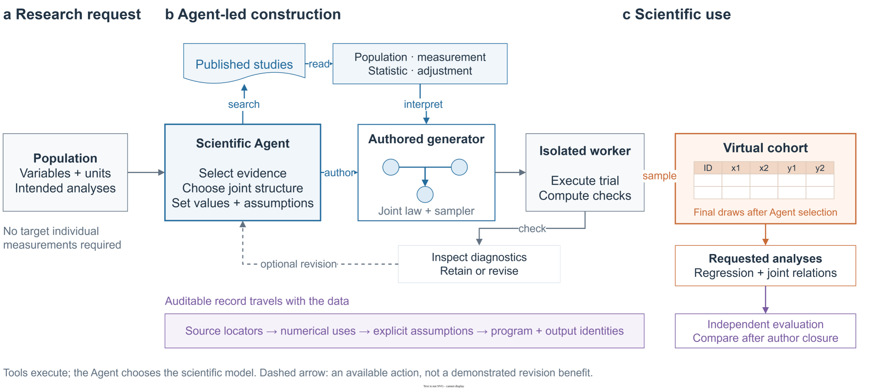

**Figure 1. A scientific Agent constructs data for a research question.** The Agent selects evidence, interprets source conditions and authors a joint probability model; numerical tools execute that model and return generated-data diagnostics. Retrieval, checking and revision are available actions, not a fixed requirement to perform multiple rounds. The artifact trail links sources and assumptions to the selected generator, records and analyses. Clinical reference estimates are outside the author context in the request-only evaluation. All twelve authors in the repeated request-only study selected their first submitted candidate. In a separate paired quality-assurance study, both review policies repaired two existing laws, with largely unchanged or mixed scientific analyses. The diagram therefore shows available actions rather than a guarantee of iterative improvement. Table 1 separates scientific decisions from shared infrastructure; Supplements S21-S23 distinguish the earlier four-author capacity diagnostic, twelve fresh constructors and 24 dependent review sessions.

Consider the paired-blood-pressure request. Neither the ordinary nor the workflow-guided Agent is given a regression coefficient or a correlation. Each chooses its own studies and numerical construction. In the earlier four-author capacity diagnostic, one retrieved an explicitly reported Ugandan residual correlation, while the other combined a longitudinal Kendall correlation with a Gaussian-copula approximation and a variance budget. The host did not supply either path. These choices become inspectable scientific hypotheses in code, not hidden corrections applied by the evaluator.

**Table 1. Who does what in the implemented procedure?** The repeated request-only comparison uses the same tool capabilities and within-study limits for both Agent policies. Earlier study-specific review stages remain documented in Supplement S17.

| Stage | Responsible actor | Concrete decision or artifact |
|---|---|---|
| Specify the research use | Researcher and host coordinator | Define population, columns, units, row count, intended analyses and information access. No desired coefficient, sign or target distribution is supplied in the request-only study. |
| Find and interpret evidence | Scientific Agent with search/read tools | Choose queries and articles; distinguish population, measurement, adjustment, statistic type and overlap; record exact source uses and remaining gaps. |
| Construct the joint law | Scientific Agent | Choose distributions, dependence, numerical mappings and assumptions; submit a model specification, generator program and concise decision record. |
| Execute and inspect | Isolated numerical worker, then scientific Agent | Run a trial and return generated-data analyses; expose reusable mathematical-law, physiological-rule and joint-analysis checks in the review version. The Agent may retrieve more, revise, retain or stop. Trial summaries are not automatically source-population replay or scientific certification. |
| Bind and deliver | Shared controller and sampling worker | Record requests, responses, tool calls, versions and costs; execute the selected immutable candidate at predefined final seeds. |
| Audit scientific use | Separate numerical and source reviewers | Recompute final analyses, inspect source-to-code uses, and compare with the allowed reference after author closure. Audit does not alter scientific parameters. |

The request-only controller directly launches captured GPT API sessions and dispatches the same Europe PMC/PMC retrieval, candidate-submission, isolated-trial and finalization tools for both policies. The ordinary Agent is a capable coding Agent free to plan, search, model and check. The workflow Agent receives an additional reusable strategy connecting requested analyses, evidence gaps, study conditions, reported/derived/assumed quantities and checks. It is not given a case-specific evidence packet or a host-written scientific model. Both can independently follow good practices; the comparison concerns organization of the scientific work, not access to tools or a crippled baseline.

The source-rich lifestyle application uses the same API, retrieval and isolated-sampling machinery with a new task and evaluator. It additionally supplies the original study and permitted published aggregates. Both authors can search for missing information; the Agent still chooses the scientific law and numerical assumptions. The host does not replace unavailable source statistics with fits to the real reference. This declared evidence allowance differs from the request-only comparison rather than being an unreported relaxation of its protocol.

Candidate programs run in a network-disabled worker without access to reference files or credentials. Specifications pass to that worker unchanged. Generated-data checks report what the current program produces; exact agreement with a publication requires the appropriate source population and statistical operator. The final cohort remains a sample from an Agent-authored statistical model. Model authoring, program execution and clinical evaluation are separate operations.

The historical experiments use related but distinct controllers and review requirements. Q1 supplies curated evidence; Q4 permits open retrieval with host source review; Q5 permits optional additional retrieval but leaves its strict source checks unavailable; iron uses source-only review and an upper-tail correction. The current API launcher does not retroactively make those authoring sessions fully specified or replayable. Table 4 and Supplements S17 and S20-S25 identify the implementation and information boundary of each result.

## 3. How a scientific agent constructs an analyzable cohort

### 3.1. Start with a population and a question

A request names the population, variables and scientific analyses, along with the observations and external studies that may be used. Knowing the intended analysis matters. Published counts of women with low hemoglobin and low ferritin already determine their co-occurrence and crude odds ratio in the source sample. A researcher who also wants to calculate a continuous rank correlation needs pairs of values, including within each threshold group. A researcher working in another population must consider how the pairing might change there.

For whole-cohort generation the agent receives a population description and generates all requested individual measurements. In our iron task, age and pregnancy status specify who the table represents. Only hemoglobin and raw ferritin are output columns. An enrichment request can instead supply observed covariates and ask for an additional variable conditional on those values. Partial completion can preserve observed cells and generate just the missing entries. The experiments in the main paper evaluate the whole-cohort setting.

The researcher determines the information boundary before construction. For the iron study, the two authors received identical external evidence, target eligibility and three intended analyses. They had no target biomarker values. In the summary-assisted Q2 arm, the protocol deliberately supplied target summaries. Comparing against a supplied statistic measures reconstruction. Comparing with previously withheld measurements asks whether the model also supports the analysis in that target. We report these conditions separately.

### 3.2. Decide which findings can enter the model

The agent can work with a reviewed packet or search for additional evidence when the protocol permits. In Q4 the authors started without bibliographic seeds and selected queries and original articles through Europe PMC/PMC. Each had up to eight query credits and four original papers. Four authors used twelve distinct originals in total. One author used six query credits and obtained four original articles. For example, the source review distinguished Bao et al.'s fasting glucose correlation with HbA1c (0.619) from the two-hour value (0.622) [7]. It also distinguished group medians and interquartile ranges from the standard deviation of individual measurements. These distinctions determine which numbers can enter a fasting-glucose generator. The [source review](../work/core_workflow_replication_2026-11-04/SOURCE_PROPOSAL_REVIEW_C01.md) records the studies and statistics checked. In Q5, reviewed articles were supplied and further retrieval was optional. In the iron task, the coordinator had already qualified aspects of the evidence packet, including the contextual role of the Cuban study.

**Table 2. Who decided how to construct the iron-status cohort?** The two authors received the same request and evidence packet.

| Contribution | Iron-status example |
|---|---|
| Investigator | Defines US eligibility, two requested measurements and three analyses. Identifies the corrected-ferritin result as contextual. |
| Published study | Supplies joint threshold counts and ferritin geometric means for three hemoglobin bands [33]. |
| Agent A | Chooses a continuous model for each band. In the target law, it reduces the relative weight of low ferritin and independently redraws hemoglobin in one fifth of rows. |
| Agent B | Chooses a dependence model for ranks within bands. Carries the source joint distribution into the target context. |
| Numerical tools | Sample paired measurements from each frozen model. Apply all three analyses to each delivered table. |

The agent records a source, study population, measurement definition, units and adjustment set for each quantitative use. A reported quantity can fix a model feature, help derive a parameter, or provide a check. A relevant paper with an incompatible measurement can be retained as context. A quantity the sources leave unspecified calls for a modeling assumption. Table 3 shows these decisions for the two continuous iron columns.

**Table 3. What a paper supplies and what the agent must choose.** The iron authors had access to the same source packet and task.

| Available information | Consequence for construction |
|---|---|
| Zhu et al. report 53, 205 and 1,413 women in hemoglobin bands below 10, from 10 to below 12, and at least 12 g/dL, respectively [33]. | The band proportions constrain how often a source draw belongs to each band. The author still chooses a continuous concentration distribution inside each band. |
| Ferritin geometric means in the bands are 1.3, 5.9 and 22.3 µg/L. The published proportions below 15 µg/L are 94.3%, 60.0% and 23.4%. | The source model can match mean log ferritin and depletion frequency by band. Several different ways of pairing continuous values can meet both constraints. |
| Joint threshold counts and band summaries come from the same participants. | The four counts give a crude odds ratio of 6.65. This follows algebraically from the counts. |
| The Cuban association uses ferritin corrected for inflammation [34]. | The packet identifies its different measurement definition. Both authors retain it as context when modeling raw ferritin. |
| Neither source supplies the continuous rank correlation in the target population. | The author chooses within-band dependence and how much of the source model to carry into the target. |

Unit conversions and population differences are recorded separately. The source hemoglobin threshold of 120 g/L becomes 12 g/dL by arithmetic. Carrying a ferritin distribution from the selected Chinese plasma study into a US survey of nonpregnant women requires assumptions about selection and measurement. Converting hemoglobin units resolves only the unit difference.

### 3.3. Write a joint sampling model and generate one row

For model B, generating a row begins with a draw from the three source hemoglobin bands in their reported proportions. The program draws a continuous hemoglobin value within the selected band and determines its rank there. It then draws a ferritin rank conditional on that hemoglobin rank. The chosen dependence rule is a copula. The program converts the ferritin rank into a positive concentration using a distribution on the log scale. Its probability of falling below 15 µg/L and its mean log concentration reflect the statistics for the selected band. The paired numbers are placed in the same row (Figure 2).

Two generators can assign the same proportion of low ferritin to a band and match its geometric mean, yet disagree on whether a woman with higher hemoglobin in that band also has higher ferritin. B supplied a within-band rank rule and applied the source distribution unchanged in the target context. A used a different continuous construction and made two changes for the broader target population. It gave low ferritin a relative weight of two thirds, then redrew hemoglobin independently for one fifth of target rows from the reweighted target hemoglobin distribution. Those fractions were A's assumptions. Section 5.7 shows their consequences for the threshold odds ratio and the joint proportion.

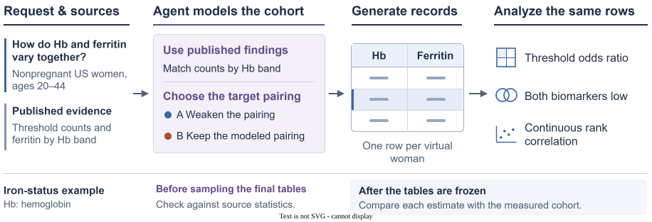

**Figure 2. The iron-status request through the system.** Study findings constrain the model that the agent builds. The agent also chooses how to pair measurements and how to apply the source evidence in the requested population. Each virtual row pairs hemoglobin with ferritin, so the three analyses use the same records. In the sealed iron evaluation the measured target biomarkers became available only after generation.

The common method is to build and record a sampling rule suited to the requested analysis. Its statistical form changes with the evidence. For CHNS glycemia, one constructor connected two separately adjusted source regressions by supplying a residual dependence assumption (Supplement S11). For HRS, fitted model exports supplied a starting point for generating repeated visits per person. Each construction delivers its own specification, numerical uses of evidence and executable program. A second author can produce a different joint law from the same packet.

### 3.4. Use trial feedback to make a scientific decision

The coordinator binds the candidate program to a particular version. A numerical worker samples it and reports the diagnostics the protocol allows. In a source replay the worker draws records under the source population rules and calculates the quantity reported in the source study, using its definition and units. A summary of a trial in the target context answers a different question about what that generator produced. A numerical comparison with the paper requires a compatible definition, weighting scheme and source population.

The iron task allowed one source-only review per author. For A, a trial of 100,000 source rows gave a crude odds ratio of 6.58, compared with 6.65 from the published counts. The simulated band-specific geometric means also tracked the reported values. A separate inspection of the sampling rule found that the original upper ferritin tail had infinite variance. A finite trial can look plausible even when very rare draws make the model variance diverge. For concentrations above the cutoff, A used a rescaled square root of the original random draw on the log scale to slow the growth of the upper tail. The replacement preserves the mean log excess, threshold membership and rank order for fixed latent draws, and gives finite variance. This change repaired the mathematical behavior of the generator. The three registered analyses depend on thresholds or ranks, so the repair preserves their results for the same draws.

B's source trial produced an odds ratio of 6.73, with the three band means close to their source values. B retained the initial program. When a source statistic cannot be reproduced under its stated definition, the system records an unavailable check. In Q5 all 132 proposed source comparisons were unavailable because weighting, statistical definitions or details required for implementation were missing or unsupported. For example, the weight convention for a source summary of mean BMI in men was unspecified. The mean in an equally weighted synthetic sample could not stand in for that source estimator. The six Q5 authors could inspect their generated summaries and all retained their programs.

The later API review version exposes three reusable inspections to both ordinary and structured reviewers. The Agent states support, transformations and moment claims, proposes physiological rules with their measurement interpretation, and records the scientific dependencies of each requested analysis. A heuristic code screen flags potentially problematic transformations; the isolated worker evaluates declared rules and returns generated-only analyses tied to the candidate version. None of these checks certifies source truth, population transfer or general mathematical correctness. The Agent decides whether to seek evidence, repair, retain or report an unresolved relationship. Section 5.12 separates the repairs actually observed from changes in final analytical use.

### 3.5. Freeze the tables and evaluate a scientific use

Once a final model has been selected, the coordinator records the program identity and draws all prespecified deliveries. In the iron study each model supplied 5,000 rows at each of three seeds. The program and table hashes were sealed before the measured target biomarkers were accessed. The evaluator ran the three prespecified analyses on the same two columns in every synthetic delivery. It computed the survey quantities using the eligibility, phlebotomy weight, strata and primary sampling units of the measured data. For Q5, the evaluator instead read previously computed reference estimates after the batch was closed. Supplement S12 documents the study-specific implementation paths.

An analysis can be rerun from a delivered table without asking the agent to refit the model to that result. We distinguish successful execution, agreement of a specified point estimate or association pattern, and adequacy for a scientific decision. Our evaluations report the first two, including discrepancies; they do not set a general acceptance threshold for the third. For a threshold analysis the evaluator classifies each generated and measured pair using the same cutoffs. For continuous dependence it uses the original paired concentrations and their ranks. Agreement on threshold counts leaves room for differences in continuous ranks. Table 7 summarizes the demonstrated properties and the uses that remain unvalidated. Marginal and residual variation are reported where available.

The construction, the generated table and the measured participant are different units. Three draws show the variability encoded in the selected program: usually finite-table sampling, but also shared parameter or scenario draws when the author included them. Independently authored models show variation across construction decisions. Neither spread is automatically a calibrated interval for source, model or transport uncertainty. Measured participants contribute to the reference estimate under the cohort or survey design, including clustering and repeated observations where applicable. Generating more rows does not add measured participants or reduce uncertainty in the source evidence. These sources of variation answer different questions and are shown separately in the results. Standard errors or tests obtained by treating the synthetic rows as sampled patients do not automatically include uncertainty in source estimates, model selection or population transfer. The present evaluation does not validate confidence-interval coverage, power calculations or clinical decisions from those rows. A data-use statement should identify the synthetic status, source-supported and assumed properties, evaluated analyses, and the uncertainty omitted from any reported interval.

### 3.6. Explain the data through scientific provenance

For a requested analysis, we retain five distinct objects: the original source statistic; the parameter adopted by the author; the requested analysis implied by the complete model, when derivable; the estimate calculated from its sampled records; and the eligible measured-sample reference. The model implication includes nonlinearities, mixtures, transformations and selection. A literal code coefficient cannot be substituted for that implication merely because its name matches the requested regression.

The author is asked to connect consequential parameters and structural rules to source locators, study conditions, code/specification locations and explicit assumptions. Our audits inspect the connections actually documented, rather than assuming complete coverage from the instruction. A transformation may be algebraically valid yet still depend on assumed covariance or population transport. Thus REPORTED, DERIVED and ASSUMED are composable origin descriptors, not three ordered confidence levels. Uncomputed model implications remain uncomputed. The record can explain why a sampler produces a relationship and show where additional knowledge would matter; it does not automatically explain why populations differ.

Our current evidence for explainability consists of recoverable source uses, independently checked calculations and concrete model-to-analysis examples. We have not tested whether independent users can diagnose errors faster, whether the record is complete for all parameters, or whether provenance predicts target accuracy before revelation. Those are separate empirical claims. The concise decision record and tool receipts support inspection without requiring disclosure of private model reasoning.

## 4. Evaluation design

Each experiment specifies what the constructor can see and which analyses the delivered table should support (Table 4). We organize results by scientific use, evidence contribution, model inspection and autonomous request-to-data execution. The experiments were completed under different versions and are not pooled as repetitions of one frozen method. Across studies, a construction is a separately authored model. Repeated draws quantify the stochastic variability encoded within that model, including any declared shared-parameter scenarios. We report discrepancies in the units of the intended scientific analysis and preserve each study's original decision rule.

**Table 4. What the constructor could know, and what the evaluation can establish.** Q1–Q5 are the identifiers of the frozen experiments. The iron study and the earlier prospective tests have separate protocols. Construction studies generate complete cohorts; the explicitly marked reuse study evaluates previously generated records.

| Study | Construction inputs | Constructions and final deliveries | Analysis |
|---|---|---|---|
| Lifestyle application | Original study and published aggregates, plus Agent-chosen retrieval; no participant records or newly fitted reference results | 2 fresh GPT authors; 6 complete tables of 1,226 | Nine adjusted lifestyle contrasts, sex-specific counterparts, interaction and scale diagnostics; source-rich reconstruction; S24 |
| Existing-table analysis reuse | Existing frozen records; no new author or generation | 18 initial tables from 6 laws, plus 6 tables from 2 dependent repairs | Three age/sex-adjusted biomarker correlations; all data passed to the same operator; S25 |
| Q4: open-retrieval replication | Population/measurement definitions and analyses; no bibliographic seeds or target records/results | 4 agent; 12 tables of 3,000 | Six glycemia analyses; adjustment patterns |
| Q1: CHNS and ENSANUT | Basic evidence (E0); E0 plus external relations (E1) | 20 agent + 4 prescribed; 72 tables of 3,000 | Six adjusted glycemia coefficients |
| Iron status | External evidence; target eligibility; no target biomarkers | 2 agent; 6 tables of 5,000 | Threshold association, joint burden and continuous ranks |
| Q5: glycemia and lipids | Reviewed external papers, population description, optional retrieval | 6 agent; 18 tables of 3,000 | Six requested effects or correlations |
| Paired blood pressure | Identical external evidence and visible analyses; target BP results sealed until all authors closed | 5 agent; 15 tables of 3,000 | Age/sex-adjusted BMI effects on SBP and DBP; adjusted residual correlation |
| Earlier prospective wave | External summaries and population description; exact target results withheld | 5 agent + 1 prescribed per case; 36 tables of 5,000 | HAALSI glucose and Turkana lipid analyses |
| Q3: longitudinal reconstruction | Published HRS fitted-model artifacts | 1 agent + 1 reconstructed; 6 valid tables, 11,509 subjects × 4 visits each | Age–HbA1c interactions in memory trajectories |
| Q2: supplied-summary reconstruction | With or without 30 target summaries | 6 agent laws; 18 distinct tables | Reconstruction of supplied summaries |
| Fixed-packet API pilots | Identical evidence per task; no retrieval; captured model configurations | 28 initial attempts, 20 data-delivering initial laws; 4 dependent review calls | Six BP/lipid analyses, provenance and configuration-dependent delivery; S20 |
| Request-only development rounds | Same request, GPT model and tools; no prepared papers or target estimates | 12 sessions across three versioned rounds; 8 selected laws; 24/36 final slots delivered | Six BP/lipid analyses plus diagnostics; capacity diagnostic: 4 laws, 12 tables; S21 |
| Repeated request-only construction | Unchanged scientific requests, policies and shared runtime from the capacity diagnostic; three fresh constructors per policy/context | 12 newly authored laws; 36/36 tables of 3,000 | Six BP/lipid analyses, dispersion, coherence and provenance; S22 |
| Paired scientific-law review | Each of those 12 frozen laws plus its original request and source artifacts; no clinical target estimates | 24 dependent review sessions; 72/72 final tables of 3,000; initial 36 tables reused | Mathematical/physiological repairs and paired analytical changes; not new constructors or clinical validation; S23 |

CHNS (6,631 adults, ages 35–74) uses unweighted estimates for the selected sample. ENSANUT (6,931 adults, ages 25–79) assigns equal mass to eight sex-by-age cells. In Q1, each case and information condition has five fresh agent authors and one prescribed statistical law. We average absolute discrepancy over three draws within each law, then across laws within the arm. E0 and E1 authors are not paired. The prescribed law illustrates a statistical completion from the same information; it is not a competitive search over statistical methods.

Supplement S16 gives the eligibility, measurement selection, weighting and uncertainty definition for each reference. In particular, the ENSANUT estimand uses selected adults without a reported prior diabetes diagnosis, with a recorded 8–12-hour fast and serum glucose below 126 mg/dL, and equal mass in eight age-by-sex cells. It is not a nationally weighted adult-population regression.

The reference conditions differ. Q1–Q5 reused project-level references where applicable. For iron status we sealed the protocol and the six deliveries before acquiring the target biomarkers; NHANES was already known to the project. In the earlier prospective wave, a custodian withheld the exact HAALSI and Turkana results, although investigators knew related Turkana findings. We distinguish target sampling intervals, resampling stability bands and model-conditional intervals in the figures. None makes a sample estimate the true population value.

### 4.1. Retrospective model-to-analysis attribution

After the evaluations, we assembled an attribution audit from frozen model specifications, generator source, evidence-use records and existing aggregate results. The audit covered twenty CHNS/ENSANUT constructions, five PNS blood-pressure constructions, three lipid constructions and two iron constructions. Each had three requested analyses, giving ninety requested-analysis records; six lipid marginal-SD records supplied additional dispersion diagnostics. These thirty constructions were a defined subset of the study record. HRS, HAALSI, statistical controls and other historical workflow versions were not added to this attribution table. Their original results remain separate.

For each requested analysis, we distinguished the following quantities.

The source statistic retains its original population, measurement, adjustment, weighting and uncertainty. The adopted parameter records what the author placed in the generator and why. The full-model implication applies the requested analysis to the complete probability law, including its joint dependence, nonlinearities and selection; it need not equal a coefficient in the code. The generated estimate applies that analysis to a finite draw. The measured reference applies it to the eligible real sample, retaining its own selection, weighting and uncertainty.

Several source statistics and assumptions can contribute to one model parameter or analysis. We therefore retained source-to-parameter links and named the additional modeling choices, rather than assigning one label to an entire cohort. REPORTED, DERIVED and ASSUMED describe origin. A derived value may depend on assumed inputs, and a reported coefficient can require an assumption when carried into another population or adjustment context. These labels do not form an ordered credibility scale.

The audit reused available analytical derivations and numerical summaries. Numerical full-model implications were available for seven of the ninety requested-analysis records and all six supplementary SD records. The remaining eighty-three requested-analysis implications were left uncomputed; they were not filled with literal parameters, source coefficients or generated estimates. This incompleteness limits comparisons between theoretical and sampled results; it does not mean that the requested analyses were unavailable in generated data.

We inspected existing artifacts without reading individual rows, executing generators or rerunning clinical analyses. The underlying frozen specifications document choices made during construction where available; the cross-case taxonomy and interpretations were assembled retrospectively. Generated summaries retain their original conventions: medians across three seeds for PNS and means for the other audited cases. Seed ranges are not confidence intervals. We did not fit or validate a provenance-based error predictor, rank constructors using retrospective risk labels, or identify a causal decomposition of discrepancies.

### 4.2. Request-only comparison and recorded model configurations

The request-only construction comparison asks whether an ordinary Agent and an evidence-guided workflow can complete the same scientific-data request from a common starting point. Both receive the target context, five columns, units, 3,000-row request and three intended analyses. They have the same gpt-6.1-sol configuration and search/read/execute tools, and begin without prepared papers or numerical targets. They may retrieve different evidence; evidence discovery is part of the end-to-end task. The tool scope covers Europe PMC search and retrievable PMC full text and embedded tables, not unrestricted web access. A shared exclusion policy screens target-family aliases and prior project outputs.

The first round allowed 24 API calls per session and a 250,000-byte ceiling on each serialized Responses request body. After two input-limit failures and metadata-access problems, a second round changed shared search presentation and specification pass-through. A final precommitted diagnostic raised both policies' allowances to 48 calls per session and a 750,000-byte per-request body ceiling, retaining scientific requests, tool quotas, model configuration and the per-session spend cap. The serialized body includes accumulated conversation history, tools and instructions; this is not a sum of bytes or tokens spent across the episode. The resource amendment preceded the preceding round's reference evaluation. Each of these three development rounds used four fresh author contexts, one per case and policy. All failures remain in their original rounds. Because authors and source choices also changed, the sequence is not a paired causal estimate of either interface or budget improvement.

After every session in a round closed, the selected programs generated three final 3,000-row tables at seeds 54001, 54003 and 54007. The same frozen regressions and dependence analyses were applied to all available tables without selective row removal. Existing aggregate references were then compared; no new patient data were acquired or refit. Independent implementations recomputed the results. Study-level exposure was already present, and fresh author contexts do not create independent clinical confirmation. Full primary endpoints, missing deliveries, dispersion and component-order diagnostics are retained.

The subsequent repeatability study retained the capacity diagnostic's scientific requests, policies, model configuration, shared tools and ceilings, with three fresh sessions per policy and context: twelve constructors in total. Changes to indexing, closure enforcement and long-context cost accounting were recorded separately. Neither policy received prepared papers or target estimates. All twelve sessions closed before their 36 final tables and reference comparisons were evaluated. PNS_BASE_R3 sampled shared parameters per seed, so its spread includes scenario variability; no new patient cohort was introduced. Section 5.4 and Supplement S22 report this repeated construction study as the primary current-runtime result.

Separate fixed-packet API pilots evaluate construction under shared evidence across recorded GPT, DeepSeek, Claude and Gemini configurations. They do not test the latest retrieval workflow or provide a balanced model ranking. The first pilot's common output ceiling produced several incomplete responses; a later economical round used a smaller, unequal roster and four dependent review calls. Model identity, delivery and scientific quality are therefore reported separately (S20), rather than treating a missing table as a numerical quality score.

### 4.3. Paired scientific-law review

A distinct quality-assurance experiment imported all twelve frozen repeatability laws unchanged into two fresh review sessions each. Ordinary and structured review used the same GPT configuration, original request, captured source catalog, code/specification/notes, available scientific tools and resource ceilings. Both could inspect and revise or retrieve more literature. Structured review additionally requested explicit coverage of mathematical properties, physiological consistency and joint analyses and required a completed inspection receipt for the selected law. The treatment is organization plus a completion gate under shared capabilities, not exclusive access to checking tools.

Review contexts received no clinical reference estimates, old analysis results or host-selected numerical repairs. All 24 sessions closed before final generation; an independent code/source audit preceded comparison with the previously exposed sample references. Each branch produced three 3,000-row tables, and its baseline was the corresponding set of already-saved initial outputs. We retain every law, analysis, diagnostic and unchanged or unfavorable result. A code change does not count as an empirical quality improvement; matched seed labels do not guarantee matched random events after a program changes. This study evaluates review of existing artifacts, not a second request-only construction or independent clinical validation (S23).

### 4.4. Source-rich lifestyle application

Two fresh Agent contexts received the Lea et al. (2020) study [32], an audited account of its published evidence, the printed age/sex/lifestyle counts, and a visible request for BMI, total cholesterol (TC) and HDL analyses. They could search additional publications through the same Europe PMC/PMC tools. Each selected its own demographic construction, conditional relationships, numerical values and joint law. The host fixed the output schema, eligibility, analysis procedure and budget, but supplied no new real-data fits or old project generators. The original paper's findings were legitimate inputs. This is reconstruction of a specified scientific use, not transfer from entirely independent evidence.

The task requested 1,226 complete virtual records with seven columns: identifier, age, sex, three-level lifestyle, BMI, TC and HDL. Lipids use mg/dL and age eligibility is strictly greater than 18. The printed demographic counts total 1,360, unlike the reported recruitment of 1,226; the Agents were told about the discrepancy and documented their own rescaling assumptions. Complete virtual measurement is a task choice, not reconstruction of the original missingness. Both used gpt-6.1-sol/high/default and had the same ceiling of two candidates, two generated-only trials and at most one revision. Both histories closed before sampling three final seeds per law and computing the new reference contrasts. Full model identity, requests, responses, tools and costs were retained.

We reimplemented the original Methods rather than unavailable author code. For each trait separately, the same function selects eligible, observed, positive finite values, standardizes by that dataset's pooled sample mean and SD, and regresses the outcome on lifestyle, age in years and sex. One three-category fit provides all three pairwise lifestyle contrasts, including their full covariance. A Gaussian maximum-likelihood likelihood-ratio test compares the additive model with two lifestyle-by-sex terms (nominal p<0.05). All nine additive and eighteen sex-specific contrasts remain visible regardless of branch; sex-specific fits use the same pooled scale. These choices resolve details not fully specified in the source prose. The nine-contrast exploratory BH family is not the paper's original 11-outcome correction. Raw-unit contrasts, obtained using the same dataset's outcome SD, are reported alongside standardized effects.

The real release has 1,226 rows; the predefined age rule excludes nine. Available-case n is 1,189 for BMI, 400 for TC and 405 for HDL. The six virtual tables each have 1,226 complete records. Accordingly, generated p-values and intervals are conditional on a different usable sample size and assumed distribution. They cannot be read as additional clinical evidence. The protocol compares direction, effect magnitude, scale and branch behavior without a post-hoc pass threshold. The real sample is an uncertain observational reference, and the previously exposed study family is not a new independent validation cohort. Supplement S24 preserves complete outputs and source limitations.

### 4.5. Reusing existing records in a common correlation analysis

A separate analysis-only unit applied the same age/sex-adjusted Pearson procedure from the source's supplementary Methods [32] to existing real and virtual records. It included all six initial lipid constructions and three saved draws each, plus two already completed dependent repairs with three draws each. No generator was changed or executed. The fixed rule retained age>18 and common complete BMI/TC/HDL records; it left 396 real participants. This differs from the earlier age/sex/BMI-adjusted lipid residual analysis and from the lifestyle application's per-trait case selection. All three pairwise correlations and all 24 virtual tables were retained. Supplement S25 reports these separately from new construction, with no pooled quality score or independence claim.

## 5. Results

### 5.1. Can virtual cohorts reproduce a lifestyle analysis when only the data change?

Both Agents delivered a seven-column cohort law, independently read the permitted study and chose an additional publication, inspected one generated-data trial, and retained their first candidate. The programs included lifestyle-dependent conditional means and dispersion, age and sex terms, and stochastic paired biomarkers. Both selected bounded age distributions and lognormal innovations with finite moments. They independently constructed TC as HDL plus a positive non-HDL component; no host-authored group coefficient or target-based correction was inserted. The demographic and conditional relationships not identified by the publications remained explicit assumptions.

With the same age/sex-adjusted analysis applied to real and virtual data, the principal urban BMI pattern was preserved (Figure 3). The urban-minus-pastoralist contrast was 1.882 kg/m² in the reference, with a 95% interval of 1.368-2.397, compared with 1.700-2.251 across all six generated draws. Urban-minus-rural BMI was also positive in every draw. The corresponding standardized TC contrast was 0.475 in the reference and three-draw means of 0.451 and 0.496 for the two constructions. In raw units, however, the TC contrast was 20.342 mg/dL versus 13.732-18.907. Lower virtual TC variability partly explains why standardized agreement looks stronger than raw-scale agreement.

The same generated tables did not preserve every contrast. Rural-minus-pastoralist TC and HDL point estimates were attenuated or reversed; the real reference intervals already include zero, so these are descriptive discrepancies rather than established differences from a known population effect. All three reference HDL intervals include zero. Five generated tables likewise had all three nominal intervals include zero, while A1/seed64001 produced a positive urban-minus-rural HDL contrast and selected the sex-specific interaction branch. The reference selected no interaction branch. Virtual TC SDs were 31.85-34.06 mg/dL versus 42.81, and HDL SDs were 14.40-15.10 versus 20.23. Complete standardized results and this branch exception appear in S24.

**Figure 3. Hold the analysis fixed and replace its input data.** Every panel shows the three age/sex-adjusted lifestyle contrasts for one biomarker. Navy diamonds and bars are the real sample estimates and 95% OLS t intervals. Purple and orange points are the three predeclared draws for each of two Agent-authored laws; their ranges indicate sampling variation, not confidence intervals. All nine additive contrasts are shown in original units. The reference has 1,189/400/405 eligible measured records for BMI/TC/HDL; each virtual table has 1,226 complete records. Differences in precision do not measure scientific validity. The original paper was permitted generation evidence, whereas newly fitted reference results were withheld until both authors closed. This is a Methods-guided reconstruction of three outcomes, not unchanged author-code execution, the complete original study or an independent target test. Figure S8 shows the same comparisons in standardized units; Table S24 retains the interaction exception and scale diagnostics.

This application demonstrates that the Agent-generated data can be used in a recognizable biomedical analysis while preserving important parts of its pattern. It does not establish that every relationship is recovered, that revision helped, or that source-rich input outperforms request-only input: the latter studies also differ in variables, requests and generators. All seven datasets yielded the 189 predefined contrasts and 21 interaction tests, independently recomputed to a maximum numerical difference of 8.52e-13. The two author sessions used 31 API calls at an estimated tariff cost of USD0.375. Repeated seeds remain nested within two constructions, not six independent studies.

### 5.2. Can generated cohorts support the requested scientific analyses?

Four fresh authors constructed complete cohorts for the CHNS and ENSANUT requests through open paper retrieval. They received the analyses and population definitions, but no target measurements, coefficients, desired signs or prior models. Their twelve final 3,000-row tables supported all six requested analysis definitions. All 36 seed estimates retained the reference point direction; the effective replication units are four authored laws and two requests, not 36 independent discoveries. A separate implementation reproduced all 366 reported coefficients and diagnostics on the frozen outputs (Supplement S3).

For CHNS, the two construction means for age/sex-adjusted BMI were 0.03992 and 0.05338 against a reference of 0.05495 HbA1c percentage points per kg/m². The corresponding glucose coefficients were 0.37754 and 0.49241 against 0.40209 percentage points per mmol/L. The conditional age coefficients were smaller than the reference: 0.00311 and 0.00563 versus 0.00811 per year. Both authors preserved the three reference point directions, with different magnitude discrepancies across analyses (Figure 4).

For ENSANUT, the BMI coefficient before and after adding glucose adjustment changed from 0.09165 to 0.07509 in E01 and from 0.07140 to 0.04733 in E02, compared with 0.08364 to 0.05664 in the sample reference. Every draw preserved attenuation using the same generated records. This is a multivariable association pattern, not causal mediation or a wholly evidence-independent discovery. Both age coefficients were too large, and residual HbA1c RMS was only approximately 0.295/0.324 against 0.488. Direction and adjustment behavior did not ensure adequate individual variability.

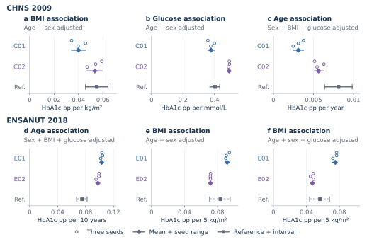

**Figure 4. Analysis-specific utility of repeated open-evidence cohort construction.** Four Agent authors independently selected external evidence and constructed complete virtual cohorts for CHNS 2009 (C01, C02; a-c) and ENSANUT 2018 (E01, E02; d-f) requests. All six prespecified analyses and all 36 estimates from 12 final tables of 3,000 virtual rows are shown. Open circles are the three fixed seed draws per law (8101-8103, top to bottom); diamonds and colored lines show their means and ranges. Gray squares show the existing sample estimates. Solid reference bars in a-c are community-cluster CR1-t 95% confidence intervals for the selected, unweighted CHNS analytical sample; dashed bars in d-f are empirical cluster-resampling stability bands from the 399-attempt ENSANUT procedure. These intervals have different interpretations and are not equivalence or acceptance margins. HbA1c effects are in percentage points (pp), with predictor units and adjustment sets shown on each panel. All generated estimates retain the positive reference direction, and both ENSANUT constructions retain BMI-coefficient attenuation after glucose adjustment. Effect magnitudes remain mixed: both CHNS age effects are smaller, and both ENSANUT age effects larger, than their sample references. Seed ranges describe sampling under fixed laws, not uncertainty in evidence or population transfer. The previously exposed references make this developmental replication, not independent clinical validation; all constructions and their additional dispersion and rank-dependence discrepancies remain in the complete evaluation.

A separate real-real context analysis evaluated three earlier tables from one evidence-to-generation law, not these four authors. Across 100 community-disjoint CHNS resplits, the median absolute reduced-model BMI difference was 0.007239; symmetric generated-real discrepancy medians were 0.004383–0.012727. Age discrepancies were also on a similar numerical scale, while the full-model glucose discrepancy remained appreciably larger than real-real variation. This supplies descriptive context rather than an equivalence threshold, and does not make 100 resplits independent cohorts (Supplement S6).

### 5.3. Which regressions improve with additional relationship evidence?

The next comparison asks whether published associations help constrain the scientific information in a generated cohort beyond basic summaries. Across CHNS and ENSANUT, the sampled agent arms given these additional relationships (E1) had smaller mean absolute discrepancies than the basic-evidence arms (E0) for five of six regression coefficients (Figure 5). For the CHNS glucose slope the error fell from 0.134019 to 0.024079 HbA1c percentage points per mmol/L. The CHNS BMI error increased from 0.020380 to 0.031557 percentage points per kg/m². All three ENSANUT discrepancies decreased. These are descriptive contrasts between the sampled construction arms; they do not isolate a feedback or revision effect. Some E1 endpoints were closer under the prescribed statistical construction, including CHNS glucose (0.012021 versus 0.024079 for the agent mean) and ENSANUT BMI adjusted for glucose (0.007940 versus 0.025649). Table S1 reports both statistical arms and both agent arms for all six analyses.

Agent arm averages were closer than the delivered statistical specification in six of six E0 comparisons and four of six E1 comparisons. The comparator completes unprovided within-source dependence by independence under its entropy criterion; mixing sources can still induce dependence. Agents can instead choose dependent structures and document their assumptions. In ENSANUT E1, they used the published age slope numerically, whereas the fixed specification left it contextual because source covariates, dispersion and weighting were unbound. These are relevant differences in evidence use under incomplete specification. Five Agent constructions versus one fixed construction per arm do not establish superiority over statistical model search, and every E1 Agent lost to the statistical reference on CHNS glucose and ENSANUT glucose-adjusted BMI.

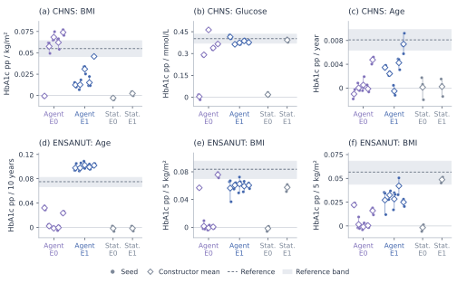

**Figure 5. Relational evidence and scientific analysis agreement.** CHNS panels show BMI adjusted for age/sex (a), glucose adjusted for age/sex (b), and age adjusted for sex/BMI/glucose (c). ENSANUT panels show age adjusted for sex/BMI/glucose (d), BMI adjusted for age/sex (e), and BMI additionally adjusted for glucose (f). All six analyses retain native units. E0 contains basic/marginal evidence; E1 adds relations. Each agent arm has five independently authored laws and each statistical arm one prescribed law, with all three final draws retained: 24 constructions, 72 tables and 216 coefficient estimates. Dots show seeds, open diamonds constructor means and thin segments seed ranges; dashed lines mark sample references. Reference bands are CHNS community-cluster CR1-t intervals or ENSANUT cluster-resampling stability bands. Author indices do not pair E0 with E1. Table S1 gives every endpoint's mean absolute discrepancy and E1–E0 contrast.

### 5.4. Can Agents repeatedly start from a research request without prepared papers?

All twelve fresh constructor sessions delivered a selected generator and all 36 final tables were available. Each Agent independently searched, chose studies, authored a joint model, executed a trial and selected its first submitted candidate. Both policies completed the full task under the same GPT configuration and shared tools, without prepared papers or scientific coefficients from the host. The 108,000 fictional records supported all six requested analysis definitions across the two contexts. They are draws from twelve laws, not newly measured participants. The study used 331 model calls at an estimated token-tariff cost of USD3.985, with complete captured usage. Supplement S22 retains every constructor and its diagnostics.

This repeated construction study follows, rather than replaces, the earlier development rounds. Their first two versions had incomplete deliveries at common input/call ceilings. The four-author capacity diagnostic subsequently delivered twelve tables; across those three development rounds, eight of twelve sessions selected laws and 24 of 36 final slots were delivered. Those failures, scientific values and USD2.95305 cost remain in S21. The new twelve sessions retained the capacity stage's scientific requests, policies and runtime. Independent construction under the working interface therefore establishes operational repeatability, without attributing the earlier delivery improvement to a single component.

**Table 5. Primary analytical profiles across all twelve autonomous constructors.** Each range spans the means of three independently authored laws per policy/context; each law has three fixed final draws. These are author ranges, not confidence intervals. BP slopes are mmHg and lipid slopes mg/dL per 5 kg/m², adjusted for linear age and recorded sex; residual correlations also remove BMI. References are previously exposed sample estimates.

| Requested analysis | Ordinary Agent, author range | Workflow-guided Agent, author range | Sample reference |
|---|---:|---:|---:|
| BMI-SBP slope | 3.293-4.722 | 3.362-5.597 | 3.524 |
| BMI-DBP slope | 2.595-2.987 | 2.424-3.704 | 2.260 |
| SBP-DBP residual correlation | 0.611-0.669 | 0.616-0.783 | 0.717 |
| BMI-TC slope | 8.829-14.615 | 8.810-13.337 | 5.683 |
| BMI-HDL slope | -2.312 to -1.155 | -1.414 to -0.012 | -4.623 |
| TC-HDL residual correlation | 0.331-0.423 | 0.146-0.356 | 0.512 |

Blood-pressure records showed useful but variable analytical agreement. Several BMI-SBP and residual-dependence estimates approached the sample reference; other authors produced substantially larger BMI effects. Descriptively, workflow had smaller mean absolute differences on residual dependence and both marginal-SD diagnostics, while ordinary Agent was closer on the two primary BMI coefficients. One workflow residual correlation exceeded the reference, so the results do not support inevitable dependence shrinkage.

Lipid analyses showed a clearer boundary. All six constructor means had weaker residual dependence (0.146-0.423 versus 0.512) and lower HDL dispersion (SD 11.38-13.18 versus 20.18 mg/dL). The nearly zero workflow HDL slope is retained. Workflow was closer on the TC coefficient, whereas ordinary Agent was closer on the HDL coefficient and lipid residual dependence. The TC reference interval includes zero; these are sample comparisons rather than known population errors. No policy dominated the scientific endpoints.

**Figure 6. Scientific analysis utility across repeated autonomous constructions.** Each row is a fresh constructor using the same research request, GPT configuration and tool capabilities within its context; ordinary and workflow policies receive no prepared papers or target estimates. All twelve laws, 36 primary constructor-analysis means and 108 seed estimates from 36 final tables are retained across the six endpoint panels. Filled diamonds show three-seed means, open circles the individual estimates and segments their ranges. Variability includes the program's encoded stochasticity: PNS_BASE_R3 also samples shared parameters per seed. The ranges are not source or transport confidence intervals. Dashed lines mark existing sample estimates and shading their saved uncertainty: conditional row-resampling stability for PNS, nominal 95% HC3 normal-assumption conditional sensitivity intervals for lipid slopes, and no invented interval for lipid residual correlation. These developmental comparisons use two contexts and three constructors per policy/context. Full dispersion, coherence and delivery records accompany the analytical profiles in S22; the earlier four-author capacity results remain in S21.

All BP outputs satisfied the evaluated SBP-at-least-DBP condition. One workflow lipid law produced a single HDL-above-TC row in its 9,000 final records, one of 54,000 lipid records across the six authors; it was retained. Uniform source/code inspection also found one ordinary lipid law with an infinite raw TC mean under its ideal continuous distribution, despite successful finite-table delivery. A different capped law has finite actual moments and must not be assigned that defect. The subsequent quality-assurance study evaluated Agent-led repairs separately (Section 5.12).

### 5.5. What can a reader explain and trace?

The earlier four-author capacity audit shows numerical use of retrieved evidence, not merely citations appended to a chosen generator. Both PNS Agents independently retrieved China-PEACE BMI slopes of 1.15/0.75 mmHg per unit [42]. Ordinary retrieved Uganda's explicitly labelled residual correlation of 0.7307 [43]. Workflow retrieved a treatment-corrected longitudinal Kendall tau of 0.578 [44] and introduced a Gaussian-copula conversion followed by a variance budget. The latter is a genuine, inspectable derivation, but its population and statistical bridges remain assumptions.

**Table 6. Scientific traceability in the earlier four-author capacity constructions.** These are postclosure audits of records authored during construction; they are separate from the twelve-law repeatability audit. The resulting chain explains numerical uses without ranking credibility or guaranteeing transport.

| Analysis and Agent decision | Evidence and transformation | Additional assumption or boundary |
|---|---|---|
| PNS BMI effects, both Agents | China-PEACE reports 1.15/0.75 mmHg per BMI unit; the five-unit conversion is 5.75/3.75. The code uses these anchors. | The source has additional adjustment variables. Nonlinear age, selection and target composition mean the code parameters need not equal the requested age/sex-only projections. |
| PNS dependence, ordinary | Uganda's joint-regression table reports residual correlation 0.7307; the Agent uses 0.73 in paired innovations. | The source uses categorical BMI and a different covariate set, excludes treated participants and represents another population. It does not identify the target residual correlation. |
| PNS dependence, workflow | Source Kendall tau 0.578 becomes 0.788 under a Gaussian-copula approximation; a variance budget yields innovation correlation 0.763. | The source concerns repeated-exam, treatment-corrected phenotypes and an asymmetric copula. Gaussian mapping, covariance subtraction and baseline transfer are additional assumptions. |
| Lipid BMI effects, workflow | Malawian per-SD BMI coefficients [46] are combined with Kenyan marginal anchors [45]. | Dividing by modeled/Kenyan BMI SD 4.8 is standardized-effect transport, not recovery of an unknown Malawian physical-unit coefficient. Most source adjustment variables are absent. |
| Lipid joint behavior, both Agents | TC equals HDL plus positive non-HDL; source marginal moments and context evidence inform component laws. | Ordinary assumes log-error correlation 0.08; workflow assumes conditional component independence. Neither value is a reported target TC-HDL residual coefficient. |

This record can distinguish accurate extraction from a questionable use. For example, the Malawi coefficients and their intervals were extracted correctly, while converting them with a different population's BMI SD adds uncertainty. Likewise, Uganda's number really is reported as a residual correlation, but the source residualizes different variables. These are not transcription failures. They point to the additional evidence or sensitivity analysis needed before stronger scientific interpretation.

The record can also explain model consequences. In the workflow lipid law, conditional component independence and its variance budget imply TC-HDL correlations of approximately 0.349 for women and 0.299 for men under the stated rural reference assumptions. These are model-conditional quantities, not the pooled age/sex/BMI-adjusted statistic in the delivered cohort. Mixtures and differing covariate distributions intervene. The older L03 and iron examples in Figure 10 provide fuller analytical links where the requested model functional was derived explicitly.

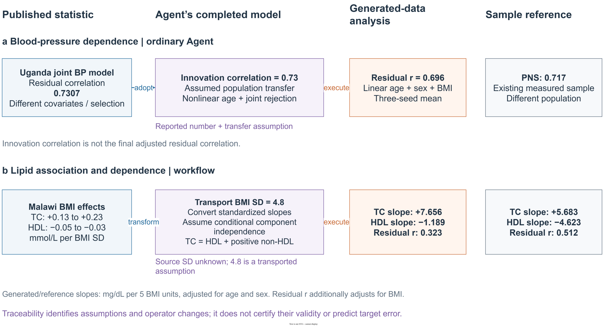

**Figure 7. Explainability through inspectable scientific dependencies.** Source quantities retain their population, measurement and analysis definitions. Algebraic transformations and additional assumptions lead to adopted model choices; the full joint law then determines downstream analyses, which are estimated in generated records. Clinical reference comparison is a separate empirical step. The illustrated audited examples do not equate source coefficients, innovation correlations and final regression estimands. The chain is not a calibrated confidence score or evidence that a private reasoning account is faithful.

The twelve-law repeatability audit provided additional concrete uses. One workflow derived covariance from SBP, DBP and pulse-pressure variances before subtracting an assumed covariate contribution. Lipid constructors inferred or assumed BMI scales to convert standardized effects, and one adapted variance components from a longitudinal model to single-visit generation. Both third-repeat lipid authors independently used positive component constructions. These are substantive Agent modeling decisions; their source definitions and additional assumptions remain inspectable in the complete audit (S22).

Neither the four-author capacity stage nor the twelve-author repeatability study changed its selected program after the successful first trial. They demonstrate retrieval, construction and inspection. The separate review experiment documents actual repairs without asserting general analytical improvement (Section 5.12). The provenance record lets a reader examine where a relationship came from and what remains assumed; its benefit for external-user speed, diagnostic accuracy or study decisions has not been measured.

### 5.6. What does the cross-model evidence add?

The two fixed-packet API pilots contain 28 initial construction attempts and four dependent reviews. Twenty initial laws delivered analyzable data: nine for blood pressure and eleven for lipids. Several model configurations therefore implemented the evidence-to-joint-model task. Gemini produced no complete initial artifact under the tested output/reasoning configuration; the report retains delivery failure rather than assigning it a scientific-quality score. The smaller economy round and the dependent reviews are not new independent models (S20).

Under these fixed packets, every delivered initial construction had mean residual dependence below its case reference: approximately 0.375-0.608 versus 0.717 for BP, and 0.097-0.382 versus 0.512 for lipids. Yet they did not implement one common prior. Some chose error correlations; others subtracted explained variance, used latent copulas or generated positive lipid components. One Claude component law assumed independent HDL/non-HDL errors but implied a TC-HDL residual correlation of about 0.381 because TC includes HDL. A zero component-error parameter was therefore not a zero requested outcome correlation.

The request-only PNS results narrow this pattern. The capacity diagnostic produced residual correlations near the existing reference, while the subsequent six independent BP constructors spanned 0.611-0.783, including a value above it. This observation rules out treating all Agent-built cohorts as inevitably dependence-shrunken. It does not isolate retrieval as the cause: evidence, scientific construction, model configuration and resource conditions differed. Lipid dependence remained weak even with more explicit source use. A more expensive or different model also did not uniformly improve the fixed-packet analyses. The current evidence supports investigating specific evidence-and-model choices, rather than ranking providers by an aggregate score or assuming that model scale alone resolves missing joint information.

### 5.7. Which analyses can use the same iron-status records?

Zhu et al. studied 1,671 parous women who used IUDs in northern China, two to four years postpartum [33]. The source counts imply a crude odds ratio of 6.65. The agents' source replays gave 6.58 and 6.73. Both programs used the hemoglobin bands and their ferritin summaries. The Cuban study used inflammation-corrected ferritin [34]. As specified in the shared packet, its odds ratio supplied context for the transfer assumptions (Table 2).

Figure 8 traces the implications of the frozen code. In A, giving low-ferritin observations a relative weight of two thirds preserves the threshold odds ratio, since the factor cancels in the cross-product of counts. It reduces the joint-low proportion from 10.35% to 7.67%. For one fifth of rows A then draws hemoglobin independently from the same target hemoglobin distribution. The resulting model implies a joint-low proportion of 6.73% and an odds ratio of 4.65. B retains the source joint-low proportion of 10.35% and odds ratio of 6.65. These values follow from the two authored models. The colored markers in panels c to e show estimates from the six previously sealed tables.

The survey reference used the 979 women with both measurements among 1,065 eligible positive-weight women [35]. Missing either measurement excluded 86 women (8.08% unweighted; 2.47% of eligible phlebotomy-weight mass). The reported estimates describe this weighted complete-case reference; extending them to all eligible women requires assumptions about the missing measurements (Supplement S9). Comparison on the log-odds-ratio scale was primary. All six delivered odds ratios (A 4.835–4.866, B 6.011–6.565) fell below the survey's lower confidence limit of 9.28 (estimate 17.79, 95% CI 9.28–34.11). A came closer on the joint-low proportion (6.66–6.88% versus 7.63%), while B came closer on the continuous Spearman correlation (0.391–0.430 versus 0.398). For B the joint-low proportion was 10.02–10.44%, and for A the correlation was 0.156–0.195. The sources reported no continuous rank coefficient. Their ferritin summaries by hemoglobin band constrain ranks indirectly, leaving within-band dependence to the author. The same two columns in each delivery supplied all three estimates.

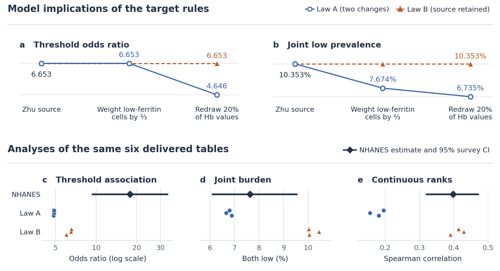

**Figure 8. How two transfer choices affect analyses on the same iron-status records.** Panels a and b are a post hoc calculation from the source counts and frozen rules. Panels c to e show three sealed tables of 5,000 rows per law and the NHANES estimate with its design-based 95% interval. Low hemoglobin is below 12 g/dL and low raw ferritin below 15 µg/L. The two secondary analyses had no prespecified equivalence margin.

### 5.8. Which findings carry across requests and reference conditions?

For glycemia and lipids, three authors per request generated 18 tables in total. All 54 primary estimates agreed in point direction with the corresponding sample estimates across six distinct analyses (Figure 9). The tables supported age- and sex-adjusted BMI models and further adjustment for glucose. The three constructor-mean correlations of total and HDL cholesterol after adjustment for age, sex and BMI were 0.108–0.141, against 0.512 in the measured sample. The total-cholesterol slope's reference interval crossed zero. A post hoc check of the sealed lipid tables found HDL above total cholesterol in 69 of 27,000 synthetic rows (0.256%). Both concentrations were expressed in mmol/L. This check measures the biological consistency of individual pairs separately from the prespecified association results.

A close coefficient did not imply that individual variation was reproduced. H03's mean glucose-adjusted BMI coefficient was 0.05098 versus 0.05664 HbA1c percentage points per 5 kg/m² in the reference. Its mean HbA1c SD was 0.3523 versus 0.5274 percentage points, and its full-model residual RMS was 0.3006 versus 0.4885 (Figure S2). These diagnostics qualify its regression-use result: the tables retained less marginal and residual variation. The lower residual variation also limits inferential uses: a close slope does not establish calibrated standard errors, confidence intervals or power. Studies of individual heterogeneity and tails likewise require their own validation.

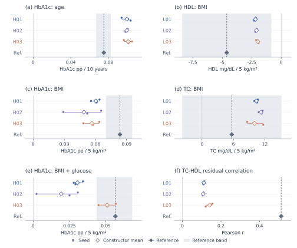

**Figure 9. Analysis-specific behavior across glycemia and lipid requests.** HbA1c panels in the left column show age adjusted for sex/BMI/glucose (a), BMI adjusted for age/sex (c), and BMI additionally adjusted for glucose (e). The right column shows age/sex-adjusted HDL and TC BMI slopes (b,d) and residual Pearson correlation after age/sex/BMI adjustment (f). All six laws and 54 estimates from 18 tables are retained. Circles show seeds, open diamonds means and thin segments seed ranges; dark diamonds and dashed lines mark sample references. HbA1c units are percentage points per 10 years or 5 kg/m²; lipid slopes are mg/dL per 5 kg/m². Bands are ENSANUT empirical cluster-resampling stability bands and lipid HC3 assumption-conditional sensitivity intervals. The TC band crosses zero; no residual-correlation interval is available. Seed ranges describe sampling under each frozen law. Table S5 supplies all numerical summaries and Figure S2 the dispersion results.

The earlier prospective wave tested a stricter question. In HAALSI adults aged 40 or older [30,31], all 15 agent draws recovered the positive directions of the adjusted BMI and age associations with capillary glucose; only eight recovered the negative difference between female and male BMI slopes. The rule required four of five laws per case to meet all prespecified margins on every seed. Three passed in HAALSI and none in Turkana [32], so the planned expansion stopped. Even a zero-effect rule met the HAALSI margin for all three endpoints. The earlier method and its gate remain a separate prospective result, not a fresh evaluation of the later workflow on the same Turkana participants.

### 5.9. What changes when the scientific relationship is already supplied?

In the HRS longitudinal benchmark both methods received the published model exports [1]. Below the 6.5% HbA1c knot, the age–HbA1c interaction in memory trajectories averaged −0.04464 for agent tables and −0.04050 for the reconstructed published generator, against the supplied −0.04684. Above the knot the mean signs differed; five of six intervals included zero (Figure S5). This is a matched reconstruction check, not transfer from partial evidence. Similarly, supplying 30 target summaries in Q2 allowed joint reconstruction of the five highlighted regression and correlation analyses (Table S2). In Q4, open retrieval yielded twelve distinct original studies across four authors and twelve complete tables (Tables S3–S4); the design did not isolate the effect of retrieval. HRS and Q2 test reconstruction when target-model information is supplied; Q4 instead demonstrates a way to obtain external evidence without supplying more information about the target.

**Table 7. Observed scientific properties and unvalidated uses.** These descriptive conclusions add no pass/fail criteria. Agreement concerns the stated sample reference or supplied model, not known population truth.

| Experiment and intended analysis | Observed property | Use not established by this result |
|---|---|---|
| Q4: six glycemia regressions under open retrieval | Four authored laws produced complete tables retaining all six reference point directions. Both ENSANUT laws retained BMI-coefficient attenuation after glucose adjustment; effect magnitudes, ranks and dispersion remained mixed. | Reliable effect-size estimation for an unseen population, causal mediation, or calibrated uncertainty. The two requests used previously exposed references. |
| Q1: comparison with additional relationship evidence | The sampled E1 agent arms had smaller mean absolute discrepancy than E0 on five of six coefficients; CHNS BMI discrepancy increased. Comparisons with the fixed statistical completion varied by endpoint. | A general probability of improvement, universal method superiority, or a feedback/revision effect. Authors were unpaired, and six endpoints do not constitute six independent clinical studies. |
| Iron: threshold association, joint burden and continuous ranks from the same paired columns | A was closer on joint-low prevalence; B was closer on Spearman correlation. Both substantially understated the primary odds ratio; all six delivered ORs lay below the reference interval's lower limit. | Adequacy of one law for all three analyses, direct source-to-target transport, or a prospective rule for choosing the better construction without target measurements. No equivalence margin was specified. |
| Q5: glycemia and lipid regressions and residual dependence | All focal point directions agreed. H03's glucose-adjusted BMI coefficient was relatively close despite reduced HbA1c dispersion; lipid residual correlations remained 0.108–0.141 versus 0.512 in the sample reference. | Adequate joint variation, individual heterogeneity or tails, or reliable magnitude recovery inferred from direction alone. The TC reference interval included zero. |
| PNS: BMI associations with both blood pressures and their adjusted dependence | All five laws produced analyzable records; BMI-SBP magnitudes overlapped the conditional reference resampling interval, while BMI-DBP effects were consistently larger and residual correlations smaller. | Adequate joint-distribution recovery, calibrated author-ensemble uncertainty, cross-provider agreement or revision benefit. The release family was already exposed and the intervals omit complex-survey design. |
| HRS/Q3 and Q2: analyses whose model information or summaries were supplied | HRS tables retained the below-knot interaction's negative direction, with unstable upper-branch behavior. Q2 reconstructed the five highlighted supplied regression/correlation summaries jointly. | Recovery of an unconstrained hidden relationship or independent population validation. The relevant target-model information was legitimate construction input. |
| Repeated request-only API construction | All twelve fresh sessions delivered full-cohort generators and 36 tables. BP association/dependence profiles were useful but variable; lipid dependence and HDL dispersion remained weaker in every new law. | General workflow superiority, clinical equivalence or broad model/task generalization. Three constructors per policy/context are not new clinical populations. |
| Paired scientific-law review | Both policies repaired a divergent tail and a possible rounding failure; all 72 final tables were delivered. Sixty-six tables were unchanged; the changed lipid law had mixed analytical consequences. | A general quality benefit from structured review, four empirical improvements from four code changes, or independent confirmation using the same clinical references. |

### 5.10. From evidence to a joint law and its scientific analyses

The thirty-construction audit helps explain why an evidence-informed cohort can agree on one analysis and disagree on another. Adding relationship evidence reduced mean absolute discrepancy for five of the six main-study coefficients, but this was not five instances of an assumed endpoint becoming a reported fact. The CHNS fully adjusted age coefficient improved at arm level even though no age relationship was supplied. The ENSANUT BMI coefficient adjusted for glucose was derived from separate reported projections together with assumed covariance; it was not directly reported in the source. Moreover, the E0 and E1 authors were unpaired. The observed contrast therefore characterizes these evidence conditions and constructions, without identifying a universal provenance upgrade or a unique mechanism of improvement. The CHNS BMI deterioration likewise cannot be attributed exclusively to transfer, because the authors differed in the relationships constrained, distributional completion and target-law choices.

The lipid construction L03 provides a case in which the full-model implication can be separated from both the source and the sampled result. Published unadjusted Spearman correlations were converted to a latent Gaussian dependence model and combined with lognormal margins and assumptions about sex and age. The complete law implied a Pearson correlation of 0.1322 between TC and HDL residuals after adjustment for age, sex and BMI. Its generated mean was 0.1413 across three draws, whereas the measured reference was 0.5121. Thus the weak generated residual association was already a property of the chosen law. It was not merely a difference between one sampled cohort and its intended model. The source rank correlations and the requested residual Pearson correlation were different statistical quantities, so their difference cannot be read as a direct source-reproduction error. The reference residual-correlation interval was unavailable.

The iron models show a different, identifiable link between an author's decision and a scientific analysis. The reported joint threshold counts implied a crude odds ratio of 6.653. Author B retained that threshold structure. Author A first reduced the relative weight of low ferritin, which changed prevalence while preserving the odds ratio, then independently redrew hemoglobin in 20% of rows from the reweighted hemoglobin marginal distribution. That second operation reduced the model odds ratio to 4.646. The generated means were 4.855 for A and 6.362 for B, compared with the weighted reference of 17.790. These are consequences of the frozen probability laws; they do not establish a biological mechanism for the population difference.

Conversely, B's continuous rank relationship depended on unreported within-band modeling choices, yet its generated mean Spearman correlation was 0.411, close to the reference point estimate of 0.398. In the main study, the assumption-dependent ENSANUT E0 author A05 also had a smaller discrepancy for the age/sex-adjusted BMI coefficient (Q2, before glucose adjustment) than any E1 author. These observations rule out a guarantee that reported or derived inputs always give more accurate target analyses than assumed inputs. They do not show that provenance is unrelated to error in general. The present cases are too few, heterogeneous and retrospectively examined to establish that predictive relationship.

The audit also separates evidence uptake from a completed numerical check. In Q5, all 132 declared source-check entries remained unavailable under the required source operators. Numerical source values still entered the laws through reviewed derivations and named assumptions, but the batch did not provide measured numerical source-fit feedback. Retention of the initial laws therefore cannot be described as all source-fit checks passing or as evidence of a revision benefit. Together, these findings locate which scientific relationships follow from the construction and which remain commitments needing further evidence.

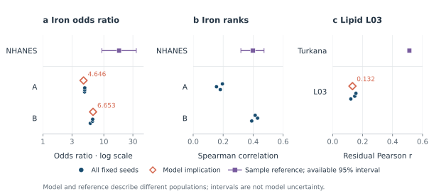

**Figure 10. Tracing model commitments into different scientific analyses.** Panel a separates the source-table/B-law crude odds ratio (6.653) from A's target-law implication after its assumed independent-Hb redraw (4.646), and shows all final generated estimates and the measured NHANES reference with its design-based 95% interval. Panel b shows continuous Hb-ferritin Spearman correlations from the same six tables; no population rank coefficient is implied by the published threshold table alone. Panel c shows L03's model-implied age/sex/BMI-adjusted residual TC-HDL Pearson correlation, its three generated estimates and the Turkana reference, for which no interval is available. Model implications are retrospective calculations under the frozen laws, not target fits or additional observations. The source's pooled Spearman correlation is a different statistic and is not plotted on the adjusted-Pearson axis. These panels illustrate inspectable model consequences, not uniquely identified causes of population discrepancies.

### 5.11. Does a further whole-cohort request retain the same analytical distinctions?

Five fresh author contexts constructed complete age, recorded-sex, BMI, SBP and DBP cohorts from identical external evidence. All fifteen outputs were sealed before the reference analyses were revealed. The PNS family had already been used for other outcomes, so this is a qualified new-task validation within an exposed release, not a new independent cohort. The reference consisted of 8,352 eligible laboratory-substudy records with supplied laboratory weights [41]. Both BMI regressions adjust for age and sex; the residual Pearson analysis additionally removes BMI from both blood pressures. Supplement S18 gives eligibility, measurement, uncertainty and all author summaries.

All fifteen tables supported the three analyses (Figure 11). Across all draws, BMI-SBP coefficients ranged from 3.081 to 4.276 mmHg per 5 kg/m², compared with the weighted reference 3.524. BMI-DBP coefficients were larger, 2.886-3.691 versus 2.260, while residual correlations were smaller, 0.466-0.646 versus 0.717. Unweighted reference estimates of 3.435, 2.114 and 0.741 retained this discrepancy pattern. Marginal SD ratios relative to the weighted reference ranged from 0.931 to 1.129 for SBP and 0.896 to 1.076 for DBP. Generated means were lower across all draws. The results therefore do not support a universal contraction of all variances, or adequacy of the full joint distribution from one favorable regression.

All five authors adopted INTERSALT's BMI coefficients, 0.7754 and 0.5967 mmHg per BMI unit, as conditional location parameters under explicit transfer assumptions [39]. The source coefficients pool within-centre regressions with additional sodium, potassium and alcohol adjustment. Nonlinear age terms, heteroscedasticity and selection mean that the requested age/sex-only projections need not equal those parameters. The five assumed pre-selection residual correlations were 0.50, 0.65, 0.50, 0.55 and 0.55; these are neither the older Beijing population's raw correlation [40] nor the requested post-selection residual estimand. Exact population projections were not computed in this audit.

To describe agreement among authors, we took each author's median over its three seeds and calculated the sample SD across the five medians. The absolute discrepancy between the mean of those medians and the measured reference was 1.02, 5.11 and 2.95 times that SD for SBP, DBP and residual correlation. These are descriptive ratios, not calibrated uncertainty intervals or z statistics. The constructions shared a host service, evidence and workflow. Their consistency does not establish cross-provider convergence or provide independent clinical corroboration.

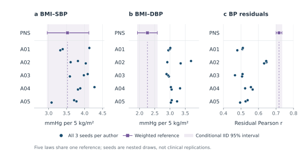

**Figure 11. Complete blood-pressure results across five authored laws.** Each panel shows all three fixed draws for each author and the weighted PNS reference. BMI effects are mmHg per 5 kg/m², adjusted for age and sex; residual correlation removes age, sex and BMI. The reference band is the 2.5th-97.5th percentile of 500 conditional IID row resamples retaining supplied weights. It is not a complex-survey confidence interval or an equivalence margin. Draws are nested within laws and all authors share one reference. Source conditional coefficients and assumed innovation correlations are not substituted for the requested population estimands. All five authors retained their initial reviewed law; no generation occurred after target disclosure.

### 5.12. What do reusable scientific checks add to the final data?

A separate paired review study applied ordinary and structured review to each of the twelve frozen autonomous laws. All 24 review sessions used the inspection tool and delivered all 72 final tables. Both policies retained ten laws and revised the same two. The Agent chose the repairs without target values or host-written scientific corrections. This establishes an implemented path from inspection to Agent-led repair, while keeping the generated data's analytical behavior as the outcome.

For the lipid law with divergent TC moments, ordinary review replaced its exponential BMI contribution with a positive affine term; structured review used log-BMI and positive HDL/non-HDL components. Both fixed specifications have finite positive polynomial measurement moments. For a BP law, both reviewers moved rounding before pair acceptance, addressing a possible output failure. Its six saved outputs nevertheless matched the initial tables byte for byte, as did the sixty outputs from retained laws. Only the six tables from the repaired lipid law changed numerically.

For that lipid law, the BMI-TC slope moved from 14.615 to 14.106 under ordinary review and 13.364 under structured review, compared with the sample estimate 5.683 mg/dL per 5 kg/m². Residual dependence remained approximately 0.359 versus 0.512, and TC dispersion moved slightly farther from its sample reference. A physiological component construction also changes the interpretation of the measurements; it is not itself validation of a scientific association. These results support reusable quality checks and specific repairs, with mixed or unchanged analytical consequences. Ordinary review achieved the same principal repairs. Supplement S23 retains all starting laws, final profiles, mandatory diagnostics and operational counts.

## 6. Discussion

The lifestyle application makes the data product directly assessable: an existing biomedical analysis receives a different input table. Its urban BMI result is interpretable in kg/m², and the TC comparison shows why raw and standardized scales should be examined together. The ability to run the analysis and retain a useful pattern is a concrete outcome; smaller virtual p-values are not. The source-rich setting also clarifies what the result can establish. The original paper contributes legitimate constraints, while incomplete conditional and joint quantities remain model commitments. Matching those permitted findings is reconstruction, not a new biological discovery. Request-only experiments answer the complementary question of whether the Agent can obtain and use evidence without that supplied starting point.

The central result is that a scientific Agent can turn a biomedical research request and incomplete external evidence into an executable joint model and records that support specified analyses. In the latest implementation, the Agent actually performs the search and numerical modeling work; a separate worker samples its program. Earlier glycemia experiments show useful adjustment patterns and analysis-specific agreement, while all twelve fresh request-only constructors delivered full cohorts without prepared source packets. This is a concrete data-generation capability. Its value must be assessed at the level of the scientific analyses the records enable.

The evidence does not favor making specialized Agent orchestration the main performance claim. Ordinary Agents completed the same request-only tasks and were closer on several endpoints. The repeated workflow constructions offered explicit source and assumption records, but more detailed explanation did not imply uniformly closer analyses. Retaining a capable ordinary Agent as a valid implementation keeps the method centered on the work required to turn incomplete studies into analyzable data. Extra roles, compulsory iteration or more elaborate tools would require their own demonstrated benefit.

Scientific provenance strengthens this application because the generated records come from a constructed joint law. A source estimate, a code parameter and a requested analysis coincide only under additional conditions. Unit conversion can be exact while population transfer remains uncertain; a derived value can depend on an assumed covariance; a coherent sampler can produce a systematically different scientific relation. The iron redraw and L03 examples make model consequences calculable. The latest BP and lipid examples show that actual retrieval also finds statistically different kinds of evidence and leaves meaningful conversion decisions. The deliverable should therefore include an analysis-specific account of sources, transformations and unresolved assumptions alongside the data.

Traceability is not an accuracy ranking. Both reported and assumed choices can be close to or far from a sample reference. The observed weak residual dependence in the two fixed-packet API tasks is informative, but the near-reference and above-reference BP dependence in later request-only constructions shows it is not a universal Agent property. Appropriate joint evidence may matter, but these sequential studies do not identify its causal contribution. The existing audit can identify where more joint information would be useful, without claiming a causal explanation for every discrepancy. A task-based user study would be needed to establish whether these records help independent researchers interpret or diagnose generated data.

Reference comparisons also need an appropriate interpretation. Real cohorts differ because of sampling, selection, measurement and population structure. We do not require row-level agreement or regard one sample mean as a population truth. At the same time, this uncertainty does not erase persistent differences in effect magnitude, joint dependence or dispersion. Our figures retain the estimand, sample-reference uncertainty and all generated laws rather than reducing quality to direction agreement or a single distributional distance. Repeated seeds expose Monte Carlo variation; independent constructions expose some modeling variation; neither supplies calibrated uncertainty about transfer to an unfamiliar cohort.

The paired review adds a useful practical distinction. A finite table can look plausible while its generating law has divergent moments; correcting that law is worthwhile even when the requested regressions hardly change. A delivery repair can also leave every current draw unchanged. The generic inspections support these repairs, but do not supply unidentified cross-variable information or establish target-population fidelity. The result favors keeping scientific checks available to the Agent rather than making extra roles or compulsory revision the main contribution.

Together, the experiments support autonomous evidence-to-data construction, demonstrated but analysis-specific use, and inspectable scientific commitments. They provide a basis for studying scientific relationships and exploring models from virtual records, while stronger inferential or clinical uses require additional validation. The completed repeatability and quality-assurance studies strengthen this application story; they do not establish a universal substitute for measurement, calibrated confidence labels or a general feedback benefit. The exploratory model configurations also remain distinct from a balanced provider or model-size comparison.

## Limitations and Ethical Considerations

The new lifestyle application has two constructors under one GPT configuration and an already exposed study family. Published source findings were allowed, original analysis code and supplemental numerical workbooks were unavailable, and the task requested complete measurements despite substantial real-data lipid missingness. We explicitly chose the common regression, case-selection and scaling rules and retained all branches. The source population's demographic inconsistency and unreported conditional effects remain assumptions in the two laws. This study therefore supports a specified reconstruction use, not general inference, new-population validation or a controlled estimate of the benefit of source-rich evidence. The separate correlation reuse analysis uses old tables and does not increase the number of independent constructions or clinical populations.

Published evidence does not identify every joint relationship. Eligibility, age, geography, specimen handling, treatment and adjustment differ across sources; clinical references have sampling and selection uncertainty. The iron sample conditions on both biomarkers being observed, and no additional item-nonresponse sensitivity analysis was performed. Synthetic standard errors conditional on a generated table omit source, model-selection and transport uncertainty. No general equivalence margin, calibrated uncertainty coverage or clinical decision benefit has been established.

The protocols and controllers differ across studies. Central Q1/Q4/Q5 author sessions have incomplete backend and inference metadata, while the later API pilots capture requested/returned model identities, prompts, responses, tools, token usage and estimated costs. Alias identities do not identify immutable model weights, and complete original authoring cannot be reconstructed for every historical experiment. The repeated request-only comparison has three constructors per policy and context under one GPT configuration. The earlier capacity diagnostic had one per cell and is retained separately. The paired review adds 24 dependent review sessions around twelve existing laws, not 24 new constructors. These small, two-context studies and differing retrieved evidence do not identify a task-general workflow advantage. No new-population trial establishes that review improves scientific outcomes or that the system saves a measured amount of human labor.

All request-only references were already exposed at project level. In the interface-repair round, an indirectly cited PNS hypertension prevalence reached the ordinary BP Agent despite source-alias screening; the author stated it was ignored and the audit found no visible numerical use, but exposure remains recorded. The capacity round's bounded inspection found no equivalent target-family input, which does not certify perfect screening. In the repeatability study, a PNS-family search preview exposed approximately 1% ideal cardiovascular health prevalence; it did not supply the requested BMI coefficients or residual correlation, but remains recorded. Current results are developmental, not new clinical confirmation. Full outcomes, incomplete deliveries and no-op decisions remain available in the aggregate record.

Values must be labelled synthetic and must not be presented as measured individual biomarkers, diagnoses or independent patient evidence. A virtual value is a draw under a model, not recovery of an individual's missing measurement. Source cohort access and reuse conditions continue to apply. Public materials contain permissible code, original documentation and aggregate results; patient-level records, generated row tables, full third-party articles and credentials remain local. Scientific use should state the population assumptions, supported and unassessed analyses, and what uncertainty is omitted.

## Generative AI Usage

Language models participated in research planning and manuscript editing and were an object of the experiments. In the scientific workflow, agent authors interpreted evidence, selected or received studies according to protocol, proposed statistical models, and wrote or revised generator code. For program-based studies, deterministic tools sampled the records; the historical direct-row study used literal Agent-authored values. Deterministic tools computed the reported analyses, and separate implementations checked the numerical results where specified. Study protocols and source records document these roles. The final author list, study-specific declarations, and applicable oversight and data-use statements must be confirmed before submission.

## Supporting materials and reproducibility

The [public research repository](https://github.com/ziwang11112/evidence-guided-virtual-cohorts-2026) contains earlier versioned protocols, executable programs and aggregate audits. The iron [protocol seal](https://github.com/ziwang11112/evidence-guided-virtual-cohorts-2026/commit/bedd845768c1c938768f58fce685f53cbf97f3df) and [delivery seal](https://github.com/ziwang11112/evidence-guided-virtual-cohorts-2026/commit/c88192edeb0bc63b60d0bfe6e3a7282ced9d2975) precede its target evaluation. This revision integrates already completed studies; it conducts no new clinical experiment, target refit or model call. Recent API artifacts are linked locally below and are not represented as already publicly synchronized.

The [historical attribution table](../work/parameter_attribution_2026-11-10/ATTRIBUTION_MASTER.md) preserves ninety requested-analysis and six dispersion records. The [fixed-packet API synthesis](../work/two_round_synthesis_2026-11-10/RESULTS_SUMMARY.md) links all attempts, parameter origins and sampled analyses. The [request-only development report](../work/request_only_agent_capacity_2026-11-10/RESULTS.md) and its [all-round aggregate ledger](../work/request_only_agent_capacity_2026-11-10/review/ALL_ROUNDS.json) retain the three earlier rounds. The [repeated construction report](../work/request_only_repeatability_2026-11-11/RESULTS.md) contains the twelve new constructors, and the [paired review report](../work/scientific_check_revision_2026-11-11/RESULTS.md) contains their 24 dependent review branches. Each separates source/code inspection, numerical recomputation and scientific-reference interpretation. Supplements S20-S23 document these studies without upgrading the reproducibility claims for older controllers. Frozen original studies and prior manuscript editions remain unchanged.

## References

1. Filshtein TJ, Li X, Zimmerman SC, Ackley SF, Glymour MM, Power MC. Proof of concept example for use of simulation to allow data pooling despite privacy restrictions. *Epidemiology*. 2021;32(5):638–647. [DOI and full text](https://pmc.ncbi.nlm.nih.gov/articles/PMC8338788/).
2. Zhao Z et al. SynthIPD: training-free synthetic individual patient data generation. arXiv:2509.16466v2, 24 July 2026. [Versioned full text](https://arxiv.org/html/2509.16466v2). Publication beyond this preprint was not established in the positioning audit.
3. Phillippo DM et al. Multilevel network meta-regression for population-adjusted treatment comparisons. *Journal of the Royal Statistical Society: Series A*. 2020;183(3):1189–1210. [DOI/full text](https://rss.onlinelibrary.wiley.com/doi/full/10.1111/rssa.12579).
4. Holt S, Ruiz Luyten M, Berthon A, van der Schaar M. G-Sim: Generative Simulations with Large Language Models and Gradient-Free Calibration. *Proceedings of ICML*. PMLR 267;2025:23513–23561. [Published record](https://proceedings.mlr.press/v267/holt25b.html).
5. Tang Y, Kong M, He J, Nie T, Ma W, Sun L. LLMSynthor: Macro-Aligned Micro-Records Synthesis with Large Language Models. KDD 2026. [DOI](https://doi.org/10.1145/3770855.3818965); [full text v4](https://arxiv.org/html/2505.14752v4).
6. Callender T, Boyd A, Davis R, Ruhrberg Estevez S, Lavista Ferres JM, van der Schaar M. SynthCraft: An AI partner for synthetic data generation to support data access and augmentation in healthcare. *PLOS Digital Health*. 2026;5(3):e0001290. [Published article](https://journals.plos.org/digitalhealth/article?id=10.1371/journal.pdig.0001290).
7. Bao Y, Ma X, Li H, Zhou M, Hu C, Wu H, Tang J, Hou X, Xiang K, Jia W. Glycated haemoglobin A1c for diagnosing diabetes in Chinese population: cross sectional epidemiological survey. *BMJ*. 2010;340:c2249. [DOI](https://doi.org/10.1136/bmj.c2249); [bibliographic record](https://pubmed.ncbi.nlm.nih.gov/20478961/).
8. Wang P, Li Y, Wang M, Song L, Dong Y, Han X, Tuomilehto J, Wang Y, Du Y, Qiu C. Comparing glycemic traits in defining diabetes among rural Chinese older adults. *PLOS ONE*. 2024;19(1):e0296694. [Published article](https://journals.plos.org/plosone/article?id=10.1371/journal.pone.0296694).
9. Jansen H, Stolk RP, Nolte IM, Kema IP, Wolffenbuttel BHR, Snieder H. Determinants of HbA1c in nondiabetic Dutch adults: genetic loci and clinical and lifestyle parameters, and their interactions in the lifelines cohort study. *Journal of Internal Medicine*. 2013;273(3):283–293. [Published article](https://onlinelibrary.wiley.com/doi/10.1111/joim.12010).
10. Pani LN, Korenda L, Meigs JB, Driver C, Chamany S, Fox CS, Sullivan L, D'Agostino RB, Nathan DM. Effect of aging on A1C levels in individuals without diabetes: evidence from the Framingham Offspring Study and the National Health and Nutrition Examination Survey 2001-2004. *Diabetes Care*. 2008;31(10):1991–1996. [DOI](https://doi.org/10.2337/dc08-0577); [bibliographic record](https://pubmed.ncbi.nlm.nih.gov/18628569/).
11. NGSP. The IFCC and NGSP, Table 2. [Official measurement-scale guidance](https://ngsp.org/ifccngsp.asp).
12. Li T, Quan H, Zhang H, Lin L, Lin L, Ou Q, Chen K. Type 2 diabetes is more predictable in women than men by multiple anthropometric and biochemical measures. *Scientific Reports*. 2021;11:6062. [DOI](https://doi.org/10.1038/s41598-021-85581-z); [original full text](https://pmc.ncbi.nlm.nih.gov/articles/PMC7960723/).
13. Sakane N, Sato J, Tsushita K, Tsujii S, Kotani K, Tominaga M, Kawazu S, Sato Y, Usui T, Kamae I, Yoshida T, Kiyohara Y, Sato S, Tsuzaki K, Nirengi S, Takahashi K, Kuzuya H, JDPP Research Group. Determinants of Glycated Hemoglobin in Subjects With Impaired Glucose Tolerance: Subanalysis of the Japan Diabetes Prevention Program. *Journal of Clinical Medicine Research*. 2017;9(4):360–365. [DOI](https://doi.org/10.14740/jocmr2928w); [original full text](https://pmc.ncbi.nlm.nih.gov/articles/PMC5330780/).
14. Wisgerhof W, Ruijgrok C, den Braver NR, Borgonjen—van den Berg KJ, van der Heijden AAWA, Elders PJM, Beulens JWJ, Alssema M. Phenotypic and lifestyle determinants of HbA1c in the general population–The Hoorn Study. *PLOS ONE*. 2020;15(6):e0233769. [DOI](https://doi.org/10.1371/journal.pone.0233769); [original full text](https://pmc.ncbi.nlm.nih.gov/articles/PMC7272077/).

15. Yang S, Zhang Z, Prenkaj B, Kasneci G. Doubling Your Data in Minutes: Ultra-fast Tabular Data Generation via LLM-Induced Dependency Graphs. *Proceedings of the 2025 Conference on Empirical Methods in Natural Language Processing*. 2025:10337–10358. [Official article and PDF](https://aclanthology.org/2025.emnlp-main.525/); [DOI](https://doi.org/10.18653/v1/2025.emnlp-main.525).

16. Wu et al. Effect of age on the diagnostic efficiency of HbA1c for diabetes in a Chinese middle-aged and elderly population: The Shanghai Changfeng Study. *PLoS ONE*. 2017. [Admitted original](https://pmc.ncbi.nlm.nih.gov/articles/PMC5591004/).
17. Skogberg et al. The association between anthropometric measures and glycated haemoglobin (HbA1c) is different in Russian, Somali and Kurdish origin migrants compared with the general population in Finland: a cross-sectional population-based study. *BMC Public Health*. 2019. [Admitted original](https://pmc.ncbi.nlm.nih.gov/articles/PMC6458679/).
18. Zhang et al. The Association of Retinopathy and Plasma Glucose and HbA1c: A Validation of Diabetes Diagnostic Criteria in a Chinese Population. *Journal of Diabetes Research*. 2016. [Admitted original](https://pmc.ncbi.nlm.nih.gov/articles/PMC5078665/).
19. Venkataraman et al. Ethnicity modifies the relation between fasting plasma glucose and HbA1c in Indians, Malays and Chinese. *Diabetic Medicine*. 2012. [Admitted original](https://pmc.ncbi.nlm.nih.gov/articles/PMC3504343/).
20. Liu et al. Ideal glycated hemoglobin cut-off points for screening diabetes and prediabetes in a Chinese population. *Journal of Diabetes Investigation*. 2016. [Admitted original](https://pmc.ncbi.nlm.nih.gov/articles/PMC5009131/).
21. Huang et al. Hemoglobin A1c Levels Associated with Age and Gender in Taiwanese Adults without Prior Diagnosis with Diabetes. *International Journal of Environmental Research and Public Health*. 2021. [Admitted original](https://pmc.ncbi.nlm.nih.gov/articles/PMC8038122/).
22. Ghazanfari et al. A Comparison of HbA1c and Fasting Blood Sugar Tests in General Population. *International Journal of Preventive Medicine*. 2010. [Admitted original](https://pmc.ncbi.nlm.nih.gov/articles/PMC3075530/).
23. Masuch et al. Preventing misdiagnosis of diabetes in the elderly: age-dependent HbA1c reference intervals derived from two population-based study cohorts. *BMC Endocrine Disorders*. 2019. [Admitted original](https://pmc.ncbi.nlm.nih.gov/articles/PMC6371438/).
24. Marini et al. Association between hemoglobin glycation index with insulin resistance and carotid atherosclerosis in non-diabetic individuals. *PLoS ONE*. 2017. [Admitted original](https://pmc.ncbi.nlm.nih.gov/articles/PMC5398507/).
25. Greiner et al. Associations between low HDL, sex and cardiovascular risk markers are substantially different in sub-Saharan Africa and the UK: analysis of four population studies. *BMJ Global Health*. 2021;6:e005222. [DOI](https://doi.org/10.1136/bmjgh-2021-005222); [published correction to author names](https://gh.bmj.com/content/6/6/e005222corr1).
26. Obirikorang et al. Obesity and Cardio-Metabolic Risk Factors in an Urban and Rural Population in the Ashanti Region-Ghana: A Comparative Cross-Sectional Study. *PLOS ONE*. 2015;10:e0129494. [DOI](https://doi.org/10.1371/journal.pone.0129494); [admitted original](https://journals.plos.org/plosone/article?id=10.1371/journal.pone.0129494).
27. Agongo et al. The burden of dyslipidaemia and factors associated with lipid levels among adults in rural northern Ghana: An AWI-Gen sub-study. *PLOS ONE*. 2018;13:e0206326. [DOI](https://doi.org/10.1371/journal.pone.0206326); [admitted original](https://journals.plos.org/plosone/article?id=10.1371/journal.pone.0206326).
28. Agongo et al. Correction: The burden of dyslipidaemia and factors associated with lipid levels among adults in rural northern Ghana: An AWI-Gen sub-study. *PLOS ONE*. 2019;14:e0213233. [DOI](https://doi.org/10.1371/journal.pone.0213233); [correction](https://pmc.ncbi.nlm.nih.gov/articles/PMC6392312/). The correction concerns hip/waist entries and a citation; those entries were not used in the lipid constructions.
29. Gu T, Taylor JMG, Mukherjee B. A synthetic data integration framework to leverage external summary-level information from heterogeneous populations. *Biometrics*. 2023;79:3831–3845. [DOI](https://doi.org/10.1111/biom.13852).

30. Gómez-Olivé FX et al. Cohort Profile: Health and Ageing in Africa: A Longitudinal Study of an INDEPTH Community in South Africa (HAALSI). *International Journal of Epidemiology*. 2018;47:689–690j. [Cohort profile](https://doi.org/10.1093/ije/dyx247).
31. Harvard Center for Population and Development Studies. HAALSI Baseline Survey. Harvard Dataverse, 2016, version 3.0. [Dataset](https://doi.org/10.7910/DVN/F5YHML).
32. Lea AJ, Martins D, Kamau J, Gurven M, Ayroles JF. Urbanization and market integration have strong, nonlinear effects on cardiometabolic health in the Turkana. *Science Advances*. 2020;6:eabb1430. [Article](https://doi.org/10.1126/sciadv.abb1430). [Dataset](https://doi.org/10.5061/dryad.2z34tmpjk).

33. Zhu JH et al. Iron, folate, and B12 deficiencies and their associations with anemia among women of childbearing age in a rural area in northern China. International Journal for Vitamin and Nutrition Research. 2010;80:144–154. [Article](https://doi.org/10.1024/0300-9831/a000014).
34. Pita-Rodríguez GM et al. Prevalence of Anemia and Iron Deficiency in Women of Reproductive Age in Cuba and Associated Factors. International Journal of Environmental Research and Public Health. 2023;20:5110. [Article](https://doi.org/10.3390/ijerph20065110).
35. National Center for Health Statistics. NHANES, August 2021–August 2023: Ferritin (FERTIN_L); Complete Blood Count (CBC_L); Demographic Variables and Sample Weights (DEMO_L). [Ferritin and phlebotomy weights](https://wwwn.cdc.gov/Nchs/Data/Nhanes/Public/2021/DataFiles/FERTIN_L.htm); [complete blood count](https://wwwn.cdc.gov/Nchs/Data/Nhanes/Public/2021/DataFiles/CBC_L.htm); [demographics](https://wwwn.cdc.gov/Nchs/Data/Nhanes/Public/2021/DataFiles/DEMO_L.htm).

36. Jiang J, Gao C, Rasmussen E, Xie SZ, Sun J. KMGen: A Skill-based Approach for Synthetic Individual Patient Data Generation. *Proceedings of the 11th Machine Learning for Healthcare Conference*. PMLR 340;2026:755–814. [Official proceedings](https://proceedings.mlr.press/v340/jiang26a.html).
37. Jones M, Dawson R, Mills J. A large language model framework for sample-free population synthesis. *PLOS ONE*. 2026;21(6):e0341704. [Published article](https://journals.plos.org/plosone/article?id=10.1371/journal.pone.0341704).
38. Jones M, Dawson R, Mills J. Correction: A large language model framework for sample-free population synthesis. *PLOS ONE*. 2026;21(8):e0356492. [Published correction](https://journals.plos.org/plosone/article?id=10.1371/journal.pone.0356492).

39. Intersalt Cooperative Research Group. Intersalt: an international study of electrolyte excretion and blood pressure. Results for 24 hour urinary sodium and potassium excretion. *BMJ*. 1988;297:319-328. [Article](https://doi.org/10.1136/bmj.297.6644.319).
40. Zhang Z, Gu X, Tang Z, et al. Associations of blood pressure components with risks of cardiovascular events and all-cause death in a Chinese population: A Prospective Study. *Journal of Clinical Hypertension*. 2022;24:825-837. [Article](https://doi.org/10.1111/jch.14529); [full text](https://pmc.ncbi.nlm.nih.gov/articles/PMC9278591/).
41. Pesquisa Nacional de Saúde, Fiocruz. PNS 2013 laboratory-substudy release and field documentation. [Official data access](https://www.pns.icict.fiocruz.br/bases-de-dados/); [laboratory documentation](https://www.pns.icict.fiocruz.br/exames-laboratoriais/). The retained release, field dictionary and acquisition provenance are bound in the study archive; no claim of national inference is made from the selected laboratory-weighted sample.

42. Linderman GC, Lu J, Lu Y, et al. Association of Body Mass Index With Blood Pressure Among 1.7 Million Chinese Adults. *JAMA Network Open*. 2018;1:e181271. [Original](https://pmc.ncbi.nlm.nih.gov/articles/PMC6324286/).
43. Appeli S, Omala SK, Izudi J, et al. Joint regression modeling of blood pressure and associated factors among adults in Uganda: Implications for clinical practice. *PLOS Global Public Health*. 2024;4:e0003707. [Original](https://pmc.ncbi.nlm.nih.gov/articles/PMC11392332/).
44. Konigorski S, Yilmaz YE, Bull SB. Bivariate genetic association analysis of systolic and diastolic blood pressure by copula models. *BMC Proceedings*. 2014;8(Suppl 1):S72. [Original](https://pmc.ncbi.nlm.nih.gov/articles/PMC4143670/).
45. Lee JC, Westgate K, Boit MK, et al. Physical Activity Energy Expenditure and Cardiometabolic Health in Three Rural Kenyan Populations. *American Journal of Human Biology*. 2019;31:e23199. [Original](https://pmc.ncbi.nlm.nih.gov/articles/PMC6435188/).
46. Soares ALG, Banda L, Amberbir A, et al. Sex and area differences in the association between adiposity and lipid profile in Malawi. *BMJ Global Health*. 2019;4:e001542. [Original](https://pmc.ncbi.nlm.nih.gov/articles/PMC6747887/).
47. Souza R, Gueroudji A, DeWitt S, et al. PROV-AGENT: Unified Provenance for Tracking AI Agent Interactions in Agentic Workflows. 2025. arXiv:2508.02866v1. [Versioned paper](https://arxiv.org/html/2508.02866v1). Agent-workflow provenance capture is cited here as adjacent work, not as a biomedical data-generation baseline.

## Supplementary results

The supplement retains the complete numerical comparisons and supporting displays under their original study identities. Figure and table numbers follow their new placement; no construction, primary result or unavailable comparison is removed by the shorter main narrative. Q1–Q5 remain distinct experiments with their original information conditions.

### S1. Complete external-evidence contrast

All 24 Q1 constructions produced their three scheduled final tables. The 72 final tables were distinct and supported every requested regression and diagnostic; seven exploratory tables brought physical executions to 79. Additional relational evidence reduced constructor-averaged mean absolute discrepancy for five of the six designated coefficients (Table S1). CHNS glucose discrepancy decreased from 0.134019 to 0.024079 HbA1c percentage points per mmol/L. All three ENSANUT contrasts improved. CHNS BMI discrepancy increased from 0.020380 to 0.031557.

**Table S1. Complete main-study information and statistical comparisons.** All numerical columns report mean absolute discrepancy in HbA1c percentage points per stated predictor increment, except the agent E1−E0 difference between those discrepancies. For each agent arm, absolute discrepancies are averaged over three draws within each of five constructions and then across constructions. Each statistical arm contains one prescribed construction and three draws. E1−E0 is calculated before rounding; E0 and E1 authors are not paired. The contrasts are descriptive. Rows retain their native units and are not pooled.

| Case / focal analysis | Predictor increment | Agent E0 | Agent E1 | Agent E1 − E0 | Statistical E0 | Statistical E1 |
|---|---|---:|---:|---:|---:|---:|
| CHNS BMI, adjusted age/sex | 1 kg/m² | 0.020380 | 0.031557 | +0.011178 | 0.057877 | 0.052555 |
| CHNS glucose, adjusted age/sex | 1 mmol/L | 0.134019 | 0.024079 | −0.109939 | 0.384750 | 0.012021 |
| CHNS age, adjusted sex/BMI/glucose | 1 year | 0.007281 | 0.004854 | −0.002426 | 0.007986 | 0.007878 |
| ENSANUT age, adjusted sex/BMI/glucose | 10 years | 0.063944 | 0.024670 | −0.039274 | 0.076797 | 0.076680 |
| ENSANUT BMI, adjusted age/sex | 5 kg/m² | 0.056883 | 0.023732 | −0.033151 | 0.085378 | 0.026202 |
| ENSANUT BMI, adjusted age/sex/glucose | 5 kg/m² | 0.048797 | 0.025649 | −0.023147 | 0.058345 | 0.007940 |

The effect displays explain what these changes mean. CHNS E1 glucose constructor means were 0.363363–0.414189 around the 0.402093 reference. Its BMI means were positive but lower, 0.012400–0.045757 versus 0.054946. Conditional-age means ranged from −0.000509 to 0.007393 versus 0.008107; one author retained a negative mean and two negative seeds. All ENSANUT E1 focal coefficients were positive, although its age means of 0.097769–0.102452 per decade exceeded 0.075132 and its BMI means remained below their references. Preserving a direction and recovering its magnitude are distinct aspects of usefulness.

Every E1 author used at least one relationship as a numerical constraint. The complete uptake records include constraints, unfitted analytic checks and contextual uses, including the case-specific projection calculation in Supplement S11. Statistical references also achieved useful results: under E1, the prescribed constructions had lower seed-averaged discrepancies than every corresponding agent for CHNS glucose and ENSANUT conditional BMI. Other comparisons favored agent constructions. The observed contrasts support the reported analysis-specific agreements and a descriptive association between added relationship information and smaller errors in these sampled arms.

### S2. Complete supplied-summary reconstruction

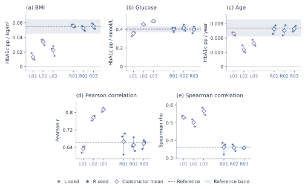

**Figure S1. Supplied summaries become jointly analyzable data.** Five panels show BMI, glucose and age regression coefficients plus glucose–HbA1c Pearson and Spearman correlations. L01–L03 use literature; R01–R03 additionally receive 30 target summaries and metadata. Points show all three final draws, diamonds constructor means and segments seed ranges. Dashed lines mark reference summaries available to R; regression bands are CHNS community-cluster CR1-t intervals, with no supplied correlation interval. All six constructors, 18 distinct delivery tables, 30 means and 90 seed statistics appear once. Initial and final deliveries were identical after retention; Table S2 gives the complete five-analysis numerical comparison.

The separate CHNS experiment gave three authors external literature (L) and three authors that literature plus 30 target summaries and their metadata (R). Each author delivered three tables and had one additional diagnostic-review opportunity. All six retained their models. There were 42 physical executions: six trials and 36 initial/final deliveries. Final bytes duplicated their matching initial outputs, leaving 24 distinct tables overall and 18 distinct delivery tables. The identical stages are displayed once.

R supported close reconstruction of all five highlighted scientific analyses (Table S2; Figure S1). These values were legitimate construction inputs; their agreement measures reconstruction rather than prediction of hidden coefficients. The L/R packet and authors differ from Q1, so those two information comparisons are kept separate.

**Table S2. Joint-statistic reconstruction with available summaries.** Ranges span three constructor means over three fixed seeds, not confidence intervals. Regression units are HbA1c percentage points per kg/m², mmol/L and year, respectively.

| Analysis | Supplied reference | External literature L | Literature + summaries R |
|---|---:|---:|---:|
| BMI coefficient, age/sex adjusted | 0.054946 | 0.013001–0.034287 | 0.052821–0.055789 |
| Glucose coefficient, age/sex adjusted | 0.402093 | 0.356064–0.487815 | 0.396941–0.413715 |
| Age coefficient, sex/BMI/glucose adjusted | 0.008107 | 0.003552–0.006910 | 0.007569–0.007947 |
| Glucose–HbA1c Pearson correlation | 0.660968 | 0.633764–0.813170 | 0.650561–0.666438 |
| Glucose–HbA1c Spearman correlation | 0.361457 | 0.501339–0.566477 | 0.357571–0.360983 |

Agreement extended beyond central values. R constructor-mean BMI SDs were 3.38965–3.40243 versus 3.40632, glucose SDs were 1.48817–1.58968 versus 1.54455, and HbA1c SDs were 0.95208–0.96554 versus 0.95357. A separate three-table statistical calibration supplement also closely reconstructed the regression summaries, with mean coefficients 0.055726, 0.412568 and 0.007679. That purpose-built family was developed with coding-agent assistance and is not an agent-removal ablation. Both approaches reconstructed the displayed joint statistics from accessible aggregate information.

### S3. Open retrieval across population requests

The unified workflow allocated two fresh scientific authors to each of the existing CHNS and ENSANUT requests. Each author received the intended analyses, population/measurement definitions, task interface and retrieval budget, but no target coefficients, desired signs, individual records or prior construction. CHNS- and ENSANUT-derived studies were excluded as generating evidence. Across 24 query credits, the authors selected sixteen paper uses representing twelve distinct originals. Independent review checked the original statistical definitions, numerical derivations, source applicability and required finite moments before execution. Sources could overlap across authors; four constructions do not imply four independent bodies of clinical evidence.

The agents chose materially different laws. C01 used an age-conditioned multivariate-lognormal mixture informed by Chinese population summaries [7,16] and contextual age/body-size findings [10,17]. C02 combined copula predictors with an affine HbA1c conditional mean using Pinggu summaries and Singapore coefficients [18,19], with other populations as applicability context [14,20]. E01 used bounded beta predictors and a conditional gamma response [10,17,21,22]. E02 combined lognormal BMI, conditional truncated-normal glucose and a positive conditional-mean lognormal response [10,21,23,24]. Their unreported dependencies, population transfers and residual choices remained declared assumptions. The shared controller did not prescribe these families or insert target coefficients.

Each author completed one 3,000-row trial, inspected generated-only diagnostics and source feedback, then selected its final model before three fixed draws. All four retained the first reviewed, frozen law. This retention decision follows the required proposal and pre-freeze reviews; it does not imply that the original unreviewed response received no correction. The sixteen physical executions comprised four trials and twelve unique final tables, or 36,000 final virtual rows. Feedback contained 29 qualified approximate comparisons and 39 unavailable checks across the four trials, not source-population replays or 29 passed constraints. After all sessions closed, the evaluator reused the fixed sample references. A separate numerical implementation reproduced all 366 final coefficient/diagnostic values; no clinical data were downloaded or refitted.

All 36 primary seed estimates had the same positive directions as their corresponding references (Figure 4). These are repeated measurements of six analysis definitions across four laws, not 36 independent confirmations. Magnitude recovery varied by analysis. CHNS C01/C02 means were 0.03992/0.05338 for BMI against 0.05495, 0.37754/0.49241 for glucose against 0.40209, and 0.00311/0.00563 for age against 0.00811. Units are respectively HbA1c percentage points per kg/m², mmol/L and year. C02 was closer for BMI and age, while C01 was closer for glucose; no construction dominated all analyses.

For ENSANUT, E01/E02 means were 0.10308/0.09772 for adjusted age against 0.07513 pp/decade, 0.09165/0.07140 for age/sex-adjusted BMI against 0.08364 pp per 5 kg/m², and 0.07509/0.04733 after additionally adjusting for glucose against 0.05664. Every draw retained the reduction of the BMI coefficient after glucose adjustment, an association pattern rather than causal mediation. Both authors built an age coefficient near 0.10 pp/decade and shared some sources; their agreement does not establish independent evidence convergence.

The complete diagnostics reveal remaining limits. CHNS C01 glucose–HbA1c Pearson correlation was approximately 0.666 versus 0.661, but Spearman correlation was 0.635 versus 0.361. ENSANUT residual HbA1c RMS was approximately 0.295/0.324 versus 0.488, and total SD was 0.362/0.406 versus 0.527. Correct directions and a close Pearson coefficient therefore coexisted with rank and dispersion mismatches. The [complete replication report](../work/core_workflow_replication_2026-11-04/RESULTS.md), every diagnostic and Supplementary Table S3 retain the full results. A scalar-type interface defect in the original evaluator was corrected additively on unchanged frozen tables, with its failed output and independent audit preserved; no scientific model was adjusted after comparison.

**Table S3. Complete Q4 open-retrieval primary summaries.** Means and ranges summarize three final seeds under each fixed construction. Units are HbA1c percentage points per stated predictor increment. No row is omitted; ranges are not confidence intervals.

| Request / analysis | Author | Increment | Reference | Generated mean | Seed min–max |
|---|---|---|---:|---:|---|
| CHNS BMI | C01 | 1 kg/m² | 0.054946 | 0.039923 | 0.034342–0.045708 |
| CHNS glucose | C01 | 1 mmol/L | 0.402093 | 0.377538 | 0.357560–0.398892 |
| CHNS adjusted age | C01 | 1 year | 0.008107 | 0.003109 | 0.002461–0.003755 |
| CHNS BMI | C02 | 1 kg/m² | 0.054946 | 0.053375 | 0.047088–0.059055 |
| CHNS glucose | C02 | 1 mmol/L | 0.402093 | 0.492412 | 0.488649–0.494875 |
| CHNS adjusted age | C02 | 1 year | 0.008107 | 0.005628 | 0.005137–0.006301 |
| ENSANUT adjusted age | E01 | 10 years | 0.075132 | 0.103084 | 0.101546–0.104315 |
| ENSANUT BMI | E01 | 5 kg/m² | 0.083643 | 0.091651 | 0.089940–0.094413 |
| ENSANUT glucose-adjusted BMI | E01 | 5 kg/m² | 0.056638 | 0.075089 | 0.072005–0.076661 |
| ENSANUT adjusted age | E02 | 10 years | 0.075132 | 0.097724 | 0.094947–0.099135 |
| ENSANUT BMI | E02 | 5 kg/m² | 0.083643 | 0.071399 | 0.071232–0.071563 |
| ENSANUT glucose-adjusted BMI | E02 | 5 kg/m² | 0.056638 | 0.047325 | 0.045022–0.048592 |

CHNS BMI/glucose analyses adjust for age and sex; CHNS age adjusts for sex, BMI and glucose. ENSANUT age adjusts for sex, BMI and glucose; its BMI analyses adjust for age/sex, with or without glucose. All Q4 diagnostic values remain in the [complete diagnostic table](../work/core_workflow_replication_2026-11-04/display/ALL_DIAGNOSTICS.md).

**Table S4. Original-source inventory for Q4 open retrieval.** Twelve unique originals supplied sixteen author-specific paper uses. Sharing a source is not independent clinical evidence; source populations are not the target populations.

| Original | Reference | Constructing authors |
|---|---|---|
| Wu et al., 2017 | [16]; PMC5591004 | C01 |
| Bao et al., 2010 | [7]; PMC2871988 | C01 |
| Pani et al., 2008 | [10]; PMC2551641 | C01, E01, E02 |
| Skogberg et al., 2019 | [17]; PMC6458679 | C01, E01 |
| Zhang et al., 2016 | [18]; PMC5078665 | C02 |
| Venkataraman et al., 2012 | [19]; PMC3504343 | C02 |
| Liu et al., 2016 | [20]; PMC5009131 | C02 |
| Wisgerhof et al., 2020 | [14]; PMC7272077 | C02 |
| Huang et al., 2021 | [21]; PMC8038122 | E01, E02 |
| Ghazanfari et al., 2010 | [22]; PMC3075530 | E01 |
| Masuch et al., 2019 | [23]; PMC6371438 | E02 |
| Marini et al., 2017 | [24]; PMC5398507 | E02 |

The reviewed evidence/specification files distinguish reported statistics, algebraic derivations and assumed relations. The public experiment record includes per-source eligibility, measurement, adjustment, overlap and reporting-quality notes; full third-party originals and participant-like rows remain local.

### S4. Longitudinal reconstruction from published artifacts

The HRS recipient-stage example [1] tested a different data product. A fresh agent received published model exports, a variable specification and the intended mixed-model analysis. It authored the recursive conditional generating family with parameter provenance. A separate implementation reconstructed the published law. Each generated 11,509 subjects at 0, 2, 4 and 6 years, producing 46,036 rows per table. No HRS individual records were used, and the source analysis coefficients were construction inputs.

All three agent and three corrected-law tables supported the native R/lme4 model with 16 fixed effects, individual intercepts/slopes and piecewise HbA1c terms around 6.5%, with age centered at 60 and scaled per decade. The below-threshold HbA1c-by-age interaction averaged −0.044635 in agent data, with range −0.051059 to −0.038247, against the supplied −0.046837. The reconstructed law averaged −0.040500. Both preserved its negative direction in all three draws (Figure S5).

Figure S5 shows the estimates and their per-table Wald intervals. The [longitudinal analysis record](../work/hrs_public_example_2026-11-03/RESULTS.md) gives all 16 fixed effects and the comparator correction.

The weaker above-threshold interaction was less stable: agent estimates averaged 0.026485 against 0.012867, while corrected-law estimates averaged −0.011691. Overall agent HbA1c mean/SD was 5.8725/0.9676 versus the original published 5.9/1.0. The high-HbA1c subgroup had mean/SD 7.1515/0.5630, compared with original 7.7/1.4 and published synthetic 7.2/0.6. Thus useful source-model behavior coexisted with inadequate upper-group spread.

A CRLF-sensitive parser initially overwrote seven coefficient/SE pairs in our comparator preparation. A separately reviewed source-bound repair produced the three corrected comparator tables without changing the frozen agent outputs. The full record contains nine physical generations, six valid comparison tables and three invalid initial comparator attempts. This was our implementation defect, not a failure of the published method. The [incident record](../work/hrs_public_example_2026-11-03/recovery_v1/INCIDENT_AND_CORRECTION.md) and complete effects retain the correction and all outcomes.

### S5. Cross-task construction, dispersion and source uses

A [post hoc biological consistency check](Q5_LIPID_ORDER_POST_HOC_v19.md) reports the HDL and total cholesterol ordering counts by frozen law and seed. The comparison uses generated pairs in their original common units.

The next study applied the common workflow to HbA1c analyses in the ENSANUT2018 analytical design and BMI-related TC/HDL analyses in the Turkana study context. Three fresh agent contexts constructed a law for each request, using reviewed external articles, population/measurement metadata and optional literature tools. No participant inputs, target coefficients, target means or prior generators were supplied. The six contexts used the same model service and shared some source evidence. This study therefore tests repeated construction across two requests, with the law chosen by each author, rather than independent clinical replication or a controlled comparison of workflow components.

The HbA1c analyses retained the existing age and BMI estimands and equal allocation to eight sex-by-age cells. The lipid analyses used unweighted age/sex-adjusted BMI coefficients for TC and HDL, plus the Pearson correlation of their residuals after age, sex and BMI adjustment. Lipid eligibility required adults with recognized recorded sex and finite, positive BMI and lipid values. Generated lipid concentrations were converted from mmol/L to mg/dL using the frozen factor 38.67. The reference represents a selected Turkana/Laikipia study sample; fasting, assay transfer and population composition remained qualified in the evidence record. No new participant records were read, downloaded or refitted for this study.

The agents made different scientific choices within the common interface. H01 combined bounded predictors, conditionally truncated glucose and a shifted gamma HbA1c innovation; H02 used bounded beta conditional laws. H03 solved cross-source moment equations under declared dependence and dispersion assumptions, then used conditional beta laws. Their source records included overlapping age, body-size and glycemia evidence [10,17,21,22], with additional check-only/contextual evidence for H01 [14]. The lipid authors combined Gaussian copulas and lognormal margins using geometric summaries from Greiner et al. [25], rural Ashanti rank correlations [26] and arithmetic moments from Agongo et al. [27,28]. Choices about arithmetic versus geometric location, transfer of coefficients of variation, sex strata and age dependence differed among L01–L03. These are applications of established probability families whose numerical use was selected and explained by the agent.

Independent source and implementation reviews checked the statistical meanings, specification/code consistency and finite moments before isolated execution. Each constructor completed one scheduled trial, inspected generated diagnostics and source feedback, and could revise once. All six retained their initial laws. Three fixed final seeds, 9101–9103, produced 18 distinct 3,000-row tables: 54,000 fictional rows from 24 successful physical attempts, including the six trials. No final execution failed and no seed was replaced. Reference comparison began after all six author sessions closed and reused previously exposed aggregate results.

All 54 primary point estimates had the same direction as their corresponding sample estimates, with quantitative agreement varying by analysis (Figure 9; Table S5). HbA1c age effects averaged 0.09954–0.10091 percentage points per decade versus 0.07513 in the reference; age/sex-adjusted BMI effects averaged 0.04892–0.06030 versus 0.08364 per 5 kg/m². With glucose additionally adjusted, H03 averaged 0.05098 versus 0.05664, whereas H01 and H02 averaged 0.03047 and 0.01936. Thus the shared age direction and attenuation after glucose adjustment did not imply recovery of each effect magnitude.

For lipids, mean HDL BMI coefficients ranged from −2.1865 to −1.9868 mg/dL per 5 kg/m² versus −4.6230 in the reference, while TC coefficients ranged from 10.0151 to 11.2609 versus 5.6831. The TC reference sensitivity interval was −3.7535 to 15.1197, so matching its positive point estimate does not establish replication of a definite positive population effect. Residual TC–HDL correlations averaged 0.10828–0.14134 versus 0.51207. The generators preserved the directions of these focal point estimates while substantially underrepresenting the lipid dependence remaining after the specified adjustment.

Dispersion changes the assessment of usefulness (Figure S2). H03's closer glucose-adjusted BMI coefficient accompanied lower HbA1c marginal SD and full-model residual RMS, 0.3523 and 0.3006 percentage points versus 0.5274 and 0.4885. H02 retained more variation, with corresponding values 0.4825 and 0.4036, but smaller BMI coefficients. L02's TC SD was close to the reference, 43.6778 versus 42.8466 mg/dL, although its residual TC–HDL correlation remained weak. All three lipid laws had HDL SDs below the reference. No construction uniformly dominated across focal effects, dependence and dispersion.

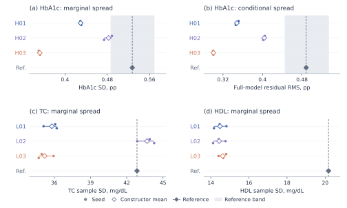

**Figure S2. Dispersion across all cross-task constructions.** Panels show marginal HbA1c SD, HbA1c full-model residual RMS, and marginal TC and HDL SDs for each construction and its three final draws, retaining all 36 diagnostic values from the same 18 tables. HbA1c uses the population-SD diagnostic; lipids use sample SD. These quantities measure individual or residual spread, not uncertainty in a regression coefficient. H03's relatively close adjusted BMI effect in Figure 9 coexists with reduced HbA1c spread, and L02's close TC SD coexists with weak adjusted lipid dependence. Seed ranges reflect Monte Carlo variation conditional on the selected law. Gray HbA1c bands are empirical cluster-resampling stability bands; no reference interval is supplied for lipid SDs.

The evaluation retained all 513 prespecified estimates and diagnostics, including the 54 primary outputs. Independent recomputation verified every value and all 324 matched reference comparisons; the maximum numerical difference was 5.33 × 10⁻¹⁴. The remaining 189 diagnostics lacked matching cached reference estimators and remained generated-only results. Across authors, eight original studies supplied 22 author–paper uses, including context/check-only uses; optional retrieval consumed seven query credits and one original download. All 132 declared source-check entries were unavailable under the implemented semantic rules because weighting or essential operator definitions were unresolved or unsupported (Table S6). Numerical source values still informed reviewed parameter derivations, but this batch provides neither measured numerical source-fit feedback nor a before/after revision benefit. The [complete results and reviews](../work/evidence_use_cross_task_2026-11-05/RESULTS.md) retain every endpoint, unavailable comparison and implementation incident, including correction of the independent auditor's identifier parser without changing any generated table.

**Table S5. Complete Q5 cross-task primary summaries.** Each row summarizes three fixed final draws from one law. All 18 author–analysis combinations are retained. HbA1c entries are percentage points (pp); lipid slopes are mg/dL per 5 kg/m². Ranges are seed minima and maxima, not confidence intervals or evidence/model uncertainty.

| Request / analysis | Author | Units / increment | Reference | Generated mean | Seed min–max |
|---|---|---|---:|---:|---|
| HbA1c adjusted age | H01 | pp / 10 years | 0.075132 | 0.099545 | 0.094075–0.103606 |
| HbA1c BMI | H01 | pp / 5 kg/m² | 0.083643 | 0.060295 | 0.055769–0.063938 |
| HbA1c glucose-adjusted BMI | H01 | pp / 5 kg/m² | 0.056638 | 0.030469 | 0.027956–0.034291 |
| HbA1c adjusted age | H02 | pp / 10 years | 0.075132 | 0.099539 | 0.098162–0.100396 |
| HbA1c BMI | H02 | pp / 5 kg/m² | 0.083643 | 0.048923 | 0.029090–0.065499 |
| HbA1c glucose-adjusted BMI | H02 | pp / 5 kg/m² | 0.056638 | 0.019363 | 0.002308–0.030777 |
| HbA1c adjusted age | H03 | pp / 10 years | 0.075132 | 0.100912 | 0.096356–0.105015 |
| HbA1c BMI | H03 | pp / 5 kg/m² | 0.083643 | 0.056649 | 0.048449–0.063758 |
| HbA1c glucose-adjusted BMI | H03 | pp / 5 kg/m² | 0.056638 | 0.050978 | 0.044994–0.056901 |
| HDL BMI | L01 | mg/dL / 5 kg/m² | −4.623004 | −2.186526 | −2.286805–−2.118624 |
| TC BMI | L01 | mg/dL / 5 kg/m² | 5.683108 | 10.393977 | 9.992186–10.676486 |
| TC–HDL residual correlation | L01 | dimensionless | 0.512070 | 0.111234 | 0.108517–0.113140 |
| HDL BMI | L02 | mg/dL / 5 kg/m² | −4.623004 | −2.100390 | −2.194806–−2.035712 |
| TC BMI | L02 | mg/dL / 5 kg/m² | 5.683108 | 11.260864 | 10.811415–11.565687 |
| TC–HDL residual correlation | L02 | dimensionless | 0.512070 | 0.108283 | 0.105395–0.110194 |
| HDL BMI | L03 | mg/dL / 5 kg/m² | −4.623004 | −1.986781 | −2.122835–−1.913541 |
| TC BMI | L03 | mg/dL / 5 kg/m² | 5.683108 | 10.015112 | 8.617345–11.698752 |
| TC–HDL residual correlation | L03 | dimensionless | 0.512070 | 0.141343 | 0.121087–0.155368 |

HbA1c age adjusts for sex, BMI and glucose. HbA1c BMI adjusts for age/sex, with glucose added in the third analysis. Lipid BMI slopes adjust for age/sex; the residual correlation removes age/sex/BMI projections from both lipids on the same rows. H01–H03 belong only to this Q5 HbA1c request, and L01–L03 only to this Q5 lipid request; the L labels do not refer to the earlier Q2 literature arm. All 54 individual primary outputs and all 513 prespecified estimates/diagnostics remain in the [complete endpoint table](../work/evidence_use_cross_task_2026-11-05/evaluation/ALL_ENDPOINTS.csv). The 324 matched reference comparisons and 189 generated-only diagnostics retain their original availability labels.

**Table S6. Q5 original-source uses and unavailable feedback.** Eight distinct originals supplied 22 author–paper uses, including context/check-only evidence. All six authors retained their initial laws. The 132 source-check entries were unavailable, not successful numerical comparisons or failed generators. The inventory counts the three lipid originals, with the Agongo correction [28] attached to its source rather than counted as a separate original study.

| Author | Original-source references | Paper uses | Unavailable source checks |
|---|---|---:|---:|
| H01 | Pani [10]; Wisgerhof [14]; Skogberg [17]; Huang [21]; Ghazanfari [22] | 5 | 13 |
| H02 | Pani [10]; Skogberg [17]; Huang [21]; Ghazanfari [22] | 4 | 18 |
| H03 | Pani [10]; Skogberg [17]; Huang [21]; Ghazanfari [22] | 4 | 32 |
| L01 | Greiner [25]; Obirikorang [26]; Agongo [27,28] | 3 | 29 |
| L02 | Greiner [25]; Obirikorang [26]; Agongo [27,28] | 3 | 19 |
| L03 | Greiner [25]; Obirikorang [26]; Agongo [27,28] | 3 | 21 |
| Total | 8 distinct original studies | 22 | 132 |

The [evidence-use inventory](../work/evidence_use_cross_task_2026-11-05/evaluation/EVIDENCE_USAGE_SUMMARY.json) and [source/code review](../work/evidence_use_cross_task_2026-11-05/review/SOURCE_AND_CODE_REVIEW.md) retain the source IDs, numerical roles, unresolved definitions and actual retrieval activity. Unresolved weighting and unsupported or incompletely specified operators were not replaced with different statistics. Parameter derivations can therefore use reviewed source information while the corresponding runtime source comparison remains unavailable.

### S6. Dependence sensitivity and the supporting construction

The preceding open-search example acquired five seriously reviewed studies [9,10,12,13,14] without bibliographic seeds or desired signs. A fresh constructor selected a sex-stratified Gaussian copula with positive biomarker margins and generated one trial plus three complete 3,000-person tables. It retained the model after eleven approximate and 23 unavailable source comparisons per execution. Secondary BMI coefficients were 0.04217–0.05176 versus 0.05495 in the reused CHNS reference, secondary age was 0.01613–0.01771 versus 0.01530, and primary age was 0.00842–0.01084 versus 0.00811. Primary BMI/glucose were attenuated, and the female point direction and distributional tails remained imperfect. Supplementary Figure S3 retains all seven nonintercept effects and their uncertainty labels.

Before generating data or comparing targets, the source review identified an unreported BMI–glucose dependence. Two valid latent correlations, 0.10 and 0.40, implied conditional BMI coefficients of +0.03422 and −0.01095 while retaining the same margins, other bivariate laws and secondary projection. The delivered model used the declared assumption 0.25. This is an analytical sensitivity, not additional generated cohorts or a causal intervention. It demonstrates why an explicit data-generating law can identify which missing relationship matters to an intended use.

A separate analysis contextualized the same three tables with 100 community-disjoint resplits of the existing CHNS sample, drawing 3,000 people per side and retaining all 36 metrics. Secondary BMI and age discrepancies were on scales comparable with within-sample variation, while primary glucose/female and several joint/tail discrepancies were larger. The [complete table](../work/real_real_calibration_2026-11-04/COMPLETE_METRIC_TABLE.md) preserves the nonexchangeable real-real and generated comparisons. These are descriptive interpretation aids, not a new population or retrospectively selected equivalence cutoff.

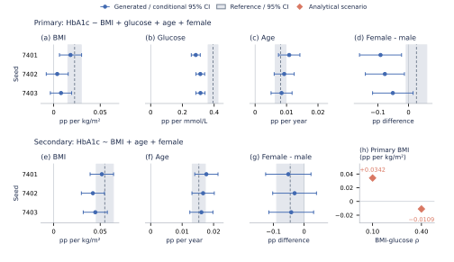

**Figure S3. Analysis-specific usefulness and an unresolved joint dependence.** Panels (a–d) show all primary-model nonintercept effects and (e–g) all secondary-model effects. Blue points are three fixed 3,000-person draws with conditional 95% HC3-t intervals. Gray dashed lines and bands are exposed CHNS reference estimates and 95% community-cluster CR1-t intervals; solid lines mark zero. All effects retain native units (pp: HbA1c percentage points), with shared limits for matching predictors. Generated intervals omit source, structural and transport uncertainty; overlap is not equivalence. Panel (h) displays two pre-generation analytical scenarios: latent BMI–glucose correlations 0.10 and 0.40 imply conditional BMI coefficients +0.03422 and −0.01095 while leaving marginal laws, other bivariate laws and the secondary projection unchanged. The delivered model used 0.25. These are not new draws, a fitted curve or a causal intervention. Retained initial/final stages alias the same three tables.

The [real-real context analysis](../work/real_real_calibration_2026-11-04/RESULTS.md) reuses this evidence-to-generation law (`evcBuild01`, seeds 7401–7403). It does not evaluate the four Q4 authors. One hundred fixed community-disjoint partitions of the selected CHNS sample each provided two 3,000-person subsamples. Across the nine coefficients, 21 marginal summaries and six correlations, all 36 metrics were retained. Reduced-model BMI had median real-real difference 0.007239 versus generated-real symmetric discrepancy medians 0.004383–0.012727; reduced-model age had 0.001705 versus 0.001055–0.002387. Full-model glucose was 0.023839 versus 0.079642–0.109154. These selected examples illustrate agreement and disagreement relative to ordinary resampling variation; the complete report contains every metric. The resplits do not define population truth, independent cohorts or prespecified acceptable margins. The distances also have different geometry: real–real compares two complementary estimates, whereas the symmetric generated discrepancy averages distances from a fixed generated estimate to each. For illustrative estimates m+d and m−d and a generated estimate m, those distances are 2|d| and |d|. This identity is not an equality asserted for the fitted regressions; it explains why the comparison cannot itself supply an equivalence threshold.

### S7. Prospective evaluation under the earlier method

In HAALSI, eligible ages started at 40 years and the analysis used the released capillary point-of-care glucose measurement. Fasting was not an eligibility requirement. The fixed BMI and age contrasts were taken from the same additive glucose model with recorded sex. A second model estimated the difference in the BMI slope between women and men, adjusting for age. In Turkana, the two BMI slopes were adjusted for age and recorded sex. The correlation uses the residuals after adjusting both lipid measurements for age, sex and BMI.

Each case had five separately authored agent laws and one prespecified statistical generator (S01). The experiment produced 48 source-context and 36 target-context tables of 5,000 rows each. All authors retained their initial laws after source-only feedback. Initial and final labels therefore refer to the same 36 target tables. The [public checkpoint preceding disclosure](../work/scaleup_2026-11-01/production_release/PRE_REVEAL_CHECKPOINT.json) records work in progress. The [final evaluation record](../work/scaleup_2026-11-01/production_release/RESULTS.md) documents the complete inventory, one reveal and independent recomputation of 6,704 checks. HAALSI had a prospectively withheld target. Turkana's exact estimates were withheld, with prior investigator exposure to adjacent findings. Later Q5 reused the same 397-person Turkana reference.

**Table S7. Six prespecified analyses under the earlier workflow.** The columns report the measured-sample estimate, the minimum and maximum across 15 agent draws, the number agreeing in point sign, and the range of the three draws of the prescribed statistical law. The ranges describe draws under the candidate models. HAALSI glucose contrasts are in mmol/L, lipid slopes in mg/dL and the adjusted correlation is unitless.

| Analysis | Measured | Agent range | Same sign | S01 range |
|---|---:|---|---:|---|
| HAALSI glucose, BMI per 5 kg/m² | 0.3138 | 0.3285 to 0.5698 | 15/15 | −0.0174 to 0.0180 |
| HAALSI glucose, age per 10 years | 0.2322 | 0.1136 to 0.3005 | 15/15 | −0.0170 to 0.0077 |
| HAALSI female-minus-male BMI slope per 5 kg/m² | −0.2440 | −0.2487 to 0.1903 | 8/15 | −0.0524 to 0.0046 |
| Turkana HDL, BMI per 5 kg/m² | −4.6230 | −3.5509 to −1.8173 | 15/15 | −0.1120 to 0.0710 |
| Turkana TC, BMI per 5 kg/m² | 5.6831 | 10.2822 to 15.0413 | 15/15 | −0.4657 to 0.0334 |
| Turkana residual TC–HDL correlation | 0.5121 | 0.1162 to 0.5361 | 15/15 | 0.3625 to 0.3840 |

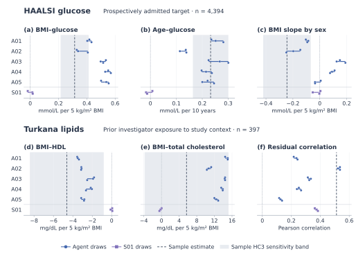

**Figure S4. Earlier prospective evaluation of whole-cohort generation.** Blue circles show the three draws of each agent law and purple squares the three draws of the prescribed statistical law (S01). Short segments span draws. Dashed lines mark measured-sample estimates, and shaded bands give approximate 95% HC3 sensitivity intervals for the five slopes. The residual correlation has no reference interval. HAALSI glucose main effects were directionally stable across agent draws. The sex difference in the BMI slope varied by construction. Turkana's total cholesterol point estimate had a reference interval that included zero. Its quantitative estimates were withheld before generation despite prior exposure to related published findings.

The primary rule divided the absolute difference in each slope by the measured outcome's sample SD and used the absolute correlation difference directly. A construction passed when all nine comparisons (three analyses by three seeds) were at most 0.10. The agent counts at thresholds 0.05, 0.10, 0.20 and 0.30 were 1, 3, 5 and 5 of five for HAALSI and 0, 0, 1 and 4 for Turkana. Both S01 laws missed the primary criterion. For HAALSI, the discrepancies for three zero-valued effects were 0.0990, 0.0733 and 0.0770. The [frozen decision](../work/scaleup_2026-11-01/production_release/CLAIM_LOCK.md) closed the expansion. The prospective study predates the later interface for documenting numerical evidence use and supplies a separate evaluation of the underlying construction approach.

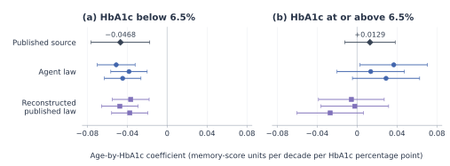

**Figure S5. Two prespecified age–HbA1c interactions in a longitudinal memory model.** Diamonds show the supplied coefficients; circles and squares show estimates from three draws per law (seeds 6101–6103, top to bottom). Bars show approximate 95% Wald intervals calculated from the exported source standard errors or from the generated-table fits. Units are standardized memory-score change per decade per percentage point of HbA1c within the indicated branch. Each table contains 11,509 synthetic subjects and four visits per subject. The upper-branch signs differed between constructions. The six tables describe sampling under two frozen generating laws.

### S8. Full records and retained implementation incidents

The [public repository](https://github.com/ziwang11112/evidence-guided-virtual-cohorts-2026) provides original code, protocols, aggregate results and independent checks. The [complete v0.9 extended record](DRAFT_v0_9.md) preserves all six original numerical tables and full methods/results. Its Table 2 supplies every main endpoint's adjustment set, units and reference interval; Tables 3–4 retain the main and summary-assisted values; Table 5 retains all latest seven effects; Table 6 retains the real-real comparison values. These archived tables preserve the earlier analyses alongside the separately sealed iron study.

The [main study](../work/main_study_freeze_2026-11-03/RESULTS.md), [summary-assisted study](../work/information_revision_ablation_2026-11-03/RESULTS.md), [statistical supplement](../work/summary_comparator_2026-11-03/RESULTS.md), [HRS example](../work/hrs_public_example_2026-11-03/RESULTS.md), [preceding open-search construction](../work/evidence_to_generation_2026-11-04/RESULTS.md), [unified workflow replication](../work/core_workflow_replication_2026-11-04/RESULTS.md) and [cross-task evidence-use study](../work/evidence_use_cross_task_2026-11-05/RESULTS.md) preserve separate frozen identities and complete endpoint outputs. The cross-task [protocol](../work/evidence_use_cross_task_2026-11-05/PROTOCOL.json), [complete endpoint table](../work/evidence_use_cross_task_2026-11-05/evaluation/ALL_ENDPOINTS.csv), [independent numerical review](../work/evidence_use_cross_task_2026-11-05/review/INDEPENDENT_NUMERICAL_REVIEW.md) and [scientific interpretation](../work/evidence_use_cross_task_2026-11-05/review/SCIENTIFIC_RESULT_INTERPRETATION.md) document the new unit. Earlier live A/B results, including the conditioned BMI mismatch and source-replay unavailability, remain in the extended record. Figure updates and added tables consume reviewed aggregates only; manuscript integration creates no cohorts or clinical fits. In the main study, seven authors inspected exploratory outputs and kept their laws, and thirteen finalized without exploration. The two earlier live authors both kept their models after the available review.

Individual real/generated tables, third-party originals and credentials remain local; clinical reruns require lawful access and the appropriate environment. Historical model identifiers and token costs are incompletely metered. Author/affiliation/funding/conflict/ethics/access/AI declarations and final submission formatting remain to be completed. No manuscript has been submitted.

The [historical supplement](SUPPLEMENT_HISTORICAL_RESULTS_v05.md) retains earlier enrichment and direct-row construction, the divergent-moment repair, failed transport criteria, tail defects and revision trade-offs. The [v0.16 reading draft](DRAFT_v0_16.md) preserves the earlier layout.

### S9. Iron-status analysis and independent verification

All six deliveries used two continuous columns, with three target analyses per delivery. The target survey comparison used the phlebotomy weight and 15 design degrees of freedom. Among 1,065 eligible positive-weight women, 979 had both measurements, 26 had hemoglobin only, 3 had ferritin only and 57 had neither. Thus 86 women were excluded from the paired analysis: 8.08% of eligible records and 2.47% of eligible phlebotomy-weight mass. Complete records represented 97.53% of that weight mass. These percentages describe different denominators; the weighted percentage does not remove the need for a missingness assumption. The complete-case estimates characterize the observed-pair reference under the specified weights and design. Generalizing to all eligible women requires the unavailable pairs to be represented adequately by that analysis or another justified missing-data model; the existing phlebotomy weights alone do not establish this. No additional weighting adjustment or imputation for missing biomarker pairs was performed. A separate implementation reproduced all 21 point estimates (three reference, eighteen generated), the six target interval endpoints and the four unweighted cell counts. The [study report](../work/iron_breadth_2026-11-05/RESULTS.md) gives all seed values and the [evaluation protocol](../work/iron_breadth_2026-11-05/PROTOCOL.md) specifies the source replay, primary log-odds-ratio comparison and secondary analyses.

### S10. Reproducing a program and tracing an agent decision

In the iron task each fresh author received the same target description, source packet and clarification about a source summary. Only external source materials were allowed. The protocol specified numpy and pandas, a supplied random generator, the separate source and target contexts, and one source-only retain-or-revise opportunity. The [task](../work/iron_breadth_2026-11-05/admission/TASK.md), [evidence packet](../work/iron_breadth_2026-11-05/admission/SOURCE_PACKET.md), [A's final program](../work/iron_breadth_2026-11-05/candidates/A/final/generator.py) and [B's final program](../work/iron_breadth_2026-11-05/candidates/B/final/generator.py) document the handoff. Run the programs with the [recorded seeds and worker](../work/iron_breadth_2026-11-05/EXECUTION.md). The published code and aggregates support computational verification. Historical author-model snapshots and per-construction token counts are incompletely recorded, which limits reproduction of the original model-authoring sessions.

For the analytic part of Figure 8, let the four source counts be 173 (both low), 85 (low hemoglobin only), 331 (low ferritin only) and 1,082 (neither). Weight the first and third cells by two thirds and renormalize. Under A the final joint-low probability equals 0.8 times the reweighted joint-low probability plus 0.2 times the product of the two reweighted marginal probabilities. B keeps the original probabilities. This calculation describes the selected models and can be reproduced from published counts without sampling. The figure retains the original sealed deliveries and reference analysis alongside these model implications.

### S11. A regression calculation used by one glycemia constructor

This derivation belongs to CHNS Q1, arm E1, constructor A01, selected by ordinal identifier. Jansen et al. reported two age- and sex-adjusted regressions of HbA1c [9]. One used BMI as its predictor and the other used fasting glucose. The curated packet explicitly identified them as separate regressions. The constructor wanted to draw all three variables together. A slope from a regression on BMI alone can include part of the glucose association when BMI and glucose vary together, even after their age and sex terms are removed.

Let $c_B$ and $c_G$ be the two reported slopes. Let $s_B$ and $s_G$ be the residual standard deviations of BMI and glucose after accounting for age and sex, and let $r$ be their residual correlation. The constructor assumed a linear HbA1c response to both residual predictors, with joint slopes $\theta_B$ and $\theta_G$ and an independent error. Projecting this response onto each predictor separately gives

$$
c_B = \theta_B + \theta_G r\,s_G/s_B
$$

$$
c_G = \theta_G + \theta_B r\,s_B/s_G
$$

The reported slopes were 0.13 mmol/mol per kg/m² of BMI and 2.29 mmol/mol per mmol/L of fasting glucose. A01 used residual standard deviations of 4.07611 kg/m² and 0.49694 mmol/L and assumed a residual correlation of 0.25. Solving for the joint slopes gave 0.0642173 and 2.1583154 in the respective IFCC response units. Multiplication by 0.09148 converted these slopes to 0.00587460 and 0.19744269 in HbA1c percentage-point units [11]. This construction recovers the two source projections under its own assumptions. The target model adds a separate glucose heterogeneity component. The [source-to-model trace](SUPPLEMENT_SOURCE_AND_ASSUMPTIONS_v05.md) provides the response law, the source check and the ensuing target BMI discrepancy.

### S12. Implementation of the system overview

The current Figure 1 is implemented by the captured [request-only API loop](../work/request_only_agent_capacity_2026-11-10/api_loop.py), [shared tools](../work/request_only_agent_capacity_2026-11-10/tools_runtime.py) and [postclosure evaluator](../work/request_only_agent_capacity_2026-11-10/evaluate_pilot.py). These handle API invocation, bounded Agent-selected actions, immutable submissions, isolated trials and final selection. Source/code audits occur separately after closure; they do not silently correct the selected law. The following paths describe historical implementations of the shared scientific procedure, not identical versions of this API controller.

Each study uses a host coordinator to dispatch agent sessions and bind the research request to a dedicated execution path. Q4 describes the [bounded open-retrieval workflow](../work/core_workflow_replication_2026-11-04/RESULTS.md). Q5 provides a [controller that binds the candidate files](../work/evidence_use_cross_task_2026-11-05/controller_evidence_use.py) and a [session runner](../work/evidence_use_cross_task_2026-11-05/runner.py) that records trial feedback, decisions and closure. Its [evaluator](../work/evidence_use_cross_task_2026-11-05/evaluator.py) checks the closed state before reading pinned reference estimates.

In the iron study a [case-specific adapter](../work/iron_breadth_2026-11-05/iron_runner.py) runs the agent's program with a source or target context using the [isolated execution worker](../cohort_harness/execution.py). The [seal](../work/iron_breadth_2026-11-05/seal.py) verifies the model and delivery hashes. The [target analysis](../work/iron_breadth_2026-11-05/reveal.py) checks the sealed record before accessing the survey measurements. The [execution notes](../work/iron_breadth_2026-11-05/EXECUTION.md) document which checks were implemented in this adapter. The two studies share the separation of scientific authorship, numerical execution and evaluation, with different retrieval and feedback interfaces.

### S13. Controlled check of joint-evidence construction

We examined whether explicitly requesting joint consistency added value when the necessary evidence was already available. In one artificial four-variable population, both arms received the same 15 exact summaries: marginal means and SDs, the three predictor correlations, and four coefficients from two separately adjusted regressions. These summaries determine the requested joint linear projection and residual variance, but not the full probability distribution. Two fresh constructors per arm wrote their own programs without target coefficients, a supplied solver or earlier results. The additional-instruction arm was asked to reconcile all constraints jointly and separate explained from residual variation; the ordinary arm received the same scientific task and evidence. The protocol, evaluation rules and all four programs were frozen before sampling. Each program generated three 10,000-row tables using the fixed seeds 8101–8103; no trial or feedback revision was allowed.

All four authors selected the same Gaussian law and recovered the implied joint coefficients 0.25, 0.65 and −0.40 and residual variance 0.6775. All twelve attempts succeeded. O1/C2 and O2/C1 used matching RNG layouts, so corresponding same-seed outputs were identical: twelve deliveries represented six distinct tables and one law. The three seeds within each layout gave distinct tables. In both arms, mean absolute standardized joint-coefficient errors were 0.01244, 0.01024 and 0.01337; mean absolute log residual-SD error was 0.00613. Metrics were averaged over seeds within constructors and then equally across the two constructors, without pooled-row inference.

The ordinary construction already performed the required statistical reconciliation. This bounded diagnostic therefore supplied no evidence for adding the extra instruction. It is not biomedical validation or a test of uncertain extraction, heterogeneous populations, tail behavior or feedback. The target coefficients were withheld from authors but algebraically implied by the supplied summaries; their recovery does not demonstrate learning an unconstrained relationship. The [complete report](../work/review_revision_2026-11-08/controlled_joint_moments/RESULTS.md) retains all runs, failure checks, duplicate-output accounting and separate implementation/results audits. No additional cases or constructions were added after these results.

### S14. Historical synthetic training on a later real sample

The [October 25 temporal pilot](../../obesity_temporal_prediction_2026-10-25/RESULTS.md) tested a different input setting and direct-row output route. Two fresh authors literally supplied 128-row cohorts from rich outcome-by-sex-conditioned summaries of 128 real NHANES2015–16 training participants. Inputs included counts, means, SDs, quantiles and regularized Gaussian-rank correlations. An ordinary Gaussian-copula generator supplied 100 comparison cohorts. The predictor set was age, sex, BMI, waist and systolic blood pressure; HbA1c and design variables were not predictors. The outcome was current HbA1c at least 5.7% among adults with BMI at least 30, not future diabetes or obesity classification.

All preprocessing and classifier artifacts were locked before the NHANES2017–18 test download. Evaluation used 1,811 eligible test participants. Table S8 retains the primary logistic and secondary histogram-gradient-boosting results. A prevalence-only predictor using the training prevalence 68/128 had AUC 0.5 and Brier score 0.248578. Both Agent cohorts carried predictive information, but neither exceeded the real-training AUC. One was below and one above the ordinary-generation median in each classifier, both within the ordinary draw distributions. The ordinary median summarizes 100 draws, not 100 independent studies. Neither a confidence interval nor a noninferiority test was calculated for the AUC differences. The complete report also retains log loss, balanced accuracy and weighted sensitivity analyses. This is evidence of historical downstream utility under rich real-training summaries, not a literature-only or current-controller confirmation.

**Table S8. Historical synthetic-training utility on later real participants.** Higher AUC and lower Brier score indicate better performance on this selected sample. Agent rows come from two literal 128-row datasets. The ordinary entry is the median across 100 generated training cohorts. Both classifiers used the same 1,811-person test; no rows were regenerated after test disclosure.

| Classifier | Training cohort | AUC | Brier score |
|---|---|---:|---:|
| Logistic (primary) | Real 128 | 0.734936 | 0.210303 |
| Logistic (primary) | Agent A1 | 0.712130 | 0.216229 |
| Logistic (primary) | Agent A2 | 0.726871 | 0.213445 |
| Logistic (primary) | Ordinary, median | 0.717394 | 0.215560 |
| Histogram boosting (secondary) | Real 128 | 0.660930 | 0.240598 |
| Histogram boosting (secondary) | Agent A1 | 0.634484 | 0.247879 |
| Histogram boosting (secondary) | Agent A2 | 0.646883 | 0.242525 |
| Histogram boosting (secondary) | Ordinary, median | 0.638858 | 0.261487 |

### S15. Later adaptive and source-context implementation

The [bounded adaptive case](../work/adaptive_case_loop_2026-11-09/RESULTS.md) executed 28 dispatched actions, including retrieval, construction, inspection and a final choice. The author produced two scientific models and six tables, then retained the initial model. Its sensitivity altered two analyses in different directions of reference agreement. This is executed scientific decision-making, with zero initial-to-selected-final improvement. It is not a new clinical population or a controlled estimate of a feedback benefit.

The [source-conditioned replay](../work/source_conditioned_replay_2026-11-09/RESULTS.md) next linked one Agent-authored shared source/target law to eight sex/site-stratified BMI–lipid coefficients from the [admitted source study](https://doi.org/10.1136/bmjgh-2019-001542). Four source contexts and three seeds yielded twelve 8,000-row source tables and 24 numerical projections. All reported directions were retained, with independent QR/FWL arithmetic agreement within 5.9e-15. The source weighting and BMI-standardization convention remained unresolved: every strict semantic check stayed unavailable, and the numerical projections were explicitly assumption-dependent. The Agent retained the initial law. Three subsequent 3,000-row target-scenario tables supported nine requested estimates and 69 descriptive calculations without a new clinical-reference comparison. Residual component coupling could change substantially while the mean slopes remained fixed. These results demonstrate source-conditioned execution and attributable assumptions, not independently established target accuracy.

The [method-coverage audit](../work/manuscript_focus_v26_2026-11-09/METHOD_COVERAGE.md) separates these implementations from the curated Q1 comparison, open-retrieval Q4 workflow, Q5 evidence-use interface, iron source pilot, HRS reconstruction and earlier prospective controller. They share the scientific procedure described in Sections 2–3. Optional later components were not exercised in every historical case and are not credited retroactively. No participant or generated row table was opened for this manuscript integration.

### S16. Reference populations and estimands

**Table S9. Reference definitions, analytical populations and uncertainty.** Sample sizes are measured-reference counts except in HRS, where the comparison uses supplied model exports and the stated count describes each generated table. HbA1c effects are in percentage points (pp). Reference intervals and stability bands describe different sources of uncertainty; none is an equivalence margin or an interval for source-to-target transfer error.

| Reference and study use | Eligibility and size | Weighting and scientific estimand | Uncertainty and reference status |
|---|---|---|---|
| CHNS 2009: Q1, Q2, Q4 and preceding CHNS analyses | 6,631 linked adults aged 35–74 in 218 communities, complete for recorded age, sex, BMI, central glucose and HbA1c. BMI uses finite positive height and weight; a height/weight cleaning flag of 9 makes that measurement unavailable. No diabetes, treatment or pregnancy exclusion; individual fasting adherence was not verified. | Unweighted selected-sample regressions. The Q1/Q4 focal coefficients are BMI adjusted for age/sex, glucose adjusted for age/sex, and age adjusted for sex/BMI/glucose; units are HbA1c pp per kg/m², mmol/L and year, respectively. Q2 additionally evaluates supplied correlations. | Regression reference intervals use the community-cluster CR1 sandwich and a t cutoff with 217 degrees of freedom. These are not national survey estimates. The project references had been exposed before Q1/Q2/Q4; Q2 deliberately supplied target summaries. |
| ENSANUT 2018: Q1, Q4 and Q5 glycemia | 6,931 adults aged 25–79 with concordant laboratory/anthropometry age and sex; no reported prior doctor diagnosis of diabetes/high blood sugar; recorded 8–12-hour fast; finite positive serum glucose below 126 mg/dL and positive HbA1c; eligible standing anthropometry and questionnaire-routed pregnancy/lactation status, detailed below. No verified medication or anemia exclusion. | Each sex-by-age cell has mass 1/8: recorded male/female crossed with 25–39, 40–54, 55–69 and 70–79 years. A reference participant in cell h has weight 1/(8n_h). HbA1c regressions estimate age per 10 years adjusted for sex/BMI/glucose, and BMI per 5 kg/m² adjusted for age/sex with or without glucose. This is an equal-cell analytical standard, not national survey weighting. | Empirical 2.5th–97.5th percentile stability bands from 399 fixed cluster-resampling attempts using laboratory strata/PSUs and recomputed cell weights; all 399 were valid. These bands have no claimed national confidence coverage. The reference was previously exposed at project level. |
| NHANES August 2021–August 2023: iron | 979 women aged 20–44 with confirmed nonpregnant status (RIDEXPRG=2), positive phlebotomy weight and both hemoglobin and raw ferritin, among 1,065 otherwise eligible positive-weight women. Missing pairs excluded 86 women, representing 2.47% of eligible weight mass; no additional item-nonresponse adjustment or imputation. No CRP requirement. | WTPH2YR-weighted complete-case crude odds ratio for hemoglobin <12 g/dL by ferritin <15 µg/L (primary comparison on log OR), joint-low prevalence and weighted Spearman correlation using midranks. The release's detection-limit convention is retained. | Stratified delete-one-PSU jackknife, 15 strata, 30 PSUs and 15 design degrees of freedom; t intervals on log-OR, logit-prevalence and Fisher-z correlation scales, back-transformed. Protocol and deliveries preceded target biomarker access; NHANES was already known to the project. Inference concerns the observed-pair reference under this design. |
| HAALSI baseline v3.0: earlier prospective wave | 4,394 adults aged ≥40, with recognized recorded sex and finite age, positive cleaned BMI and positive cleaned capillary point-of-care glucose. Age is census age at 31 July 2014 sample selection. No fasting or treatment restriction, imputation, flag-based trimming or winsorization; finite positive released boundary values are retained. | Unweighted selected-sample glucose regressions: BMI per 5 kg/m² adjusted for age/sex; age per 10 years adjusted for BMI/sex; female-minus-male difference in the BMI slope from a model also adjusting for age. Outcome units are mmol/L. | Reference-only HC3 normal working sensitivity intervals; no survey-design, cluster or transport coverage claim. Exact target results were prospectively withheld from construction. The outcome is the released cleaned measurement, without assuming equivalence to a fasting serum/plasma assay. |
| Turkana/Laikipia 2018–2019 study context: earlier prospective wave and Q5 lipids | 397 adults aged ≥18 with recorded sex F/M, finite age and positive finite BMI, total cholesterol and HDL cholesterol. No additional disease, pregnancy, fasting, lifestyle, outlier or TC≥HDL exclusion. Lipids were recorded in mg/dL; generated mmol/L values were converted with the frozen factor 38.67. | Unweighted age/sex-adjusted BMI slopes for TC and HDL, in mg/dL per 5 kg/m², and Pearson correlation of their residuals after age/sex/BMI adjustment on the same rows. The pooled site/lifestyle composition is that of the selected sample. | HC3 normal assumption-conditional sensitivity intervals for slopes; no interval supplied for residual correlation. Sampling weights and cluster identifiers were not supplied. Earlier exact estimates were withheld despite prior investigator exposure to related findings; Q5 reused this exposed reference. |
| HRS published recipient-stage example: Q3 | Supplied-model reconstruction, with no new selection or analysis of HRS participants. Each generated table has 11,509 synthetic subjects and four visits at 0, 2, 4 and 6 years (46,036 rows), using exported demographic cells. The output contract permits baseline ages 50–100, female/male sex and white/black race; these are generation definitions, not a newly verified source-cohort eligibility rule. | The supplied mixed model has subject intercepts/slopes, age centered at 60 and scaled per decade, piecewise HbA1c terms below/above 6.5%, and the source covariates/interactions. Focal interactions measure standardized-memory-score change per decade per HbA1c pp within each branch. | Approximate Wald intervals use exported source SEs or generated-table fits. Source coefficients are legitimate inputs. The published observed analysis had 43,500 visits, whereas generated schedules are balanced; equal precision is not assumed. This is source-model reconstruction, not a withheld-patient validation or national HRS inference. |

**ENSANUT measurement restrictions.** Laboratory diagnosis response P7 must equal 2; prior, pregnancy-related, unknown or missing diagnosis responses are excluded. For women aged 25–49, anthropometry P6 must equal 4 (neither pregnant nor breastfeeding); unasked groups are not assigned negative responses. BMI uses the first complete admissible same-ordinal weight/standing-height pair, or the second only when the first is unavailable. Weight 222.222 kg and height 222.2 cm are treated as documented nonmeasurement codes in both repeats. Both age-routed measurement-block result flags must equal 1 (“no problem”); at age ≥60, the documented standing route must be P11=1 or 4. Explicit not-weighed or alternative-route documentation, including contradictions with usable standing values, is excluded uniformly. These are investigator-defined measurement/documentation restrictions, not proof that excluded numeric readings are erroneous. There is no cross-repeat mixing, alternative-stature reconstruction, imputation or distribution-based trimming. Serum glucose remains in mg/dL and HbA1c in percentage points for analysis; external plasma-glucose evidence requires a specimen/assay transfer assumption.

All reference definitions retain their original study-specific role. A valid numerical comparison does not by itself establish population transport, causal interpretation or calibrated inference from synthetic rows.

### S17. Authoring and reproducibility conditions

**Table S10. Historical implementation records for the principal construction studies.** These controllers manage a study-specific process around externally dispatched authors and do not provide a reproducibly specified model-service invocation. The later captured API launchers are described separately in S20-S21.

| Study and authors | Recorded model identity | Evidence and required review | Trial budget and executed decisions |
|---|---|---|---|
| Q1: 20 Agent authors; 4 prescribed constructions | Dispatches record an inherited host model; exact backend and token costs unavailable. | Curated condition-specific packets; no retrieval. Separate reviewers checked numerical uptake and finite moments before final selection. Source calculations were analytic, without simulated source populations. | At most two exploratory attempts, one scientific revision and three final draws per construction; 3,000 rows per draw. Seven authors inspected a trial and retained; thirteen finalized without exploration. All 72 final tables followed common closure. |
| Q4: 4 Agent authors | Fresh context IDs and timestamps retained; exact backend/inference configuration not specified. | Up to eight query credits, including fetch metadata, and four originals per author. Source/proposal review preceded implementation; up to two source/mechanical review rounds per stage. Independent review required before freeze and final selection. | One initial and at most one revised trial; three final draws, each 3,000 rows. All four retained the first frozen law. Generated diagnostics included qualified source comparisons, without source-population replay. Twelve unchanged final tables were analyzed by the corrected evaluator. |
| Q5: 6 Agent authors | Shared model service and external author IDs recorded; exact backend/inference configuration not specified. | Reviewed packets; optional four query credits and two new originals per author before freeze. Source/proposal, candidate and final-decision reviews required. | One initial and one optional revised/repair trial, sharing the second slot; three final draws, each 3,000 rows. All retained. All 132 source comparisons were unavailable; generated diagnostics and reviewed derivations remained available. Reference reading followed six closures. |
| Iron: 2 Agent authors | Candidate stages and hashes retained; exact author-model snapshot/inference configuration not recorded in admission files. | Shared packet and pre-author source clarification. Host source-only review and hash locks; the compact adapter did not implement Q4/Q5 review-state gates. | One initial source review and one retain/revise opportunity; 100,000 rows at seed 4101 per source run. A repaired its upper tail and repeated the source check; B retained. Three 5,000-row final tables per law at seeds 5101–5103 were sealed before target biomarker access. |

Fresh-context instructions restricted author inputs procedurally; the sampling program ran in a network-disabled isolated worker. Exact model snapshots, inference settings and per-construction token usage are incompletely recorded. These omissions limit reconstruction of the original authoring sessions, separately from inspecting and replaying the frozen statistical programs.

The [reproducibility guide](../work/manuscript_revision_v27_2026-11-09/REPRODUCIBILITY_GUIDE.md) distinguishes aggregate-display regeneration, frozen-program replay and clinical-reference evaluation. Its iron example documents the existing isolated interface and numerical environment as an unexecuted reference recipe, not a verified clean-install reproduction. Complete original Agent sessions in these historical studies cannot be reconstructed from the incomplete or unpublished model and conversation records. Later API capture improves the record for the new pilots without repairing the missing historical metadata.

In Q4 the host/root Agent performed source and static reviews; Q5 also used separately dispatched review Agents, with final decisions reviewed by the root coordinator. A distinct review role does not imply a different model family or a reviewer unexposed to earlier project results. The Q4 record distinguishes source-transcription corrections, such as two printed residual variances, from a mechanical path-name repair and from a post-trial change of scientific law.

### S18. Blood-pressure protocol, complete author results and source feedback

The PNS request was fixed before its reference effects were inspected. Authors received a target description, identical reviewed external evidence, the three analyses and optional bounded retrieval. They received no target records, means, slopes or prior generators. Each could retain its reviewed initial construction or make one source-feedback revision, with three prespecified seeds (271, 409, 557) at 3,000 rows. All five retained the initial law, undertook no additional retrieval and performed no exact source-population replay. There were fifteen final tables and no post-reveal regeneration. The author programs use different nonlinear surfaces, dependence and feasibility assumptions; an author identifier denotes a new context under the shared service, not a separately identified model backend.

Eligibility used baseline ages 20-79, recorded sex codes 1/2, weight 30-200 kg, height 120-210 cm, SBP 60-290 mmHg, DBP 30-200 mmHg and positive finite laboratory weight, with complete required measurements. Reported pregnancy was excluded; unknown or inapplicable pregnancy was retained. BMI was weight divided by squared height in metres. No HbA1c, treatment or hypertension restriction, and no SBP-greater-than-DBP reference filter, was applied. Selection retained 8,352 of 8,952 released records. The BP fields represent baseline measurements; the laboratory-substudy weight defines the selected analytical reference, not proven national representativeness. The field inventory provides no supported survey strata or PSU identifiers. All analyses use the same rows and a design with intercept, age, female indicator and BMI. Weighted point estimates have an unweighted sensitivity analysis. The displayed intervals use 500 IID row resamples retaining row weights; they do not account for complex survey design, nonresponse, transport or evidence uncertainty.

**Table S11. All PNS author summaries and measured references.** Each author entry is its median over three draws. BMI effects are mmHg per 5 kg/m², adjusted for age and sex. Residual Pearson correlation adjusts both blood pressures for age, sex and BMI. The weighted reference is a sample estimate; its interval is conditional IID row-resampling stability, not an acceptance margin. Every draw appears in Figure 11 and the frozen results.

| Construction/reference | BMI-SBP | BMI-DBP | Residual correlation |
|---|---:|---:|---:|
| A01 | 3.391 | 2.997 | 0.508 |
| A02 | 3.815 | 3.350 | 0.644 |
| A03 | 3.980 | 2.933 | 0.506 |
| A04 | 3.880 | 3.053 | 0.557 |
| A05 | 3.709 | 3.058 | 0.526 |
| Weighted sample reference | 3.524 | 2.260 | 0.717 |
| Conditional reference interval | 2.961-4.119 | 1.931-2.585 | 0.700-0.734 |
| Unweighted reference sensitivity | 3.435 | 2.114 | 0.741 |

Source feedback produced 108 non-computable strict check evaluations, 75 computed assumption-labelled descriptive contrasts and 27 unavailable descriptive contrasts. These are repeated evaluations, not independent evidence items. The strict checks did not replace INTERSALT's pooled, more-adjusted coefficients with target age/sex-only regressions. Restricting generated target-context ages to 65-79 was a descriptive contrast with Beijing, not a replay of that source population. Authors documented discrepancies and retained their laws; unchanged retention neither demonstrates feedback gain nor certifies source fit or transport. Independent recomputation verified selection and 306 numerical comparisons across the reference and fifteen outputs, with maximum absolute difference 1.82e-12. Frozen bootstrap quantiles were not independently refitted on patient data in that audit. Residual-SD ratios across draws were 0.833-1.058 for SBP and 0.880-1.034 for DBP. Generated means were 117.90-124.81/74.65-77.05 mmHg, versus reference 125.83/78.87.

### S19. Attribution scope, operator distinctions and prospective limits

The retrospective audit covers thirty Agent constructions: twenty in the main CHNS/ENSANUT contrast, five PNS authors, three Q5 lipid authors and both iron authors. It includes ninety requested-analysis records and six lipid marginal-SD diagnostics. It does not cover every historical construction, statistical comparator, HRS reconstruction or prospective wave. Audit counts are not replication counts. Eighty main-study specification, generator, uptake and evidence files matched their original freeze hashes; the audit also checked the later case specifications and original aggregate anchors. No individual row table was read and no scientific generator or evaluator was rerun for this attribution.

For each requested analysis the record separates the original source statistic and operator, adopted parameters and native provenance, additional bridge assumptions, model-implied estimand where already derived, finite generated estimates and measured-reference estimate with its available uncertainty. REPORTED, DERIVED and ASSUMED are parameter-origin descriptors. A single endpoint can depend on all three, and a derivation may itself require an assumed joint distribution. Target transport and source applicability are recorded separately. Seven requested-analysis entries and six dispersion entries have existing numerical model implications in this scope; the other eighty-three remain uncomputed, not replaced by declared coefficients or generated values. Null theory fields do not mean the empirical analysis failed to run.

L03's existing lognormal-mixture algebra implies TC and HDL BMI slopes of 10.872168 and -2.105832 mg/dL per 5 kg/m², and residual Pearson correlation 0.132232. Its generated means are 10.015112, -1.986781 and 0.141343, with seed ranges 8.617345-11.698752, -2.122835 to -1.913541, and 0.121087-0.155368. These quantities are neither literal source coefficients nor means across different authors. Published pooled rank correlations constrain a different operator and enter through disclosed copula, conditioning and population assumptions. Agreement between a fixed law and its finite draws is an implementation property, not independent clinical evidence.

The PNS descriptive author-spread ratios use each author's median across its three seeds, the arithmetic mean of those five medians, and their sample SD with denominator four. Signed mean-reference differences divided by this SD are +1.02238, +5.11135 and -2.94896 for SBP, DBP and residual correlation. Using the median of the five medians instead gives +1.28799, +4.95360 and -3.33221. These describe the five constructed laws; they are not calibrated z statistics and do not identify a universal Agent prior. No historical missing backend identity is imputed.

An analysis-support card is proposed as future work, not validated in this paper. Such a card would expose evidence, operator mismatch, completion assumptions and sensitivity of a requested analysis. The current categories and judgments were assessed with outcomes known, even when the underlying author declarations preceded evaluation. All predicted-error and validated-reliability fields in the retrospective table remain null. A separate frozen assessment is required to test prediction of fragility or error. The subsequently completed fixed-packet API pilots are reported separately in S20; they do not retrospectively enlarge this thirty-construction audit.

### S20. Captured fixed-packet API constructions and their analytical uses

These two completed pilots used identical admitted evidence packets for their two tasks: whole-cohort BP construction for the PNS analytical context and lipid construction for the Turkana context. No target individual covariates, target estimates, live retrieval or pre-existing generator was supplied. The first pilot made twenty initial API calls, two for each configuration/task. Fourteen complete generators delivered 42 final tables at three fixed seeds; six incomplete responses left eighteen scheduled slots unavailable. Each table contained 3,000 rows. The second economy pilot made eight initial calls and four dependent review calls. Six initial generators delivered data; a complete DeepSeek BP artifact failed execution because it indexed a DataFrame with column-descriptor dictionaries, and the lipid DeepSeek call ended without a complete capture. These are distinct delivery mechanisms, not numerical scientific scores.

**Table S12. Initial construction delivery by recorded configuration.** The first pilot has two attempts per task for each configuration. The economy pilot has two Sol attempts and one Astra/DeepSeek attempt per task. Its four Sol review calls are additional dependent branches and are not counted as new initial authors here.

| Pilot | Requested and returned model configuration | Initial attempts | Data-delivering initial laws | Observed non-delivery |
|---|---|---:|---:|---|
| First | gpt-6-astra | 4 | 4 | None |
| First | gpt-6.1-sol | 4 | 4 | None |
| First | deepseek-v4-pro | 4 | 4 | None |
| First | claude-fable-5-2 | 4 | 2 | Both BP responses incomplete |
| First | gemini-4-carbon | 4 | 0 | All responses incomplete |
| Economy | gpt-6.1-sol | 4 | 4 | None |
| Economy | gpt-6-astra | 2 | 2 | None |
| Economy | deepseek-v4-pro | 2 | 0 | BP execution error; lipid transport/capture error |

In the first pilot, the incomplete Claude and Gemini responses exhausted the common 32,768-token output ceiling under the specified high/HIGH configuration; the four Gemini receipts attributed 32,765 tokens to thinking and only three to candidate output. Thus the observed delivery rates belong to these request settings, not general model capability. Requested and returned aliases matched in received calls, but aliases do not identify immutable weight snapshots. The economy pilot did not repeat the full roster and is not a balanced provider replication.

Across both pilots, 28 initial calls yielded 21 complete initial artifacts and twenty initial laws that delivered analyzable tables. Four dependent review calls inspected two preselected Sol parents: ordinary second-look and second-look with generated diagnostics. Three retained exact code/specification. One changed the lipid age support to an assumed [18,100] interval, reducing extreme ages but preserving every non-age field at matched seeds; its primary HDL-greater-than-TC count remained 34/9,000 and the scientific lipid analyses scarcely changed. Both case pairs actually dispatched feedback review before ordinary review, rather than achieving the planned order counterbalancing; this deviation was retained.

The combined evaluation contains 96 scheduled table slots: 72 successful files, three execution failures and 21 unavailable-candidate slots. There are 63 distinct successful file hashes because retained branches duplicate parent outputs at matched seeds. Six separate diagnostic tables belong to the economy review stage. None of these table counts is a count of independent studies, initial authors or clinically distinct populations. Known tariff estimates total USD14.14412666, with USD0.21840852 retained as an unknown-usage reservation. These amounts are separate from the request-only study and are not invoices.

**Table S13. All data-delivering initial BP constructions across the two API pilots.** Each number is the mean over three predefined draws. BMI effects are mmHg per 5 kg/m², adjusted for age and sex; the residual correlation also removes BMI. R1/R2 here denote the first and economy fixed-packet pilots, not the request-only rounds in S21. These are individual law summaries, not model-level means or confidence intervals.

| Construction | Model | BMI–first outcome | BMI–second outcome | Residual correlation |
|---|---|---:|---:|---:|
| R1 / PNS_OA_ASTRA_C1 | GPT Astra | 3.553 | 2.736 | 0.608 |
| R1 / PNS_DS_PRO_C1 | DeepSeek | 4.008 | 3.092 | 0.467 |
| R1 / PNS_OA_SOL_C1 | GPT Sol | 3.931 | 2.684 | 0.545 |
| R1 / PNS_OA_ASTRA_C2 | GPT Astra | 3.824 | 2.782 | 0.572 |
| R1 / PNS_DS_PRO_C2 | DeepSeek | 3.815 | 2.947 | 0.488 |
| R1 / PNS_OA_SOL_C2 | GPT Sol | 3.560 | 2.826 | 0.477 |
| R2 / PNS_SOL_A | GPT Sol | 3.871 | 2.979 | 0.593 |
| R2 / PNS_SOL_B | GPT Sol | 4.070 | 2.970 | 0.474 |
| R2 / PNS_ASTRA | GPT Astra | 4.600 | 3.226 | 0.375 |
| Existing sample reference | — | 3.524 | 2.260 | 0.717 |

**Table S14. All data-delivering initial lipid constructions across the two API pilots.** Column order is TC followed by HDL, with BMI effects in mg/dL per 5 kg/m² adjusted for age and sex; residual Pearson correlation also removes BMI. Failed or unavailable initial attempts remain in Table S12 and the attempt ledger, rather than being represented as zero effects.

| Construction | Model | BMI–first outcome | BMI–second outcome | Residual correlation |
|---|---|---:|---:|---:|
| R1 / LIPID_OA_ASTRA_C1 | GPT Astra | 10.774 | -1.668 | 0.123 |
| R1 / LIPID_DS_PRO_C1 | DeepSeek | 7.835 | -1.202 | 0.151 |
| R1 / LIPID_CL_FABLE_C1 | Claude Fable | 9.369 | -1.257 | 0.333 |
| R1 / LIPID_OA_SOL_C1 | GPT Sol | 8.452 | -1.693 | 0.139 |
| R1 / LIPID_OA_ASTRA_C2 | GPT Astra | 9.631 | -1.909 | 0.123 |
| R1 / LIPID_DS_PRO_C2 | DeepSeek | 7.867 | -1.599 | 0.097 |
| R1 / LIPID_CL_FABLE_C2 | Claude Fable | 9.341 | -1.207 | 0.382 |
| R1 / LIPID_OA_SOL_C2 | GPT Sol | 8.687 | -1.975 | 0.121 |
| R2 / LIPID_SOL_A | GPT Sol | 10.456 | -2.063 | 0.124 |
| R2 / LIPID_SOL_B | GPT Sol | 9.594 | -2.189 | 0.110 |
| R2 / LIPID_ASTRA | GPT Astra | 9.138 | -2.219 | 0.105 |
| Existing sample reference | — | 5.683 | -4.623 | 0.512 |

Every delivered initial residual correlation was below its existing case reference, but structures and margins varied. There was no universal shrinkage of all SDs: the economy Sol_B BP law had SBP SD 20.287 against 18.192 in the reference. A postconstruction mathematical audit also identified an unsupported exact-law claim in a lipid program that positivity-rejected errors; pre-rejection coefficients and covariance were not assumed to equal post-rejection estimands. The earlier audit criticism of Astra C1's evidence-pointer syntax was withdrawn after all sixteen pointers resolved against the actual packet. An auditor error is not counted as an Agent error.

All primary values, seed ranges, marginal diagnostics, missing outputs and source mappings remain in the [synthesis ledger](../work/two_round_synthesis_2026-11-10/SYNTHESIS.json) and [analysis table](../work/two_round_synthesis_2026-11-10/ANALYSIS_RESULTS.csv). Scientific ranks are not inferred from configuration-dependent delivery or from one favorable endpoint. The main residual-dependence observation is limited to these two fixed packets; the request-only BP constructions provide a different observed pattern.

### S21. Earlier request-only development: implementation, three rounds and verification

Both policies receive a task defining population context, columns, units, row count and three analyses. They start with no bibliography, extracted statistic, individual target record, previous program or desired sign. The common model is gpt-6.1-sol with high reasoning effort and default service tier, as captured in requested and returned identifiers. The controller records complete API prompts/responses and tool calls, token usage, candidate hashes, generated-file receipts, selection and costs. Source text is evidence, not executable instruction. The numerical sampler is isolated through the existing WSL/bubblewrap worker, with network and reference/credential access unavailable; no host fallback executes submitted programs.

The ordinary policy asks a capable coding Agent to choose its own plan, studies, model and checks. The workflow policy adds reusable guidance to identify what each analysis requires, track evidence gaps, preserve source definitions, distinguish reported/derived/assumed quantities and select checks or further retrieval accordingly. It specifies no distribution family, scientific value, sign, paper count or compulsory iteration. Both use the same search/read, submission, isolated-trial, generated-data analysis and finalization tools. A source-policy rejection consumes an action but not necessarily a provider query; local article-version disambiguation and pagination are recorded separately from new evidence acquisition.

The first round returned verbose search metadata and wrapped the submitted model specification. Its two lipid authors repaired metadata-access errors without changing their scientific laws; both PNS authors ended at the shared serialized-body ceiling before submission. The shared-interface repair compacted identity records and made full metadata/abstracts expandable by hash-linked IDs, without dropping the cached scientific content. It also passed the submitted specification unchanged to the generator. An offline replay of 34 cached pages and 114 accepted record occurrences verified complete recoverability and approximately 49% lower initial metadata bytes. These are interface properties, not biological or algorithmic-quality gains.

**Table S15. Earlier request-only development history.** Each of these three rounds contains four fresh sessions, one per policy and task. The separate twelve-constructor repeatability study appears in S22. The byte ceiling applies to each serialized Responses request body, including accumulated history, tools and instructions; it is not a cumulative token allowance. All rows and failed slots remain assigned to their original round.

| Round | Shared call/body ceilings | Selected laws / sessions | Final tables / planned | API calls | Estimated tariff USD |
|---|---|---:|---:|---:|---:|
| Initial | 24 calls; 250,000 bytes | 2 / 4 | 6 / 12 | 78 | 0.8666782 |
| Interface repair | 24 calls; 250,000 bytes | 2 / 4 | 6 / 12 | 85 | 0.8103350 |
| Final resource diagnostic | 48 calls; 750,000 bytes | 4 / 4 | 12 / 12 | 115 | 1.2760368 |
| Total | Versioned development rounds | 8 / 12 | 24 / 36 | 278 | 2.9530500 |

The repair round's ordinary BP/lipid sessions finalized v001 after successful trials; workflow BP submitted v001 but hit the body ceiling before trial/finalization, and workflow lipids exhausted 24 calls before submission. No unfinalized candidate was selected by the host. The final resource diagnostic was precommitted from these terminal delivery outcomes before the repair round's reference evaluation. Only shared call/body ceilings and their common instruction changed; model, scientific requests/policies, action/search/download/candidate/trial quotas, estimators and final seeds remained fixed. Fresh sessions and source choices still prevent a paired causal interpretation of the cross-round delivery progression.

Each final-round episode allowed at most 48 API calls, 60 dispatched actions, twenty provider queries, sixteen article downloads, six candidate submissions and six trial executions, with a USD4 model-spend ceiling. The aggregate continuation cap accounted for already spent calls; it was not reset per retry. Each trial used seed 53001. After all four author outcomes closed, the selected immutable programs generated final tables at 54001, 54003 and 54007. Each had 3,000 rows. Each final author selected v001 after one successful trial; no candidate revision occurred. Ordinary/workflow BP used 20/35 model calls and USD0.2562012/0.4017387; ordinary/workflow lipids used 28/32 and USD0.2453062/0.3727907. The workflows cost more in both observed pairs.

**Table S16. Dispersion and component coherence in the earlier four-author capacity diagnostic.** Values are means of the per-table diagnostics over three seeds. The reference SDs use the original case conventions: BP population SD and lipid sample SD. Differences are not standardized into a single quality score.

| Diagnostic | Ordinary | Workflow | Existing sample reference |
|---|---:|---:|---:|
| SBP population SD, mmHg | 17.100 | 18.130 | 18.192 |
| DBP population SD, mmHg | 10.926 | 12.517 | 11.094 |
| TC sample SD, mg/dL | 36.661 | 38.724 | 42.847 |
| HDL sample SD, mg/dL | 12.533 | 12.123 | 20.176 |
| Fraction SBP below DBP | 0 | 0 | 0 |
| Fraction HDL above TC | 0 | 0 | Not available |

All twelve final outputs passed the declared schema and eligibility requirements; every generated row entered evaluation. No coefficient matching, row deletion or scientific-value repair was performed by the evaluator. The source/code audit found positive lipid-component constructions and finite moments under the submitted bounded-input laws. That mathematical property does not establish biological accuracy. The first-round workflow lipid output's 23 HDL-greater-than-TC rows among 9,000 remain in the historical result; later successful coherence does not erase them.

The six capacity-stage primary analyses are retained in Table S17; Figure 6/Table 5 now show the separate twelve-constructor repeatability study. All three development rounds' endpoints and unavailable slots are preserved in [ALL_ROUNDS.csv](../work/request_only_agent_capacity_2026-11-10/review/ALL_ROUNDS.csv). PNS and lipid references are pre-existing aggregate snapshots, not newly acquired patients. The weighted PNS reference slopes and residual correlation are 3.524, 2.260 and 0.717; conditional row-resampling bands do not include survey-design uncertainty. Lipid references are TC slope 5.683, HDL slope -4.623 and residual correlation 0.512. Conditional HC3 intervals for the slopes are -3.754 to 15.120 and -8.392 to -0.854; the residual-correlation interval is unavailable. Seed ranges reflect simulation variation under a fixed law, not confidence in the source or its transfer. No equivalence margin was introduced after seeing results.

A postclosure source audit, performed without reading target results, verified actual retrieved statistics, selected article versions and assumptions in submitted code. Uganda's 0.7307 is explicitly a reported joint-model residual correlation, although under different covariates and treatment exclusions. The workflow's tau conversion is a Gaussian approximation to a source using an asymmetric copula and treatment-corrected repeated-exam phenotypes. Malawian per-SD effects were extracted correctly, but the Kenyan/model BMI SD of 4.8 used to convert them is an explicit transport assumption. One Agent query included 0.7, so the self-directed search is not described as an exhaustive unbiased meta-analysis. Different versions of the Kenyan paper count as one study.

Exposure is recorded rather than inferred from a clean final output. In the repair round, PNS_BASE's returned PMC12622929 text included national-survey hypertension prevalence 32.5% (31.7-33.0). Its cached bibliography attributes that value to the National Health Survey, DOI 10.1590/1980-549720180021.supl.1; the bibliography was not itself in the same displayed page. The author stated the value was ignored and the audit found no visible numerical use, but the indirect citation escaped alias screening. It was not disclosure of the target BMI coefficients or residual correlation. The final round's bounded returned-text audit found no corresponding PNS-family result or Turkana material. PNAD 2008 was correctly recognized as a different household survey. These observations do not certify perfect screening or reset historical project exposure.

Independent final-table recomputation verified all twelve unique final CSVs, 36,000 retained rows, rank-four designs, unit conversions, statistics, hashes and cost totals. All 1,157 checks passed, with maximum numerical difference 5.51×10^-14. The interface-repair round separately passed 782 checks on six delivered tables. All-round narrative review matched 72 endpoint summaries and 216 planned seed-endpoint rows, retaining 72 unavailable numerical entries. These are audit counts, not additional scientific replications. The two added rounds cost USD2.0863718; the three-round total in Table S15 includes the initial pilot. All raw API payloads, downloaded articles and row-level tables remain local. No further batch or clinical reference was opened for this manuscript integration.

**Table S17. Primary analyses in the earlier four-author capacity diagnostic.** These are the former v0.29 Table 5 values, retained separately from the new twelve-constructor study. Each entry averages three fixed final draws from one selected law. BMI slopes are per 5 kg/m², adjusted for age and sex; residual correlations additionally remove BMI. BP units are mmHg and lipid units mg/dL.

| Requested analysis | Ordinary Agent | Workflow-guided Agent | Sample reference |
|---|---:|---:|---:|
| BMI-SBP slope | 5.527 | 5.601 | 3.524 |
| BMI-DBP slope | 3.870 | 3.994 | 2.260 |
| SBP-DBP residual correlation | 0.696 | 0.727 | 0.717 |
| BMI-HDL slope | -2.612 | -1.189 | -4.623 |
| BMI-TC slope | 11.195 | 7.656 | 5.683 |
| TC-HDL residual correlation | 0.407 | 0.323 | 0.512 |

The four capacity-stage laws retained all six reference point directions. Both lipid authors used positive HDL/non-HDL components, so their stated laws exclude HDL greater than TC, and no final BP table had SBP below DBP. These coherence properties did not establish full-distribution adequacy; Table S16 retains the low HDL SDs and mixed BP dispersion. The [original capacity figure](paper_figures_v29_2026-11-11/fig9-request-only.svg) and [complete round report](../work/request_only_agent_capacity_2026-11-10/RESULTS.md) preserve that study's visualization and interpretation. The Table S16 DBP reference SD was corrected from a v0.29 transcription error to 11.094; both underlying evaluations and the pinned reference were already correct ([reconciliation](../work/request_only_repeatability_2026-11-11/review/REFERENCE_VALUE_RECONCILIATION.json)).

### S22. Repeated autonomous construction: complete profiles and scientific audit

The frozen repeatability design used the same Brazilian adult BP and Turkana-context adult lipid requests, ordinary/workflow policies, gpt-6.1-sol high-reasoning configuration, scientific runtime and ceilings as the working capacity diagnostic. Three fresh sessions per policy/context produced twelve newly authored laws. The shared launcher version added indexing, complete-closure checks and conservative long-context cost accounting. It supplied no new case-specific coefficients, prepared source packet, target covariates or target analysis results. All sessions closed before evaluation. Each selected law generated 3,000 fictional rows at seeds 54001, 54003 and 54007.

All twelve selected v001 after their first successful trial, and all 36 final deliveries were available. This unit contains 108,000 fictional rows, 36 primary constructor-analysis means and 108 nested primary seed estimates. It is not twelve new cohorts of measured participants. Model use was 331 calls with USD3.9851613 known/accounted token tariffs and zero unknown-usage calls. The captured record contains 127 provider queries and 54 episode-level full-text downloads, representing 36 distinct PMC identifiers and 38 versions. Downloads and papers are not independent clinical evidence. The [resource figure](../work/request_only_repeatability_2026-11-11/figures/delivery_resources.pdf) and [full ledger](../work/request_only_repeatability_2026-11-11/AGGREGATE_TABLES.md) retain every assigned session and its actual cost.

**Table S18. Every repeated BP constructor and mandatory diagnostics.** Entries are means across the three prescribed final seeds. BASE denotes ordinary Agent and WORKFLOW the organized policy; R1-R3 are separate fresh constructions, not paired treatment assignments. BMI effects are mmHg per 5 kg/m². Residual correlation removes age, sex and BMI. BP SD retains the population-SD convention; the final column is a fraction, not a percentage.

| Constructor | BMI–SBP | BMI–DBP | Residual SBP–DBP | SBP SD | DBP SD | SBP < DBP fraction |
|---|---:|---:|---:|---:|---:|---:|
| PNS_BASE_R1 | 3.2927 | 2.5948 | 0.6109 | 20.6543 | 11.2822 | 0.0000 |
| PNS_BASE_R2 | 3.7368 | 2.9868 | 0.6160 | 16.2475 | 10.5048 | 0.0000 |
| PNS_BASE_R3 | 4.7221 | 2.7545 | 0.6691 | 16.6879 | 10.2083 | 0.0000 |
| PNS_WORKFLOW_R1 | 5.4061 | 3.6483 | 0.7834 | 18.6987 | 10.8648 | 0.0000 |
| PNS_WORKFLOW_R2 | 5.5969 | 3.7041 | 0.6160 | 18.6492 | 11.0658 | 0.0000 |
| PNS_WORKFLOW_R3 | 3.3622 | 2.4244 | 0.6765 | 16.8372 | 11.2052 | 0.0000 |
| Existing sample reference | 3.5240 | 2.2599 | 0.7172 | 18.1916 | 11.0941 | 0.0000 |

**Table S19. Every repeated lipid constructor and mandatory diagnostics.** Entries are means across the three prescribed seeds. BMI effects are mg/dL per 5 kg/m²; TC and HDL sample SDs are mg/dL. Correlation adjusts both outcomes for age, sex and BMI. The final column is a fraction; rounding in this table does not erase the one observed HDL-above-TC record. The corresponding measured-reference fraction is unavailable.

| Constructor | BMI–TC | BMI–HDL | Residual TC–HDL | TC SD | HDL SD | HDL > TC fraction |
|---|---:|---:|---:|---:|---:|---:|
| LIPID_BASE_R1 | 8.8287 | -1.1546 | 0.3308 | 37.8013 | 11.9592 | 0.0000 |
| LIPID_BASE_R2 | 14.6148 | -1.4896 | 0.3590 | 36.6868 | 13.1331 | 0.0000 |
| LIPID_BASE_R3 | 12.3831 | -2.3124 | 0.4233 | 35.7716 | 11.9587 | 0.0000 |
| LIPID_WORKFLOW_R1 | 9.9313 | -1.3482 | 0.1456 | 32.9360 | 11.3752 | 0.0001 |
| LIPID_WORKFLOW_R2 | 13.3370 | -0.0116 | 0.3560 | 42.1900 | 13.1809 | 0.0000 |
| LIPID_WORKFLOW_R3 | 8.8104 | -1.4142 | 0.3193 | 39.2089 | 12.2797 | 0.0000 |
| Existing sample reference | 5.6831 | -4.6230 | 0.5121 | 42.8466 | 20.1756 | unavailable |

The six primary endpoints all remain in Figure 6, including the almost zero LIPID_WORKFLOW_R2 HDL slope. Ordinary Agent has the smaller mean absolute sample-reference difference for the two BP BMI slopes, while workflow is closer for BP residual dependence and both SDs. For lipids, workflow is closer on the TC slope and TC SD, while ordinary is closer on the HDL slope and residual dependence. These are descriptive profiles, not a cross-unit score or task-general policy ranking. Both ordinary and workflow constructions have low HDL SD relative to the sample reference.

For PNS_BASE_R3, each seed draws shared scientific parameters before participant sampling. Its variation is therefore a mixture of encoded scenario variability and finite-table variation. The other eleven programs use fixed scientific parameters. Neither seed ranges nor author ranges are calibrated source/transport intervals. Existing sample-reference uncertainty retains its saved convention; no new clinical estimate or acceptance margin was created.

Source/code review examined all twelve frozen laws, 36 requested-analysis mappings and 48 candidate artifact hashes, without opening the current clinical comparison. It verified actual decisions including covariance derivation from SBP/DBP/pulse-pressure variances, standardized-to-physical coefficient conversion, longitudinal-to-single-visit dependence assumptions and positive lipid-component models. The [provenance audit](../work/request_only_repeatability_2026-11-11/review/SCIENTIFIC_PROVENANCE_AUDIT.md) records source locators, adopted quantities and assumptions. A full requested-analysis projection is not replaced by a literal model coefficient.

The uniform law audit found LIPID_BASE_R2 uses shifted-lognormal BMI B=12+exp(Z) and a positive exponential TC contribution exp(cB), c>0. Under that ideal continuous law, the positive TC moments diverge. Finite successful samples do not resolve this mathematical defect. LIPID_BASE_R1 instead applies numerical log caps, so its actual law is bounded; describing its uncapped counterfactual as an actual infinite mean would be incorrect. These initial outputs remain frozen and evaluated. The separate prospective review of these existing artifacts appears in S23.

One workflow PNS search returned a title and truncated abstract preview of a target-family paper containing approximately 1% ideal cardiovascular health prevalence. No explicit full-text fetch or literal candidate citation was observed for that hit; absence of a citation does not prove absence of influence. The preview did not contain the requested BMI coefficients or residual correlation. The author remains in the roster and the [exposure adjudication](../work/request_only_repeatability_2026-11-11/review/SOURCE_EXPOSURE_ADJUDICATION.json) remains attached. These previously exposed project references are developmental, not new clinical confirmation.

Independent execution/accounting checks, saved-row recomputation and closure/history review passed. The saved-table numerical comparison agreed to a maximum discrepancy of 9.06 x 10^-14; it did not rerun a generator or fit a new reference. The [complete result](../work/request_only_repeatability_2026-11-11/RESULTS.md), [evaluation](../work/request_only_repeatability_2026-11-11/EVALUATION.json), [protocol](../work/request_only_repeatability_2026-11-11/PROTOCOL.md) and [seed interpretation](../work/request_only_repeatability_2026-11-11/SEED_INTERPRETATION_ADDENDUM.md) retain all outputs and qualifications.

### S23. Paired scientific review: repairs, all analytical changes and operational outcomes

All twelve laws in S22 were imported unchanged, each into one ordinary-review and one structured-review context. The new pair IDs R01-R12 are lineage identifiers, not twelve new scientific tasks; the full mapping is in the [aggregate tables](../work/scientific_check_revision_2026-11-11/reporting/AGGREGATE_TABLES.md). Each review received the original request, code, specification, notes and source catalog; full-text access and additional retrieval were available. No clinical target estimates, old evaluation results, host-selected coefficients or repair instructions were supplied. Both review policies could use all tools. The structured policy added explicit coverage and a completed-inspection gate for the selected model; honest unresolved and no-change outcomes were allowed.

Each episode permitted at most 24 model calls, 24 tool actions, eight admitted provider queries, six new full-source downloads, three new submissions and three isolated trials, with USD2 per-episode/USD48 aggregate accounted ceilings. Imported v000 did not consume a new-submission allowance. The initial 36 tables were reused unchanged; all 24 review outcomes closed before the 72 final draws. A bound source/code audit was frozen before clinical comparison. The study is paired developmental quality assurance around existing laws, not a fresh end-to-end comparison or new-population evaluation.

All 24 sessions finalized; twenty retained v000 and four selected v001, both policies for R04 and R07. All 72 final 3,000-row tables were delivered. The sixty retained-law outputs and the six R07 outputs are byte-identical to their initial counterparts, so only six R04 tables changed numerical analyses. The 216,000 final fictional rows and 72 table slots do not count as independent author decisions or new clinical samples.

**Table S20. Scientific changes in the only law whose saved numerical outputs changed.** R04 was initially LIPID_BASE_R2. Values are means across three seeds; ranges and every other law remain in Figures S6-S7 and the full aggregate record. Coefficients adjust for age and sex; residual dependence additionally removes BMI. These comparisons are to existing sample estimates, not population truth.

| R04 analysis | Initial | Ordinary review | Structured review | Sample reference |
|---|---:|---:|---:|---:|
| BMI-TC, mg/dL per 5 kg/m² | 14.615 | 14.106 | 13.364 | 5.683 |
| BMI-HDL, mg/dL per 5 kg/m² | -1.490 | -1.490 | -1.511 | -4.623 |
| TC-HDL residual correlation | 0.35900 | 0.35938 | 0.35838 | 0.51207 |
| TC sample SD, mg/dL | 36.687 | 36.503 | 36.418 | 42.847 |
| HDL sample SD, mg/dL | 13.133 | 13.133 | 13.125 | 20.176 |

Ordinary R04 review replaced the problematic positive exponential BMI contribution with an affine term; structured review used log-BMI and constructed positive HDL and non-HDL components whose sum is TC. Independent fixed-specification algebra supports finite positive polynomial measurement moments for both revised laws. The structured construction guarantees component ordering under an ideal concentration interpretation, not every possible noisy assay relationship. Its converted covariance is derived from an assumed reference covariance; no new target residual-dependence constraint was identified. The audit also retains a wording defect: the structured HDL contract says Tanzania/Uganda, whereas the cited HDL contrast is Tanzanian and the newly fetched Ugandan paper measured TC only. The numerical source and its limitation are recorded rather than silently repaired in frozen artifacts.

Both R07 reviewers moved rounding before pair acceptance. Ordinary review retains its 100-attempt failure cap. Structured review uses rejection until acceptance, which terminates almost surely under the fixed law but lacks a deterministic runtime bound; isolated execution still has an external time limit. No relevant boundary event occurred in the three prescribed draws, so its changed code did not improve any saved analysis. Four changed code files therefore do not mean four empirical quality gains.

No final BP table had SBP below DBP. The retained R08 lipid law reproduced its original one HDL-above-TC row at seed 54003 in each branch, one row per 54,000 lipid rows in each arm. These copies are the same retained record, not independent new failures. No rows were discarded. R04 had no observed ordering violation in its initial final tables, so the structured component guarantee is not an observed violation-rate reduction in that pair.

**Figure S6. Every requested analysis before and after Agent-led scientific review.** Six panels show the three requested analyses in each context and all six starting laws per context. Gray indicates the initial law, blue ordinary review and orange structured review. Filled markers are three-seed means, open markers individual estimates and segments their ranges. Lines and shading show only the saved sample references and available uncertainty. Seed variation includes any encoded scenario draws and is not a confidence interval; matched seed labels do not guarantee matched random events after revision. Most analyses are exactly unchanged, which is retained as a result. Mandatory SD and physiological diagnostics appear in the complete accompanying tables. This is paired review of existing laws with previously exposed references.

**Figure S7. Paired analytical changes relative to each starting law.** For each requested analysis, the plotted value is the absolute difference between the final three-seed mean and the sample reference minus the corresponding initial absolute difference. Negative values are closer to that sample point, positive values farther, and zero unchanged. Every pair and both review policies are shown in native endpoint units, including unchanged and unfavorable differences. This is descriptive point-distance change, not a scientific-validity test, equivalence criterion or cross-analysis quality score. Six endpoints are not six independent clinical tasks.

**Table S21. Resource operations in paired review.** Search requests admitted by the local gate include gateway errors; completed review receipts exclude static-only and invalid-contract responses. Ceilings and tool availability were shared. Counts measure operations, not evidence quality or independent scientific replications.

| Operation | Ordinary review | Structured review |
|---|---:|---:|
| Review sessions | 12 | 12 |
| Inspection invocations | 18 | 25 |
| Completed review receipts | 13 | 12 |
| Static-only inspection responses | 2 | 1 |
| Invalid-contract inspection responses | 3 | 12 |
| Literature-search calls attempted | 22 | 36 |
| Search requests admitted locally | 16 | 25 |
| Gateway errors among admitted searches | 2 | 4 |
| Locally rejected searches | 6 | 11 |
| Successful new full-source downloads | 1 | 2 |
| New candidate submissions | 2 | 2 |
| Known token-tariff USD | 2.0268326 | 2.8462990 |

Every Agent invoked inspection. Invalid contracts were recorded and recovered, not counted as completed scientific reviews. Total use was 343 API calls and USD4.8731316 known/accounted tariffs with zero unknown-usage calls. Costs exclude human review and infrastructure and are not invoices. Ordinary review's access to the same checks prevents attributing the contrast to exclusive checker availability.

Independent saved-row and history recomputation passed 13,419 checks with largest arithmetic discrepancy 9.33 x 10^-14 across all 72 final and 36 initial tables; no generator or clinical reference was refit. Aggregate reporting passed 9,245 binding checks. Both final PDF figure exports were rendered through Poppler and visually inspected. These checks establish artifact and numerical integrity, not biomedical validity. The [complete evaluation](../work/scientific_check_revision_2026-11-11/EVALUATION.json), [source/code audit](../work/scientific_check_revision_2026-11-11/review/CODE_SOURCE_CHANGE_AUDIT.md), [analysis and resource tables](../work/scientific_check_revision_2026-11-11/reporting/AGGREGATE_TABLES.md), [reporting QA](../work/scientific_check_revision_2026-11-11/reporting/qa/REPORTING_QA.md) and [full result](../work/scientific_check_revision_2026-11-11/RESULTS.md) retain all outcomes.

The result supports reusable scientific inspections and specific Agent-led repairs. It does not establish general structured-policy superiority, a new source-informed dependency, or improved final scientific use from revision in general. No new task, model/provider, paid batch or clinical dataset was launched for this manuscript integration.

### S24. Lifestyle application: evidence allowance, all contrasts and analysis branches

The source-rich task was frozen before launching two fresh API contexts. The authorized initial packet contained an audited source summary and printed Table 1 demographic counts from Lea et al. [32]; source text was treated as evidence, not tool instructions. The paper's published findings were legitimate generation inputs. No participant row, old generator or newly computed reference coefficient was supplied. Additional retrieval used the same Europe PMC/PMC gateway as the request-only runtime. Both authors independently searched twice, read the original study and one further primary article, authored a program/specification and inspected one generated-only trial. A1 made 16 API calls and A2 15, with a combined recorded tariff estimate of USD0.3746075 and no unknown-usage calls. Both selected their first law. Source section reads and tool actions are not additional authors or independent evidence items.

The two programs generated age, sex and lifestyle jointly from their own rescaling of the published demographic cells, with bounded age distributions. Conditional arithmetic means included lifestyle, age, sex and small lifestyle-by-sex terms; paired lognormal innovations generated positive BMI and lipid components. Both selected TC=HDL+positive non-HDL, yielding zero HDL>TC rows in all six final draws. The selected parameter support and covariance matrices give finite first and second moments. These properties concern implementation coherence, not validation of the assumed scientific relationships. The API-submitted program text and specification values match the frozen candidates.

The main article reports 1,226 participants, but its displayed demographic cells sum to 1,360 and leave an age-bin boundary ambiguous. Each author rescaled the printed cells and documented its assumption. Neither consulted individual counts to repair the source. Published pastoralist BMI/HDL summaries and descriptive BMI percentage differences informed some parameters; numerous age/sex effects, TC differences, dispersion and latent correlations were explicit assumptions. The original S1/S2 spreadsheet retrieval did not succeed, and no unverified spreadsheet coefficients were supplied. A negligible BMI arithmetic approximation is recorded with its corrected author attribution in the audit; frozen outputs were not changed.

The final law identities were closed before three fresh seeds (64001, 64003, 64007) per author. All six complete tables have 1,226 rows. The real file's 1,226 rows lose nine under the fixed age>18 rule; no additional discretionary outlier filtering or HDL/TC-based deletion is used. Outcome-specific available-case counts are 1,189, 400 and 405. The common operator standardizes on each outcome's eligible pooled sample, fits the three-category age/sex-adjusted model, and obtains all three contrasts with their full covariance. Its Gaussian maximum-likelihood interaction test has two added terms; all sex-specific fits retain the pooled outcome scale. The exploratory nine-additive-test BH correction is not the original 11-outcome family and is not used to declare data equivalence.

**Table S22. All nine standardized lifestyle contrasts.** Each author entry averages three final draws; brackets show their full range. Reference brackets are conditional 95% OLS t intervals. Standardization uses each dataset's own outcome SD; these intervals and ranges describe different sources of variation.

| Trait / contrast | Real estimate [95% CI] | A1 mean [draw range] | A2 mean [draw range] |
|---|---:|---:|---:|
| BMI / Rural - pastoralist | 0.086 [-0.061, 0.232] | 0.047 [0.031, 0.072] | 0.063 [-0.052, 0.152] |
| BMI / Urban - pastoralist | 0.666 [0.484, 0.848] | 0.746 [0.673, 0.817] | 0.779 [0.684, 0.844] |
| BMI / Urban - rural | 0.580 [0.434, 0.726] | 0.699 [0.600, 0.786] | 0.715 [0.657, 0.753] |
| TC / Rural - pastoralist | 0.222 [-0.009, 0.452] | 0.032 [0.010, 0.045] | 0.026 [-0.021, 0.057] |
| TC / Urban - pastoralist | 0.475 [0.104, 0.846] | 0.451 [0.410, 0.500] | 0.496 [0.426, 0.558] |
| TC / Urban - rural | 0.253 [-0.077, 0.584] | 0.420 [0.366, 0.460] | 0.470 [0.447, 0.501] |
| HDL / Rural - pastoralist | 0.220 [-0.003, 0.443] | -0.053 [-0.127, 0.001] | -0.062 [-0.099, -0.022] |
| HDL / Urban - pastoralist | 0.087 [-0.271, 0.444] | -0.007 [-0.127, 0.118] | -0.031 [-0.075, 0.020] |
| HDL / Urban - rural | -0.133 [-0.452, 0.186] | 0.046 [-0.014, 0.152] | 0.031 [0.024, 0.042] |

**Table S23. The same contrasts in raw units.** BMI is kg/m²; TC and HDL are mg/dL. The operator is unchanged; each standardized effect is multiplied by that dataset's scaling SD. All contrasts remain present, including rural lipid discrepancies.

| Trait / contrast | Real estimate [95% CI] | A1 mean [draw range] | A2 mean [draw range] |
|---|---:|---:|---:|
| BMI / Rural - pastoralist | 0.242 [-0.172, 0.656] | 0.129 [0.085, 0.201] | 0.161 [-0.130, 0.375] |
| BMI / Urban - pastoralist | 1.882 [1.368, 2.397] | 2.047 [1.869, 2.251] | 1.972 [1.700, 2.217] |
| BMI / Urban - rural | 1.640 [1.227, 2.053] | 1.918 [1.668, 2.166] | 1.811 [1.624, 1.980] |
| TC / Rural - pastoralist | 9.493 [-0.373, 19.359] | 1.058 [0.331, 1.490] | 0.868 [-0.695, 1.943] |
| TC / Urban - pastoralist | 20.342 [4.467, 36.217] | 14.959 [13.732, 17.023] | 16.535 [13.959, 18.907] |
| TC / Urban - rural | 10.849 [-3.313, 25.011] | 13.902 [12.242, 15.672] | 15.667 [14.654, 16.964] |
| HDL / Rural - pastoralist | 4.446 [-0.062, 8.954] | -0.770 [-1.833, 0.015] | -0.908 [-1.441, -0.327] |
| HDL / Urban - pastoralist | 1.750 [-5.474, 8.975] | -0.091 [-1.823, 1.741] | -0.447 [-1.092, 0.306] |
| HDL / Urban - rural | -2.696 [-9.147, 3.755] | 0.679 [-0.205, 2.234] | 0.460 [0.349, 0.632] |

**Figure S8. Standardized view of the complete lifestyle analysis.** The same records, estimates and plotting conventions as Figure 3 are used, with effects divided by each dataset's pooled outcome SD. This view can appear closer when virtual variation is lower; the raw-unit main figure and Table S23 retain that distinction. No overlap rule or retrospective equivalence margin is applied.

**Table S24. All lifestyle sample, scale and interaction diagnostics.** The same three outcome checks are retained for every table. A nominal interaction p<0.05 marks the source-style sex-specific branch; all pooled and sex-specific estimates remain in the complete export irrespective of selection. Virtual intervals condition on a fixed law and do not quantify uncertainty in evidence or transport.

| Dataset | Trait | n | SD in raw units | Interaction p | Selected branch |
|---|---|---:|---:|---:|---|
| Reference | BMI | 1189 | 2.827 | 0.30206 | Additive |
| Reference | TC | 400 | 42.811 | 0.25858 | Additive |
| Reference | HDL | 405 | 20.228 | 0.66618 | Additive |
| A1_s64001 | BMI | 1226 | 2.698 | 0.57495 | Additive |
| A1_s64001 | TC | 1226 | 31.847 | 0.94170 | Additive |
| A1_s64001 | HDL | 1226 | 14.722 | 0.02457 | Sex-specific |
| A1_s64003 | BMI | 1226 | 2.779 | 0.80850 | Additive |
| A1_s64003 | TC | 1226 | 34.063 | 0.19063 | Additive |
| A1_s64003 | HDL | 1226 | 14.395 | 0.44205 | Additive |
| A1_s64007 | BMI | 1226 | 2.756 | 0.95124 | Additive |
| A1_s64007 | TC | 1226 | 33.455 | 0.10026 | Additive |
| A1_s64007 | HDL | 1226 | 15.103 | 0.30880 | Additive |
| A2_s64001 | BMI | 1226 | 2.485 | 0.21593 | Additive |
| A2_s64001 | TC | 1226 | 32.805 | 0.62560 | Additive |
| A2_s64001 | HDL | 1226 | 14.793 | 0.35656 | Additive |
| A2_s64003 | BMI | 1226 | 2.473 | 0.11766 | Additive |
| A2_s64003 | TC | 1226 | 33.887 | 0.35227 | Additive |
| A2_s64003 | HDL | 1226 | 15.053 | 0.08492 | Additive |
| A2_s64007 | BMI | 1226 | 2.628 | 0.50988 | Additive |
| A2_s64007 | TC | 1226 | 33.273 | 0.89580 | Additive |
| A2_s64007 | HDL | 1226 | 14.593 | 0.21731 | Additive |

All 189 contrasts and 21 interaction tests were independently recalculated with a separate positional CSV parser and statsmodels QR/contrast/likelihood implementation. The audit compared 4,690 numerical values within 5,846 checks; maximum absolute difference was 8.52e-13. The [full aggregate export](../work/lifestyle_application_2026-11-11/ANALYSIS_CONTRASTS.csv) retains all 18 sex-specific contrasts per dataset in addition to the nine additive results. The [protocol](../work/lifestyle_application_2026-11-11/PROTOCOL.md), [complete results](../work/lifestyle_application_2026-11-11/RESULTS.md) and [independent recomputation](../work/lifestyle_application_2026-11-11/review/INDEPENDENT_NUMERICAL_REVIEW.json) define the exact interpretation and preserve the no-op decisions. A pre-API documentation hash race was rejected before any paid dispatch and recorded before stable inputs were rebound; it changed neither the scientific packet nor the task or budget. These local audits have not yet been newly synchronized to public GitHub.

### S25. Fixed correlation analysis on existing real and virtual records

The separate analysis-only reuse unit applied one age/sex-adjusted Pearson function to all preselected frozen tables. It did not execute or revise a generator. Three pairs were retained: BMI-TC, BMI-HDL and TC-HDL. The real sample comprised 396 common-complete adults under age>18, versus the older lipid reference's different age/case/conditioning definition. This source-Methods-guided subanalysis does not reproduce the full ten-biomarker matrix or establish agreement with unchanged author code. Every pair in all six initial constructions and both already completed dependent repairs was retained.

**Table S25. Complete existing-table correlation reuse.** Entries are means and ranges across each law's three saved draws; the near-zero mean is shown to four decimal places. The reference is one selected real sample, not a known population coefficient. Repairs are dependent on their existing starting law. These age/sex-only correlations must not be substituted for the older age/sex/BMI-adjusted lipid residual correlation.

| Existing law / role | BMI-TC | BMI-HDL | TC-HDL |
|---|---:|---:|---:|
| REAL / real reference | 0.070 | -0.117 | 0.498 |
| LIPID_BASE_R1 / initial | 0.185 [0.165, 0.220] | -0.075 [-0.099, -0.048] | 0.311 [0.302, 0.327] |
| LIPID_BASE_R2 / initial | 0.314 [0.296, 0.344] | -0.089 [-0.105, -0.060] | 0.312 [0.294, 0.347] |
| LIPID_BASE_R3 / initial | 0.271 [0.246, 0.288] | -0.147 [-0.179, -0.127] | 0.363 [0.357, 0.371] |
| LIPID_WORKFLOW_R1 / initial | 0.228 [0.198, 0.262] | -0.088 [-0.115, -0.056] | 0.121 [0.117, 0.124] |
| LIPID_WORKFLOW_R2 / initial | 0.237 [0.229, 0.248] | -0.0005 [-0.008, 0.005] | 0.346 [0.334, 0.360] |
| LIPID_WORKFLOW_R3 / initial | 0.216 [0.185, 0.252] | -0.109 [-0.117, -0.100] | 0.286 [0.274, 0.303] |
| R04_GENERIC / dependent repair | 0.305 [0.287, 0.334] | -0.089 [-0.105, -0.060] | 0.314 [0.296, 0.349] |
| R04_STRUCTURED / dependent repair | 0.289 [0.273, 0.321] | -0.090 [-0.102, -0.073] | 0.316 [0.294, 0.341] |

The initial-law means overstate the sample BMI-TC correlation (0.185-0.314 versus 0.070) and understate TC-HDL correlation (0.121-0.363 versus 0.498). BMI-HDL means range from -0.147 to approximately -0.0005 versus -0.117; one near-zero law changes sign between draws. Dependent repairs do not remove these magnitude differences. A separate covariance/Schur-complement implementation verified all 75 correlations and their squared values, with maximum absolute difference 1.33e-15. The [complete reuse report](../work/published_analysis_replay_2026-11-11/RESULTS.md) preserves all 24 virtual tables, the common analysis definition, exclusions and uncertainty interpretation. It is a developmental comparison of existing records, not additional independent construction or a new clinical validation family.

