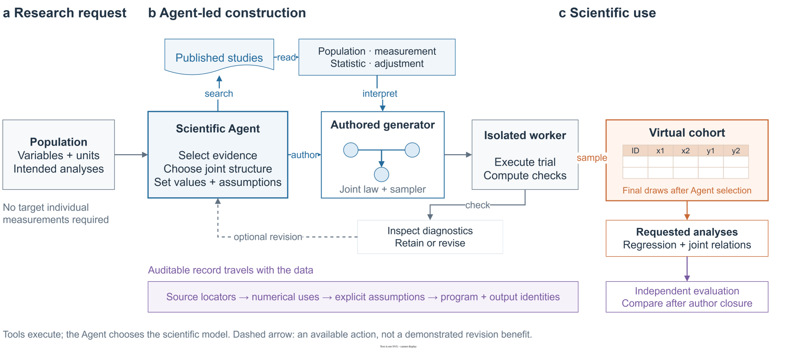
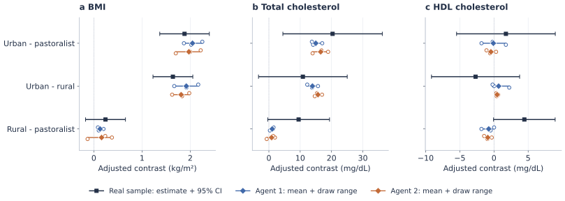
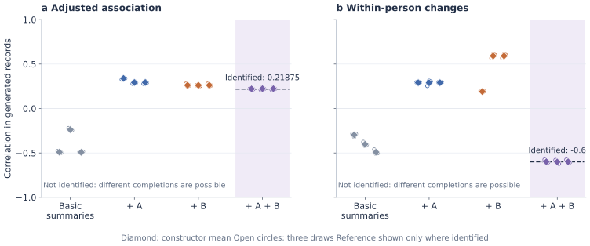
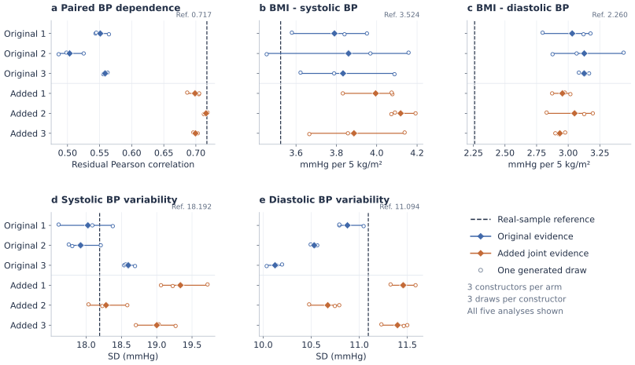

# From Published Evidence to Analyzable Biomedical Cohorts with Scientific Agents

Working manuscript v0.32 — 16 November 2026.
Integrated scientific-use, evidence-composition and joint-evidence studies. Historical experiments remain preserved in v0.31 and their original reports.

## Abstract

Biomedical researchers often have access to published statistical findings but lack the individual measurements needed for a new analysis. We study whether a scientific Agent can translate a research request and permitted evidence into a joint data-generating model and virtual records that support that analysis. The Agent selects evidence, chooses structures and parameters, writes an executable sampler, and can inspect or revise its construction. A deterministic harness executes programs in isolation, records provenance and freezes deliveries before evaluation. We evaluate the resulting data through scientific analyses, separating reconstruction of supplied findings, composition of complementary statistics and comparison with an external measured sample. In a lifestyle application, two Agent constructions produced an urban-minus-pastoralist BMI contrast of 1.700–2.251 kg/m² across six draws, compared with 1.882 in the measured sample; lipid contrasts and dispersion showed important discrepancies. In two artificial composition tasks, 24 fresh constructions distinguished identified relations from assumed scenarios, and all 90 identified analysis estimates met the prespecified numerical tolerance. In a developmental blood-pressure case, Agent-retrieved joint evidence reduced the mean absolute residual-correlation difference from 0.180 to 0.013 across three constructions per condition, while systolic-pressure slope and dispersion agreement worsened. These findings support analysis-specific use of evidence-guided virtual data and a concrete role for complementary relationship evidence. They do not establish general replacement of patient measurements, reliable population transfer or consistent superiority over an ordinary capable Agent. The contribution is an executable, inspectable route from evidence to analyzable records, evaluated at the level of scientific use rather than table plausibility alone.

## 1. Introduction

An investigator may know which variables and analyses a study requires without being able to collect all the corresponding measurements. Existing cohorts omit biomarkers; individual-level records cannot always be shared; and potentially useful findings are distributed across papers, tables and supplementary materials. A publication might describe a biomarker distribution, another its adjusted association with BMI, and a third its joint variation with a second biomarker. Those summaries are useful evidence, but they are not a ready-to-analyze cohort.

The practical question is whether a scientific Agent can make that evidence usable as data. A request specifies a population, variables, units and intended analyses. The output is a set of virtual individual records, together with the generation program and its scientific assumptions. A researcher can then apply regression, group comparison, joint-threshold or repeated-measure analysis to those records. This task includes complete cohort generation with no target individual input. Augmenting an unmeasured column or filling partially missing values are related information regimes; they need their own validation and are not interchangeable with whole-cohort generation.

Generating a plausible table is only one part of this problem. A sampler can reproduce marginal means while weakening a conditional association, preserve a regression slope while narrowing residual variation, or reconstruct one published comparison while giving an unsupported answer to another. Conversely, disagreement with one measured sample does not automatically establish disagreement with the target population. We therefore ask which scientific quantities the virtual records support, what information determines those quantities, and what assumptions remain when the evidence is incomplete.

LLM-based simulation and synthetic-data research already covers important parts of this workflow. G-Sim constructs and calibrates simulators; LLMSynthor uses statistical discrepancies and inferred dependencies to guide synthetic records; and biomedical systems reconstruct individual data from reported summaries or survival curves [1–6]. We do not claim that literature-to-data synthesis or iterative generation is new. Our emphasis is on Agent-authored joint models for requested biomedical analyses, including conditional and repeated-measure relationships, with evidence uses that can be inspected and a shared analysis applied to both virtual and measured records.

This manuscript brings three contributions together. First, it specifies and implements a request-to-data workflow in which the Agent makes the scientific modeling decisions while deterministic tools execute and document them. Second, it tests complementary evidence as a resource for constructing useful joint data: a controlled study establishes algebraic composition capability, followed by a biomedical experiment that searches for missing joint information. Third, it evaluates concrete scientific uses with complete analysis profiles and source-to-model records, separating successful reconstruction, assumptions and remaining discrepancies. The strongest current claim is analysis-specific feasibility and targeted benefit from additional evidence. General workflow superiority is neither a prerequisite for this task nor a result established by these studies.

## 2. Related work and task position

G-Sim iteratively proposes simulator structure with an LLM and calibrates parameters using gradient-free optimization or simulation-based inference [1]. LLMSynthor reconstructs micro-level records from aggregate statistics, using inferred dependencies and statistical differences to guide generation [2]. These methods already motivate combining language-model proposals with numerical execution. Our system is distinguished by its biomedical research-request interface, explicit study conditions and analysis-level evaluation, rather than by calling the proposer an Agent or by including a feedback arrow.

Biomedical synthesis also predates this work. Filshtein et al. demonstrate simulation from summary rules for data pooling [3]. SynthIPD reconstructs survival data with covariates from published materials [4]. KMGen combines literature extraction, trial information and mechanistic patient sampling [5], while SynthCraft organizes a medical synthetic-data workflow [6]. The present studies emphasize continuous biomarker relations and Agent-selected joint structures for varied scientific requests. Their results do not establish quality superiority over these systems, whose information requirements and evaluated tasks differ.

Statistical integration provides a further foundation. Multilevel network meta-regression relates individual models to study-level evidence, and SynDI incorporates external models through synthetic data [7,8]. Matching study summaries is a statistical operation, not a property unique to LLMs. The potential value of an Agent is in interpreting heterogeneous inputs and constructing the appropriate executable model with less case-specific authoring. That potential must be evaluated separately from whether the resulting assumptions transfer to another population.

Our experimental distinction is consequential. A source-rich reconstruction may use the original paper's findings and test whether those findings can be represented in reusable records. A controlled composition task tests whether complementary summaries identify a requested relationship. An external comparison tests whether an evidence-guided model yields useful analyses in another measured sample. Success in one regime does not imply success in the others. Table 1 makes these regimes explicit for the three result blocks emphasized here.

## 3. Method: a scientific request becomes a data-generating model

### 3.1. Specify the data product and intended uses

The request identifies the population, variables and measurement units, desired row or visit structure, and scientific analyses. It also states which observations or external materials are available. A complete-cohort request can contain no target participant records. The Agent may know the intended regression or comparison; the research question need not be hidden. The evaluation protocol instead records whether target measurements or target results entered construction or revision.

The deliverable is more than a CSV file: it includes the virtual records, an executable generator, a model specification, consequential parameter origins, source locators and a record of permitted checks. Each row is a simulated individual under that model, not a recovered patient. Different requests can legitimately lead the Agent to different structures. Within an evaluation unit, the selected model is frozen so that its analyses are not repeatedly repaired against the reference being used to evaluate it.

**Figure 1. The implemented request-to-data workflow.** The Agent selects evidence, chooses a joint law and its numerical assumptions, and authors a sampler. Tools perform search, isolated execution and available checks. The final data can be passed to familiar scientific analyses. The dashed revision path is an available action, not a claimed source of improvement in every experiment. The biomedical evidence-increment study additionally used root-led original-source admission checks; the controlled composition study used fixed artificial records and one-shot construction. These variants are distinguished in Table 1.

### 3.2. Interpret evidence as a study-conditioned statistical statement

A numerical finding is represented with its source, study population, measurement definition, units and transformation, statistical operator, adjustment set and reported uncertainty where available. This prevents a raw correlation from silently becoming an adjusted residual correlation, or a variance from being treated as a standard deviation. Source eligibility and weighting also matter: the mean of an equally weighted generated cohort is not automatically a replay of a weighted source estimator.

The Agent can search for information missing from the initial request. Retrieval and source admission are separate steps. In the blood-pressure follow-up, an API-connected search Agent queried Europe PMC and read retrieved full texts. The coordinating research assistant then checked its proposed records against the original methods and tables, outside the constructor sessions. One ambiguous result was withheld. The demonstrated workflow therefore includes a separate, unblinded source-admission review; it is not fully automatic authentication of evidence or independent human adjudication.

Each consequential use is marked as reported, derived or assumed. These are composable origin descriptors. A covariance derived from a source table can be mathematically justified while its use in another population remains assumed. They are not three ordered confidence levels. The source's numerical value, the adopted model parameter, the full model's implication for an analysis, the estimate from sampled records and the measured-sample reference are kept distinct.

### 3.3. Let the Agent choose a joint law and write the sampler

The scientific Agent, rather than the host harness, chooses how variables depend on each other, what distributional families to use and how to complete missing relationships. It returns executable code and a model description with parameter origins. The numerical worker then samples that code. Thus the implemented route is Agent-authored programmatic generation; it is not a claim that the LLM writes every individual row as text.

This division allows the scientific structure to change with the request. A multivariate model can combine marginal and covariate correlations. A repeated-measure model can separate stable person components from within-person deviations. A biomarker model can use a conditional distribution or copula to connect variables whose individual distributions are reported. These are modeling choices, not a fixed host template containing the desired slopes or signs. In the two new November 16 generation units, the host inserted no target scientific parameters and did not repair the returned laws.

Incomplete evidence generally permits multiple valid models. The Agent may deliver an explicit scenario, identify an unsupported functional or supply a sensitivity construction. A fixed scenario is allowed, but narrow variation across repeated draws does not make its assumptions empirically established. The controlled study tests whether the Agent distinguishes identified functionals from such choices; it does not require all incomplete-evidence constructions to guess the same hidden completion.

### 3.4. Execute, inspect and close a construction

Programs execute through the existing isolated worker. The November 16 units used WSL and bubblewrap with a cleared environment, an unshared network, read-only code and runtime inputs, bounded resources and writable output handles. Schema, row counts, finite values and artifact hashes are checked outside the Agent. Source comparisons are computed only when the required operator and conditions are available; unavailable checks are retained rather than reported as passes.

The broader workflow exposes mathematical, physiological and scientific-relation checks. Mathematical inspection addresses support and existence of relevant moments; finite samples alone cannot establish those properties. Physiological rules must be interpreted for the measurements involved. Scientific checks examine the relationships needed for the requested use. An Agent may retain or revise a model after permitted diagnostics. These tools are useful quality controls, but a repair to mathematical support need not improve a target regression, and a source-consistent model need not transfer.

Before evaluation, the program, specification and allowed inputs are sealed. Every prespecified delivery is then generated and retained, including unsuccessful or unfavorable outcomes. API-based units record requested and returned model identifiers, exact prompts, tool interactions, raw responses, usage and tariff-based cost estimates. These records support replay of the scientific program and inspection of the Agent session. Regenerating an identical language-model decision is not guaranteed by replaying a stochastic or subsequently changed API model.

### 3.5. Evaluate scientific use with a fixed analysis

The central comparison applies the same scientific estimator to virtual and measured records. Depending on the task, this may be an adjusted group difference, a biomarker regression, residual correlation or association of within-person changes. Marginal distributions and dispersion remain necessary diagnostics because an apparently good standardized effect can coexist with an incorrect raw scale.

We distinguish construction-level variation, Monte Carlo variation within a generator and uncertainty in a measured reference. Three seeds are three draws from one model, not three additional independent Agents. A measured sample estimate is not a known population parameter. Similarly, confidence intervals computed from thousands of simulated rows do not automatically include uncertainty about source studies, unmeasured joint structure or transport. The current studies evaluate analysis estimates and patterns; they do not validate synthetic-data inferential coverage or clinical decisions.

## 4. Evaluation design

**Table 1. The three integrated studies have different information boundaries. Counts refer to fresh constructions and final draws, not interchangeable units of evidence.**

| Study and question | Information available at construction | Construction and output scale | Evaluation boundary |
|---|---|---|---|
| Lifestyle: can generated records support a published biomedical analysis? | Original paper, published findings and permitted search; no individual target measurements supplied | 2 constructions; 3 draws each; 1,226 rows per draw | Source-rich reconstruction. The original study also supplies the measured reference. |
| Composition: can complementary statistics support a derived analysis? | Exact artificial records under four information conditions; no search | 2 task families × 4 conditions × 3 constructions; 72 draws of 3,000 persons | Mathematical capability diagnostic, not patient validation. Partial conditions remain underidentified for the primary analysis. |
| Blood pressure: does filling a joint-evidence gap help? | Original packet versus original plus two audited external studies | 3 constructions per condition; 18 draws of 3,000 persons | One historically exposed PNS reference. New authors receive neither its estimates nor previous model outputs. |

### 4.1. Lifestyle analysis with only the data replaced

Lea et al. studied health variation across pastoralist, rural and urban Turkana lifestyles [9]. Two fresh Agent authors generated age, sex, lifestyle group, BMI, total cholesterol and HDL cholesterol, with identifiers. Each produced three full cohorts. The real analytical pool contained 1,226 eligible adults, with available BMI, total cholesterol and HDL measurements for 1,189, 400 and 405 participants, respectively. Virtual tables contained all requested measurements for all 1,226 rows.

We implemented the analysis from the published Methods and applied the same implementation to both kinds of table. Original author analysis software was unavailable; this is a Methods-guided reimplementation, not an unchanged run of the authors' code or a reproduction of the entire paper. The primary profile contains all nine pooled, adjusted pairwise lifestyle contrasts across three biomarkers. Prespecified sex-specific contrasts, interaction tests and data diagnostics are retained as supporting checks. The original reported group findings were permitted inputs, so agreement is reconstruction evidence rather than independent discovery.

### 4.2. Complementary evidence under controlled identification

Two artificial tasks isolate statistical composition. The first requests the Pearson correlation of X and Y after separate linear adjustment for Z. Basic records give standardized marginal moments. Record A gives the marginal X–Y correlation; record B supplies the two correlations with Z. Together they identify a residual correlation of 0.21875. The second requests the correlation of two biomarkers' within-person changes. Basic records stipulate stable person components plus independent visit deviations and their variances. Record A gives the between-person correlation; record B gives the same-visit correlation. Together they identify a change correlation of −0.6. The derivations and structural assumptions are given in Supplement S2.

Each task has basic-only, A-only, B-only and A+B conditions, with three fresh author contexts per cell. One economical GPT configuration, requested and returned as `gpt-6.1-sol`, used high reasoning, default service and a 16,384-token output limit. There were exactly 24 first attempts, no model tools, automatic retries or scientific repair calls. Each sealed program produced 3,000 persons at three fixed seeds. The resulting 72 draws are nested within 24 constructions; 57 numeric tables are unique.

For identified quantities, the frozen numerical tolerance was 0.08 in correlation or slope units. Source diagnostics used a correlation tolerance of 0.08, variance tolerance of 12% and mean tolerance of 0.12 marginal standard deviations. These are numerical diagnostics, not clinical equivalence margins or confidence coverage. Unidentified primary relations are shown as scenarios, without grading their distance from one full-information completion as error.

### 4.3. Agent-retrieved joint evidence for blood pressure

The biomedical follow-up used the existing Brazilian PNS blood-pressure task for adults aged 20–79 [10]. The three requested analyses were BMI associations with systolic and diastolic pressure and their residual Pearson correlation after common age, sex and BMI adjustment. Dispersion and physiological ordering were additional diagnostics. The design matrix was an intercept, age centered at 50 and scaled per decade, female indicator, and BMI centered at 25 and scaled per 5 kg/m².

An actual search Agent performed 14 queries and retrieved six full texts. Root-led original-source checking admitted two partial joint records, from Burkina Faso and Ghana [11,12]. Their adjustment sets and populations differ from the requested PNS analysis. Three fresh authors received the original packet and three the augmented packet, using the same GPT configuration and otherwise common construction interface. There was no target feedback, revision call or host scientific repair. Every author chose its own structure and parameters; each program produced three predeclared 3,000-person draws.

This is a developmental evidence-increment comparison in a previously exposed family, not a new blinded population validation. All six programs closed before the new tables were evaluated. The reference is an existing weighted sample analysis; generated rows are equally weighted realizations of an author-chosen approximation to that analytical distribution. We do not infer national-population accuracy. Figure 4 displays reference point estimates; previously available row-bootstrap intervals measure conditional sampling stability and are not design-based survey intervals.

## 5. Results

### 5.1. Virtual records support a recognizable analysis, with trait-specific limits

Both lifestyle authors delivered complete analyzable cohorts. The urban-minus-pastoralist BMI contrast was 1.882 kg/m² in the measured sample, with a conventional model-based 95% interval of 1.368–2.397. Across six virtual draws it ranged from 1.700 to 2.251. The same adjustment and contrast calculation therefore recovered a similar prominent group difference without target individual measurements being supplied to the constructors.

The full profile is more informative than this single comparison (Figure 2). The measured urban-minus-pastoralist total-cholesterol contrast was 20.342 mg/dL; virtual contrasts ranged from 13.732 to 18.907. Their standardized effects looked closer because total-cholesterol spread was also smaller. Generated standard deviations were approximately 31.85–34.06 mg/dL for total cholesterol and 14.40–15.10 for HDL, versus 42.81 and 20.23 in the reference. Rural-minus-pastoralist lipid differences were attenuated or changed sign. These discrepancies matter for scientific use even when a broad urban group pattern is reproduced.

All nine primary contrasts are displayed, not selected by significance. The real additive HDL contrast intervals included zero. Five of six virtual draws also had no HDL contrast excluding zero; one draw produced an exception and an HDL sex-interaction test with p = 0.02457. All prespecified outputs remain in the record. The generated tables had no missing requested biomarkers or HDL values above total cholesterol, and the inspected laws had finite relevant moments. These checks establish valid deliveries and selected analytical similarities, not equivalence of every scientific conclusion.

**Figure 2. Change the data, retain the scientific analysis.** All nine pooled adjusted contrasts are shown in original units. Dark squares and bars are measured-sample estimates and conventional model-based 95% confidence intervals. Colored diamonds are the mean of three draws from each Agent construction; open circles and horizontal ranges show those draws, not uncertainty intervals for clinical effects. The same Methods-guided analysis is applied to real and virtual records. Reference availability differs by biomarker, whereas every virtual cohort is complete. Published findings were permitted construction inputs.

### 5.2. Agents combine complementary evidence into derived relationships

All 24 controlled constructions completed, yielding all 72 prespecified tables and 216 analyses. With both records, author-mean adjusted correlations were 0.2211–0.2230, close to the algebraically identified 0.21875. Author-mean correlations of within-person changes were −0.6013 to −0.5991 against −0.6. The mean absolute errors across draws were 0.00731 and 0.01492, respectively.

Across all conditions, all 90 identified primary or secondary estimates met the numerical tolerance. This denominator includes repeated draws and different functionals; it is not 90 independent tasks. All 738 available source diagnostics met their frozen tolerances, and all 72 functional identification labels were correct. A separately coded covariance route reproduced all 216 analysis estimates, with maximum numerical difference 1.17 × 10⁻¹⁵.

Incomplete-evidence constructions chose different primary relationships (Figure 3). For example, longitudinal basic-only author means were negative, whereas A-only means were positive, even though both sets complied with their available records. Neither is scored against the complete-information relation when that relation is not identified. All 24 inspected constructions used Gaussian laws with finite moments; the modeling freedom lay in the joint structure left open by the records. These results demonstrate successful composition under exact, compatible statistical constraints. They do not establish that an Agent can identify an unknown clinical relationship from insufficient evidence.

**Figure 3. Complementary summaries make a requested relationship identifiable.** Each diamond is one construction's mean across three draws; open circles and vertical ranges show the draws. The two panels are artificial mathematical populations, not patient cohorts. A reference line is drawn only in the A+B condition, where the primary relation is identified. The other conditions admit multiple completions and are not ranked by error to that line. All 24 constructions are shown; narrow spread among scenario choices is not calibrated uncertainty.

### 5.3. Filling a joint-evidence gap improves one biomedical use

The additional blood-pressure evidence changed the Agents' working dependence assumptions. Original-packet authors chose residual-dependence parameters of 0.55, 0.50 and 0.55; augmented-packet authors chose 0.70, 0.72 and 0.70. These are explicit target modeling assumptions, not exact values reported for the target adjustment set. No PNS estimate or desired correlation was placed in their construction prompts.

The resulting mean residual correlation moved from 0.5376 to 0.7046, compared with the existing reference estimate of 0.7172. Mean absolute reference difference declined from 0.17962 to 0.01277, a descriptive reduction of 92.89%. Every augmented construction was closer on this endpoint than every original-packet construction. This is a concrete benefit for a joint scientific analysis following targeted evidence acquisition.

The benefit did not extend uniformly across the five outcomes in Figure 4. BMI–diastolic-pressure mean absolute difference decreased from 0.8352 to 0.7195 mmHg per 5 kg/m², but remained appreciable. The systolic-pressure slope difference increased from 0.3194 to 0.4761. Diastolic dispersion agreement improved, whereas systolic dispersion agreement worsened. These mixed effects prevent a claim that the augmented data are globally better. Because the authors could change their whole model, the experiment also does not isolate the causal contribution of a single parameter or of either new source alone.

All 18 tables were distinct and contained no duplicate measurement rows, nonpositive BMI or pressure values, or systolic pressure below diastolic pressure. Code inspection found finite relevant moments: five laws bounded pressure values, while one used an affine gamma component and was not bounded. A separately coded QR-based analysis reproduced all 108 endpoint values with maximum difference 5.23 × 10⁻¹³. Thus the targeted dependence improvement is supported by functioning, inspected generators rather than by manually substituted analysis outputs.

**Figure 4. Additional joint evidence improves paired dependence, with visible trade-offs.** Each condition contains three fresh Agent constructions, each sampled three times. Diamonds are construction means, open circles are draws and horizontal ranges are Monte Carlo ranges. Dashed lines are existing measured-sample point references, not known population values or equivalence thresholds. Panels a–c show all three primary analyses; panels d–e show both pressure-scale diagnostics. The augmented condition improves residual dependence and diastolic outcomes while worsening systolic slope and spread agreement. All authors received the same interface and model configuration, but freely chose their laws.

### 5.4. Provenance explains the scientific choices that remain

Table 2 traces the new blood-pressure evidence into the model. The Burkina Faso paper reports a common-sample Pearson matrix. Its age/BMI-adjusted residual correlation can be derived by covariance projection. That calculation does not adjust for sex and does not identify a nonlinear conditional distribution. The Ghana paper instead reports distinct individual and household residual components for women under another adjustment set. These records add genuine joint information, but neither reports the exact requested PNS functional.

**Table 2. A source-to-model walkthrough for the blood-pressure experiment. The last column states the remaining assumption, not a confidence grade.**

| Evidence object | Valid numerical or scientific use | Unresolved part of the requested target use |
|---|---|---|
| Burkina Faso: same-sample BP, age and BMI Pearson matrix | Covariance projection yields an approximate age/BMI residual correlation of 0.788 | Sex adjustment and transport from rural adults aged at least 40 to the PNS task are not identified. Rounded inputs are not an uncertainty interval. |
| Ghana: paired individual and household residual components | Individual correlation 0.73 and household correlation 0.81 are conditional on a specified multilevel model | Women aged 15–49, categorical age, obesity and further covariates differ from the requested single-level analysis. The two correlations cannot simply be averaged. |
| Augmented Agent laws | Working target dependence parameters 0.70, 0.72 and 0.70 become executable joint models | Each is an Agent-selected transfer assumption. Provenance does not make it measured target evidence. |
| Generated analyses and PNS comparison | Residual-correlation construction mean 0.7046 versus reference 0.7172 | Agreement in this exposed case does not calibrate the assumption for another population. |

A concise record therefore explains how a value entered a sampler and which requested analysis depends on it. It does not by itself explain why two populations differ or predict an analysis's accuracy. The broader source-role audit found explicit assumptions throughout the delivered dependence decisions. This documents consequential modeling choices without converting an origin label into a validated accuracy predictor.

### 5.5. Earlier comparisons and an unsuccessful source-admission attempt

The positive composition and blood-pressure results sit within a mixed development record. A request-only comparison used the same GPT and available tools for ordinary and specialized workflows across blood-pressure and lipid tasks. All twelve sessions selected their initial law; the specialized workflow was closer on two of six aggregated primary analysis discrepancies and the ordinary Agent on four. This small comparison supports ordinary Agent effectiveness and rejects a blanket workflow-superiority claim. Its tasks and policies differ from the present evidence-increment experiment.

Subsequent paired scientific reviews repaired a divergent mathematical tail and a possible rounding failure, but 66 of 72 final tables remained byte-identical to their initial counterparts. Mathematical repair and analytical improvement are different outcomes. Earlier glycemia, iron-status and repeated-follow-up studies likewise contain both useful reconstructions and unresolved joint or transport discrepancies. Table 3 locates these results in the full retained record instead of merging different method versions into one success percentage.

**Table 3. Historical evidence retained alongside the main studies. These are separate developmental experiments, not a common frozen benchmark.**

| Evidence block | Finding retained in this manuscript | Scope and record |
|---|---|---|
| Glycemia and relationship-evidence contrasts | Added relationship evidence helped several analyses but did not uniformly improve conditional BMI effects or residual variation. | Different source packets and exposed references; complete numerical profiles remain in v0.31. |
| Iron-status generation | Source threshold summaries can be represented in continuous paired records; target threshold and rank relationships can still differ. | Two constructions; source replay and transfer are separate tests. |
| Repeated-follow-up and summary reconstruction | Rich model exports support repeated-measure generation and requested analyses. | Information-rich reconstruction, not evidence that a generic Agent surpasses statistical reconstruction. |
| Request-only ordinary versus workflow | Both produce analyzable data; two of six aggregate discrepancies favor the workflow. | 12 constructions, 36 draws; no consistent superiority. |
| Paired scientific review | A tail-law defect and a rounding issue were repaired; 66 of 72 tables were unchanged. | 24 dependent review sessions, not 24 new initial constructions. |
| New lipid source search | No complete admissible increment packet; no new lipid construction or table. | Search/report limits and unresolved source semantics; not a negative test of generated-data quality. |

The lipid follow-up is particularly important to interpret correctly. Its search Agent made 16 searches and retrieved seven original articles, but exhausted the input budget without completing its report. One documented source-only synthesis attempt also reached its output limit. Original-paper review retained partial constraints and unresolved operator or common-row issues. The contingent nine constructions and 27 tables were not launched. The result is an admission and execution limitation, not evidence that joint literature is absent or that a generated lipid model failed.

One useful control-design lesson emerged: the variance of non-HDL cholesterol, together with total-cholesterol and HDL variances from the same rows, determines their raw covariance. A control that removes an explicit correlation field but retains those three variances has not removed joint information. Reporting precision and shared-row assumptions must also be carried through that derivation. This lesson informs evidence accounting; it is not an additional successful biomedical experiment.

## 6. Discussion

### 6.1. What the current results establish

The application is feasible in a concrete sense: a scientific Agent can produce a joint sampler and records that run through standard biomedical analyses, with some meaningful estimates close to measured-sample results. The lifestyle analysis demonstrates this practical use. The controlled pilot shows that compatible summaries can be combined into derived adjusted and repeated-measure relations. The blood-pressure follow-up then shows that a targeted search for joint information can improve one real-case analysis without host-prescribed relations.

The common theme is evidence coverage for the intended use. Generating more rows reduces simulation noise under a selected model; it does not supply a missing conditional association. Conversely, a request can already be useful without reconstructing every aspect of an unavailable patient distribution. Utility should be stated for the analyses actually evaluated, in their units and information regime. The present data support exploratory model checking and analytical prototyping. They do not yet validate substituting virtual participants for new clinical observations in estimation, power calculation or treatment decisions.

### 6.2. Why Agent freedom and explicit assumptions both matter

The Agent should be able to search, select a suitable family and revise its scientific plan. Fixing every covariance and distribution in the host would remove much of the intended capability. The workflow therefore constrains interfaces, records and evaluation boundaries while allowing the scientific model to change with the request. An ordinary capable Agent is a valid implementation of this idea.

That freedom does not eliminate underidentification. The controlled tasks deliberately accept source-consistent scenarios when the requested functional is not determined. In biomedical transfer, even a derived source quantity may remain only a working target prior. The role of provenance is to make that choice inspectable. A future analysis-use confidence card would require its own prospective validation; the current origin labels do not provide that result.

### 6.3. Limitations and the next claim-driven experiment

The most prominent biomedical results use only two or three constructions per condition, one current GPT configuration and historically exposed references. The controlled tasks use exact moments and stipulated structure, whereas clinical studies have uncertainty, selection and measurement differences. Root-led source admission remains part of the demonstrated workflow. The lipid search failure also shows that available retrieval tools do not guarantee a completed evidence synthesis.

Neither study summaries nor generated tables identify a full target distribution in general. Current generated intervals largely describe sampling under the adopted law, not calibrated evidence and transfer uncertainty. Agreement with a measured point estimate is descriptive; its scientific adequacy depends on effect size, scale, study design and intended use. The PNS trade-offs and lifestyle lipid discrepancies must therefore remain visible alongside the favorable findings.

The next experiment should serve a specific extension of the present claim: after a biomedical reviewer identifies a useful analysis and a defensible tolerance, apply a frozen request-to-data protocol to one additional case with appropriate evidence and an unused evaluation boundary. If a source-compatibility intervention is proposed, compare it under fixed information and budget and retain all endpoints. Cross-model replication is needed before a model-general capability claim. Comparative reproduction of a neighboring method is appropriate where its task and inputs match. None of these requires proving that an Agent beats an arbitrarily optimized statistical model on every possible biomedical dataset.

## 7. Reproducibility, cost and data-use scope

All main figures in this edition are built from previously completed aggregate results. The editorial integration ran no API calls, generated no new cohorts and refitted no patient data. The experimental records bind protocols, prompts, model identifiers, candidate programs, execution receipts and final deliveries by hashes. Independent numerical implementations checked the composition and blood-pressure analyses; these checks were implemented by the same research process and are not independent personnel adjudication.

Recorded API tariff estimates were USD0.3746075 for the lifestyle unit, USD0.6540764 for the controlled pilot and USD1.0560459 for the blood-pressure search plus construction unit. The unsuccessful lipid admission unit cost USD0.7708042. These figures cover recorded returned usage, not staff time, compute amortization, model development or a general cost per reliable finding. Source searching may require many calls even when construction itself uses one call.

Patient-level real and generated tables and complete third-party papers remain local. Publicly shareable materials consist of original code, protocols, metadata, permitted prompts and aggregate findings after disclosure review. Applicable dataset terms govern access and redistribution. The current editable package provides the manuscript, vector figures and build instructions; the project record preserves the expanded v0.31 reports and earlier method versions. Author information, contribution statements, funding, conflicts, ethics and dataset-specific declarations remain to be finalized before submission.

## Supporting materials and reproducibility

The focused supplement below gives complete numerical profiles for the three main figures, the composition algebra and implementation boundaries. The unchanged expanded v0.31 reading edition remains the historical experimental record. It is not silently superseded as a source of negative results. Local audit files for this revision include the protected-input manifest, all plotted aggregate values, build receipts and page-level visual review.

## References

1. Holt S, Ruiz Luyten M, Berthon A, van der Schaar M. G-Sim: Generative Simulations with Large Language Models and Gradient-Free Calibration. *Proceedings of ICML*. PMLR 267;2025:23513–23561. [Published record](https://proceedings.mlr.press/v267/holt25b.html).
2. Tang Y, Kong M, He J, Nie T, Ma W, Sun L. LLMSynthor: Macro-Aligned Micro-Records Synthesis with Large Language Models. KDD 2026. [DOI](https://doi.org/10.1145/3770855.3818965); [full text v4](https://arxiv.org/html/2505.14752v4).
3. Filshtein TJ, Li X, Zimmerman SC, Ackley SF, Glymour MM, Power MC. Proof of concept example for use of simulation to allow data pooling despite privacy restrictions. *Epidemiology*. 2021;32(5):638–647. [DOI and full text](https://pmc.ncbi.nlm.nih.gov/articles/PMC8338788/).
4. Zhao Z et al. SynthIPD: training-free synthetic individual patient data generation. arXiv:2509.16466v2, 24 July 2026. [Versioned full text](https://arxiv.org/html/2509.16466v2). Publication beyond this preprint was not established in the positioning audit.
5. Jiang J, Gao C, Rasmussen E, Xie SZ, Sun J. KMGen: A Skill-based Approach for Synthetic Individual Patient Data Generation. MLHC 2026, PMLR 340:755–814. [Official proceedings](https://proceedings.mlr.press/v340/jiang26a.html).
6. Callender T, Boyd A, Davis R, Ruhrberg Estevez S, Lavista Ferres JM, van der Schaar M. SynthCraft: An AI partner for synthetic data generation to support data access and augmentation in healthcare. *PLOS Digital Health*. 2026;5(3):e0001290. [Published article](https://journals.plos.org/digitalhealth/article?id=10.1371/journal.pdig.0001290).
7. Phillippo DM et al. Multilevel network meta-regression for population-adjusted treatment comparisons. *Journal of the Royal Statistical Society: Series A*. 2020;183(3):1189–1210. [DOI/full text](https://rss.onlinelibrary.wiley.com/doi/full/10.1111/rssa.12579).
8. Gu T, Taylor JMG, Mukherjee B. A synthetic data integration framework to leverage external summary-level information from heterogeneous populations. *Biometrics*. 2023;79:3831–3845. [DOI](https://doi.org/10.1111/biom.13852).
9. Lea AJ, Martins D, Kamau J, Gurven M, Ayroles JF. Urbanization and market integration have strong, nonlinear effects on cardiometabolic health in the Turkana. *Science Advances*. 2020;6:eabb1430. [Article](https://doi.org/10.1126/sciadv.abb1430). [Dataset](https://doi.org/10.5061/dryad.2z34tmpjk).
10. Pesquisa Nacional de Saúde. PNS 2013 public survey and laboratory data. [Survey files](https://www.pns.icict.fiocruz.br/bases-de-dados/); [laboratory information](https://www.pns.icict.fiocruz.br/exames-laboratoriais/).
11. Jaspert FM, Harling G, Sie A, Bountogo M, Bärnighausen T, Ditzen B, Fischer MS. Association of relationship satisfaction with blood pressure: a cross-sectional study of older adults in rural Burkina Faso. BMJ Open. 2024;14:e089374. [Original article](https://doi.org/10.1136/bmjopen-2024-089374).
12. Aheto JMK, Gates T, Babah R, Takramah W. Joint modelling of systolic and diastolic blood pressure and its associated factors among women in Ghana: Multivariate response multilevel modelling methods. PLOS Global Public Health. 2023;3:e0001613. [Original article](https://pmc.ncbi.nlm.nih.gov/articles/PMC10132648/).

## Supplementary results

### S1. Complete lifestyle profile and analysis boundary

Table S1 gives all nine primary raw-scale contrasts with both constructions, rather than filtering by the direction or size of agreement. The interval is the conventional model-based interval from the measured-sample analysis. Author means average three prespecified draws; they are not pooled patient observations. Standardizing each biomarker within each dataset changes the numerical scale, so raw effects remain primary for this comparison.

**Table S1. All primary lifestyle contrasts. Author values are means across three virtual draws; real intervals are 95% model-based intervals. BMI is in kg/m² and both cholesterol measures are in mg/dL.**

| Trait and contrast | Real estimate [95% interval] | Agent 1 | Agent 2 |
|---|---|---|---|
| BMI: urban − pastoralist | 1.882 [1.368, 2.397] | 2.047 | 1.972 |
| BMI: urban − rural | 1.640 [1.227, 2.053] | 1.918 | 1.811 |
| BMI: rural − pastoralist | 0.242 [-0.172, 0.656] | 0.129 | 0.161 |
| Total cholesterol: urban − pastoralist | 20.342 [4.467, 36.217] | 14.959 | 16.535 |
| Total cholesterol: urban − rural | 10.849 [-3.313, 25.011] | 13.902 | 15.667 |
| Total cholesterol: rural − pastoralist | 9.493 [-0.373, 19.359] | 1.058 | 0.868 |
| HDL: urban − pastoralist | 1.750 [-5.474, 8.975] | -0.091 | -0.447 |
| HDL: urban − rural | -2.696 [-9.147, 3.755] | 0.679 | 0.460 |
| HDL: rural − pastoralist | 4.446 [-0.062, 8.954] | -0.770 | -0.908 |

The real pool used age greater than 18, with nine otherwise available 18-year-olds excluded. No generated row was affected by that boundary in this unit. Biomarker-specific complete-case availability differs substantially between real and virtual tables. The full analysis retained 189 group-contrast estimates and 21 interaction tests across the seven datasets, including the measured reference. The plotted primary subset contains nine contrasts per dataset. A separate numerical implementation made 4,690 comparisons, with maximum difference 8.52 × 10⁻¹³. These are computational checks, not 4,690 scientific validations.

Original records: `work/lifestyle_application_2026-11-11/RESULTS.md` and `ANALYSIS_CONTRASTS.csv`. All sex-specific outputs, diagnostics, full laws and author records remain in that completed unit. The use of the original publication's conclusions is intentional and is not an independent-reference design.

### S2. What the composition tasks identify

In the adjusted task, all variables have mean zero and variance one. A reports marginal correlation $r_{XY}=0.5$; B reports $r_{XZ}=r_{YZ}=0.6$. The correlation of linear-projection residuals is

$$
r_{XY\cdot Z}=\frac{r_{XY}-r_{XZ}r_{YZ}}{\sqrt{(1-r_{XZ}^{2})(1-r_{YZ}^{2})}}=\frac{0.5-0.36}{0.64}=0.21875.
$$

This identity describes linear residual correlation, not arbitrary conditional independence. It does not require a Gaussian population. The Agents chose Gaussian generators, but the evaluator did not require that family. A alone identifies marginal X–Y correlation, B alone identifies the X-on-Z slope, and both identify the primary residual correlation. Basic-only, A-only and B-only do not identify that primary quantity.

In the longitudinal task, each visit is a stable person component plus a mean-zero deviation. Stable-component variances are 4, visit-deviation variances are 1, the two components are independent, and deviations at different visits are independent. These assumptions are supplied in every condition. A gives a between-person correlation of 0.8, so the stable covariance is 3.2. B gives a same-visit correlation of 0.52, so total same-visit covariance is 2.6. The within-visit deviation covariance must therefore be −0.6. With independent visit deviations, the covariance of changes is twice that quantity and each change variance is 2, yielding change correlation −0.6. Cross-visit correlation is 3.2/5 = 0.64. The negative change relation can coexist with a positive same-visit relation under the stipulated structure.

**Table S2. Complete controlled primary results. Each row has three fresh constructions and nine draws. Ranges describe the three construction means. Error is scored only when the primary relation is identified.**

| Task | Evidence | Primary range | Primary MAE | Source checks |
|---|---|---|---|---|
| Adjusted | Basic | -0.4930 to -0.2380 | Not identified | 54/54 |
| Adjusted | Basic + A | 0.2926 to 0.3387 | Not identified | 63/63 |
| Adjusted | Basic + B | 0.2615 to 0.2624 | Not identified | 72/72 |
| Adjusted | Basic + A + B | 0.2211 to 0.2230 | 0.00731 | 81/81 |
| Longitudinal | Basic | -0.4911 to -0.2966 | Not identified | 108/108 |
| Longitudinal | Basic + A | 0.2893 to 0.2907 | Not identified | 117/117 |
| Longitudinal | Basic + B | 0.1911 to 0.5923 | Not identified | 117/117 |
| Longitudinal | Basic + A + B | -0.6013 to -0.5991 | 0.01492 | 126/126 |

All 90 identified estimates include primary and secondary functionals across conditions. There are 18 primary estimates in combined cells, not 90 independent primary tests. The full 216 estimates, identification labels, source-check details and failures are retained. There were no construction or execution failures in the 24-slot unit. The three seeds were 16101, 16103 and 16109. The 57 unique numeric tables among 72 outputs do not change the construction denominator.

The original records remain in [the frozen composition unit](../work/evidence_composition_pilot_2026-11-16/RESULTS.md). Its protocol and bindings are in `PROTOCOL.md` and `FREEZE.json`; its analysis directory contains `analyses.csv`, `constructor_analyses.csv` and `INDEPENDENT_RECOMPUTATION.json`.

### S3. Complete blood-pressure profile

**Table S3. Blood-pressure analysis and dispersion results. Each condition has three constructions and nine draws. Mean absolute difference is averaged within constructions and then across constructions; the reference is an exposed sample estimate.**

| Analysis | Reference | Original mean | Added mean | Original / added MAE |
|---|---|---|---|---|
| Residual correlation | 0.7172 | 0.5376 | 0.7046 | 0.17962 / 0.01277 |
| BMI–SBP (mmHg/5 kg/m²) | 3.5240 | 3.8280 | 4.0001 | 0.31944 / 0.47613 |
| BMI–DBP (mmHg/5 kg/m²) | 2.2599 | 3.0951 | 2.9795 | 0.83516 / 0.71955 |
| SBP SD (mmHg) | 18.1916 | 18.1816 | 18.8729 | 0.32525 / 0.71631 |
| DBP SD (mmHg) | 11.0941 | 10.5107 | 11.1757 | 0.58344 / 0.36284 |

The added evidence was selected for its statistical content before evaluating the newly generated outputs. Source admission was not based on choosing a statistic close to the PNS estimate. Nevertheless, the target family and its earlier estimates were historically known to the project, so this remains developmental evidence. The new author contexts did not receive those estimates, prior outputs or desired target signs. The original packet was reused with its historical extraction status; this unit did not reauthenticate every old source.

Burkina Faso reports a complete-case sample of 2,114 partnered adults aged at least 40, excluding recent antihypertensive use and pregnancy. Pressure is the average of the last two of three seated measurements. The source age/BMI covariance projection does not provide sex adjustment. Ghana analyzes women aged 15–49 with categorical age, binary obesity and additional covariates. Its individual residual variances are 224.49 and 101.75 mmHg² with correlation 0.73; household variances are 38.91 and 16.37 mmHg² with correlation 0.81. Correlations cannot be combined without the variance components and the intended estimand. Neither article supplies a transferable uncertainty interval for the target relation.

The Ghana report contains an individual-level column labeled “Child,” despite the methods specifying women, and inconsistent household counts. These issues were recorded; they were not silently corrected into invented precision. A third candidate from Uganda was withheld because 0.7307 was described ambiguously as both an outcome and residual correlation, under a different adjustment set. No source-level replay under these three studies' complete populations was demonstrated. Generated target diagnostics are not relabeled as source replay.

All final draws used seeds 16121, 16123 and 16127. The selected programs and all outputs closed before aggregate comparison. Original records: `work/pns_joint_evidence_2026-11-16/PROTOCOL.md`, `SOURCE_AUDIT.md`, `IMPLEMENTATION_REVIEW.md`, `analysis/author_results.json` and `analysis/REFERENCE_USED.json`.

### S4. Mathematical and physiological checks are distinct from utility

The earlier request-only study found a lipid construction in which an unbounded lognormal BMI entered a positive exponential cholesterol law. Finite output tables looked normal, but the ideal total-cholesterol mean diverged. A different construction with explicit support limits did not share that defect. Law-level inspection must therefore consider the complete transformation and support, rather than flagging all similar code indiscriminately.

In the later paired reviews, both review policies repaired the divergent tail and a possible rounding issue. Most selected laws were retained, and 66 of 72 final tables were unchanged. One retained lipid model still produced a single HDL-above-total-cholesterol record in each reviewed arm. A repair that prevents a rare physical inconsistency or supplies finite moments is useful even when the previously requested estimates barely change. It cannot be presented as a demonstrated general improvement in scientific accuracy.

Original records: `work/request_only_repeatability_2026-11-11/RESULTS.md` and `work/scientific_check_revision_2026-11-11/RESULTS.md`. Earlier tail repairs and threshold-preserving transformations are described in the unchanged v0.31 supplement. This manuscript does not extend those mathematical guarantees to all generators.

### S5. Failed source admission, reproducibility levels and remaining claims

The lipid follow-up completed 37 recorded calls in total and seven full-text downloads. No valid final Agent report or approved increment packet resulted; zero new constructors and tables followed. Its report and root-led original-paper audit remain inspectable in `work/lipid_joint_evidence_2026-11-16`. A rounded non-HDL variance identity supplies partial raw-covariance information only when the observations are common across all summaries. It does not identify age/sex/BMI-adjusted dependence, and a rounding range is not a sampling confidence interval.

There are three distinct reproducibility levels. Aggregate plotting can be rerun from the released summaries. Frozen generation can be rerun from the laws and seeds under the recorded environment, subject to applicable access terms. New Agent construction requires API availability and the stored prompts and tools; its scientific decisions may differ even with an unchanged requested model name. The November 16 API records include returned model IDs and usage. Earlier host-mediated episodes with incomplete backend metadata must not be described as fully recorded API runs.

The strongest current evidence is a concrete scientific-use example, successful exact-summary composition, and targeted improvement of a joint analysis after adding external evidence. The next claims requiring new evidence are calibrated uncertainty, prospective target utility, generality across model families, independent user benefit from provenance and matched-task superiority over another published method. These are not established by adding more simulated rows, more versions of the paper or additional unspecified Agent components.
