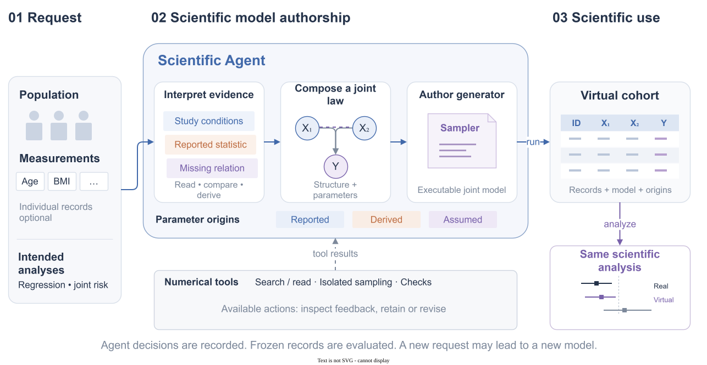
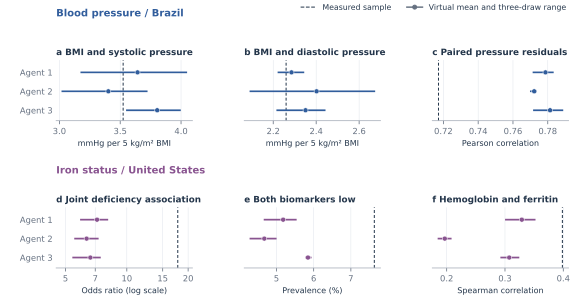
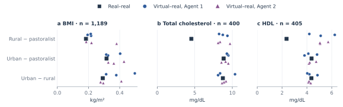
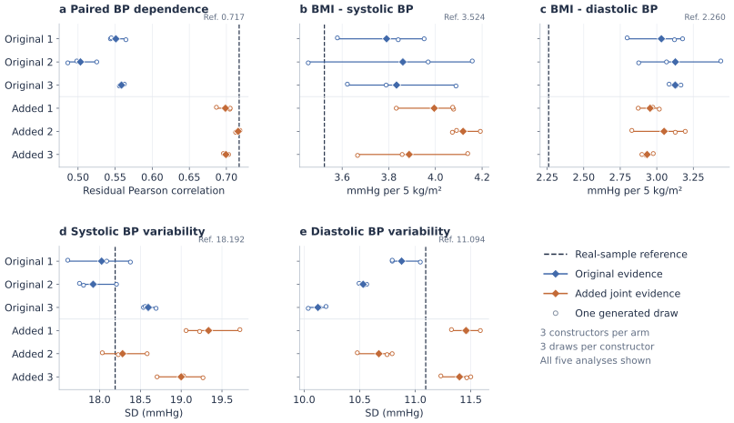
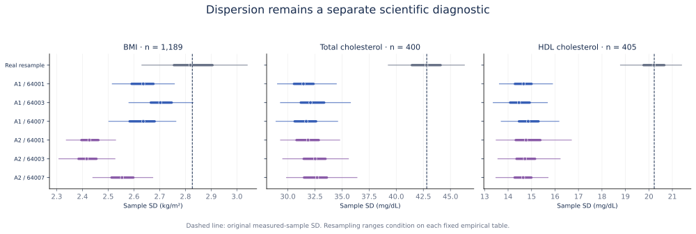

# From Fragmented Evidence to Analyzable Biomedical Cohorts with Scientific Agents

KDD working manuscript v0.34. 18 November 2026.

## Abstract

Can a researcher recover a useful scientific analysis from published evidence when individual measurements are unavailable? We study a scientific Agent that reads original studies, chooses how their findings constrain a joint model and writes a program that samples complete virtual cohorts. Six fresh sessions started with a research request and an original paper on blood pressure or iron status. All six extracted joint information from the paper and delivered an executable model. Applying the same regressions to synthetic and measured records gave systolic blood-pressure slopes of 3.40–3.80 versus 3.52 mmHg per five body mass index (BMI) units. For iron status, the generated records retained the positive association between anemia and iron depletion but yielded odds ratios of 6.35–7.14 versus 17.79. In a separate lifestyle reconstruction, the mean absolute discrepancy in the urban–pastoralist BMI contrast was 0.314–0.428 kg/m² across virtual tables, compared with 0.316 between matched resamples of the measured records. Rural lipid effects and variability were less well represented. Controlled changes to the supplied evidence improved two specified joint analyses, with losses on others. These experiments connect decisions an Agent makes while reading a paper to the particular analyses its data can support.

## 1. Introduction

A paper on anemia can tell a reader how many women had low ferritin and how many also had low hemoglobin. A researcher planning a new study might want to run two analyses on these biomarkers. One compares the odds of anemia above and below a ferritin threshold. The other asks how the two concentrations vary together over their full ranges. A four-cell table determines the first statistic for the published sample. It leaves many possible answers to the second. Changing the age range, selection criteria or measurement protocol introduces another choice even for the threshold analysis.

We ask what happens when a scientific Agent makes those choices and delivers the result as a dataset. A researcher specifies the population, measurements and intended analyses. The Agent can read studies, retrieve supplementary evidence, select a probability model and write a sampling program. An ordinary analysis package can then use the same fictional records to answer several questions. This matters when a laboratory measurement was expensive or never collected, or when a publication is accessible but its individual records are unavailable. Our experiments generate whole cohorts without target participant inputs.

We follow three links in this process. First, we trace actual modeling decisions from the original article to the executable law, including the assumptions the Agent introduced. Second, we replace measured records with virtual records in a fixed scientific analysis and compare the resulting estimates in their original units. Equal-size resampling gives a reference for how far two estimates from the measured pool can differ. Third, we vary which statistics a constructor receives to ask whether joint evidence adds anything beyond extra marginal summaries. Together these comparisons give a researcher a way to say which uses of one table have empirical support.

## 2. Related work

G-Sim uses an LLM to propose simulation programs and numerical procedures to calibrate them [1]. LLMSynthor infers dependent variable subsets and uses discrepancies in marginal and joint frequency tables to plan successive batches of micro-records. Its mobility application combines aggregates from multiple sources [2]. In our setting, papers report quantities such as adjusted slopes, pairwise correlations and threshold counts. The Agent has to work out which of these describe the relationship requested by the researcher, construct an executable law and expose the choices required to use it in another population. We evaluate downstream biomedical estimates on a common analysis implementation.

Filshtein et al. share fitted models that a recipient can use to simulate cohorts [3]. SynthIPD reconstructs individual trial data from published materials [4], KMGen uses literature-informed generation [5] and SynthCraft supports medical synthetic-data workflows [6]. Statistical foundations include multilevel network meta-regression for linking individual and aggregate evidence [7] and SynDI for incorporating external regression information [8]. Our contribution concerns the modeling work an Agent performs when these inputs leave aspects of the joint distribution unspecified, and the scientific uses that can be demonstrated for the delivered records.

## 3. From a research request to a virtual cohort

**Define the analysis.** The request names the study population, measurements and units, row structure and scientific questions. For example, the iron request asks for continuous hemoglobin and ferritin values in nonpregnant US women aged 20–44. The same records must support an odds ratio, joint prevalence and a rank correlation. Intended questions are visible to the constructor. The local evaluation records and reference estimates are withheld from its session.

**Figure 1. The Agent's scientific choices and the tools that execute them.** The Agent selects scientific relationships, probability laws and parameters. The host supplies the tools, freezes the selected program and samples records. The evaluator applies the requested analysis to virtual and measured records. In the original-paper experiment the starting article was supplied. In the information controls the constructor received a fixed packet. The numerical marks in this overview are schematic.

**Read in context.** The Agent receives the original paper through a document reader and may search other literature. It records where each consequential quantity came from, its population, units, statistic and adjustment set. It distinguishes a reported value from one derived by arithmetic and from an assumption needed for generation. A quantity can have two origins in this sense. An age/BMI partial correlation can be calculated exactly from the source matrix, while applying that value after additional sex adjustment in another population remains an assumption.

**Author and sample a joint law.** The Agent submits executable code, parameters and a description of how it used the evidence. Each case can call for a different law. A separate, network-isolated worker executes the submitted program with a cleared environment and bounded resources. The Agent may inspect generated-only diagnostics and retain or revise its candidate when the protocol allows. After the candidate closes, prespecified seeds yield the final tables. The evaluator checks units, schema, counts and finite outputs, then applies the same scientific estimator used for the measured reference with the weights appropriate to each design. This division of work makes it possible to inspect who chose a relationship and to rerun an analysis from the delivered records.

## 4. Can the Agent build the model from an original paper?

Three fresh sessions per case received a scientific request, the known original article as an entry point, a data contract, tool access and a budget. The openings contained no coordinator-extracted numerical packet, preferred distribution or target result. All six sessions read the article, searched additional literature, wrote a sampler, inspected one generated-only trial and retained their first candidate. We sealed the six laws before evaluating their three final draws each. A construction is one modeling decision sequence. Its draws measure variation under that chosen law.

### 4.1. Blood pressure from a published correlation matrix

Jaspert et al. report blood pressure in partnered adults aged at least 40 in rural Burkina Faso [11]. The Agents located a correlation matrix and combined its entries to remove linear age and BMI associations from systolic (SBP) and diastolic (DBP) pressure. Each recovered a source partial correlation of about 0.788. The requested Brazilian survey analysis also adjusts for sex and includes a broader age range. Each constructor recorded how it carried information across these settings. All three modeled a positive diastolic pressure and a positive pulse pressure, then added the two to obtain systolic pressure. Each program thus encoded the ordering of the paired measurements. The constructors chose different demographic distributions and conditional pressure levels.

Figure 2 shows all six requested analyses. For blood pressure we fit each outcome on the same age, sex and BMI terms and correlated the two sets of residuals. For every five kg/m² difference in BMI, the three construction means gave systolic slopes of 3.40–3.80 mmHg versus 3.52 in the weighted Brazilian National Health Survey (PNS) sample [10]. Diastolic slopes were 2.29–2.40 versus 2.26. The same tables yielded residual correlations of 0.772–0.781 versus 0.717. Both pressure SDs were higher than their measured counterparts. These data support the positive adjusted BMI associations at approximately the observed scale. They give a stronger remaining dependence between the paired pressures.

### 4.2. Iron status from eight published groups

Zhu et al. stratified women by ferritin, folate and B12 status in rural northern China [13]. Each Agent combined the eight groups into four cells: 173 women with both low hemoglobin and low ferritin, 85 with low hemoglobin only, 331 with low ferritin only and 1,082 with neither. This gives a crude source odds ratio of 6.65. Each distinguished it from the separately adjusted value of 6.448 and flagged ambiguous ferritin unit or interval labels. The four source counts entered three different programs. One Agent fitted a Clayton copula to couple continuous biomarker levels. One used two latent iron-store components and a hemoglobin response with a change in slope. The third used a saturating response with inflammatory and other-anemia components. Supplementary sources informed the marginal distributions.

We applied the same thresholds, hemoglobin below 12 g/dL and ferritin below 15 μg/L, and the same continuous rank analysis as in the US National Health and Nutrition Examination Survey (NHANES) sample [14]. Construction-average odds ratios were 6.35–7.14 versus 17.79 in 979 measured women. All three reproduced the direction and stayed near the published source association. They understated its strength in the target sample. Joint deficiency occurred in 4.67–5.85% versus 7.63%, and Spearman correlations were 0.197–0.329 versus 0.398. Published counts constrain threshold pairing in their own study. The ordering of two people within a threshold group and the transport of that pairing to another population both require further information.

**Figure 2. The BMI slopes are close to the measured estimates. Residual pressure dependence is higher and iron-status association is weaker.** Points and segments give each constructor's three-draw mean and range. Dashed lines mark measured-sample estimates. Odds ratios use a log scale. Table S8 includes all five companion checks.

## 5. What changes when only the data change?

Lea et al. analyzed cardiometabolic differences across urban, rural and pastoralist Turkana lifestyles [9]. Two Agents had access to the paper's group findings and generated age, sex, lifestyle, BMI, total cholesterol and high-density lipoprotein (HDL) cholesterol. Each supplied three complete tables of 1,226 fictional people. We implemented the paper's age- and sex-adjusted group comparison with ordinary least squares from its Methods, then ran this one implementation on measured and virtual records. The original author software was unavailable. This setting evaluates reconstruction of a published analysis whose findings were available during generation.

**Place discrepancies on a sampling scale.** The measured data contain BMI for 1,189 adults, total cholesterol for 400 and HDL for 405. Figure 3 shows the resulting discrepancy for every contrast. For each trait we resampled the same six lifestyle-by-sex cell sizes from the measured pool and from each frozen virtual table. In each of 500 repetitions, two independently drawn real samples A and B gave a real–real contrast difference. The virtual–real comparison used the same B sample. All nine adjusted group contrasts were evaluated in original units. Holding sample size and group composition fixed matters particularly for the urban lipid groups, which contain only 37 or 38 measured participants.

**Which group conclusions survive?** Urban BMI exceeded pastoralist BMI by 1.649–2.262 kg/m² across the six virtual tables' mean resampled contrasts, compared with 1.896 in measured B resamples. Mean absolute virtual–real differences were 0.314–0.428 kg/m², alongside 0.316 for real–real. Urban–pastoralist total cholesterol also showed discrepancies on a similar scale, 8.556–9.479 versus 8.848 mg/dL. For rural–pastoralist contrasts the virtual effects were smaller by 7.800–9.545 mg/dL for total cholesterol and 4.074–6.208 mg/dL for HDL. Both virtual lipid distributions also had too little spread. The measured-sample SDs were 42.81 and 20.23 mg/dL, compared with mean resampled virtual SDs of 31.49–32.67 and 14.50–14.89. The urban BMI contrast is a supported reconstruction use. Calculations that rely on the observed lipid variance, including power analyses, lack that support.

**Figure 3. How large is the change in an adjusted analysis when the data are replaced?** Squares show mean absolute real–real differences. Circles and triangles give virtual–real differences for six saved tables from two constructors. Points near a square indicate discrepancies comparable to real–real variation across 500 matched resamples of the observed pools. Tables S1 and S7 give effects and signed differences.

## 6. Which additional evidence changes the result?

The original-paper sessions demonstrate model authorship. To isolate the value of information, we used separate constructors with prepared packets. Within each case, three fresh constructors per condition received a common request, model and tool interface. BASE supplied the starting packet, SUMMARY added study context and univariate summaries, and JOINT also supplied paired observations in aggregate form. BASE already included older relationship evidence in the pressure case. The iron BASE gave the study identity and measurements. The interpretable increment across both cases is JOINT versus SUMMARY. Every one of the 18 programs was sampled three times. Absolute discrepancies were computed per draw, averaged within each construction, then averaged across the three constructions in that condition.

**Table 1. Mean absolute discrepancy with additional paired evidence. All six primary analyses are shown. The prespecified increments concern residual pressure correlation and log odds ratio (OR). Prevalence uses percentage points (pp).**

| Analysis and error scale | SUMMARY | JOINT |
|---|---|---|
| Residual pressure correlation (r) | 0.1633 | 0.0350 |
| BMI–systolic slope (mmHg per 5 BMI) | 0.3396 | 0.5091 |
| BMI–diastolic slope (mmHg per 5 BMI) | 0.7378 | 0.7550 |
| Deficiency association (log OR) | 1.7620 | 0.9373 |
| Both iron markers low (pp) | 0.519 | 2.594 |
| Continuous Hb–ferritin (rank r) | 0.0447 | 0.1736 |

As Table 1 shows, six same-sample pressure correlations reduced residual-correlation discrepancy by 78.6%. Four paired iron cells reduced absolute log-odds-ratio discrepancy by 46.8%. Both pressure slope discrepancies increased. In iron status, all three JOINT constructors chose a Gaussian copula, which extends threshold pairing to a continuous relationship. Their mean generated rank correlation was 0.572 versus 0.398 in the measured sample. In the original-paper sessions of Section 4.2 the three alternative laws gave lower rank correlations. These separate protocols illustrate how a decision about the continuous law affects the analysis. They do not isolate the effect of free reading versus a prepared packet. Tables S3–S4 report every condition and its diagnostics.

Two controlled mathematical tasks clarify what composition alone can achieve. When the supplied correlations and adjustment set jointly identified a residual correlation of 0.21875, the three constructor means were 0.2211–0.2230. Under a stipulated repeated-visit model, between-person and same-visit correlations together identified a negative change correlation of −0.6. The three constructor means were −0.6013 to −0.5991. The incomplete conditions admit multiple joint models. Supplement S2 gives the derivations and results for all 24 constructions.

## 7. Discussion

The evidence from original articles made some scientific decisions possible before any records were sampled. A reader can trace the four iron cells to a crude association and inspect the additional assumptions that made a continuous virtual record possible. A user can then fit the intended analysis and discover that the table is useful for the direction of association but understates its strength in another population. In the lifestyle example, equal-size real resamples show why a discrepancy that looks substantial in mg/dL can be common for one contrast and unusual for another. The unit of a scientific-use claim is therefore a specified analysis in a specified population.

**What an Agent adds.** The recorded contribution is the interpretation and executable completion of incomplete evidence. In a separate request-only comparison, an ordinary Agent and the organized workflow used the same GPT, search and runtime capabilities, and resource ceilings. Both delivered models. Across 12 constructors and 36 tables the workflow had smaller mean absolute discrepancy on two of six primary analyses and the ordinary Agent on four. In a source-rich longitudinal comparison with common fitted HRS exports [3], both the Agent and a reconstruction of the published recipient method preserved the negative below-threshold HbA1c-by-age interaction. The weak above-threshold interaction differed between implementations. Six comparison tables were valid after repairing our parser for three initially invalid comparator tables. These comparisons address workflow choice and recipient-side reconstruction, respectively.

**Scope of inference.** The biomedical target families had been examined previously. Fresh sessions had no access to the local target outcomes. One pressure session received a search preview identifying the target survey and some demographic information and excluded it. The preview contained none of the evaluated coefficients. The opening papers were provided, all six sessions used one GPT configuration, and all retained their initial programs. The matched lifestyle resampling conditions on available cases and on lifestyle and sex. It omits household clustering, missingness uncertainty and between-population differences. The measured values themselves are sample estimates. These boundaries support using the virtual records for the named reconstruction and analysis-prototyping tasks. Replacement of individual measurements or calibrated inference in a new population would need a separate validation.

**Reproducibility.** Each original-paper session retained the prompt, source interactions, model specification, sampler and execution receipts. The requested and returned model was `gpt-6.1-sol`. The six laws produced 18 final tables and 72,000 fictional rows. A separate implementation recomputed all 99 seed-level analysis and diagnostic values to a maximum absolute difference of 7.55 × 10⁻¹⁴. The 142 model calls had a recorded tariff estimate of USD 1.51. The matched-size study reused six saved virtual tables, required no model calls and completed 12,000 trait fits. These counts describe computation. The scientific units remain constructors and study populations. Supplement S7–S8 supplies the complete results for both rounds.

## References

1. Holt S, Ruiz Luyten M, Berthon A, van der Schaar M. G-Sim: Generative Simulations with Large Language Models and Gradient-Free Calibration. *Proceedings of ICML*. PMLR 267;2025:23513–23561. [Published record](https://proceedings.mlr.press/v267/holt25b.html).
2. Tang Y, Kong M, He J, Nie T, Ma W, Sun L. LLMSynthor: Macro-Aligned Micro-Records Synthesis with Large Language Models. KDD 2026. [DOI](https://doi.org/10.1145/3770855.3818965); [full text v4](https://arxiv.org/html/2505.14752v4).
3. Filshtein TJ, Li X, Zimmerman SC, Ackley SF, Glymour MM, Power MC. Proof of concept example for use of simulation to allow data pooling despite privacy restrictions. *Epidemiology*. 2021;32(5):638–647. [DOI and full text](https://pmc.ncbi.nlm.nih.gov/articles/PMC8338788/).
4. Zhao Z et al. SynthIPD: training-free synthetic individual patient data generation. arXiv:2509.16466v2, 24 July 2026. [Versioned full text](https://arxiv.org/html/2509.16466v2).
5. Jiang J, Gao C, Rasmussen E, Xie SZ, Sun J. KMGen: A Skill-based Approach for Synthetic Individual Patient Data Generation. MLHC 2026, PMLR 340:755–814. [Official proceedings](https://proceedings.mlr.press/v340/jiang26a.html).
6. Callender T, Boyd A, Davis R, Ruhrberg Estevez S, Lavista Ferres JM, van der Schaar M. SynthCraft: An AI partner for synthetic data generation to support data access and augmentation in healthcare. *PLOS Digital Health*. 2026;5(3):e0001290. [Published article](https://journals.plos.org/digitalhealth/article?id=10.1371/journal.pdig.0001290).
7. Phillippo DM et al. Multilevel network meta-regression for population-adjusted treatment comparisons. *Journal of the Royal Statistical Society: Series A*. 2020;183(3):1189–1210. [DOI/full text](https://rss.onlinelibrary.wiley.com/doi/full/10.1111/rssa.12579).
8. Gu T, Taylor JMG, Mukherjee B. A synthetic data integration framework to leverage external summary-level information from heterogeneous populations. *Biometrics*. 2023;79:3831–3845. [DOI](https://doi.org/10.1111/biom.13852).
9. Lea AJ, Martins D, Kamau J, Gurven M, Ayroles JF. Urbanization and market integration have strong, nonlinear effects on cardiometabolic health in the Turkana. *Science Advances*. 2020;6:eabb1430. [Article](https://doi.org/10.1126/sciadv.abb1430). [Dataset](https://doi.org/10.5061/dryad.2z34tmpjk).
10. Pesquisa Nacional de Saúde. PNS 2013 public survey and laboratory data. [Survey files](https://www.pns.icict.fiocruz.br/bases-de-dados/); [laboratory information](https://www.pns.icict.fiocruz.br/exames-laboratoriais/).
11. Jaspert FM, Harling G, Sie A, Bountogo M, Bärnighausen T, Ditzen B, Fischer MS. Association of relationship satisfaction with blood pressure: a cross-sectional study of older adults in rural Burkina Faso. BMJ Open. 2024;14:e089374. [Original article](https://doi.org/10.1136/bmjopen-2024-089374).
12. Aheto JMK, Gates T, Babah R, Takramah W. Joint modelling of systolic and diastolic blood pressure and its associated factors among women in Ghana: Multivariate response multilevel modelling methods. PLOS Global Public Health. 2023;3:e0001613. [Original article](https://pmc.ncbi.nlm.nih.gov/articles/PMC10132648/).
13. Zhu JH et al. Iron, Folate, and B12 Deficiencies and their Associations with Anemia among Women of Childbearing Age in a Rural Area in Northern China. *International Journal for Vitamin and Nutrition Research*. 2010;80(2):144–154. [DOI](https://doi.org/10.1024/0300-9831/a000014).
14. National Center for Health Statistics. NHANES August 2021–August 2023 laboratory documentation. [Ferritin, FERTIN_L](https://wwwn.cdc.gov/Nchs/Data/Nhanes/Public/2021/DataFiles/FERTIN_L.htm); [Complete blood count, CBC_L](https://wwwn.cdc.gov/Nchs/Data/Nhanes/Public/2021/DataFiles/CBC_L.htm).

## Supplementary results

### S1. Complete lifestyle profile and analysis boundary

Table S1 gives all nine primary raw-scale contrasts with both constructions, rather than filtering by the direction or size of agreement. The interval is the conventional model-based interval from the measured-sample analysis. Author means average three prespecified draws; they are not pooled patient observations. Standardizing each biomarker within each dataset changes the numerical scale, so raw effects remain primary for this comparison.

**Table S1. All primary lifestyle contrasts. Author values are means across three virtual draws; real intervals are 95% model-based intervals. BMI is in kg/m² and both cholesterol measures are in mg/dL.**

| Trait and contrast | Real estimate [95% interval] | Agent 1 | Agent 2 |
|---|---|---|---|
| BMI: urban − pastoralist | 1.882 [1.368, 2.397] | 2.047 | 1.972 |
| BMI: urban − rural | 1.640 [1.227, 2.053] | 1.918 | 1.811 |
| BMI: rural − pastoralist | 0.242 [-0.172, 0.656] | 0.129 | 0.161 |
| Total cholesterol: urban − pastoralist | 20.342 [4.467, 36.217] | 14.959 | 16.535 |
| Total cholesterol: urban − rural | 10.849 [-3.313, 25.011] | 13.902 | 15.667 |
| Total cholesterol: rural − pastoralist | 9.493 [-0.373, 19.359] | 1.058 | 0.868 |
| HDL: urban − pastoralist | 1.750 [-5.474, 8.975] | -0.091 | -0.447 |
| HDL: urban − rural | -2.696 [-9.147, 3.755] | 0.679 | 0.460 |
| HDL: rural − pastoralist | 4.446 [-0.062, 8.954] | -0.770 | -0.908 |

The real pool used age greater than 18, with nine otherwise available 18-year-olds excluded. No generated row was affected by that boundary in this unit. Biomarker-specific complete-case availability differs substantially between real and virtual tables. The full analysis retained 189 group-contrast estimates and 21 interaction tests across the seven datasets, including the measured reference. The plotted primary subset contains nine contrasts per dataset. A separate numerical implementation made 4,690 comparisons, with maximum difference 8.52 × 10⁻¹³. These are computational checks, not 4,690 scientific validations.

Original records: `work/lifestyle_application_2026-11-11/RESULTS.md` and `ANALYSIS_CONTRASTS.csv`. All sex-specific outputs, diagnostics, full laws and author records remain in that completed unit. The use of the original publication's conclusions is intentional and is not an independent-reference design.

### S2. What the composition tasks identify

In the adjusted task, all variables have mean zero and variance one. A reports marginal correlation $r_{XY}=0.5$; B reports $r_{XZ}=r_{YZ}=0.6$. The correlation of linear-projection residuals is

$$
r_{XY\cdot Z}=\frac{r_{XY}-r_{XZ}r_{YZ}}{\sqrt{(1-r_{XZ}^{2})(1-r_{YZ}^{2})}}=\frac{0.5-0.36}{0.64}=0.21875.
$$

This identity describes linear residual correlation, not arbitrary conditional independence. It does not require a Gaussian population. The Agents chose Gaussian generators, but the evaluator did not require that family. A alone identifies marginal X–Y correlation, B alone identifies the X-on-Z slope, and both identify the primary residual correlation. Basic-only, A-only and B-only do not identify that primary quantity.

In the longitudinal task, each visit is a stable person component plus a mean-zero deviation. Stable-component variances are 4, visit-deviation variances are 1, the two components are independent, and deviations at different visits are independent. These assumptions are supplied in every condition. A gives a between-person correlation of 0.8, so the stable covariance is 3.2. B gives a same-visit correlation of 0.52, so total same-visit covariance is 2.6. The within-visit deviation covariance must therefore be −0.6. With independent visit deviations, the covariance of changes is twice that quantity and each change variance is 2, yielding change correlation −0.6. Cross-visit correlation is 3.2/5 = 0.64. The negative change relation can coexist with a positive same-visit relation under the stipulated structure.

**Table S2. Complete controlled primary results. Each row has three fresh constructions and nine draws. Ranges describe the three construction means. Error is scored only when the primary relation is identified.**

| Task | Evidence | Primary range | Primary MAE | Source checks |
|---|---|---|---|---|
| Adjusted | Basic | -0.4930 to -0.2380 | Not identified | 54/54 |
| Adjusted | Basic + A | 0.2926 to 0.3387 | Not identified | 63/63 |
| Adjusted | Basic + B | 0.2615 to 0.2624 | Not identified | 72/72 |
| Adjusted | Basic + A + B | 0.2211 to 0.2230 | 0.00731 | 81/81 |
| Longitudinal | Basic | -0.4911 to -0.2966 | Not identified | 108/108 |
| Longitudinal | Basic + A | 0.2893 to 0.2907 | Not identified | 117/117 |
| Longitudinal | Basic + B | 0.1911 to 0.5923 | Not identified | 117/117 |
| Longitudinal | Basic + A + B | -0.6013 to -0.5991 | 0.01492 | 126/126 |

All 90 identified estimates include primary and secondary functionals across conditions. There are 18 primary estimates in combined cells, not 90 independent primary tests. The full 216 estimates, identification labels, source-check details and failures are retained. There were no construction or execution failures in the 24-slot unit. The three seeds were 16101, 16103 and 16109. The 57 unique numeric tables among 72 outputs do not change the construction denominator.

The original records remain in [the frozen composition unit](../work/evidence_composition_pilot_2026-11-16/RESULTS.md). Its protocol and bindings are in `PROTOCOL.md` and `FREEZE.json`; its analysis directory contains `analyses.csv`, `constructor_analyses.csv` and `INDEPENDENT_RECOMPUTATION.json`.

### S3. Pressure content control

**Table S3. Complete PNS profile. Entries are mean estimate / mean absolute discrepancy. Absolute differences are computed before construction and arm averaging.**

| Analysis | Sample reference | BASE | SUMMARY | JOINT |
|---|---|---|---|---|
| Residual Pearson r | 0.7172 | 0.5540 / 0.1632 | 0.5539 / 0.1633 | 0.7251 / 0.0350 |
| BMI–SBP (mmHg/5 kg/m²) | 3.5240 | 3.7103 / 0.1934 | 3.7617 / 0.3396 | 3.9238 / 0.5091 |
| BMI–DBP (mmHg/5 kg/m²) | 2.2599 | 2.9875 / 0.7276 | 2.9977 / 0.7378 | 3.0149 / 0.7550 |
| SBP SD (mmHg) | 18.1916 | 17.5350 / 0.8140 | 17.4468 / 0.7448 | 17.9824 / 0.2991 |
| DBP SD (mmHg) | 11.0941 | 10.4221 / 0.6721 | 10.4139 / 0.6803 | 10.4312 / 0.6630 |

The two augmented arms share the Burkina Faso population description and univariate summaries. Its admitted matrix describes 2,114 complete-case partnered adults aged at least 40, excluding recent antihypertensive use and pregnancy, with pressure averaged from the last two of three seated measurements. Source age/BMI projection does not identify sex-adjusted target dependence. The original BASE packet retains its historical extraction status; this unit did not reauthenticate every old source. Source uncertainty, rounding and transport are not converted into fabricated target intervals.

All nine models are sampled at seeds 16211, 16213 and 16217. The programs are sealed before 27 final outputs and aggregate comparison. Every table has a unique hash. The pressure-ordering violation fraction is zero for every draw, the sixth endpoint in the independent 162-value calculation. Case-specific source audit, model decisions, receipts and full outputs remain in `work/pns_evidence_content_control_2026-11-16`. Table S3 gives both pressure slopes, their residual correlation and both SDs.

### S4. Iron content control

**Table S4. Complete iron profile. Entries are mean estimate / mean absolute discrepancy. Absolute differences are computed before construction and arm averaging.**

| Analysis | Sample reference | BASE | SUMMARY | JOINT |
|---|---|---|---|---|
| Crude OR / absolute log-OR difference | 17.7898 | 4.0659 / 1.5495 | 3.0638 / 1.7620 | 6.9725 / 0.9373 |
| Both low (%) / pp difference | 7.6304 | 5.8911 / 1.7903 | 7.7511 / 0.5187 | 10.2244 / 2.5940 |
| Continuous Spearman r | 0.3984 | 0.3215 / 0.0769 | 0.3564 / 0.0447 | 0.5720 / 0.1736 |
| Low Hb (%) / pp difference | 15.2401 | 16.3978 / 2.3844 | 14.9711 / 0.5978 | 15.0644 / 0.6022 |
| Low ferritin (%) / pp difference | 12.1531 | 17.4289 / 5.2758 | 29.8400 / 17.6869 | 29.9844 / 17.8314 |

The source four-cell table is both low 173, Hb-only 85, ferritin-only 331 and neither low 1,082, after collapsing the folate/B12 categories. The source crude OR is 6.6531. It must not be confused with the paper's separately adjusted OR of 6.4. Agents saw the source cells and definitions, not these derived ORs or a prescribed copula. The source population includes selected parous rural Chinese women, 2–4 years postpartum and using IUD contraception; it is not a representative US target sample.

The existing NHANES reference uses a stratified delete-one-PSU JKn calculation, with 15 strata, 30 PSUs and 15 degrees of freedom. Its 95% intervals are OR 9.2786–34.1083, joint prevalence 6.0681–9.5541% and Spearman 0.3183–0.4729. No intervals were calculated for the two displayed marginal fractions in this unit. The stored weighted reference is parsed after the new construction and generation outputs close. The project had already seen it historically; delayed parsing does not make it a new holdout.

All nine laws have finite relevant moments. Five bound both concentrations; one has ideal half-normal log tails with finite positive polynomial moments and an additional numerical probability guard; three have bounded Hb and positive lognormal-type ferritin tails. No post-submission scientific edits are made. One provenance classification remains incorrect: BASE_2 labels its source-suitability assessment REPORTED although it is an Agent assessment. Origin records therefore remain inspectable evidence, not infallible truth labels.

All 27 tables have distinct hashes. SUMMARY_1 and SUMMARY_2 nevertheless have identical three-seed primary profiles because their threshold probabilities, latent dependence and common seeds coincide; there are 24 unique primary draw triplets. No construction is removed or counted as an independent scientific replication merely because its rows differ. Seeds are 16311, 16313 and 16317. All 135 scientific endpoints independently agree to 8.88 × 10⁻¹⁶. Full records remain in `work/iron_evidence_content_control_2026-11-16`.

### S5. Earlier search-to-generation pressure episode

Before the three-condition control, an API-connected search Agent made 14 queries and retrieved six full texts. Coordinator original-source review admitted Burkina Faso and Ghana records [11,12]. Six fresh constructors received original or augmented packets, producing 18 tables. The mean residual correlation moved from 0.5376 to 0.7046; MAE fell from 0.17962 to 0.01277 (92.89%). This favorable exploratory result motivated the content-control experiment; it is not the latter's effect estimate. The new 78.6% result uses different fresh constructions and a more specific SUMMARY comparison.

**Figure S1. Earlier search follow-up, kept distinct from the new content control.** All three primary analyses and two scale diagnostics are shown for three constructions per arm, each sampled three times. Points are construction means, ranges span three seeded draws and dashed lines are measured-sample estimates. Added evidence improves residual dependence and diastolic outcomes while worsening systolic slope and spread agreement. This episode changes the entire source packet and does not isolate the effect of its joint statistics.

**Table S5. Blood-pressure analysis and dispersion results. Each condition has three constructions and nine draws. Mean absolute difference is averaged within constructions and then across constructions; the reference is an exposed sample estimate.**

| Analysis | Reference | Original mean | Added mean | Original / added MAE |
|---|---|---|---|---|
| Residual correlation | 0.7172 | 0.5376 | 0.7046 | 0.17962 / 0.01277 |
| BMI–SBP (mmHg/5 kg/m²) | 3.5240 | 3.8280 | 4.0001 | 0.31944 / 0.47613 |
| BMI–DBP (mmHg/5 kg/m²) | 2.2599 | 3.0951 | 2.9795 | 0.83516 / 0.71955 |
| SBP SD (mmHg) | 18.1916 | 18.1816 | 18.8729 | 0.32525 / 0.71631 |
| DBP SD (mmHg) | 11.0941 | 10.5107 | 11.1757 | 0.58344 / 0.36284 |

The added evidence was selected for its statistical content before evaluating the newly generated outputs. Source admission was not based on choosing a statistic close to the PNS estimate. Nevertheless, the target family and its earlier estimates were historically known to the project, so this remains developmental evidence. The new author contexts did not receive those estimates, prior outputs or desired target signs. The original packet was reused with its historical extraction status; this unit did not reauthenticate every old source.

Burkina Faso reports a complete-case sample of 2,114 partnered adults aged at least 40, excluding recent antihypertensive use and pregnancy. Pressure is the average of the last two of three seated measurements. The source age/BMI covariance projection does not provide sex adjustment. Ghana analyzes women aged 15–49 with categorical age, binary obesity and additional covariates. Its individual residual variances are 224.49 and 101.75 mmHg² with correlation 0.73; household variances are 38.91 and 16.37 mmHg² with correlation 0.81. Correlations cannot be combined without the variance components and the intended estimand. Neither article supplies a transferable uncertainty interval for the target relation.

The Ghana report contains an individual-level column labeled “Child,” despite the methods specifying women, and inconsistent household counts. These issues were recorded; they were not silently corrected into invented precision. A third candidate from Uganda was withheld because 0.7307 was described ambiguously as both an outcome and residual correlation, under a different adjustment set. No source-level replay under these three studies' complete populations was demonstrated. Generated target diagnostics are not relabeled as source replay.

All final draws used seeds 16121, 16123 and 16127. The selected programs and all outputs closed before aggregate comparison. Original records: `work/pns_joint_evidence_2026-11-16/PROTOCOL.md`, `SOURCE_AUDIT.md`, `IMPLEMENTATION_REVIEW.md`, `analysis/author_results.json` and `analysis/REFERENCE_USED.json`.

### S6. Historical checks, unsuccessful admission and replay boundaries

**Table S6. Historical evidence retained alongside the main studies. These are separate developmental experiments, not a common frozen benchmark.**

| Evidence block | Retained finding | Interpretation |
|---|---|---|
| Glycemia | Conditional BMI and residual spread do not uniformly improve | Different historical packets and exposed references |
| Earlier iron study | Threshold summaries are representable; transfer differs | Two constructions; separate from the new content control |
| Repeated follow-up | Rich model exports support requested analyses | Information-rich reconstruction |
| Ordinary Agent versus workflow | Workflow closer on 2/6 aggregate analyses | 12 constructions; no consistent superiority |
| Paired review | Tail and rounding repairs; 66/72 tables unchanged | 24 dependent review sessions |
| New lipid search | No complete admissible increment packet | No new construction or table |

The lipid follow-up is particularly important to interpret correctly. Its search Agent made 16 searches and retrieved seven original articles, but exhausted the input budget without completing its report. One documented source-only synthesis attempt also reached its output limit. Original-paper review retained partial constraints and unresolved operator or common-row issues. The contingent nine constructions and 27 tables were not launched. The result is an admission and execution limitation, not evidence that joint literature is absent or that a generated lipid model failed.

One useful control-design lesson emerged: the variance of non-HDL cholesterol, together with total-cholesterol and HDL variances from the same rows, determines their raw covariance. A control that removes an explicit correlation field but retains those three variances has not removed joint information. Reporting precision and shared-row assumptions must also be carried through that derivation. This lesson informs evidence accounting; it is not an additional successful biomedical experiment.

The paired scientific-review programs repaired a divergent tail and a possible threshold-rounding failure, while 66/72 final tables remained byte-identical. Finite observed values do not prove a finite population mean; mathematical review and scientific accuracy are distinct. These older repairs are documented in the unchanged expanded manuscript and `work/scientific_check_revision_2026-11-11/RESULTS.md`. They are not credited as gains from the one-call content controls.

Reproduction has three levels: plotting released aggregates; resampling a frozen law under its recorded environment and access conditions; and initiating a new API construction using recorded prompts and tools. The last is stochastic and model availability can change. Earlier host-mediated episodes with incomplete backend identifiers are not described as fully recorded API runs. The controlled and content-control units retain explicit requested/returned IDs and usage. Independent numerical recomputation here means a separate implementation within the same research process, not an external investigator's adjudication.

### S7. Equal-size analysis of all lifestyle contrasts

Table S7 retains the sign and size of every discrepancy from the same regression. For each trait, resampling preserved the six observed lifestyle-by-sex counts. The empirical difference is the adjusted contrast in the first resample minus the contrast in real B. A range across tables spans six saved tables from two Agent sessions.

**Table S7. Matched lifestyle comparisons. Signed and absolute differences are means across 500 repetitions per table. BMI is in kg/m² and both lipid outcomes are in mg/dL.**

| Trait and contrast | Real–real mean absolute | Virtual–real mean absolute | Virtual–real mean signed |
|---|---|---|---|
| BMI, rural − pastoralist | 0.184 | 0.185 to 0.380 | -0.362 to 0.147 |
| BMI, urban − pastoralist | 0.316 | 0.314 to 0.428 | -0.246 to 0.367 |
| BMI, urban − rural | 0.291 | 0.277 to 0.497 | 0.008 to 0.472 |
| TC, rural − pastoralist | 4.543 | 8.118 to 9.695 | -9.545 to -7.800 |
| TC, urban − pastoralist | 8.848 | 8.556 to 9.479 | -6.158 to -2.085 |
| TC, urban − rural | 8.743 | 8.110 to 10.365 | 2.953 to 6.359 |
| HDL, rural − pastoralist | 2.363 | 4.195 to 6.242 | -6.208 to -4.074 |
| HDL, urban − pastoralist | 4.375 | 3.807 to 4.818 | -3.592 to -1.053 |
| HDL, urban − rural | 4.362 | 4.029 to 4.851 | 1.971 to 3.942 |

Measured urban lipid subsamples were small. Matching their sizes and composition helps interpret discrepancies for those contrasts, while the rural lipid effects are systematically smaller. Household structure, measurement selection and source-to-target variation are outside this conditional bootstrap.

**Figure S2. Dispersion of all six saved lifestyle tables under the same matched resampling.** Each panel compares real B resamples with all six virtual tables. The annotated original sample SD is the measured-sample reference. The thin and thick lines span the middle 95% and 50% of 500 resamples and the dot is the median. Both lipid SDs remain too small for variance-dependent applications.

All 12,000 planned trait fits completed. A separately implemented centered-age QR regression reproduced 372 checked numerical fields to within 4.05 × 10⁻¹³. The [matched-size study record](../work/matched_size_utility_2026-11-17/RESULTS.md) binds the complete data summaries, protocol and numerical review.

### S8. Original-paper construction and generated analyses

Fresh constructors read the original Jaspert or Zhu article and could search for additional sources. They ran one trial on virtual data, kept the submitted law, and used the same three final seeds (17121, 17123 and 17127). The six models produced 3,000 rows per draw for blood pressure and 5,000 for iron status. Model calls by constructor were 28, 25 and 23 for pressure and 21, 22 and 23 for iron. The tariff estimate was USD 1.5113403 and includes all 142 model calls.

**Table S8. Complete original-paper results. Each Agent entry is the mean of three seeded analyses. Percentages use a 0–100 scale. Pressure slopes are mmHg per five kg/m² BMI and SDs are mmHg.**

| Scientific analysis | Agent 1 | Agent 2 | Agent 3 | Measured sample |
|---|---|---|---|---|
| BMI–systolic slope | 3.642 | 3.402 | 3.804 | 3.524 |
| BMI–diastolic slope | 2.285 | 2.402 | 2.350 | 2.260 |
| SBP–DBP residual r | 0.779 | 0.772 | 0.781 | 0.717 |
| Systolic SD | 20.003 | 19.703 | 19.566 | 18.192 |
| Diastolic SD | 11.568 | 11.569 | 11.472 | 11.094 |
| SBP below DBP (%) | 0.000 | 0.000 | 0.000 | 0.000 |
| Anemia–iron depletion OR | 7.141 | 6.348 | 6.625 | 17.790 |
| Both markers low (%) | 5.180 | 4.673 | 5.847 | 7.630 |
| Hb–ferritin Spearman r | 0.329 | 0.197 | 0.307 | 0.398 |
| Low hemoglobin (%) | 10.660 | 8.807 | 11.727 | 15.240 |
| Low ferritin (%) | 15.680 | 18.513 | 17.487 | 12.153 |

For pressure the reference uses weighted PNS measurements in adults aged 20–79. We fit both outcomes on an intercept, age, sex and BMI and take the Pearson correlation of the two residuals. Generated draws have equal weights. The age/BMI source projection lacks the sex adjustment of the target estimand. For iron we use the phlebotomy weights in the measured NHANES sample of nonpregnant women aged 20–44 and the same threshold and rank operators for synthetic draws. The published Chinese sample includes selected rural women after childbirth. Applying its deficiency association to this target is a transport assumption.

The PNS A2 source preview identified the target-family survey and reported demographics and a qualitative topic. The constructor excluded the preview and did not open the paper. It had not been shown the requested reference estimates. We retained all sessions. A [source-to-program audit](../work/original_paper_capability_2026-11-17/SOURCE_MODEL_AUDIT.md) documents the adopted and excluded evidence. The [experiment record](../work/original_paper_capability_2026-11-17/RESULTS.md) links all 99 seed-level estimates. The separate numerical reimplementation checks execution and analysis within this project.
