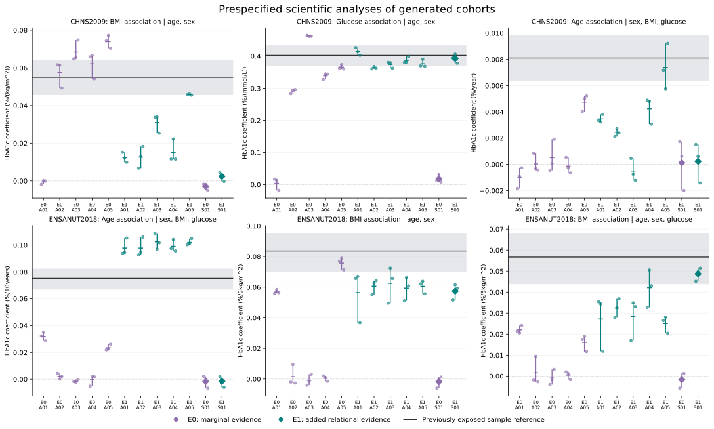

# Evidence-Guided Virtual Biomedical Data: An Executable Procedure with Analysis-Specific Benefits and Limits

Working manuscript v0.4, 3 November 2026. This revision reports the completed, frozen two-case main study and retains earlier experiments as explicitly historical developmental evidence. It is a readable scientific working draft, not a submission-ready manuscript. Bibliographic completion, statistical predecessor positioning, ethics and data-access declarations, author information and submission preparation remain outstanding. Earlier drafts and frozen study artifacts are unchanged.

## Abstract

Biomedical researchers may lack individual-level measurements needed for an analysis while related distributions and associations are available in published studies. We evaluated an Agent-assisted procedure that translates curated, study-qualified evidence, a target-population description and a visible analytical request into executable virtual-data generators. A scientific Agent chose a joint probability law and explicit completion assumptions; numerical software sampled that law. The frozen main study used two previously exposed development references, CHNS 2009 and ENSANUT 2018, with five fresh Agent constructions per case and information condition. E0 supplied external marginal and basic measurement evidence; E1 added qualified relational evidence. Four prescribed statistical constructions provided descriptive comparisons. All 24 constructions completed, producing 72 distinct 3,000-row final tables over three fixed seeds per construction. Independent recomputation matched all 2,196 evaluated statistics, with a maximum numerical difference of 4.26 × 10⁻¹⁴. E1 had smaller constructor-averaged absolute discrepancy for five of six prespecified regression coefficients; CHNS BMI discrepancy increased from 0.020380 to 0.031557 HbA1c percentage points per kg/m². ENSANUT E1 age coefficients overshot and BMI coefficients undershot their sample references. A CHNS E1 conditional-age construction retained a negative mean. Prescribed statistical E1 constructions had smaller discrepancies than every corresponding Agent for CHNS glucose and ENSANUT conditional BMI. All ten E1 Agents documented numerical evidence use, but this did not establish source-constraint fit or transport. Seven Agents retained their initial models after feedback and thirteen finalized without exploratory feedback; no feedback-driven scientific revision occurred. Together with the historical mixed and negative findings, these results support an executable evidence-to-data procedure with analysis-specific benefits and limits, without establishing clinical interchangeability, independent external confirmation or general superiority over statistical synthesis.

## Introduction

Scientific questions often require combinations of biomedical measurements that are not jointly accessible. Individual records may be unavailable, an indicator may never have been measured in the target study, or only published summaries and a population description may be available. Converting this information into an explicit virtual table would allow investigators to apply familiar analytical procedures and explore assumption-qualified scenarios. The relevant product is data with a defined analytical use, rather than a numerical prediction alone.

Published quantities are conditioned on the studies that produced them. A marginal distribution, an adjusted coefficient and a subgroup contrast have different statistical meanings and may reflect different eligibility rules, assays and population compositions. Agreement with several such quantities does not identify a complete joint distribution. A construction method must preserve the meaning of each input, disclose assumptions completing the joint model, and evaluate the resulting data for the requested use. A table can execute correctly and reproduce a direction while giving a materially different effect magnitude or conditional association.

LLM-assisted simulator design and discrepancy-guided synthetic-data generation already have close precedents, including G-Sim and LLMSynthor [1,2]. Aggregate inputs, multiple sources, numerical calibration and iterative generation are not claimed as new in themselves. The contribution examined here is a biomedical, task-adaptive evidence-to-data procedure with explicit numerical evidence-use records, executable scientific models and analysis-specific empirical evaluation. A distinct algorithmic mechanism or superiority claim would require evidence under comparable inputs and budgets; it is not established by the present study.

We address three questions: whether the procedure can construct complete joint data from admitted evidence; how analytical agreement changes when relational information is available; and what the records establish about evidence use, author variability and optional revision. The analytical requests are visible to the scientific author. Different requests may legitimately lead to different probability laws. Reusing one unchanged table for many analyses is a separately testable capability, rather than a universal restriction on this procedure.

## Methods

### Evidence-guided whole-cohort construction

We evaluated a task-specific procedure for constructing virtual biomedical data when individual-level inputs were unavailable. Each request specified a target population, five variables—age, sex, BMI, glucose and HbA1c—measurement units, sample-selection requirements and three intended regression analyses. The research questions were visible to the scientific author. An Agent received a curated external-evidence packet and chose a joint probability law, its parameters and explicit assumptions for quantities not identified by the packet. The output was executable generator code and a structured model specification, rather than individual-level measurements recovered from a source study. Numerical software sampled the Agent-authored law. Different requests and independent construction contexts could yield different laws.

Researchers curated the evidence and defined the study requests, packets, allowed access, comparator and evaluation protocol. The allocation therefore included researcher intervention and was not an experiment in autonomous literature acquisition. No new source or target acquisition was permitted during the comparison. The scientific author selected the model structure and parameters within those inputs. The coordinator did not supply target-derived coefficients or desired association directions.

An evidence record retained the reported population, measurement, units, statistical operator, adjustment set, estimate and available uncertainty. For each admitted relational operation, the author recorded whether it constrained the model, was checked analytically, supplied context or was declined. For numerical use, the corresponding calculation had to follow from the actual probability law under a declared source-context approximation. Coefficients from separate adjusted regressions were treated as separate projections, not automatically inserted as coefficients of a single joint equation. Completion and transport assumptions remained distinguishable from reported quantities. Individual dispersion was separated from uncertainty in an estimated mean or slope; fixed scientific parameters did not acquire an uncertainty interpretation merely because a generator used multiple random seeds.

The retained biomedical sources included Bao, Wang/MIND, Jansen/Lifelines and Pani, with measurement-scale guidance from NGSP [3–7]. Their roles differed by case and information condition. A source locator or mathematically compatible operation did not itself establish extraction validity, agreement with a published value or applicability to the target population. Unit conversion added no independent evidence.

Source-population simulation was not supplied in this allocation. Source-statistic comparisons on generated target tables were therefore unavailable. A versioned semantic checker verified declared statistical, measurement and role information, while deterministic analytic artifacts and independent review assessed the qualified numerical uses. These checks did not authenticate source extraction, establish transportability or convert an assumed source context into the original study population. Optional exploration supplied generated-table diagnostics rather than target reference answers.

Whole-cohort synthesis required no individual-level construction inputs. Indicator augmentation and missing-cell completion have separate development records; their results were not pooled with this whole-cohort study. Generic source replay, automatic evidence acquisition, arbitrary measurement conversion and universal uncertainty calibration were not claimed.

### Cases and information conditions

The two cases used existing preparations for CHNS 2009 and ENSANUT 2018. Both reference samples had been exposed to the research team in earlier development. They were not untouched confirmations, and a fresh Agent context did not restore clinical independence. Source packets also overlapped across the cases, including Jansen/Lifelines evidence and measurement guidance.

CHNS construction covered ages 35–74, used glucose in mmol/L and retained the original unweighted selected-sample analytical definitions. Its three analyses estimated the BMI coefficient in HbA1c regressed on age, sex and BMI; the glucose coefficient in HbA1c regressed on age, sex and glucose; and the age coefficient in HbA1c regressed on sex, BMI, glucose and age. ENSANUT construction covered ages 25–79, used glucose in mg/dL and followed its original fasting, prior-diagnosis and anthropometric selection definitions. Each generated ENSANUT table contained exactly 375 rows in each of eight sex-by-age cells. Its requested uses were the age coefficient in the full age/sex/BMI/glucose model, the BMI coefficient in the age/sex/BMI model and the BMI coefficient in the full model. ENSANUT predictors were scaled per 10 years of age, 5 kg/m² of BMI and 10 mg/dL of glucose. These estimates used the prespecified equal-cell standard and did not estimate national survey-weighted effects.

For each case, E0 supplied external marginal and basic measurement evidence. E1 supplied the same information plus admitted relational evidence. An author could decline a numerically incompatible operation if the reason was recorded. The contrast assessed the use of additional available information within the procedure; it did not isolate an algorithmic mechanism or require every relationship to be accepted. Target reference values were withheld from construction and revision, although the reference families were already known to the research team. Intended analyses were disclosed, including analyses not directly used as numerical calibration objectives. An algebraic implication of supplied information was not presented as a newly discovered relationship.

All coefficients are expressed as changes in HbA1c **percentage points**, not relative percentage changes. Table 1 retains the separate predictor scales, selected-sample estimates and uncertainty definitions. The endpoint label “CHNS E1” in the frozen records denotes the BMI analysis and is distinct from information condition E1; descriptive endpoint names are used below to avoid that ambiguity.

**Table 1. Prespecified scientific uses and uncertain sample references.** BMI is in kg/m². Each row gives the coefficient for the named predictor in the listed adjustment model. CHNS intervals are 95% community-cluster CR1-t intervals for its selected, unweighted sample. ENSANUT bands come from the prespecified 399-attempt cluster-resampling stability procedure for the equal-cell analytical standard; they are not national confidence intervals. Neither type is an equivalence margin or an acceptance threshold.

| Case / focal predictor | Adjustment variables | Unit of HbA1c coefficient | Sample estimate | Reference interval or stability band |
|---|---|---|---:|---|
| CHNS BMI | Age, sex | Percentage points per kg/m² | 0.054946 | 0.045726 to 0.064166 |
| CHNS glucose | Age, sex | Percentage points per mmol/L | 0.402093 | 0.371286 to 0.432900 |
| CHNS age | Sex, BMI, glucose | Percentage points per year | 0.008107 | 0.006387 to 0.009827 |
| ENSANUT age | Sex, BMI, glucose | Percentage points per 10 years | 0.075132 | 0.067124 to 0.082185 |
| ENSANUT BMI | Age, sex | Percentage points per 5 kg/m² | 0.083643 | 0.070373 to 0.095214 |
| ENSANUT conditional BMI | Age, sex, glucose | Percentage points per 5 kg/m² | 0.056638 | 0.043901 to 0.068006 |

### Allocation, review and execution

The release allocated five fresh Agent construction contexts per case and information condition, giving 20 Agent constructions. Four additional constructions used one fixed, independently reviewed statistical synthesis specification per case and condition. The statistical procedure used the same admitted information through source-qualified moment constraints and explicit completion assumptions. The comparison with five independently authored Agent models was descriptive and asymmetric; one prescribed statistical specification was not a representative sample of all statistical synthesis methods. Independently authored contexts measured construction variability and were not a required multi-Agent collaboration mechanism.

Each construction was assigned three prespecified final attempts, using seeds 5101, 5102 and 5103. Each final attempt was scheduled to produce 3,000 rows, giving 72 final slots. At most two exploratory row-producing attempts, using 5201 and 5202, were permitted per construction. Failed attempts consumed the same allowance, and the ceiling was 120 physical table attempts. Deterministic analytic calculations were retained separately. Each author could use at most one actual feedback-to-scientific-revision cycle, retain the initial model or finalize without exploratory feedback. Selection did not depend on a favorable clinical comparison. Unexecuted analytic drafting was distinguished from feedback-driven revision.

The coordinator froze candidates before execution, recorded actual author identities and enforced fixed final slots. Separate Agent review contexts checked the implemented probability law, numerical uptake, support and required finite moments before final delivery, retaining independent deterministic calculations. These implementation audits were not external clinical expert validation or scientific peer review. Runtime checks assessed table completeness and output linkage; these technical properties did not establish biological validity.

Author tool access was procedurally restricted to approved inputs and the author's own artifacts. Generator execution used the existing isolated runtime, which did not provide host-level isolation for the author's general tools. Hash-bound artifacts recorded procedural commitments, not cryptographic authentication of scientific truth. Observable execution metadata were retained; unavailable model-snapshot and token metadata were not imputed.

All cases, conditions and final attempts had to close before common reference evaluation. No favorable author, seed or earlier candidate could replace a final output. Failures and unavailable endpoints were to remain represented among all scheduled slots. Earlier completed experiments and their negative findings were retained under their original protocols.

### Analysis and reporting

The prespecified evaluation reported each requested regression coefficient, its direction and discrepancy from the corresponding real-sample estimate, together with 27 CHNS or 28 ENSANUT distribution and joint diagnostics. Real-sample estimates were uncertain references, not known population constants. Their intervals were not treated as equivalence margins. Repeated synthetic rows and seeds characterized simulation conditional on the chosen model, not additional clinical observations or independent evidence.

For each analysis separately, the information contrast was the E1 minus E0 difference in arm means of constructor-level mean absolute discrepancies over the three final seeds. Thus, the absolute discrepancy was calculated for each seed, averaged within each constructor, and then averaged over the five constructors in an Agent arm. This is not the absolute difference between an arm-average coefficient and the reference. Each constructor's coefficient mean and actual seed range were also retained. If a required seed or endpoint had been unavailable, the complete-arm contrast would have been unavailable and any available-case description labelled incomplete. Unlike estimands and units were not pooled into a single accuracy score. Matching author labels across conditions did not establish a paired design, and the five author contexts were not a random sample of all possible authors or laws. No inferential interval or hypothesis test for the information contrasts was added.

The prespecified independent audit recomputed generated-table statistics using a separately written implementation with independent regression and weighted-summary arithmetic, checked frozen reference-aggregate mappings and rechecked constructor-first contrasts. It did not regenerate rows or reopen model selection. The original patient-reference calculations retained their earlier independent audit; final recomputation was not a new patient-level reanalysis. Execution-receipt timings were recorded separately from unmetered Agent authoring, source preparation and review costs.

### Reproducibility anchors

The executed unit is `work/main_study_freeze_2026-11-03/`. Its release, `RELEASE.json`, has SHA-256 `796fb50db7fc49c0b0195e596182a3550816938f5d8e1d28e859bf267ee78aad`. It binds case definitions, admitted packets, information profiles, the statistical specification, execution controller and common evaluator. The completed common result has SHA-256 `1fbc32d2f982d31c649d9217e644a34c02b81e08c093380fba8f3aaec9e4c2cb`. Independent audit code has SHA-256 `d225b591b6c3d3f6e54ff9b0fc41f9437b6bfdd8f18f367d52a79db85538e8b4`. This manuscript revision uses the audited aggregate results and retained interpretation, uptake and cost records; it adds no new experiment, model fitting, hypothesis test or patient-level analysis.

## Results

### Main-study completion and arithmetic audit

All 24 constructions completed: 20 fresh Agent constructions and four prescribed statistical constructions. All 72 final slots produced complete 3,000-row tables with distinct table contents, and all 72 received complete analyses. Including seven exploratory trials, 79 row-producing attempts succeeded. The independent audit reported 22,713 checks, matched all 2,196 numerical statistics, and found a maximum numerical difference of 4.263256414560601 × 10⁻¹⁴, with no errors and no unavailable slots. This establishes agreement in retained-output arithmetic and frozen aggregate mappings. It does not establish source validity, target transport or clinical equivalence.

All 79 execution receipts were metered and summed to 53.565 seconds. These elapsed times cover isolated generator execution only. They exclude source curation, author reasoning, analytic work, review, orchestration and user time. End-to-end LLM cost, token counts and model-snapshot identifiers were unavailable; the study therefore provides no estimate of overall resource or recruitment-cost savings.

### Prespecified information contrasts

All six contrasts were complete. Adding relational information was associated with a smaller constructor-averaged mean absolute discrepancy for five coefficients, while CHNS BMI discrepancy increased (Table 2). CHNS glucose discrepancy decreased from 0.134019 to 0.024079 HbA1c percentage points per mmol/L. These are descriptive comparisons of delivered constructions. Five of six is neither a pooled accuracy measure nor a claim that the endpoints are independent confirmations.

**Table 2. All six prespecified Agent information contrasts.** Each arm contains all five constructors and their three fixed final seeds. MAD denotes each constructor's mean absolute discrepancy from the case-specific sample point estimate, averaged over the arm. A negative E1 − E0 value indicates smaller discrepancy. Units follow the coefficient in Table 1. Different endpoints are not pooled; no significance or equivalence test is implied.

| Case / focal predictor | Unit | E0 arm MAD | E1 arm MAD | E1 − E0 |
|---|---|---:|---:|---:|
| CHNS BMI | Percentage points per kg/m² | 0.020380 | 0.031557 | +0.011178 |
| CHNS glucose | Percentage points per mmol/L | 0.134019 | 0.024079 | −0.109939 |
| CHNS age | Percentage points per year | 0.007281 | 0.004854 | −0.002426 |
| ENSANUT age | Percentage points per 10 years | 0.063944 | 0.024670 | −0.039274 |
| ENSANUT BMI | Percentage points per 5 kg/m² | 0.056883 | 0.023732 | −0.033151 |
| ENSANUT conditional BMI | Percentage points per 5 kg/m² | 0.048797 | 0.025649 | −0.023147 |

CHNS BMI provides an explicit counterexample to uniform benefit. Every E1 BMI seed coefficient was positive, but the five constructor means ranged from 0.012400 to 0.045757 against the reference 0.054946 percentage points per kg/m². Every mean was below the reference, and arm MAD increased by 0.011178. E1 glucose means ranged from 0.363363 to 0.414189 against 0.402093 percentage points per mmol/L, despite the smaller average discrepancy.

CHNS conditional age also showed incomplete recovery. E1 constructor means ranged from −0.000509 to 0.007393 against 0.008107 percentage points per year. A03 had a negative mean and two negative final-seed coefficients; 13 of the 15 E1 seed coefficients were positive. The lower arm-average discrepancy did not establish uniform directional recovery. This conditional age relationship was not supplied by the CHNS packet, and Pani was absent from both CHNS conditions. Its generated value was an assumption-dependent consequence of the completed joint law.

All ENSANUT E1 Agent final-seed focal coefficients were positive, but systematic magnitude mismatches remained. Age means ranged from 0.097769 to 0.102452 against 0.075132 percentage points per 10 years; every final age seed exceeded the reference stability-band upper bound of 0.082185. BMI means ranged from 0.056459 to 0.062515 without glucose adjustment and from 0.024997 to 0.042091 with glucose adjustment, compared with references of 0.083643 and 0.056638 percentage points per 5 kg/m². For each BMI endpoint, all five constructor means were below its reference-band lower bound. These interval positions describe mismatch; they do not define pass/fail rules or test the E1 − E0 contrast.

Source-analogous CHNS BMI/glucose and ENSANUT age/BMI projections were available under E1, with target values withheld. ENSANUT conditional BMI was neither supplied nor algebraically identified by the packet. Its smaller E1 discrepancy does not establish discovery, mediation or causal validity: completion and transport assumptions determine the conditional projection. Across both cases, the 27 CHNS and 28 ENSANUT diagnostics remain part of the common aggregate evaluation; the focal coefficients alone do not establish recovery of the whole joint distribution.

**Figure 1. Analysis-specific outputs from every main-study construction.** The six panels show the prespecified CHNS and ENSANUT regression coefficients. Every Agent author A01–A05 in each case and information condition, and every prescribed statistical construction S01, is represented. Small circles show the individual final seeds, 5101, 5102 and 5103. Central markers show their mean (horizontal marks for Agent constructions and diamonds for statistical constructions); vertical ranges are the actual minimum and maximum over those seeds, not confidence intervals. No favorable author or seed was selected. Repeated labels across arms do not identify paired authors. Reference lines and shaded uncertainty regions retain the selected-sample estimates in Table 1: CHNS community-cluster CR1-t intervals and ENSANUT cluster-resampling stability bands under its equal-cell standard. The bands are case-specific uncertainty context, not equivalence or acceptance margins. HbA1c coefficients are in percentage points per the indicated predictor unit. Synthetic seed variation is conditional on each fixed probability law and does not represent source-estimation, structural or transport uncertainty. The linked SVG is the GitHub publication copy; its local source is `work/main_study_freeze_2026-11-03/publication/figures/main_scientific_uses.svg` under the project root `biomedical_research/virtual_cohort_system/`.

### Statistical references and endpoint-specific ordering

Table 3 reports all four prescribed statistical constructions and every focal endpoint. Their ordering relative to the Agent arms depended on the endpoint. Under E1, the prescribed CHNS glucose construction had MAD 0.012021, below every corresponding Agent constructor's MAD and below the Agent arm mean of 0.024079. The ENSANUT conditional-BMI statistical construction likewise had MAD 0.007940, below every corresponding Agent and the arm mean of 0.025649. Conversely, the ENSANUT E1 statistical age mean was −0.001548 with MAD 0.076680, larger than every corresponding Agent discrepancy and the arm mean of 0.024670.

**Table 3. All prescribed statistical references alongside Agent arm discrepancies.** Statistical means and MADs use all three final seeds. Agent MAD is the mean of the five constructor-level MADs. Units and adjustments follow Table 1. One fixed statistical specification per case/condition versus five independently authored Agent models is an asymmetric descriptive comparison, not a test of general method superiority.

| Case / condition / focal predictor | Statistical mean coefficient | Statistical MAD | Agent arm MAD |
|---|---:|---:|---:|
| CHNS / E0 / BMI | −0.002931 | 0.057877 | 0.020380 |
| CHNS / E0 / glucose | 0.017344 | 0.384750 | 0.134019 |
| CHNS / E0 / age | 0.000121 | 0.007986 | 0.007281 |
| CHNS / E1 / BMI | 0.002391 | 0.052555 | 0.031557 |
| CHNS / E1 / glucose | 0.392570 | 0.012021 | 0.024079 |
| CHNS / E1 / age | 0.000229 | 0.007878 | 0.004854 |
| ENSANUT / E0 / age | −0.001664 | 0.076797 | 0.063944 |
| ENSANUT / E0 / BMI | −0.001736 | 0.085378 | 0.056883 |
| ENSANUT / E0 / conditional BMI | −0.001708 | 0.058345 | 0.048797 |
| ENSANUT / E1 / age | −0.001548 | 0.076680 | 0.024670 |
| ENSANUT / E1 / BMI | 0.057441 | 0.026202 | 0.023732 |
| ENSANUT / E1 / conditional BMI | 0.048698 | 0.007940 | 0.025649 |

Numerical uptake differed even with the same admitted packet. ENSANUT E1 Agents constrained two Jansen projections and the Pani age projection. The statistical specification constrained the two Jansen projections and retained the Pani age slope and eight age-band quantities as context because source individual dispersion, the source age law and original survey weighting were unbound. This is a documented difference in evidence-use decisions, not an identified explanation for the observed performance ordering.

### Numerical evidence use and absence of scientific revision

All ten E1 Agent authors used at least one admitted relation as a numerical model constraint and assigned a role to every admitted relational operation. Table 4 includes every E1 construction. All E0 constructions had zero admitted relational operations. Across E1 Agent constructions, CHNS records contained nine model constraints, eight analytic checks and three contextual uses; ENSANUT records contained fifteen model constraints, twenty-four analytic checks and sixteen contextual uses. These are operation-use counts across authored models, not counts or weights of independent evidence.

**Table 4. Declared, reviewed relational evidence use for all E1 constructions.** A model constraint is qualified by the assumed source context. An analytic check need not match its source value. Numerical uptake therefore does not prove that all source constraints were jointly fitted, that the original source population was reconstructed or that any relation transported to the target. No record used the explicit declined classification, although context-only records could explain a decision against numerical use.

| Case / constructor | Model constraints | Analytic checks | Context only | Declined | Final decision |
|---|---:|---:|---:|---:|---|
| CHNS / A01 | 2 | 1 | 1 | 0 | Retain initial after feedback |
| CHNS / A02 | 2 | 1 | 1 | 0 | Retain initial after feedback |
| CHNS / A03 | 1 | 3 | 0 | 0 | Initial final |
| CHNS / A04 | 2 | 1 | 1 | 0 | Initial final |
| CHNS / A05 | 2 | 2 | 0 | 0 | Initial final |
| CHNS / S01 | 4 | 0 | 0 | 0 | Initial final |
| ENSANUT / A01 | 3 | 0 | 8 | 0 | Retain initial after feedback |
| ENSANUT / A02 | 3 | 8 | 0 | 0 | Initial final |
| ENSANUT / A03 | 3 | 8 | 0 | 0 | Initial final |
| ENSANUT / A04 | 3 | 0 | 8 | 0 | Initial final |
| ENSANUT / A05 | 3 | 8 | 0 | 0 | Initial final |
| ENSANUT / S01 | 2 | 0 | 9 | 0 | Initial final |

CHNS A01, A02 and A04 constrained both Jansen projections, checked Bao Pearson and kept MIND Spearman as context. A03 constrained MIND Spearman and checked both Jansen projections plus Bao Pearson. A05 constrained Jansen BMI and MIND Spearman while checking Jansen glucose and Bao Pearson. The statistical CHNS E1 specification constrained all four operations. ENSANUT Agents constrained three projections each; A02, A03 and A05 checked all eight Pani age-band means, while A01 and A04 kept those means as context.

Across all 24 constructions, seven Agent decisions were `retain`, thirteen Agent decisions were `initial_final`, and four statistical decisions were `initial_final`. Every selected candidate was the initial candidate. Thus, seven Agents retained their original models after exploratory feedback, thirteen finalized their initial models without exploratory feedback, and all statistical constructions finalized their initial specifications. No feedback-driven scientific revision occurred. Retention after feedback cannot substantiate a revision gain, and analytic drafting without executed feedback is not a feedback-to-revision experiment.

### Historical developmental evidence

The following studies preceded the frozen main study and retain their original protocols, exposure conditions and method versions. They are not pooled with the main study as independent confirmations or as additional observations in its contrasts.

The earlier CHNS construction retained all three requested association directions, but BMI coefficients were approximately 30–39% of the observed reference estimate and glycemic variability was reduced. These quantitative limitations remain part of the development record (`work/chns_admission_2026-11-01/f2/CASE_RESULTS.md`).

Wave A evaluated HAALSI glucose and Turkana lipids with ten fresh Agent constructions and two prescribed statistical constructions. All 84 scheduled source/target tables executed, and 6,704 independent comparisons agreed. The frozen positive criterion failed: three of five Agent constructions passed the HAALSI case and none passed the Turkana case at the specified resolution. The HAALSI zero anchors also passed that resolution, limiting its discrimination. Those results did not support general quantitative usefulness or comparative superiority. No Wave B was started (`work/scaleup_2026-11-01/production_release/`).

A completed CHNS marginal-versus-relational evidence comparison also failed its overall joint-improvement criterion. A construction audit found predominantly qualitative relationship use and infinite population moments in seven proposed laws. Finite-table results were retained. Later mathematical repairs and audits did not retrospectively turn these historical failures into positive results (`work/existing_data_benchmark_2026-11-02/`).

A separate single-author reference-assisted pilot generated nine distinct tables. A dependence revision improved rank agreement in all three paired seeds, while regression absolute discrepancies increased slightly. This targeted trade-off is retained as a separate observation; it does not establish a general revision benefit (`work/adaptive_reference_pilot_2026-11-03/`).

The subsequent information-and-revision experiment used six fresh contexts to generate 3,000-row CHNS cohorts. Three received the request, target description and external literature; three additionally received all thirty existing CHNS reference statistics. This was an explicit information-provision experiment on an already exposed development case. Every author used one initial trial and delivered three fixed seeds, then reviewed permitted diagnostics and selected a final revised or retained version. Initial delivery was allowed feedback-bearing trials, so its stage comparison concerned an additional review opportunity, rather than no feedback versus feedback.

All 42 executions succeeded: six trials and thirty-six initial/final deliveries. All six authors retained their scientific models, so eighteen final tables exactly duplicated their paired initial tables. There were 24 distinct tables overall and eighteen distinct delivery tables. Independent recomputation matched all 1,260 statistics, with maximum numerical difference 7.11 × 10⁻¹⁵. All three focal coefficients were positive in every distinct delivery table. Table 5 preserves the quantitative information-regime comparison. No renewed infinite-moment defect was identified in its six laws; that supported mathematical consistency, not biological authenticity.

**Table 5. Historical CHNS information-provision experiment, retained separately from the main study.** Ranges are across three authors' three-seed means and are descriptive ranges, not confidence intervals. The reference-assisted condition received the quantities used for comparison. Coefficient units are HbA1c percentage points per kg/m², mmol/L and year, respectively; correlations are dimensionless.

| Analysis | CHNS sample estimate | External literature | Literature plus reference summaries |
|---|---:|---:|---:|
| BMI coefficient, adjusted for age and sex | 0.054946 | 0.013001–0.034287 | 0.052821–0.055789 |
| Glucose coefficient, adjusted for age and sex | 0.402093 | 0.356064–0.487815 | 0.396941–0.413715 |
| Age coefficient, adjusted for sex, BMI and glucose | 0.008107 | 0.003552–0.006910 | 0.007569–0.007947 |
| Glucose–HbA1c Pearson correlation | 0.660968 | 0.633764–0.813170 | 0.650561–0.666438 |
| Glucose–HbA1c Spearman correlation | 0.361457 | 0.501339–0.566477 | 0.357571–0.360983 |

Reference-assisted constructions were closer to the supplied quantities, establishing calibration consistency under admitted information. Literature-only constructions retained directions but attenuated the BMI projection and overstated the rank association. Six retention decisions, unchanged code/specifications and eighteen identical paired output hashes established exactly zero additional-stage numerical change. The complete historical record remains at `work/information_revision_ablation_2026-11-03/`; its results are not gains from the present main-study revision policy.

## Discussion

The completed main study supports an executable evidence-to-data procedure with analysis-specific benefits and limits. Twenty fresh Agent contexts and four prescribed statistical constructions produced complete analyzable tables, and a separate implementation confirmed the reported arithmetic. Additional available relational evidence was associated with smaller discrepancy for five of six prespecified coefficients. The exceptions and residual shifts are part of this result: CHNS BMI worsened, one CHNS E1 conditional-age construction had a negative mean, and ENSANUT E1 age and BMI coefficients showed systematic deviations in opposite directions. Operational completion and numerical reproducibility therefore coexist with incomplete analytical recovery.

The distinction between evidence uptake and scientific fit is central. Every E1 Agent used relations numerically, addressing a limitation seen in the historical marginal-versus-relational comparison. However, counting constraints or checks cannot establish that their values were fitted simultaneously, that an assumed source context reproduced the study, or that the resulting law transported to the target. A check can disclose a mismatch, and a constraint can be correct only under a declared approximation. Separate adjusted source regressions do not identify an entire joint target law. The unprovided CHNS conditional-age and ENSANUT conditional-BMI analyses expose the consequences of those completion assumptions.

The information contrast is useful for describing this procedure under two input regimes. It is not an isolated causal estimate of a particular reasoning mechanism: the arms contained distinct scientific authors, probability laws, uptake decisions and transport assumptions. The authors were allowed to see the intended analyses, which is appropriate for task-specific construction, but this does not make an unprovided coefficient an independent biological discovery. The two reference families had also been exposed to researchers and shared evidence sources. Fresh author contexts reduce direct context reuse within the allocation; they do not make the study an untouched external validation.

The statistical constructions clarify the limits of a whole-framework advantage claim. Under E1, the prescribed statistical models were closer than every corresponding Agent for CHNS glucose and ENSANUT conditional BMI, while ENSANUT age favored the Agent constructions. This mixed ordering should remain visible. One fixed statistical specification per condition is an asymmetric reference for five independently authored Agent models, and different numerical uptake complicates causal interpretation of their differences. The study establishes neither general Agent superiority nor the best achievable performance of statistical synthesis.

Optional revision remains an operational capability whose benefit requires evidence. The main allocation contained no feedback-driven scientific revision: seven Agents retained the initial model after feedback and thirteen finalized without it. The historical single-author pilot showed a targeted improvement with a regression trade-off, whereas the later six-context experiment had exactly zero additional-stage numerical change. These records support retaining a bounded review and stopping policy while avoiding an iterative-improvement headline. Mandatory extra revision is not justified by the current outcomes.

Reference uncertainty also limits interpretation. The real samples provide uncertain, selected-sample estimates rather than known population values. CHNS intervals and ENSANUT stability bands have different constructions and analytical targets. A synthetic coefficient outside a band indicates a descriptive discrepancy under that reference, not a failed equivalence test; a coefficient inside a band would not establish clinical acceptability. Three seeds summarize variation from a fixed law. They do not propagate source-estimation, model-selection, structural or transport uncertainty, and increasing the number of generated rows would not create additional clinical information.

Further limitations include restricted variables and two development families, overlapping literature, incomplete identification of dependence, source-to-target selection and ancestry differences, assay and serum/plasma differences, unavailable source-population replay, and procedural rather than host-enforced isolation of author tools. Implementation reviews and arithmetic audits do not authenticate source extraction or replace clinical expert assessment. The 27 or 28 additional diagnostics constrain interpretation but do not prove whole-distribution recovery. Timings cover generator execution only, and missing end-to-end cost metadata prevent a resource-saving conclusion.

The historical negative findings reinforce the scope of the contribution. Direction agreement, a technically valid table or one improved diagnostic can coexist with poor quantitative agreement elsewhere. Later repairs preserve the earlier failures as evidence of what the earlier method did, rather than erasing them from the research record. The present results do not establish participant-specific measurement recovery, causal validity, clinical substitution or observed recruitment-cost savings. They establish a transparent route from admitted evidence and explicit assumptions to virtual data whose suitability must be assessed for each requested analysis.

## Data and code availability

Reviewed source summaries, original code, protocols, aggregate results and independent checks are available through the [public research repository](https://github.com/ziwang11112/evidence-guided-virtual-cohorts-2026). The main-study publication view is organized under `reports/main_study_freeze_2026-11-03/`; the authoritative local frozen study unit is `work/main_study_freeze_2026-11-03/`. Public review packages contain selected artifacts and are not complete portable copies of every frozen runtime bundle. Real and generated individual-level tables, full third-party papers/codebooks and credentials remain local. Source access conditions and exact exclusions must be retained in the final data-availability statement. Participant-data ethics and access declarations require author completion before submission.

## References: inherited working list

The following list is inherited from the previously audited [v0.2 reference list](DRAFT_v0_2.md#references-used-in-this-working-revision). It is incomplete and has not been refreshed by a new external bibliography search for this revision. Existing bibliographic descriptions and links are retained as working entries; incomplete metadata and the statistical predecessor literature must be resolved before submission.

1. Holt S, Ruiz Luyten M, Berthon A, van der Schaar M. G-Sim: Generative Simulations with Large Language Models and Gradient-Free Calibration. ICML, PMLR 267, 2025. [Published paper](https://proceedings.mlr.press/v267/holt25b.html).
2. Tang Y, Kong M, He J, Nie T, Ma W, Sun L. LLMSynthor: Macro-Aligned Micro-Records Synthesis with Large Language Models. KDD 2026; arXiv v4, 8 June 2026, as recorded in the prior positioning review. [DOI](https://doi.org/10.1145/3770855.3818965); [versioned full text](https://arxiv.org/html/2505.14752v4).
3. Bao et al. Glycated haemoglobin A1c for diagnosing diabetes in Chinese population: cross sectional epidemiological survey. BMJ. 2010;340:c2249. [DOI](https://doi.org/10.1136/bmj.c2249).
4. Wang et al. Comparing glycemic traits in defining diabetes among rural Chinese older adults. PLOS ONE. 2024. [DOI](https://doi.org/10.1371/journal.pone.0296694).
5. Jansen et al. Lifelines adjusted-association source, 2013. [DOI](https://doi.org/10.1111/joim.12010). The [audited source record](../reports/chns_admission_2026-11-01/f2/sources/JANSEN_2013.md) identifies the exact projections used; full bibliographic metadata remains to be completed.
6. Pani et al. Age-association source, 2008. [DOI](https://doi.org/10.2337/dc08-0577). The [audited source record](../reports/chns_admission_2026-11-01/f2/sources/PANI_2008.md) identifies the retained weighted result; full bibliographic metadata remains to be completed.
7. NGSP. The IFCC and NGSP, Table 2. [Official measurement-scale guidance](https://ngsp.org/ifccngsp.asp).

## Author and submission completion notes

Remove this section before submission. The main study is complete; it is no longer a planned or unrun allocation. The following manuscript tasks remain: complete and verify the bibliography and statistical predecessor comparison; finalize source and participant-data ethics/access statements; supply author names, affiliations, contributions, funding and competing-interest declarations; complete observable runtime and reproduction details without inventing unavailable model or token metadata; update the contribution-to-evidence map to the completed main outcomes; and prepare journal-specific text, figures and submission files. The bounded manuscript revision does not require or launch a new experiment. No results should be selectively replaced by a favorable author, seed, endpoint or historical candidate.
