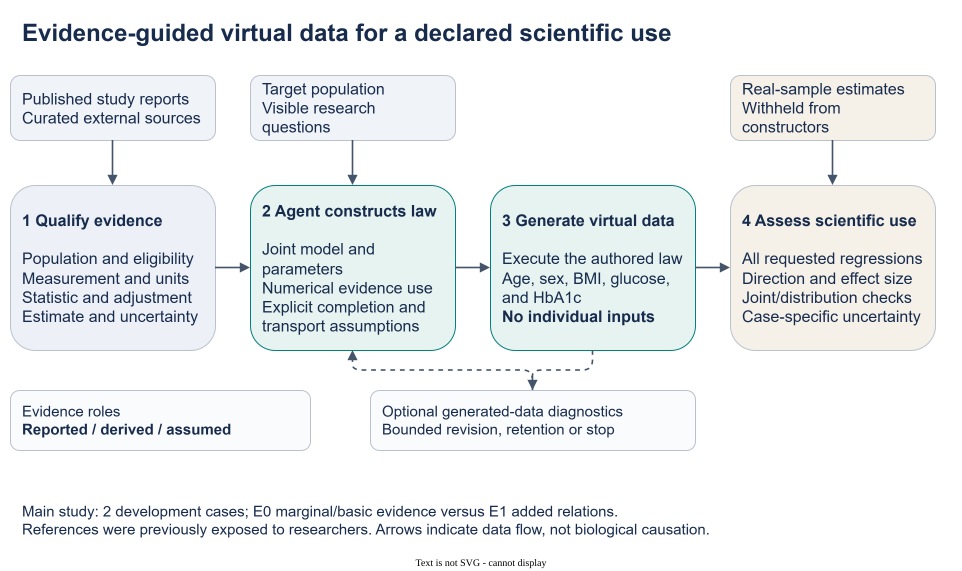
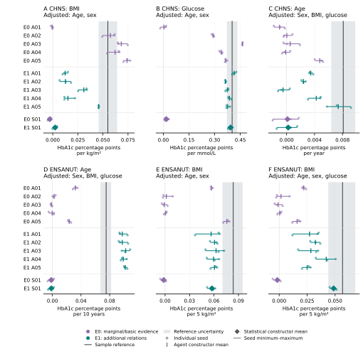

# From Published Evidence to Virtual Biomedical Cohorts for Scientific Analysis

Working manuscript v0.5, 3 November 2026. This scientific working draft reports the completed frozen main study and preserves the earlier mixed and negative findings in a linked supplement. It is not submission ready. Author information, declarations, remaining bibliographic metadata and journal-specific preparation require completion. No experiment, reference estimate or frozen artifact was changed for this revision.

## Abstract

Biomedical analyses often require measurements that are not jointly accessible, although published studies describe related distributions and associations. We evaluated an Agent-assisted procedure that converts curated, study-qualified evidence, a population description and visible analytical requests into executable virtual-cohort generators without individual-level construction inputs. The Agent selected a joint probability law and explicit completion assumptions; numerical software sampled that law. A frozen comparison used two previously exposed development references, CHNS 2009 and ENSANUT 2018. Five Agent constructions per case received either marginal/basic evidence (E0) or additional relational evidence (E1); four prescribed statistical constructions supplied descriptive comparisons. All 24 constructions delivered their three fixed 3,000-row final tables, and independent recomputation agreed with the retained analyses. E1 had smaller constructor-averaged absolute discrepancy for five of six prespecified regression coefficients. CHNS BMI discrepancy instead increased from 0.020380 to 0.031557 HbA1c percentage points per kg/m². ENSANUT E1 age coefficients were high and BMI coefficients low relative to their sample references; one CHNS E1 conditional-age construction retained a negative mean. The statistical E1 constructions were closer than every corresponding Agent for CHNS glucose and ENSANUT conditional BMI. All ten E1 Agents documented numerical model constraints, but no feedback-driven scientific revision occurred. These results support a practical evidence-to-cohort procedure and an analysis-specific account of its usefulness and limitations. They do not establish general superiority, clinical interchangeability or independent external confirmation.

## Introduction

Biomedical researchers may have a scientific question and a population description but no accessible individual-level dataset containing all necessary measurements. Articles provide fragments of the relevant distribution: marginal summaries, adjusted associations, subgroup means and measurement definitions. A virtual cohort assembled from these fragments could let researchers execute familiar analyses and inspect the consequences of explicit modelling assumptions. The scientific problem is to construct a coherent joint distribution from incomplete and heterogeneous evidence, then determine what the resulting table supports for the requested analysis.

Published estimates retain the conditions under which they were obtained. An age-adjusted coefficient from one study and a correlation from another do not automatically describe one target population. Their meaning depends on selection, measurement, adjustment and statistical operation. Even compatible estimates leave aspects of dependence and individual variation unidentified. The method must therefore distinguish reported evidence, quantities derived from it and assumptions completing the joint model. Producing plausible rows is insufficient if the analysis of those rows changes the direction or magnitude of the association of interest.

Summary-based biomedical synthesis has substantial precedents. Filshtein and colleagues used a prespecified causal structure and source-specific data-generating rules to generate complete cohorts for pooling and subsequent analysis; collaborating analysts first estimated those rules from source microdata. SynthIPD generates survival records and covariates from published trial information, with same-population inputs and additional joint summaries required for multivariate categorical reconstruction. Multilevel network meta-regression integrates individual models over study-specific covariate distributions, explicitly addressing the assumptions connecting individual and aggregate quantities. These works establish that summaries, joint-distribution assumptions and analysis-specific evaluation are already central statistical concerns. [Filshtein et al., 2021](https://pmc.ncbi.nlm.nih.gov/articles/PMC8338788/); [SynthIPD v2](https://arxiv.org/html/2509.16466v2); [Phillippo et al., 2020](https://rss.onlinelibrary.wiley.com/doi/full/10.1111/rssa.12579).

Agentic and LLM-assisted approaches also overlap with this task. G-Sim combines executable simulator authorship with numerical calibration and structural refinement, including fragmented information and summary diagnostics within its scope. LLMSynthor constructs micro-records from aggregate information and evaluates downstream policy queries. SynthCraft organizes biomedical synthetic-data workflows around an LLM-based partner and numerical generators using individual-level input datasets. Executable model authorship, aggregate inputs, multiple sources and feedback are therefore not sufficient novelty claims. [G-Sim](https://proceedings.mlr.press/v267/holt25b.html); [LLMSynthor](https://arxiv.org/html/2505.14752v4); [SynthCraft](https://journals.plos.org/digitalhealth/article?id=10.1371/journal.pdig.0001290).

Our contribution is a practical biomedical method for turning curated external evidence into an inspectable, executable whole-cohort model, together with an empirical characterization of what its outputs support. The scientific Agent makes substantive decisions about joint structure, evidence use and completion assumptions; numerical software draws the rows. We evaluated construction feasibility, the descriptive contrast between marginal and relational information, and agreement for six specified analyses. Intended analyses were visible to the author because construction was task specific. No distinct learning algorithm, field-wide priority, universal reuse of one table or advantage over the named predecessors is established by this study.

## Methods

### From qualified evidence to an executable joint law

Each construction request specified a population, five variables—age, sex, body mass index (BMI), glucose and HbA1c—units, eligibility rules and three regression analyses. Researchers curated the source packet and fixed the evaluation protocol. The Agent received no individual-level construction records or target reference coefficients. It selected a probability law, numerical parameters and assumptions for unreported quantities, then delivered generator code and a structured model specification. The resulting table represented draws from that law, rather than recovered measurements for identifiable participants. Figure 1 shows these scientific roles and the separation of construction from reference evaluation.

An evidence record retained source population, measurement, units, statistical operator, adjustment set, estimate and available uncertainty. The author assigned every admitted relational operation a role: model constraint, analytic check, contextual information or declined use. A numerical use required a calculation implied by the actual law under a declared source-context approximation. An analytic check could reveal disagreement; classifying a relation as a constraint did not establish that all source quantities were fitted simultaneously. Reported individual dispersion was distinguished from uncertainty in an estimated mean or slope.

The retained sources included Bao's Chinese glycemia study, Wang's MIND study, Jansen's Lifelines study and Pani's age-association study, with NGSP measurement-scale guidance. For example, Jansen's BMI and glucose coefficients were separate HbA1c projections adjusted for age and sex. They could not simply be inserted as coefficients of a single equation jointly containing BMI and glucose. The author had to choose the covariate law and residual dependence that made the required projections meaningful. A conversion from IFCC to NGSP units changed their representation, while adding no independent evidence or assay harmonization. [Bao et al.](https://doi.org/10.1136/bmj.c2249); [Wang et al.](https://doi.org/10.1371/journal.pone.0296694); [Jansen source](https://doi.org/10.1111/joim.12010); [Pani source](https://doi.org/10.2337/dc08-0577); [NGSP](https://ngsp.org/ifccngsp.asp).

Model specifications kept such completion and transport assumptions distinct from source facts. The [source-and-assumption supplement](SUPPLEMENT_SOURCE_AND_ASSUMPTIONS_v05.md) traces the admitted operations and their limits. A semantic checker assessed declared operators, measurement information and roles. Separate Agent reviewers inspected numerical derivations, implemented laws, support and required finite moments. These were implementation reviews, not external clinical expert validation. Source-population simulation was unavailable, so generated target-table diagnostics were not treated as reproduction of the source studies. Optional exploratory feedback concerned generated outputs, without revealing target reference answers. Evidence extraction and source-to-target applicability remained separate scientific questions.

**Figure 1. From published evidence to an analysable virtual cohort.** Researchers specify the population and analytical request and curate study-qualified evidence. The scientific Agent assigns numerical roles, chooses a joint law and states completion and transport assumptions; numerical software executes the generator. The resulting complete table can be used to execute the declared analyses. Sample reference values remain on the evaluator side of the workflow. Review and retention are permitted operations, but the main study observed no feedback-driven scientific revision. The pathway illustrates model construction, not authenticated source reconstruction or validated transport.

### Cases and information conditions

The study reused the existing CHNS 2009 and ENSANUT 2018 reference preparations, containing 6,631 and 6,931 selected participants, respectively. Both reference families had been exposed to researchers during development. Fresh author contexts did not restore untouched validation. No new source acquisition, target acquisition or patient-level reanalysis was undertaken for this comparison. The cases also shared Jansen/Lifelines evidence and measurement guidance.

CHNS covered ages 35–74 and required complete age, recorded sex, BMI, central glucose and HbA1c measurements under its fixed linkage and measurement rules. It used glucose in mmol/L and unweighted selected-sample analyses. Diabetes, treatment and pregnancy exclusions were not imposed, and fasting adherence was not verified for each person. BMI was derived from released height and weight with the prescribed measurement-flag handling. The resulting estimates describe the selected analytical sample, not national effects.

ENSANUT covered ages 25–79 with no reported prior doctor diagnosis of diabetes/high blood sugar, a recorded 8–12-hour fast, positive serum glucose below 126 mg/dL, available HbA1c and valid standing anthropometry. Pregnancy/lactation exclusions followed questionnaire routing for women aged 25–49; medication and anemia exclusions were not verified. The original preparation addressed contradictory anthropometry documentation without distribution-based trimming. Its standard assigned equal mass to eight sex-by-age cells, crossing two sex categories with ages 25–39, 40–54, 55–69 and 70–79. Reference observations in cell h received weight 1/(8n_h); generated tables contained exactly 375 rows per cell. These were equal-cell analytical estimates, not national survey-weighted effects. Glucose was in mg/dL; regression predictors were scaled per 10 years, 5 kg/m² and 10 mg/dL as applicable.

E0 supplied external marginal and basic measurement evidence. E1 added the admitted relational evidence to the same base. Source-analogous projections were available for CHNS BMI/glucose and ENSANUT age/BMI, but their target values were withheld. CHNS conditional age and ENSANUT conditional BMI were neither directly supplied as target coefficients nor identified by the packet. Pani evidence was absent from both CHNS conditions. The additional-information contrast did not require accepting every source relation; the author could retain a quantity as context or decline numerical use with a reason.

**Table 1. Prespecified scientific uses and uncertain sample references.** Each coefficient measures change in HbA1c percentage points per listed predictor increment. The focal predictor is added to the adjustment variables shown. CHNS intervals are 95% community-cluster CR1-t intervals for the selected unweighted sample. ENSANUT bands derive from the prespecified 399-attempt cluster-resampling stability procedure under its equal-cell standard. Neither is an equivalence margin. “Source-analogous” refers to an available type of projection, not an identical source and target population.

| Case / focal predictor | Adjustment variables | Predictor increment | Evidence relationship | Sample estimate | Reference interval or stability band |
|---|---|---|---|---:|---|
| CHNS BMI | Age, sex | 1 kg/m² | Source-analogous | 0.054946 | 0.045726–0.064166 |
| CHNS glucose | Age, sex | 1 mmol/L | Source-analogous | 0.402093 | 0.371286–0.432900 |
| CHNS conditional age | Sex, BMI, glucose | 1 year | Unprovided conditional projection | 0.008107 | 0.006387–0.009827 |
| ENSANUT conditional age | Sex, BMI, glucose | 10 years | Source-analogous | 0.075132 | 0.067124–0.082185 |
| ENSANUT BMI | Age, sex | 5 kg/m² | Source-analogous | 0.083643 | 0.070373–0.095214 |
| ENSANUT conditional BMI | Age, sex, glucose | 5 kg/m² | Unprovided conditional projection | 0.056638 | 0.043901–0.068006 |

### Allocation and evaluation

Five fresh Agent contexts per case and information condition produced 20 constructions. Four further constructions used one fixed, independently reviewed statistical specification per case and condition, applying source-qualified moment constraints and explicit completion assumptions to the same admitted packets. One prescribed specification versus five independently authored Agent models was an asymmetric descriptive comparison. Independently authored contexts assessed construction variability; multi-Agent collaboration was not a required generative mechanism. Matching labels A01–A05 across arms did not define paired authors.

Each construction had three fixed final attempts, seeds 5101–5103, each producing 3,000 rows. At most two exploratory row-producing attempts and one feedback-to-scientific-revision cycle were permitted per construction. Retaining the initial law or finalizing without exploration was valid. Failed attempts consumed the allowance, and the overall ceiling was 120 physical table attempts. Candidates were frozen before execution. All constructions and final slots had to close before common reference evaluation; favorable authors, seeds or earlier candidates could not replace final outputs. Author access was procedurally restricted to admitted inputs and their own artifacts. The generator runtime was isolated, but general author tools were not isolated at the host level.

Evaluation retained all six focal coefficients plus 27 CHNS or 28 ENSANUT distribution and joint diagnostics per table. For each endpoint, absolute discrepancy from the sample point estimate was calculated separately for each seed, averaged within each constructor, then averaged across the five Agent constructors. The E1 minus E0 contrast compared these arm means. This differs from taking the absolute difference of an arm-average coefficient and the reference. Constructor means and actual seed ranges were also reported. Missing required endpoints or seeds would make a complete-arm contrast unavailable. No heterogeneous pooled score, hypothesis test or post-hoc equivalence threshold was introduced.

A separately written audit recomputed statistics from retained generated outputs using independent regression and weighted-summary arithmetic, verified frozen reference-aggregate mappings and rechecked the contrasts. It did not regenerate tables or repeat patient-level reference analyses. Three seeds quantify sampling from a fixed law, not source-estimation, structural or transport uncertainty. The prespecified reference intervals and stability bands provide uncertainty context for selected-sample estimates, not clinical acceptance rules.

## Results

### Whole-cohort construction and the six analytical uses

The frozen procedure constructed complete age, sex, BMI, glucose and HbA1c cohorts from external evidence and a population request without individual-level construction inputs. All 20 Agent and four statistical constructions delivered their three fixed 3,000-row tables. All 72 final table contents were distinct, and every scheduled analysis was available. Seven exploratory tables brought the total to 79 successful executions. Independent recomputation agreed for all 2,196 evaluated statistics, with a maximum numerical difference of 4.26 × 10⁻¹⁴. This verifies retained-output arithmetic; analytical usefulness is assessed below.

Additional relational information was associated with smaller constructor-averaged absolute discrepancy for five of the six coefficients (Table 2). CHNS glucose discrepancy decreased from 0.134019 to 0.024079 HbA1c percentage points per mmol/L. CHNS BMI discrepancy increased from 0.020380 to 0.031557 percentage points per kg/m². These six descriptive comparisons retain their separate units and are not a success rate or independent replications of one effect.

**Table 2. Complete information contrasts and prescribed statistical comparisons.** Agent MAD is mean absolute discrepancy across each constructor's three final seeds, then averaged across all five constructors. Statistical MAD uses the three seeds of its single prescribed construction. Negative E1 − E0 denotes smaller Agent discrepancy. Units follow Table 1. Contrasts were calculated before rounding; subtraction of displayed values can differ in the last decimal. All statistical coefficient means and seed-level values are retained in Figure 2 and the complete constructor ledger.

| Case / focal predictor | Agent E0 MAD | Agent E1 MAD | Agent E1 − E0 | Statistical E0 MAD | Statistical E1 MAD |
|---|---:|---:|---:|---:|---:|
| CHNS BMI | 0.020380 | 0.031557 | +0.011178 | 0.057877 | 0.052555 |
| CHNS glucose | 0.134019 | 0.024079 | −0.109939 | 0.384750 | 0.012021 |
| CHNS conditional age | 0.007281 | 0.004854 | −0.002426 | 0.007986 | 0.007878 |
| ENSANUT conditional age | 0.063944 | 0.024670 | −0.039274 | 0.076797 | 0.076680 |
| ENSANUT BMI | 0.056883 | 0.023732 | −0.033151 | 0.085378 | 0.026202 |
| ENSANUT conditional BMI | 0.048797 | 0.025649 | −0.023147 | 0.058345 | 0.007940 |

Figure 2 shows why directional agreement and quantitative agreement require separate assessment. Every CHNS E1 BMI seed coefficient was positive, but all five constructor means, 0.012400–0.045757, were below the reference of 0.054946. E1 glucose means ranged from 0.363363 to 0.414189 around the reference of 0.402093. For conditional age, E1 means ranged from −0.000509 to 0.007393 against 0.008107. A03 retained a negative mean and two negative seeds; only 13 of 15 E1 seed coefficients were positive. An improved arm average therefore coexisted with an incorrect conditional-association direction in one construction.

All ENSANUT E1 focal seed coefficients were positive, while systematic magnitude mismatches persisted. Conditional-age means were 0.097769–0.102452 against 0.075132 percentage points per decade, and every final age seed exceeded the reference-band upper bound. BMI means were 0.056459–0.062515 before glucose adjustment and 0.024997–0.042091 after adjustment, compared with 0.083643 and 0.056638 percentage points per 5 kg/m². All five means for each BMI endpoint fell below its reference-band lower bound. These positions describe the discrepancies without converting reference uncertainty into a pass/fail threshold. The full distribution and joint diagnostics remain in the aggregate evaluation; the six regressions do not establish whole-distribution recovery.

**Figure 2. Analysis-specific coefficients from every main-study construction.** Six horizontal forest panels retain all 24 constructions and 72 final tables, yielding 216 seed-level focal coefficients. Each panel shows all five E0 Agents, five E1 Agents and the two prescribed statistical constructions for that case. Small circles represent seeds 5101–5103; central vertical ticks mark Agent means and diamonds mark statistical means. Horizontal segments show the actual seed minimum–maximum, not confidence intervals. Repeated author labels across arms are unpaired. The vertical black reference line and gray band show the selected-sample estimate and its case-specific uncertainty: CHNS community-cluster CR1-t intervals or ENSANUT equal-cell cluster-resampling stability bands. The bands are not equivalence margins. Predictor scales, selections and weighting differ by case as specified in Table 1. Seed variation is conditional on the fixed law and excludes source-estimation, structural and transport uncertainty.

### Statistical comparisons and documented evidence use

Comparator ordering depended on the endpoint. The E1 statistical CHNS glucose construction had MAD 0.012021, below every corresponding Agent and the Agent arm mean of 0.024079. For ENSANUT conditional BMI, its MAD was 0.007940, again below every corresponding Agent and the arm mean of 0.025649. Conversely, statistical ENSANUT E1 age had mean −0.001548 and MAD 0.076680, larger than every corresponding Agent discrepancy. Equal available evidence did not produce identical numerical uptake: ENSANUT Agents constrained the Pani age projection as well as both Jansen projections, whereas the statistical specification retained Pani's slope and eight age-band quantities as context because source individual dispersion, age distribution and original survey weighting were unbound. This documents a modelling difference without identifying the cause of the rankings.

All ten E1 Agents used at least one admitted relation as a numerical model constraint. CHNS Agent records contained nine constraints, eight analytic checks and three contextual uses; ENSANUT records contained fifteen constraints, twenty-four checks and sixteen contextual uses. These count repeated operation-use decisions across constructions, not independent evidence. The complete uptake inventory retains every operation, statistical construction and nonuse. Numerical uptake establishes that a source entered the law under stated assumptions; it does not establish source fit or transport.

Seven Agents explored generated outputs and retained their initial models. Thirteen finalized their initial models without exploratory feedback; all four statistical constructions also finalized their initial specifications. Every selected candidate was therefore initial, with zero feedback-driven scientific revisions. The experiment evaluated completed constructions and information conditions, not improvement through an iterative correction loop.

Earlier development included quantitative failures, predominantly qualitative relationship use, infinite population moments in seven proposed laws, and a targeted revision that improved rank agreement while slightly worsening regression discrepancy. A later reference-assisted experiment showed closer agreement with supplied reference summaries but exactly zero additional-stage numerical change. The [historical-results supplement](SUPPLEMENT_HISTORICAL_RESULTS_v05.md) retains these findings and their original denominators. They are not pooled with the main comparison.

## Discussion

The study demonstrates a practical route from qualified biomedical evidence to complete virtual cohorts that can be analysed using ordinary regression procedures. Its scientific product is an explicit joint model and its analytical consequences. The Agent selects how available evidence constrains the model and which assumptions supply the missing structure. The results support this procedure's feasibility and show analysis-specific empirical value: E1 was closer for five coefficients, but worsened CHNS BMI, left a negative conditional-age construction and produced systematic ENSANUT magnitude shifts. The main finding is therefore a combination of capability and its observed limits.

This contribution occupies an established methodological landscape. Statistical summary-sharing approaches already generate biomedical cohorts, and aggregate synthesis and executable simulator design are already supported by close Agent predecessors. The present application asks how heterogeneous, externally published biomedical projections can be made operational when no individual construction records or comprehensive source-analyst rules are available. Retaining source conditions, numerical roles and explicit completion assumptions makes those scientific choices inspectable. It does not establish that an Agent is the only way to make them, or that the implemented procedure is more accurate than alternatives. No comparable-input experiment against G-Sim, LLMSynthor, SynthCraft or SynthIPD was performed.

The contrast between evidence use and analytical validity is especially consequential. A correct unit conversion does not resolve differences in selection or measurement. Separate adjusted projections leave dependence unidentified, and even several numerical constraints may leave different joint laws compatible with the admitted information. Consequently, an unprovided conditional coefficient is an implication of the completed law, not automatically an inferred fact about the population. CHNS conditional age and ENSANUT conditional BMI make this visible: their results depend on assumptions beyond directly supplied coefficients. The current study does not isolate which completion or transport decision caused each discrepancy.

Task visibility is appropriate for this intended use. A researcher normally knows the analysis motivating a virtual dataset, and that question can guide which evidence and model features require attention. The authors were allowed to use that request while target coefficients remained withheld. This evaluates task-specific construction, rather than universal validity of one table across arbitrary future questions. Its incremental advantage over a task-agnostic procedure was not isolated. Likewise, indicator augmentation and missing-cell completion are potential extensions with separate development records; this whole-cohort comparison does not validate those broader uses.

The prescribed statistical constructions provide a useful counterweight to a general Agent-performance claim. Their favorable CHNS glucose and ENSANUT conditional-BMI results show that good agreement on a requested analysis can arise from a fixed statistical specification. The opposite age ordering shows that no single ranking describes all requested uses. Five independently authored models versus one prescribed specification, together with different uptake choices, cannot estimate the relative performance of method families. Nor does the E0/E1 contrast isolate a causal reasoning mechanism: distinct author contexts produced different laws and transport assumptions.

Several limitations constrain external inference. Both real-reference families were already exposed during development, and shared sources reduce their evidential independence. The evaluation covers five variables in two glycemic settings. Differences in ancestry, selection, assay, serum versus plasma, fasting and unreported joint structure remain unresolved. Source-population replay was unavailable. Implementation and arithmetic reviews do not authenticate extraction or replace clinical expert assessment. Reference samples themselves supply uncertain estimates under different selections and weighting, so neither interval inclusion nor closeness establishes clinical interchangeability.

Uncertainty also remains incomplete. Three seeds measure variation conditional on a chosen scientific law. They do not propagate uncertainty in published estimates, model selection, unreported dependence or transport to another population. Larger generated samples can stabilize numerical estimates under that law without adding biomedical information. The study therefore supports transparent scenario construction and empirical evaluation for specified analyses, rather than participant-specific measurement recovery or causal identification. A useful future extension would assess alternative plausible completion assumptions and rejection criteria for analyses that the available evidence cannot adequately support.

Finally, optional review must be distinguished from demonstrated revision benefit. No main-study author changed the scientific model after feedback. Historical revision results included a trade-off and an unchanged additional stage, so they provide no basis for an iterative-improvement headline. The 79 generator receipts summed to 53.565 seconds, but source curation, author reasoning, analytic work, review and orchestration were unmetered. Exact model-snapshot identifiers, token counts and end-to-end costs were unavailable. The completed work establishes neither research-cost savings nor recruitment substitution. It establishes an inspectable evidence-to-cohort procedure whose usefulness must be evaluated for the scientific analysis it is intended to support.

## Data, code and supporting material

The [public research repository](https://github.com/ziwang11112/evidence-guided-virtual-cohorts-2026) contains reviewed source summaries, original code, protocols, aggregate results and independent checks. The retained main-study unit is documented in [the frozen study report](https://github.com/ziwang11112/evidence-guided-virtual-cohorts-2026/blob/26ccdfb5a77c665ddce1d1c0c73ce991b7107fb3/biomedical_research/virtual_cohort_system/reports/main_study_freeze_2026-11-03/RESULTS.md); public reports are organized under `reports/main_study_freeze_2026-11-03/`. The [complete constructor ledger](https://github.com/ziwang11112/evidence-guided-virtual-cohorts-2026/blob/26ccdfb5a77c665ddce1d1c0c73ce991b7107fb3/biomedical_research/virtual_cohort_system/reports/main_study_freeze_2026-11-03/publication/RESULT_INTERPRETATION.md), [all aggregate diagnostics](https://github.com/ziwang11112/evidence-guided-virtual-cohorts-2026/blob/26ccdfb5a77c665ddce1d1c0c73ce991b7107fb3/biomedical_research/virtual_cohort_system/reports/main_study_freeze_2026-11-03/final_evaluation/RESULTS.json), [uptake inventory](https://github.com/ziwang11112/evidence-guided-virtual-cohorts-2026/blob/26ccdfb5a77c665ddce1d1c0c73ce991b7107fb3/biomedical_research/virtual_cohort_system/reports/main_study_freeze_2026-11-03/publication/UPTAKE_INVENTORY.json) and [claim lock](https://github.com/ziwang11112/evidence-guided-virtual-cohorts-2026/blob/26ccdfb5a77c665ddce1d1c0c73ce991b7107fb3/biomedical_research/virtual_cohort_system/reports/main_study_freeze_2026-11-03/CLAIM_LOCK.json) retain the full main-study evidence. Selected public review artifacts are not a complete portable runtime. Real and generated individual-level tables, third-party full texts/codebooks and credentials remain local. Participant-data access and ethics declarations require author completion.

## References and source-access status

The predecessor comparisons use the primary-source reading documented in the [3 November positioning memo](CORE_CONTRIBUTION_POSITIONING_2026-11-03.md) and [journal-fit memo](JOURNAL_FIT_2026-11-03.md). Their access record distinguishes freshly checked publication records from previously retrieved full text, including G-Sim's retained extraction. Bibliographic metadata for SynthCraft, Jansen and Wang were checked against publisher pages for this revision; Bao and Pani metadata were checked against their PubMed records after direct publisher/PMC access failed or encountered a browser challenge. Those metadata checks did not re-audit clinical extraction. Numerical-use descriptions rely on the already admitted source packets and retained audits; an identifier alone does not verify a source's use.

1. Filshtein TJ, Li X, Zimmerman SC, Ackley SF, Glymour MM, Power MC. Proof of concept example for use of simulation to allow data pooling despite privacy restrictions. *Epidemiology*. 2021;32(5):638–647. [DOI and full text](https://pmc.ncbi.nlm.nih.gov/articles/PMC8338788/).
2. Zhao Z et al. SynthIPD: training-free synthetic individual patient data generation. arXiv:2509.16466v2, 24 July 2026. [Versioned full text](https://arxiv.org/html/2509.16466v2). Publication beyond this preprint was not established in the positioning audit.
3. Phillippo DM et al. Multilevel network meta-regression for population-adjusted treatment comparisons. *Journal of the Royal Statistical Society: Series A*. 2020;183(3):1189–1210. [DOI/full text](https://rss.onlinelibrary.wiley.com/doi/full/10.1111/rssa.12579).
4. Holt S, Ruiz Luyten M, Berthon A, van der Schaar M. G-Sim: Generative Simulations with Large Language Models and Gradient-Free Calibration. *Proceedings of ICML*. PMLR 267;2025:23513–23561. [Published record](https://proceedings.mlr.press/v267/holt25b.html).
5. Tang Y, Kong M, He J, Nie T, Ma W, Sun L. LLMSynthor: Macro-Aligned Micro-Records Synthesis with Large Language Models. KDD 2026. [DOI](https://doi.org/10.1145/3770855.3818965); [full text v4](https://arxiv.org/html/2505.14752v4).
6. Callender T, Boyd A, Davis R, Ruhrberg Estevez S, Lavista Ferres JM, van der Schaar M. SynthCraft: An AI partner for synthetic data generation to support data access and augmentation in healthcare. *PLOS Digital Health*. 2026;5(3):e0001290. [Published article](https://journals.plos.org/digitalhealth/article?id=10.1371/journal.pdig.0001290).
7. Bao Y, Ma X, Li H, Zhou M, Hu C, Wu H, Tang J, Hou X, Xiang K, Jia W. Glycated haemoglobin A1c for diagnosing diabetes in Chinese population: cross sectional epidemiological survey. *BMJ*. 2010;340:c2249. [DOI](https://doi.org/10.1136/bmj.c2249); [bibliographic record](https://pubmed.ncbi.nlm.nih.gov/20478961/).
8. Wang P, Li Y, Wang M, Song L, Dong Y, Han X, Tuomilehto J, Wang Y, Du Y, Qiu C. Comparing glycemic traits in defining diabetes among rural Chinese older adults. *PLOS ONE*. 2024;19(1):e0296694. [Published article](https://journals.plos.org/plosone/article?id=10.1371/journal.pone.0296694).
9. Jansen H, Stolk RP, Nolte IM, Kema IP, Wolffenbuttel BHR, Snieder H. Determinants of HbA1c in nondiabetic Dutch adults: genetic loci and clinical and lifestyle parameters, and their interactions in the lifelines cohort study. *Journal of Internal Medicine*. 2013;273(3):283–293. [Published article](https://onlinelibrary.wiley.com/doi/10.1111/joim.12010).
10. Pani LN, Korenda L, Meigs JB, Driver C, Chamany S, Fox CS, Sullivan L, D'Agostino RB, Nathan DM. Effect of aging on A1C levels in individuals without diabetes: evidence from the Framingham Offspring Study and the National Health and Nutrition Examination Survey 2001-2004. *Diabetes Care*. 2008;31(10):1991–1996. [DOI](https://doi.org/10.2337/dc08-0577); [bibliographic record](https://pubmed.ncbi.nlm.nih.gov/18628569/).
11. NGSP. The IFCC and NGSP, Table 2. [Official measurement-scale guidance](https://ngsp.org/ifccngsp.asp).

## Author declarations to complete

Authors, affiliations, contributions, funding, competing interests, participant-reference ethics/access statements, and the final AI-use disclosure are to be completed by the authors; none is inferred from implementation audits. Journal-specific formatting and a checked reproduction package also remain outstanding. This draft does not reopen generation, target fitting, source acquisition or selection of favorable results.
