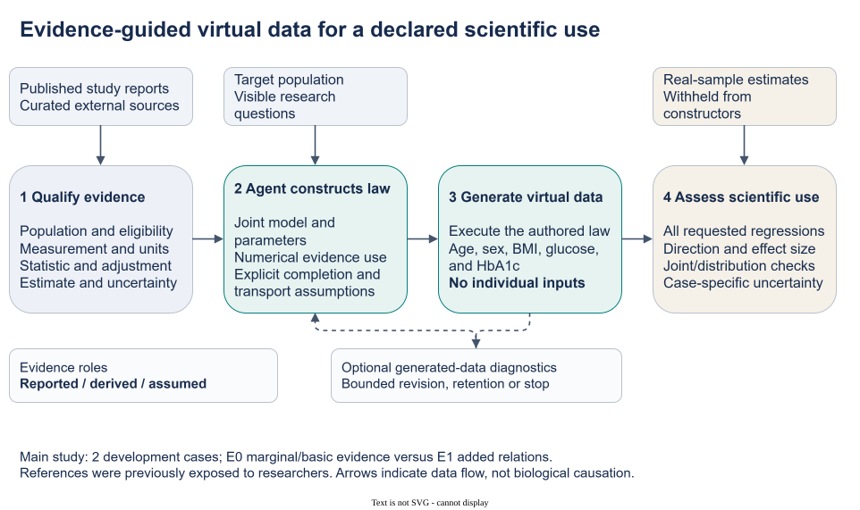
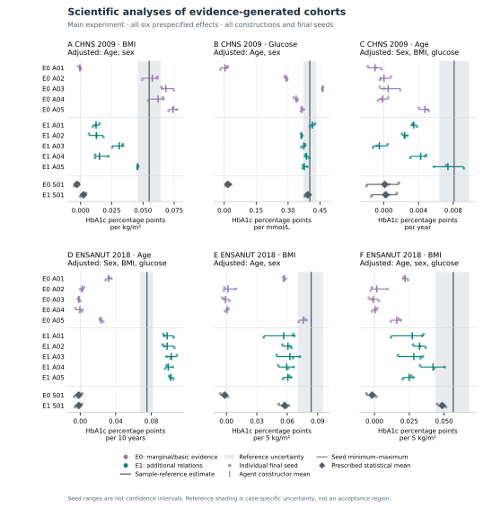
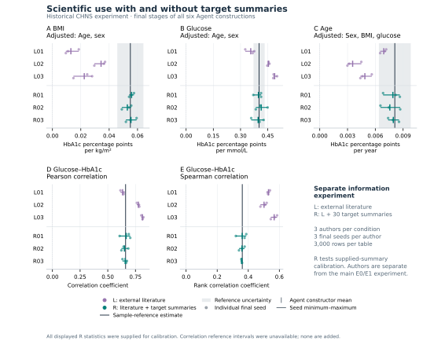

# Evidence-Guided Agent Generation of Virtual Biomedical Data for Scientific Analysis

Working manuscript v0.6, 3 November 2026. This revision centers the scientific uses of generated data and brings the completed summary-assisted experiment into the main text as a separate information setting. It reorganizes existing results without changing any study, generated output or analysis. Author declarations and submission formatting remain to be completed.

## Abstract

Biomedical studies often report useful distributions and associations while their individual measurements remain inaccessible or incomplete. We present an evidence-guided Agent procedure that converts study-qualified findings, a population description and a research request into an executable joint model and a virtual cohort. The Agent selects the scientific structure, numerical constraints and completion assumptions; statistical tools generate records for ordinary downstream analysis. A two-case developmental study used CHNS 2009 and ENSANUT 2018 references to evaluate complete age, sex, BMI, glucose and HbA1c cohorts constructed without individual-level inputs. Twenty Agent constructions and four prescribed statistical references produced 72 final tables. Additional relational evidence reduced mean absolute discrepancy for five of six designated regression coefficients, while worsening CHNS BMI. A separate six-author CHNS experiment tested external literature with and without available target summaries. With summaries, the three authors' mean BMI coefficients ranged from 0.05282 to 0.05579 against the supplied reference of 0.05495; glucose and conditional-age coefficients and two joint-association measures also aligned more closely with their supplied references. All scheduled analyses and unfavorable outcomes were retained and independently recomputed. The results demonstrate the construction of analyzable biomedical data from incomplete evidence and characterize how available information affects its usefulness. Summary-assisted synthesis supported the reported analyses more closely; external-evidence construction retained important relationships but also showed magnitude and dependence mismatches. These developmental results motivate evidence-guided virtual data for specified analytical uses, with source-to-target assumptions and uncertainty stated alongside the data.

## Introduction

A biomedical research question can be well defined before the required individual measurements are available. Existing cohorts may omit an indicator, source records may be inaccessible, or no single study may contain the relevant combination of variables. Published findings nevertheless provide partial knowledge: distributions, adjusted associations, subgroup summaries and measurement definitions. Turning that information into a virtual dataset would allow researchers to execute their intended analyses and examine the implications of the available evidence.

This requires scientific modeling. An age-adjusted coefficient, a marginal correlation and a subgroup mean are different constraints on a joint distribution. Their interpretation depends on the population, selection, measurement and adjustment variables of the reporting study. A generator must combine compatible evidence, represent remaining assumptions and deliver data whose analyses are useful for the intended question. The desired product is a data table and its generating model, with quality assessed through the analyses the researcher wishes to perform.

Prior methods establish several routes to that product. Filshtein and colleagues generated complete biomedical cohorts from source-specific generating rules estimated by collaborating analysts. SynthIPD constructs survival records and categorical covariates from published trial curves and subgroup summaries. Multilevel network meta-regression provides related statistical principles for connecting aggregate findings to individual models under population assumptions. [Filshtein et al.](https://pmc.ncbi.nlm.nih.gov/articles/PMC8338788/); [SynthIPD v2](https://arxiv.org/html/2509.16466v2); [Phillippo et al.](https://rss.onlinelibrary.wiley.com/doi/full/10.1111/rssa.12579).

LLM-based methods offer a complementary way to construct and operate generative models. G-Sim combines simulator authorship with numerical calibration and structural refinement. LLMSynthor uses aggregate information to generate micro-records and evaluate downstream queries. SynthCraft assists biomedical synthetic-data workflows using individual-level input datasets. These precedents motivate a practical biomedical question: how can an Agent make heterogeneous published statistical findings operational for a requested joint dataset when complete generating rules or individual construction records are unavailable? [G-Sim](https://proceedings.mlr.press/v267/holt25b.html); [LLMSynthor](https://arxiv.org/html/2505.14752v4); [SynthCraft](https://journals.plos.org/digitalhealth/article?id=10.1371/journal.pdig.0001290).

Our method assigns the scientific construction to an Agent: it interprets qualified evidence, selects a joint law, determines numerical parameters and declares the assumptions supplying missing structure. Deterministic tools then execute and check the proposed model. The analysis request is visible and can guide construction; a new request may produce a different generator. This paper demonstrates that procedure in whole-cohort synthesis and evaluates the resulting data under external-evidence and summary-assisted information settings. The central empirical question is which scientific analyses the generated data support and with what agreement. Comparisons provide context, while the main contribution is an implemented evidence-to-data method and its demonstrated analytical uses.

## Methods

### Evaluation settings and scientific objective

We report two completed experiments separately. The main study compares marginal/basic external evidence with added relational evidence in two glycemic reference populations. A separate historical CHNS experiment compares external literature with the same literature plus openly supplied target summaries. Both generate complete cohorts without individual-level construction records. Their protocols and authors differ, so results are not pooled into a single factorial experiment. The retained methods below first describe the main study; the summary-assisted procedure follows explicitly.

### From qualified evidence to an executable joint law

Each construction request specified a population, five variables—age, sex, body mass index (BMI), glucose and HbA1c—units, eligibility rules and three regression analyses. Researchers curated the source packet and fixed the evaluation protocol. The Agent received no individual-level construction records or target reference coefficients. It selected a probability law, numerical parameters and assumptions for unreported quantities, then delivered generator code and a structured model specification. The resulting table represented draws from that law, rather than recovered measurements for identifiable participants. Figure 1 shows these scientific roles and the separation of construction from reference evaluation.

An evidence record retained source population, measurement, units, statistical operator, adjustment set, estimate and available uncertainty. The author assigned every admitted relational operation a role: model constraint, analytic check, contextual information or declined use. A numerical use required a calculation implied by the actual law under a declared source-context approximation. An analytic check could reveal disagreement; classifying a relation as a constraint did not establish that all source quantities were fitted simultaneously. Reported individual dispersion was distinguished from uncertainty in an estimated mean or slope.

The retained sources included Bao's Chinese glycemia study, Wang's MIND study, Jansen's Lifelines study and Pani's age-association study, with NGSP measurement-scale guidance. For example, Jansen's BMI and glucose coefficients were separate HbA1c projections adjusted for age and sex. They could not simply be inserted as coefficients of a single equation jointly containing BMI and glucose. The author had to choose the covariate law and residual dependence that made the required projections meaningful. A conversion from IFCC to NGSP units changed their representation, while adding no independent evidence or assay harmonization. [Bao et al.](https://doi.org/10.1136/bmj.c2249); [Wang et al.](https://doi.org/10.1371/journal.pone.0296694); [Jansen source](https://doi.org/10.1111/joim.12010); [Pani source](https://doi.org/10.2337/dc08-0577); [NGSP](https://ngsp.org/ifccngsp.asp).

Model specifications kept such completion and transport assumptions distinct from source facts. The [source-and-assumption supplement](SUPPLEMENT_SOURCE_AND_ASSUMPTIONS_v05.md) traces the admitted operations and their limits. A semantic checker assessed declared operators, measurement information and roles. Separate Agent reviewers inspected numerical derivations, implemented laws, support and required finite moments. These were implementation reviews, not external clinical expert validation. Source-population simulation was unavailable, so generated target-table diagnostics were not treated as reproduction of the source studies. Optional exploratory feedback concerned generated outputs, without revealing target reference answers. Evidence extraction and source-to-target applicability remained separate scientific questions.

**Figure 1. The main-study external-evidence pathway from published findings to an analysable virtual cohort.** Researchers specify the population and analytical request and curate study-qualified evidence. The scientific Agent assigns numerical roles, chooses a joint law and states completion and transport assumptions; numerical software executes the generator. The resulting complete table can be used to execute the declared analyses. In this external-evidence study, sample reference values remain on the evaluator side. The separate summary-assisted setting below explicitly permits them as construction inputs. Review and retention are permitted operations, but the main study observed no feedback-driven scientific revision. The pathway illustrates model construction, not authenticated source reconstruction or validated transport.

### Cases and information conditions

The study reused the existing CHNS 2009 and ENSANUT 2018 reference preparations, containing 6,631 and 6,931 selected participants, respectively. Both reference families had been exposed to researchers during development. Fresh author contexts did not restore untouched validation. No new source acquisition, target acquisition or patient-level reanalysis was undertaken for this comparison. The cases also shared Jansen/Lifelines evidence and measurement guidance.

CHNS covered ages 35–74 and required complete age, recorded sex, BMI, central glucose and HbA1c measurements under its fixed linkage and measurement rules. It used glucose in mmol/L and unweighted selected-sample analyses. Diabetes, treatment and pregnancy exclusions were not imposed, and fasting adherence was not verified for each person. BMI was derived from released height and weight with the prescribed measurement-flag handling. The resulting estimates describe the selected analytical sample, not national effects.

ENSANUT covered ages 25–79 with no reported prior doctor diagnosis of diabetes/high blood sugar, a recorded 8–12-hour fast, positive serum glucose below 126 mg/dL, available HbA1c and valid standing anthropometry. Pregnancy/lactation exclusions followed questionnaire routing for women aged 25–49; medication and anemia exclusions were not verified. The original preparation addressed contradictory anthropometry documentation without distribution-based trimming. Its standard assigned equal mass to eight sex-by-age cells, crossing two sex categories with ages 25–39, 40–54, 55–69 and 70–79. Reference observations in cell h received weight 1/(8n_h); generated tables contained exactly 375 rows per cell. These were equal-cell analytical estimates, not national survey-weighted effects. Glucose was in mg/dL; regression predictors were scaled per 10 years, 5 kg/m² and 10 mg/dL as applicable.

E0 supplied external marginal and basic measurement evidence. E1 added the admitted relational evidence to the same base. Source-analogous projections were available for CHNS BMI/glucose and ENSANUT age/BMI, but their target values were withheld. CHNS conditional age and ENSANUT conditional BMI were neither directly supplied as target coefficients nor identified by the packet. Pani evidence was absent from both CHNS conditions. The additional-information contrast did not require accepting every source relation; the author could retain a quantity as context or decline numerical use with a reason.

**Table 1. Prespecified scientific uses and uncertain sample references.** Each coefficient measures change in HbA1c percentage points per listed predictor increment. The focal predictor is added to the adjustment variables shown. CHNS intervals are 95% community-cluster CR1-t intervals for the selected unweighted sample. ENSANUT bands derive from the prespecified 399-attempt cluster-resampling stability procedure under its equal-cell standard. Neither is an equivalence margin. “Source-analogous” refers to an available type of projection, not an identical source and target population.

| Case / focal predictor | Adjustment variables | Predictor increment | Evidence relationship | Sample estimate | Reference interval or stability band |
|---|---|---|---|---:|---|
| CHNS BMI | Age, sex | 1 kg/m² | Source-analogous | 0.054946 | 0.045726–0.064166 |
| CHNS glucose | Age, sex | 1 mmol/L | Source-analogous | 0.402093 | 0.371286–0.432900 |
| CHNS conditional age | Sex, BMI, glucose | 1 year | Unprovided conditional projection | 0.008107 | 0.006387–0.009827 |
| ENSANUT conditional age | Sex, BMI, glucose | 10 years | Source-analogous | 0.075132 | 0.067124–0.082185 |
| ENSANUT BMI | Age, sex | 5 kg/m² | Source-analogous | 0.083643 | 0.070373–0.095214 |
| ENSANUT conditional BMI | Age, sex, glucose | 5 kg/m² | Unprovided conditional projection | 0.056638 | 0.043901–0.068006 |

### Allocation and evaluation

Five fresh Agent contexts per case and information condition produced 20 constructions. Four further constructions used one fixed, independently reviewed statistical specification per case and condition, applying source-qualified moment constraints and explicit completion assumptions to the same admitted packets. One prescribed specification versus five independently authored Agent models was an asymmetric descriptive comparison. Independently authored contexts assessed construction variability; multi-Agent collaboration was not a required generative mechanism. Matching labels A01–A05 across arms did not define paired authors.

Each construction had three fixed final attempts, seeds 5101–5103, each producing 3,000 rows. At most two exploratory row-producing attempts and one feedback-to-scientific-revision cycle were permitted per construction. Retaining the initial law or finalizing without exploration was valid. Failed attempts consumed the allowance, and the overall ceiling was 120 physical table attempts. Candidates were frozen before execution. All constructions and final slots had to close before common reference evaluation; favorable authors, seeds or earlier candidates could not replace final outputs. Author access was procedurally restricted to admitted inputs and their own artifacts. The generator runtime was isolated, but general author tools were not isolated at the host level.

Evaluation retained all six focal coefficients plus 27 CHNS or 28 ENSANUT distribution and joint diagnostics per table. For each endpoint, absolute discrepancy from the sample point estimate was calculated separately for each seed, averaged within each constructor, then averaged across the five Agent constructors. The E1 minus E0 contrast compared these arm means. This differs from taking the absolute difference of an arm-average coefficient and the reference. Constructor means and actual seed ranges were also reported. Missing required endpoints or seeds would make a complete-arm contrast unavailable. No heterogeneous pooled score, hypothesis test or post-hoc equivalence threshold was introduced.

A separately written audit recomputed statistics from retained generated outputs using independent regression and weighted-summary arithmetic, verified frozen reference-aggregate mappings and rechecked the contrasts. It did not regenerate tables or repeat patient-level reference analyses. Three seeds quantify sampling from a fixed law, not source-estimation, structural or transport uncertainty. The prespecified reference intervals and stability bands provide uncertainty context for selected-sample estimates, not clinical acceptance rules.

### Summary-assisted construction as a second information setting

The separate CHNS information-and-revision experiment used three fresh scientific authors per condition. L received the research request, population and measurement definitions, and external literature. R additionally received all 30 existing target summaries: three adjusted regression estimates and 27 marginal/joint diagnostics. Each author delivered three 3,000-row tables at seeds 4101–4103, then had one additional diagnostic-review opportunity to revise or retain the model. Initial delivery already allowed exploratory feedback, so this stage comparison evaluates an additional review opportunity. Both conditions could use permitted literature retrieval; the retained input audit found no newly retrieved documents for the three R authors.

All six authors used one trial and retained their models after the additional review. There were 42 successful executions, comprising six trials and 36 initial/final deliveries. The 18 final deliveries duplicated their corresponding initial tables; there were 24 distinct tables overall and 18 distinct delivery tables. The complete analyses and all 30 summaries were independently recomputed. We display each author's final-seed values once. This experiment evaluates useful reconstruction when summaries are available and the effect of information provision under its own protocol; its source packet and author allocation are not merged with main-study E0/E1.

A subsequent bounded statistical supplement fitted one fixed, purpose-built family to the same admitted R summaries and generated three final tables. It provides a descriptive calibration reference. Its complete model, results and disclosed technical recovery are in [Supplementary statistical comparison](../reports/summary_comparator_2026-11-03/RESULTS.md). No new statistical family or fit was created for this manuscript revision.

## Results

### Complete virtual cohorts enabled the specified analyses

The main-study procedure delivered complete age, sex, BMI, glucose and HbA1c tables from external evidence and a population request. All 20 Agent constructions and four prescribed statistical constructions produced their three fixed 3,000-row final tables. All 72 final tables were distinct and every scheduled regression and diagnostic was available. Seven exploratory tables brought the total to 79 successful executions. Independent recomputation agreed for all 2,196 statistics. The substantive quality of the delivered data is shown by the analysis results below.

### External relational evidence supported several scientific relationships

Additional relational evidence reduced constructor-averaged mean absolute discrepancy for five of six designated coefficients (Table 2). CHNS glucose discrepancy decreased from 0.134019 to 0.024079 HbA1c percentage points per mmol/L. ENSANUT age and both BMI projections also became closer to their respective sample references. CHNS BMI discrepancy increased from 0.020380 to 0.031557. The complete six-endpoint result therefore identifies useful improvements and an important exception under the same evaluation rule.

**Table 2. Scientific-analysis agreement under external evidence.** Each discrepancy is first averaged over the three final seeds of a constructor, then across the five Agent constructors. Each row retains its own units from Table 1. E0 and E1 are independently authored conditions, not paired models. The contrasts were computed before rounding. Full prescribed-statistical results remain in Figure 2 and the retained main-study table.

| Case / focal predictor | E0 mean absolute discrepancy | E1 mean absolute discrepancy | E1 minus E0 |
|---|---:|---:|---:|
| CHNS BMI | 0.020380 | 0.031557 | +0.011178 |
| CHNS glucose | 0.134019 | 0.024079 | −0.109939 |
| CHNS conditional age | 0.007281 | 0.004854 | −0.002426 |
| ENSANUT conditional age | 0.063944 | 0.024670 | −0.039274 |
| ENSANUT BMI | 0.056883 | 0.023732 | −0.033151 |
| ENSANUT conditional BMI | 0.048797 | 0.025649 | −0.023147 |

**Figure 2. All main-study scientific uses.** Each panel displays every construction and final seed for one specified coefficient. Agent means and actual seed ranges are shown together with the selected-sample estimate and its original interval or stability band. Ranges over three generated samples are not confidence intervals. All E0/E1 Agent and prescribed statistical constructions are retained; repeated author labels do not imply paired authors. The figure reports effects in their original analytical units rather than combining them into an accuracy score. Plot sources and exact definitions are recorded in the [figure manifest](utility_package_2026-11-03/NUMERIC_MANIFEST.json).

The generated associations were useful to different degrees. CHNS E1 glucose constructor means ranged from 0.363363 to 0.414189 around a reference of 0.402093. All E1 BMI coefficients were positive, although constructor means of 0.012400–0.045757 underestimated the 0.054946 reference. Conditional-age means ranged from −0.000509 to 0.007393 against 0.008107; one constructor retained a negative mean and two negative seeds. All ENSANUT E1 focal coefficients were positive, with age means of 0.097769–0.102452 per decade versus 0.075132 and BMI means below their references. These complete effect displays distinguish retention of a scientific direction from closer recovery of its magnitude.

### Available summaries enabled closer reconstruction of the requested analyses

The separate information-provision experiment evaluated a common practical situation: published or otherwise accessible aggregate findings are available, but the corresponding individual records are not construction inputs. All three summary-assisted R authors generated data with regression coefficients and joint associations close to the supplied reference quantities (Table 3; Figure 3). The table also retains all three external-literature L authors from that experiment. This direct L/R comparison is kept separate from the main-study E0/E1 comparison.

**Table 3. Analysis results in the CHNS information-provision experiment.** Each range spans the three authors' means over their three fixed final seeds; it is not a confidence interval or a range over individual participants. Coefficients are HbA1c percentage points per kg/m², mmol/L and year, respectively. R received all listed reference values as legitimate construction inputs.

| Analysis | Sample reference | External literature L | Literature plus summaries R |
|---|---:|---:|---:|
| BMI coefficient, age/sex adjusted | 0.054946 | 0.013001–0.034287 | 0.052821–0.055789 |
| Glucose coefficient, age/sex adjusted | 0.402093 | 0.356064–0.487815 | 0.396941–0.413715 |
| Age coefficient, sex/BMI/glucose adjusted | 0.008107 | 0.003552–0.006910 | 0.007569–0.007947 |
| Glucose–HbA1c Pearson correlation | 0.660968 | 0.633764–0.813170 | 0.650561–0.666438 |
| Glucose–HbA1c Spearman correlation | 0.361457 | 0.501339–0.566477 | 0.357571–0.360983 |

**Figure 3. Complete information-provision results for the three regressions and two joint-association diagnostics.** All L01–L03 and R01–R03 final seeds and constructor means are shown against the CHNS reference. These are distinct authors from those in Figure 2. R was explicitly given the reference summaries, so its closer agreement demonstrates summary-assisted reconstruction. The final outputs were retained without numerical change after the additional review; identical initial/final tables are displayed once. The [complete historical results](../reports/information_revision_ablation_2026-11-03/RESULTS.md) include all 27 diagnostics and all stage comparisons.

Marginal variability was also retained in the summary-assisted data. R constructor-mean BMI SDs ranged from 3.38965 to 3.40243 versus 3.40632 in the supplied sample; glucose SDs ranged from 1.48817 to 1.58968 versus 1.54455, and HbA1c SDs from 0.95208 to 0.96554 versus 0.95357. Together with the regression and rank-association results, these checks show that agreement extended beyond matching a single central value. All 30 supplied quantities remain available for inspection. This is empirical evidence of coherent summary reconstruction, rather than recovery of each participant's original measurements.

### The Agent made substantive evidence-to-model decisions

Every E1 main-study Agent used at least one admitted relation as a numerical model constraint. CHNS records contained nine constraint assignments, eight analytic checks and three contextual uses across the five constructions; ENSANUT records contained fifteen, twenty-four and sixteen, respectively. The roles describe how the authors used evidence in their scientific models. They distinguish actual numerical construction from mentioning an association as background.

Separate adjusted projections are a concrete example of the modeling work involved. The Jansen source reports BMI and glucose coefficients from different age/sex-adjusted HbA1c regressions. To use both, an author must choose joint covariate variation and residual dependence so the projections implied by the generator have the specified meanings. Assigning the two reported slopes directly to a single joint equation would generally change those meanings. The framework permits different scientific completions, records their assumptions, and evaluates their consequences through the generated data. The [source-and-assumption supplement](SUPPLEMENT_SOURCE_AND_ASSUMPTIONS_v05.md) and full uptake inventory document the implemented choices.

Seven main-study Agents reviewed exploratory outputs and retained their original models; thirteen finalized without exploration. All six L/R authors also retained their models at the additional review stage. These outcomes support a workflow that can finalize a usable construction without mandatory revision. They provide no improvement estimate for iterative revision itself. Earlier development and its failed quantitative criteria, tail defects and revision trade-offs remain in the [historical-results supplement](SUPPLEMENT_HISTORICAL_RESULTS_v05.md).

### Statistical references contextualized achievable quality

Under E1, the prescribed main-study statistical constructions had smaller seed-averaged absolute discrepancies than every corresponding Agent for CHNS glucose and ENSANUT conditional BMI; other comparisons favored Agent constructions. The later three-table summary-fitted statistical supplement produced mean coefficients of 0.055726, 0.412568 and 0.007679 for the three CHNS regressions. Its purpose-built family was developed with coding-Agent assistance and is a fixed statistical calibration reference, not an Agent-removal ablation. Both approaches therefore demonstrated useful reconstruction in the supplied-summary setting. The complete comparisons are retained as supporting results. This study asks whether the Agent procedure produces scientifically useful data; it does not require uniform superiority to a task-specific statistical family.

## Discussion

The results establish a practical use for evidence-guided Agent generation: researchers can obtain complete, analyzable biomedical tables from published statistical information and a population request, even when individual construction records are unavailable. The Agent carries out scientific model authorship, and numerical tools produce the rows. The completed studies show both how external relationships can support requested analyses and how access to aggregate target information can improve the usefulness of the resulting dataset.

The two information settings correspond to different research opportunities. External-evidence generation allows a researcher to combine partial findings and inspect the consequences of transferring them to a specified population. Summary-assisted generation makes an accessible set of aggregate findings usable in a joint table. The latter is valuable in its own right: a researcher can apply standard analysis software and examine several modeled relationships together. Its demonstrated agreement is with the supplied summaries; additional analyses remain dependent on the model's completion assumptions. This distinction identifies the intended use rather than treating one information regime as universally preferable.

The methodological contribution lies in the Agent's evidence-to-model work. Qualified biomedical records retain measurement scales, population definitions and adjustment sets. The scientific author chooses how those heterogeneous facts constrain a generative law, which quantities can be derived and which must be assumed. Complete tables and inspectable specifications make the consequences available to downstream users. The same procedure can accept different declared requests and choose different constructions. The current experiments demonstrate this within two glycemic settings and differing information packets; they do not require one fixed disease equation for every request.

Published synthesis and Agent methods provide useful tools and comparison settings. Our contribution builds on this established ability to generate from summaries and executable models, focusing on a biomedical evidence-to-data workflow and its analysis-specific evaluation. A comparison on a predecessor's accessible public example can clarify quality and scope more directly than designing a new statistical opponent for each dataset. Such a comparison is being assessed separately and has not been performed in the studies reported here. The present data support the demonstrated scientific uses without making a universal method-ranking claim.

There are substantive limits to those uses. Both reference families were previously exposed during development, and shared sources reduce their evidential independence. The external-only results contain effect-size and directional mismatches, including one CHNS E1 constructor with a conditional-age direction opposite to the reference; these limit the corresponding analytical claims. The evaluation covers five variables and selected regression analyses rather than arbitrary biomarkers, subgroup effects or causal questions. Source-to-target differences in population, assay, selection and unreported dependence remain partly assumed, and source-population replay was unavailable in these experiments.

Uncertainty requires particular care. Three seeds characterize sampling from a fixed law, not uncertainty in the published evidence, scientific structure or transfer assumptions. The real-reference estimates also have sampling uncertainty and are not known population parameters. Larger generated tables can stabilize a modeled analysis, but do not create new patient observations. The demonstrated use is therefore population-level analytical reconstruction under specified evidence and assumptions, not recovery of unmeasured individual test results or a substitute for confirmatory clinical evidence.

The implementation also retains researcher preparation of evidence and case-specific evaluation definitions. Model-snapshot identifiers, token use and end-to-end costs were not completely metered, so the study makes no measured cost-saving claim. Feedback and retention are supported, while the main study and the six-author L/R experiment observed no scientific revision benefit. These limitations can be addressed in targeted extensions; they do not require expanding this paper into a general autonomous-research platform.

Evidence-guided virtual cohorts are most useful when their intended analyses, information sources and modeled assumptions travel with the data. Our results provide an implemented route to that product, demonstrate useful reconstruction under accessible-summary conditions, and expose the scientific relationships that remain difficult under external evidence alone.

## Data, code and supporting material

The [public repository](https://github.com/ziwang11112/evidence-guided-virtual-cohorts-2026) contains reviewed protocols, original code, aggregate results and independent checks. The [main-study report](../reports/main_study_freeze_2026-11-03/RESULTS.md), [information-provision report](../reports/information_revision_ablation_2026-11-03/RESULTS.md), and [statistical supplement](../reports/summary_comparator_2026-11-03/RESULTS.md) preserve their own inputs, allocations and complete results. The [figure package](utility_package_2026-11-03/CAPTIONS.md) binds every plotted value to existing aggregate records. Historical drafts and failed experiments remain available. Individual real/generated records, third-party full texts and credentials remain local. Author details, data-access/ethics declarations and submission-specific reproduction instructions remain to be completed.

## References and source-access status

The predecessor comparisons use the primary-source reading documented in the [3 November positioning memo](CORE_CONTRIBUTION_POSITIONING_2026-11-03.md) and [journal-fit memo](JOURNAL_FIT_2026-11-03.md). Their access record distinguishes freshly checked publication records from previously retrieved full text, including G-Sim's retained extraction. Bibliographic metadata for SynthCraft, Jansen and Wang were checked against publisher pages for this revision; Bao and Pani metadata were checked against their PubMed records after direct publisher/PMC access failed or encountered a browser challenge. Those metadata checks did not re-audit clinical extraction. Numerical-use descriptions rely on the already admitted source packets and retained audits; an identifier alone does not verify a source's use.

1. Filshtein TJ, Li X, Zimmerman SC, Ackley SF, Glymour MM, Power MC. Proof of concept example for use of simulation to allow data pooling despite privacy restrictions. *Epidemiology*. 2021;32(5):638–647. [DOI and full text](https://pmc.ncbi.nlm.nih.gov/articles/PMC8338788/).
2. Zhao Z et al. SynthIPD: training-free synthetic individual patient data generation. arXiv:2509.16466v2, 24 July 2026. [Versioned full text](https://arxiv.org/html/2509.16466v2). Publication beyond this preprint was not established in the positioning audit.
3. Phillippo DM et al. Multilevel network meta-regression for population-adjusted treatment comparisons. *Journal of the Royal Statistical Society: Series A*. 2020;183(3):1189–1210. [DOI/full text](https://rss.onlinelibrary.wiley.com/doi/full/10.1111/rssa.12579).
4. Holt S, Ruiz Luyten M, Berthon A, van der Schaar M. G-Sim: Generative Simulations with Large Language Models and Gradient-Free Calibration. *Proceedings of ICML*. PMLR 267;2025:23513–23561. [Published record](https://proceedings.mlr.press/v267/holt25b.html).
5. Tang Y, Kong M, He J, Nie T, Ma W, Sun L. LLMSynthor: Macro-Aligned Micro-Records Synthesis with Large Language Models. KDD 2026. [DOI](https://doi.org/10.1145/3770855.3818965); [full text v4](https://arxiv.org/html/2505.14752v4).
6. Callender T, Boyd A, Davis R, Ruhrberg Estevez S, Lavista Ferres JM, van der Schaar M. SynthCraft: An AI partner for synthetic data generation to support data access and augmentation in healthcare. *PLOS Digital Health*. 2026;5(3):e0001290. [Published article](https://journals.plos.org/digitalhealth/article?id=10.1371/journal.pdig.0001290).
7. Bao Y, Ma X, Li H, Zhou M, Hu C, Wu H, Tang J, Hou X, Xiang K, Jia W. Glycated haemoglobin A1c for diagnosing diabetes in Chinese population: cross sectional epidemiological survey. *BMJ*. 2010;340:c2249. [DOI](https://doi.org/10.1136/bmj.c2249); [bibliographic record](https://pubmed.ncbi.nlm.nih.gov/20478961/).
8. Wang P, Li Y, Wang M, Song L, Dong Y, Han X, Tuomilehto J, Wang Y, Du Y, Qiu C. Comparing glycemic traits in defining diabetes among rural Chinese older adults. *PLOS ONE*. 2024;19(1):e0296694. [Published article](https://journals.plos.org/plosone/article?id=10.1371/journal.pone.0296694).
9. Jansen H, Stolk RP, Nolte IM, Kema IP, Wolffenbuttel BHR, Snieder H. Determinants of HbA1c in nondiabetic Dutch adults: genetic loci and clinical and lifestyle parameters, and their interactions in the lifelines cohort study. *Journal of Internal Medicine*. 2013;273(3):283–293. [Published article](https://onlinelibrary.wiley.com/doi/10.1111/joim.12010).
10. Pani LN, Korenda L, Meigs JB, Driver C, Chamany S, Fox CS, Sullivan L, D'Agostino RB, Nathan DM. Effect of aging on A1C levels in individuals without diabetes: evidence from the Framingham Offspring Study and the National Health and Nutrition Examination Survey 2001-2004. *Diabetes Care*. 2008;31(10):1991–1996. [DOI](https://doi.org/10.2337/dc08-0577); [bibliographic record](https://pubmed.ncbi.nlm.nih.gov/18628569/).
11. NGSP. The IFCC and NGSP, Table 2. [Official measurement-scale guidance](https://ngsp.org/ifccngsp.asp).

## Author declarations to complete

Authors, affiliations, contributions, funding, competing interests, participant-reference ethics/access statements, and the final AI-use disclosure are to be completed by the authors; none is inferred from implementation audits. Journal-specific formatting and a checked reproduction package also remain outstanding. This draft does not reopen generation, target fitting, source acquisition or selection of favorable results.
