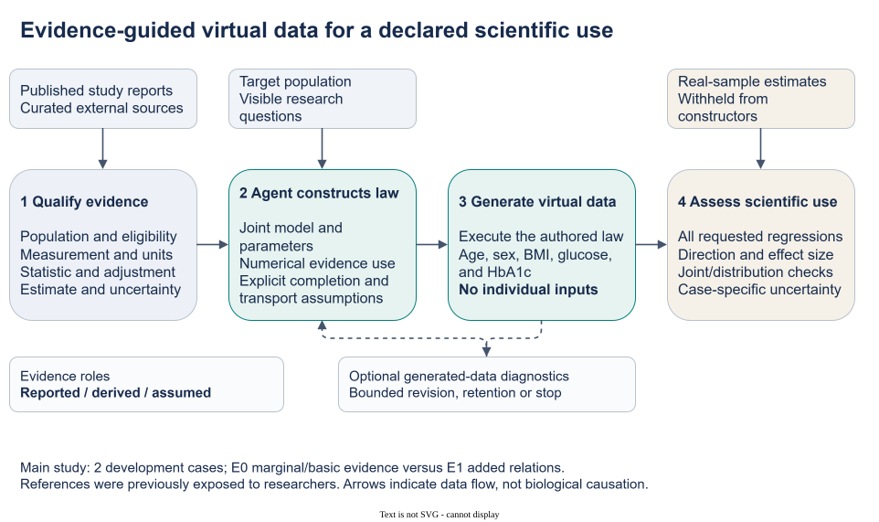
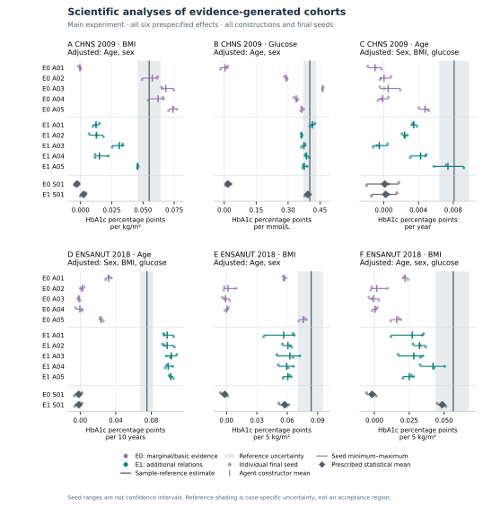
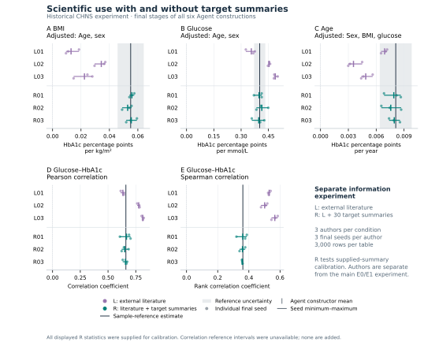
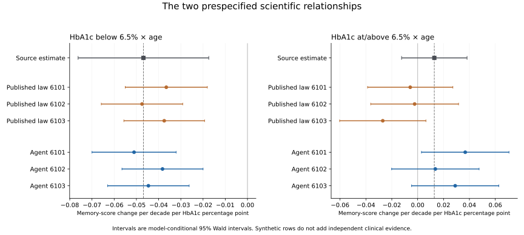

# Evidence-Guided Agent Generation of Virtual Biomedical Data for Scientific Analysis

Working manuscript v0.7, 3 November 2026 (America/Chicago). This revision integrates the completed longitudinal public example with the two earlier information settings. All studies retain their own protocols, information boundaries and complete outcomes. No new generation, patient-level analysis or parameter adjustment was performed for this writing revision. Author declarations, reproduction packaging and submission formatting remain incomplete.

## Abstract

Individual biomedical measurements may be inaccessible, incomplete or unavailable for a proposed study, although relevant distributions and associations have been published. We present an evidence-guided Agent procedure that converts curated, study-qualified findings, a population description and a research request into an executable joint model and virtual data for ordinary scientific analysis. The Agent selects model structure, numerical constraints and assumptions; statistical software samples and evaluates the resulting records. We report three distinct information settings. In a two-case developmental study using CHNS and ENSANUT references, 20 Agent and four statistical constructions produced 72 final cross-sectional tables without individual-level construction inputs. Added external relational evidence reduced mean absolute discrepancy for five of six designated coefficients, while worsening CHNS BMI. In a separate six-author CHNS experiment, supplied target summaries enabled closer reconstruction: BMI coefficients averaged across each author's seeds ranged from 0.05282 to 0.05579 against the supplied 0.05495 reference. A public HRS example extended construction to complete longitudinal cohorts with 11,509 virtual subjects and four visits. The Agent reproduced a negative below-threshold HbA1c-by-age interaction for memory across three draws, with mean coefficient −0.04464 versus the supplied −0.04684; a weak above-threshold interaction and high-HbA1c dispersion remained less reliable. Complete results and implementation failures were retained and independently checked. These experiments demonstrate analysis-specific uses of evidence-guided virtual data across differing information and modeling requirements. They support constructive use of published knowledge while showing that reconstruction of supplied information and evaluation of externally transferred relationships answer different questions.

## Introduction

A biomedical research question can be well defined before the required individual measurements are available. Existing cohorts may omit an indicator, source records may be inaccessible, or no single study may contain the relevant combination of variables. Published findings nevertheless supply partial knowledge: distributions, adjusted associations, subgroup summaries and measurement definitions. Turning that information into a virtual dataset would let researchers execute their intended analyses and inspect the implications of the available evidence.

The scientific challenge is to construct a joint model from these fragments. An age-adjusted coefficient, a marginal correlation and a subgroup mean constrain different aspects of a distribution. Their meanings depend on the population, selection, measurement and adjustment variables of the reporting study. The generator must use compatible evidence and supply the missing structure through stated assumptions. Its useful output is both a table that standard software can analyze and an inspectable account of how that table was constructed.

Prior methods establish important parts of this problem. Filshtein and colleagues generated complete biomedical cohorts from source-specific rules estimated by collaborating analysts. SynthIPD reconstructs survival records and categorical covariates from published trial curves and subgroup summaries. Multilevel network meta-regression connects aggregate findings to individual models under population assumptions. [Filshtein et al.](https://pmc.ncbi.nlm.nih.gov/articles/PMC8338788/); [SynthIPD v2](https://arxiv.org/html/2509.16466v2); [Phillippo et al.](https://rss.onlinelibrary.wiley.com/doi/full/10.1111/rssa.12579).

LLM-based approaches make model construction itself programmable. G-Sim combines simulator authorship with numerical calibration and structural refinement. LLMSynthor uses aggregate information to synthesize micro-records for downstream queries. SynthCraft assists biomedical synthetic-data workflows using individual-level inputs. Our question is how an Agent can make heterogeneous biomedical evidence operational for a requested dataset when individual construction records, and sometimes complete generating rules, are unavailable. [G-Sim](https://proceedings.mlr.press/v267/holt25b.html); [LLMSynthor](https://arxiv.org/html/2505.14752v4); [SynthCraft](https://journals.plos.org/digitalhealth/article?id=10.1371/journal.pdig.0001290).

We contribute an implemented procedure for study-qualified evidence use and scientific model authorship, an analysis-centered evaluation of the resulting data under different available-information conditions, and a demonstration spanning complete cross-sectional and longitudinal cohorts. The Agent chooses scientific structure and parameters; deterministic software executes its proposal and reports checks. A research request may guide construction, and a new request may lead to a different generator. The reusable object is the procedure and its evidence record, not a single fixed biomedical equation.

The evidence is organized around three questions: what analyses external study fragments support, what accessible target summaries make recoverable, and whether detailed published models can be translated into a more complex longitudinal data product. These are separate experimental questions with separate reference interpretations. Whole-cohort generation without individual construction inputs is the central empirical application here. Indicator enrichment has historical supporting experiments; missing-cell completion is an additional system mode not validated by the experiments assembled here. Their evidence is distinguished in the [integrated ledger](INTEGRATED_EVIDENCE_LEDGER_v07_2026-11-03.md), rather than inferred from whole-cohort performance.

## Methods

### Evaluation settings and scientific objective

We integrate three completed experiments without pooling their performance or treating their information conditions as a common factorial design (Table 1). The first compares basic/marginal with additional relational external evidence in two glycemic populations. The second compares external literature with literature plus accessible target summaries in CHNS. The third uses a public HRS generating-model example for longitudinal reconstruction. Individual-level data were not supplied to the constructors in any of these settings. Earlier real data established the CHNS/ENSANUT references; no HRS participant records were accessed for the public example.

**Table 1. Experimental questions, permitted information and units of evidence.** A construction is one authored scientific model; seeds sample that model. Table counts are not counts of independent clinical studies. Protocols and information packets differ across rows.

| Setting and question | Permitted construction information | Authorship and valid delivery | Meaning of the reference comparison |
|---|---|---|---|
| External-evidence developmental study: which requested relationships can be supported? | CHNS/ENSANUT population requests and curated external evidence; target coefficients withheld from fresh author contexts | 20 Agent + 4 prescribed statistical constructions; 72 final tables, 3,000 rows each | Analysis agreement with previously exposed selected-sample references; no restored untouched confirmation |
| CHNS summary-assisted study: can accessible aggregate findings become useful joint data? | External literature in L; the same literature plus 30 target summaries and accompanying reference metadata in R | 6 Agent constructions; 18 distinct final deliveries, 3,000 rows each; 24 distinct tables including trials | Reconstruction of explicitly provided quantities in R; not an independent target prediction |
| HRS public-model example: can the procedure construct longitudinal data for a published analysis? | Published model exports, method code, population specification and requested analysis | 1 Agent + 1 reconstructed published-law specification; 6 valid tables, 11,509 subjects × 4 visits each | Source-rich model reconstruction; 3 initial invalid comparator tables additionally retained in a 9-attempt record |

A subsequent three-table CHNS statistical supplement is a separate calibration reference for the supplied-summary setting. Historical studies with other protocols and method versions remain in the supplement. The detailed methods below retain the two-case main-study definitions before describing each additional setting.

### From qualified evidence to an executable joint law

Each main-study construction request specified a population, five variables—age, sex, body mass index (BMI), glucose and HbA1c—units, eligibility rules and three regression analyses. Researchers curated the source packet and fixed the evaluation protocol. The Agent received no individual-level construction records or target reference coefficients. It selected a probability law, numerical parameters and assumptions for unreported quantities, then delivered generator code and a structured model specification. The resulting table represented draws from that law, rather than recovered measurements for identifiable participants. Figure 1 shows these scientific roles and the separation of construction from reference evaluation.

An evidence record retained source population, measurement, units, statistical operator, adjustment set, estimate and available uncertainty. The author assigned every admitted relational operation a role: model constraint, analytic check, contextual information or declined use. A numerical use required a calculation implied by the actual law under a declared source-context approximation. An analytic check could reveal disagreement; classifying a relation as a constraint did not establish that all source quantities were fitted simultaneously. Reported individual dispersion was distinguished from uncertainty in an estimated mean or slope.

The retained sources included Bao's Chinese glycemia study, Wang's MIND study, Jansen's Lifelines study and Pani's age-association study, with NGSP measurement-scale guidance. For example, Jansen's BMI and glucose coefficients were separate HbA1c projections adjusted for age and sex. They could not simply be inserted as coefficients of a single equation jointly containing BMI and glucose. The author had to choose the covariate law and residual dependence that made the required projections meaningful. A conversion from IFCC to NGSP units changed their representation, while adding no independent evidence or assay harmonization. [Bao et al.](https://doi.org/10.1136/bmj.c2249); [Wang et al.](https://doi.org/10.1371/journal.pone.0296694); [Jansen source](https://doi.org/10.1111/joim.12010); [Pani source](https://doi.org/10.2337/dc08-0577); [NGSP](https://ngsp.org/ifccngsp.asp).

Model specifications kept such completion and transport assumptions distinct from source facts. The [source-and-assumption supplement](SUPPLEMENT_SOURCE_AND_ASSUMPTIONS_v05.md) traces the admitted operations and their limits. A semantic checker assessed declared operators, measurement information and roles. Separate Agent reviewers inspected numerical derivations, implemented laws, support and required finite moments. These were implementation reviews, not external clinical expert validation. Source-population simulation was unavailable, so generated target-table diagnostics were not treated as reproduction of the source studies. Optional exploratory feedback concerned generated outputs, without revealing target reference answers. Evidence extraction and source-to-target applicability remained separate scientific questions.



**Figure 1. The main-study external-evidence pathway from published findings to an analysable virtual cohort.** Researchers specify the population and analytical request and curate study-qualified evidence. The scientific Agent assigns numerical roles, chooses a joint law and states completion and transport assumptions; numerical software executes the generator. The resulting complete table can be used to execute the declared analyses. In this external-evidence study, sample reference values remain on the evaluator side. The separate summary-assisted setting below explicitly permits them as construction inputs. Review and retention are permitted operations, but the main study observed no feedback-driven scientific revision. The pathway illustrates model construction, not authenticated source reconstruction or validated transport.

### Worked example: translating separate adjusted projections

CHNS2009 E1 A01, selected by its first ordinal identifier rather than its performance, illustrates the actual scientific construction. Jansen's separate age/sex-adjusted HbA1c slopes were `cB = 0.13` for BMI and `cG = 2.29` for glucose in native IFCC response units. The Agent represented age/sex-residual BMI and glucose by `b` and `g`, with residual SDs `sB` and `sG`, and assumed residual correlation `r = 0.25`. A response containing `thetaB*b + thetaG*g` then implies the separate projections

```text
cB = thetaB + thetaG * r * sG/sB
cG = thetaG + thetaB * r * sB/sG.
```

With residual SDs 4.07611 and 0.49694 after the stipulated age/sex contributions, the implemented solution was `thetaB = 0.0642173` and `thetaG = 2.1583154`. Multiplication by the IFCC-to-NGSP slope factor 0.09148 gave 0.00587460 and 0.19744269 in percentage-point response units. Thus the Agent translated separate projections into a joint equation rather than inserting both reported slopes unchanged. Residual correlation, age/sex contributions, factor distributions, target mixture structure and source-to-target transport remained assumptions. The [source-to-generator trace](SUPPLEMENT_SOURCE_AND_ASSUMPTIONS_v05.md) binds these equations to the frozen code and includes the unfitted Bao correlation check and this constructor's target BMI mismatch. The calculation demonstrates a numerical evidence-use operation, not a newly identified joint distribution or uniform source agreement.

### Cases and information conditions

The study reused the existing CHNS 2009 and ENSANUT 2018 reference preparations, containing 6,631 and 6,931 selected participants, respectively. Both reference families had been exposed to researchers during development. Fresh author contexts did not restore untouched validation. No new source acquisition, target acquisition or patient-level reanalysis was undertaken for this comparison. The cases also shared Jansen/Lifelines evidence and measurement guidance.

CHNS covered ages 35–74 and required complete age, recorded sex, BMI, central glucose and HbA1c measurements under its fixed linkage and measurement rules. It used glucose in mmol/L and unweighted selected-sample analyses. Diabetes, treatment and pregnancy exclusions were not imposed, and fasting adherence was not verified for each person. BMI was derived from released height and weight with the prescribed measurement-flag handling. The resulting estimates describe the selected analytical sample, not national effects.

ENSANUT covered ages 25–79 with no reported prior doctor diagnosis of diabetes/high blood sugar, a recorded 8–12-hour fast, positive serum glucose below 126 mg/dL, available HbA1c and valid standing anthropometry. Pregnancy/lactation exclusions followed questionnaire routing for women aged 25–49; medication and anemia exclusions were not verified. The original preparation addressed contradictory anthropometry documentation without distribution-based trimming. Its standard assigned equal mass to eight sex-by-age cells, crossing two sex categories with ages 25–39, 40–54, 55–69 and 70–79. Reference observations in cell h received weight 1/(8n_h); generated tables contained exactly 375 rows per cell. These were equal-cell analytical estimates, not national survey-weighted effects. Glucose was in mg/dL; regression predictors were scaled per 10 years, 5 kg/m² and 10 mg/dL as applicable.

E0 supplied external marginal and basic measurement evidence. E1 added the admitted relational evidence to the same base. Source-analogous projections were available for CHNS BMI/glucose and ENSANUT age/BMI, but their target values were withheld. CHNS conditional age and ENSANUT conditional BMI were neither directly supplied as target coefficients nor identified by the packet. Pani evidence was absent from both CHNS conditions. The additional-information contrast did not require accepting every source relation; the author could retain a quantity as context or decline numerical use with a reason.

**Table 2. Prespecified scientific uses and uncertain sample references.** Each coefficient measures change in HbA1c percentage points per listed predictor increment. The focal predictor is added to the adjustment variables shown. CHNS intervals are 95% community-cluster CR1-t intervals for the selected unweighted sample. ENSANUT bands derive from the prespecified 399-attempt cluster-resampling stability procedure under its equal-cell standard. Neither is an equivalence margin. “Source-analogous” refers to an available type of projection, not an identical source and target population.

| Case / focal predictor | Adjustment variables | Predictor increment | Evidence relationship | Sample estimate | Reference interval or stability band |
|---|---|---|---|---:|---|
| CHNS BMI | Age, sex | 1 kg/m² | Source-analogous | 0.054946 | 0.045726–0.064166 |
| CHNS glucose | Age, sex | 1 mmol/L | Source-analogous | 0.402093 | 0.371286–0.432900 |
| CHNS conditional age | Sex, BMI, glucose | 1 year | Unprovided conditional projection | 0.008107 | 0.006387–0.009827 |
| ENSANUT conditional age | Sex, BMI, glucose | 10 years | Source-analogous | 0.075132 | 0.067124–0.082185 |
| ENSANUT BMI | Age, sex | 5 kg/m² | Source-analogous | 0.083643 | 0.070373–0.095214 |
| ENSANUT conditional BMI | Age, sex, glucose | 5 kg/m² | Unprovided conditional projection | 0.056638 | 0.043901–0.068006 |

### Allocation and evaluation

Five fresh Agent contexts per case and information condition produced 20 constructions. Four further constructions used one fixed, independently reviewed statistical specification per case and condition, applying source-qualified moment constraints and explicit completion assumptions to the same admitted packets. One prescribed specification versus five independently authored Agent models was an asymmetric descriptive comparison. Independently authored contexts assessed construction variability; multi-Agent collaboration was not a required generative mechanism. Matching labels A01–A05 across arms did not define paired authors.

Each construction had three fixed final attempts, seeds 5101–5103, each producing 3,000 rows. At most two exploratory row-producing attempts and one feedback-to-scientific-revision cycle were permitted per construction. Retaining the initial law or finalizing without exploration was valid. Failed attempts consumed the allowance, and the overall ceiling was 120 physical table attempts. Candidates were frozen before execution. All constructions and final slots had to close before common reference evaluation; favorable authors, seeds or earlier candidates could not replace final outputs. Author access was procedurally restricted to admitted inputs and their own artifacts. The generator runtime was isolated, but general author tools were not isolated at the host level.

Across the two cases, evaluation retained six focal coefficients; each table was evaluated on its three case-specific regressions and 27 CHNS or 28 ENSANUT distribution and joint diagnostics. For each endpoint, absolute discrepancy from the sample point estimate was calculated separately for each seed, averaged within each constructor, then averaged across the five Agent constructors. The E1 minus E0 contrast compared these arm means. This differs from taking the absolute difference of an arm-average coefficient and the reference. Constructor means and actual seed ranges were also reported. Missing required endpoints or seeds would make a complete-arm contrast unavailable. No heterogeneous pooled score, hypothesis test or post-hoc equivalence threshold was introduced.

A separately written audit recomputed statistics from retained generated outputs using independent regression and weighted-summary arithmetic, verified frozen reference-aggregate mappings and rechecked the contrasts. It did not regenerate tables or repeat patient-level reference analyses. Three seeds quantify sampling from a fixed law, not source-estimation, structural or transport uncertainty. The prespecified reference intervals and stability bands provide uncertainty context for selected-sample estimates, not clinical acceptance rules.

### Summary-assisted construction as a second information setting

The separate CHNS information-and-revision experiment used three fresh scientific authors per condition. L received the research request, population and measurement definitions, and external literature. R additionally received the existing target-summary package: three adjusted regression estimates and 27 marginal/joint diagnostics, accompanied by the available uncertainty, design and quality metadata. Each author delivered three 3,000-row tables at seeds 4101–4103, then had one additional diagnostic-review opportunity to revise or retain the model. Initial delivery already allowed exploratory feedback, so this stage comparison evaluates an additional review opportunity. Both conditions could use permitted literature retrieval; the retained input audit found no newly retrieved documents for the three R authors.

All six authors used one trial and retained their models after the additional review. There were 42 successful executions, comprising six trials and 36 initial/final deliveries. The 18 final deliveries duplicated their corresponding initial tables; there were 24 distinct tables overall and 18 distinct delivery tables. The complete analyses and all 30 summaries were independently recomputed. We display each author's final-seed values once. This experiment evaluates useful reconstruction when summaries are available and the effect of information provision under its own protocol; its source packet and author allocation are not merged with main-study E0/E1. In particular, its historical external packet included Pani evidence, which was absent from the main CHNS conditions.

A subsequent bounded statistical supplement fitted one fixed, purpose-built family to the same admitted R summaries and generated three final tables. It provides a descriptive calibration reference. Its complete model, results and disclosed technical recovery are in [Supplementary statistical comparison](../reports/summary_comparator_2026-11-03/RESULTS.md). No new statistical family or fit was created for this manuscript revision.

### Published-model reconstruction of a complete longitudinal cohort

The third experiment used the public HRS recipient-stage example of Filshtein et al. Published model exports and method definitions were pinned to repository commit `6708e43d5e342fa76d57b31d5a6d0bfcc2979539`. One fresh scientific Agent received those artifacts, the requested variables, visit schedule and analysis. It selected the published recursive conditional family and authored an executable implementation with parameter-level provenance. A separately implemented statistical comparator reconstructed the published generating law. This experiment concerns the HRS recipient-stage generator, not the paper's entire HRS/ARIC pooling and imputation pipeline.

The construction generated demographic strata, age, childhood socioeconomic status, education and HbA1c, then repeated memory scores with correlated individual intercepts and slopes. Each final dataset comprised 11,509 synthetic subjects observed at 0, 2, 4 and 6 years, or 46,036 rows. The requested outcome model used `age60 = (age − 60)/10`, HbA1c terms `min(HbA1c − 6.5, 0)` and `max(HbA1c − 6.5, 0)`, their age interactions, demographic and socioeconomic terms, and subject random intercepts/slopes. Both constructions had three prescribed seeds, 6101–6103. The Agent used the published variance precision; the comparator squared the printed rounded standard deviations, a small disclosed implementation difference.

Evaluation fitted the same 16-fixed-effect R/lme4 mixed model to each completed table, using REML and the fixed optimizer settings. We retained every coefficient, SE, model-conditional Wald interval, variance component and convergence diagnostic, plus all 27 prespecified baseline distribution fields. Python independently recomputed the fixed coefficients and SEs conditional on the fitted variance components; it did not independently optimize REML. Original published coefficients were permitted inputs, so this evaluation measures model reconstruction and analysis preservation. The balanced synthetic visits also differ from the original study's 43,500 observed visits.

An implementation defect invalidated the first three comparator tables: a CRLF-sensitive source parser crossed model boundaries and overwrote seven HbA1c coefficient/SE pairs. A separately reviewed technical recovery restored only those source-bound pairs and their locators, with unchanged generator code and other parameters, then generated three corrected comparator tables. The Agent outputs remained frozen and were not regenerated. Thus nine physical generations produced six valid comparison tables and three retained invalid initial comparator deliveries. All failures and the overturned preparation assessment remain in the [incident record](../reports/hrs_public_example_2026-11-03/recovery_v1/INCIDENT_AND_CORRECTION.md). This defect belongs to our implementation, not the published method.

## Results

### Complete virtual cohorts enabled the specified analyses

The main-study procedure delivered complete age, sex, BMI, glucose and HbA1c tables from external evidence and a population request. All 20 Agent constructions and four prescribed statistical constructions produced their three fixed 3,000-row final tables. All 72 final tables were distinct and every scheduled regression and diagnostic was available. Seven exploratory tables brought the total to 79 successful executions. Independent recomputation agreed for all 2,196 statistics. The substantive quality of the delivered data is shown by the analysis results below.

### External relational evidence supported several scientific relationships

Additional relational evidence reduced constructor-averaged mean absolute discrepancy for five of six designated coefficients (Table 3). CHNS glucose discrepancy decreased from 0.134019 to 0.024079 HbA1c percentage points per mmol/L. ENSANUT age and both BMI projections also became closer to their respective sample references. CHNS BMI discrepancy increased from 0.020380 to 0.031557. The complete six-endpoint result therefore identifies useful improvements and an important exception under the same evaluation rule.

**Table 3. Scientific-analysis agreement under external evidence.** Each discrepancy is first averaged over the three final seeds of a constructor, then across the five Agent constructors. Each row retains its own units from Table 2. E0 and E1 are independently authored conditions, not paired models. The contrasts were computed before rounding. Full prescribed-statistical results remain in Figure 2 and the retained main-study table.

| Case / focal predictor | E0 mean absolute discrepancy | E1 mean absolute discrepancy | E1 minus E0 |
|---|---:|---:|---:|
| CHNS BMI | 0.020380 | 0.031557 | +0.011178 |
| CHNS glucose | 0.134019 | 0.024079 | −0.109939 |
| CHNS conditional age | 0.007281 | 0.004854 | −0.002426 |
| ENSANUT conditional age | 0.063944 | 0.024670 | −0.039274 |
| ENSANUT BMI | 0.056883 | 0.023732 | −0.033151 |
| ENSANUT conditional BMI | 0.048797 | 0.025649 | −0.023147 |



**Figure 2. All main-study scientific uses.** Each panel displays every construction and final seed for one specified coefficient. Agent means and actual seed ranges are shown together with the selected-sample estimate and its original interval or stability band. Ranges over three generated samples are not confidence intervals. All E0/E1 Agent and prescribed statistical constructions are retained; repeated author labels do not imply paired authors. The figure reports effects in their original analytical units rather than combining them into an accuracy score. Plot sources and exact definitions are recorded in the [figure manifest](integrated_figures_v07_2026-11-03/NUMERIC_MANIFEST.json).

The generated associations were useful to different degrees. CHNS E1 glucose constructor means ranged from 0.363363 to 0.414189 around a reference of 0.402093. All E1 BMI coefficients were positive, although constructor means of 0.012400–0.045757 underestimated the 0.054946 reference. Conditional-age means ranged from −0.000509 to 0.007393 against 0.008107; one constructor retained a negative mean and two negative seeds. All ENSANUT E1 focal coefficients were positive, with age means of 0.097769–0.102452 per decade versus 0.075132 and BMI means below their references. These complete effect displays distinguish retention of a scientific direction from closer recovery of its magnitude.

### Available summaries enabled closer reconstruction of the requested analyses

The separate information-provision experiment evaluated a common practical situation: published or otherwise accessible aggregate findings are available, but the corresponding individual records are not construction inputs. All three summary-assisted R authors generated data with regression coefficients and joint associations close to the supplied reference quantities (Table 4; Figure 3). The table also retains all three external-literature L authors from that experiment. This direct L/R comparison is kept separate from the main-study E0/E1 comparison.

**Table 4. Analysis results in the CHNS information-provision experiment.** Each range spans the three authors' means over their three fixed final seeds; it is not a confidence interval or a range over individual participants. Coefficients are HbA1c percentage points per kg/m², mmol/L and year, respectively. R received all listed reference values as legitimate construction inputs.

| Analysis | Sample reference | External literature L | Literature plus summaries R |
|---|---:|---:|---:|
| BMI coefficient, age/sex adjusted | 0.054946 | 0.013001–0.034287 | 0.052821–0.055789 |
| Glucose coefficient, age/sex adjusted | 0.402093 | 0.356064–0.487815 | 0.396941–0.413715 |
| Age coefficient, sex/BMI/glucose adjusted | 0.008107 | 0.003552–0.006910 | 0.007569–0.007947 |
| Glucose–HbA1c Pearson correlation | 0.660968 | 0.633764–0.813170 | 0.650561–0.666438 |
| Glucose–HbA1c Spearman correlation | 0.361457 | 0.501339–0.566477 | 0.357571–0.360983 |



**Figure 3. Complete information-provision results for the three regressions and two joint-association diagnostics.** All L01–L03 and R01–R03 final seeds and constructor means are shown against the CHNS reference. These are distinct authors from those in Figure 2. R was explicitly given the reference summaries, so its closer agreement demonstrates summary-assisted reconstruction. The final outputs were retained without numerical change after the additional review; identical initial/final tables are displayed once. The [complete historical results](../reports/information_revision_ablation_2026-11-03/RESULTS.md) include all 27 diagnostics and all stage comparisons.

Marginal variability was also retained in the summary-assisted data. R constructor-mean BMI SDs ranged from 3.38965 to 3.40243 versus 3.40632 in the supplied sample; glucose SDs ranged from 1.48817 to 1.58968 versus 1.54455, and HbA1c SDs from 0.95208 to 0.96554 versus 0.95357. Together with the regression and rank-association results, these checks show that agreement extended beyond matching a single central value. All 30 supplied quantities remain available for inspection. This is empirical evidence of coherent summary reconstruction, rather than recovery of each participant's original measurements.

### The Agent made substantive evidence-to-model decisions

Every E1 main-study Agent used at least one admitted relation as a numerical model constraint. CHNS records contained nine constraint assignments, eight analytic checks and three contextual uses across the five constructions; ENSANUT records contained fifteen, twenty-four and sixteen, respectively. The roles describe how the authors used evidence in their scientific models. They distinguish actual numerical construction from mentioning an association as background.

Separate adjusted projections are a concrete example of the modeling work involved. The Jansen source reports BMI and glucose coefficients from different age/sex-adjusted HbA1c regressions. To use both, an author must choose joint covariate variation and residual dependence so the projections implied by the generator have the specified meanings. Assigning the two reported slopes directly to a single joint equation would generally change those meanings. The framework permits different scientific completions, records their assumptions, and evaluates their consequences through the generated data. The [source-and-assumption supplement](SUPPLEMENT_SOURCE_AND_ASSUMPTIONS_v05.md) and full uptake inventory document the implemented choices.

Seven main-study Agents reviewed exploratory outputs and retained their original models; thirteen finalized without exploration. All six L/R authors also retained their models at the additional review stage. These outcomes support a workflow that can finalize a usable construction without mandatory revision. They provide no improvement estimate for iterative revision itself. Earlier development and its failed quantitative criteria, tail defects and revision trade-offs remain in the [historical-results supplement](SUPPLEMENT_HISTORICAL_RESULTS_v05.md).

### Statistical references contextualized achievable quality

Under E1, the prescribed main-study statistical constructions had smaller seed-averaged absolute discrepancies than every corresponding Agent for CHNS glucose and ENSANUT conditional BMI; other comparisons favored Agent constructions. The later three-table summary-fitted statistical supplement produced mean coefficients of 0.055726, 0.412568 and 0.007679 for the three CHNS regressions. Its purpose-built family was developed with coding-Agent assistance and is a fixed statistical calibration reference, not an Agent-removal ablation. Both approaches therefore demonstrated useful reconstruction in the supplied-summary setting. The complete comparisons are retained as supporting results. This study asks whether the Agent procedure produces scientifically useful data; it does not require uniform superiority to a task-specific statistical family.

### The procedure also constructed a complete longitudinal data product

All three Agent HRS datasets and three corrected published-law datasets supported the specified longitudinal mixed model. Every fit returned the 16 specified effects, converged without a warning or singular fit, and passed the conditional-GLS verification. The below-threshold HbA1c-by-age coefficient averaged −0.044635 in the Agent data, with three-seed range −0.051059 to −0.038247, against the supplied −0.046837. The reconstructed published law averaged −0.040500. Both implementations retained the negative direction in all three draws (Figure 4).

The weak above-threshold interaction was less stable. Agent estimates averaged 0.026485, versus the supplied 0.012867, and one of three model-based intervals excluded zero although the source interval included zero. All three corrected-law point estimates were negative, with mean −0.011691 and intervals including zero. Three draws from nearly the same supplied family, with different random-effect sampling implementations and a minor variance-rounding difference, do not identify a general accuracy ordering. The [complete 16-effect figure](integrated_figures_v07_2026-11-03/figures/figS1_longitudinal_all_effects.svg) and [all-seed coefficient table](../reports/hrs_public_example_2026-11-03/summary/fixed_effects_all_seeds.csv) retain every effect.



**Figure 4. Longitudinal analysis of complete virtual HRS cohorts.** Both prespecified HbA1c-by-age interactions are shown for all three Agent and three corrected published-law draws. Each synthetic estimate has its model-conditional 95% Wald interval; the exported source estimate and its reported SE-based interval are distinguished. These intervals are different from the three-seed ranges in Figures 2–3 and Supplementary Figure S1 and do not account for structural or source-to-target uncertainty. The analysis coefficients were supplied during construction. The three invalid initial comparator deliveries are retained in the incident record and excluded from the comparison, not treated as published-method failures.

Overall Agent HbA1c mean/SD averaged 5.8725/0.9676, close to the paper's original 5.9/1.0. However, the subgroup at or above 6.5% had mean/SD 7.1515/0.5630, compared with original 7.7/1.4 and the paper's own synthetic 7.2/0.6. The comparator had the same covariate summaries for these seeds. The procedure therefore reproduced useful aspects of the source law while inheriting its inadequate high-value spread. Complete [baseline diagnostics](../reports/hrs_public_example_2026-11-03/summary/distributions_all_seeds.csv) preserve that mismatch. The example broadens the demonstrated data product to repeated measures, piecewise relations, interactions and individual effects; it does not add independent patient observations or a new simulation family.

### Earlier enrichment and direct-output results provide supporting context

Earlier frozen experiments tested a related data gap: observed covariates were retained while an entirely unmeasured biomarker was generated. The insulin constructions retained selected BMI and curvature directions, while the HbA1c constructions retained age and BMI directions but not all nonlinear or interaction findings. A separate small urate example directly authored the added values as table text and included Agent-directed literature acquisition with controller assistance; it retained selected associations but missed the age relationship and overestimated subgroup variability. These different versions support limited mode-specific feasibility. They do not establish missing-cell completion, a common-protocol comparison of direct versus programmatic output, or automatic retrieval in the present main studies. The [integrated evidence ledger](INTEGRATED_EVIDENCE_LEDGER_v07_2026-11-03.md) links all denominators and failures to their original reports.

## Discussion

These studies demonstrate a practical evidence-to-data workflow: an Agent can construct complete, analyzable biomedical tables using study-qualified statistical information, a population description and an explicit research request. The scientific work is the selection of a joint model, the interpretation of evidence as numerical constraints and the declaration of missing structure. The resulting data support ordinary analysis software. The experiments characterize that use across externally transferred fragments, accessible target summaries and a detailed published longitudinal model.

The three settings answer complementary questions. With external evidence alone, additional relational information brought five of six designated effects closer to the developmental references but worsened one and left meaningful magnitude discrepancies. With target summaries available, independently authored models reconstructed adjusted regressions and both linear and rank associations more closely. With the HRS source model available, the procedure generated longitudinal cohorts supporting the published mixed-model analysis. The inputs in each setting support different construction tasks; these separate studies are not a controlled information ladder or a pooled success rate.

The contribution is an applied biomedical methods procedure with observed analytical uses. Its scientific specificity lies in retaining what a reported number means—population, measurement and adjustment set—while an Agent determines its role in a joint model. Existing methods already generate from summaries and use LLMs to author or revise simulators. Our results add an inspectable implementation and empirical characterization of this evidence-to-model task. The HRS comparison gives a concrete public-method example without requiring a newly customized statistical opponent for every clinical dataset. The already completed statistical references show achievable quality in their stated settings and remain part of the evidence.

Several limitations directly determine how to use the generated data. CHNS and ENSANUT are exposed developmental reference families, and their shared source evidence reduces independence. The HRS example uses a different source family but supplies the model coefficients and has no independent participant-level validation. The external-only data retain effect-size and directional mismatches, including the CHNS conditional-age reversal in one E1 construction. Summary-assisted agreement is demonstrated for provided quantities; additional analyses depend on completion assumptions. The HRS high-HbA1c spread illustrates that a useful fitted relationship and a well-recovered full distribution are distinct properties. Historical negative studies and tail defects remain visible in the supplement.

Reference samples also have uncertainty and are not known population distributions. Conversely, uncertainty in a reference does not make an observed mismatch irrelevant. The final-table seed ranges quantify sampling from a chosen law. HRS Wald intervals are conditional on a fitted synthetic-data model. Neither represents uncertainty across plausible evidence extractions, model structures or population transfers. Larger generated tables can stabilize the numerical implications of a model, but do not add clinical evidence. The supported application is population-level analytical reconstruction and scenario exploration under stated assumptions, not recovery of a person's unmeasured biomarker or confirmation of a new clinical effect.

The present implementation retains researcher curation of evidence and case-specific evaluation definitions. Thus construction without individual-level inputs is demonstrated, whereas fully autonomous paper processing and measured reductions in end-to-end human effort are not. Exact model-snapshot identifiers and token costs were incompletely metered in historical runs. Feedback is available as an operation, but the main and six-author summary experiments retained their models without a measured revision gain. Revision is therefore optional in the method and is not a headline efficacy claim.

A focused next validation would freeze the current procedure for one prospectively selected, previously unexposed reference and a small set of declared analytical uses. It would test whether useful external-evidence generation transfers beyond the development cases. An extraction-to-model audit is a separate requirement only if autonomous article processing becomes a claimed contribution. Neither extension justifies retuning the already disclosed targets. The present manuscript can report the completed construction and reconstruction evidence while keeping these stronger claims explicit as future work.

## Data, code and supporting material

The [public repository](https://github.com/ziwang11112/evidence-guided-virtual-cohorts-2026) contains reviewed protocols, original code, aggregate results and independent checks. The [main-study report](../reports/main_study_freeze_2026-11-03/RESULTS.md), [information-provision report](../reports/information_revision_ablation_2026-11-03/RESULTS.md), [statistical supplement](../reports/summary_comparator_2026-11-03/RESULTS.md) and [HRS public-example report](../reports/hrs_public_example_2026-11-03/RESULTS.md) preserve their own inputs, allocations, failures and complete results. The [integrated figure package](integrated_figures_v07_2026-11-03/FIGURE_PLAN.md) maps each panel to its existing records. Historical drafts and failed experiments remain available. Individual real/generated records, third-party full texts and credentials remain local. This writing revision does not reopen any experimental budget or alter frozen artifacts.

## References and source-access status


This integration retains the existing bibliography and adds no field-priority claim or new literature search. The predecessor comparisons use the primary-source reading documented in the [3 November positioning memo](CORE_CONTRIBUTION_POSITIONING_2026-11-03.md) and [journal-fit memo](JOURNAL_FIT_2026-11-03.md). Their previously completed access record distinguishes publication-record checks from retrieved full text, including G-Sim's retained extraction. Bibliographic metadata for SynthCraft, Jansen and Wang were checked against publisher pages during v0.6 preparation; Bao and Pani metadata were checked against their PubMed records after direct publisher/PMC access failed or encountered a browser challenge. Those metadata checks did not re-audit clinical extraction. Numerical-use descriptions rely on the already admitted source packets and retained audits; an identifier alone does not verify a source's use.

1. Filshtein TJ, Li X, Zimmerman SC, Ackley SF, Glymour MM, Power MC. Proof of concept example for use of simulation to allow data pooling despite privacy restrictions. *Epidemiology*. 2021;32(5):638–647. [DOI and full text](https://pmc.ncbi.nlm.nih.gov/articles/PMC8338788/).
2. Zhao Z et al. SynthIPD: training-free synthetic individual patient data generation. arXiv:2509.16466v2, 24 July 2026. [Versioned full text](https://arxiv.org/html/2509.16466v2). Publication beyond this preprint was not established in the positioning audit.
3. Phillippo DM et al. Multilevel network meta-regression for population-adjusted treatment comparisons. *Journal of the Royal Statistical Society: Series A*. 2020;183(3):1189–1210. [DOI/full text](https://rss.onlinelibrary.wiley.com/doi/full/10.1111/rssa.12579).
4. Holt S, Ruiz Luyten M, Berthon A, van der Schaar M. G-Sim: Generative Simulations with Large Language Models and Gradient-Free Calibration. *Proceedings of ICML*. PMLR 267;2025:23513–23561. [Published record](https://proceedings.mlr.press/v267/holt25b.html).
5. Tang Y, Kong M, He J, Nie T, Ma W, Sun L. LLMSynthor: Macro-Aligned Micro-Records Synthesis with Large Language Models. KDD 2026. [DOI](https://doi.org/10.1145/3770855.3818965); [full text v4](https://arxiv.org/html/2505.14752v4).
6. Callender T, Boyd A, Davis R, Ruhrberg Estevez S, Lavista Ferres JM, van der Schaar M. SynthCraft: An AI partner for synthetic data generation to support data access and augmentation in healthcare. *PLOS Digital Health*. 2026;5(3):e0001290. [Published article](https://journals.plos.org/digitalhealth/article?id=10.1371/journal.pdig.0001290).
7. Bao Y, Ma X, Li H, Zhou M, Hu C, Wu H, Tang J, Hou X, Xiang K, Jia W. Glycated haemoglobin A1c for diagnosing diabetes in Chinese population: cross sectional epidemiological survey. *BMJ*. 2010;340:c2249. [DOI](https://doi.org/10.1136/bmj.c2249); [bibliographic record](https://pubmed.ncbi.nlm.nih.gov/20478961/).
8. Wang P, Li Y, Wang M, Song L, Dong Y, Han X, Tuomilehto J, Wang Y, Du Y, Qiu C. Comparing glycemic traits in defining diabetes among rural Chinese older adults. *PLOS ONE*. 2024;19(1):e0296694. [Published article](https://journals.plos.org/plosone/article?id=10.1371/journal.pone.0296694).
9. Jansen H, Stolk RP, Nolte IM, Kema IP, Wolffenbuttel BHR, Snieder H. Determinants of HbA1c in nondiabetic Dutch adults: genetic loci and clinical and lifestyle parameters, and their interactions in the lifelines cohort study. *Journal of Internal Medicine*. 2013;273(3):283–293. [Published article](https://onlinelibrary.wiley.com/doi/10.1111/joim.12010).
10. Pani LN, Korenda L, Meigs JB, Driver C, Chamany S, Fox CS, Sullivan L, D'Agostino RB, Nathan DM. Effect of aging on A1C levels in individuals without diabetes: evidence from the Framingham Offspring Study and the National Health and Nutrition Examination Survey 2001-2004. *Diabetes Care*. 2008;31(10):1991–1996. [DOI](https://doi.org/10.2337/dc08-0577); [bibliographic record](https://pubmed.ncbi.nlm.nih.gov/18628569/).
11. NGSP. The IFCC and NGSP, Table 2. [Official measurement-scale guidance](https://ngsp.org/ifccngsp.asp).

## Author declarations to complete

Authors, affiliations, contributions, funding, competing interests, participant-reference ethics/access statements, and the final AI-use disclosure are to be completed by the authors; none is inferred from implementation audits. Journal-specific formatting and a checked reproduction package also remain outstanding. This draft does not reopen generation, target fitting, source acquisition or selection of favorable results.
