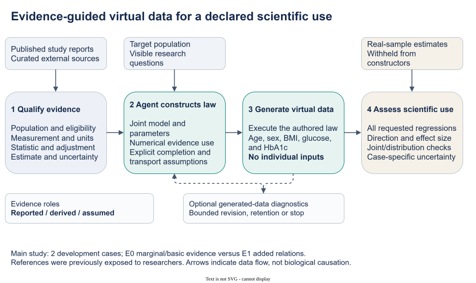
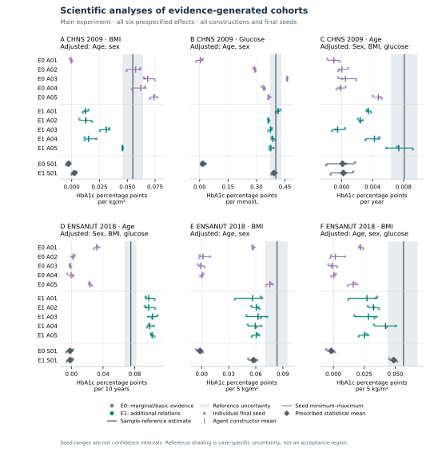
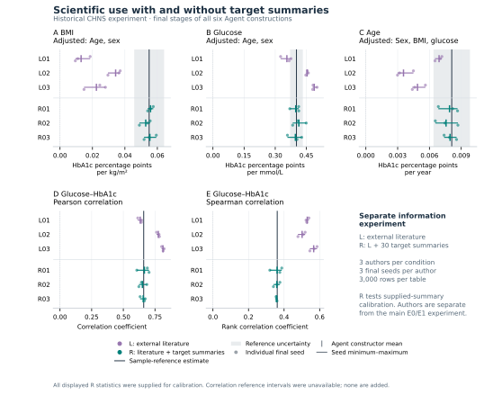
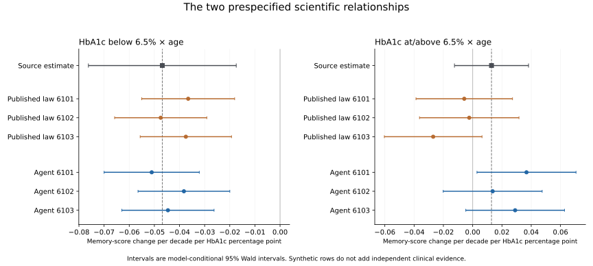
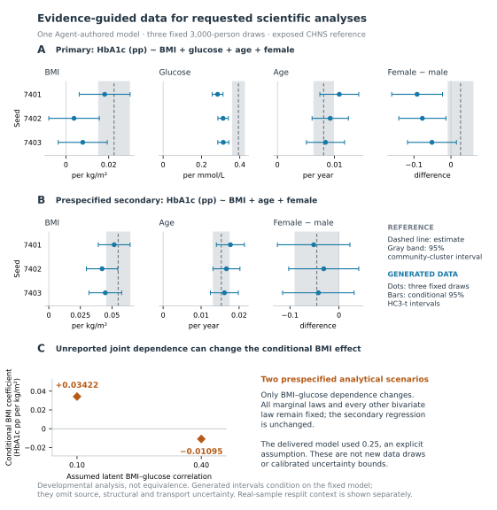
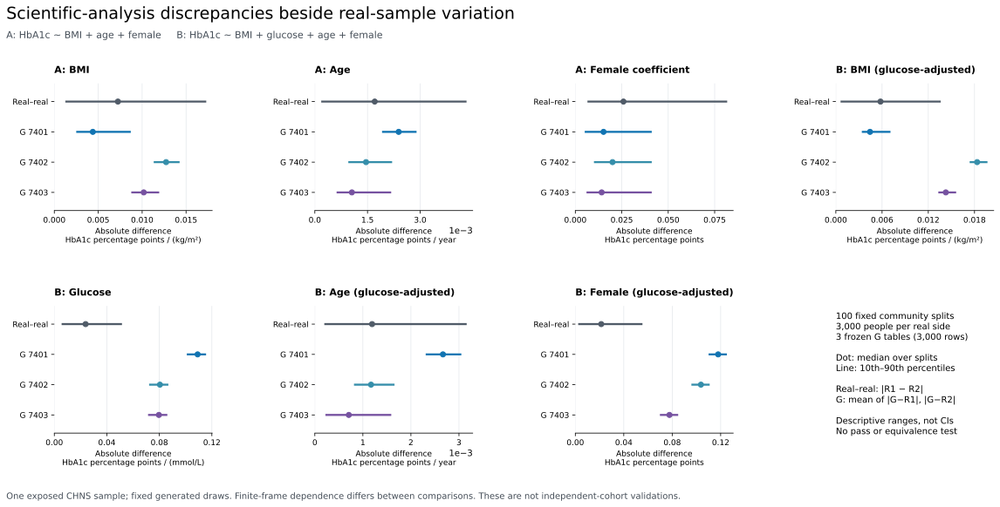

# An Evidence-Guided Agent System for Constructing Virtual Biomedical Data

Working manuscript v0.9, 4 November 2026 (America/Chicago). This draft integrates the completed live workflow, gap-directed evidence search, reviewed-evidence construction and real-sample context analyses with the existing studies. Tables 1–4 and the original eleven bibliography entries are retained from v0.8; three source-verified references are appended. Figures 1–4 retain their existing assets. Figure 5 integrates the latest analyses and dependence sensitivity; Supplementary Figure S2 provides real-sample context. Author declarations and journal-specific production remain incomplete.

## Abstract

Biomedical research questions often require measurements that are unavailable, although relevant distributions and associations have been published. We present an evidence-guided Agent system that connects a research request to evidence acquisition, scientific model construction, numerical execution and analyzable virtual data. The Agent interprets study-qualified findings, chooses a joint distribution, translates statistics into parameters and records assumptions for missing relationships. A developmental study using CHNS and ENSANUT references comprised 20 Agent and four statistical constructions and 72 final cross-sectional tables without individual-level construction inputs. Added relational evidence reduced mean absolute discrepancy for five of six designated coefficients, with CHNS BMI the exception. In a separate CHNS study, accessible target summaries supported close reconstruction: author-mean BMI coefficients ranged from 0.05282 to 0.05579 against the supplied 0.05495. An HRS public-model example generated 11,509 virtual subjects at four visits and reproduced the negative below-threshold HbA1c-by-age interaction for memory, averaging −0.04464 against the supplied −0.04684. Subsequent workflow demonstrations connected actual article retrieval, Agent-authored generators, execution-linked inspection and explicit retention decisions. A gap-directed search without bibliographic seeds informed a new complete-cohort construction delivering three 3,000-person tables. Age/sex-adjusted BMI and age relationships showed useful descriptive agreement; more conditioned relationships and selected distributional features were less well recovered. Within-reference community resplits contextualized these discrepancies and supported several analysis-specific uses. An analytical sensitivity check also exposed an unsupported BMI–glucose dependence capable of reversing the conditioned BMI coefficient. The system makes partial biomedical knowledge executable as data and exposes which scientific uses depend on missing evidence. External-evidence development, supplied-summary reconstruction and published-model reconstruction provide distinct forms of support for this practical contribution.

## Introduction

A biomedical research question can be well defined before the required measurements are available. A cohort may omit a biomarker, individual records may be inaccessible, or no study may contain the requested combination of variables. Published distributions, adjusted associations, subgroup findings and measurement definitions can nevertheless provide useful knowledge. Turning that knowledge into virtual data would allow researchers to execute an intended analysis, inspect a joint representation of the available findings and explore consequences of explicit assumptions.

The central difficulty is scientific model construction. Reported statistics do not specify a joint distribution: an age-adjusted coefficient, a marginal correlation and a subgroup mean describe different properties, often in different populations. Even coefficients for the same response may use different adjustment sets. A useful procedure must find relevant evidence, distinguish its statistical meaning, choose compatible numerical uses and complete the unreported dependence structure. The researcher's desired output is an analyzable dataset accompanied by a concise account of its evidence and assumptions.

Previous work establishes routes from restricted information to synthetic biomedical records. Filshtein and colleagues generated complete cohorts from source-specific rules estimated by collaborating analysts. SynthIPD reconstructs survival records and categorical covariates from published trial curves and subgroup summaries. Multilevel network meta-regression connects aggregate findings to individual models under population assumptions. [Filshtein et al.](https://pmc.ncbi.nlm.nih.gov/articles/PMC8338788/); [SynthIPD v2](https://arxiv.org/html/2509.16466v2); [Phillippo et al.](https://rss.onlinelibrary.wiley.com/doi/full/10.1111/rssa.12579).

LLM-based methods extend automation to model construction. G-Sim combines simulator authorship with numerical calibration and structural refinement. LLMSynthor uses aggregate information to synthesize micro-records for downstream queries. SynthCraft assists biomedical synthetic-data workflows using individual-level inputs. Our focus is the complete scientific task between a biomedical research request and useful virtual data: acquiring relevant findings, preserving their meaning, choosing their numerical role and inspecting the resulting analyses. This task arises when individual construction records are absent and the literature supplies only parts of the desired joint law. [G-Sim](https://proceedings.mlr.press/v267/holt25b.html); [LLMSynthor](https://arxiv.org/html/2505.14752v4); [SynthCraft](https://journals.plos.org/digitalhealth/article?id=10.1371/journal.pdig.0001290).

We make three connected contributions. First, we implement a research-request-driven Agent workflow connecting evidence acquisition, scientific model authorship, executable generation and numerical inspection. The scientific author chooses the structure and parameters; the software executes and checks its proposal. Second, we make consequential evidence-to-model decisions inspectable, including the translation of separately adjusted projections into joint-model coefficients and the identification of an unreported dependence that changes an intended analysis. Third, we evaluate the generated data through ordinary scientific analyses across complete cross-sectional and longitudinal products, with distinct evidence conditions and real-sample variation providing context for interpretation.

The reusable object is this evidence-to-model procedure. Different requests can lead an ordinary Agent to different generating laws; a specialized training regime or multi-Agent architecture is not required. The principal study evaluates curated external evidence. Separate studies examine accessible target summaries and a published longitudinal model. Later demonstrations connect actual retrieval to generation and feedback, while retaining their developmental status. Historical enrichment and direct-output work provide supporting context; missing-cell completion remains an unevaluated system mode. The [integrated ledger](INTEGRATED_EVIDENCE_LEDGER_v07_2026-11-03.md) and the later unit reports preserve these distinctions.

## Methods

### Evaluation settings and scientific objective

Three completed experiments establish the principal analytical evidence (Table 1). They share a scientific procedure but use separately frozen implementations, information packets, feedback opportunities and evaluators; performance is therefore reported separately. The first compares basic/marginal with additional relational external evidence in two glycemic populations. The second compares external literature with literature plus accessible target summaries in CHNS. The third uses a public HRS generating-model example for longitudinal reconstruction. Individual-level data were not supplied to the constructors in any of these settings. Earlier real data established the CHNS/ENSANUT references; no HRS participant records were accessed for the public example.

**Table 1. Experimental questions, permitted information and units of evidence.** A construction is one authored scientific model; seeds sample that model. Table counts are not counts of independent clinical studies. Protocols and information packets differ across rows.

| Setting and question | Permitted construction information | Authorship and valid delivery | Meaning of the reference comparison |
|---|---|---|---|
| External-evidence developmental study: which requested relationships can be supported? | CHNS/ENSANUT population requests and curated external evidence; target coefficients withheld from fresh author contexts | 20 Agent + 4 prescribed statistical constructions; 72 final tables, 3,000 rows each | Analysis agreement with previously exposed selected-sample references; no restored untouched confirmation |
| CHNS summary-assisted study: can accessible aggregate findings become useful joint data? | External literature in L; the same literature plus 30 target summaries and accompanying reference metadata in R | 6 Agent constructions; 18 distinct final deliveries, 3,000 rows each; 24 distinct tables including trials | Reconstruction of explicitly provided quantities in R; not an independent target prediction |
| HRS public-model example: can the procedure construct longitudinal data for a published analysis? | Published model exports, method code, population specification and requested analysis | 1 Agent + 1 reconstructed published-law specification; 6 valid tables, 11,509 subjects × 4 visits each | Source-rich model reconstruction; 3 initial invalid comparator tables additionally retained in a 9-attempt record |

A subsequent three-table CHNS statistical supplement provides a separate calibration reference for the supplied-summary setting. Later bounded units demonstrate live retrieval and generation, gap-directed evidence acquisition, a new single-model construction and descriptive real-versus-real context. All later CHNS analyses reuse the existing reference; they add workflow evidence and analytical detail without adding an external cohort. Their methods and denominators are reported separately below. Historical studies with other protocols and method versions remain in the supplement.

### Request-driven scientific Agent workflow

The implemented workflow connects five operations: define the requested data and analysis; acquire and qualify relevant evidence; choose an executable joint model; generate and inspect data; and record a final retain or revise decision. The request specifies the target population and era, variables, units, eligibility and intended analyses, together with the available observations or summaries. Complete-cohort generation was the central mode evaluated here. The intake layer prepares task-bound author packets and delivery requirements, while the scientific author selects its probability family, numerical parameters and evidence-use assumptions.

The host dispatched the scientific Agents and a coordinator managed tool access, schemas, execution and closure. The library intake prepares structured tasks but does not itself launch a model or interpret arbitrary natural language. Literature tools support queries, primary-source retrieval and access records. Numerical tools run the Agent-authored program, compute the specified analyses and return diagnostics. The scientific Agent receives this feedback and decides whether to revise or retain its model. The generator runtime uses an isolated WSL/bubblewrap adapter; author access boundaries are procedural. These responsibilities make scientific choices distinguishable from orchestration and numerical execution.

The workflow accepts curated evidence when it is already available and Agent-directed acquisition when retrieval is part of the task. It records findings as constraints, checks, context or declined numerical uses. A source comparison can be unavailable when its population, measurement or statistical operator cannot be represented. Approximate comparisons retain their assumptions. A full reconstruction of every source population is optional; the relevant question is whether the available evidence and completed model support the requested analysis. The [system record](../docs/AGENT_SYSTEM_CONTRIBUTION_AND_EVALUATION_2026-11-03.md) identifies implemented components and observed operations.

### From qualified evidence to an executable joint law

The construction contract separated the requested data product, the evidence supplied and the decisions delegated to the Agent. Each main-study request specified a population, five variables—age, sex, body mass index (BMI), glucose and HbA1c—units, eligibility rules and three regression analyses. Researchers curated the source packet and fixed the evaluation protocol. The Agent received no individual-level construction records or target reference coefficients. It selected a probability law and numerical parameters, declared assumptions for unreported quantities, and delivered generator code with a structured model specification. Numerical software sampled that law to produce the complete table.

Three linked decisions connected evidence to data. Using the supplied study definitions, the Agent interpreted each statistic, selected its role in the proposed model and chose the unreported joint structure required to use it. Each evidence record retained source population, measurement, units, statistical operator, adjustment set, estimate and available uncertainty. An admitted relation could serve as a model constraint, an analytic check, contextual information or a declined use. Numerical use required a calculation implied by the actual law under a declared source-context approximation. A check could reveal disagreement without being fitted. Reported individual dispersion remained distinct from uncertainty in an estimated mean or slope.

The retained sources included Bao's Chinese glycemia study, Wang's MIND study, Jansen's Lifelines study and Pani's age-association study, with NGSP measurement-scale guidance. For example, Jansen's BMI and glucose coefficients were separate HbA1c projections adjusted for age and sex. They could not simply be inserted as coefficients of a single equation jointly containing BMI and glucose. The author had to choose the covariate law and residual dependence that made the required projections meaningful. A conversion from IFCC to NGSP units changed their representation, while adding no independent evidence or assay harmonization. [Bao et al.](https://doi.org/10.1136/bmj.c2249); [Wang et al.](https://doi.org/10.1371/journal.pone.0296694); [Jansen source](https://doi.org/10.1111/joim.12010); [Pani source](https://doi.org/10.2337/dc08-0577); [NGSP](https://ngsp.org/ifccngsp.asp).

The resulting specification made the boundary between evidence and model completion inspectable. The [source-and-assumption supplement](SUPPLEMENT_SOURCE_AND_ASSUMPTIONS_v05.md) traces the admitted operations and their limits. A semantic checker assessed declared operators, measurement information and roles. Separate Agent reviewers inspected numerical derivations, implemented laws, support and required finite moments. These implementation reviews did not supply external clinical expert validation. Source-population simulation was unavailable; analytic calculations under assumed source contexts and generated target-table diagnostics therefore did not reconstruct the original studies. Optional exploratory feedback concerned generated outputs, without revealing target reference answers. The delivered tables represent draws from stated laws rather than recovered measurements for identifiable participants. Figure 1 maps these scientific and computational roles.



**Figure 1. The main-study external-evidence pathway from published findings to an analysable virtual cohort.** Researchers specify the population and analytical request and curate study-qualified evidence. The scientific Agent assigns numerical roles, chooses a joint law and states completion and transport assumptions; numerical software executes the generator. The resulting complete table can be used to execute the declared analyses. In this external-evidence study, sample reference values remain on the evaluator side. The separate summary-assisted setting below explicitly permits them as construction inputs. Review and retention are permitted operations, but the main study observed no feedback-driven scientific revision. The pathway illustrates model construction, not authenticated source reconstruction or validated transport.

### Worked example: translating separate adjusted projections

CHNS2009 E1 A01, selected by its first ordinal identifier rather than its performance, illustrates the actual scientific construction. Jansen's separate age/sex-adjusted HbA1c slopes were `cB = 0.13` for BMI and `cG = 2.29` for glucose in native IFCC response units. The Agent represented age/sex-residual BMI and glucose by `b` and `g`, with residual SDs `sB` and `sG`, and assumed residual correlation `r = 0.25`. A response containing `thetaB*b + thetaG*g` then implies the separate projections

```text
cB = thetaB + thetaG * r * sG/sB
cG = thetaG + thetaB * r * sB/sG.
```

With residual SDs 4.07611 and 0.49694 after the stipulated age/sex contributions, the implemented solution was `thetaB = 0.0642173` and `thetaG = 2.1583154`. Multiplication by the IFCC-to-NGSP slope factor 0.09148 gave 0.00587460 and 0.19744269 in percentage-point response units. Thus the Agent translated separate projections into a joint equation rather than inserting both reported slopes unchanged. Residual correlation, age/sex contributions, factor distributions, target mixture structure and source-to-target transport remained assumptions. The [source-to-generator trace](SUPPLEMENT_SOURCE_AND_ASSUMPTIONS_v05.md) binds these equations to the frozen code and includes the unfitted Bao correlation check and this constructor's target BMI mismatch. The calculation demonstrates a numerical evidence-use operation, not a newly identified joint distribution or uniform source agreement.

### Cases and information conditions

The study reused the existing CHNS 2009 and ENSANUT 2018 reference preparations, containing 6,631 and 6,931 selected participants, respectively. Both reference families had been exposed to researchers during development. Fresh author contexts did not restore untouched validation. No new source acquisition, target acquisition or patient-level reanalysis was undertaken for this comparison. The cases also shared Jansen/Lifelines evidence and measurement guidance.

CHNS covered ages 35–74 and required complete age, recorded sex, BMI, central glucose and HbA1c measurements under its fixed linkage and measurement rules. It used glucose in mmol/L and unweighted selected-sample analyses. Diabetes, treatment and pregnancy exclusions were not imposed, and fasting adherence was not verified for each person. BMI was derived from released height and weight with the prescribed measurement-flag handling. The resulting estimates describe the selected analytical sample, not national effects.

ENSANUT covered ages 25–79 with no reported prior doctor diagnosis of diabetes/high blood sugar, a recorded 8–12-hour fast, positive serum glucose below 126 mg/dL, available HbA1c and valid standing anthropometry. Pregnancy/lactation exclusions followed questionnaire routing for women aged 25–49; medication and anemia exclusions were not verified. The original preparation addressed contradictory anthropometry documentation without distribution-based trimming. Its standard assigned equal mass to eight sex-by-age cells, crossing two sex categories with ages 25–39, 40–54, 55–69 and 70–79. Reference observations in cell h received weight 1/(8n_h); generated tables contained exactly 375 rows per cell. These were equal-cell analytical estimates, not national survey-weighted effects. Glucose was in mg/dL; regression predictors were scaled per 10 years, 5 kg/m² and 10 mg/dL as applicable.

E0 supplied external marginal and basic measurement evidence. E1 added the admitted relational evidence to the same base. Source-analogous projections were available for CHNS BMI/glucose and ENSANUT age/BMI, but their target values were withheld. CHNS conditional age and ENSANUT conditional BMI were neither directly supplied as target coefficients nor identified by the packet. Pani evidence was absent from both CHNS conditions. The additional-information contrast did not require accepting every source relation; the author could retain a quantity as context or decline numerical use with a reason.

**Table 2. Prespecified scientific uses and uncertain sample references.** Each coefficient measures change in HbA1c percentage points per listed predictor increment. The focal predictor is added to the adjustment variables shown. CHNS intervals are 95% community-cluster CR1-t intervals for the selected unweighted sample. ENSANUT bands derive from the prespecified 399-attempt cluster-resampling stability procedure under its equal-cell standard. Neither is an equivalence margin. “Source-analogous” refers to an available type of projection, not an identical source and target population.

| Case / focal predictor | Adjustment variables | Predictor increment | Evidence relationship | Sample estimate | Reference interval or stability band |
|---|---|---|---|---:|---|
| CHNS BMI | Age, sex | 1 kg/m² | Source-analogous | 0.054946 | 0.045726–0.064166 |
| CHNS glucose | Age, sex | 1 mmol/L | Source-analogous | 0.402093 | 0.371286–0.432900 |
| CHNS conditional age | Sex, BMI, glucose | 1 year | Unprovided conditional projection | 0.008107 | 0.006387–0.009827 |
| ENSANUT conditional age | Sex, BMI, glucose | 10 years | Source-analogous | 0.075132 | 0.067124–0.082185 |
| ENSANUT BMI | Age, sex | 5 kg/m² | Source-analogous | 0.083643 | 0.070373–0.095214 |
| ENSANUT conditional BMI | Age, sex, glucose | 5 kg/m² | Unprovided conditional projection | 0.056638 | 0.043901–0.068006 |

### Allocation and evaluation

Five fresh Agent contexts per case and information condition produced 20 constructions. Four further constructions used one fixed, independently reviewed statistical specification per case and condition, applying source-qualified moment constraints and explicit completion assumptions to the same admitted packets. One prescribed specification versus five independently authored Agent models was an asymmetric descriptive comparison. Independently authored contexts assessed construction variability; multi-Agent collaboration was not a required generative mechanism. Matching labels A01–A05 across arms did not define paired authors.

Each construction had three fixed final attempts, seeds 5101–5103, each producing 3,000 rows. At most two exploratory row-producing attempts and one feedback-to-scientific-revision cycle were permitted per construction. Retaining the initial law or finalizing without exploration was valid. Failed attempts consumed the allowance, and the overall ceiling was 120 physical table attempts. Candidates were frozen before execution. All constructions and final slots had to close before common reference evaluation; favorable authors, seeds or earlier candidates could not replace final outputs. Author access was procedurally restricted to admitted inputs and their own artifacts. The generator runtime was isolated, but general author tools were not isolated at the host level.

Across the two cases, evaluation retained six focal coefficients; each table was evaluated on its three case-specific regressions and 27 CHNS or 28 ENSANUT distribution and joint diagnostics. For each endpoint, absolute discrepancy from the sample point estimate was calculated separately for each seed, averaged within each constructor, then averaged across the five Agent constructors. The E1 minus E0 contrast compared these arm means. This differs from taking the absolute difference of an arm-average coefficient and the reference. Constructor means and actual seed ranges were also reported. Missing required endpoints or seeds would make a complete-arm contrast unavailable. No heterogeneous pooled score, hypothesis test or post-hoc equivalence threshold was introduced.

A separately written audit recomputed statistics from retained generated outputs using independent regression and weighted-summary arithmetic, verified frozen reference-aggregate mappings and rechecked the contrasts. It did not regenerate tables or repeat patient-level reference analyses. Three seeds quantify sampling from a fixed law, not source-estimation, structural or transport uncertainty. The prespecified reference intervals and stability bands provide uncertainty context for selected-sample estimates, not clinical acceptance rules.

### Summary-assisted construction as a second information setting

The separate CHNS information-and-revision experiment used three fresh scientific authors per condition. L received the research request, population and measurement definitions, and external literature. R additionally received the existing target-summary package: three adjusted regression estimates and 27 marginal/joint diagnostics, accompanied by the available uncertainty, design and quality metadata. Each author delivered three 3,000-row tables at seeds 4101–4103, then had one additional diagnostic-review opportunity to revise or retain the model. Initial delivery already allowed exploratory feedback, so this stage comparison evaluates an additional review opportunity. Both conditions could use permitted literature retrieval; the retained input audit found no newly retrieved documents for the three R authors.

All six authors used one trial and retained their models after the additional review. There were 42 successful executions, comprising six trials and 36 initial/final deliveries. The 18 final deliveries duplicated their corresponding initial tables; there were 24 distinct tables overall and 18 distinct delivery tables. The complete analyses and all 30 summaries were independently recomputed. We display each author's final-seed values once. This experiment evaluates useful reconstruction when summaries are available and the effect of information provision under its own protocol; its source packet and author allocation are not merged with main-study E0/E1. In particular, its historical external packet included Pani evidence, which was absent from the main CHNS conditions.

A subsequent bounded statistical supplement fitted one fixed, purpose-built family to the same admitted R summaries and generated three final tables. It provides a descriptive calibration reference. Its complete model, results and disclosed technical recovery are in [Supplementary statistical comparison](../reports/summary_comparator_2026-11-03/RESULTS.md). No new statistical family or fit was created for this manuscript revision.

### Published-model reconstruction of a complete longitudinal cohort

The third experiment used the public HRS recipient-stage example of Filshtein et al. Published model exports and method definitions were pinned to repository commit `6708e43d5e342fa76d57b31d5a6d0bfcc2979539`. One fresh scientific Agent received those artifacts, the requested variables, visit schedule and analysis. It selected the published recursive conditional family and authored an executable implementation with parameter-level provenance. A separately implemented statistical comparator reconstructed the published generating law. This experiment concerns the HRS recipient-stage generator, not the paper's entire HRS/ARIC pooling and imputation pipeline.

The construction generated demographic strata, age, childhood socioeconomic status, education and HbA1c, then repeated memory scores with correlated individual intercepts and slopes. Each final dataset comprised 11,509 synthetic subjects observed at 0, 2, 4 and 6 years, or 46,036 rows. The requested outcome model used `age60 = (age − 60)/10`, HbA1c terms `min(HbA1c − 6.5, 0)` and `max(HbA1c − 6.5, 0)`, their age interactions, demographic and socioeconomic terms, and subject random intercepts/slopes. Both constructions had three prescribed seeds, 6101–6103. The Agent used the published variance precision; the comparator squared the printed rounded standard deviations, a small disclosed implementation difference.

Evaluation fitted the same 16-fixed-effect R/lme4 mixed model to each completed table, using REML and the fixed optimizer settings. We retained every coefficient, SE, model-conditional Wald interval, variance component and convergence diagnostic, plus all 27 prespecified baseline distribution fields. Python independently recomputed the fixed coefficients and SEs conditional on the fitted variance components; it did not independently optimize REML. Original published coefficients were permitted inputs, so this evaluation measures model reconstruction and analysis preservation. The balanced synthetic visits also differ from the original study's 43,500 observed visits.

An implementation defect invalidated the first three comparator tables: a CRLF-sensitive source parser crossed model boundaries and overwrote seven HbA1c coefficient/SE pairs. A separately reviewed technical recovery restored only those source-bound pairs and their locators, with unchanged generator code and other parameters, then generated three corrected comparator tables. The Agent outputs remained frozen and were not regenerated. Thus nine physical generations produced six valid comparison tables and three retained invalid initial comparator deliveries. All failures and the overturned preparation assessment remain in the [incident record](../reports/hrs_public_example_2026-11-03/recovery_v1/INCIDENT_AND_CORRECTION.md). This defect belongs to our implementation, not the published method.

### Live retrieval, scientific construction and feedback

The first live integration used two related complete-cohort requests. Request A sought the BMI–HbA1c association adjusted for age and sex. Request B added central serum glucose and requested the glucose-adjusted BMI association. Two fresh scientific authors received their requests, literature tools and three bibliographic identifiers, without participant records, target outcome summaries, desired coefficients or desired signs. Each authored a complete probability law and executable generator. Each construction had one trial and three delivery seeds, with 3,000 rows per table. Execution-linked source/generated-data feedback preceded the explicit final decision.

This unit evaluated the reused CHNS reference only after both authors closed. Its regressions retained all nonintercept terms, intercepts, distribution summaries and joint diagnostics. A separate implementation independently checked the generated statistics and reference linkage. The [live protocol and report](../reports/agent_system_live_2026-11-03/RESULTS.md) retain the actual source access, model decisions, coordinator interventions and delivered versions.

### Gap-directed evidence acquisition and a new complete-cohort construction

A subsequent acquisition unit gave a fresh Agent the intended analysis, population and measurement description, with no preset bibliography, desired coefficient, desired sign or generator family. The requested primary analysis was `HbA1c ~ 1 + BMI + glucose + age + female` for community-dwelling Chinese adults aged 35–74 around 2009, without diabetes/treatment exclusions. HbA1c was in percent and glucose in central serum mmol/L; individual fasting adherence was unverified. CHNS-derived numerical evidence was excluded. The Agent formulated queries and selected original studies using the existing gateway and permitted publisher routes. An independent reviewer checked the critical quantities and their statistical meanings. The [acquisition report](../reports/gap_search_2026-11-04/RESULTS.md) is an evidence-acquisition result, separate from subsequent generation.

A new constructor then received the reviewed five-paper packet, originals and analysis request. It received no participant observations, target summaries, old generators or target results. It authored an entire six-column dataset containing identifier, age, female indicator, BMI, HbA1c and glucose. The primary model added glucose to BMI, age and sex; the secondary model omitted glucose. One trial at seed 7400 and three fixed deliveries at seeds 7401–7403 each contained 3,000 rows. The constructor inspected all scheduled source/generated-only feedback before closure. The evaluator then compared outputs with the pinned historical CHNS aggregates; this construction unit read no new participant-level reference values.

Independent scientific and code review checked the evidence transformations, numerical model and finite moments. A deterministic calculation verified the implied regression projections and the author's pre-generation dependence sensitivity. Separate numerical review recomputed output summaries and audited final delivery bindings. All outcomes and assumptions remain in the [construction report](../reports/evidence_to_generation_2026-11-04/RESULTS.md) and [completed numerical review](../reports/evidence_to_generation_2026-11-04/evaluation/INDEPENDENT_NUMERICAL_REVIEW.md). The frozen model and all scheduled seeds were retained.

### Descriptive context from variation within the real reference

To interpret discrepancies without requiring equality to one sample estimate, a separately frozen analysis reused the three latest virtual tables and the existing CHNS reference of 6,631 people in 218 communities. For each of 100 prescribed seeds, communities were randomly divided into two disjoint sets of 109. After a size-only feasibility check, 3,000 people were sampled without replacement per side. Every first proposed partition was feasible. Both regression models used the same people within each side. This analysis generated no new virtual tables.

For each statistic T, real-real discrepancy was `|T(R1) − T(R2)|`. For a fixed generated table G, symmetric generated-real discrepancy was `(|T(G) − T(R1)| + |T(G) − T(R2)|)/2`. We retained all nine regression coefficients, 21 marginal quantities and six Pearson/Spearman correlations. Displays report medians across splits and ranges across the three fixed G tables; the complete results also retain signed differences and distribution quantiles. Independent review reproduced the numerical calculations and checked the aggregate displays. The [protocol and complete results](../reports/real_real_calibration_2026-11-04/RESULTS.md) define this as descriptive within-reference context. The real halves and fixed generated tables have different sampling constructions, so these differences are not an exchangeable comparison or equivalence threshold.

## Results

### Complete virtual cohorts enabled the specified analyses

The main-study procedure delivered complete age, sex, BMI, glucose and HbA1c tables from external evidence and a population request. All 20 Agent constructions and four prescribed statistical constructions produced their three fixed 3,000-row final tables. All 72 final tables were distinct and every scheduled regression and diagnostic was available. Seven exploratory tables brought the total to 79 successful executions. Independent recomputation agreed for all 2,196 statistics. The substantive quality of the delivered data is shown by the analysis results below.

### External relational evidence supported several scientific relationships

Additional relational evidence reduced constructor-averaged mean absolute discrepancy for five of six designated coefficients (Table 3). CHNS glucose discrepancy decreased from 0.134019 to 0.024079 HbA1c percentage points per mmol/L. ENSANUT age and both BMI projections also became closer to their respective sample references. CHNS BMI discrepancy increased from 0.020380 to 0.031557. The complete six-endpoint result therefore identifies useful improvements and an important exception under the same evaluation rule.

**Table 3. Scientific-analysis agreement under external evidence.** Each discrepancy is first averaged over the three final seeds of a constructor, then across the five Agent constructors. Each row retains its own units from Table 2. E0 and E1 are independently authored conditions, not paired models. The contrasts were computed before rounding. Full prescribed-statistical results remain in Figure 2 and the retained main-study table.

| Case / focal predictor | E0 mean absolute discrepancy | E1 mean absolute discrepancy | E1 minus E0 |
|---|---:|---:|---:|
| CHNS BMI | 0.020380 | 0.031557 | +0.011178 |
| CHNS glucose | 0.134019 | 0.024079 | −0.109939 |
| CHNS conditional age | 0.007281 | 0.004854 | −0.002426 |
| ENSANUT conditional age | 0.063944 | 0.024670 | −0.039274 |
| ENSANUT BMI | 0.056883 | 0.023732 | −0.033151 |
| ENSANUT conditional BMI | 0.048797 | 0.025649 | −0.023147 |



**Figure 2. All main-study scientific uses.** Each panel displays every construction and final seed for one specified coefficient. Agent means and actual seed ranges are shown together with the selected-sample estimate and its original interval or stability band. Ranges over three generated samples are not confidence intervals. All E0/E1 Agent and prescribed statistical constructions are retained; repeated author labels do not imply paired authors. The figure reports effects in their original analytical units rather than combining them into an accuracy score. Plot sources and exact definitions are recorded in the [figure manifest](integrated_figures_v07_2026-11-03/NUMERIC_MANIFEST.json).

The generated associations were useful to different degrees. CHNS E1 glucose constructor means ranged from 0.363363 to 0.414189 around a reference of 0.402093. All E1 BMI coefficients were positive, although constructor means of 0.012400–0.045757 underestimated the 0.054946 reference. Conditional-age means ranged from −0.000509 to 0.007393 against 0.008107; one constructor retained a negative mean and two negative seeds. All ENSANUT E1 focal coefficients were positive, with age means of 0.097769–0.102452 per decade versus 0.075132 and BMI means below their references. These complete effect displays distinguish retention of a scientific direction from closer recovery of its magnitude.

### Available summaries enabled closer reconstruction of the requested analyses

The separate information-provision experiment evaluated a common practical situation: published or otherwise accessible aggregate findings are available, but the corresponding individual records are not construction inputs. All three summary-assisted R authors generated data with regression coefficients and joint associations close to the supplied reference quantities (Table 4; Figure 3). The table also retains all three external-literature L authors from that experiment. This direct L/R comparison is kept separate from the main-study E0/E1 comparison.

**Table 4. Analysis results in the CHNS information-provision experiment.** Each range spans the three authors' means over their three fixed final seeds; it is not a confidence interval or a range over individual participants. Coefficients are HbA1c percentage points per kg/m², mmol/L and year, respectively. R received all listed reference values as legitimate construction inputs.

| Analysis | Sample reference | External literature L | Literature plus summaries R |
|---|---:|---:|---:|
| BMI coefficient, age/sex adjusted | 0.054946 | 0.013001–0.034287 | 0.052821–0.055789 |
| Glucose coefficient, age/sex adjusted | 0.402093 | 0.356064–0.487815 | 0.396941–0.413715 |
| Age coefficient, sex/BMI/glucose adjusted | 0.008107 | 0.003552–0.006910 | 0.007569–0.007947 |
| Glucose–HbA1c Pearson correlation | 0.660968 | 0.633764–0.813170 | 0.650561–0.666438 |
| Glucose–HbA1c Spearman correlation | 0.361457 | 0.501339–0.566477 | 0.357571–0.360983 |



**Figure 3. Complete information-provision results for the three regressions and two joint-association diagnostics.** All L01–L03 and R01–R03 final seeds and constructor means are shown against the CHNS reference. These are distinct authors from those in Figure 2. R was explicitly given the reference summaries, so its closer agreement demonstrates summary-assisted reconstruction. The final outputs were retained without numerical change after the additional review; identical initial/final tables are displayed once. The [complete historical results](../reports/information_revision_ablation_2026-11-03/RESULTS.md) include all 27 diagnostics and all stage comparisons.

Marginal variability was also retained in the summary-assisted data. R constructor-mean BMI SDs ranged from 3.38965 to 3.40243 versus 3.40632 in the supplied sample; glucose SDs ranged from 1.48817 to 1.58968 versus 1.54455, and HbA1c SDs from 0.95208 to 0.96554 versus 0.95357. Together with the regression and rank-association results, these checks show that agreement extended beyond matching a single central value. All 30 supplied quantities remain available for inspection. This is empirical evidence of coherent summary reconstruction, rather than recovery of each participant's original measurements.

### The Agent made substantive evidence-to-model decisions

Every E1 main-study Agent used at least one admitted relation as a numerical model constraint. CHNS records contained nine constraint assignments, eight analytic checks and three contextual uses across the five constructions; ENSANUT records contained fifteen, twenty-four and sixteen, respectively. The roles describe how the authors used evidence in their scientific models. They distinguish actual numerical construction from mentioning an association as background.

Separate adjusted projections are a concrete example of the modeling work involved. The Jansen source reports BMI and glucose coefficients from different age/sex-adjusted HbA1c regressions. To use both, an author must choose joint covariate variation and residual dependence so the projections implied by the generator have the specified meanings. Assigning the two reported slopes directly to a single joint equation would generally change those meanings. The framework permits different scientific completions, records their assumptions, and evaluates their consequences through the generated data. The [source-and-assumption supplement](SUPPLEMENT_SOURCE_AND_ASSUMPTIONS_v05.md) and full uptake inventory document the implemented choices.

Seven main-study Agents reviewed exploratory outputs and retained their original models; thirteen finalized without exploration. All six L/R authors also retained their models at the additional review stage. These outcomes support a workflow that can finalize a usable construction without mandatory revision. They provide no improvement estimate for iterative revision itself. Earlier development and its failed quantitative criteria, tail defects and revision trade-offs remain in the [historical-results supplement](SUPPLEMENT_HISTORICAL_RESULTS_v05.md).

### Statistical references contextualized achievable quality

Under E1, the prescribed main-study statistical constructions had smaller seed-averaged absolute discrepancies than every corresponding Agent for CHNS glucose and ENSANUT conditional BMI; other comparisons favored Agent constructions. The later three-table summary-fitted statistical supplement produced mean coefficients of 0.055726, 0.412568 and 0.007679 for the three CHNS regressions. Its purpose-built family was developed with coding-Agent assistance and is a fixed statistical calibration reference, not an Agent-removal ablation. Both approaches therefore demonstrated useful reconstruction in the supplied-summary setting. The complete comparisons are retained as supporting results. This study asks whether the Agent procedure produces scientifically useful data; it does not require uniform superiority to a task-specific statistical family.

### The procedure also constructed a complete longitudinal data product

All three Agent HRS datasets and three corrected published-law datasets supported the specified longitudinal mixed model. Every fit returned the 16 specified effects, converged without a warning or singular fit, and passed the conditional-GLS verification. The below-threshold HbA1c-by-age coefficient averaged −0.044635 in the Agent data, with three-seed range −0.051059 to −0.038247, against the supplied −0.046837. The reconstructed published law averaged −0.040500. Both implementations retained the negative direction in all three draws (Figure 4).

The weak above-threshold interaction was less stable. Agent estimates averaged 0.026485, versus the supplied 0.012867, and one of three model-based intervals excluded zero although the source interval included zero. All three corrected-law point estimates were negative, with mean −0.011691 and intervals including zero. Three draws from nearly the same supplied family, with different random-effect sampling implementations and a minor variance-rounding difference, do not identify a general accuracy ordering. The [complete 16-effect figure](integrated_figures_v07_2026-11-03/figures/figS1_longitudinal_all_effects.svg) and [all-seed coefficient table](../reports/hrs_public_example_2026-11-03/summary/fixed_effects_all_seeds.csv) retain every effect.



**Figure 4. Longitudinal analysis of complete virtual HRS cohorts.** Both prespecified HbA1c-by-age interactions are shown for all three Agent and three corrected published-law draws. Each synthetic estimate has its model-conditional 95% Wald interval; the exported source estimate and its reported SE-based interval are distinguished. These intervals are different from the three-seed ranges in Figures 2–3 and Supplementary Figure S1 and do not account for structural or source-to-target uncertainty. The analysis coefficients were supplied during construction. The three invalid initial comparator deliveries are retained in the incident record and excluded from the comparison, not treated as published-method failures.

Overall Agent HbA1c mean/SD averaged 5.8725/0.9676, close to the paper's original 5.9/1.0. However, the subgroup at or above 6.5% had mean/SD 7.1515/0.5630, compared with original 7.7/1.4 and the paper's own synthetic 7.2/0.6. The comparator had the same covariate summaries for these seeds. The procedure therefore reproduced useful aspects of the source law while inheriting its inadequate high-value spread. Complete [baseline diagnostics](../reports/hrs_public_example_2026-11-03/summary/distributions_all_seeds.csv) preserve that mismatch. The example broadens the demonstrated data product to repeated measures, piecewise relations, interactions and individual effects; it does not add independent patient observations or a new simulation family.

### The live workflow connected evidence retrieval to scientific decisions and delivery

Both live authors retrieved original evidence, selected distinct joint models, produced executable programs and made explicit decisions after actual feedback. A chose a latent-stratum law with conditional lognormal BMI and shifted-gamma HbA1c. B chose a mixture with shared lognormal glycaemic variation and an explicit meal-contamination scenario. Four metered queries and four per-session downloads covered two distinct full original papers; a third original was available only as an abstract. Two trials and six deliveries produced eight successful 3,000-row executions. Both authors retained their initial laws, so the six final delivery aliases represented six distinct tables.

The complete workflow supported several requested uses. A's age coefficient ranged from 0.01337 to 0.01483 against 0.01530 in CHNS, and B's glucose coefficient ranged from 0.39164 to 0.43870 against 0.39291. A's BMI coefficient was positive but smaller, at 0.02445–0.03894 against 0.05495. B's glucose-adjusted BMI coefficient ranged from −0.00949 to −0.000985 against a positive 0.02246 reference. The [complete live analysis display](../reports/agent_system_live_2026-11-03/ANALYSIS_UTILITY.svg) retains all seven nonintercept terms and the aggregate report retains every specified diagnostic. Agreement in B's marginal glucose–HbA1c correlation coexisted with the conditional BMI discrepancy, demonstrating why evaluation follows the requested regression.

The operational record also identified a substantive review intervention. Before freeze, the coordinator recognized that B's exponentiated lognormal BMI link implied divergent moments. The author preserved its draft and replaced the link with positive linear multipliers. This repair addressed the model's mathematical validity before target comparison. All nine A and eight B source comparisons were unavailable because the declared models did not support those source-context computations. The generated-data diagnostics and final retention decisions were nevertheless completed. These observations establish implemented retrieval, scientific authorship, execution and review, with their actual interventions visible.

### Open evidence search recovered analysis-relevant information

The gap-directed acquisition used ten recorded queries and seriously reviewed five original studies. It recovered the LifeLines original through the publisher, extending the earlier abstract-only access. Table 3 Model III supplied a genuinely conditional BMI coefficient of 0.05, with reported interval 0.02–0.08, in HbA1c mmol/mol per kg/m². Its glucose coefficient was 2.13 and age coefficient 0.07 in native response units. The model adjusted for age, gender, BMI, fasting plasma glucose, MCH, MCHC, smoking and alcohol. The source's factor of 10.93 supports an algebraic conversion to HbA1c percentage points; the additional covariates and different population require separate modeling choices. Pani supplied complementary age effects of 0.012 and 0.010 percentage points/year under its reported adjustment sets. [Jansen et al.](https://doi.org/10.1111/joim.12010); [Pani et al.](https://doi.org/10.2337/dc08-0577).

The evidence review distinguished Hoorn's grouped BMI contrasts [14] from continuous slopes, Sakane et al.'s coefficients of unresolved scale [13] from raw-scale effects, and Li et al.'s diabetes logistic models [12] from HbA1c regressions. Contrasting and less directly applicable findings remained in the [reviewed five-study packet](../reports/gap_search_2026-11-04/RESULTS.md), alongside access and applicability details. This unit demonstrates gap-directed retrieval and interpretation: the resulting packet made more relevant evidence available to the model author. Its independent contribution is evidence acquisition; the analytical consequences were examined in the separately recorded construction that followed.

### Reviewed evidence supported a complete cohort and identified an analysis-sensitive gap

The new constructor selected a sex-stratified Gaussian copula with bounded integer age and positive lognormal/shifted-lognormal margins. It used Hainan glycaemic summaries and rank associations [12], Japanese IGT BMI summaries and Pearson associations [13], and a US age-association magnitude [10], with declared transport assumptions. Pearson and Spearman evidence were converted under the chosen marginal laws rather than equated with latent Gaussian correlations. Deterministic moment equations connected this model to both requested regressions. LifeLines [9] and Hoorn [14] conditional findings were retained with their differing adjustment sets instead of being copied directly into the target regression. The controller supplied no scientific parameter or desired coefficient.

All four executions succeeded, delivering three distinct complete 3,000-person tables plus one trial. Each execution returned 11 approximate target/source comparisons and 23 unavailable checks. After inspecting all scheduled feedback, the author retained its model. The completed independent numerical audit found zero mismatches, with largest numerical difference 8.44 × 10⁻¹⁵. The latest construction therefore extends the evidence chain from Agent-directed source discovery through an inspected executable law to ordinary regression analysis (Table 5).

**Table 5. Analyses of the latest reviewed-evidence complete-cohort construction.** Primary regression includes BMI, glucose, age and female; secondary regression includes BMI, age and female. All coefficients measure HbA1c percentage points per unit of the predictor. Reference intervals are the historical CHNS 95% community-cluster intervals. Generated ranges span all three delivery seeds of one law, rather than independent constructions or confidence intervals. Intercepts and every distribution/joint diagnostic are retained in the linked aggregate report.

| Analysis and term | Existing CHNS estimate [95% cluster interval] | Generated range |
|---|---:|---:|
| Primary: BMI | 0.02246 [0.01526, 0.02967] | 0.00380–0.01811 |
| Primary: glucose | 0.39291 [0.36175, 0.42406] | 0.28417–0.31368 |
| Primary: age | 0.00811 [0.00639, 0.00983] | 0.00842–0.01084 |
| Primary: female | 0.02599 [−0.00776, 0.05974] | −0.09143–−0.05124 |
| Secondary: BMI | 0.05495 [0.04573, 0.06417] | 0.04217–0.05176 |
| Secondary: age | 0.01530 [0.01322, 0.01739] | 0.01613–0.01771 |
| Secondary: female | −0.04530 [−0.08971, −0.00088] | −0.05157–−0.03108 |

The age/sex-adjusted BMI and age relationships, together with primary age, showed useful descriptive agreement. The primary BMI and glucose effects were smaller than the reference, and the primary female coefficient had the opposite point direction, although the reference interval included zero. HbA1c means of 5.688–5.717% and SDs of 0.960–0.980 were near the reference 5.675% and 0.954. Its 90th percentile of 6.914–6.955% was higher than the reference 6.3%, while generated female proportions of 0.635–0.642 exceeded 0.537. All joint and distribution results remain available in the [aggregate report](../reports/evidence_to_generation_2026-11-04/evaluation/REPORT.json).

Before generating or viewing target results, the author identified a concrete gap in the requested analysis. Changing only the unreported latent BMI–glucose correlation from 0.10 to 0.40 changed the implied primary BMI coefficient from +0.03422 to −0.01095. The secondary regression, all margins and every other bivariate law remained unchanged, and both covariance structures were valid. Independent calculation reproduced this sensitivity. The selected 0.25 correlation was an explicit completion assumption. This calculation shows how an Agent-authored model can identify the particular missing relationship that matters for an intended use. It was an analytical examination of one model family, not an additional generation experiment or an uncertainty interval.



**Figure 5. Scientific use and assumption dependence of a cohort constructed from independently retrieved evidence.** One Agent-authored model produced three fixed 3,000-person delivery tables. **A**, all four non-intercept coefficients from the prespecified primary regression of HbA1c on BMI, glucose, age and female indicator. **B**, all three non-intercept coefficients from the prespecified secondary regression excluding glucose. Effects are HbA1c percentage-point changes per the displayed predictor increment; the female coefficient is the female-minus-male difference. Blue points and bars are the three generated estimates and conditional 95% HC3-t intervals. Dashed lines and gray bands are the existing CHNS selected-sample estimates and 95% community-cluster CR1-t intervals (6,631 participants, 218 communities). These intervals have different meanings; neither interval overlap nor the displayed differences define equivalence. Generated intervals do not include source, structural or transport uncertainty. **C**, two pre-generation analytical scenarios for the unreported latent BMI–glucose correlation. Changing only this dependence from 0.10 to 0.40 changes the model-implied primary BMI coefficient from +0.03422 to −0.01095, while all marginal laws, every other bivariate law and the secondary regression remain unchanged. The delivered model used the declared assumption 0.25. The two points are retained analytical calculations, without interpolation, additional generated cohorts or calibrated uncertainty bounds. All seven requested non-intercept effects are shown; intercepts and complete distribution and correlation diagnostics remain in the aggregate report. This is one developmental case, not an independent clinical validation.

### Real-sample variation contextualized useful relationships and remaining discrepancies

The 100 community-disjoint CHNS resplits retained all 36 prescribed metrics without unavailable or discarded analyses. Several generated relationships had discrepancies on a similar numerical scale to differences between the real subsets (Table 6). For example, the real-real median absolute difference for the age/sex-adjusted BMI coefficient was 0.007239, compared with symmetric generated-real median differences of 0.004383–0.012727 across the three fixed tables. The corresponding age values were 0.001705 and 0.001055–0.002387. These comparisons support interpreting the latest construction through specific scientific uses rather than requiring exact agreement with one reference sample.

**Table 6. Descriptive within-reference context for selected scientific analyses.** A is the age/sex-adjusted regression and B additionally includes glucose; these correspond to the latest construction's secondary and primary analyses. Real-real values are medians of absolute differences over 100 community-disjoint resplits. Generated values are the range across three frozen tables of the median symmetric discrepancy defined in Methods. Each row retains its original units. The complete 36-metric table is linked below; no threshold or win/loss count is derived from these columns.

| Analysis quantity | Real-real median absolute difference | Generated symmetric median difference, range across 3 draws |
|---|---:|---:|
| A: BMI coefficient | 0.007239 | 0.004383–0.012727 |
| A: Age coefficient | 0.001705 | 0.001055–0.002387 |
| A: Female coefficient | 0.025909 | 0.014178–0.020021 |
| B: BMI coefficient | 0.005797 | 0.004436–0.018340 |
| B: Glucose coefficient | 0.023839 | 0.079642–0.109154 |
| B: Age coefficient | 0.001192 | 0.000707–0.002667 |
| B: Female coefficient | 0.021398 | 0.077716–0.117915 |
| BMI–glucose Pearson correlation | 0.025768 | 0.062791–0.077943 |
| BMI–glucose Spearman correlation | 0.025903 | 0.015363–0.024806 |

All three nonintercept A coefficients, B age and BMI–glucose rank correlation had discrepancies on broadly similar scales to this resplit variation. B glucose and female coefficients remained farther away, while B BMI varied across generated draws. Mean differences also illustrated why exact equality is unnecessary: glucose had a real-real median difference of 0.048830 mmol/L versus generated symmetric medians of 0.024415–0.045521. Selected tails and composition remained less similar; glucose q90 differences were 0.060000 mmol/L versus 0.676156–0.811237, and female-proportion differences were 0.005333 versus 0.098167–0.105500.

The [complete 36-metric table](../reports/real_real_calibration_2026-11-04/COMPLETE_METRIC_TABLE.md) and [Supplementary Figure S2](integrated_figures_v09_2026-11-04/supplement_real_real_context.svg) retain these mixed results. The figure's 10th–90th percentile lines describe split distributions, not confidence intervals. This analysis provides within-sample context from the same exposed CHNS reference; it leaves between-population transfer as a separate empirical question.

### Earlier enrichment and direct-output results provide supporting context

Earlier frozen experiments tested a related data gap: observed covariates were retained while an entirely unmeasured biomarker was generated. The insulin constructions retained selected BMI and curvature directions, while the HbA1c constructions retained age and BMI directions but not all nonlinear or interaction findings. A separate small urate example directly authored the added values as table text and included Agent-directed literature acquisition with controller assistance; it retained selected associations but missed the age relationship and overestimated subgroup variability. These different versions support limited mode-specific feasibility. They do not establish missing-cell completion, a common-protocol comparison of direct versus programmatic output, or automatic retrieval in the present main studies. The [integrated evidence ledger](INTEGRATED_EVIDENCE_LEDGER_v07_2026-11-03.md) links all denominators and failures to their original reports.

## Discussion

This work demonstrates a practical scientific role for Agents: converting available biomedical knowledge and a research request into an executable joint model and data that ordinary analysis software can use. The system connects evidence acquisition, scientific modeling, numerical execution, inspection and a documented final decision. Complete cross-sectional cohorts supported regression analyses, and the published-model example supported repeated-measure analysis with individual effects. The useful product is a dataset together with an inspectable explanation of how its scientific properties were constructed.

The Agent's substantive contribution lies in the decisions between a source finding and a generating law. The worked example combines separate adjusted projections with an assumed residual covariance to derive joint coefficients. The latest construction converts Pearson and Spearman information under explicit marginal laws and calculates the regression implications of its copula. These operations use established statistical mathematics. The implemented contribution is delegating their evidence-specific selection, derivation and use to a scientific author within a complete data-generation workflow. The source-search unit further demonstrates that an Agent can seek a missing conditional relationship and distinguish its estimand from superficially similar findings.

The experiments support several useful information settings. External relational evidence improved five of six designated discrepancy contrasts across CHNS and ENSANUT. Accessible CHNS summaries supported coherent reconstruction of adjusted coefficients, rank associations and variability. The HRS source model supported a complete longitudinal product and recovery of its negative below-threshold interaction. These results give concrete examples of analyses that can be executed from available evidence when individual construction records are missing. The settings remain separate because their sources, allocations and permitted target information differ.

The latest complete-cohort construction broadens the observed workflow from curated inputs to Agent-directed discovery followed by inspected generation. Its age/sex-adjusted BMI and age relationships and primary age effect had useful descriptive agreement. The real-real context strengthens an analysis-centered interpretation: several discrepancies were on similar scales to variation between real subsets, while other conditional effects, composition and tails remained farther away. A virtual cohort need not reproduce each observed row or every sample coefficient to be useful. Its suitability depends on the scientific properties required for the intended analysis and on the assumptions supporting them.

An additional output of scientific model authorship is a precise diagnosis of missing evidence. In the latest model, changing an unsupported BMI–glucose dependence reversed the implied glucose-adjusted BMI slope without changing the secondary regression or other bivariate laws. This finding explains why matching marginal summaries and an important pairwise association can leave a conditional analysis unstable. It also offers an actionable research direction: seek joint or subgroup evidence for the relationship that controls the requested result. More generated rows can reduce sampling variation under the chosen law, but cannot supply that missing scientific information.

The workflow builds on summary-based synthesis and LLM-authored simulation. G-Sim and LLMSynthor also assign consequential construction and refinement decisions to LLMs. Here, the applied contribution connects a biomedical research request, study-qualified evidence, scientific model choices and analysis-centered evaluation across the observed task chain. Ordinary Agents are sufficient for this role. Separate authors and reviewers provide observations about construction variation and review interventions; their number is not itself the methodological contribution. Purpose-built statistical references likewise remain useful: some main-study coefficients favored them, and the supplied-summary statistical family achieved close reconstruction. The present evidence supports utility of the Agent workflow without a general superiority claim.

The principal empirical limits concern population transfer and information exposure. CHNS and ENSANUT are developmental references already known during earlier work, with some shared external evidence. Later CHNS units reuse that same reference and do not add an external population. R reconstructs supplied target summaries, and the HRS example uses published generating coefficients without independent participant-level validation. External-only data retain meaningful effect discrepancies, including the main-study CHNS conditional-age reversal and the live glucose-adjusted BMI discrepancy. The latest model also retains glucose, female and distributional mismatches, while HRS inherits inadequate high-HbA1c dispersion. These findings delimit specific analytical uses rather than a single verdict on every generated table.

The workflow evidence is bounded. The live comparison changed author and request together; the later construction changed its author, packet, demographic description, family and seeds. Neither isolates the causal benefit of request adaptation or open search. Both live authors and the latest constructor retained their initial models after feedback. In the main study, seven authors reviewed exploratory outputs and retained their laws, while thirteen finalized without exploration; all six L/R authors retained their models after the additional review. Those completed decisions demonstrate an operational loop but provide no revision-gain estimate. The observed pre-freeze tail repair was a coordinator-detected mathematical defect followed by author revision, and its intervention is retained explicitly. Source-context replay was unavailable in the live runs; later comparisons included approximate and unavailable quantities rather than reconstructed source populations.

The uncertainty measures also answer different questions. Seed ranges quantify draws from a fixed law, and the synthetic-data intervals condition on that law. They do not propagate source-estimation, extraction, structural or transport uncertainty. The community-disjoint resplits describe variation within a finite, selected CHNS sample. The real halves are dependent parts of that sample, and three fixed generated tables do not share their sampling design. Consequently, smaller symmetric discrepancies do not establish equivalence, greater realism or superiority; the 100 resplits are neither 100 independent clinical replications nor between-cohort validation. Reference intervals and resplit distributions provide context without creating a retrospective acceptance rule.

Finally, the implementation remains host-dispatched and coordinator-managed. End-to-end standalone autonomy, broad-domain adaptability and reductions in human effort have not been measured; historical model identifiers and token costs are incompletely metered. Search exclusions and fresh author contexts are procedural, and one excluded CHNS-derived search snippet was logged during acquisition. Missing-cell completion is unvalidated, while historical enrichment and direct-output results use different protocols. The supported application is population-level reconstruction and scenario exploration under stated assumptions. It does not recover an individual's unmeasured biomarker, establish a new causal or clinical effect, or replace clinical observations.

Prospective work can now focus on a frozen workflow, independently defined requests and previously unexposed references, while recording actual preparation and review effort. The dependence sensitivity supplies a concrete test of whether additional joint evidence improves the intended analysis. These extensions build on an already operational contribution: allowing researchers to request useful virtual biomedical data while the Agent makes and records the scientific modeling decisions needed to construct them.

## Data, code and supporting material

The [public repository](https://github.com/ziwang11112/evidence-guided-virtual-cohorts-2026) contains protocols, original code, aggregate results and independent checks. The [main-study](../reports/main_study_freeze_2026-11-03/RESULTS.md), [information-provision](../reports/information_revision_ablation_2026-11-03/RESULTS.md), [statistical-supplement](../reports/summary_comparator_2026-11-03/RESULTS.md) and [HRS-example](../reports/hrs_public_example_2026-11-03/RESULTS.md) reports retain their complete inputs, results and failures. The [figure package](integrated_figures_v07_2026-11-03/FIGURE_PLAN.md) maps panels to these records.

The later [live integration](../reports/agent_system_live_2026-11-03/RESULTS.md), [gap-directed acquisition](../reports/gap_search_2026-11-04/RESULTS.md), [reviewed-evidence construction](../reports/evidence_to_generation_2026-11-04/RESULTS.md) and [real-real context](../reports/real_real_calibration_2026-11-04/RESULTS.md) reports provide their protocols, aggregate results and completed reviews. The new tables and figure links in this draft use those existing aggregates. The [v0.9 figure package](integrated_figures_v09_2026-11-04/FIGURE5_CAPTIONS.md) documents the new Figure 5 and the supplementary real-real image, including pinned inputs, exact plotted values and visual inspection. This new package and the original aggregate reproduction lock remain separately versioned.

The independently checked [aggregate reproduction entry point](../docs/REPRODUCING_MANUSCRIPT_v07.md) rebuilds Tables 2–4 numeric cells and Figures 2–4/S1; Figure 1 is a schematic copy. It is pinned to v0.7, whose Tables 2–4 and Figures 1–4/S1 remain unchanged here, and does not rerun clinical analysis or generation. Historical drafts remain available. Individual real/generated records, third-party full texts and credentials remain local; clinical reruns require lawful data access and the case-specific environment.

## References and source-access status


This writing revision preserves the eleven existing bibliography entries and appends the three additional studies from the completed 4 November acquisition. Titles, all author names, journals, publication details and DOIs for references 12–14 were checked against their retained original JATS XML metadata; no new retrieval or literature search was needed. Their scientific-use descriptions follow the existing five-study evidence review. No field-priority claim is made. The predecessor comparisons use the primary-source reading documented in the [3 November positioning memo](CORE_CONTRIBUTION_POSITIONING_2026-11-03.md) and [journal-fit memo](JOURNAL_FIT_2026-11-03.md). Their previously completed access record distinguishes publication-record checks from retrieved full text, including G-Sim's retained extraction. Bibliographic metadata for SynthCraft, Jansen and Wang were checked against publisher pages during v0.6 preparation; Bao and Pani metadata were checked against their PubMed records after direct publisher/PMC access failed or encountered a browser challenge. Those metadata checks did not re-audit clinical extraction. Numerical-use descriptions rely on the already admitted source packets and retained audits; an identifier alone does not verify a source's use.

1. Filshtein TJ, Li X, Zimmerman SC, Ackley SF, Glymour MM, Power MC. Proof of concept example for use of simulation to allow data pooling despite privacy restrictions. *Epidemiology*. 2021;32(5):638–647. [DOI and full text](https://pmc.ncbi.nlm.nih.gov/articles/PMC8338788/).
2. Zhao Z et al. SynthIPD: training-free synthetic individual patient data generation. arXiv:2509.16466v2, 24 July 2026. [Versioned full text](https://arxiv.org/html/2509.16466v2). Publication beyond this preprint was not established in the positioning audit.
3. Phillippo DM et al. Multilevel network meta-regression for population-adjusted treatment comparisons. *Journal of the Royal Statistical Society: Series A*. 2020;183(3):1189–1210. [DOI/full text](https://rss.onlinelibrary.wiley.com/doi/full/10.1111/rssa.12579).
4. Holt S, Ruiz Luyten M, Berthon A, van der Schaar M. G-Sim: Generative Simulations with Large Language Models and Gradient-Free Calibration. *Proceedings of ICML*. PMLR 267;2025:23513–23561. [Published record](https://proceedings.mlr.press/v267/holt25b.html).
5. Tang Y, Kong M, He J, Nie T, Ma W, Sun L. LLMSynthor: Macro-Aligned Micro-Records Synthesis with Large Language Models. KDD 2026. [DOI](https://doi.org/10.1145/3770855.3818965); [full text v4](https://arxiv.org/html/2505.14752v4).
6. Callender T, Boyd A, Davis R, Ruhrberg Estevez S, Lavista Ferres JM, van der Schaar M. SynthCraft: An AI partner for synthetic data generation to support data access and augmentation in healthcare. *PLOS Digital Health*. 2026;5(3):e0001290. [Published article](https://journals.plos.org/digitalhealth/article?id=10.1371/journal.pdig.0001290).
7. Bao Y, Ma X, Li H, Zhou M, Hu C, Wu H, Tang J, Hou X, Xiang K, Jia W. Glycated haemoglobin A1c for diagnosing diabetes in Chinese population: cross sectional epidemiological survey. *BMJ*. 2010;340:c2249. [DOI](https://doi.org/10.1136/bmj.c2249); [bibliographic record](https://pubmed.ncbi.nlm.nih.gov/20478961/).
8. Wang P, Li Y, Wang M, Song L, Dong Y, Han X, Tuomilehto J, Wang Y, Du Y, Qiu C. Comparing glycemic traits in defining diabetes among rural Chinese older adults. *PLOS ONE*. 2024;19(1):e0296694. [Published article](https://journals.plos.org/plosone/article?id=10.1371/journal.pone.0296694).
9. Jansen H, Stolk RP, Nolte IM, Kema IP, Wolffenbuttel BHR, Snieder H. Determinants of HbA1c in nondiabetic Dutch adults: genetic loci and clinical and lifestyle parameters, and their interactions in the lifelines cohort study. *Journal of Internal Medicine*. 2013;273(3):283–293. [Published article](https://onlinelibrary.wiley.com/doi/10.1111/joim.12010).
10. Pani LN, Korenda L, Meigs JB, Driver C, Chamany S, Fox CS, Sullivan L, D'Agostino RB, Nathan DM. Effect of aging on A1C levels in individuals without diabetes: evidence from the Framingham Offspring Study and the National Health and Nutrition Examination Survey 2001-2004. *Diabetes Care*. 2008;31(10):1991–1996. [DOI](https://doi.org/10.2337/dc08-0577); [bibliographic record](https://pubmed.ncbi.nlm.nih.gov/18628569/).
11. NGSP. The IFCC and NGSP, Table 2. [Official measurement-scale guidance](https://ngsp.org/ifccngsp.asp).
12. Li T, Quan H, Zhang H, Lin L, Lin L, Ou Q, Chen K. Type 2 diabetes is more predictable in women than men by multiple anthropometric and biochemical measures. *Scientific Reports*. 2021;11:6062. [DOI](https://doi.org/10.1038/s41598-021-85581-z); [original full text](https://pmc.ncbi.nlm.nih.gov/articles/PMC7960723/).
13. Sakane N, Sato J, Tsushita K, Tsujii S, Kotani K, Tominaga M, Kawazu S, Sato Y, Usui T, Kamae I, Yoshida T, Kiyohara Y, Sato S, Tsuzaki K, Nirengi S, Takahashi K, Kuzuya H, JDPP Research Group. Determinants of Glycated Hemoglobin in Subjects With Impaired Glucose Tolerance: Subanalysis of the Japan Diabetes Prevention Program. *Journal of Clinical Medicine Research*. 2017;9(4):360–365. [DOI](https://doi.org/10.14740/jocmr2928w); [original full text](https://pmc.ncbi.nlm.nih.gov/articles/PMC5330780/).
14. Wisgerhof W, Ruijgrok C, den Braver NR, Borgonjen—van den Berg KJ, van der Heijden AAWA, Elders PJM, Beulens JWJ, Alssema M. Phenotypic and lifestyle determinants of HbA1c in the general population–The Hoorn Study. *PLOS ONE*. 2020;15(6):e0233769. [DOI](https://doi.org/10.1371/journal.pone.0233769); [original full text](https://pmc.ncbi.nlm.nih.gov/articles/PMC7272077/).

## Supplementary real-sample context



**Supplementary Figure S2. Scientific-analysis discrepancies in the context of real-sample variation.** All seven non-intercept coefficients are shown for the existing frozen cohorts and 100 prescribed community-disjoint resplits of the previously exposed CHNS reference, with 3,000 participants sampled on each real side. The source figure's model labels are retained: A excludes glucose and B includes glucose; they are model names rather than the panel letters of Figure 5. Real–real differences are |T(R1)−T(R2)|. Each generated comparison uses a fixed table and the symmetric discrepancy (|T(G)−T(R1)|+|T(G)−T(R2)|)/2. Points are medians across splits and lines are 10th–90th percentiles, not confidence intervals. The three generated tables are seeds 7401–7403 of the same 11-04 model shown in Figure 5. Complementary finite-sample halves and fixed generated draws have different dependence structures, so these distributions are descriptive context rather than exchangeable comparisons, equivalence thresholds or independent-cohort validation. All 36 prescribed metrics remain in the complete aggregate report. This supplementary image is a byte-identical copy of the existing reviewed figure.

## Author declarations to complete

Authors, affiliations, contributions, funding, competing interests, participant-reference ethics/access statements, and the final AI-use disclosure are to be completed by the authors; none is inferred from implementation audits. Journal-specific formatting and final publication-layout inspection remain outstanding; the checked aggregate display-reproduction package is available as described above. This writing revision introduces no new generation, target fitting, source acquisition or selection of favorable results.
