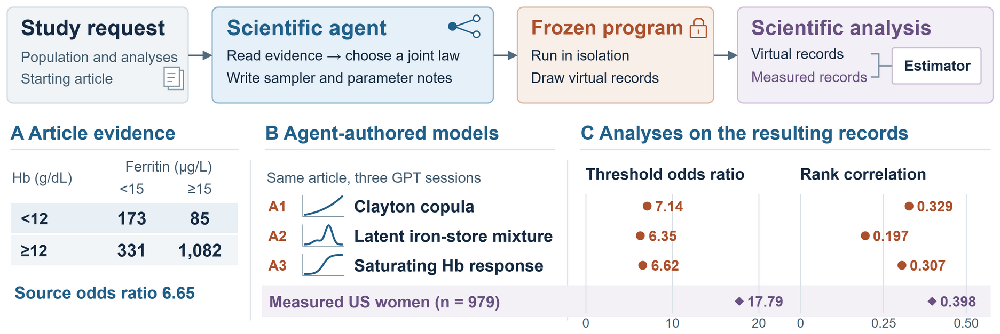

# Which Scientific Analyses Can Agent-Generated Biomedical Cohorts Support?

KDD Research working manuscript, v0.49, 21 November 2026.

[External review PDF](external_review.pdf) · [Anonymous PDF](paper.pdf) · [External review Overleaf project](overleaf_external_review_v49.zip) · [Anonymous Overleaf project](overleaf_v49.zip)

## Who chooses the model?

The study assigns the GPT model, the target population and the scientific questions. In the original-paper iron experiment, the agent reads the assigned article, can search for more evidence and writes its own scientific model, parameters and Python sampler. The execution service draws participants from the frozen sampler. In the lung experiment we supply two fixed columns so that the agent's choice is precisely which measurements belong to the same individual. Table 1 gives the permitted choices for each design.

Three separate GPT sessions derived the same source odds ratio of 6.65. Each implemented a different joint model. Their generated threshold odds ratios were 7.14, 6.35 and 6.62. Their rank correlations were 0.329, 0.197 and 0.307. Both measures were higher in the US survey. Figure 1 documents what each session built and how the resulting records behaved. Figure 3 addresses the separate question of what changes when the joint assignment alone is altered.

[Editable figure](figures/agent-model-authorship.drawio) · [Vector PDF](figures/agent-model-authorship.drawio.pdf) · [Figure builder and data checks](../../work/kdd_v49_build_2026-11-21/method_figure.py) · [Agent request](../../work/original_paper_capability_2026-11-17/requests/IRON.txt) · [Source and model audit](../../work/original_paper_capability_2026-11-17/SOURCE_MODEL_AUDIT.md) · [Session traces](../../work/original_paper_capability_2026-11-17/audit/TRACE_SUMMARY.json) · [Results by author](../../work/original_paper_capability_2026-11-17/analysis/author_results.csv)

The archived scientific programs can be read alongside the graphic. [A1, Clayton copula](../../work/original_paper_capability_2026-11-17/episodes/P1_IRON_A1/candidates/v001/generator.py) · [A2, latent iron-store mixture](../../work/original_paper_capability_2026-11-17/episodes/P1_IRON_A2/candidates/v001/generator.py) · [A3, saturating hemoglobin response](../../work/original_paper_capability_2026-11-17/episodes/P1_IRON_A3/candidates/v001/generator.py) · [Lung experiment request](../../work/spirometry_pairing_2026-11-21/REQUEST.txt)

## Reading the results

| Location | Scientific question |
|---|---|
| Figure 1 and Table 1, p. 2 | What did the agent read, decide and implement? Which decisions did the study fix? |
| Figure 2, p. 4 | Which of nine adjusted Kenyan lifestyle comparisons carry over when the same analysis uses virtual participants? |
| Figure 3, p. 5 | How much does pairing contribute to the Chinese iron and Kenyan lifestyle analyses when the individual measurement values stay fixed? |
| Figure 4, p. 6 | How well does virtual pairing recover between-hand differences and the fraction exceeding 5 kg? |
| Figure 5, p. 8 | How widely can lipid screening prevalence vary across pairings compatible with the same evidence? |
| Table 3, p. 10 | Which recruitment samples, study families and analyses are represented? |
| Figure 11, p. 17 | What can seven alternative iron programs change while retaining selected source summaries? |
| Figure 21, p. 25 | What happens to three lung-function analyses after adding source evidence on paired measurements? |

In lung function, giving the joint evidence moved the predicted fraction below a pre-bronchodilator FEV1/FVC of 0.70 from 25.50% to 16.26%, closer to both measured samples. Agreement worsened for the mean individual ratio. The statistical comparator with the same evidence also predicted 16.26%. The registered predictions and independent recomputation remain available. [Protocol](../../work/spirometry_pairing_2026-11-21/PROTOCOL.md) · [Results and uncertainty](../../work/spirometry_pairing_2026-11-21/RESULTS.md) · [Independent check](../../work/spirometry_pairing_2026-11-21/verify.py)

The manuscript draws on six domains, 17 analysis–sample comparisons, 15 distinct recruitment samples or periods, 13 study families and ten countries. Thirteen construction experiments contain 67 initial authoring sessions and 252 seeded outputs. A session can choose a scientific model. Repeated seeds sample from an existing model. This release revises the presentation of those experiments. [Counting rules](../../work/spirometry_pairing_2026-11-21/COVERAGE.json) · [Earlier handgrip analysis](../../work/kdd_v47_scale_2026-11-21/RESULTS.md) · [Kenyan analysis replay](../../work/kdd_v45_build_2026-11-21/ANALYSIS_REPLAY.md) · [Related work](RELATED_WORK.md) · [Anonymous build check](BUILD_CHECK.json) · [Linked edition check](EXTERNAL_REVIEW_CHECK.json)
