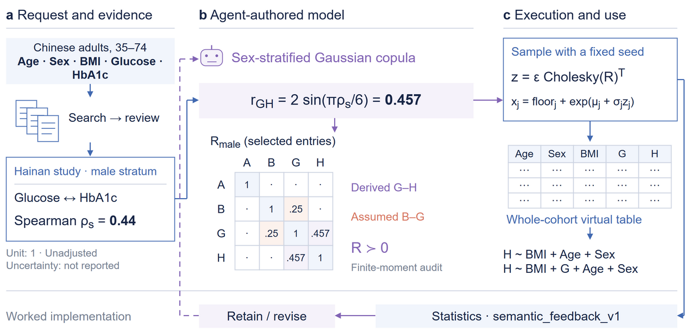
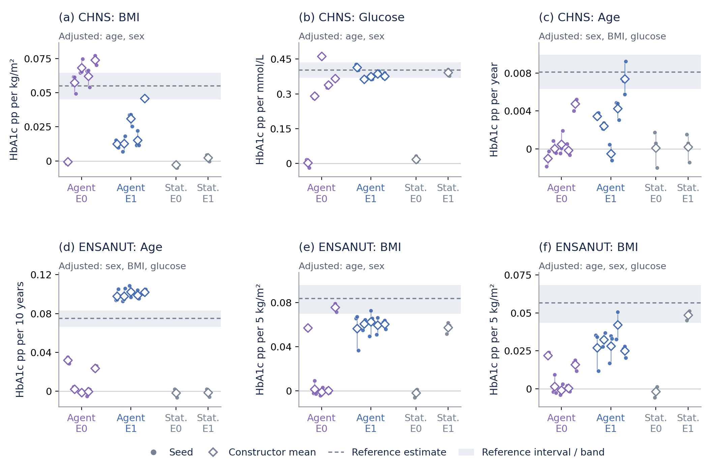
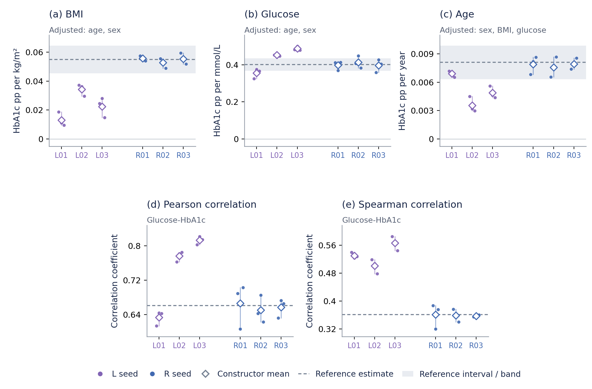
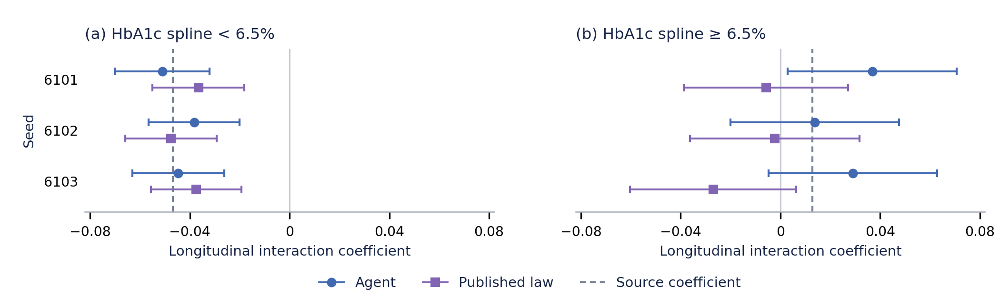
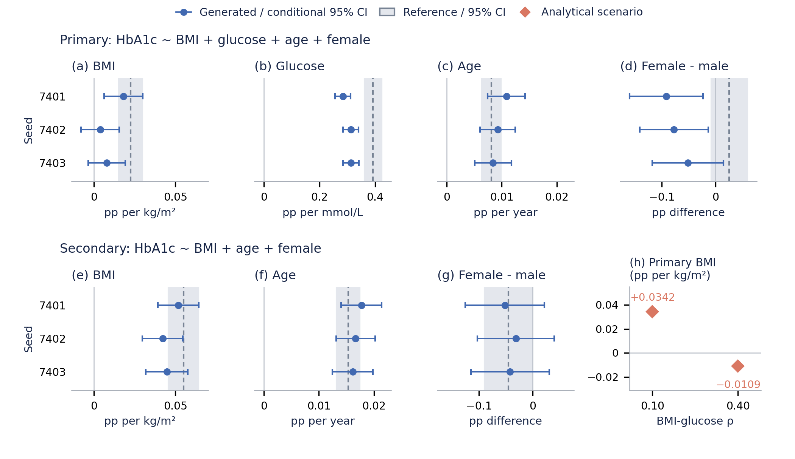

# v12 论文图：怎么读，以及现在结果说明什么

这次改变的是表达，不是实验。所有点、区间和对照均来自已经关闭的实验汇总；没有新增患者分析、生成数据或挑选随机种子。之前的卡片、标题条、数字看板和不便解释的标准化横轴已撤掉。

## 1. 对照实际论文后，为什么这样改

- [G-Sim，ICML 2025](https://proceedings.mlr.press/v267/holt25b.html)：主方法图展示输入、代码构造和校准反馈；结果图直接比较干预轨迹和决策成本面。可以学习的是具体对象与操作的连接，以及同一坐标下的比较；不能把它的已知模拟真值当作我们的人群真值。
- [LLMSynthor，KDD 2026，v4](https://arxiv.org/html/2505.14752v4)：结果图分别回答空间分布、宏观统计匹配和条件分布等问题，并将量化表与机制示例配合使用。我们的冻结实验没有对应的迭代轨迹，不能为了像顶会而补画收敛曲线。
- [SPADA，EMNLP 2025](https://aclanthology.org/2025.emnlp-main.525/)：utility、约束违反和计算开销分开呈现，联合分布图也有明确的真实/生成对照。它拥有个体输入，不能把其条件或评价直接等同于我们的无个体输入设置。

我们的设计判断：图要让读者先看到一个科学比较，再通过图注理解实验条件。颜色表达方法或信息条件，不能同时承担“好/坏”和“不同方法”两种含义；原始单位优先；所有预定分析都出现。

## 2. 图 1：读到的是具体实现，不是流程口号

从左向右读：

1. 请求指定中国社区成年人、年龄范围、变量和分析用途。检索与审查产生带人群、单位和分析口径的文献证据。
2. 实例中的海南研究报告男性组血糖—HbA1c Spearman 相关系数 0.44。Agent 选择高斯 copula，并将其转换为潜在正态变量的相关系数：`2 sin(π × 0.44 / 6) ≈ 0.457`。这不是把 Spearman 系数直接塞进 Pearson 或潜在相关矩阵。
3. Agent 还必须补足未报告的依赖。图中 BMI—血糖潜在相关 0.25 是它声明的假设，不是文献估计或从目标数据学得的值。矩阵只展示选定元素；A/B/G/H 分别是年龄、BMI、血糖、HbA1c，点号表示省略。
4. 程序用该矩阵的 Cholesky 分解抽样，再将 BMI、血糖和 HbA1c 转成 Agent 选择的正值边缘分布。年龄使用单独的有界整数变换，性别按选定组成抽样。Agent 写模型与参数，工具执行采样。
5. 运行前对模型做有限矩等数学审查；运行时语义与统计诊断返回给 Agent，允许保留或修订。semantic_feedback_v1 本身不认证有限矩或迁移正确性。本例实际决定为保留。每次 11 项近似比较、23 项不可计算，并没有完成 34 项精确来源重放，也没有证明修订收益。

这张图展示已完成的一种构造；Gaussian copula 不是框架对所有未来任务的固定要求。前置检索、审查、构造和工具运行由宿主协调，不能据此宣称库已提供无人参与的全自动部署服务。

## 3. 先学会读结果图

**先认坐标。图 2/3 的纵轴是统计量，横轴区分信息条件或构造；图 4 和图 5(a–g) 的横轴是效应系数，纵轴是种子。图 5(h) 的横轴是相关假设，纵轴是解析系数。** 在 HbA1c 回归中，BMI 系数 0.05 的意思是：在所列调整条件下，BMI 每增加 1 kg/m²，与 HbA1c 增加约 0.05 个百分点相关。它不是“准确率 5%”，也不是因果效应。按这一线性模型，BMI 相差 5 个单位对应约 0.25 个 HbA1c 百分点。

**先看方向，再看大小，再看不确定性和重复性。** 图 2/3 在零线上方、图 4 和图 5(a–g) 在零线右侧表示正关联；靠近灰色参照线表示点估计较接近这份参照。水平区间在注明时是模型条件下的 95% 区间；灰带是参照区间或稳定性带，具体类型见各图图注。区间跨零表示方向证据不确定，不能直接读成“没有关系”。区间重叠不等于两种数据等效；区间很宽也可能很容易重叠。

**不同的点和区间不是同一种重复。** 图 2 的小点是同一构造的不同抽样种子，大点是构造内均值；不同构造是不同的 Agent 建模尝试。三次抽样不能当作三份独立临床队列。图 5 的区间是数据分析模型的条件区间，不包含文献抽取、结构选择和跨人群迁移的全部不确定性。

**没有“每张图越接近零越好”的统一规则。** 回归系数的零代表在该模型中没有该项线性关联，误差图的零才代表没有该项数值差异。相关系数、效应系数和绝对差异也不能混用。

## 4. 图 2：增加关系证据，是否帮助生成有用的数据？

这是 CHNS 和 ENSANUT 的六个预定系数。E0 使用基本/边缘证据，E1 增加关系证据。分别看每个原单位面板，观察 E1 的点是否向参照靠近、构造间离散是否减小，而不是横向比较不同单位系数的绝对大小。

| 分析 | E0 平均绝对差异 | E1 平均绝对差异 | 改变 |
|---|---:|---:|---:|
| CHNS BMI | 0.020380 | 0.031557 | 增加约 55%，变差 |
| CHNS 血糖 | 0.134019 | 0.024079 | 减少约 82% |
| CHNS 条件年龄 | 0.007281 | 0.004854 | 减少约 33% |
| ENSANUT 年龄 | 0.063944 | 0.024670 | 减少约 61% |
| ENSANUT BMI | 0.056883 | 0.023732 | 减少约 58% |
| ENSANUT 条件 BMI | 0.048797 | 0.025649 | 减少约 47% |

支持的结论：在这次设计中，增加关系证据对六项中的五项有帮助，同时存在反例。82% 是“相对参照的平均绝对差异减少比例”，不是数据有 82% 真实，也不是模型准确率。五项改善不能写成 83% 的总体成功率。E0/E1 构造没有按作者配对，图也不是总体显著性检验。

## 5. 图 3：有较充分摘要时，能不能构造联合数据？

L 是文献条件，R 额外获得目标摘要。R 在这次检查的五项统计上更接近参照。例如 BMI 系数由 L 的 0.0130–0.0343，变为 R 的 0.0528–0.0558，参照约 0.05495；Spearman 从约 0.50–0.57，变为约 0.358–0.361，参照约 0.36146。范围是各构造的种子均值范围。

这张图支持“给定摘要能够转成同时支持多项分析的数据”。R 使用了目标摘要，所以不能把接近参照当作未见目标的迁移能力。所有构造均保留初稿，也不能解释成反馈迭代改善。

## 6. 图 4：生成的纵向记录能不能用于原模型分析？

两面板分别是 HbA1c 在 6.5% 两侧的样条分支与时间（每十年）的交互项，用于描述记忆评分随时间变化的差异；不是把参与者拆成两个独立亚组。蓝色是 Agent，紫色是已发表生成律的实现，灰线是来源模型。每个方法的三个种子都显示。

低 HbA1c 交互的来源系数为 −0.04684，Agent 均值约 −0.04464，文献模型实现约 −0.04050，都较接近。高 HbA1c 交互的来源系数为 +0.01287，Agent 均值约 +0.02649，文献模型实现约 −0.01169，不能把全部条件概括为两者都很好。

这是生成 11,509 个虚拟个体、四次访视后重新运行分析的能力验证；来源的模型参数是已提供输入。它不是使用真实 HRS 个体数据得到的新临床发现，也不是证明在一切纵向任务上优于统计方法。

## 7. 图 5：现在这份开放检索生成数据，哪些用途较好？

上排 primary 回归同时调整 BMI、血糖、年龄、性别；下排 secondary 不调整血糖。这两个模型问的问题不同：加入血糖后，BMI 系数描述的是在血糖相同时的剩余关联，不能要求它与未调整血糖的 BMI 系数相同。

| 预定分析 | 生成范围；真实样本点参照 | 现在能怎么评价 |
|---|---|---|
| Primary 年龄 | 0.00842–0.01084；0.00811 | 正方向和数量级较接近 |
| Secondary BMI | 0.04217–0.05176；0.05495 | 同向、量级相近，略弱 |
| Secondary 年龄 | 0.01613–0.01771；0.01530 | 正方向和数量级较接近 |
| Primary 血糖 | 0.28417–0.31368；0.39291 | 同向但稳定偏弱，仍是明显差异 |
| Primary BMI | 0.00380–0.01811；0.02246 | 点方向为正，但较弱，部分生成区间跨零 |
| Primary 女性 | −0.09143–−0.05124；+0.02599 | 点方向不同；真实参照本身区间跨零 |
| Secondary 女性 | −0.05157–−0.03108；−0.04530 | 点方向/大小相近，生成区间均跨零 |

右下角不是新生成的两组患者数据，而是 Agent 在生成前做的解析检查：只把未有证据约束的 BMI—血糖潜在相关从 0.10 改到 0.40，primary BMI 系数就从 +0.03422 变为 −0.01095。其他边缘及其余两两分布不变，secondary 回归也不变。它解释了为何有些普通分析可用、更深调整的分析仍依赖缺失证据。这不是连续剂量曲线或置信区间。

## 8. 真实数据自己也不同，是否要求太严？

确实不应要求虚拟样本和一份真实样本完全一致。我们已有的 CHNS 社区不重叠拆分提供了实际背景：重复 100 次、每侧 3,000 人，仅用于参照差异的描述。

例如 secondary BMI 的真实—真实绝对差异中位数约 0.00724，生成样本对两份真实样本的对称差异中位数在三个种子间约 0.00438–0.01273；确实与普通拆分差异有重叠。但 primary 血糖的真实—真实中位数约 0.02384，生成—真实为 0.07964–0.10915，仍明显更大。

这些拆分相互重叠，不能当成 100 份独立队列；上述范围也不是总体置信区间。它们帮助解释误差背景，不提供事后设定的“合格线”。因此既不要求完全一致，也不能把所有偏差都归因于真实数据本来有差异。

## 9. 对论文主张的落点

当前最扎实的正面证据是：Agent 已经把发表证据数值化，构造出可执行联合生成模型；这些数据能支持若干具有合理方向与量级的实际回归分析；不同信息条件和纵向设置提供了互补能力验证。进一步价值是能够指出哪个未观测关系限制了某个分析。

现在不适合使用单一“总体数据质量优秀”或“全部替代真实数据”的表述。方法的质量应按研究用途和信息条件报告。图与表可以突出有力结果，同时保留一项证据扩展反例、条件关系不足和无修订增益；这不会取消已观察到的分析用途。

数据依据：核心冻结结果、summary ablation、HRS aggregate results、4 November open-search evaluation 与 real–real calibration。逐数值绑定及独立检查见同目录 JSON 和对应 work 审查文件。
