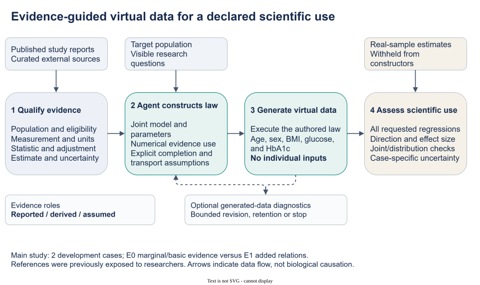
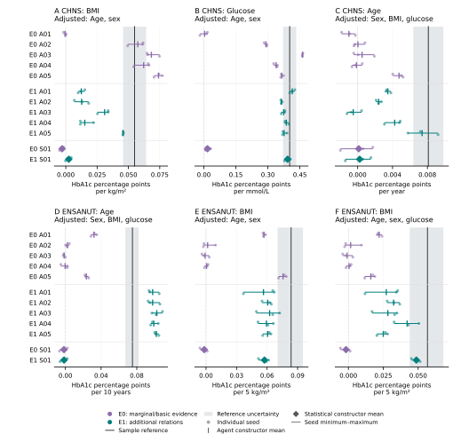

# Main-study story and display package

Prepared 3 November 2026 from the frozen, independently audited main-study aggregates. This package changes presentation and interpretation, not the completed experiment. No generator or clinical-reference analysis was rerun.

## Paper route

[Working manuscript v0.5](../DRAFT_v0_5.md) · [Contribution/evidence map](../CONTRIBUTION_EVIDENCE_MAP_2026-11-03.md) · [Primary-work comparison](../CORE_CONTRIBUTION_POSITIONING_2026-11-03.md) · [Journal assessment](../JOURNAL_FIT_2026-11-03.md) · [Worked evidence-to-law trace](../SUPPLEMENT_SOURCE_AND_ASSUMPTIONS_v05.md)

The story starts with unavailable individual-level construction inputs. An Agent combines qualified published evidence and a visible analytical request into a joint law and complete virtual cohort. The study then evaluates the delivered tables for each requested analysis, including failures. It demonstrates an implemented procedure and bounded analytical information, not population reconstruction, clinical substitution, general algorithmic superiority or feedback-driven improvement.

## Main Figure 1

**Figure 1. From study-qualified evidence to virtual data for a declared scientific use.** Curated external reports retain population, eligibility, measurements, units, statistical operator, adjustments and uncertainty. The Agent chooses a joint law, numerical uses of evidence and explicit completion/transport assumptions. Numerical execution samples complete age, sex, BMI, glucose and HbA1c tables without individual-level construction inputs. Evaluator-side real-sample estimates are withheld from constructors and used to assess all declared analyses. The optional diagnostics branch permits revision, retention or stopping; the main study contained no scientific revisions. Source-population replay was unavailable. Arrows depict data flow, not biological causation. Both reference families were previously exposed to researchers and are development evaluations.

Editable [draw.io source](figures/figure1-evidence-to-analysis.drawio), [embedded SVG](figures/figure1-evidence-to-analysis.drawio.svg), [PNG](figures/figure1-evidence-to-analysis.drawio.png), [PDF](figures/figure1-evidence-to-analysis.drawio.pdf).

## Main Figure 2

**Figure 2. Analytical coefficients from every final construction and seed.** Panels A–C show CHNS and D–F ENSANUT, with adjustments and predictor scales labelled separately. All 20 Agent and four prescribed statistical constructions are represented, each by three final samples of 3,000 synthetic records. Small circles denote individual seeds; short vertical ticks are Agent constructor means; diamonds are statistical constructor means; horizontal lines span the actual seed minimum–maximum and are not confidence intervals. E0 contains marginal/basic evidence; E1 adds relational evidence. A01–A05 labels in different arms identify distinct, unpaired constructions and are not connected. Black vertical lines show selected real-sample estimates. CHNS shading is a community-cluster CR1-t 95% interval; ENSANUT shading is a cluster-resampling stability band for the equal-eight-cell standardized analysis. These are different uncertainty summaries, not acceptance/equivalence regions. Seed variation conditions on each fixed authored law and does not include evidence, structural or transport uncertainty. Real selected samples contained 6,631 CHNS and 6,931 ENSANUT participants; these estimates are not national population targets. All 216 displayed values and six information contrasts are retained in the tables below.

[Vector SVG](figures/figure2_all_scientific_uses.svg) · [PDF](figures/figure2_all_scientific_uses.pdf) · [PNG](figures/figure2_all_scientific_uses.png)

## Tables and full evidence

- [All 216 plotted coefficients](tables/figure2_plotted_values.csv), one row per constructor/seed/analysis; these are aggregate estimates, not patient or generated-person records.
- [All six Agent E0/E1 contrasts](tables/table2_information_contrasts.csv). Compute each seed's absolute difference from its sample reference, average within constructor, then across the five Agent constructors in the condition. Units differ across rows; no pooled accuracy score is defined.
- Main manuscript Table 1 specifies the cases and analyses; Table 2 includes the statistical construction comparisons as well as the Agent contrasts.
- [Complete results interpretation](https://github.com/ziwang11112/evidence-guided-virtual-cohorts-2026/blob/26ccdfb5a77c665ddce1d1c0c73ce991b7107fb3/biomedical_research/virtual_cohort_system/reports/main_study_freeze_2026-11-03/publication/RESULT_INTERPRETATION.md) and [machine-readable interpretation](https://github.com/ziwang11112/evidence-guided-virtual-cohorts-2026/blob/26ccdfb5a77c665ddce1d1c0c73ce991b7107fb3/biomedical_research/virtual_cohort_system/reports/main_study_freeze_2026-11-03/publication/RESULT_INTERPRETATION.json) retain all constructor means, seed ranges, discrepancies and prescribed diagnostics.
- [Complete numerical-use inventory](https://github.com/ziwang11112/evidence-guided-virtual-cohorts-2026/blob/26ccdfb5a77c665ddce1d1c0c73ce991b7107fb3/biomedical_research/virtual_cohort_system/reports/main_study_freeze_2026-11-03/publication/UPTAKE_INVENTORY.json) retains roles, nonuses and independent construction review findings.
- [Historical findings](../SUPPLEMENT_HISTORICAL_RESULTS_v05.md) remain separate from the main study; they do not add independent clinical confirmations.

## Reproduce these displays

`python manuscript/story_package_2026-11-03/build_displays.py` reads the retained aggregate results and independent-audit JSON. It redraws Figure 2, writes the aggregate CSV files and creates native Figure 1 XML. It does not import or execute a generator, read row-level tables or recompute clinical references. Dependencies: Python, matplotlib and standard-library modules. Export Figure 1 using draw.io desktop CLI or its editor; embedded export versions are supplied here. `repair_drawio.js` applies the diagram skill's XML repair pass before export. The supplied renders were visually checked; provenance and review receipts state the exact checked version.

Figure 2 is designed at 180 × 176 mm with vector text and embedded TrueType fonts in PDF. Colours identify information conditions; neither colour nor reference shading encodes pass/fail. No unfavorable endpoint, construction or seed was omitted.

## Interpretation and submission boundary

E1 reduced descriptive Agent discrepancy on five of six coefficients and increased CHNS BMI discrepancy. Important magnitude mismatches and one negative conditional-age constructor remain. Two E1 statistical constructions were closer than every corresponding Agent on their focal endpoint. Ten of ten E1 Agents used a numerical relation, which establishes use but not simultaneous source fit or transport. Seven retained an initial law after feedback; thirteen finalized without exploratory feedback; no scientific revision occurred.

The first preparation target is PLOS Digital Health, with JBI and a focused JAMIA route considered in the linked official-policy assessment. Scope compatibility is not acceptance or readiness. Source verification, complete declarations and a clear, usable reproduction route remain manuscript obligations. Stronger external-validity or algorithmic-advantage claims require additional evidence, not a cosmetic rewrite of these findings.
