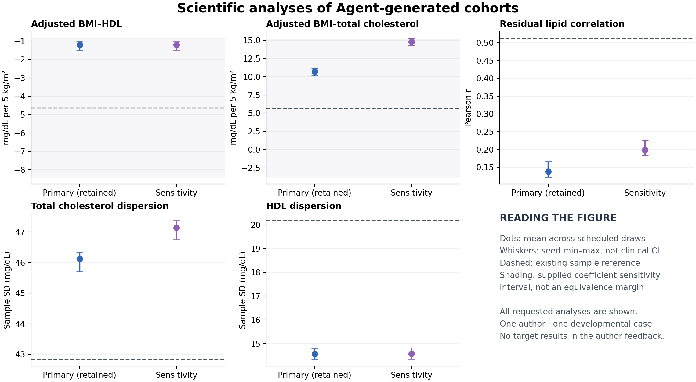

# An actual adaptive Agent loop on an existing biomedical case

9 November 2026. The retrieval–construction–execution–inspection–revision loop is now operational. One fresh scientific Agent completed 28 dispatched actions, generated six 3,000-row tables from two frozen models, and retained its original model before reference evaluation. The final data preserve the directions of the three sample-reference point estimates, while effect magnitudes and conditional lipid dependence remain incompletely reproduced. This run does not demonstrate an overall quality gain from adaptive revision.

## What the Agent actually controlled

The task requested a whole adult cohort without individual inputs: age, recorded sex, BMI, total cholesterol and HDL cholesterol. Its intended uses were visible: age/sex-adjusted BMI associations with each lipid and the correlation between the two lipids after adjustment for age, sex and BMI. The host supplied the schema, initial curated evidence, methods-only population description, tools, resource allowance and fixed analysis definitions. It supplied no desired signs, clinical coefficients, correlation target, model family or target-outcome feedback.

The same fresh Agent selected its literature queries, source interpretations, model and parameters, optional procedures, extra calculations, sensitivity revision and final selection. It used the program route: Agent-authored scientific structure and parameter specification, with records sampled by the isolated numerical worker. The dispatcher also supports direct-table submissions; this run did not test their scientific performance. The Agent's wider file tools are governed by a procedural allowlist, not OS isolation.

Actual actions went through [adaptive_session_v1](../../cohort_harness/adaptive_session_v1.py), using the existing literature gateway, immutable candidate lifecycle, WSL/bubblewrap worker, explicitly selected semantic_feedback_v1 and a pinned generated-only analysis adapter. The host still launches the model; this is not a standalone model-API service. Earlier planning-only action records have not been relabelled as executed work.

## Evidence and substantive choices

The Agent reread [Obirikorang et al.](https://pmc.ncbi.nlm.nih.gov/articles/PMC4457529/) and independently found [PMC6897412](https://pmc.ncbi.nlm.nih.gov/articles/PMC6897412/). Acquisition used three query-budget units and two full-text downloads, with nine successful HTTP requests. One attempted search used an invalid page limit; its error is retained and no network query was charged. The full trace is summarized in [ACTION_SUMMARY.json](ACTION_SUMMARY.json), without redistributing source bodies or individual records.

The original paper confirmed the six curated rural/urban Spearman coefficients, but did not supply the requested age-adjusted joint law. The new study distinguished survey-weighted marginal summaries from unweighted, stratum-adjusted regressions and supplied HDL age/BMI-category contrasts. Those contrasts have a different adjustment set and estimand from the requested continuous BMI analyses. An independent source reviewer also found a sex–HDL prose/table sign inconsistency. The author recorded it and did not use either sign as a coefficient.

The resulting model separates a demographic joint scenario, conditional lipid means and positive correlated residual variation. The Agent used an age/BMI-category response for HDL, an explicitly derived working BMI slope for total cholesterol, selected sex-specific margins and named transport/dependence assumptions. These were scientific author choices, not clinical parameters inserted by the coordinator. The [initial](SOURCE_REVIEW.md) and [sensitivity](SOURCE_REVIEW_STAGE2.md) reviews verify the numerical extraction and its qualifications; they do not certify population transfer.

After inspecting the first three outputs, the Agent computed deterministic model implications using those same generated rows. It did not import the generator on the host or draw additional samples. The checks found no clear implementation defect in the fitted slopes or residual cross-products. It then chose a dependence sensitivity: replace the rural Ashanti rank triple with the urban triple while retaining the demographic scenario and HDL response model. The generator code itself stayed unchanged; the evidence-derived working TC slope and latent residual-correlation parameters changed. This was an alternative source-transfer assumption, not an accuracy repair.

## Scientific analyses after author closure

The author selected **initial** before the existing reference results were revealed for this unit and made no further changes. Every scheduled output is retained. Entries below are means across the three fixed draws; the complete per-seed analyses and 23 diagnostics appear in [EVALUATION.json](EVALUATION.json).

| Requested analysis | Retained primary | Unselected sensitivity | Existing real-sample reference | Supplied reference interval |
|---|---:|---:|---:|---|
| Adjusted BMI–HDL, mg/dL per 5 kg/m² | -1.1898 | -1.1999 | -4.6230 | [-8.3920, -0.8541] |
| Adjusted BMI–total cholesterol, mg/dL per 5 kg/m² | 10.6997 | 14.7893 | 5.6831 | [-3.7535, 15.1197] |
| Adjusted residual TC–HDL correlation | 0.1383 | 0.1986 | 0.5121 | Not supplied |

The retained slopes have the same directions as the sample point estimates and lie inside the supplied broad coefficient intervals. Those intervals are HC3 normal, assumption-conditional sensitivity intervals, not equivalence margins or proof of clinical interchangeability; the TC interval includes zero. Generated seed ranges represent simulation variation, not study or transfer uncertainty. The reference is a selected sample rather than a known population truth. Its uncertainty does not remove the unresolved residual-dependence difference.

The sensitivity changed the TC slope by about +4.09 and the residual correlation by +0.060. It moved residual correlation closer to the reference point while moving the TC slope farther away. The author retained the original primary scenario, so **initial-to-selected-final changes are zero**. No favorable alternative or seed was substituted after seeing the reference.

| Dispersion diagnostic | Retained primary | Sensitivity | Existing sample |
|---|---:|---:|---:|
| Total cholesterol sample SD, mg/dL | 46.1168 | 47.1385 | 42.8466 |
| HDL sample SD, mg/dL | 14.5611 | 14.5785 | 20.1756 |
| Total cholesterol conditional RMS, mg/dL | 44.1161 | 44.3587 | Not available in frozen aggregate |
| HDL conditional RMS, mg/dL | 14.4646 | 14.4809 | Not available in frozen aggregate |

All 26 planned endpoint records per output are present. Independent recomputation agreed on **156/156 values**, with maximum absolute difference **5.15 × 10^-14**. Thirty generated values have a corresponding frozen reference value; 126 diagnostic values have no reference and remain generated-only. There were no failed executions or unavailable generated endpoints in this run.

## What the checks establish

Strict source feedback executed six times with verified output linkage. Each report retained 34 unavailable checks: **204 unavailable instances, zero numerically computable formal source comparisons**. Unknown weighting/definitions, nonidentity or unsupported quantities, missing adjustment variables and population differences were not silently converted into valid comparisons. These unavailable source checks are separate from the 156 successfully computed generated-data statistics.

The Agent still used source facts for construction and retained explicitly assumption-dependent algebra/diagnostics. That flexibility helped it explore consequences, but those calculations are not substitutes for a faithful source-population replay or numerical source-calibration certificate. The current v1 operator boundary is therefore a practical limitation of this implementation as well as an evidence-coverage limitation.

The newly added controller passed 30 focused tests; the generated-only adapter passed an independent known-coefficient artificial-data test. A prospective evaluator review corrected missing/unavailable-endpoint reporting and strengthened postclosure dependency verification in an additive v2 evaluator, which passed seven focused tests. Original locked code and design receipts remain available. Source reviewers checked the evidence independently; the [implementation review](IMPLEMENTATION_REVIEW.md) and [result recomputation](RECOMPUTATION.json) have different scopes.

## Decision and implications for the core method

**Continue with the operational adaptive loop; do not claim that autonomy or revision has already improved biomedical generation quality.** This exercise establishes that the Agent can act on retrieved evidence, generate analyzable whole-cohort data, inspect actual outputs and preserve an explicitly chosen alternative without a coordinator hard-coding clinical relationships. It also exposes a substantive limitation: plausible, source-traceable dependence assumptions produce materially different downstream analyses.

The final data have descriptive and sensitivity-analysis uses under their declared model assumptions. Target-population recovery of the conditional joint law has not been established. One fresh author on an already exposed case does not establish general performance or causal benefit from a skill, retrieval or feedback. Three seeds are repeated draws from a model, not three independently authored methods or clinical replications.

The next improvement should address evidence-to-analysis compatibility: preserve reported and assumed semantics separately, expose useful assumption-dependent diagnostic calculations transparently, and seek compatible conditional/joint evidence when an intended use depends on it. A new operator should be implemented only for a real selected statistic and tested for its transformation and adjustment semantics. Generating more rows, repeatedly changing disclosed-target parameters or adding Agent roles would not resolve the demonstrated information gap. This bounded run is complete; no extra case, target calibration, paid API, training or HPC job was started.

Individual real/generated tables and complete retrieved papers remain local. Public artifacts comprise reviewed original code, methods/protocols, model specifications, source-use declarations and aggregate results. Reproducing frozen local source receipts requires reacquiring the exact source versions; the public package is not a redistribution of those full texts.
