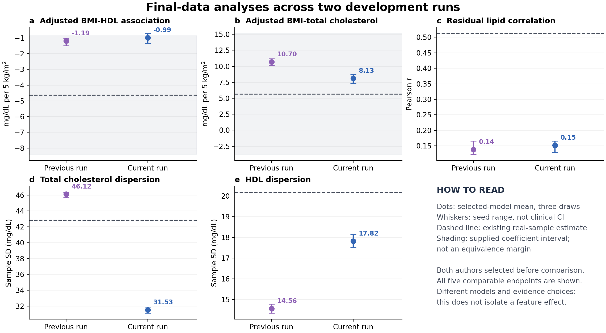

# Broader evidence retrieval and usable diagnostic feedback

9 November 2026. The new evidence and feedback interfaces ran end to end on the existing whole-cohort lipid case. One fresh scientific Agent retrieved two original studies and an official manufacturer page, authored one generator, inspected all three scheduled outputs and retained the initial candidate. The three 3,000-row outputs support every requested calculation. Against the existing sample reference, the scientific relationships retain the same point-estimate directions, but important magnitude and dependence differences remain. Comparison with the previous closed run is mixed, not an overall quality improvement.

## What changed in the system

The additive [adaptive session v2](../../cohort_harness/adaptive_session_v2.py) connects the original acquisition, immutable candidate and isolated execution tools to two new components. Historical v1 code, candidates and receipts are unchanged.

1. [Public web evidence](../../docs/WEB_EVIDENCE_V1.md) can ingest public HTML, text and PDF, including official measurement information. The Agent chooses the question and source. Document provenance, content screening, request/byte accounting and retrieval failures are recorded. Paper count is not the sufficiency criterion. This run used a separate native search for discovery; that channel is logged but is not controller-screened or fully metered.
2. [Descriptive feedback](../../docs/DESCRIPTIVE_FEEDBACK_V1.md) computes explicitly declared statistics even when some source conventions require assumptions. Calculation, source-definition agreement and population applicability remain separate. Known weighted/unweighted mismatches do not receive a direct numerical difference. Unsupported contrasts stay unavailable. The original strict semantic feedback is retained alongside the descriptive report.

The host supplied the task, fields, source seed packets, requested analyses and resource limits. The fresh Agent chose searches, evidence interpretation, population/sex/age scenario, model family, dependence assumptions, parameters and whether to revise. It chose program generation: its authored model was sampled inside the existing WSL/bubblewrap worker. It did not directly emit individual rows, and this run is not a comparison of program versus direct-row generation. The host launches the author; this is not a standalone model-API service, and the author's broader tool access is procedurally restricted rather than OS-isolated.

## Actual evidence use and review

The two retrieved studies were [Zanzibar, PMC6615808](https://pmc.ncbi.nlm.nih.gov/articles/PMC6615808/) and [Tanzania/Uganda, PMC6897412](https://pmc.ncbi.nlm.nih.gov/articles/PMC6897412/). The manufacturer source contributed strip-specific measurement ranges, not a clinical joint distribution. Previously admitted Ashanti and Navrongo curator packets contributed marginal rank relationships and demographic information; this run did not independently reauthenticate those packets against fresh full texts.

The [source review](SOURCE_REVIEW.md) checked locators, numbers, units, eligibility, sampling, adjustments and generator algebra. Before freeze, it caught a table/narrative sign conflict, incorrect weighting metadata, an unsupported adult-eligibility description and an overconfident complete-adjustment description. Metadata errors were corrected; unresolved source ambiguities were explicitly retained. The reviewer did not prescribe desired target coefficients.

The final model uses Zanzibar adult-stratum arithmetic means and individual SDs, lognormal BMI/lipid margins, and an assumed conditional Gaussian copula informed by Ashanti marginal Spearman correlations. These marginal correlations do not identify the requested adjusted raw-scale slopes or residual correlation. The selected fasting Zanzibar sample also excludes extreme values and has a different recruitment context. Faithfulness to its moments is not evidence of transfer to the target sample. A provisional source-table sex effect remains an explicitly disputed assumption, not a settled finding.

Static independent calculations verified finite lognormal moments, a positive-definite copula, positive residual variance and agreement between the code and declared mean/variance decomposition. The model does not reproduce source trimming or unknown historical device censoring, nor enforce TC greater than or equal to HDL. Those limitations remain visible rather than being repaired using the target results.

## Executed work and checks

The completed session contains **22 dispatched actions**, one submitted frozen model and three successful executions at seeds 9501, 9502 and 9503. All three outputs have 3,000 rows. The Agent selected the initial model in terminal action `a22_finish_retain_initial`; the host then sealed 176 files before reference evaluation. No second candidate, hidden extra draw or post-reference change was made.

Shared acquisition accounting records two charged queries, three downloads and nine successful HTTP requests. The official web body was 324,657 bytes. The two literature downloads and native discovery traffic are not included in that web-body number. One native discovery log entry is retained locally. Rejected exclusion-containing search syntax, an invalid search argument and a preflight error remain in the [action summary](ACTION_SUMMARY.json). The allowance was not exhausted. No model-token total or measured researcher-time saving is claimed.

| Feedback, per output | Count | Meaning |
|---|---:|---|
| Strict source comparisons unavailable | 29 | No certified source-population replay |
| Descriptive calculations completed | 26 | Numerical diagnostics on generated data |
| Of those: assumed-convention comparisons | 22 | Differences calculable under stated conventions and transfer assumptions |
| Of those: known weighting mismatches | 4 | Calculated values retained; direct differences suppressed |
| Descriptive checks unavailable | 3 | Unsupported category/device comparisons |

Across three runs this is 78 descriptive calculations, 66 assumption-labelled differences, 12 known-mismatch instances and 9 unavailable descriptive instances. These are repeated diagnostics, not independent validations. This run selected a different set of checks from the previous run's 34; it is not a conversion of all 34 old failures into passes.

The Agent also checked assay-range consequences on retained rows: each output contains 53-65 TC values below 100 mg/dL and 14-20 HDL values above 120 mg/dL. These are out-of-range for particular current strips, not necessarily physiologically impossible values. Exact historical strip and recording rules are unresolved. Separately, 6, 2 and 3 rows respectively have HDL greater than TC (11/9,000 in total). This is a component-consistency defect for the intended concentration interpretation, not merely a difference from a sample reference. No rows were silently dropped or clipped. Thus the output represents a partially checked concentration scenario, not an established reproduction of the device-recorded target distribution.

## Same scientific analyses on virtual data and the existing reference

The prescribed analysis was unweighted OLS for each lipid on age, recorded sex and BMI, reporting the BMI coefficient per 5 kg/m2; the third analysis correlates the paired residuals. All generated rows were eligible. Results below average the three scheduled draws. Every requested analysis and all 23 diagnostics are retained in [EVALUATION.json](EVALUATION.json).

| Endpoint | Previous selected model | Current selected model | Existing real-sample estimate |
|---|---:|---:|---:|
| Adjusted BMI-HDL, mg/dL per 5 kg/m2 | -1.1898 | -0.9882 | -4.6230 |
| Adjusted BMI-TC, mg/dL per 5 kg/m2 | 10.6997 | 8.1278 | 5.6831 |
| Residual TC-HDL correlation | 0.1383 | 0.1517 | 0.5121 |
| TC sample SD, mg/dL | 46.1168 | 31.5290 | 42.8466 |
| HDL sample SD, mg/dL | 14.5611 | 17.8231 | 20.1756 |

The TC slope and HDL dispersion move closer to the sample point estimates. Residual correlation changes only slightly and remains far lower. The HDL slope is slightly farther from the sample point estimate, and TC dispersion is substantially farther. These observations do not establish that one interface caused the changes: author session, model, source choice and seeds also differ. [PREVIOUS_COMPARISON.json](PREVIOUS_COMPARISON.json) retains all five endpoints and binds both closed input reports.

Both current mean slope estimates fall within the supplied broad reference intervals: HDL [-8.3920, -0.8541] and TC [-3.7535, 15.1197]. These are assumption-conditional HC3 normal intervals, not equivalence margins; the TC interval includes zero. One current HDL seed estimate lies outside the supplied HDL interval. Seed ranges measure Monte Carlo variation, not source, transport or clinical uncertainty. A sample estimate is not known population truth, but this does not make unresolved differences irrelevant.

Independent recomputation agrees on **78/78 planned numerical endpoint values**, maximum absolute difference **5.33e-14**. Only five endpoint types have a frozen reference: 15 comparisons across three outputs. The remaining 63 diagnostic values have no reference and remain generated-only. There were no failed executions or unavailable generated endpoints. Arithmetic reproducibility does not certify biomedical transfer.

## What this supports, and the next decision

Retain the broader acquisition and dual-feedback interfaces. They give the Agent actual source-informed diagnostics, expose rather than conceal statistical-definition problems, and allow an informed retain decision. This is a useful implementation improvement. It is not evidence that every revision or more retrieval improves final data quality.

The current dataset can run the requested scientific analyses and expresses the same directional pattern as the sample point estimates. It remains an evidence-informed scenario for analysis development and sensitivity exploration; population-level effect recovery, clinical interchangeability and calibrated power have not been demonstrated. The unresolved conditional joint law and measurement transfer are substantive scientific limits. Matching source margins alone does not resolve them.

For the paper, keep final-data usefulness as the main outcome. Present this as an honest development example of flexible evidence use and explicit uncertainty, alongside stronger already-frozen cases; do not label it new independent clinical confirmation or an overall adaptive-quality win. The next method-level priorities are use-specific evidence coverage and explicit component-consistency checks: which requested coefficients or joint relationships are directly constrained, which follow algebraically, and which remain transport assumptions; which generated records violate a justified cross-variable identity. The latter can be improved without supplying target slopes or means. Any further performance experiment should apply the frozen workflow to a prespecified existing case, rather than tune this disclosed target or add more rows to conceal the gap.

The bounded run is complete. It used no paid API, training, HPC job or new patient acquisition. Generated individual tables, full source artifacts and raw logs remain local. Reviewed code, original documentation, metadata and aggregate figures/results can be synchronized to the existing public repository.
