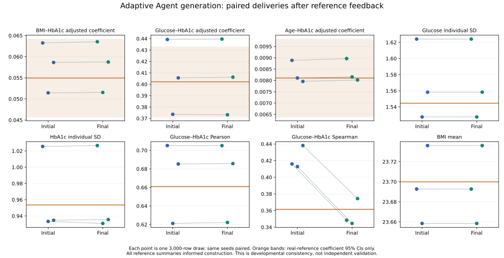

# Adaptive reference-assisted whole-cohort pilot: complete results

One fresh scientific Agent chose the generative structure and parameters, used deterministic numerical calculations and isolated trial feedback, and revised the same construction. The coordinator provided the full declared reference/evidence package, execution tools and fixed analysis definitions; it did not write scientific coefficients or alter scientific code.

Actual execution: 9 attempts, 9 successes, 9 distinct output tables, 3,000 virtual rows each. These are repeated draws from one scientific construction, not independent clinical cohorts. All source patients and generated individual tables remain local.

## Scientific result

| Statistic | Exposed CHNS reference | Initial mean [3-seed range] | Final mean [3-seed range] |
|---|---:|---:|---:|
| E1 | 0.0549461 | 0.0577729 [0.0514401, 0.0632477] | 0.0579348 [0.0515316, 0.0635293] |
| E2 | 0.402093 | 0.406169 [0.373615, 0.439281] | 0.406369 [0.373246, 0.43966] |
| E3 | 0.00810704 | 0.0083172 [0.00795681, 0.00888698] | 0.00838071 [0.00801952, 0.00896589] |
| glucose_sd | 1.54455 | 1.56997 [1.52753, 1.62411] | 1.56997 [1.52753, 1.62411] |
| hba1c_sd | 0.953571 | 0.96454 [0.933328, 1.02553] | 0.964362 [0.930825, 1.02662] |
| glucose_hba1c_pearson | 0.660968 | 0.670539 [0.621107, 0.705191] | 0.671013 [0.622196, 0.705109] |
| glucose_hba1c_spearman | 0.361457 | 0.422337 [0.412842, 0.438124] | 0.355747 [0.344477, 0.37438] |
| bmi_mean | 23.6999 | 23.6957 [23.6584, 23.7361] | 23.6957 [23.6584, 23.7361] |

The complete 30-statistic, seed-level results and paired changes are in COMPLETE_RESULTS.json. No global accuracy score or post-hoc equivalence threshold is used. Improved rank agreement does not imply improvement of every statistic; all losses remain visible. Reference intervals characterize the real-sample regression estimates; they are not intervals for means, equivalence bounds or synthetic-model uncertainty.

The paired rank-correlation discrepancy decreased in all three seeds: mean absolute reference difference 0.060879 to 0.014325. All three regression mean absolute discrepancies increased slightly: E1 0.005164 to 0.005265, E2 0.023061 to 0.023507, E3 0.0003103 to 0.0003320. E2 absolute discrepancy increased in every paired seed. This is a targeted improvement with trade-offs, not global improvement or statistical proof of superiority.

## What changed and what this establishes

The Agent selected a bounded two-component biomarker mixture with age and BMI shifts and component-specific copula dependence. Marginal distributions and regression shifts were derived from explicitly supplied CHNS sample summaries under stated simplifying assumptions. After persistent excess rank association across initial deliveries, the Agent changed component dependence while preserving its analytical covariance target, checked the consequence numerically, and froze a final version before paired delivery evaluation.

This run supports operation of an actual author/tool/feedback/revision loop and a specific reference-assisted data-use case. Its numerical targets come from CHNS reference summaries; external papers provide qualified context here. It does not establish external-literature-only reconstruction, independent target validity, superiority to conventional statistical synthesis, benefits of multiple Agents, or population-wide recovery.

## Unresolved assumptions and failures

- Covariate independence, absence of a female biomarker term, mixture membership, tail bounds and measurement rounding are assumptions. They do not support untested subgroup, causal, tail-risk or clinical claims.
- Deterministic quadrature convergence is approximate numerical evidence, not a rigorous error certificate. More synthetic rows do not resolve evidence or structural uncertainty.
- The first dependence adjustment did not demonstrate empirical rank improvement under different trial seeds; both trial results were retained. Subsequent persistent three-seed discrepancy informed the final change.
- Initial ar02 freezing failed on mixed text encoding. A coordinator encoding-only repair left mojibake in inherited prose; the failed step and frozen imperfect artifact remain recorded in AR02_ENCODING_REPAIR.json. Scientific code/parameters were unaffected; later author text uses UTF-8.
- Original trial covariance calculation was first executed inline; its reproducible solver was retained in a later candidate. This provenance gap is reported rather than retroactively editing the frozen first trial.
- Automatic approval review rejected deletion of two mocked-test temporary directories with the reason "blocked by policy". They remain local and are excluded from public export.

## Scope and next decision

Keep this bounded pilot closed after independent recomputation. The next discriminating experiment is the already described information comparison: what changes when complete real-reference summaries are not explicitly provided, with research questions and ordinary Agent tools still available. This pilot must not be silently pooled into that later experiment or compared to older literature-only runs as a controlled superiority test.

## All supplied statistics

| ID | Reference | Initial mean | Final mean |
|---|---:|---:|---:|
| E1 | 0.054946082 | 0.057772929 | 0.05793484 |
| E2 | 0.40209339 | 0.40616858 | 0.40636943 |
| E3 | 0.0081070351 | 0.0083171982 | 0.0083807072 |
| age_mean | 52.742573 | 52.900778 | 52.900778 |
| age_sd | 10.431791 | 10.397067 | 10.397067 |
| age_q10 | 39 | 39 | 39 |
| age_median | 53 | 53 | 53 |
| age_q90 | 68 | 68 | 68 |
| female_mean | 0.53687227 | 0.53833333 | 0.53833333 |
| female_sd | 0.49867619 | 0.49855849 | 0.49855849 |
| female_q10 | 0 | 0 | 0 |
| female_median | 1 | 1 | 1 |
| female_q90 | 1 | 1 | 1 |
| bmi_mean | 23.699888 | 23.695736 | 23.695736 |
| bmi_sd | 3.4063224 | 3.4587576 | 3.4587576 |
| bmi_q10 | 19.53125 | 19.463413 | 19.463413 |
| bmi_median | 23.423986 | 23.434435 | 23.434435 |
| bmi_q90 | 28.100957 | 28.280719 | 28.280719 |
| glucose_mean | 5.4877676 | 5.5109867 | 5.5109867 |
| glucose_sd | 1.544546 | 1.5699659 | 1.5699659 |
| glucose_q10 | 4.419 | 4.4266667 | 4.4266667 |
| glucose_median | 5.17 | 5.1766667 | 5.1766667 |
| glucose_q90 | 6.579 | 6.4773333 | 6.4773333 |
| hba1c_mean | 5.6753129 | 5.6885333 | 5.6883333 |
| hba1c_sd | 0.95357142 | 0.96454049 | 0.96436231 |
| hba1c_q10 | 5 | 5 | 5 |
| hba1c_median | 5.5 | 5.5 | 5.5 |
| hba1c_q90 | 6.3 | 6.3 | 6.3 |
| glucose_hba1c_pearson | 0.66096829 | 0.67053881 | 0.67101336 |
| glucose_hba1c_spearman | 0.36145732 | 0.42233681 | 0.3557473 |
