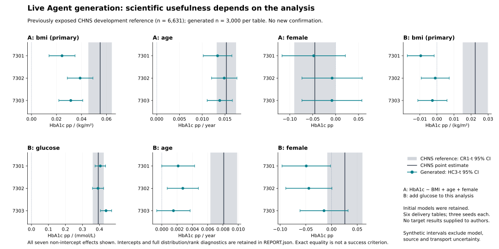

# Live Agent generation across two scientific requests

Started 3 November and completed 4 November 2026, America/Chicago. Completed bounded developmental integration. The Agents actually retrieved original articles, chose scientific models and parameters, produced executable generators, received execution-linked feedback and made final decisions. Six delivered 3,000-row tables reproduce some requested relationship patterns, but the glucose-adjusted BMI relationship fails against the existing CHNS reference. This establishes an operational workflow and selective descriptive agreement, not general biological validity, formal equivalence or a revision advantage.

## What was actually connected

The existing request intake prepared two whole-cohort tasks. Two fresh-context scientific Agents received the task, analysis question, literature tools and three bibliographic identifiers. They received no participant records, target outcome summaries, desired regression coefficients or desired signs. They independently searched and fetched two original full papers and used a third original abstract. A coordinating Agent supplied the schema, source identifiers, execution tools and routine routing; it did not author the scientific equations or parameter values.

| Stage | Actual implementation | Important boundary |
|---|---|---|
| Request | A asks for age/sex-adjusted BMI–HbA1c regression; B adds central serum glucose and adjusts for it. | Two related requests in one known variable family, not broad-domain adaptability. |
| Retrieval | Existing metered literature gateway; A used one query, B three; each downloaded two originals. | Bibliographic seeds were supplied. Jansen full text was unavailable through this route. No autonomous open-ended literature discovery is claimed. |
| Scientific construction | A chose a latent-stratum model with conditional lognormal BMI and shifted-gamma HbA1c. B chose a mixture with shared lognormal glycaemic variation and an explicit meal-contamination scenario. | Numerous conditional slopes, composition and transport choices remain assumptions, documented in the specifications. |
| Execution | Hash-frozen Agent programs run in the existing WSL/bubblewrap adapter. One trial plus three delivery seeds per request. | Programs sample rows; the scientific Agents wrote those programs and chose parameters. This run did not test direct token-by-token row authorship. |
| Inspection | Explicit semantic_feedback_v1 plus generated-only quality, regression, marginal and correlation diagnostics. | All nine A and eight B source comparisons were unavailable; a complete feedback envelope does not mean successful calibration. |
| Final decision | Both Agents independently retained their initial frozen candidate after reading actual feedback. Final delivery aliases the initial three tables. | No post-feedback scientific revision and no demonstrated revision gain. |
| Evaluation | The evaluator read the existing CHNS participant reference under the new frozen definition only after both authors closed. All specified analyses and all delivery seeds were evaluated. | CHNS was already exposed in previous work. This remains development, not a new independent confirmation. |

This is a host-dispatched scientific Agent workflow with coordinator-managed tools. The library intake itself does not launch a model, interpret arbitrary natural language or provide operating-system isolation for all Agent tools. The generated programs do run in an isolated adapter. Both distinctions are retained in the records.

## Execution and review counts

- Two scientific constructions, two requests, eight successful physical executions: two trials and six delivery tables, each with 3,000 rows. There were zero failed scientific execution slots.
- Final retention creates six aliases, not six additional tables. The evaluation has 12 initial/final slots but only six distinct delivered tables.
- Four metered queries and four per-session paper downloads total, covering two distinct full original articles. A requested unavailable version was resolved to the available version and logged; the unavailable full article was not replaced with old curated numbers.
- No new patient data download, paid API, training, HPC or new clinical cohort was used. The existing reference selection contains 6,631 participants and 218 communities.
- All requested regressions were computable, with no nonfinite values, invalid sex codes or out-of-scope ages in the eight outputs. These checks do not establish clinical plausibility of every tail value.
- Eight new runner control-flow mock checks passed before execution. The generated diagnostics and final comparison were independently checked with a separate QR/covariance formulation. Reference linkage was also recomputed in a different join order. Complete coefficients, distributions, rank correlations, intervals and failures are retained in [the aggregate report](evaluation/REPORT.json).

The coordinator caught a mathematical defect in B before freeze: exponentiating a positive multiple of an unbounded lognormal BMI implies divergent moments even when ordinary finite samples look plausible. B preserved the draft and independently changed its BMI mean links to positive linear multipliers. This was a real scientific-review intervention, recorded separately from source feedback; it is not evidence that the author detected its own defect or that source calibration improved the result.

## Scientific results

The following ranges cover all three final delivery seeds, without selection. HbA1c effect units are percentage points per unit of the named predictor.

| Requested relationship | CHNS reference estimate (95% cluster interval) | Generated estimate range | Interpretation |
|---|---:|---:|---|
| A: BMI, adjusted for age and sex | 0.05495 (0.04573, 0.06417) | 0.02445 to 0.03894 | Positive direction retained; effect consistently smaller. |
| A: age, adjusted for BMI and sex | 0.01530 (0.01322, 0.01739) | 0.01337 to 0.01483 | Similar positive scale in this comparison. |
| A: female coefficient | −0.04530 (−0.08971, −0.00088) | −0.04781 to −0.00765 | Negative point direction, but all generated intervals include zero. |
| B: BMI, additionally adjusted for glucose | 0.02246 (0.01526, 0.02967) | −0.00949 to −0.000985 | Primary requested conditional relationship not reproduced. |
| B: glucose, adjusted for BMI, age and sex | 0.39291 (0.36175, 0.42406) | 0.39164 to 0.43870 | Similar positive scale; no equivalence claim. |
| B: age, adjusted for BMI, glucose and sex | 0.008107 (0.006387, 0.009827) | 0.001524 to 0.002751 | Positive but much weaker. |
| B: female coefficient | 0.02599 (−0.00776, 0.05974) | −0.04907 to −0.01457 | Opposite point direction; reference direction itself uncertain. |

The figure reports every prespecified non-intercept term; intercepts are also retained in the aggregate report. Gray intervals reflect selected-sample CHNS uncertainty; generated intervals are conditional on the fixed synthetic law and do not include source, structural or transport uncertainty. Interval overlap is not an equivalence test.

B also produced a numerically similar marginal glucose–HbA1c Pearson correlation (0.655–0.700 versus 0.661), while its Spearman correlation was stronger (0.492–0.521 versus 0.361). Its glucose mean was 5.495–5.525 mmol/L versus 5.488. Nevertheless, the BMI coefficient after glucose adjustment had the wrong point direction. Thus agreement in an important pairwise relationship and a marginal distribution did not establish the requested conditional analytical use. This result is not explained away by requiring exact row equality: no such requirement was imposed.

A's HbA1c mean was 5.796–5.817% versus 5.675%, and its SD was 0.918–0.967 versus 0.954. B's BMI mean was 24.835–24.979 versus 23.700 kg/m². Differences are descriptive comparisons with one real sample, not errors relative to known population truth. All distribution and quantile results are available; no single mean-error score was used to decide usefulness.

## What the integration exposed

1. **Scientific choices really moved to the authors.** The two Agents built different joint laws for different requested variables and analyses. The root did not insert a target slope. These two runs do not separate author variability from adaptation to the request: the author and request change together.
2. **Numerical provenance is incomplete for the important conditional relations.** Correctly extracted marginal/stratum values do not identify conditional slopes, copula parameters, mixture prevalence or B's assumed 15% meal contamination. Clear labels make these choices auditable but do not make them accurate.
3. **The source-feedback interface is connected but source-conditioned simulation is missing.** A generated target table is not a replay of an older rural source or a diabetes-excluding source. Both models therefore returned unavailable source comparisons. This prevents false feedback but leaves no source residual for a grounded numerical revision.
4. **The task description was also under-specified.** It gave age/sex/measurement coverage but not an explicit geography, survey year, age histogram or sex proportion. Both authors declared their demographic choices. Geographic and temporal descriptors can be supplied without exposing a target outcome; those omissions should be repaired at the reusable request layer.
5. **Agent review can catch a meaningful defect.** The recorded B tail repair addressed a mathematical property before any target comparison. It is one observed review benefit, not a controlled demonstration of a superior multi-Agent architecture.

## Decision and next bounded change

Continue the core system, with a focused implementation change before a larger run: support separate source and target population contexts inside an Agent-authored generator. Let the Agent propose how a shared structure, population composition, measurement mapping and source analysis operator connect. Replay only statistics that this declared source view can compute, and distinguish approximate assumption-dependent replay from an actual reconstructed study. Unavailable source quantities must remain unavailable.

The same request layer should include available population/era/measurement metadata and an explicit list of which requested relations have numerical evidence, qualitative evidence or only assumptions. That record should guide additional permitted retrieval; it must not substitute missing evidence with the just-revealed CHNS coefficients.

The next check should test whether the source-view implementation supplies real, correctly defined feedback and whether authors can act on it. Test reusable mechanics with invented bounded fixtures before spending new scientific executions. Do not retune these closed models, force the observed BMI sign or silently add favorable seeds. A later scientific comparison using CHNS must remain labeled development. There is no reason to expand unrelated datasets or add training at this checkpoint.

## Artifacts and reproducibility

- [Frozen live protocol](PROTOCOL.json), [author closure](LIVE_CLOSURE.json), and [current state](STATE.json).
- [Reviewed runner](run_session.py), [closure builder](close_authors.py), and [aggregate figure renderer](render_aggregate_figure.py).
- [Evaluation definition](evaluation/EVALUATION_DEFINITION.json), [reference-read receipt](evaluation/REFERENCE_READ_RECEIPT.json), and [complete aggregate results](evaluation/REPORT.json).
- [Implementation review](evaluation/IMPLEMENTATION_REVIEW.md), [numerical/source evaluation report](evaluation/RESULTS.md), and [independent source/model audit](SOURCE_AND_MODEL_AUDIT.md).

Individual real/generated records and full third-party articles remain local. Public export is restricted to reviewed original code, metadata, authored specifications and aggregate results. Existing manuscript v0.8, older frozen results and the 21-input reproduction lock remain unchanged.
