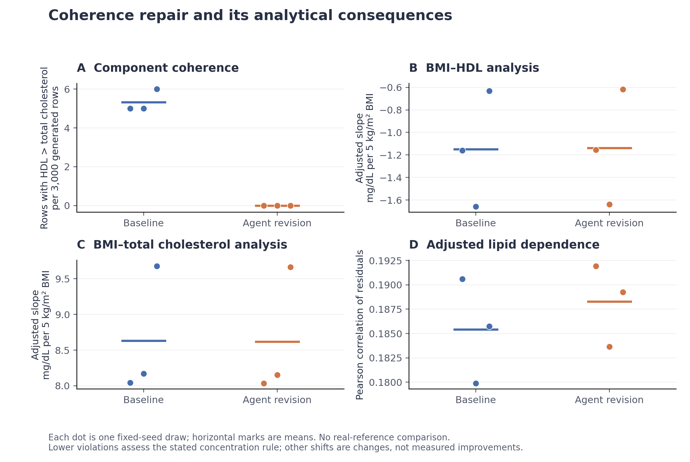

# Scientific-use checks and Agent-selected coherence repair

Completed 9 November 2026. This is a bounded development experiment on one existing lipid construction, not a new cohort validation.

The Agent identified the reported component violations, selected and implemented a repair, and retained its analytical consequences. Component violations fell from **16/9,000 baseline rows to 0/9,000 revised rows**, but the repair introduced **16 exact TC=HDL boundary values**. Evidence coverage for all three requested analyses remained partial. This supports a transparent construction-and-checking capability; it does not establish improved biomedical accuracy or novelty of projection itself.

## What was implemented and tested

The additive `analysis_use_v1` adapter combines exact requested-estimand declarations with generic `order` and `sum` checks. It has no built-in clinical variables, desired correlations, coefficient values, repair algorithm or target reference. Numerical findings are bound to frozen candidates and actual executions. Author declarations of evidence support remain declarations, not authenticated scientific truth. Host review still supplies the use contract and source-grounded rule; this unit does not demonstrate automatic discovery of that rule.

The existing controller dispatched candidate preflight, freeze, isolated execution, two source-feedback layers and both analysis adapters. A fresh-context scientific author chose whether and how to revise. It was allowed further retrieval, but made no new retrieval requests in this bounded unit; it reused 14 previously admitted source artifacts. No root-written clinical coefficients or requested effect signs were supplied.

The specific requested output was a complete adult concentration scenario with age, sex, BMI, total cholesterol (TC) and HDL. The rule HDL <= TC was reviewed against official definitions. This applies here to **underlying same-specimen concentrations without an explicit assay-error model**. Independently measured noisy assay outputs require separate interpretation. Historical measured-source statistics were transferred to this scenario under an explicit, unvalidated assumption. The experiment cannot retroactively classify every earlier measured-value violation as a biological impossibility. See [rule basis](RULE_BASIS.md).

## Frozen design and actual scale

| Quantity | Actual scope |
|---|---|
| Independent scientific constructors | One; reviewers did not select a repair algorithm or coefficients |
| Case / stages | One existing case; baseline plus one optional revision |
| Fixed seeds | 9601, 9602, 9603 for each stage |
| Generated outputs | Six tables of 3,000 complete synthetic rows; 18,000 output rows total |
| Distinct clinical cohorts / patients newly validated | Zero |
| Scientific analyses | Adjusted BMI–HDL slope, adjusted BMI–TC slope, adjusted lipid residual correlation |
| Additional diagnostics | All 23 predefined marginal, quantile, conditional-RMS and sex-composition statistics |
| Controller use | 30 actions, two candidate submissions, six executions, six dual-feedback actions, 12 analyses |
| Final selection | Agent-selected coherent_projection, before host reporting |

Repeated synthetic draws are not independent clinical evidence. Common seed labels alone do not imply matched people; the postclosure audit separately established identical proposal-related values for this particular implementation. All stages and all seeds are retained. No real-target result was read or used for this unit.

## What the Agent changed

The Agent retained the original proposal parameters and random-number sequence. For an HDL-above-TC proposal, it replaced both lipid values by their shared midpoint. This is equal-weight Euclidean projection in common mmol/L units. Every other pair and all other columns were preserved. The equal weighting is an Agent assumption, not a source-estimated error model or a unique biologically correct repair.

The independent saved-row audit confirmed:

- Baseline violations: 5, 5 and 6; revised violations: 0, 0 and 0, with all pairs evaluable.
- Exactly those 16 lipid pairs changed. IDs, row order, age, sex, BMI and all originally nonviolating lipid pairs were unchanged.
- Every altered pair became TC=HDL, creating 16 artificial zero-non-HDL boundary values; their biological frequency is not validated.
- Maximum original HDL-minus-TC excess was 1.281966 mmol/L; the maximum single-lipid correction was 0.640983 mmol/L.

Finite sample counts and the deterministic support argument are distinct. For positive finite proposals and a finite midpoint, this transformation enforces the declared order. It does not guarantee other scientific properties or arbitrary-input numerical safety.

## Effects on the scientific analyses

These are means across the three preset draws, not confidence intervals for a clinical population. Slopes adjust for age and sex and are reported in mg/dL per 5 kg/m² BMI; lipid values are converted from mmol/L by 38.67. The residual correlation adjusts both lipids for age, sex and BMI. All analysis directions were retained in these draws. Changes are reported without a clinical-equivalence margin or an accuracy ranking.

| Analysis | Baseline mean | Revised mean | Revised minus baseline |
|---|---:|---:|---:|
| BMI–HDL adjusted slope | -1.150084 | -1.137195 | 0.012889 |
| BMI–TC adjusted slope | 8.630396 | 8.617507 | -0.012889 |
| Adjusted lipid residual correlation | 0.185411 | 0.188281 | 0.002870 |

Panel A tests the declared component relation. Panels B–D show every requested analysis; their axes are not quality scores and changes do not imply improvement. Dots are fixed-seed outputs and horizontal marks are means. [Vector PDF](coherence_and_analyses.pdf).

## Source agreement and remaining evidence gaps

All 29 strict source checks remained unavailable per table. Descriptive feedback computed 26 statistics per table: 22 under explicit assumed conventions and four with a known weighting mismatch, for which no source difference was asserted. Three further checks remained unsupported. These diagnostics use task-population output, not a reconstruction of each source population.

Across the 66 comparable source-check/seed pairs (22 × 3), the independent audit found 18 absolute discrepancies decreased, 16 increased and 32 stayed unchanged. Another 21 comparisons remained unavailable or mismatched. These are descriptive distances, not 66 independent confirmations. For example, the young-stratum TC mean moved farther from its reported source value in all seeds. Reducing a structural violation therefore did not uniformly improve source agreement.

The exact requested adjusted regressions and residual dependence remain only partially supported by the available marginal/contextual evidence. The revision added no conditional joint evidence, no calibrated transport uncertainty and no validated observation-error model. A numerical component check cannot fill these gaps.

## Complete diagnostic changes

No diagnostic was selected by favorable movement. Values below are three-draw means; complete per-run values, source comparisons and unavailable items are retained in [EVALUATION.json](EVALUATION.json).

| Diagnostic | Unit | Baseline | Revised | Difference |
|---|---|---:|---:|---:|
| age.mean | year | 38.704496 | 38.704496 | 0.000000 |
| age.sd_sample | year | 16.357411 | 16.357411 | 0.000000 |
| age.q10 | year | 19.189588 | 19.189588 | 0.000000 |
| age.q50 | year | 36.211960 | 36.211960 | 0.000000 |
| age.q90 | year | 61.776904 | 61.776904 | 0.000000 |
| bmi.mean | kg/m^2 | 24.127040 | 24.127040 | 0.000000 |
| bmi.sd_sample | kg/m^2 | 5.214680 | 5.214680 | 0.000000 |
| bmi.q10 | kg/m^2 | 18.075012 | 18.075012 | 0.000000 |
| bmi.q50 | kg/m^2 | 23.531262 | 23.531262 | 0.000000 |
| bmi.q90 | kg/m^2 | 30.967518 | 30.967518 | 0.000000 |
| total_cholesterol.mean | mg/dL | 154.972622 | 154.985214 | 0.012592 |
| total_cholesterol.sd_sample | mg/dL | 31.551712 | 31.536443 | -0.015268 |
| total_cholesterol.q10 | mg/dL | 116.788518 | 116.788518 | 0.000000 |
| total_cholesterol.q50 | mg/dL | 152.185115 | 152.207749 | 0.022635 |
| total_cholesterol.q90 | mg/dL | 196.204469 | 196.204469 | 0.000000 |
| hdl_cholesterol.mean | mg/dL | 56.804479 | 56.791887 | -0.012592 |
| hdl_cholesterol.sd_sample | mg/dL | 18.342609 | 18.291397 | -0.051212 |
| hdl_cholesterol.q10 | mg/dL | 36.517621 | 36.517621 | 0.000000 |
| hdl_cholesterol.q50 | mg/dL | 53.970685 | 53.970685 | 0.000000 |
| hdl_cholesterol.q90 | mg/dL | 80.976757 | 80.951469 | -0.025288 |
| total_cholesterol.conditional_rms | mg/dL | 29.959145 | 29.947974 | -0.011171 |
| hdl_cholesterol.conditional_rms | mg/dL | 18.166231 | 18.116381 | -0.049850 |
| sex.F_fraction | 1 | 0.548778 | 0.548778 | 0.000000 |

## Independent implementation and result audit

All **156 / 156 endpoint calculations** were independently reproduced; maximum absolute numerical difference was 1.17e-13. A separate Python CSV/float audit independently checked every coherence count and all row-pair transformations. All 276 sealed bundle files retained their hashes. [Arithmetic recomputation](RECOMPUTATION.json), [coherence recomputation](COHERENCE_RECOMPUTATION.json), [scientific review](SCIENTIFIC_REVIEW.md), [independent result review](INDEPENDENT_RESULT_REVIEW.md).

The relevant implementation tests total 44 passing cases: generic adapter 30, evaluation coverage 11, actual controller loader one, and inherited-source namespace regression two. The unchanged passing suites were not repeatedly rerun to pad this count. All fixtures use invented data, not clinical validation.

Failures remain explicit. The first setup could not verify inherited web artifacts in a new session; it was preserved before any controller action, freeze or execution. A fresh setup honestly moved those unchanged artifacts to a curated namespace and rebound only evidence paths/hashes. Six baseline files, including generator and model specification, remained byte-identical; the other three changed only provenance bindings. The old session was not reset and old verifiers were not weakened. [Setup review](SETUP_REVIEW.md). During revision, action a15 failed preflight on a stale recipe hash; it was charged and corrected before submission. All six executions succeeded. A host audit invocation initially used an invalid CLI flag and stopped at argument parsing; the correct postclosure invocation produced the audit above.

## Decision and relevance to the paper

Keep the generic use/coherence adapter and this complete bounded record. The unit demonstrates that an Agent-controlled workflow can react to execution-bound feedback, make an explicit construction change, and expose its side effects. Projection itself is a standard operation, and this single-author development case is not a new biomedical validation or proof that a rubric or multiple Agents improve quality.

For the paper's core contribution, the important deliverable remains evidence-guided virtual data with analysis-specific supported uses. This repair improves one declared consistency property while leaving conditional-evidence and transport gaps unresolved. The next useful scientific work is to obtain compatible conditional/joint evidence for the intended analyses and evaluate its implications under an explicit use definition. This record supplies no basis for further target-tuned changes or a broad clinical-reliability claim. No new case, extra repair round, target comparison, training or paid API was started here.

Patient-level and generated tables, complete sources and full session artifacts remain local. Only original implementation/documents, source metadata and aggregate results are eligible for the reviewed public release.
