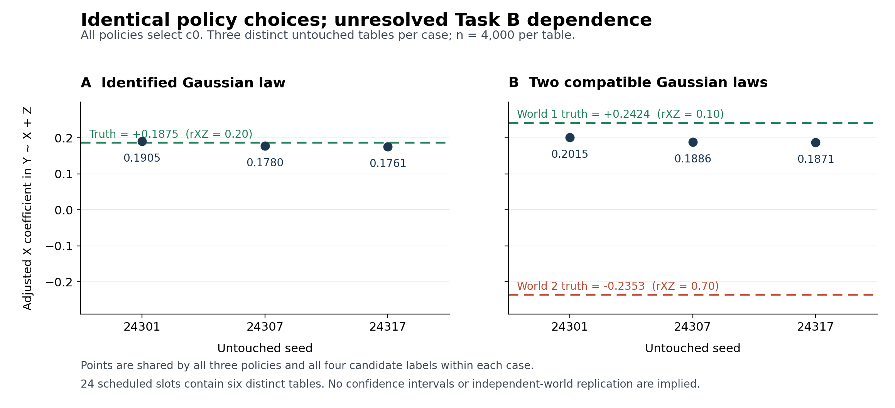

# C4: identical policy choices and a designed identification counterexample

The policy comparison is nondiscriminating: retain, minimum source loss, and protected-use acceptance all select c0 in both tasks. Each author proposal opportunity retained the initial generator/specification within its task. All four labels produce byte-identical outputs for each seed. Therefore the 24 scheduled test slots contain only six distinct tables (three per task); policies and candidate labels are not additional replicates. No selector benefit or superiority is established. This interpretation was recorded in ELECTION_GATE.json before election and hidden reveal.

All 54 scheduled generation runs succeeded (6 initial feedback, 24 election, 24 untouched test). This evaluation generated no new rows and imported no candidate code. The unchanged frozen evaluator scored every scheduled final table under every precommitted world. Rows remain local.

## Source qualification and selection

| Phase | Scheduled tables | Full numeric pass | Protected-use pass | Fixed check evaluations |
|---|---:|---:|---:|---:|
| feedback | 6 | 6 | 6 | 51 |
| election | 24 | 24 | 24 | 204 |
| test | 24 | 24 | 24 | 204 |

Election losses were 0.042433618 for every A label and 0.036015735 for every B label. Every candidate passed all fixed source checks on all three election seeds (27 checks per A candidate; 24 per B candidate) and every admitted correlation. Tie order retains c0; no proposal strictly improves loss, so the protected policy also retains qualified c0. Qualification concerns admitted source statistics only.

## Held-out endpoints

The primary operator is the X coefficient from OLS Y ~ X + Z with intercept. Secondary operators are the Z coefficient and Pearson partial correlation of X,Y given Z. Coefficients use fixed population-standardized measurement units, without sample restandardization. The following results apply identically to all three policies; means and errors summarize only the three distinct seed tables per task. Both B worlds score the same outputs.

| Case / world | Endpoint | Truth | Mean estimate | MAE | MSE | Direction matches |
|---|---|---:|---:|---:|---:|---:|
| A | Adjusted X (primary) | 0.187500 | 0.181531 | 0.007981 | 7.66155e-05 | 3/3 |
| A | Adjusted Z | 0.562500 | 0.556896 | 0.007797 | 0.000137212 | 3/3 |
| A | Partial r(X,Y given Z) | 0.229640 | 0.225490 | 0.006486 | 4.76519e-05 | 3/3 |
| B world 1 | Adjusted X (primary) | 0.242424 | 0.192380 | 0.050044 | 0.00254639 | 3/3 |
| B world 1 | Adjusted Z | 0.575758 | 0.558628 | 0.017129 | 0.000398734 | 3/3 |
| B world 1 | Partial r(X,Y given Z) | 0.301511 | 0.239924 | 0.061588 | 0.00382286 | 3/3 |
| B world 2 | Adjusted X (primary) | -0.235294 | 0.192380 | 0.427674 | 0.182947 | 0/3 |
| B world 2 | Adjusted Z | 0.764706 | 0.558628 | 0.206078 | 0.0425733 | 3/3 |
| B world 2 | Partial r(X,Y given Z) | -0.210042 | 0.239924 | 0.449966 | 0.202499 | 0/3 |

All raw estimates and errors are retained in [all_table_endpoints.csv](all_table_endpoints.csv) (108 rows: 24 tables × applicable worlds × 3 endpoints), [selected_policy_endpoints.csv](selected_policy_endpoints.csv) (81 rows, with policy reuse explicit), and [aggregate_results.csv](aggregate_results.csv) (27 rows). None of these row counts is an independent-sample count.

| Case | Seed | Adjusted X | Adjusted Z | Partial r |
|---|---:|---:|---:|---:|
| A | 24301 | 0.190519 | 0.565790 | 0.233143 |
| A | 24307 | 0.177986 | 0.542480 | 0.222972 |
| A | 24317 | 0.176089 | 0.562418 | 0.220354 |
| B | 24301 | 0.201503 | 0.567595 | 0.247547 |
| B | 24307 | 0.188559 | 0.544261 | 0.237166 |
| B | 24317 | 0.187078 | 0.564029 | 0.235057 |

The frozen primary error bands are <=0.05, >0.05–0.10, >0.10–0.20 and >0.20. Numerical utility is 1/(1+(absolute error/0.10)^2), averaged over three tables. These are descriptive engineering conventions, not clinical usefulness thresholds. Direction is separate; no bands or utility were prespecified for secondary endpoints.

- A: {'within_0.05': 3}; mean numerical utility 0.992422.
- B world 1: {'within_0.05': 1, 'above_0.05_through_0.10': 2}; mean numerical utility 0.799061.
- B world 2: {'above_0.20': 3}; mean numerical utility 0.051870.

## Meaning and limits

Task A admits an explicitly artificial Gaussian law with zero means, unit SDs and correlations rXY=0.30, rYZ=0.60, rXZ=0.20. Its adjusted-X truth 0.1875 is mathematically derivable from those moments. Its small error establishes numerical agreement for this construction, not a new biological result or independent validation of unreported evidence. Gaussianity identifies the full joint law when its moments are complete; these linear projection endpoints themselves are determined by the covariance matrix and do not require Gaussianity.

Task B admits the same X,Y and Y,Z Gaussian marginals but leaves rXZ unidentified. Two positive-definite compatible Gaussian laws were deliberately fixed before authorship: rXZ=0.10 and rXZ=0.70. Their adjusted-X truths are +0.242424 and −0.235294. Both preserve every admitted source moment. The same source-qualified outputs are positive on all three seeds, yet disagree in direction with world 2 and have mean absolute primary error 0.427674 there. The partial correlation also has the wrong direction under world 2; the Z coefficient retains its direction but has mean absolute error 0.206078.

The primary truths differ by 0.477718, so any single estimate must have absolute error at least 0.238859 under at least one world. This is a designed identification counterexample, not a discovered biomedical phenomenon. The two worlds are ambiguity witnesses with no assigned probabilities; no preferred world was selected after seeing outcomes. Source matching alone cannot resolve the missing dependence. Three simulation seeds do not support confidence intervals, clinical claims, or broad policy comparisons.

## Chronology and integrity

| Phase (31 October 2026, UTC) | Time | Artifact SHA256 |
|---|---|---|
| Task/evaluator frozen | 17:58:19 | `d9be7d67bb8ffb605928249fd5ab60be56f92a003f6144dae5bbcdd10bd4903a` |
| Visible source admission | 17:59:24 | `afe2060a82b2e69ebb82b5753101c526cd67092166ebfa94b36151237ca0841c` |
| Initial feedback released | 18:04:58 | `767ed0812cf875e7f537f1f3eb0ac30dc419adcaee1cdfef0d4e6f3d2feec1e5` |
| Frozen pool election released | 18:09:35 | `3142cec54c2cbe946b32d3d67a26ada8dc07739c4bc192dc454600dc0e9dc9a8` |
| Sealed selection bound into test release | 18:10:11 | `1f9940224ba842dc8907a0b9991721f82b7268e11ac15ee1e8ce3d1ff8a656a0` |
| All 24 outputs committed and reveal authorized | 18:11:04 | `bea5626274935be637964e38e4cd971152fe0c69df9e04e2f0df24fe5272e2f1` |
| Unchanged evaluator completed | 18:12:26 | `d2ce43cdf6f451be07fba5ebacf0a9876f6f32872ae4def177f69b1ef5d552df` |

The sealed selection SHA256 is `457e40547f8094ea05f703a2db0bcdc9b03f4c533615b3bbb80315954d47edd4`; the test output manifest SHA256 is `9ea6cbeae685f5e4e75dbf80b3b8681d06b2058ca27f6eda9febc5a8c6de8d3c`. The test release binds the selection before test generation; the reveal gate binds all 24 table commitments. Every test table and test diagnostic hash was checked. Frozen evaluator SHA256 `fa1009b4ecbaa37a78695f83bf07881c0f0b51b0acd11cbca2bd7dd27e7c417a` and contract SHA256 `60acd691504e533d22295e989ae6cb2373435de50494f265a1dac237902a67b9` matched before and after evaluation. The [evaluation receipt](EVALUATION_RECEIPT.json) records all 24 result hashes and the adapter hash. Hidden findings are not candidate feedback. Independent root review remains the final audit step.

The requested comparison is complete. Preserve the nondiscriminating result; this unit supplies no basis for adding selector complexity or claiming its benefit. Any new scientific question requires a separately authorized design.
