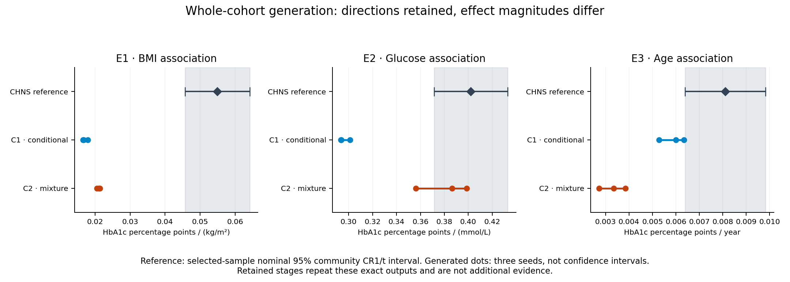

# CHNS F2: whole-cohort generation preserves directions but not all effect magnitudes

Completed 1 November 2026 (America/Chicago; completion records use 2 November UTC). **Decision: retain the overall evidence-to-virtual-data research question, simplify the next methodological claim, and close this CHNS case to further tuning.** This bounded continuation is complete. It does not authorize a new case or expanded search.

Two fresh-context Agents independently authored different whole-cohort generators without receiving any individual records or numerical CHNS target results. All three predeclared association directions were positive in both constructions across all three seeds. However, the BMI association was substantially weaker than the CHNS sample estimate, and better glucose-association agreement in one construction coincided with worse age-association agreement. Both Agents retained their initial model after source feedback. **No feedback-driven improvement or general method superiority was demonstrated.**

The primary evaluation was independently recomputed using separate data preparation and statsmodels estimation: **zero discrepancies within the predefined numerical tolerance**. This confirms computational agreement, not biological validity.

## What question was tested?

Can an Agent use published study-level evidence and a target-population description, without any input participant table, generate one reusable joint dataset that supports several scientific analyses? This is the whole-cohort regime of the larger project; it is not restricted to filling one missing column.

The target use case was a descriptive joint distribution of age, sex, BMI, serum glucose and HbA1c among adults aged 35–74 in the released CHNS 2009 sample. The age interval was fixed prospectively for a midlife/older-adult use case, not selected from target effects and not claimed to harmonize source age ranges. No treatment, diabetes or pregnancy exclusions were applied. The analysis describes a selected complete-case sample; it is not a nationally representative or causal analysis.

The scientific analysis unit is one target cohort and two Agent constructions. Twelve execution slots are not twelve independent patient validations.

## Evidence, Agent choices and actual implementation

The frozen packet contains five sources and sixteen evidence items: Bao 2010 SHDS II, Wang 2024 MIND-China, Jansen 2013 Lifelines, Pani 2008 NHANES/FOS and NGSP unit guidance. Four are clinical-study sources and one is measurement guidance. Bao and MIND consumed two newly deep-read original-study slots; the other evidence had already been audited. CHNS-derived scientific findings were not supplied as independent external generation evidence.

The curator retained source populations, measurements, analysis/adjustment conditions, source uncertainty and overlap limitations. A contradictory MIND kappa result was quarantined. Separate Jansen adjusted coefficients were not represented as one jointly adjusted model. Source-wide n was not treated as the effective n of every statistic, and between-person SD was not called uncertainty in a reported mean. Source-family names do not prove individual-level non-overlap.

Two constructors received the same allowed evidence and task in fresh contexts. They selected their own scientific structures and numerical settings:

| Construction | Agent-authored scientific model | Important unverified choices |
|---|---|---|
| C1 | Conditional lognormal glucose and HbA1c model, with age/BMI effects and an HbA1c response to glucose | Age/sex composition, covariate dependence, conditional effects, constant residual scales and independent conditional errors |
| C2 | Two-component bivariate lognormal glycemic mixture, with covariate-dependent component membership | Mixture prevalence and shifts, within-component covariance, age/BMI-dependent component membership, conditional mean effects and conditional scales; the elevated component is not a diagnosed-diabetes group |

The coordinator supplied task/schema/measurement rules, allowed evidence, feedback semantics and budgets, but did not enter target means, desired slopes or target signs. The Agents authored **Python generator programs**; the isolated runtime produced the numerical rows. This is Agent-designed programmatic generation, not the Agent directly typing a table and not a centrally fixed biomedical simulator. Direct-row generation remains a valid project route but was not evaluated in this case. Separate contexts use the same available model family and are not cross-model replications.

Each initial generator was reviewed, frozen and executed at seeds 1701, 1702 and 1703, with 3,000 rows per output. After receiving the complete three-seed source feedback, each constructor had at most one revision opportunity. Both chose **retain**. The retained stages were frozen and executed at the same seeds; all resulting file hashes exactly matched their initial counterpart. There are therefore **12 successful execution slots, six unique tables and no changed scientific generator**. These repeated retained tables do not add independent Monte Carlo evidence.

The new controller explicitly calls `semantic_feedback_v1`; there is no legacy-collector fallback. It uses the existing isolated execution path, fixed seed/stage reservations, hash-bound candidate reviews, model-specific interpretation approvals and an evaluation gate after every generation slot has been consumed. Source semantic checking does not certify original-paper extraction or transportability.

## What did source feedback actually say?

The strict collector left both proposed correlation discrepancies unavailable because essential source semantics, including original analytic weighting, were not established. An independently reviewed opt-in interpretation supplied separately labelled, equally weighted **task-population proxies**. These are not replayed source populations and are not precision-weighted calibration losses.

| Diagnostic | Source report | C1 initial, three-seed range | C2 initial, three-seed range |
|---|---:|---:|---:|
| Bao glucose–HbA1c Pearson | 0.619 | 0.5329–0.5541 | 0.6657–0.6851 |
| MIND serum glucose–HbA1c Spearman | 0.529 | 0.5164–0.5452 | 0.4780–0.4828 |

The Agents argued that differences in population, selection, assay and missing weighting information did not justify a particular parameter correction. Their retention decision is recorded, including persistent discrepancies. It is not evidence that no beneficial revision exists. The feedback path ran successfully but the experiment provides no evidence of an effective repair policy.

The three target regressions were not numerical feedback objectives. Related associations and qualitative directions were present in external source evidence, so these are **held out from feedback and target calibration**, not three entirely unseen scientific relationships. Pretraining non-exposure cannot be established.

## Independent target preparation and fixed analyses

After all candidates, retained decisions and twelve slots were independently reviewed and frozen, the separate evaluator decoded four checksum-bound CHNS SAS files. It linked the biomarker, physical-examination, survey-wave and person-master releases using the exact documented key capitalization and wave fields. No silent deduplication was allowed. The age/gender/measurement rules yielded:

- 9,549 biomarker records; 9,516 records after the prescribed links.
- 6,809 age/gender-eligible records; **6,631 common complete cases**.
- Exact height/weight cleaning code 9 treated as unavailable; other released corrections retained. No generic 88/99 recoding or second unit conversion.
- No observed infinite or finite nonpositive glycemia requiring the prospective withholding gate.
- **218 communities** for nominal 95% CR1/t reference intervals. Points remain unweighted OLS, not national survey estimates.

E1 is the BMI coefficient in HbA1c ~ age + female + BMI. E2 is the glucose coefficient in HbA1c ~ age + female + glucose. E3 is the age coefficient in HbA1c ~ female + BMI + glucose + age. All include an intercept and use the same complete-case reference. Generated tables were analyzed without ad hoc row deletion.

## All primary results

| Fixed estimand | CHNS sample estimate [nominal 95% CI] | C1 range across three seeds | C2 range across three seeds |
|---|---:|---:|---:|
| E1: BMI–HbA1c association, percentage points/(kg/m²) | 0.05495 [0.04573, 0.06417] | 0.01654–0.01793 | 0.02049–0.02133 |
| E2: glucose–HbA1c association, percentage points/(mmol/L) | 0.40209 [0.37129, 0.43290] | 0.29347–0.30109 | 0.35606–0.39879 |
| E3: age–HbA1c association, percentage points/year | 0.008107 [0.006387, 0.009827] | 0.005284–0.006337 | 0.002714–0.003843 |

All three reference intervals exclude zero. All eighteen coefficients from the six unique generated tables have the same positive direction. This establishes **limited directional analytical feasibility for these particular tasks**. It does not establish equivalence: no scientific equivalence margin or global accuracy score was introduced after seeing results.

Relative to the sample reference, C1/C2 BMI effects are approximately **30–33% / 37–39%** as large. Their glucose effects are **73–75% / 89–99%**, and their age effects are **65–78% / 33–47%**. C2 is descriptively closer on glucose, but C1 is closer on age. Two C2 glucose coefficients lie in the reference interval and one does not; interval membership is descriptive, not an equivalence test or calibrated coverage claim. The stage named `revised` contains the exact retained output, so its results are identical.

## Distribution and dependence checks remain necessary

The main purpose is scientific-analysis reuse, not minimizing a standalone marginal error score. Nevertheless, distributions matter because they influence those analyses. HbA1c sample means are relatively similar: reference 5.675%, C1 5.738–5.744%, C2 5.695–5.723%. Their SDs differ materially: reference **0.954**, C1 **0.719–0.736**, C2 **0.534–0.578**. Glucose SDs are reference **1.545**, C1 **1.292–1.339**, C2 **0.984–0.992** mmol/L. Mean similarity therefore does not validate individual variability or adjusted associations.

Reference glucose–HbA1c Pearson is **0.6610** and Spearman **0.3615**. C2 Pearson is relatively near the reference while its rank correlation is higher, its BMI association remains weak and its age coefficient is especially low. These are observed descriptive contrasts in two constructions, not a controlled proof that any one design component causes a failure. They motivate testing the sufficiency of joint/conditional evidence rather than simply optimizing one correlation.

The CHNS estimates are uncertain selected-sample references, not known population truth. The displayed regression intervals are not confidence intervals for marginal means. Sampling uncertainty does not erase the observed mismatches. Synthetic seed variation is conditional Monte Carlo variation; it does not quantify source-estimation, structural or transport uncertainty.

## Verification, failures and cost

The primary evaluator uses its own least-squares and CR1 calculation. Independent recomputation instead prepares records by indexed intersections and uses statsmodels OLS/cluster inference, pandas/SciPy diagnostics and a separate comparison implementation. Both use the same frozen definitions and SAS decoder; their agreement is numerical/processing verification, not independent biological replication.

The independent check matched all predefined comparisons with zero discrepancies at numerical `rtol=1e-8`, `atol=1e-10`. Its first launch failed before any read gate/reservation because the project import path was missing. The failure was retained, and the coordinator authorized an environment-only `PYTHONPATH` correction. Exact script, protocol and primary-report bytes were unchanged. The one actual reference recomputation then completed. No generator was rerun for this repair.

New controller and evaluator tests used invented in-memory data. Initial controller tests passed; after hardening, eleven focused controller tests passed. The initial evaluator suite had 77 passes; after two real pre-evaluation fixes, only 17 affected tests were rerun successfully, with 70 deselected. This is not a claim that the full expanded suite was rerun. The independent implementation also passed one fabricated self-check. Old frozen modules and prior successful suites were not repeatedly exercised.

Twelve generator execution receipts sum to **8.406 seconds** (0.609–0.922 per slot). This is the recorded execution time, not the full Agent/review/download cost. Two fresh constructor contexts, two scientific feedback follow-up turns, metadata clarifications, independent review and preparation dominate unmetered effort. No new paid API, training or HPC was used. The cumulative metered download ledger remains **232,720,603 bytes**, with browser traffic unmetered; no files were downloaded in this final execution/evaluation unit. The source quota remains 2/6 new original studies and 3/3 candidate target families. No optional mechanism tables were generated.

## Decision and next discriminating question

**Continue the research question; simplify the claim; stop this target-specific branch.** Evidence-driven whole-cohort construction has demonstrated limited analytical use in this case. It has not demonstrated broadly faithful joint data, quantitative interchangeability with measurements, revision improvement or an advantage over a same-information statistical generator. No additional architecture, multi-Agent layer or training is justified by this case alone.

The next design question is whether a specified set of conditional/joint study constraints can support a stated analysis across defensible alternative generator structures, and whether correctly matched source feedback improves that support. That proposal should be designed and evaluated prospectively on a new authorized target; it is not permission to edit C1/C2 to match the revealed CHNS slopes. A useful method contribution would tie usable analyses and unresolved assumptions to evidence, rather than promising every synthetic variable is scientifically interchangeable with a measured one.

This case can support an honest feasibility/results section and an implementation description. It cannot, by itself, support a claim that patients need not be measured, that the method reliably recovers all relationships, that source feedback repairs data, or that a top-tier methods contribution is established. The broader uses—full generation, variable enrichment and missing-cell completion—remain the project scope, but require their own information boundaries and validation.

CHNS 2009 is now **revealed and closed** to tuning or fresh-confirmation labels. Preserve both successful and unfavorable results. The single scheduled continuation is paused after this completed independent case decision.

## Audit entry points

- [Frozen protocol](PROTOCOL.md), [analysis plan](analysis_plan.json), [study release](F2_RELEASE.json).
- [Final slot inventory](FINAL_INVENTORY.json), [evaluation release](EVALUATION_RELEASE.json), [final inventory review](review/FINAL_INVENTORY_REVIEW.md).
- [Complete aggregate primary report](evaluation_results/REPORT.json), [compact aggregate summary](RESULTS_SUMMARY.json), [independent numerical report](independent_results/REPORT.json).
- [C1 model](candidates/C1_initial/model_spec.json), [C2 model](candidates/C2_initial/model_spec.json), [C1 retention](candidates/C1_revised/decision.md), [C2 retention](candidates/C2_revised/decision.md).

Participant-level real/generated tables and full third-party papers/codebooks remain local. A public code-and-aggregate snapshot is not a self-contained replay of omitted private execution bundles. Historical frozen reports keep their original pending-status language; later release and completion records document the transition rather than rewriting history.
