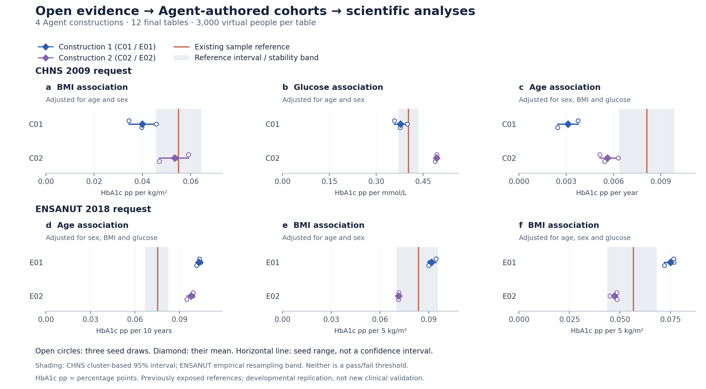

# Repeated open-evidence construction of complete biomedical cohorts

4 November 2026. **Completed: four Agent constructions, two existing population requests, twelve final tables and independent numerical verification.** The Agent workflow repeatedly produced analysable complete cohorts with the same directions as the existing sample references for all six prespecified associations. Effect magnitudes and joint-distribution diagnostics were mixed. All four authors retained their initial construction after feedback; this batch establishes no revision benefit.

This is developmental replication on previously exposed CHNS and ENSANUT references. It adds four constructions under a unified open-retrieval protocol, not two new clinical cohorts or independent external confirmation. The historical main study and its frozen outputs remain unchanged.

## What was tested

Could the same bounded workflow handle two whole-cohort requests when the scientific Agent selected its own literature, structure and numerical parameters? Each author received the population definition, allowed variables, intended analyses and interface. No individual records, target coefficients, desired signs, DOI seeds or earlier scientific constructions were supplied to the fresh author context. CHNS and ENSANUT participant studies were excluded from generating evidence. Different authors could choose overlapping external studies; author count is not independent-source count.

The root controlled budgets, interfaces, review and execution. It did not fill in biological coefficients or tune against the target. Independent reviews checked original methods/tables, statistic meaning, units, derivations, population applicability, model/program agreement and mathematical moments. These reviews were not target-fidelity certification. The reviewers and root have historical result exposure; fresh author contexts and task boundaries are not a claim of formally enforced filesystem isolation for the author. The generation subprocess itself used the existing isolated runtime, with no project/target-file mount or network.

The actual sequence was:

1. Self-selected queries through the fixed Europe PMC/PMC gateway, up to eight query credits and four original papers per author; retrieval closed at the first candidate freeze.
2. Agent-authored scientific specification, source/assumption ledger and executable generator; independent source and implementation review before execution.
3. One 3,000-row initial trial, generated-only diagnostics and `semantic_feedback_v1` source feedback. One revision was available but not used.
4. Author decision recorded before three final seed draws, 8101–8103. Every author retained the initial model.
5. All four sessions closed before reading the pinned, previously exposed sample-reference summaries. Evaluate every scheduled final table and endpoint; independently recalculate the generated-table results.

Thus data were sampled by programs **whose scientific laws and parameters were authored by Agents**. The present batch does not test direct LLM emission of individual rows. There are four scientific author instances, not a twenty-Agent collaboration. Each worked on its own construction; source/implementation reviewers performed separate audit roles.

## Actual scope and accounting

| Quantity | Completed |
|---|---:|
| Existing reference families / population requests | 2 |
| Fresh scientific author constructions | 4 |
| Query credits, including fetch metadata | 24 |
| Original-paper uses / distinct originals | 16 / 12 |
| Initial trials | 4 |
| Scientific revisions / revision trials | 0 / 0 |
| Final tables, each with 3,000 virtual rows | 12 |
| Final virtual rows / trial virtual rows | 36,000 / 12,000 |
| Physical generation attempts / successful attempts | 16 / 16 |
| Prespecified primary endpoint definitions | 6 |
| Primary seed estimates / diagnostic seed estimates | 36 / 330 |
| Independent numerical comparisons / mismatches | 366 / 0 |
| New participant downloads, reads or fits | 0 |

Synthetic rows and seeds are not new patients or clinical replications. The 36 direction matches are repeated estimates of six analysis definitions across four model constructions; they are not 36 independent scientific discoveries.

The generation adapter recorded 10.842 seconds across all sixteen attempts. This includes its setup/validation but excludes Agent reasoning, literature acquisition, source review and downstream analysis. It is not total workflow time or a patient-collection cost saving. No paid API, training or HPC was introduced.

## What the Agents actually constructed

| Author | Scientific construction | Main evidence and unresolved choices |
|---|---|---|
| C01 | Age-conditioned, two-component multivariate lognormal mixture | Chinese source summaries and glucose–HbA1c correlation constrain moments; age mappings, BMI dependence and a surrogate for known/treated diabetes remain assumptions. |
| C02 | Gaussian copula for predictors; affine HbA1c conditional mean with bounded residual | Pooled Pinggu moments and transported Singapore conditional coefficients; reduction of the adjustment set and joint predictor structure are assumptions. |
| E01 | Bounded beta BMI and conditional beta glucose; conditional gamma HbA1c | Source correlations/moments and age evidence; conditional dependence, residual allocation and population transfer remain assumed. |
| E02 | Lognormal BMI; glucose sampled from a conditional truncated normal; positive conditional-mean lognormal HbA1c | Multi-study summaries, a marginal regression and an ecological BMI guide; translating these to individual conditional effects requires assumptions. |

All four mathematical reviews supported finite polynomial moments under the stated laws. E02 required a tail-stable truncated-normal implementation, not silent clipping or replacement of extreme BMI values. This review addresses implementation and mathematical validity, not whether the tails represent the target population.

The 68 declared source checks yielded **29 qualified approximate comparisons and 39 not-computable checks**. These are comparisons of generated target-population summaries with source quantities. They are not exact source-population replays; unsupported transformations, adjustment sets, weighting and selection stayed unavailable. A check being computable does not mean the source constraint passed or transported successfully.

Source details: [C01 review](SOURCE_PROPOSAL_REVIEW_C01.md), [C02 review](SOURCE_PROPOSAL_REVIEW_C02.md), [E01 review](SOURCE_PROPOSAL_REVIEW_E01.md), [E02 review](SOURCE_PROPOSAL_REVIEW_E02.md) and its [transcription addendum](SOURCE_PROPOSAL_REVIEW_E02_ADDENDUM.md).

## All primary results

Entries are means across three frozen seed draws, followed by the observed seed range. HbA1c units are **percentage points**, not relative percent change. There is no pooled score across different units and no post-hoc pass/fail margin.

| Request and analysis | Existing sample reference | Construction 1 | Construction 2 |
|---|---:|---:|---:|
| CHNS: BMI, adjusted for age/sex; pp per kg/m² | 0.05495 | C01: 0.03992 [0.03434, 0.04571] | C02: 0.05338 [0.04709, 0.05905] |
| CHNS: glucose, adjusted for age/sex; pp per mmol/L | 0.40209 | C01: 0.37754 [0.35756, 0.39889] | C02: 0.49241 [0.48865, 0.49488] |
| CHNS: age, adjusted for sex/BMI/glucose; pp per year | 0.00811 | C01: 0.00311 [0.00246, 0.00376] | C02: 0.00563 [0.00514, 0.00630] |
| ENSANUT: age, adjusted for sex/BMI/glucose; pp per decade | 0.07513 | E01: 0.10308 [0.10155, 0.10431] | E02: 0.09772 [0.09495, 0.09913] |
| ENSANUT: BMI, adjusted for age/sex; pp per 5 kg/m² | 0.08364 | E01: 0.09165 [0.08994, 0.09441] | E02: 0.07140 [0.07123, 0.07156] |
| ENSANUT: BMI, adjusted for age/sex/glucose; pp per 5 kg/m² | 0.05664 | E01: 0.07509 [0.07201, 0.07666] | E02: 0.04733 [0.04502, 0.04859] |

The useful result is repeated recovery of the positive association directions, with some effect magnitudes also close to the reference. C02's CHNS BMI association is close; C01's CHNS glucose association is closer than C02's. Neither CHNS construction dominates all analyses. In ENSANUT, adding glucose reduces the BMI coefficient for every draw from both constructions, as in the reference; this is a joint-association pattern, not proof of causal mediation.

Persistent discrepancies are visible alongside those results. Both CHNS constructions have weaker age effects than the reference, whereas both ENSANUT constructions have stronger age effects. E01 and E02 share some literature and both explicitly choose a conditional age coefficient near 0.10 pp/decade. Their agreement therefore does not establish independent evidence convergence or discovery of an unprovided relationship. More rows from the same laws would reduce sampling noise, not resolve these structural/transport differences.

The complete diagnostics also identify limitations that the primary signs alone would miss. C01's glucose–HbA1c Pearson correlation is approximately 0.666 versus 0.661 in the reference, but Spearman correlation is approximately 0.635 versus 0.361. In ENSANUT, residual HbA1c RMS is approximately 0.295/0.324 versus 0.488, and total HbA1c SD is approximately 0.362/0.406 versus 0.527. These are remaining rank-structure and dispersion mismatches. All diagnostics, favorable and unfavorable, are available in [the complete diagnostic display](display/ALL_DIAGNOSTICS.md); all 366 seed-level values are in [the endpoint table](evaluation_v2/ALL_ENDPOINTS.csv).

## Reading the figure

Blue and purple identify the two constructions within each request. Open circles are the three generated-table estimates; the diamond is their mean, and the horizontal segment is their range. The coral line is the existing sample estimate. Grey shading is its contextual uncertainty: a CHNS community-cluster CR1-t 95% interval, or an ENSANUT empirical cluster-resampling stability band. These intervals have different meanings and are not acceptance zones. A sample estimate is not known population truth; overlap or nonoverlap alone does not establish equivalence, validity or invalidity.

Closer horizontal location indicates closer effect magnitude for that analysis. Narrow generated ranges indicate sampling repeatability under a fixed law, not confidence in the law or its population transfer. The figure retains all six planned analyses and zero on each x-axis; no unfavorable endpoint was removed.

## Implementation audit and preserved failures

An initial evaluation defect rejected finite NumPy scalar quantiles because the interface accepted only exact Python `int`/`float` types. That wrongly marked all CHNS payloads unavailable even though their generation succeeded. The original evaluator, original failure outputs and closure remain preserved. An independently reviewed additive `evaluator_v2.py` accepts finite real scalar types, excludes Booleans/nonfinite values and serializes accepted values to Python floats. It changes no estimator, model, parameter, seed, reference or table. The corrected evaluation used the same twelve frozen tables.

The separate numerical audit called neither the pinned providers nor their analytical engines. It independently recomputed all 366 values, retained accounting for all attempts, checked table validity and hashes, and found zero mismatches under its declared tolerances; ENSANUT inverse-CDF quantiles required exact observed-value equality. It performed no new real-data fit or generation. See [the evaluator correction review](EVALUATOR_V2_INDEPENDENT_REVIEW.md) and [the numerical audit](evaluation_v2/independent_numerical_audit/RESULTS.json).

Other retained repairs were mechanical: E01's pre-freeze auxiliary directory used a Windows reserved name and was renamed without changing scientific content; E02's two printed residual-variance values were corrected to match its unchanged formula/SD; three authors corrected a validation CLI path. None was a scientific feedback revision. Raw errors, source-reporting inconsistencies and unavailable source checks remain recorded.

## Contribution and next decision

This batch supports a concrete contribution: **one bounded Agent workflow can repeatedly turn self-selected external biomedical evidence and population/analysis requests into executable complete-cohort generators whose outputs support several useful scientific associations.** The evidence representation and reviews expose which parts are reported, algebraically derived or assumption-dependent. This is stronger implementation evidence than a single hand-selected construction, while remaining a small two-request developmental study.

It does not establish universal quality, an advantage from source retrieval versus a matched no-retrieval intervention, an improvement from revision, or lower total cost than real measurement. It does not test model diversity as an uncertainty distribution, and it does not supply another clinical validation cohort. No global superiority claim is needed for the demonstrated useful-data contribution.

**Decision: close this batch and retain every construction.** Do not tune these exposed references or generate more seeds to improve apparent agreement. Add this unified open-evidence result as a separately labelled experiment/supplement to the paper, leaving the historical main-study denominator intact. The next scientific question, if a new method experiment is needed, is whether source-supported conditional dispersion and joint-dependence checks improve usable analysis results across requests. That requires a new bounded protocol and evidence-supported intervention; these observed reference values must not become hand-entered target coefficients. It is not automatically released by this report. Current paper drafting can proceed with these benefits and limitations stated together.

The full [protocol](PROTOCOL.json), [corrected results](evaluation_v2/RESULTS.json), [display data](display/PRIMARY_SUMMARY.csv) and [aggregate-only plot builder](build_result_display.py) make the report reviewable. No patient-like rows or full third-party articles belong in the public export.
