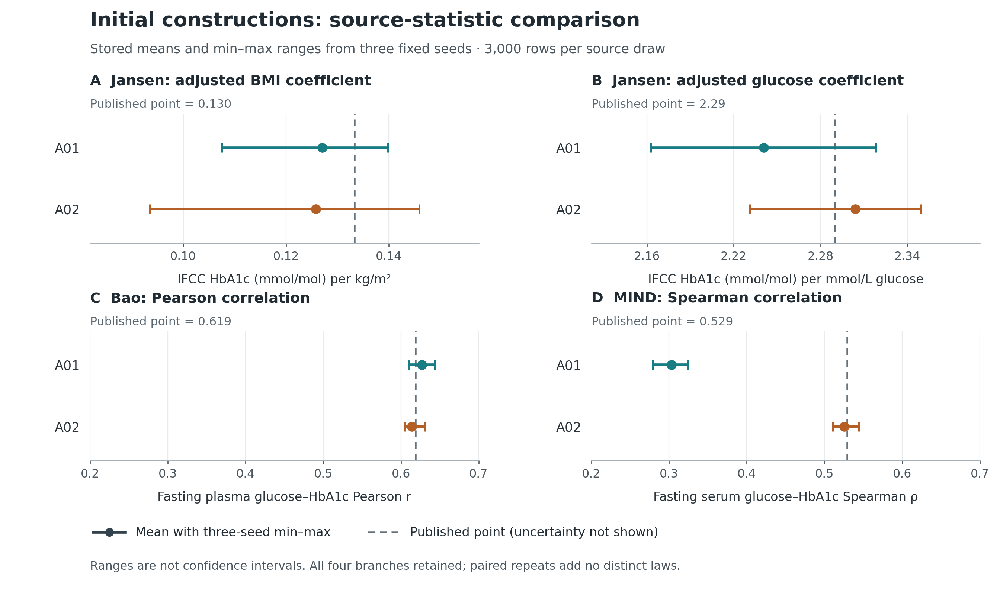
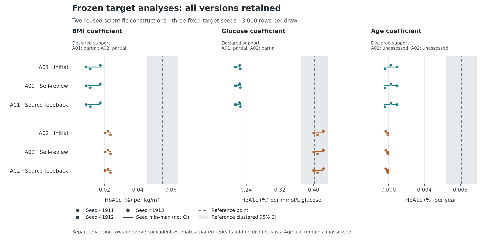

# Complete developmental continuation results — 3 November 2026

The two Agent-authored laws generated whole biomedical cohorts without participant input. The clearest target result is analysis-specific: A02 preserved the adjusted glucose–HbA1c slope near the existing CHNS sample estimate across all three fixed seeds. Both laws retained positive BMI and glucose associations, but BMI effects were too small relative to that sample reference, age associations were not recovered, and marginal/joint discrepancies remained. All four revision authors retained their initial laws; all paired revision contrasts are zero. This unit establishes a limited use profile, not general population recovery, equivalence, or a revision advantage.

Primary and independent numerical evaluation are complete. CHNS is a researcher-exposed developmental reference, not a new independent confirmation. All generation and scientific decisions closed before the frozen evaluator accessed its existing reference aggregates. No reference participant records were redecoded, no new patient data were downloaded, and no target result was returned for revision.

## What was implemented and executed

This is a separately approved technical continuation of the prior pilot, which remains closed with all 72 allocations aborted unrun. It reuses two previously Agent-authored laws, with zero fresh initial scientific constructors. Root repaired only the Jansen native HbA1c alias/conversion metadata; initial generator bytes, scientific specification, evidence, support and analysis declarations stayed unchanged. The exact lineage and allowed deltas were reviewed before execution. Four fresh-context branch authors then made one self-review or source-feedback decision each; all four retained, with no schema return or scientific change in those branches.

The Agent chose the scientific law and parameters. Deterministic tools executed its sampler, translated measurements, calculated source statistics and checked declarations. A01 is an additive glucose-mediated construction; A02 is a shared-factor construction using different Pearson/lognormal and Spearman/copula identities. These are assumed associative joint laws, not identified causal models. Both explicitly assume age/female independence. Source contexts J/B/M and target T use the same respective generator and shared specification with declared context inputs. See [method implementation](METHOD_IMPLEMENTATION.md), [frozen protocol](PROTOCOL.md), and [lineage](LINEAGE.json).

| Role | Successful / planned executions | Rows per table | Virtual row-slots | Distinct output hashes |
|---|---:|---:|---:|---:|
| source | 54 / 54 | 3,000 | 162,000 | 18 |
| target | 18 / 18 | 3,000 | 54,000 | 6 |

All 72 executions succeeded, with no replacement draws. These comprise 24 distinct table hashes, not 72 independent constructions or 216,000 clinical observations. Retained versions repeat the same seed-specific outputs. The statistical construction count remains two. Target reference: 6,631 eligible CHNS participants, with regression uncertainty based on 218 communities. Synthetic rows do not increase that real sample size.

## Source relationships

The table shows initial versions once because all branches retained them. Every source allocation and all 72 comparison records remain in [the independent source audit](source_audit/SOURCE_AUDIT.json). Jansen slopes are on native IFCC HbA1c units; target slopes below are on HbA1c percentage-point units. Source comparisons are qualified equal-weight source-context point comparisons. Unknown original weighting, processing and selection prevent strict source replay; point proximity is not source equivalence.

| Source statistic | Published point | A01 mean [three-seed range] | A02 mean [three-seed range] |
|---|---:|---:|---:|
| J: adjusted BMI slope, IFCC per kg/m² | 0.13 | 0.125256 [0.110623–0.134847] | 0.124338 [0.100054–0.139448] |
| J: adjusted glucose slope, IFCC per mmol/L | 2.29 | 2.24077 [2.16273–2.31832] | 2.30396 [2.23104–2.34914] |
| B: glucose–HbA1c Pearson r | 0.619 | 0.627067 [0.610783–0.64356] | 0.614194 [0.604522–0.631265] |
| M: glucose–HbA1c Spearman rho | 0.529 | 0.302921 [0.279127–0.324378] | 0.525022 [0.510659–0.544056] |

A02's source point estimates are closer on the MIND rank relationship. A01's MIND Spearman range remains materially below its published point; the feedback author saw this and retained the model because it did not consider a unique structural/transport revision justified. A02's feedback author also retained. These decisions do not establish that revision is impossible or that authoring restrictions caused retention. No optimizer, author-side simulation or source-fitting pilot was run.

## All three frozen target analyses

All models include an intercept. E1: HbA1c on age/female/BMI, focal BMI. E2: HbA1c on age/female/glucose, focal glucose. E3: HbA1c on female/BMI/glucose/age, focal age. The reported generated ranges are fixed-seed variation, not confidence intervals. Reference intervals describe sample-estimation uncertainty; they are not equivalence margins or known population truth. No new overall success threshold was introduced.

| Analysis | Reference coefficient [clustered 95% CI] | A01 three-seed range | A02 three-seed range | Declared support, both laws |
|---|---:|---:|---:|---|
| BMI, percentage points per kg/m² | 0.0549461 [0.0457262–0.0641659] | 0.00883353–0.0174093 | 0.0203841–0.0235523 | partial / partial |
| Glucose, percentage points per mmol/L | 0.402093 [0.371286–0.4329] | 0.214105–0.225702 | 0.400343–0.423403 | partial / partial |
| Age, percentage points per year | 0.00810704 [0.00638704–0.00982703] | -0.000421218–0.000951908 | -0.000324176–-0.000112784 | unassessed / unassessed |

A02's three glucose coefficients lie within the existing reference regression interval. This is a useful descriptive agreement for that analysis, not a formal equivalence result. Both BMI profiles remain below the reference coefficient and its interval despite retaining the positive direction. Age is unresolved in A01 and weakly negative in all three A02 draws, while the reference association is positive. Neither law had evidence support for the age analysis; both assumed independence. These observed failures remain main results, not a discarded subset.

All 18 branch/endpoint discrepancy changes (two laws × three endpoints × three paired contrasts) are exactly zero. Initial, self-review and source-feedback versions yield identical seed-specific analyses. This unit provides no revision benefit and does not compare against new statistical or Agent baselines. Per-seed estimates, paired changes and support declarations are retained in [the complete aggregate summary](COMPLETE_AGGREGATE_SUMMARY.json).

## Complete reference-comparable diagnostic profile

All 27 predeclared diagnostics are shown. Since retained versions have byte-identical seed-specific outputs, the table displays one profile per law; the JSON retains every version. Marginal reference values are sample summaries without newly estimated uncertainty. Differences are descriptive sample discrepancies, not estimates of bias against a known population distribution.

| Diagnostic | Reference value | A01 three-seed range | A02 three-seed range |
|---|---:|---:|---:|
| age.mean | 52.7426 | 54.3433–54.7583 | 54.512–54.922 |
| age.sd | 10.4318 | 11.3649–11.6074 | 11.4056–11.5817 |
| age.q10 | 39 | 38–39 | 38–39 |
| age.median | 53 | 55–55 | 55–55 |
| age.q90 | 68 | 70–71 | 70–71 |
| female.mean | 0.536872 | 0.497667–0.509 | 0.487667–0.504667 |
| female.sd | 0.498676 | 0.500002–0.500083 | 0.499931–0.500079 |
| female.q10 | 0 | 0–0 | 0–0 |
| female.median | 1 | 0–1 | 0–1 |
| female.q90 | 1 | 1–1 | 1–1 |
| bmi.mean | 23.6999 | 25.011–25.0297 | 23.7155–23.8417 |
| bmi.sd | 3.40632 | 3.58116–3.67875 | 3.2892–3.4051 |
| bmi.q10 | 19.5312 | 20.9781–21.049 | 19.724–19.7769 |
| bmi.median | 23.424 | 24.3669–24.4687 | 23.4851–23.5672 |
| bmi.q90 | 28.101 | 29.6989–30.0608 | 28.0191–28.3737 |
| glucose.mean | 5.48777 | 5.184–5.24182 | 5.22834–5.24988 |
| glucose.sd | 1.54455 | 1.40184–1.42073 | 0.596902–0.603234 |
| glucose.q10 | 4.419 | 3.5602–3.63724 | 4.49327–4.51335 |
| glucose.median | 5.17 | 4.96787–5.03745 | 5.19957–5.21229 |
| glucose.q90 | 6.579 | 7.08252–7.15188 | 6.0057–6.02661 |
| hba1c.mean | 5.67531 | 6.07385–6.1014 | 5.62623–5.64216 |
| hba1c.sd | 0.953571 | 0.98894–1.01024 | 0.448696–0.462535 |
| hba1c.q10 | 5 | 4.93968–4.947 | 5.04708–5.07925 |
| hba1c.median | 5.5 | 5.93266–5.97877 | 5.59053–5.61588 |
| hba1c.q90 | 6.3 | 7.35692–7.4204 | 6.21653–6.25821 |
| glucose__hba1c.pearson | 0.660968 | 0.30559–0.320589 | 0.533003–0.55239 |
| glucose__hba1c.spearman | 0.361457 | 0.313598–0.32375 | 0.515176–0.531872 |

A02's glucose-slope agreement coexists with substantially narrower glucose and HbA1c variation than this reference and a different Pearson/Spearman profile. Thus reproducing an association coefficient is not sufficient evidence that the same dataset supports every distributional or joint analysis. A01 also retains important marginal/joint discrepancies. This is an observed use-profile contrast; the present two-law experiment does not identify which modeling assumption caused each discrepancy.

The generated-only profile is also retained in full: BMI/glucose/HbA1c q01 and q99, all ten Pearson pairs, exact duplicate-row counts, nonfinite/domain/fractional-age counts, and all fit ranks and condition numbers. These additions have no newly opened reference comparator. All 18 target tables have zero detected invalid rows and exact duplicate rows, and all 54 focal analyses are computable. These are execution/design checks; they do not certify physiological realism, population diversity or inference calibration.

## Verification, limitations and cost

The independent source script recomputed 72 available comparisons with no mismatches; maximum absolute arithmetic difference was 3.331e-16. The separate frozen target evaluator independently recomputed all 18 target profiles, including 54 focal coefficients, 486 reference-comparable diagnostic values, generated-only diagnostics and paired summaries. Its status is matched with zero disagreements. Reference uncertainty was reused from the frozen aggregate, not reestimated. The primary report's original pending field is intentionally unchanged; current verification status comes from the independent completion and report.

All source/target support checks and the reviewed finite-moment laws are retained. Passing a metadata interface cannot certify correct paper extraction, valid transport, or a realistic biomedical population. The construction laws remain assumption-dependent. The independent source report's release_sha256 is the raw release-file byte hash; the controller uses a canonical full-release digest and the approval record uses a review-excluding digest. These are different defined hash scopes, not different scientific releases.

Measured target dispatch wall time across six versions was 4459.530 seconds (74.33 minutes), while their 18 execution-adapter receipts sum to 15.687 seconds. The difference includes repeated verification/orchestration and is not an instrumented CPU breakdown. Global closure, evaluation, earlier sources and author/reviewer time are excluded. Model-token totals were not available. See [cost records](TARGET_EXECUTION_COST.json). This prototype has substantial orchestration overhead; potential reductions were not measured. No time/cost-saving superiority is claimed.

No new original evidence, dataset, initial scientific law, trained model, paid API or HPC job was introduced. The four fresh scientific branch decisions must not be confused with the number of orchestration/review Agent calls. The earlier unrun pilot and all failures remain in the lineage. Public records contain code, original prose, metadata and aggregate results; no individual real/generated tables, full third-party papers or credentials are included.

## Decision for the research direction

Retain evidence-to-whole-cohort generation and numerical study-conditioned evidence translation as the core method under investigation. This unit supports one particularly useful target analysis and directional feasibility for BMI/glucose, with explicit limits. It does not support a general high-quality-data guarantee, a feedback-revision contribution, an overall method ranking, individual measurement recovery, causal conclusions or replacing clinical collection. There is no matched old-versus-new causal comparison of the overall method in this unit.

Close this bounded unit. Preserve both laws and all predeclared outcomes; do not choose a winner by the revealed target, retune CHNS, add seeds, acquire new datasets or expand components here. The method description and complete developmental results are ready for the working draft; broad method superiority and confirmatory claims remain unsupported. A future scientific revision would need a separately specified evidence/assumption gap and evaluation design. Computational overhead can be addressed separately from scientific model choices, after this frozen unit.

Reproduction/inspection: unchanged controller and evaluator modules are bound in RELEASE.json; exact seeds, context operators, support rules, branch packets and review hashes are retained. The public package is an inspection archive, not a self-contained runtime: private row tables and some absolute local bindings are deliberately omitted. Aggregate rendering scripts do not execute generators or create additional scientific analyses.
