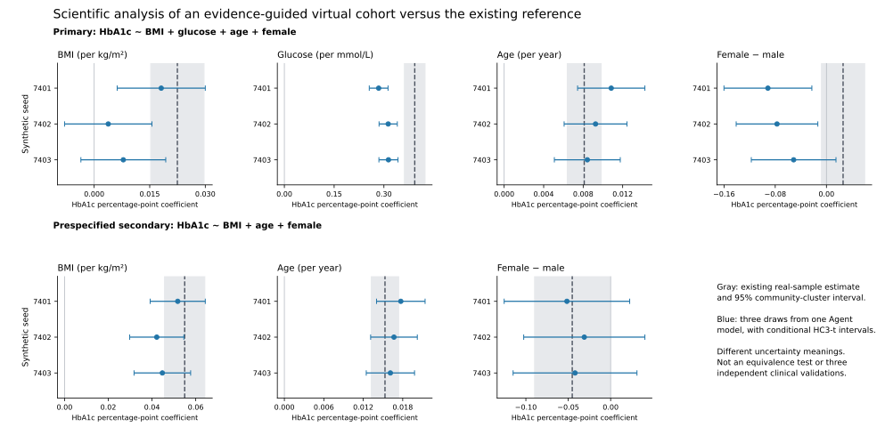

# From reviewed literature to a useful virtual cohort: developmental result

4 November 2026. The autonomous evidence search has now been connected to an actual scientific construction, isolated generation, source/generated-only inspection, an explicit retain decision, and an aggregate comparison with the existing CHNS reference. One Agent-authored model produced three delivered 3,000-person tables plus one trial. Some intended analyses have useful descriptive agreement; the more conditioned analysis and several distributional properties remain incomplete. The result is neither a universal quality claim nor a controlled improvement attributable to search alone.

## What the Agent actually did

The preceding [open-search unit](../gap_search_2026-11-04/RESULTS.md) selected five original studies without a preset bibliography or desired sign. This new constructor received their reviewed evidence, originals and the visible research questions, but no participant observations, target summaries, old generators or target results. It generated the entire six-column table: identifier, age, female indicator, BMI, HbA1c and glucose. The target description was community-dwelling Chinese adults aged 35–74 around 2009 with no diabetes/treatment exclusions; this is a selected analytical population, not a national representation claim.

The Agent chose a sex-stratified Gaussian copula, bounded integer age and positive lognormal/shifted-lognormal margins. It selected Hainan glycaemic summaries and rank associations, Japanese IGT BMI summaries and Pearson associations, and a US age-association magnitude under explicit transport assumptions. It converted Pearson and Spearman evidence using the chosen marginal laws, rather than equating either with a latent Gaussian correlation. It used deterministic moment equations to derive an age dependence and the implied primary and secondary regression coefficients. The root controller supplied no scientific parameter or desired coefficient.

LifeLines and Hoorn conditional estimates were retained with their incompatible adjustment sets rather than copied into the target regression. Missing BMI–glucose and age dependencies remained declared assumptions. Such labels make the construction inspectable; they do not establish that transferring the chosen source relationships is correct.

The generated program samples the records. The Agent authored that program and its numerical specification; this unit did not test direct token-by-token row generation. The host dispatched Agents and coordinated tools. The library does not itself provide a standalone autonomous model launcher or OS isolation of all LLM tools; the generator did execute through the existing WSL/bubblewrap adapter.

## Execution, feedback and independent checks

- One scientific construction; four successful physical executions: trial seed 7400 and delivery seeds 7401–7403. Each table has 3,000 rows. Final retention aliases the three deliveries; it creates no additional table.
- Each execution returned 34 source-check records: **11 approximate target/source comparisons and 23 unavailable checks**. These are not 34 independent validations or reconstructed source populations. All quantities and unavailable reasons are retained.
- The Agent reviewed every scheduled feedback/diagnostic output and retained the frozen model. There was no scientific revision, no favorable-seed selection and no demonstrated revision gain.
- Independent source/code review verified the scientific transformations and finite-moment law. A separate deterministic calculation reproduced the implied projections to numerical precision. The completed independent numerical audit verified every delivery slot and comparison, with zero mismatches (largest numerical difference 8.44 × 10⁻¹⁵). Its final audit is recorded separately from the immutable evaluation report.
- The controller's 15 routing/error checks and five analysis checks passed after review corrections. A feedback failure cannot discard an otherwise valid generated table; closure binds frozen candidates, attempts, outputs and decisions. These implementation checks are not scientific experiments.
- No new patient file was downloaded, decoded or fitted. Only the pinned historical aggregate reference was read after author closure. No new literature searches, training, HPC or paid API calls occurred in this construction unit.

## Scientific analysis results

All ranges below include the three final delivery seeds. Effects are in HbA1c percentage points per unit of the named predictor. The real-sample intervals are previously computed project aggregates for 6,631 selected participants in 218 communities, not known population truth. Seed ranges describe draws from one fixed synthetic law, not uncertainty about source evidence, structure or transport.

| Analysis and term | Existing sample estimate [95% cluster interval] | Generated range | What it supports here |
|---|---:|---:|---|
| Primary: BMI, with glucose/age/sex adjustment | 0.02246 [0.01526, 0.02967] | 0.00380–0.01811 | All point estimates positive, but weaker; two synthetic intervals include zero. |
| Primary: glucose | 0.39291 [0.36175, 0.42406] | 0.28417–0.31368 | Positive relation retained; effect consistently smaller. |
| Primary: age | 0.00811 [0.00639, 0.00983] | 0.00842–0.01084 | Similar positive scale in this comparison. |
| Primary: female | 0.02599 [−0.00776, 0.05974] | −0.09143–−0.05124 | Opposite point direction; real-reference direction itself uncertain. |
| Secondary: BMI, with age/sex adjustment | 0.05495 [0.04573, 0.06417] | 0.04217–0.05176 | Same positive direction and a similar, somewhat smaller scale. |
| Secondary: age | 0.01530 [0.01322, 0.01739] | 0.01613–0.01771 | Similar positive scale. |
| Secondary: female | −0.04530 [−0.08971, −0.00088] | −0.05157–−0.03108 | Point direction/scale similar; all three synthetic intervals include zero. |

All intercepts, conditional intervals, marginals, correlations and raw comparisons are in [the aggregate report](evaluation/REPORT.json). Numerical interval overlap is not an equivalence test. The study did not define a clinical utility threshold, so agreement supports a bounded descriptive use rather than certified downstream adequacy.

The earlier live B construction produced negative glucose-adjusted BMI point estimates. This new model produces positive ones and a more similar age scale, while its glucose coefficient is less similar than that earlier model's. The scientific author, source packet, demographic description, law and seeds changed. This historical contrast cannot isolate the effect of freer search or establish overall superiority.

## Means and SDs do not settle data quality

HbA1c mean/SD look close: generated means 5.688–5.717% and SDs 0.960–0.980, versus sample values 5.675% and 0.954. However, its generated 90th percentile is 6.914–6.955%, versus 6.3%, and its 10th percentile is 4.666–4.694%, versus 5.0%. Glucose also has reasonably similar mean/median but different quantiles. The generated female fraction is 0.635–0.642 versus 0.537; BMI dispersion is smaller.

The generated glucose–HbA1c Pearson correlation is 0.447–0.492 versus 0.661, whereas Spearman is 0.474–0.488 versus 0.361. This illustrates why a few marginal matches or a single correlation cannot certify all analytical uses. These are descriptive differences from one sample, not estimates of error relative to a known population distribution.

## A concrete evidence gap was identified before target evaluation

The Agent's pre-generation mathematical report changed only the unreported latent BMI–glucose correlation from 0.10 to 0.40, holding the other parameters fixed. The implied primary BMI coefficient changes from **+0.03422 to −0.01095**. The secondary regression is unchanged, as are all marginal laws and every other bivariate law. Both covariance structures remain valid. The independent [sensitivity review](SENSITIVITY_REVIEW.json) reproduced this calculation.

This was an analytical check of the declared law, not two additional generated datasets or calibrated uncertainty bounds. It shows exactly which requested analysis depends on an unsupported joint relationship. More synthetic rows cannot supply that information. The selected 0.25 value remains the Agent's explicit assumption, not a learned target parameter or a choice validated by the later reference comparison.

## Decision and next useful work

The chain from autonomous literature discovery to independently reviewed, entirely virtual data is operational. This case supports some ordinary regression uses more convincingly than others. It does not establish complete target-population fidelity, individual recovery, clinical replacement, causal conclusions, universal Agent superiority or a feedback-revision advantage.

Keep this model and all results closed. The next bounded methodological step should use the Agent's analysis sensitivity to identify which **joint relationship or subgroup evidence** needs improvement, with BMI–glucose dependence as the concrete case here. Any further retrieval or new construction needs its own recorded scope; do not fill the missing dependence from the now-revealed target result, increase row counts to conceal uncertainty, or tune this frozen model. A larger empirical claim needs evidence that the workflow works across independently defined requests/references, not more copies of these three draws.

## Artifacts

- [Protocol](PROTOCOL.json), [protocol review](PROTOCOL_REVIEW.md), [state](STATE.json), [author closure](LIVE_CLOSURE.json).
- [Initial scientific/source/code review](INITIAL_CANDIDATE_REVIEW.md), [deterministic math audit](CANDIDATE_MATH_REVIEW.json), [runner review](RUNNER_REVIEW.md).
- [Controller/evaluation implementation](evaluation/IMPLEMENTATION_NOTES.md), [completed independent numerical audit](evaluation/INDEPENDENT_NUMERICAL_REVIEW.md), and [preserved initial audit](evaluation/INDEPENDENT_NUMERICAL_REVIEW.initial.md). The completed audit records final report verification without modifying the evaluation-time pending marker.

Full third-party originals and individual real/generated records remain local. Only reviewed original code, model/evidence metadata, audit records and aggregate outputs are eligible for public synchronization. Manuscript v0.8 and earlier frozen experiments are unchanged.
