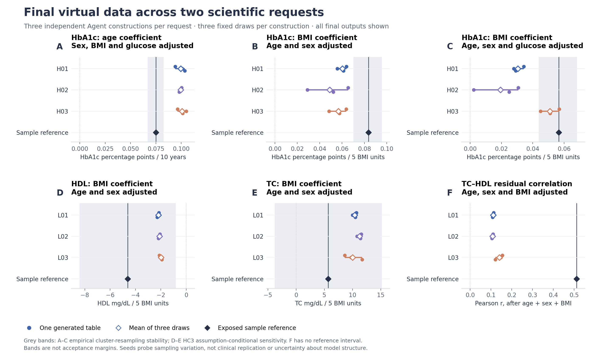
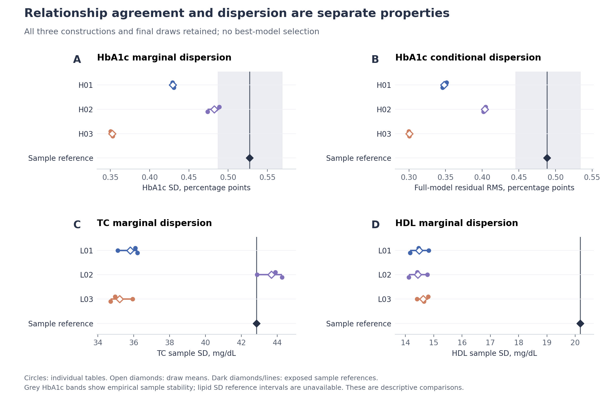

# Evidence use across two scientific requests: completed results

5 November 2026. **Completed, independently recomputed, and closed to further tuning.** This is a developmental capability study using two previously exposed reference families. The final outputs support some requested associational uses qualitatively; quantitative agreement and joint dependence are mixed.

## What was implemented and run

Six fresh-context Agent constructors used the same evidence-use workflow for two requests: HbA1c analyses in the ENSANUT2018 analytical design (H01–H03) and measured TC/HDL analyses in the Turkana study context (L01–L03). Each received the research questions, population/measurement metadata, reviewed external articles and task-bound optional literature tools. No participant-level input, target effect, target mean or prior generator was supplied. Both reference cohorts were already exposed at project level; fresh constructor contexts do not create new clinical confirmation.

The Agent selected the scientific joint law and its parameters. The root controller did not prescribe target-valued relationships. An additive evidence-use interface bound relationship, dispersion, scenario, check-only and retained-assumption decisions to actual specification paths, evidence IDs and artifacts. Independent review checked statistical meaning, code/specification consistency and finite moments. These checks verify implementation and traceability, not transport validity.

H01 used bounded predictors, conditionally truncated glucose and a shifted gamma HbA1c innovation. H02 used bounded beta conditional laws. H03 solved explicitly assumed cross-source moment equations and used conditional beta laws, distinguishing marginal from residual variance. The lipid authors used Gaussian-copula/lognormal laws with different choices about source geometric location, arithmetic moments, CV transfer and age dependence. These are Agent-selected applications of established statistical constructions, not new probability families.

All six passed the scheduled initial isolated trial, received their own generated diagnostics and semantic-feedback report, and independently chose to retain the initial model. Each frozen final model then generated three 3,000-row tables at seeds 9101–9103. No scientific revision was forced, no final seed was replaced, and no construction was selected using target results. The outputs were evaluated only after all six author sessions closed.

| Actual inventory | Count |
|---|---:|
| Requests / exposed reference families | 2 |
| Fresh Agent constructions | 6 |
| Initial trials | 6 |
| Revision trials / scientific revisions | 0 / 0 |
| Final tables / distinct table hashes | 18 / 18 |
| Final fictional rows, not new clinical observations | 54,000 |
| Physical generator attempts / successful attempts | 24 / 24 |
| Primary estimate outputs | 54 |
| All prespecified generated estimates and diagnostics | 513 |
| Matched reference comparisons / generated-only diagnostics | 324 / 189 |
| New patient-data downloads or reference refits | 0 |

Six constructions share a model service, workflow and overlapping sources; eighteen seeded tables are not eighteen clinical replications. The study did not compare workflow policies, demonstrate retrieval benefits or rank against bespoke statistical generators.

## Final scientific analyses

Entries below are the mean of three fixed draws. Every draw and native-unit difference is retained in [PRIMARY_SUMMARY.csv](evaluation/PRIMARY_SUMMARY.csv) and [ALL_ENDPOINTS.csv](evaluation/ALL_ENDPOINTS.csv). Reference estimates describe the existing selected samples, not known population truth.

| HbA1c analysis | Sample reference | H01 | H02 | H03 |
|---|---:|---:|---:|---:|
| Age, adjusted for sex/BMI/glucose, percentage points per 10 years | 0.07513 | 0.09954 | 0.09954 | 0.10091 |
| BMI, adjusted for age/sex, percentage points per 5 BMI units | 0.08364 | 0.06030 | 0.04892 | 0.05665 |
| BMI, additionally glucose-adjusted, same units | 0.05664 | 0.03047 | 0.01936 | 0.05098 |

| Lipid analysis | Sample reference | L01 | L02 | L03 |
|---|---:|---:|---:|---:|
| HDL BMI coefficient, age/sex-adjusted, mg/dL per 5 BMI units | -4.6230 | -2.1865 | -2.1004 | -1.9868 |
| TC BMI coefficient, age/sex-adjusted, same units | 5.6831 | 10.3940 | 11.2609 | 10.0151 |
| TC–HDL Pearson correlation after removing age/sex/BMI projections | 0.51207 | 0.11123 | 0.10828 | 0.14134 |

All 54 primary point estimates have the same direction as their sample references. This is six requested relationships evaluated across constructions and seeds, not 54 independent scientific confirmations. The TC–BMI reference sensitivity interval spans zero (-3.7535 to 15.1197); agreement with its positive point estimate does not reproduce a securely established positive population effect. The HbA1c reference bands are empirical cluster-resampling stability bands; the two lipid slope bands are HC3 assumption-conditional sensitivity intervals. None is a fitted acceptance margin or a proof of equivalence. A residual-correlation reference interval is unavailable.

H03's glucose-adjusted BMI effect is descriptively closer to the sample reference, while H01/H02 give smaller effects. The common age effects remain above the sample reference and the reduced BMI effects below it. All lipid constructions support a negative HDL–BMI coefficient and positive TC point coefficient, with different magnitudes from the sample. Their residual TC–HDL association is much weaker. Consequently, preserving the directions of several regressions does not demonstrate recovery of their complete joint distribution.

## Dispersion and the absence of a universal winner

| Diagnostic, mean over three draws | Sample reference | Construction 1 | Construction 2 | Construction 3 |
|---|---:|---:|---:|---:|
| HbA1c marginal SD, percentage points | 0.5274 | 0.4295 | 0.4825 | 0.3523 |
| HbA1c full-model residual RMS, percentage points | 0.4885 | 0.3480 | 0.4036 | 0.3006 |
| TC sample SD, mg/dL | 42.8466 | 35.7987 | 43.6778 | 35.2061 |
| HDL sample SD, mg/dL | 20.1756 | 14.4838 | 14.4367 | 14.6239 |

H03 is closer on one adjusted BMI effect but substantially narrower in HbA1c dispersion. H02 retains more HbA1c variation but has smaller BMI effects. L02's TC SD is close to the reference while its adjusted residual association remains weak. These are descriptive trade-offs between independently selected laws. They do not establish that a particular component caused improvement or deterioration, and no best constructor is promoted as the method's headline result.

## Evidence use, feedback and costs

The candidate evidence records cite eight distinct original studies across 22 author–paper uses, including context/check-only evidence. Repeated use is not independent corroboration. The admitted glycemia packet was reused; lipid admission reviewed two additional originals. Constructors used seven actual gateway query credits and one original download in total (H01 four queries/one download, H03 three queries, others zero); two auxiliary requests and one failed HTTP attempt are retained. This is a curated-source-plus-optional-retrieval experiment, not an end-to-end retrieval benchmark.

There were 132 declared source-check entries across authors. All remained unavailable because weighted, insufficiently specified or unsupported source operators were not replaced with different statistics. Numerical source values still informed generator parameters through reviewed algebra and explicitly named assumptions. However, this batch has **no measured numerical source-fit feedback** and **no demonstrated revision gain**. Successful generated-only checks and unchanged retention do not fill that evidence gap.

The execution receipts record 35.83 seconds total adapter wall time across 24 attempts, including setup/validation. This excludes Agent reasoning, literature work, reviews and reporting and is not an end-to-end efficiency estimate. Tokens and monetary costs were not comprehensively measured. No training, HPC or new paid API was used.

## Independent verification and retained failures

The [independent numerical review](review/INDEPENDENT_NUMERICAL_REVIEW.md) reconstructed all 513 values using a separate CSV parser, QR-based regression and independently implemented moments/quantiles. It verified all 18 slots, table hashes, 324 available reference mappings, comparison arithmetic and summaries. Maximum numerical difference was 5.33e-14 at predeclared tolerance; no discrepancy was found.

The first independent audit incorrectly expected the HbA1c identifier `id`; its task uses `row_id`. The original audit script and failed attempt remain preserved. Correcting only that audit parser yielded the full pass without regenerating data, changing scientific formulas/tolerances, or modifying frozen/evaluation artifacts. Constructor and reviewer static-schema failures are also retained in their original logs. The first figure render clipped a long title; only plot labels/layout were corrected and the final PNGs were visually inspected.

This rules out the inspected implementation/arithmetic defects as explanations of this batch's observed discrepancies. It does not isolate whether the remaining scientific discrepancies arise from evidence sufficiency, transport, model-family assumptions, source extraction uncertainty or their interactions; no controlled attribution experiment was run.

## Decision and contribution

**Close this batch; continue the method/manuscript with narrower empirical claims.** Keep whole-cohort generation, enrichment and completion in the general method definition. This experiment specifically demonstrates whole-cohort construction without participant inputs across two biomedical requests, explicit numerical use of heterogeneous source evidence, finite-moment implementations, and analysis-specific inspection of the final data.

The [independent scientific review](review/SCIENTIFIC_RESULT_INTERPRETATION.md) recommends simplifying the demonstrated use to transparent, assumption-dependent scenario data. The root adopts that limit on these outputs, not as a permanent restriction of the research objective. Current outputs can support qualitative association exploration and analytical workflow inspection for the tested requests. Quantitative target-cohort substitution, individual recovery, calibrated design/power conclusions and general joint-distribution fidelity are not established.

Freeze this unit's scientific conclusions and use all constructions in a cross-task manuscript section. Do not retune the exposed samples, select H03 as a universal winner, or add more seeds to turn a narrow scenario into validation. Any later stronger transport or quantitative-utility claim requires its own prospective evidence and validation design. Existing main-study results and archived manuscript bytes remain intact.

Reproducibility: [protocol](PROTOCOL.json), [closure](BATCH_CLOSURE.json), [complete evaluation](evaluation/RESULTS.json), [evidence usage](evaluation/EVIDENCE_USAGE_SUMMARY.json), and [manuscript insert](../../manuscript/CROSS_TASK_RESULTS_INSERT_2026-11-05.md). Participant and generated tables and complete third-party articles remain local.
