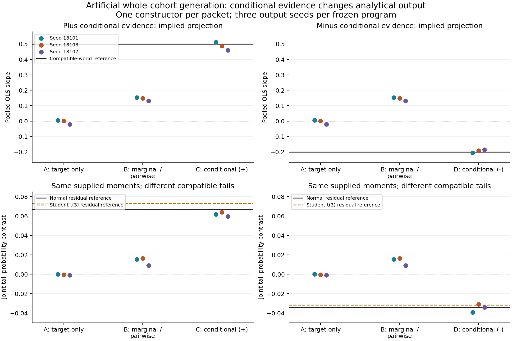

# Conditional evidence changes whole-cohort generation, while tails remain unresolved

Completed 1 November 2026, America/Chicago (execution receipts use 2 November UTC). **Retain evidence-to-virtual-data as the research objective; close this artificial pilot without further generation.** A concrete evidence-translation check succeeded. It does not establish a new clinical result, a new synthesis algorithm, or an effective feedback-revision policy.

Four fresh-context Agents independently authored generators, one per evidence packet. Their twelve frozen outputs all executed successfully, with 3,000 fictional rows per table. Adding group-conditional evidence changed the generated target relationship in the appropriate opposite directions. All three planned seed comparisons met the prespecified translation criterion. Independent recomputation of **1,710 numerical fields** agreed to a maximum absolute difference of **1.33e-15**.

## Why this test follows CHNS

The completed CHNS whole-cohort case retained three association directions, but effect magnitudes and variability differed from the measured sample; neither Agent revised its generator. Many numerical choices remained assumptions. That result did not distinguish whether an Agent could use informative conditional evidence from whether the available biomedical evidence justified its chosen joint structure.

This smaller, artificial experiment isolates a concrete information contrast. It is not another clinical target and does not reopen CHNS. Earlier C4 already illustrated partial-moment nonidentification; the additional check here is an Agent's response to opposite conditional evidence under a change in group composition. No new selector, reviewer hierarchy, training procedure or revision component was added.

## What was supplied, constructed and withheld

The fictional variables are binary group `g`, continuous `x` and `y`, and a meaningless row identifier. All four tasks require complete-cohort generation with **no individual input**. Source group probability is 0.5; target probability is 0.75. Transport of the within-group joint laws is stipulated. Those simplifying transport assumptions are part of this artificial task, not established facts about human populations.

| Packet | Available relationship evidence | Agent's actual completion |
|---|---|---|
| A / T0 | None; target description only | Independent standard-normal x and y, independent of group; declared prior scenario |
| B / T1 | Nine source marginal/pairwise quantities | Group means plus a common x slope of 0.15; Gaussian completion with equal conditional covariance structure |
| C / T2plus | Same nine quantities, plus ten group-conditional quantities | Group-specific slopes -0.55 and 0.85, residual SD 0.8; Gaussian x/residual assumptions |
| D / T2minus | Same nine quantities, opposite conditional assignment | Group-specific slopes 0.85 and -0.55, residual SD 0.8; Gaussian x/residual assumptions |

Each scientific structure, parameter and distribution assumption was selected and documented by its constructor from its own packet. The coordinator did not write target coefficients into the candidates. Agents authored Python programs; the isolated runtime sampled their rows. This is Agent-authored programmatic generation, not direct row authorship.

The same constructor prompt and interface were used in four fresh contexts. Builders had no sibling candidates, target numerical answers, prior project results, browser access or trial generation. A custodian committed two sign worlds and two residual laws per sign before construction; an independent reviewer verified the source equivalences and target mathematics. The coordinator opened the numerical reference only after all candidates and all twelve outputs were frozen. These are procedural information boundaries in a shared filesystem, not a claim of hardware-enforced Agent isolation or unknown pretraining exposure.

One authoring turn per packet, zero numerical-feedback/revision rounds and three output seeds were allowed. All four candidates passed independent static review without scientific or interface changes. Corrected metadata-check invocation errors, where recorded by the constructors, remain in their artifacts. No generator was run before freeze, and no additional output was produced after evaluation. No source-feedback-v1 revision benefit is claimed: this pilot deliberately contains no feedback round.

## The committed artificial laws, now disclosed

Let g be Bernoulli(p), x standard normal independent of g, and e independent with mean zero and variance one. The two conditional laws are:

`y = 0.4 + 0.6*g + [0.15 +/- 0.7*(2*g - 1)]*x + 0.8*e`.

Both source worlds at p=0.5 share every T1 quantity: mean(y)=0.7, variance(y)=1.2425, covariance(x,y)=0.15, covariance(g,y)=0.15, covariance(g,x)=0, and the same g/x moments. At target p=0.75, the pooled coefficient in `y ~ 1 + x` is **0.50** in the plus world and **-0.20** in the minus world. These are **known artificial population values**, unlike a real sample estimate.

For T2, the target coefficient follows algebraically from the supplied conditional summaries and transport assumption. Its recovery tests translation into an executable joint generator, not discovery of an unknown relation. Independent static moment recombination established that B's law matches its nine supplied quantities and C/D match their nineteen, before any sampled table was inspected.

## All twelve primary and unreported-tail outputs

The primary analysis is pooled unweighted OLS, with an intercept and **without adjustment for g**. The separate tail use is `P(x>1, y>2) - P(x<-1, y>2)`.

| Packet | Seed | Target slope | Tail contrast |
|---|---:|---:|---:|
| A | 18101 | 0.005147 | 0.000000 |
| A | 18103 | 0.001005 | -0.000333 |
| A | 18107 | -0.021284 | -0.001000 |
| B | 18101 | 0.152607 | 0.015333 |
| B | 18103 | 0.148521 | 0.016333 |
| B | 18107 | 0.131305 | 0.009000 |
| C | 18101 | 0.512534 | 0.061667 |
| C | 18103 | 0.488196 | 0.064000 |
| C | 18107 | 0.459489 | 0.059667 |
| D | 18101 | -0.204531 | -0.039333 |
| D | 18103 | -0.191083 | -0.031000 |
| D | 18107 | -0.185607 | -0.034000 |

C's slope absolute errors are 0.0118–0.0405, compared with B's 0.3474–0.3687 in the plus world. D's are 0.0045–0.0144, compared with B's 0.3313–0.3526 in the minus world. Both conditional completions are closer than B at **each** planned seed label, and both follow the expected sign change. The C-minus-D differences are 0.7171, 0.6793 and 0.6451, against the implied difference 0.70. This satisfies the prospective concrete-example criterion; no post-result accuracy margin was introduced.

A useful adverse result also remains: in the minus world, B is farther from the target slope than A. More supplied marginal information did not guarantee better transfer under B's chosen unreported dependence assumptions. This is a comparison of these particular constructions, not a causal estimate that adding evidence generally hurts.

Source checks recombine generated within-group first/second moments with **equal source group weights**. They are not unweighted target statistics relabelled as source replay, and no extra source tables were generated. All sample discrepancies, conditional regressions and 36 compatible-world comparisons are retained in [the full report](evaluation/REPORT.json) and [the endpoint table](evaluation/ALL_ENDPOINT_COMPARISONS.csv). A has no numerical source-compliance claim. For A/B, conditional comparisons are against withheld reference quantities; for C/D, they are supplied-evidence compliance.

## Matching these constraints does not identify the tail use

The custodian allowed either normal errors or Student-t(3)/sqrt(3) errors. Both have the same conditional mean and variance, and preserve every supplied T2 quantity. They imply different tail contrasts:

| Sign world | Normal residual | Standardized Student-t(3) residual |
|---|---:|---:|
| Plus | 0.066966 | 0.073304 |
| Minus | -0.034322 | -0.031626 |

The Agents all selected Gaussian completion. C's three tail estimates are below both compatible references; D's estimates fall on different sides across seeds. We do not select a favored residual world or attach probability weights to them. The two worlds establish nonidentification, **not a complete identification interval**: additional distributions and dependence structures may also match the packet. Three 3,000-row draws do not constitute a test capable of selecting the residual family. Increasing generated row count would reduce simulation noise around the assumed law; it would not identify the absent tail structure.

The tail differences here are numerically modest. We make no clinical-importance claim. The point is a mathematical compatibility result, not a claim that all threshold analyses fail. Student-t(3) has infinite fourth moment; no calibrated uncertainty interval for its variance or for the generated analyses is asserted.

## Independent checks and actual cost

The pre-execution reviewer independently checked the artificial source equivalences, composition algebra and deterministic tail integration, without importing the custodian's implementation. The post-run reviewer independently fitted pooled/within-group regressions, used direct per-row source reweighting, counted tail events, and recomputed all signed/absolute reference differences. It verified input, engine, candidate, output and receipt bindings. [The post-run audit](review/postrun/RESULT.json) reports 1,710 numerical comparisons with zero discrepancies at numerical tolerance 1e-12. This is arithmetic agreement, not a scientific equivalence tolerance.

There were four scientific constructions, twelve successful slots, twelve unique tables and 36,000 artificial rows; none are patients or independent clinical replications. Execution receipts total **8.439 seconds** (excluding authoring, review and orchestration). Agent model override was absent; exact model, temperature, tokens and dollar costs were not exposed by the dispatch interface. No new data download, original-study review, training, HPC job, paid API or clinical case was used. The prior CHNS automation remains paused.

## Implication for the core method and paper

This unit supports an operational capability: an Agent can translate applicable conditional summaries and a specified composition shift into reusable whole-cohort data. It also provides a controlled example of why fitting overall correlations alone is insufficient. This does **not** make that statistical fact or the linear/Gaussian construction novel. One constructor per packet confounds information changes with author variation; three seeds are conditional simulation repeats, not three independent Agents.

The next defensible methodological target is to determine which desired analyses have sufficient applicable evidence, obtain the specific missing conditional evidence where possible, and expose the remaining assumptions. The product remains a virtual dataset usable for several analyses. An analysis-support declaration accompanies that product; it does not replace generation with a single analytical answer.

For a subsequent, separately authorized biomedical test, the discriminating contrast would keep the target specification fixed, compare a source-marginal packet with a source-conditional extension, and evaluate the same frozen data across at least one transferable association and one uncalibrated use. Any new-source search and fresh target need their own admission/budget; no old CHNS target or quota is reopened here. A claim of improving generation beyond existing statistical methods would also require an appropriate same-information generator comparison. An ordinary Agent remains a valid implementation, and this pilot does not create a requirement to beat another Agent.

The present paper can report **selected biomedical analytical feasibility, an inspectable evidence-to-generation procedure, and this bounded evidence-responsiveness example**, alongside its failures. It cannot yet claim reliable arbitrary-variable synthesis, calibrated uncertainty, effective autonomous revision, general method superiority or replacement of patient measurements. Further toys or architectural components would not close those gaps. This unit is complete; no extra seed, case or automatic continuation is started.
