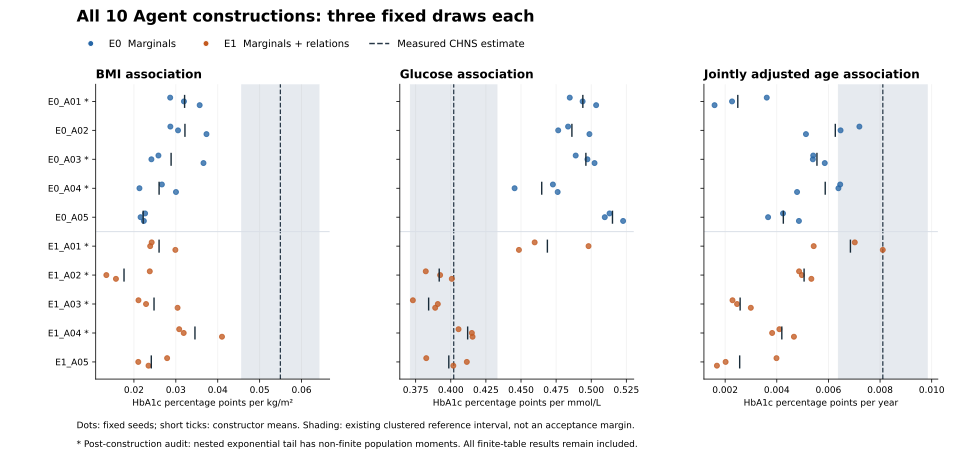

# CHNS existing-data information experiment: completed results

**A partial glucose-analysis gain was observed, but the prespecified overall improvement condition failed.** All 30 frozen target draws completed and all 90 focal coefficients were independently recomputed. A separate static audit identified a serious population-tail defect in seven generated laws. No model was repaired, replaced or excluded after results were seen.

## What actually ran

Ten fresh-context scientific Agent constructors authored executable whole-cohort laws, five per arm. They received no participant observations and no CHNS numerical results. E0 contained three source contexts and 15 grouped marginal records. E1 added four reviewed relationships to that identical base: two separate Jansen adjusted projections, Bao Pearson and MIND Spearman. Both arms received the same target task, unit guidance and interface. Each author chose its own structure, parameters and assumptions.

Each frozen law generated 3,000 rows at seeds 1701, 1702 and 1703 in the existing isolated runtime: **30 tables and 90,000 virtual rows**. These are Monte Carlo draws from ten constructions, not 30 independent clinical cohorts. There were zero technical correction returns, zero execution failures, zero scientific revisions and no new downloads, patient-reference redecoding, training, HPC or new paid API. Model-version/temperature and LLM token/dollar metering were not exposed by the authoring API.

All outputs closed before the new comparison. CHNS was already exposed to the researchers and was selected with historical results known. Its existing measured-reference analysis includes 6,631 eligible records and 218 communities. These are sample estimates with uncertainty, not known population truths. Fresh author contexts and procedural access restrictions do not erase coordinator exposure or a model's possible pretrained biomedical knowledge.

## Prespecified scientific comparisons

Every regression includes an intercept. The BMI and glucose analyses adjust age and female category separately; the age analysis jointly adjusts female category, BMI and glucose. The summary is **mean absolute discrepancy across the three seeds within each constructor, then the mean over five constructors per arm**. It is not absolute error after averaging signed estimates.

| Analysis | Measured reference | E0 mean absolute discrepancy | E1 mean absolute discrepancy | E1 − E0 |
|---|---:|---:|---:|---:|
| BMI association | 0.054946 | 0.026675 | 0.029517 | +0.002842 |
| Glucose association | 0.402093 | 0.089177 | 0.022901 | -0.066276 |
| Jointly adjusted age association | 0.008107 | 0.003219 | 0.003858 | +0.000639 |

Units are HbA1c percentage points per kg/m², per mmol/L and per year, respectively. Lower discrepancy is better. Glucose discrepancy fell **74.3%**; BMI discrepancy rose **10.7%** and age discrepancy rose **19.8%**. Both addressed projections had to improve; that fixed condition is **false**. The same contrast directions hold at both endpoints of each existing reference interval. This endpoint sensitivity does not establish robustness throughout an interval, equivalence or generalization.

All 90 finite-table slopes are positive, matching the measured-reference directions. The authors also explicitly assumed positive physiological dependencies, so direction agreement alone is weak evidence of new joint recovery. For glucose, 12/15 E1 estimates lie inside the existing reference interval, versus 0/15 E0; for BMI the counts are 0/15 in both arms; for age they are 2/15 and 3/15. These descriptive interval memberships are not equivalence tests or calibrated synthetic uncertainty.

## What the implementation audit found

The Agent made substantive scientific generation choices: demographic distributions, BMI response, latent glycemia, mixture frequency, residual dependence and tails. The coordinator did not install desired slopes. However, the additional evidence usually influenced narrative and qualitative structure rather than numerically constraining source analyses. The independent, outcome-blind audit found **19/20 author-by-relationship uses qualitative-only**. E1_A01 used MIND 0.529 through an assumed copula conversion and attenuation, then reassigned it to conditional log residuals; this did not enforce the reported marginal Spearman relationship. None of the five E1 models numerically enforced either Jansen adjusted projection.

All ten constructions use variants of a demographic/BMI hierarchy with a shared glycemic mixture or tail. There are genuine differences in age laws, saturated versus raw/log BMI predictors, and additive versus multiplicative gamma/lognormal tails, but this is limited structural diversity. E0 also has pretrained biomedical priors and explicitly assumed positive dependencies. Thus the experiment describes the effect of supplying the extra records in this bounded authoring procedure; it does not isolate exact numerical evidence fitting or prove broad superiority over a conventional generator.

### A concrete scientific generator defect

Seven frozen laws generate nondegenerate, unbounded lognormal BMI and then exponentiate a strictly positive linear function of raw BMI for glucose and HbA1c. For such B, E[exp(cB)] diverges for every c>0. Consequently these declared population laws do not have the ordinary finite biomarker moments required for population-moment and OLS interpretations. The affected laws are E0_A01/A03/A04 and E1_A01/A02/A03/A04.

This was discovered by static code/specification audit after construction and independently confirmed. It is a mathematical tail defect, **not an observed overflow or failure of finite-table least squares**. The three 3,000-row draws per law did not reveal it through runtime checks. E0_A02's bounded tanh driver and E0_A05/E1_A05's log-BMI drivers avoid this particular defect; that does not independently validate those three models. All ten remain in the original denominator. No survivor-only analysis or revised success rule is substituted.

Other prespecified diagnostics reinforce the distinction between selected-analysis agreement and full joint fidelity: the measured HbA1c sample SD is 0.954 percentage points, while the E1 finite-table SDs range from 0.561 to 0.861. Measured glucose/HbA1c Spearman is 0.361; E1 values range from 0.499 to 0.585. A close adjusted glucose slope therefore does not establish recovery of the joint distribution. These sample summaries have their own uncertainty; their discrepancies are not automatically population biases.

## Verification and decision

Independent CSV parsing and QR solves reproduced all 90 focal coefficients and the per-seed, constructor, arm and reference-endpoint arithmetic: **790 checks, zero mismatches**, with no generator reruns and no patient-row reads. The primary immutable report's initial verification-pending field is superseded by the separate bound [verification receipt](INDEPENDENT_RECOMPUTATION.json) and [review](RESULTS_REVIEW.md). [All aggregate results](PUBLIC_RESULTS.json) retain every constructor, seed and diagnostic. [The construction audit](CONSTRUCTION_EVIDENCE_AUDIT.md) records evidence use and tail mathematics.

**Continue focused method development; do not freeze the current scientific generator strategy for a manuscript.** The useful finding is a sizeable, bounded glucose-analysis gain together with precise reasons the broader claim is not yet supported. The next framework change should require the Agent to distinguish numerical source constraints from qualitative context and unsupported assumptions, and should check whether the chosen distributional composition admits the moments required by the intended analyses. Appropriate source-statistic feedback must replay the source population/measurement/operator, not quietly calibrate to the already revealed CHNS target.

No additional dataset or larger virtual n is the next bottleneck. Do not run more copies of this frozen design or hand-adjust BMI/age coefficients to the known CHNS results. A separately frozen developmental comparison can test one source-evidence/analytic-validity revision on existing data, preserve both gains and trade-offs, and then assess reuse under unchanged rules in another already available benchmark. This report does not authorize or start that next experiment.
