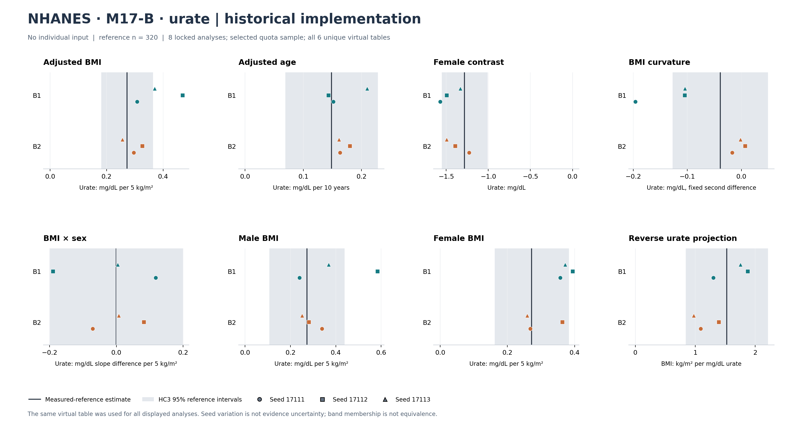
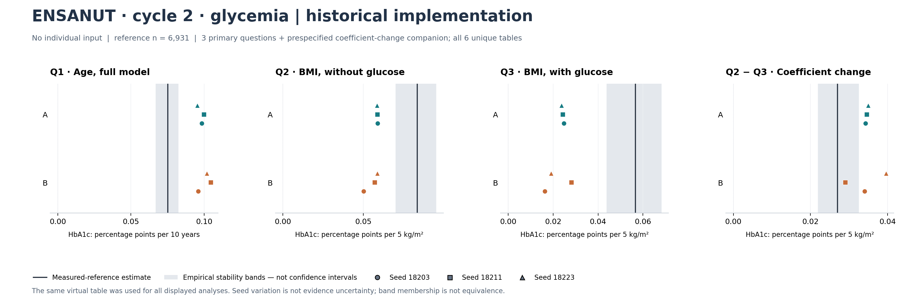
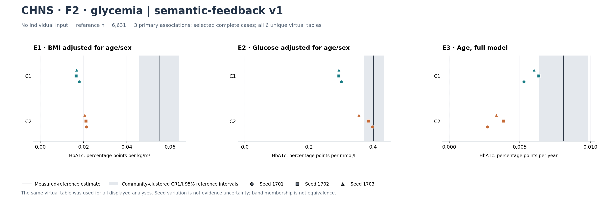

# Existing evidence atlas: virtual data for multiple scientific analyses

2 November 2026. **This release reorganizes completed results; it adds no new biomedical experiment.** It implements the user's request to use the acquired data fully and make the method contribution visible. The [data-use matrix](DATA_USE_MATRIX.md) assigns the broader collection to specific manuscript claims, supporting analyses and prospective gaps.

The central result to communicate is that published evidence and a population description can be turned into a complete virtual table, which can then be analysed in several ordinary ways. No individual input was supplied to the constructors in these three cases. The results show selected analytical feasibility alongside substantial quantitative failures. They do not establish that virtual measurements can replace real measurements or that feedback generally improves generation.

## What was actually assembled

Four frozen aggregate/inventory JSON files were read, with their original SHA-256 commitments checked before and after extraction. The atlas retains all eight locked M17-B analyses, all three ENSANUT primary questions and its predeclared coefficient-change companion, and all three CHNS primary associations. Every constructor and seed is shown. Initial/final copies are counted once when their bytes and estimates are identical.

| Completed case | Implementation context | Measured reference observations | Independent constructions | Unique virtual tables | Rows per table | Displayed analytical quantities |
|---|---|---:|---:|---:|---:|---:|
| NHANES M17-B, urate | Historical whole-cohort implementation | 320 | 2 | 6 | 320 | 8 locked analyses |
| ENSANUT cycle 2, glycemia | Historical whole-cohort/source-context implementation | 6,931 | 2 | 6 | 2,000 | 3 primary + 1 predeclared companion |
| CHNS F2, glycemia | Whole-cohort implementation with semantic feedback v1 | 6,631 | 2 | 6 | 3,000 | 3 primary |
| **Descriptive inventory** | **Different versions; no pooled performance score** | **13,882 case observations** | **6** | **18** | **31,920 virtual rows total** | **15 case-specific quantities** |

There are **90 existing generated point estimates**, not 90 experiments. The 36 initial/final stage labels represent 18 unique tables. Extra synthetic rows do not add independent observed information. These three cases are not a common-protocol test of one unchanged method; the earlier cases are historical supporting evidence for the current method paper.

## Reading the complete analytical panels

Each marker is an already evaluated estimate from one frozen table. Shape identifies a fixed seed, colour/row a constructor. Every table in a case was used for every displayed analysis in that case, without analysis-specific regeneration. This is computational reuse; scientific usefulness must be judged separately for each relationship and intended use. **The subtitle's "No individual input" refers to generation**: the original reference analyses did use measured participant records, and this atlas only reads their frozen aggregate results.

Black lines show the measured-sample estimates, not known population truths. Grey regions have different meanings across cases and must not be pooled or interpreted as equivalence margins. Seed-to-seed spread describes conditional simulation variation, not uncertainty in the published evidence, chosen model or population transport.

### NHANES M17-B: urate



All six tables preserve positive adjusted BMI and age associations and a negative female contrast. Forward and reverse projections, subgroup slopes and nonlinear/interaction quantities expose differences between constructions. The measured reference's curvature and interaction intervals span zero; they are not established nonzero population effects. Effect magnitudes and BMI distributions remain imperfect. Both authors retained their original models.

The reference is a selected 320-person quota sample; the HC3 intervals do not represent national survey inference. See the [full M17-B results and diagnostics](../m17b_whole_cohort_2026-10-31/custodian/results/RESULTS_SUMMARY.md) and [reference interpretation](../../docs/M17B_REFERENCE_INTERPRETATION.md). The curvature value is the already evaluated fixed second difference; no additional factor of two was applied.

### ENSANUT cycle 2: glycemia



Age and BMI directions are positive, and adjustment for glucose reduces the BMI coefficient in each virtual table. The age coefficients are too large and BMI coefficients too small relative to the finite measured-reference estimates; HbA1c variability is also too narrow. The coefficient change is descriptive, not evidence of causal mediation. Both authors retained their original models.

Grey regions are **empirical cluster-resampling stability bands, not confidence intervals**. The reference is an age/sex-standardized eligible analytical population, not a national population estimate. The main panel must be read alongside [all 31 endpoints and diagnostics](../autonomous_research_cycle2_2026-10-31/results_report/APPENDIX_ALL_ENDPOINTS.md), [all source checks](../autonomous_research_cycle2_2026-10-31/results_report/APPENDIX_ALL_SOURCE_CHECKS.md) and the [complete report](../autonomous_research_cycle2_2026-10-31/results_report/REPORT.md), including its secondary glucose analysis.

### CHNS F2: glycemia



All six tables reproduce the positive directions of the three selected associations. The BMI association is substantially attenuated; glucose and age agreement varies by construction. The existing case report estimates BMI effects at about 30–39% of the measured-reference coefficient and records insufficient variability. Both authors retained their original models. Accordingly, the final-stage labels do not demonstrate successful repair.

Reference intervals use community-clustered CR1/t uncertainty for the selected complete-case sample. Read the [case results](../chns_admission_2026-11-01/f2/CASE_RESULTS.md), [complete aggregate evaluation](../chns_admission_2026-11-01/f2/evaluation_results/REPORT.json), and [completed independent arithmetic review](../chns_admission_2026-11-01/f2/independent_results/REPORT.json). Historical pending-audit metadata in the first evaluation file is superseded by the later independent review, not silently overwritten.

## How to make the actual method visible

The paper should connect concrete scientific construction decisions to the shared data product, rather than treat Agent orchestration as the contribution by itself.

| Existing method operation | What it demonstrates | Assumption or boundary that stays explicit |
|---|---|---|
| M17-B translated published BMI-on-urate evidence using a covariance identity | Reported regression direction and statistical meaning affect construction; a coefficient cannot simply be inverted | This is established algebra, not a new statistical identity; the joint law and its transfer are modelling assumptions |
| ENSANUT used one construction under source and target contexts, with fixed approximate source checks | Source-side evidence consistency and target-side analytical use are separate operations | Source contexts approximate published populations; agreement with their summaries does not identify every target relationship |
| CHNS used Agent-authored conditional-lognormal and mixture structures, with declared semantic checks and proxy status | The Agent makes substantive scientific structure choices; the deterministic harness executes and checks declared operations | Semantic feedback v1 checks declared consistency, not the truth of extraction or population transport; task-population proxies are not exact source replay |
| All three cases used the same frozen release for multiple regressions/contrasts | Data, rather than a list of individually predicted answers, is the reusable deliverable | The examples show partial analytical feasibility; magnitude failures, inadequate dispersion and absent repair gain remain main Results |

The [detailed matrix](DATA_USE_MATRIX.md) links the original protocols and construction explanations. It also preserves earlier negative comparisons. These examples substantiate implemented capabilities, not firstness, superiority over other generators or a causal benefit of a particular component.

## Use the wider collection with a clear purpose

1. **Lead with the three whole-cohort cases above:** a case table, the full association panels and an adjacent distribution/assumption table. Keep their different implementation versions visible.
2. **Use M10 NHANES/PNS enrichment as a separate extension:** real covariates were provided, so it demonstrates the optional-observation regime rather than a fourth zero-input confirmation.
3. **Use Rich/NAGALA and intervention studies in a bounded development/comparator appendix:** they document transport and actual earlier comparison outcomes, including failures. Their large sample sizes do not replace validation of the current evidence-only method.
4. **Use the existing artificial conditional-evidence example to explain one operation:** it is a mechanism illustration under stipulated laws, not a biomedical cohort or new discovery.
5. **Keep Turkana in prospective admission:** its acquired lipid data may address a new family/measurement use, but no case is admitted and no target effect is evaluated yet. The atlas does not release that experiment or extend its budget.

The next scientific priority remains the existing prospective campaign's gap: whether a frozen evidence-based generator has useful effect scales and joint relationships on a new admitted case. No prior target is reopened to tuning. There is no new requirement to add a loss function, multiple Agents or more unrelated datasets. A fresh experiment must state the intended scientific use, supported evidence, unresolved assumptions and decision before target results are examined.

## Audit, files and reproduction

- [Reporting plan](PLAN.md), [independent scope/schema review](READ_ONLY_ATLAS_REVIEW.md), [final numeric and implementation review](FINAL_ATLAS_REVIEW.md), [visual checks](VISUAL_QA.md).
- [All 90 points, CSV](analytical_reuse_points.csv) and [JSON](analytical_reuse_points.json), including native units, reference-band definitions and virtual-table hashes.
- [Input/output commitments and de-duplicated inventory](ATLAS_MANIFEST.json).
- [Extraction and rendering code](build_atlas.py). SVG versions accompany each PNG for editing in a manuscript workflow.

The extraction mode requires the four exact original aggregate/inventory files at their workspace-relative locations; it does not require participant tables. The public repository is an allowlisted export with a different historical layout, so use the published-point mode to reproduce these figures from the release alone:

```sh
python build_atlas.py --replot --output-dir ./preview
```

Run this command in this atlas directory with Python 3.12 and Matplotlib installed. It verifies the released point-table hash and writes to a separate directory. It performs no scientific fitting or data generation and preserves the audited figures and manifest. Original local dossier paths in review notes are provenance, not a claim that excluded patient data are available publicly.

This reporting unit opened no participant-level real/generated files, fitted no models, recomputed no intervals and queried no target data. It changed no frozen experiment, scheduler or campaign quota. No new statistical accuracy score or post-hoc equivalence threshold was introduced.
