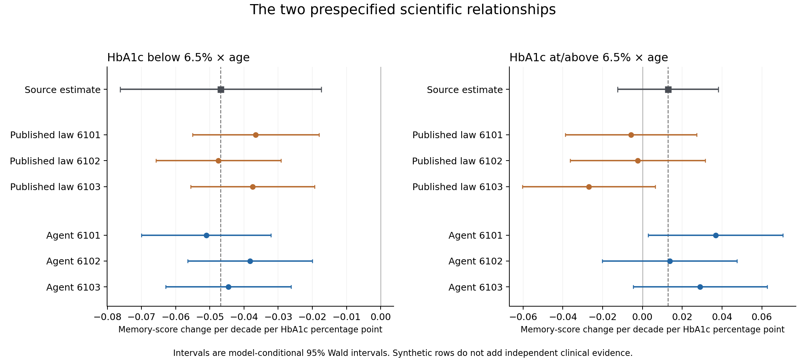
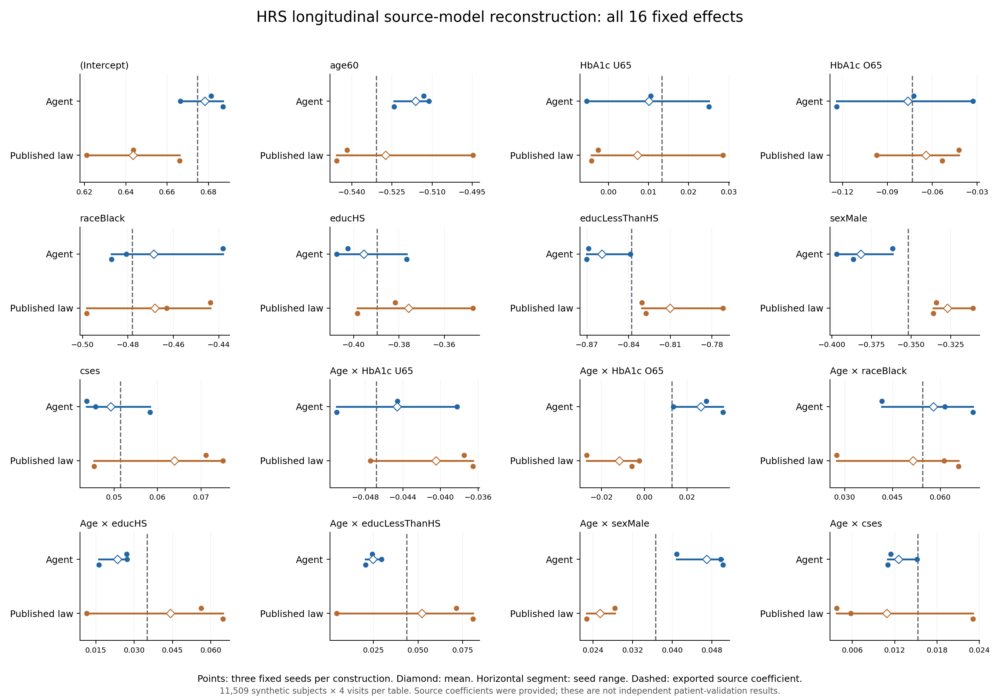

# HRS published-example results: complete longitudinal virtual cohorts

3 November 2026 (America/Chicago). All numerical values below come from retained aggregate files.

## What was tested

A fresh scientific Agent received the original published HRS aggregate model exports and method code, a whole-cohort task and the intended analysis. It produced its own executable recursive model and parameter/evidence record. The comparator reconstructs the published recipient-stage law. No HRS participant records were used. This is a source-rich reconstruction case: the analysis coefficients were legitimate inputs, so this case evaluates implementation and analysis preservation, not discovery of unseen relationships.

Each delivered table has **11,509 synthetic subjects and four visits at 0,2,4,6 years: 46,036 rows**. The task includes conditional demographics, childhood socioeconomic status, education, Gamma-distributed HbA1c, a two-branch HbA1c spline, interactions with age, and correlated subject random intercepts/slopes for memory. The same native R/lme4 model evaluates all outputs.

## Complete accounting and implementation correction

The original allocation produced six tables: three Agent tables and three attempted published-law reconstructions. All three initial comparator tables were invalid because our CRLF-sensitive metadata parser silently overwrote the seven HbA1c coefficient/SE pairs with same-named terms from later model sections. The initial root/source preflight assessment was therefore insufficient and was explicitly overturned. These are our implementation failures; they are not evidence against the published method.

A separately documented technical recovery replaced only those seven pairs and their source locators from the original text. The generator program remained byte-identical. Independent model-specific extraction, LF/CRLF and malformed-section checks preceded three additional comparator attempts. No Agent model or table was regenerated. The original six attempts and all failed records remain intact.

**Total physical generations: 9; invalid initial comparator tables: 3; valid comparison tables: 6.** Six delivered tables contain 276,216 synthetic visit rows in total, but represent repeated draws from two constructions, not six independent studies or additional clinical observations.

See [initial protocol](PROTOCOL.md), [recovery protocol](recovery_v1/PROTOCOL.md), [incident](recovery_v1/INCIDENT_AND_CORRECTION.md) and [frozen recovery](recovery_v1/RELEASE.json).

## The two prespecified longitudinal relationships

Values are the mean of three fixed seeds, with the observed seed range in brackets. Source values are the more precise published model exports; ranges are Monte Carlo summaries, not confidence intervals for a population parameter.

| Analysis coefficient | Exported source | Agent mean [range] | Corrected published law mean [range] |
|---|---:|---:|---:|
| `age60:hba1c_U65` | -0.046837 | -0.04464 [-0.05106, -0.03825] | -0.04050 [-0.04748, -0.03655] |
| `age60:hba1c_O65` | 0.012867 | 0.02649 [0.01368, 0.03677] | -0.01169 [-0.02697, -0.00235] |

The Agent retains the negative below-threshold HbA1c–age relationship in all three seeds. The above-threshold interaction is positive in all three Agent draws, but its magnitude is higher than the supplied coefficient; one Agent draw has a synthetic-model Wald interval excluding zero although the source interval includes zero. Exact significance decisions are therefore not preserved across every draw. All seed-specific estimates, SEs and intervals are retained.

The corrected comparator has negative above-threshold point estimates in these three draws, with intervals including zero. This weak relationship therefore does not have a stable point-sign across the two implementations. Both use essentially the same published family; three draws and different random-effect sampling implementations do not establish an accuracy ranking.

## All 16 fixed effects

| Term | Exported source | Agent mean [range] | Corrected published law mean [range] |
|---|---:|---:|---:|
| `(Intercept)` | 0.674696 | 0.67819 [0.66644, 0.68691] | 0.64352 [0.62105, 0.66595] |
| `age60` | -0.530801 | -0.51616 [-0.52420, -0.51118] | -0.52739 [-0.54568, -0.49475] |
| `hba1c_U65` | 0.013327 | 0.01003 [-0.00548, 0.02502] | 0.00721 [-0.00429, 0.02853] |
| `hba1c_O65` | -0.073332 | -0.07642 [-0.12390, -0.03289] | -0.06425 [-0.09706, -0.04224] |
| `raceBlack` | -0.478198 | -0.46874 [-0.48724, -0.43824] | -0.46825 [-0.49819, -0.44366] |
| `educHS` | -0.389693 | -0.39558 [-0.40755, -0.37662] | -0.37579 [-0.39835, -0.34736] |
| `educLessThanHS` | -0.837970 | -0.85942 [-0.87029, -0.83890] | -0.81010 [-0.83062, -0.77211] |
| `sexMale` | -0.351786 | -0.38167 [-0.39693, -0.36170] | -0.32700 [-0.33594, -0.31093] |
| `cses` | 0.051445 | 0.04922 [0.04368, 0.05827] | 0.06385 [0.04541, 0.07502] |
| `age60:hba1c_U65` | -0.046837 | -0.04464 [-0.05106, -0.03825] | -0.04050 [-0.04748, -0.03655] |
| `age60:hba1c_O65` | 0.012867 | 0.02649 [0.01368, 0.03677] | -0.01169 [-0.02697, -0.00235] |
| `age60:raceBlack` | 0.054426 | 0.05777 [0.04171, 0.07023] | 0.05146 [0.02748, 0.06572] |
| `age60:educHS` | 0.035008 | 0.02349 [0.01613, 0.02719] | 0.04413 [0.01138, 0.06474] |
| `age60:educLessThanHS` | 0.043667 | 0.02483 [0.02064, 0.02957] | 0.05217 [0.00445, 0.08071] |
| `age60:sexMale` | 0.036590 | 0.04695 [0.04086, 0.05023] | 0.02541 [0.02270, 0.02839] |
| `age60:cses` | 0.015266 | 0.01254 [0.01103, 0.01517] | 0.01088 [0.00378, 0.02307] |

[Every seed and its SE/interval](summary/fixed_effects_all_seeds.csv) and [all signed/absolute discrepancy summaries](summary/fixed_effects_summary.csv) are available. We do not combine unlike coefficients into a single winner score.

## Distribution quality and the original-study reference

The complete 27-field baseline comparison is retained in [all-seed diagnostics](summary/distributions_all_seeds.csv) and [summaries](summary/distributions_summary.csv). These include every applicable HRS Table2 distribution field, categorical counts and percentages. Key biomarker checks are shown here:

| Diagnostic | Paper original | Paper synthetic (5000-draw average) | Agent three-draw mean | Corrected published-law mean |
|---|---:|---:|---:|---:|
| `baseline_age_mean` | 69.00000 | 70.00000 | 70.15902 | 70.15902 |
| `baseline_age_sd` | 10.00000 | 11.00000 | 11.33050 | 11.33050 |
| `hba1c_mean` | 5.90000 | 5.90000 | 5.87248 | 5.87248 |
| `hba1c_sd` | 1.00000 | 0.96000 | 0.96756 | 0.96756 |
| `hba1c_below_mean` | 5.60000 | 5.50000 | 5.45383 | 5.45383 |
| `hba1c_below_sd` | 0.40000 | 0.70000 | 0.65431 | 0.65431 |
| `hba1c_above_mean` | 7.70000 | 7.20000 | 7.15149 | 7.15149 |
| `hba1c_above_sd` | 1.40000 | 0.60000 | 0.56305 | 0.56305 |
| `baseline_mem_s_mean` | -0.39000 | -0.44000 | -0.44785 | -0.44448 |
| `baseline_mem_s_sd` | 1.10000 | 1.19000 | 1.19241 | 1.19476 |

The Agent closely reproduces the supplied simulation law, including its limitations. The upper-HbA1c subgroup has much narrower spread than the original reported cohort, while approaching the original paper's synthetic-data spread. Analysis preservation and complete empirical distribution recovery are therefore separate outcomes. The synthetic-law agreement does not erase the original-sample mismatch.

## Verification and interpretation

All 6 retained comparison fits returned the 16 specified fixed effects; 6 independent GLS checks passed. R fits retain optimizer, warnings, singularity, variance components and input hashes. Python independently recomputes fixed coefficients and SE conditional on fitted variances; this is not an independent REML-optimizer validation.

This case adds a concrete capability result to the manuscript: the evidence-guided workflow can construct an entirely virtual longitudinal cohort with conditional variables, repeated observations, interactions and correlated individual effects, and that data product supports the corresponding published scientific analysis. It complements the earlier cross-sectional and variable-enrichment work.

The case does not establish a new simulation family, superior statistical accuracy, automatic literature search, lower human effort, population transport, causal effects, or replacement of actual measurements. The Agent selected the already published family; its use of the printed variance column instead of squared rounded SDs is disclosed. Both arms use the same rich source information. Only three draws per construction were run, versus 5000 in the original study, and balanced synthetic visits differ from the source's 43,500 observed visits.

## Decision

Include this as a published-example reconstruction and longitudinal-capability result. Preserve the parser incident and all outputs. The bounded experiment and technical recovery are closed: no further tuning or favorable-seed search. Continue manuscript integration around usable evidence-guided data, with the original upper-tail mismatch and conditional-uncertainty limits stated explicitly.

Original reference: [Filshtein et al., Proof of concept example for use of simulation to allow data pooling despite privacy restrictions](https://pmc.ncbi.nlm.nih.gov/articles/PMC8338788/). Published code is pinned to [6708e43](https://github.com/powerepilab/Sim_for_data_pooling/tree/6708e43d5e342fa76d57b31d5a6d0bfcc2979539). Third-party originals and all row-level tables stay local.
