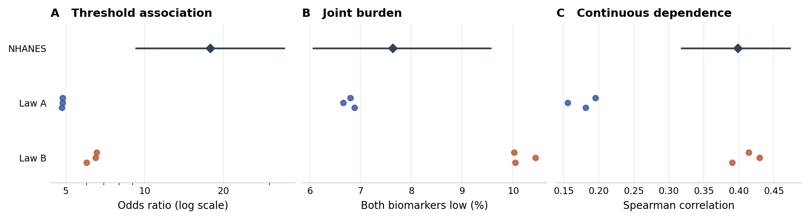

# Iron status: which analyses can the same virtual cohort support?

Two independent scientific Agents constructed full, two-variable cohorts from an external evidence packet and a target population description. Neither saw target participant rows or target outcome statistics. Each delivered three tables of 5,000 synthetic women (seeds 5101–5103). [Study protocol](PROTOCOL.md) and [shared evidence](admission/SOURCE_PACKET.md) were committed [before outcome access](https://github.com/ziwang11112/evidence-guided-virtual-cohorts-2026/commit/bedd845768c1c938768f58fce685f53cbf97f3df); a [second public seal](https://github.com/ziwang11112/evidence-guided-virtual-cohorts-2026/commit/c88192edeb0bc63b60d0bfe6e3a7282ced9d2975) bound the generator and delivery hashes before acquisition. NHANES is previously exposed at the project level. This is a developmental test of analytical breadth, not a new independent clinical-study family or an efficacy comparison between Agents.

## Results

| Analysis of the same rows | NHANES estimate (design-based 95% interval) | A: three deliveries | B: three deliveries |
|---|---:|---:|---:|
| Odds ratio for low Hb, low versus other raw ferritin | 17.79 (9.28–34.11) | 4.835, 4.864, 4.866 | 6.011, 6.511, 6.565 |
| Both biomarkers low, % | 7.63 (6.07–9.55) | 6.88, 6.66, 6.80 | 10.04, 10.44, 10.02 |
| Spearman correlation, continuous Hb and ferritin | 0.398 (0.318–0.473) | 0.181, 0.156, 0.195 | 0.391, 0.430, 0.414 |

Both constructions reproduce a positive threshold association. All six estimates understate its magnitude, even relative to the lower end of the sample interval. The log-OR differences (generated minus measured) range from −1.30 to −1.30 for A to two decimal places, and −1.09 to −1.00 for B. In contrast, construction A estimates the absolute co-occurrence within 0.75–0.97 percentage points of the sample reference. B is 2.39–2.81 points higher. For continuous ranks the order reverses: B differs from the reference by −0.008 to +0.031, while A differs by −0.243 to −0.203. The rank coefficient was not supplied; the source Hb bands and their ferritin statistics *do* constrain it indirectly. No equivalence margin or population-level guarantee was prespecified. The purpose of this comparison is to describe what statistical use survives, not to choose whichever law performs best on each endpoint.

**Figure.** All analyses use the same rows within a delivery. Diamonds and bars show the measured survey estimate and 95% design interval. Dots show the three fixed draws of each law, not three clinical cohorts; there is no interval estimate for transport/model uncertainty.

## What the Agent actually chose

- **A** used Hb bands and conditional ferritin concentrations, then downweighted low-ferritin records (relative weight 2/3) and decoupled Hb in 20% of the target population. These transport choices were the author's assumptions, not reported target evidence. Source-only review identified infinite ferritin variance in the initial upper tail. A changed the upper-tail map to give finite moments while preserving thresholds and ranks for fixed latent draws. This fixes a mathematical defect; it is not evidence that feedback increased the three endpoint scores.
- **B** matched source Hb-band frequencies, conditional low-ferritin rates and log concentrations; a copula, i.e. an explicit dependence model, linked within-band ranks. With no numeric assay or population conversion, B kept the joint law unchanged in the target context. The resulting continuous association happened to be close here; B also substantially underpredicted the threshold OR, so this does not validate direct transport generally.
- Both generators reproduced the source crude OR of 6.653 (A final replay: 6.584; B: 6.732) and the three source-band geometric means closely. The [source study](https://doi.org/10.1024/0300-9831/a000014) concerns selected Chinese IUD users; the [Cuban study](https://pmc.ncbi.nlm.nih.gov/articles/PMC10049065/) uses inflammation-corrected ferritin and was contextual, not a numerical constraint for raw ferritin. Source law fit and target utility are separate claims. Differences in population, assay or assumptions could contribute; this case cannot uniquely attribute them.

## Reference and audit

Among 1,065 confirmed nonpregnant women aged 20–44 in the positive-phlebotomy-weight frame, 979 had both measurements (97.53% complete by survey weight). Unweighted cell counts were 73 both low, 71 low Hb only, 45 low ferritin only, and 790 neither. Hb <12 g/dL and serum ferritin <15 µg/L define the analysis groups. These do not diagnose the cause of anemia. The sample reference uses WTPH2YR, 15 strata, 30 PSUs, and 15 design df; all simulated tables are equally weighted. The primary registered comparison was log OR, with estimates shown on the original OR scale. No intervals were invalid or flagged for sparse cells. Only CBC and ferritin required new downloads (1,693,200 bytes combined); local demographics matched the previous CDC acquisition hash. The [CDC ferritin documentation](https://wwwn.cdc.gov/Nchs/Data/Nhanes/Public/2021/DataFiles/FERTIN_L.htm) specifies the phlebotomy weight. No biomarkers from the target were supplied to the authors.

An [independent implementation](evaluation/independent.py) confirmed all 21 point estimates, six target interval endpoints and exact raw cell counts. The maximum absolute discrepancy was below 6 × 10⁻¹⁴ for points and interval bounds. Patient-level real and generated tables remain local. [Target aggregates](evaluation/TARGET.json) · [all six deliveries](evaluation/SYNTHETIC.json) · [audit](evaluation/INDEPENDENT_AUDIT.json).

**Decision:** include the mixed result as an analytical-breadth example. Close this target to further performance tuning. The next paper task is to place this example alongside earlier studies with the same endpoint-by-endpoint evidence labels. No RNA study, new target or superiority test is necessary to interpret this result.
