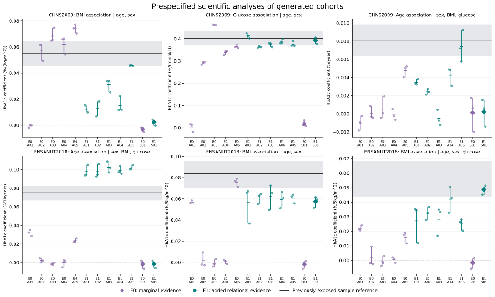

# Completed main study: evidence-guided virtual biomedical data

**Decision: close this frozen experiment and proceed to manuscript writing with analysis-specific claims. No additional construction, reference tuning or case acquisition is part of this unit.**

## What was done

The experiment generated complete age/sex/BMI/glucose/HbA1c cohorts without individual inputs. Two existing development cases (CHNS 2009 and ENSANUT 2018) each had E0 marginal/basic evidence and E1 additional qualified relational evidence. Five fresh scientific Agent contexts per case/condition selected probability laws and parameters. One fixed statistical specification per case/condition provided a descriptive comparator. The research questions were visible; target values were withheld from the authors. Both real reference samples had already been exposed to the research team, so this is not untouched confirmation.

All 24 constructions closed before common evaluation. The campaign completed 72 distinct final tables of 3,000 synthetic rows each (60 Agent and 12 statistical), plus seven exploratory tables: 79 successful physical executions and no failed generator executions. Generated rows and seeds do not increase the number of independent clinical samples. The two selected real references contain 6,631 CHNS and 6,931 ENSANUT participants under their different original selection/weighting definitions; these samples are not pooled.

Each table was evaluated on three prespecified regressions plus 27 CHNS or 28 ENSANUT diagnostics. Independent arithmetic agreed for all 2,196 statistics, with 22,713 total checks and a maximum numerical difference of 4.26e-14. All scheduled analyses were available. The audit checked existing generated outputs and frozen aggregate reference mappings; it did not repeat the patient-level reference analyses or certify biological validity.

## All six prespecified scientific analyses

The discrepancy below is the arm mean of each constructor's mean absolute difference from the sample-reference coefficient across three final seeds. These coefficients use different units and are not combined into an accuracy score. HbA1c `%` in the stored unit means percentage-point change per listed predictor unit.

| Analysis | Unit | Sample reference | E0 discrepancy | E1 discrepancy | E1 minus E0 |
|---|---|---:|---:|---:|---:|
| CHNS: BMI adjusted for age/sex | %/(kg/m^2) | 0.054946 | 0.020380 | 0.031557 | 0.011178 |
| CHNS: glucose adjusted for age/sex | %/(mmol/L) | 0.402093 | 0.134019 | 0.024079 | -0.109939 |
| CHNS: age adjusted for sex/BMI/glucose | %/year | 0.008107 | 0.007281 | 0.004854 | -0.002426 |
| ENSANUT: age adjusted for sex/BMI/glucose | %/10years | 0.075132 | 0.063944 | 0.024670 | -0.039274 |
| ENSANUT: BMI adjusted for age/sex | %/5kg/m^2 | 0.083643 | 0.056883 | 0.023732 | -0.033151 |
| ENSANUT: BMI adjusted for age/sex/glucose | %/5kg/m^2 | 0.056638 | 0.048797 | 0.025649 | -0.023147 |

Additional relational evidence was associated with smaller discrepancies in five of six prespecified analyses. CHNS BMI worsened. This is a descriptive result, not a success rate, significance test or evidence that every generated relationship is valid.

Direction agreement and magnitude agreement differ. All ENSANUT E1 focal coefficients were positive, but the five age means were 0.09777–0.10245 per decade versus 0.07513 in the reference. BMI means were 0.05646–0.06252 before glucose adjustment and 0.02500–0.04209 after adjustment, versus 0.08364 and 0.05664. CHNS E1 BMI means were 0.01240–0.04576 versus 0.05495; E1 A03 retained a negative conditional-age mean despite the positive reference. No author was selected after seeing these comparisons.

All four statistical constructions remain in the full report and figure. Under E1, statistical CHNS glucose discrepancy was 0.01202 versus the Agent arm's 0.02408; statistical ENSANUT conditional-BMI discrepancy was 0.00794 versus 0.02565. The statistical specification was closer on those two analyses, while other comparisons favored the Agent arm. One fixed specification versus five Agent-authored models does not establish general superiority of either approach. Information availability was equal within an arm, but numerical-use decisions differed.

## What the implementation demonstrated

All ten E1 Agent constructions used at least one quantitative relation as a numerical model constraint. Their reviewed records distinguish constraints, analytic checks and contextual evidence. That fixes the earlier citation-only implementation problem; it does not imply all reported relations were matched or transported. Source-population replay was unavailable in this allocation, so generated target statistics were never relabeled as original-source replay.

Seven Agent authors used one exploratory feedback cycle and retained their model. Thirteen finalized their initial model without exploratory feedback; the four statistical constructions also finalized without revision. There were zero feedback-driven scientific revisions. Consequently this study provides no evidence of revision gains, even though the review/retention interface operated.

The observed results do not isolate why a source-supported relationship transports or fails. Differences in population, measurement, selection and unreported joint structure are plausible explanations, not established causal mechanisms. The CHNS conditional-age and ENSANUT conditional-BMI requests illustrate analysis beyond a directly supplied conditional target coefficient, but their validity still depends on model completion and transport assumptions.

## Figure and interpretation limits

Every panel shows all five E0 and E1 Agent constructions and both statistical references. Dots are individual final seeds; mean markers and vertical ranges describe the three seeds, not confidence intervals. Diamonds mark statistical constructions. The line is the previously exposed sample estimate. Shading is a CHNS community-cluster CR1-t 95% interval or an ENSANUT empirical cluster-resampling stability band; neither is an equivalence margin or an interval for every marginal mean. ENSANUT uses its equal eight-cell analytical standard, not national survey weights.

The figures show genuine analysis-specific discrepancies; reference uncertainty is retained without treating it as permission to ignore mismatch. Seeds measure conditional simulation variation, not source-estimation, structural or transport uncertainty. No post-hoc acceptance threshold or pooled performance test was introduced. The public records contain all diagnostics, not only the six displayed endpoints.

## Reproducibility, cost and next work

The release, generators, evidence-use records, decisions, all final analyses and independent audit remain retained. Before common evaluation the audit implementation was repaired for compensated weighted quantile boundaries and CSV floating-point parsing; original blocked versions and their reviews are preserved. The repaired audit was separately committed/reviewed before evaluation and did not change any generator or reference.

The 79 execution receipts sum to 53.565 seconds of isolated generator runtime. This excludes source preparation, Agent authoring, review, orchestration and user time. Token costs, exact model-snapshot identifiers and end-to-end research costs were unavailable; no recruitment-cost savings are inferred.

Proceed with manuscript v0.4 and a contribution-to-evidence audit. The contribution is an executable study-qualified evidence-to-data procedure, with numerical-use records and empirical analysis-specific benefits and limits. Complete bibliographic predecessors, source/data declarations, observable runtime details and submission formatting. Current evidence does not establish universal data quality, clinical interchangeability, causal validity, individual-measurement recovery, general statistical superiority or guaranteed publication. No further fitting to these revealed references is authorized by this close-out.

See [full interpretation and constructor ledger](publication/RESULT_INTERPRETATION.md), [primary aggregate results](final_evaluation/RESULTS.json), [independent audit](independent_audit/RESULTS.json), and [claim lock](CLAIM_LOCK.json).
