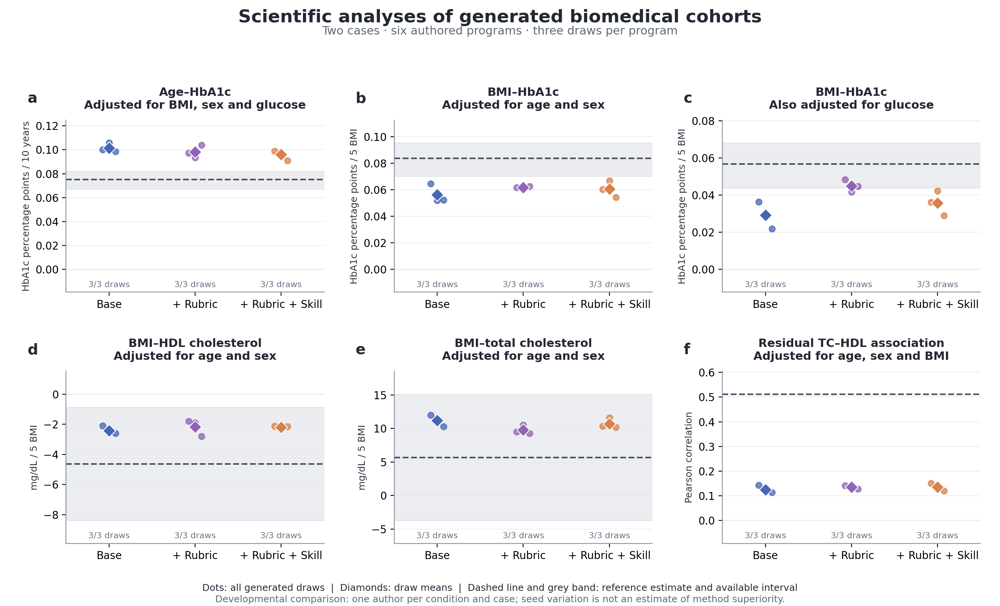

# Task-specific rubrics and reusable skills: first case pilot

The pipeline is implemented and the bounded comparison is complete: six independently authored generators produced all 18 scheduled tables, with all planned analyses computable. A task rubric helped some point-estimate comparisons in this realization. Adding the procedural skill did not produce a consistent further improvement. This is a developmental result, not evidence of general method superiority.

## What was tested

Both cases generate a whole cohort without individual participant inputs. Each uses previously admitted published evidence and an explicit scientific request. The glycemia rubric covers three age/BMI–HbA1c analyses; the lipid rubric covers two adjusted BMI associations and the residual TC–HDL relationship. The reusable skill contains procedures for source definitions, conditional variation, joint dependence, repeated measures and assumption-dependent generation, with only applicable procedures intended for use.

| Condition | Constructor guidance |
|---|---|
| A | Existing evidence-cohort-generation skill, shared minimal submission interface |
| B | A plus a supplied case-specific rubric |
| C | B plus the same cross-case procedural skill |

Each case/condition has one fresh-context author and three fixed draws (9301–9303), 3,000 rows each. All six programs were sealed before any draw. Source inputs are identical within each case, and B/C have identical rubrics. Authors selected structures, parameters and assumptions themselves. Root supplied no desired clinical coefficient, relation sign or target scale. No target results, trial draws, new retrieval or feedback revision were supplied to authors in this pilot. This controlled restriction does not prohibit retrieval or revision in the overall system.

We adapt stable criterion/evidence links and criterion-specific actions from [AutoSciRub](https://github.com/zjunlp/AutoSciRub/tree/2c6c58392ee6399e08f2526e35176f0e2c716e16), and evidence-bearing action records inspired by [SkillCoach Appendix D](https://arxiv.org/html/2607.01874v1#A4). No third-party code was installed or executed. See [reuse provenance](REUSE_NOTES.md). Neither external work establishes efficacy on this biomedical generation task.

## Final scientific analyses

Values below are the mean of all three scheduled draws from each authored law. They are not a selected seed or three independent model constructions. The complete report includes all draw values, uncertainty supplied with references, and every prespecified diagnostic.

| Analysis | Reference estimate | A: base | B: +rubric | C: +rubric +skill |
|---|---:|---:|---:|---:|
| Age–HbA1c, adjusted for sex/BMI/glucose; percentage points per 10 years | 0.0751 | 0.1015 | 0.0981 | 0.0959 |
| BMI–HbA1c, adjusted for age/sex; percentage points per 5 BMI | 0.0836 | 0.0562 | 0.0616 | 0.0604 |
| BMI–HbA1c, also glucose-adjusted; percentage points per 5 BMI | 0.0566 | 0.0292 | 0.0449 | 0.0357 |
| BMI–HDL, adjusted for age/sex; mg/dL per 5 BMI | -4.6230 | -2.4313 | -2.1666 | -2.1957 |
| BMI–TC, adjusted for age/sex; mg/dL per 5 BMI | 5.6831 | 11.2159 | 9.7649 | 10.7028 |
| TC–HDL residual Pearson correlation after age/sex/BMI | 0.5121 | 0.1251 | 0.1355 | 0.1359 |

All 54 scheduled primary estimates have the same sign as their reference point estimate. This is a descriptive observation, not 54 independent confirmations or a significance result. In particular, the supplied TC–BMI reference interval crosses zero. H reference bands are empirical cluster-resampling stability bands; L slope intervals are HC3 normal-assumption conditional sensitivities, not population-design confidence intervals. The residual-correlation reference has no supplied interval. None is an acceptance margin, and reference samples are not known population truths.

The strongest local positive change is the glucose-adjusted BMI–HbA1c coefficient: B is 0.0449 versus A's 0.0292 and the reference 0.0566. C is 0.0357, so the extra procedural guide does not preserve that full gain. All three lipid constructions remain near 0.13 residual correlation against the reference 0.5121. Their slight differences do not resolve this joint-relationship discrepancy.

The dashed line is the reference point estimate; grey shading is its supplied interval when available. Dots show all draws; diamonds show their means. The seed spread is not a confidence interval for an instruction condition. Compare each panel in its own units; there is no pooled quality score.

## Dispersion and other diagnostics

| Diagnostic | Reference | A | B | C |
|---|---:|---:|---:|---:|
| HbA1c population SD, percentage points | 0.5274 | 0.4177 | 0.3819 | 0.3936 |
| HbA1c full-model residual RMS, percentage points | 0.4885 | 0.3202 | 0.3131 | 0.3214 |
| TC sample SD, mg/dL | 42.8466 | 35.7848 | 35.5940 | 35.3170 |
| HDL sample SD, mg/dL | 20.1756 | 14.5932 | 14.5331 | 14.6322 |

Dispersion remains smaller than these reference samples in every condition. The available aggregates do not supply uncertainty intervals for these diagnostic scales, so no equivalence or statistical-significance test is claimed. B's better HbA1c coefficient comparison is accompanied by a less similar marginal SD. All 28 H and 23 L prespecified diagnostics are retained in [EVALUATION.md](EVALUATION.md), including those lacking a reference value. Unavailable reference diagnostics were not replaced with new target fits.

## Implementation and audit

- 18/18 scheduled isolated executions succeeded; 18/18 complete endpoint sets; no trial sampling, retries or source-feedback revisions.
- 513/513 scalar estimates and diagnostics agreed with a separate implementation of OLS, correlations, moments and quantiles. Maximum absolute arithmetic discrepancy was 7.82e-14. This validates the calculation, not clinical transportability.
- The original independent implementation review blocked two failure-accounting paths. They were fixed before sampling: infrastructure/unknown-entry failures and integrity failures halt the batch, including when a model error also occurs. The original BLOCK review is retained. Final execution tests passed 14 checks; the unchanged evaluator passed seven mocked checks. No historical frozen modules or receipts changed.
- Recorded execution-slot durations sum to 24.64 seconds; this excludes author reasoning, orchestration overhead, review and evaluation. Token and monetary cost were not instrumented. It is not an end-to-end efficiency benchmark.
- No new patient reads, data downloads, paid API, training or HPC. The 54,000 generated rows are fictional draws, not added clinical evidence, and remain local.

The separate outcome-blind [process review](PROCESS_REVIEW.md) examines source tracing and calculations. Common baseline authors also used real quantitative evidence and mathematical reasoning. More complete documentation alone cannot be credited as a quality gain. LB's additional checks attached to DataFrame attributes were not preserved by CSV serialization; only independently retained evaluator outputs are used. Source-reconstruction labels in LB/LC records are broader than their correctly qualified own-law algebra and receive no completed source-replay credit.

## Decision and next useful step

Keep the separation **task-specific rubric / reusable procedures**. Use the rubric as an explicit scientific task contract and use a procedure when its inputs and purpose fit. Do not install the full experimental guide as an empirically superior default or upgrade manuscript superiority claims from this pilot.

The data preserve important qualitative associations here, while some magnitudes, dispersions and joint relationships remain discrepant. Clearer instructions produced concrete modeling checks but did not supply missing conditional or population-transfer evidence. The present design cannot causally separate evidence insufficiency from structural choice, nor attribute differences to the rubric itself: each condition has only one author per case, prompts differ in length, actual compute is unmeasured, and references were already exposed in earlier development.

The next bounded improvement should connect one explicitly diagnosed scientific gap to an evidence/tool action: for example, locate compatible adjusted joint-dependence or residual-scale evidence, verify its population/measurement/operator, and let the Agent use it or retain an explicit sensitivity scenario. Compare final analysis uses again under a separately specified protocol. Do not insert the known 0.5121 correlation or reference SD into an allegedly independent construction, add more reviewers merely to obtain agreement, or treat a missing relation as identified by a checklist. The overall generation framework still permits authorized calibration inputs, retrieval, feedback and direct-row generation; none was tested as a new intervention here.

Global installed skills and the frozen manuscript method remain unchanged. All positive, mixed and unfavorable findings from this unit are retained.
