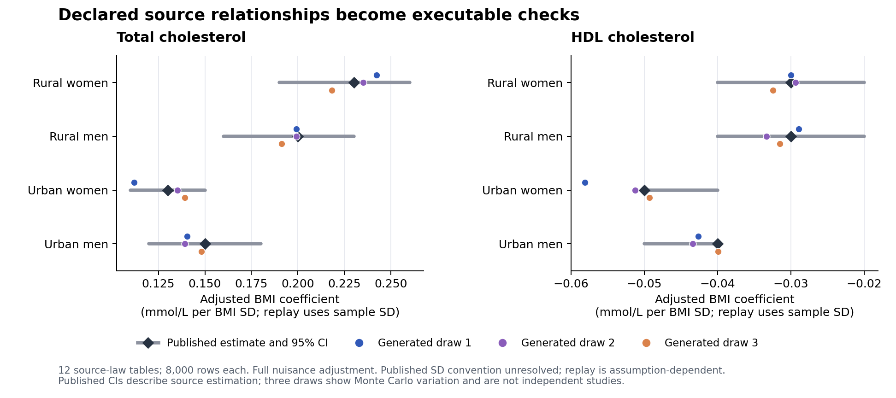
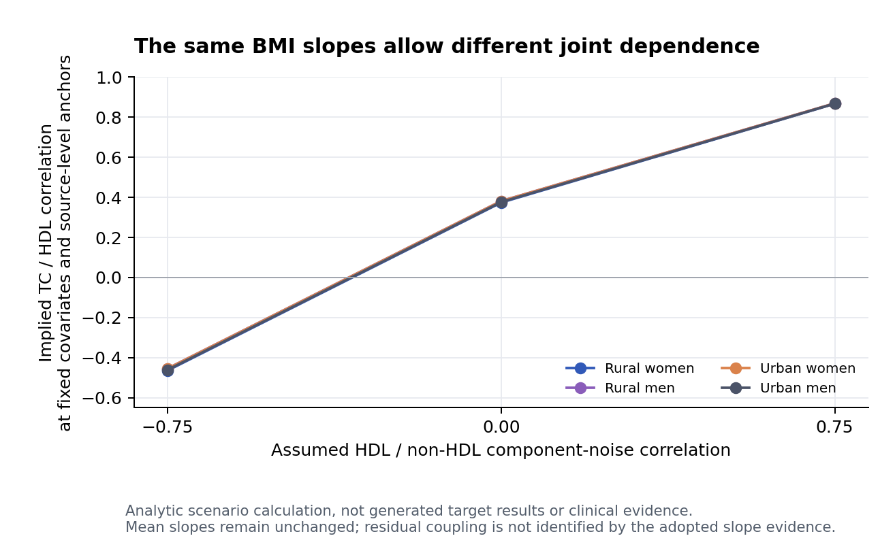

# Source-conditioned replay: completed result

9 November 2026. **The source-to-generator link now runs numerically.** One fresh scientific author constructed a shared source/target generative law, twelve source-law tables supplied all 24 planned numerical relation checks, and the retained generator subsequently delivered three target-scenario tables supporting all nine requested analysis calculations. Independent recomputation verified both stages.

**Scope:** developmental source consistency and generated-data analysis, with zero new clinical cohorts and zero reference-outcome reads. This is not a new patient-validation study, a measured gain in target accuracy, or evidence that feedback improved the model.

## What was implemented

The new additive `whole_cohort_source_replay_v1` adapter invokes the same frozen program and specification in separately declared source populations. Each source task carries the variables required by its published model. It verifies the sampled BMI standardization before applying the full adjustment model. Strict semantic availability remains separate from an explicitly assumed numerical projection. No clinical slope, level, residual SD or sign was supplied by the host controller.

The author chose four sex/site strata from Soares2019, bounded age and BMI laws, source-informed categorical nuisance margins, and a shared conditional HDL/non-HDL construction with total cholesterol as their sum. All eight reported BMI coefficients enter both source and target branches. Nuisance effects/dependence, residual CV/coupling, approximate level mappings and target mixture are visible assumptions. The target law accepts no individual observations. Positive finite-moment components arise structurally; there is no clipping, rejection search or fitted-outcome selection.

This unit used one fresh scientific constructor, independent infrastructure/scientific review and a separate numerical verifier. Those reviewers are development checks, not a required multi-agent scientific method. The generator ran only through the existing isolated WSL/bubblewrap worker. The author process itself was not OS-isolated.

## Source checks

Four source contexts × three fixed seeds × 8,000 rows produced 12 successful tables. All eight primary coefficients were retained, giving 24 computed assumed-lane projections. All 24 strict semantic checks remain unavailable because the paper does not fully resolve weighting and BMI standardization. Numeric replay does not silently certify those missing definitions.

| Source relation | Published coefficient | Generated three-draw mean | Generated range |
|---|---:|---:|---:|
| rural men HDL | -0.0300 | -0.0312 | -0.0334 to -0.0289 |
| rural men TC | 0.2000 | 0.1965 | 0.1911 to 0.1992 |
| rural women HDL | -0.0300 | -0.0306 | -0.0325 to -0.0294 |
| rural women TC | 0.2300 | 0.2318 | 0.2183 to 0.2423 |
| urban men HDL | -0.0400 | -0.0420 | -0.0434 to -0.0399 |
| urban men TC | 0.1500 | 0.1426 | 0.1391 to 0.1482 |
| urban women HDL | -0.0500 | -0.0529 | -0.0581 to -0.0493 |
| urban women TC | 0.1300 | 0.1289 | 0.1120 to 0.1393 |

Units are mmol/L per BMI SD; replay uses the generated source-sample SD under a declared convention. Published CIs are retained in the figure/JSON and are not acceptance thresholds or person-level SDs. All 24 projections preserve the reported direction; some individual draws fall outside the printed source CI. No draw is excluded. Maximum absolute point discrepancy is 0.0179768 for TC and 0.00811677 for HDL.

The independent verifier rebuilt categorical indicators and standardized BMI, checked full/nuisance rank, and used QR and Frisch–Waugh–Lovell residualization. All 12 runs and 24 coefficients agreed with the primary implementation; maximum absolute estimator difference was 5.89e-15. This verifies arithmetic, not validity of the assumed source law.

## Author decision and sealed downstream analyses

After reviewing every source result and the independent audit, the author retained the initial candidate. No new evidence or implementation defect justified changing the scientific law. The unused revision was not exercised. The decision, candidate freeze and all source-report hashes were sealed before any target-scenario generation. All three predeclared target seeds were then executed and analyzed.

| Requested analysis | Three-draw mean | Draw range | Unit |
|---|---:|---:|---|
| K02-HDL-BMI | -1.625940 | -1.804593 to -1.343896 | mg/dL per 5 kg/m^2 |
| K02-TC-BMI | 8.113641 | 7.201866 to 8.634742 | mg/dL per 5 kg/m^2 |
| K02-LIPID-RESIDUAL | 0.375712 | 0.353859 to 0.387644 | 1 |

Each table has 3,000 complete generated rows. The BMI coefficients adjust for age and sex; the residual correlation adjusts both lipids for age, sex and BMI. All nine requested calculations and 69 descriptive calculations completed. Independent QR/FWL recomputation verified all three tables and nine primary values. Every target table passed the declared row/schema, numerical, full-rank and positive-component checks, with no duplicate measurement rows or HDL>TC violations. No post-generation filtering was used.

**These are outputs of the assumed target scenario, not matches against a newly observed target.** Their three-draw ranges describe Monte Carlo variation only. For every table, the two BMI association use-contract assessments are declared partial support; K02-LIPID-RESIDUAL is unassessed with no direct evidence links. The source regression adjusts more variables than the requested age/sex target model, and the target mixture is not empirically identified.

## What remains underidentified

An analytic check frozen before generation held all BMI slopes unchanged while varying the assumed HDL/non-HDL component-noise correlation. The implied TC/HDL correlation at fixed source covariates changed from roughly −0.46 to +0.87. This is a model scenario, not another simulated patient experiment, and it is not the pooled target residual correlation. It illustrates why correct slopes alone do not establish a useful joint distribution.

Changing the unresolved BMI SD convention also changes the raw-unit slopes. Both the source-stratum and pooled descriptive-SD conversions are retained in the frozen analytic sensitivity artifact. These alternatives are not fitted to target outcomes. Measurement correspondence, source selection, nuisance coding and transport continue to require substantive review.

## Implementation review, failures and budget

The new adapter and existing semantic tests passed 68 checks, including real isolated execution on invented fixtures. Independent review caught a unit-validation bypass in the new assumed lane before biomedical execution; it was fixed with regression coverage. Review also corrected a revised-submit wrapper type and made interrupted source attempts visible in summary accounting. Documentation was aligned with the actual quota/Gumbel nuisance sampler. These are pre-experiment repairs; frozen old modules and historical receipts were unchanged.

There were no failed biomedical executions or uncomputed planned numeric projections. Strict unavailability is retained as a limitation, not counted as success. Actual scientific budget: one initial construction, zero revisions, 12/24 source evaluations, 3/6 target tables, zero calibration-objective evaluations, zero new searches/downloads. All 96,000 source-law rows and 9,000 target-scenario rows are synthetic numerical draws, not additional empirical participants. Repeated seeds and four strata do not create four independent clinical studies.

## Decision and manuscript use

**Keep the source-conditioned interface and the simpler retained construction.** This unit supports an auditable capability claim: a scientific Agent can choose a generator that operationalizes study-specific continuous relations, executes the declared source analyses, and yields whole virtual cohorts for downstream analysis while exposing unsupported assumptions. The source-slope agreement is largely expected from the chosen conditional-mean structure and is not a method-superiority result.

Integrate this as a development/capability result alongside the unchanged earlier clinical-utility results. Do not promote it into a new transport validation or a feedback-benefit claim. The next scientific evidence need is information on conditional variability, joint dependence and intended target-population composition; additional draws from this frozen model cannot identify them. A new clinical-reference evaluation needs its own admissible, unexposed protocol.

Reproducible records: [protocol](PROTOCOL.json), [scientific review](SCIENTIFIC_CANDIDATE_REVIEW.md), [source feedback](INITIAL_SOURCE_FEEDBACK.json), [independent source audit](INITIAL_SOURCE_INDEPENDENT.json), [author seal](AUTHOR_SEALED.json), [independent downstream audit](TARGET_INDEPENDENT.json), [aggregate results](RESULTS.json). Individual tables and original third-party sources remain local.
