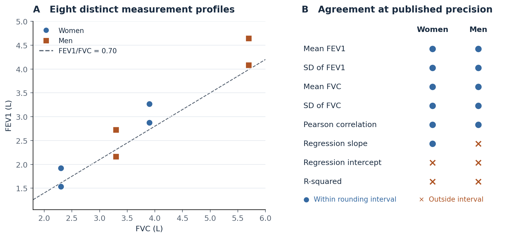

# Which lung-function analyses survived the change of data?

22 November 2026. On a second development paper, the agent generated a virtual cohort that reproduced the sex-standardized ratio of mean volumes. It correctly described the screening percentage as assumption-dependent. Its single delivered configuration also missed several of the paper's published regression statistics.

## A new run with the iron interface

The investigator supplied the [short lung request](development_requests.json) and the article's full JATS text, including both tables, equations and captions. Figure pixels and individual-level observations were unavailable to the constructor. The [pre-dispatch binding](LUNG_DEVELOPMENT_LOCK.json) records the unchanged author, runtime and driver, input hash, budget, and the predeclared checks. The same single GPT configuration used in the iron run designed the model, wrote and tested its program, then reviewed generated-only diagnostics. The three API calls cost an estimated USD 0.2246055 at the recorded tariff. The driver completed all stages unattended. The API captures were verified against the expected inputs. No case-specific formulas, prior case outputs, evaluator answers or scientific edits were supplied to the constructor. This source had already been used by the project. [Source article](https://doi.org/10.1186/1465-9921-13-57) · [API audit](LUNG_API_AUDIT.json)

## Two scientific answers on identical rows

| Requested analysis | Frozen virtual result on all three seeds | Independent interpretation |
|---|---:|---|
| 100 times equal-sex mean FEV1 divided by equal-sex mean FVC | 76.3158% | The published rounded sex-specific means give 100 × 2.9 / 3.8, approximately 76.3%. This particular use is supported. |
| Equally weighted percentage of individuals with FEV1/FVC strictly below 0.70 | 25.0% | In this scenario, 1,250 of 5,000 women and 1,250 of 5,000 men cross the cutoff. The publication gives no measured prevalence for this request. |

Each of the three frozen 10,000-row tables contains eight distinct sex/FEV1/FVC profiles. Each profile appears 1,250 times. Two profiles fall below the cutoff. The seed changes their order. All values satisfy the physiological volume ordering. The 25% result is illustrative. The agent considered a Gaussian alternative but delivered one executable configuration. Its outputs supply no empirical prevalence, cross-model range, or evidence that the percentage is stable to a different scientific model. The two independent row-level calculations agreed. [Independent replay](LUNG_INDEPENDENT_RESULTS.json) · [Second implementation](evaluation/lung_secondary_d02_results.json)

## What the agent checked

The design correctly extracted the within-sex marginal means, SDs and correlation. It also recorded the regression equations as cross-checks. While writing the program, the agent found and corrected a hand-calculation error in its proposed male example. Its actual cohort generator checked the eight sex-specific marginal summaries and the two correlations. Its final review kept the program. An independent check of sixteen numerical entries found eleven inside their printed rounding intervals. The five misses were the female intercept, male slope, male intercept and both R-squared values. The female slope happened to agree despite not being tested in the program. These sixteen entries share mathematical dependencies. They describe source coverage, not sixteen independent experiments.

The male slope was 0.80 versus the paper's 0.84. The male intercept was −0.20 L versus −0.36 L. Both modeled correlations were 0.96, giving R-squared of 92.16% in both groups, while the source reported 92.0% in women and 93.1% in men. Matching the centres of the printed means and SDs and the two-digit correlations does not automatically replay more precisely printed regression summaries. The [earlier constrained numerical examples](../lung_pairing_numerical_control_2026-11-22/RESULTS.md) demonstrate that joint agreement to printed precision is achievable. Those results were withheld from this run. [Coverage audit](LUNG_SOURCE_COVERAGE.md)

## Development decision

The [iron run](IRON_DEVELOPMENT_RESULTS.md) omitted the overall ferritin geometric mean from self-checking. This lung run omitted regressions that the agent had already identified as relevant. In both cases the researcher's requested analyses remained computable. The quality of supporting evidence differed by analysis. The next improvement to test is a generic link from each material evidence item selected by the agent to an executed check on the generated rows or an explicit reason for leaving it unresolved. For rounded and dependent statistics, a numerical discrepancy should return to the author with the source precision. The agent may reconcile it, give a qualified result, or explain why it does not apply. Keep the current development results as observed. Freeze that rule and its independent assessment before opening the four new articles. Neither development run supplies a prospective success rate or a comparison with an ordinary agent.
