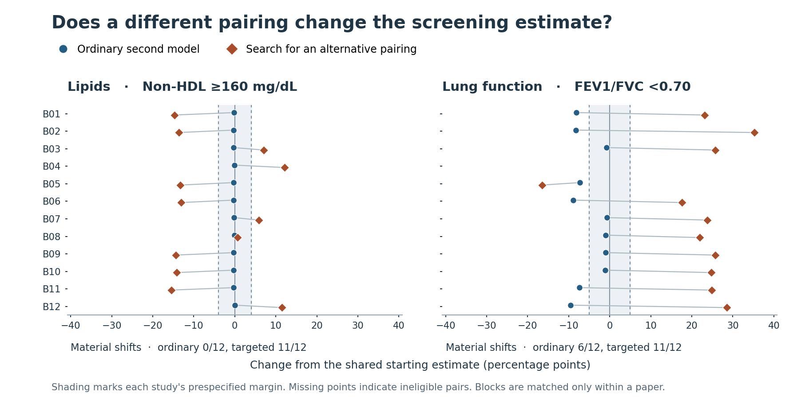

# What can the Polish lung-function study tell us about screening?

Twelve shared starts on one published article yielded **11/12 material shifts with an explicit alternative-pairing request** and **6/12 with an ordinary second-model request**. A material shift exceeded five percentage points in the pooled screening estimate and two points in the same direction at each of three seeds. In 11/12 blocks both comparison arms met all eligibility conditions. This experiment asks whether the author can *exhibit* sensitivity to the unknown within-person pairing, given the source data and the stated marginal model. [Full registration before API calls](https://github.com/ziwang11112/evidence-guided-virtual-cohorts-2026/commit/759dca89aa2da6ebb40a2d8a433c03310da9f0a1) · [Original Polish article](https://pmc.ncbi.nlm.nih.gov/articles/PMC3461438/)

## The scientific use

A researcher has published lung-volume summaries but lacks the paired measurements needed to count how many people have FEV1/FVC below 0.70. Here FEV1 is the volume expired in the first second and FVC is forced vital capacity. The Polish study reports distributions separately for healthy women and men and a within-sex FEV1-on-FVC regression. A pair of virtual columns yields both a ratio of group means and a proportion of individuals below the threshold. We weight women and men equally when computing both quantities. This is a descriptive analysis under a research cutoff. The source distinguishes age-specific reference limits.

Under a chosen set of unrounded marginal means, pairing cannot change the first analysis. The printed mean centres give 76.32%, while the registered rounding convention gives 76.24%. For the second, write FEV1 as intercept + slope × FVC + residual. A person falls below the threshold when their residual is less than (0.70 − slope) × FVC − intercept. The reported correlation and regression restrict overall residual variation. The threshold also depends on where the residuals fall at different lung volumes. This is the individual-level choice the agent has to make.

## How numbers from the article entered the models

The 2012 survey retained 1,625 women and 1,120 men in the two groups. Authors received the original scientific text, both tables (all 23 rows), equations and figure captions, and were asked to extract nine reported numbers per sex. We supplied a common marginal convention and the OLS identities. Reading the one-decimal SDs as exact makes the male slope 0.804, while the paper gives 0.84. Under the prespecified common rounding convention, the reconstructed FEV1 means and SDs agree with both tables at their reported precision. This selects one admissible set of moments and lognormal marginal grids. The unrounded participant measurements and their marginal shapes remain unknown. The FVC index paired with each FEV1 value was specified by the agent-authored sampler. No age-specific model or image digitization was used. [Source-rounding audit and protocol](PROTOCOL.md) · [Task supplied to authors](REQUEST.txt)

Every proposal used the same GPT at medium reasoning effort, the same article and output allowance, and the existing isolated execution service. Each follow-up saw an identical copy of its own block's first model. A source-compatible draw required a complete within-sex permutation, physiologically ordered volumes, and all eight summary statistics per sex inside their published rounding bins. This includes each sex's unadjusted Pearson correlation, R², slope and intercept. Construction ended before scoring all submitted models. No measured US or Malawian file was opened in this experiment.

## Results of the matched requests

| Outcome | Ordinary second model | Search for an alternative pairing |
|---|---:|---:|
| Eligible first/follow-up pairs | 11/12 | 11/12 |
| Material shifts among all assigned blocks | 6/12 | 11/12 |
| Median absolute shift in eligible pairs, percentage points | 7.31 | 24.76 |

Across qualifying programs the ratio of sex-standardized mean volumes was 76.2368%. The first fully evaluable block in the registered block numbering was B01. The initial, ordinary and targeted screening estimates were 19.02%, 10.86% and 42.20%. There were 5 discordant blocks in favor of the targeted instruction and 0 in favor of the ordinary one. The exact two-sided paired test gives *p* = 0.0625 on this article. The effect is an instruction contrast conditional on the selected study and the fixed marginal design. [Complete scientific results](RESULTS.json)

| Author role | Correct source extraction | Three scored draws | Passed all checks |
|---|---:|---:|---:|
| initial | 11/12 | 11/12 | 11/12 |
| ordinary | 11/12 | 11/12 | 11/12 |
| alternative | 11/12 | 11/12 | 11/12 |

| Block | First, % | Ordinary, % | Targeted, % | Ordinary change, pp | Targeted change, pp | Material ordinary / targeted |
|---|---:|---:|---:|---:|---:|---|
| B01 | 19.02 | 10.86 | 42.20 | -8.167 | +23.173 | yes / yes |
| B02 | 19.07 | 10.87 | 54.34 | -8.202 | +35.273 | yes / yes |
| B03 | 19.16 | 18.33 | 44.93 | -0.831 | +25.767 | no / yes |
| B04 | — | — | — | — | — | no / no |
| B05 | 19.09 | 11.78 | 2.58 | -7.315 | -16.517 | yes / yes |
| B06 | 18.96 | 10.02 | 36.54 | -8.942 | +17.583 | yes / yes |
| B07 | 18.99 | 18.31 | 42.80 | -0.683 | +23.808 | no / yes |
| B08 | 19.10 | 18.05 | 41.02 | -1.048 | +21.923 | no / yes |
| B09 | 19.22 | 18.16 | 44.98 | -1.056 | +25.762 | no / yes |
| B10 | 19.19 | 18.08 | 43.95 | -1.108 | +24.765 | no / yes |
| B11 | 19.14 | 11.75 | 43.97 | -7.390 | +24.833 | yes / yes |
| B12 | 18.99 | 9.43 | 47.58 | -9.560 | +28.583 | yes / yes |

Dashes mark ineligible estimates or pairs. All assigned blocks remain in the denominator. The full receipt retains the scored outputs of ineligible programs as diagnostics.

| Ineligible submission | Recorded check failures |
|---|---|
| B04_alternative | unavailable_artifact |
| B04_initial | unavailable_artifact |
| B04_ordinary | unavailable_artifact |

## Why some large shifts deserve scrutiny

After the registered outcomes had been calculated, we audited all 33 qualifying models at symmetric distances around 0.70. The median fraction of records with a ratio in [0.695, 0.705) was **3.69%** in initial models, **2.63%** in ordinary follow-ups and **15.28%** in targeted follow-ups. Over [0.69, 0.71) the corresponding medians were 7.46%, 5.42% and 25.49%. In B01 the targeted estimate was 28.84% at a 0.695 cutoff and 42.20% at 0.700, compared with 42.24% at 0.705. Its code expressly sought feasible assignments across the declared boundary. The original article gives no reference frequency in these narrow bands. This exploratory calculation describes numerical concentration. The frequency in real participants remains unknown. Neither eligibility nor the registered outcomes changed. [All cutoffs and programs](CUTOFF_AUDIT.json) · [Audit code](cutoff_audit.py)

The B01 ordinary program distributed the required covariance reduction through disjoint exchanges of paired ranks. The targeted program searched in both directions and retained a larger cutoff shift. Both preserved the component distributions. These two executable programs illustrate the modeling choice behind the outcome. B04's initial reply omitted required decision-record fields. Both B04 follow-ups were skipped and the block remains in the 12 assigned starts for each arm.

## What the two papers contribute to the KDD study

| Published article | Use fixed by the selected marginals | Use requiring a joint law | Ordinary / targeted material pairs | Materiality margin |
|---|---|---|---:|---:|
| Mwanza lipids | Mean non-HDL cholesterol | Non-HDL ≥160 mg/dL | 0/12 versus 11/12 | 4 pp |
| Polish lung function | Ratio of sex-standardized mean volumes | Individual FEV1/FVC <0.70 | 6/12 versus 11/12 | 5 pp |

The articles pose different downstream questions and supply different joint constraints. The lipid source gives a mean individual ratio. The lung source gives sex-specific second-moment information. Both experiments test whether the same evidence admits two executable models with different consequences for one declared scientific use. The screened proportions are feasible estimates under the selected checks. Neither pair establishes the clinical prevalence or sharp mathematical limits. A comparison *within* one study with and without designated constraints would be required to isolate the effect of evidence strength. Earlier US and Malawi results address sample agreement under a different protocol. [All lipid blocks](../article_pairing_2026-11-22/RESULTS.md) · [Earlier measured-sample comparison](../spirometry_pairing_2026-11-21/RESULTS.md)

## Cost, replay and decision

Of 36 registered author slots, 34 issued an API call and 34 supplied itemized usage. The provider returned 34 responses. Two follow-ups are skipped if their shared initial submission cannot be parsed; the whole block then stays in both denominators. The registered ceiling was USD 18. This run's reconstructed API tariff was USD 2.353595. Across both articles the recorded tariff totals USD 5.020557. The scientific comparison in each article has 12 shared author starts. Three seeds and 16,000 synthetic pairs per completed draw improve numerical precision. They do not add independent publications or patients. This lung run archived 33 parsed submissions, with 33 distinct generator source strings. [Redacted per-call usage and model identifiers](PUBLIC_AUTHORS.json) · [Scientific models and executable code](PROGRAMS.json)

An independent implementation extracted the source quantities directly from the journal XML, checked the matched prompts and original parent identity, recomputed 99 scored tables, checked the 0 unscored draw records and reproduced every matched classification and billed-usage calculation. Raw API exchanges and row-level assignments remain local. The B01 initial sampler replayed with the identical assignment hash at seed 522221. The public archive can replay a scored block with the repository's WSL/bubblewrap environment. [Independent numerical verification](VERIFICATION.json) · [Verifier](verify.py) · [Offline replay](replay.py)

The prespecified gate passed. The iron study is the next candidate. It changes the scientific use from the fraction below a cutoff to continuous rank dependence while the paper supplies joint category counts. The portfolio currently includes **two complete article-level matched comparisons**. [Portfolio and budgets](../article_pairing_2026-11-22/EXPANSION.md)
