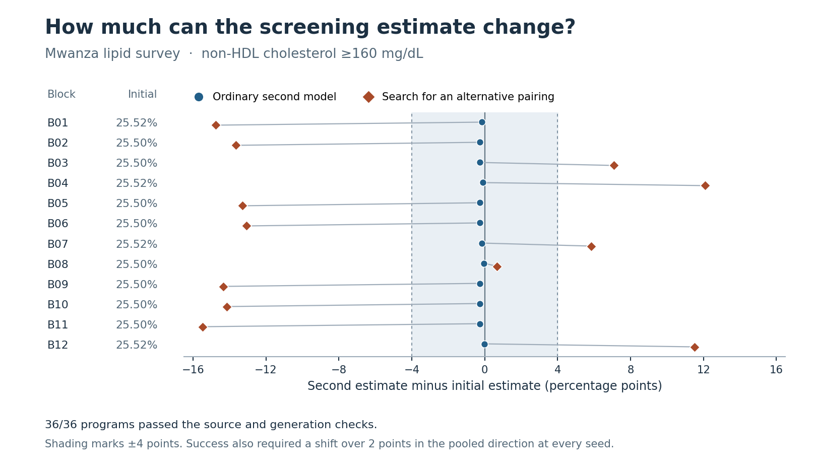

# From one published lipid survey to alternative screening estimates

A virtual cohort that matches the published summaries can still give a different answer to a screening question. In 12 matched blocks using the full scientific text of one Mwanza lipid survey, explicitly asking an agent to find a second source-compatible pairing changed the estimated screening proportion by a material amount in **11 of 12 blocks**. An ordinary second modeling request did so in **0 of 12**. All 36 programs passed the same source and generation checks. Every program recovered a mean non-HDL cholesterol of 128.77 mg/dL. [Original article](https://doi.org/10.1371/journal.pone.0223189) · [Registration before API dispatch](https://github.com/ziwang11112/evidence-guided-virtual-cohorts-2026/commit/63f272ede8b49834aead9c300020fa8c5dff4247)



## What the experiment asked of the agent

Kavishe et al. reported survey-weighted cholesterol summaries for adults in Mwanza municipality. A researcher wants to estimate how many people meet a non-HDL threshold of 160 mg/dL. The two reported means fix mean non-HDL through subtraction. To count people above a threshold, the researcher also needs to know which total cholesterol (TC) and HDL measurements belong to the same person.

Each first author read the supplied article with all five tables, located the correct population and extracted eight published values with their units and table references. The investigator provided the two marginal distribution families, the unit conversion, the analyses and the physiological ordering rule. The agent chose a within-person assignment, wrote an executable sampler and documented its assumptions. The execution service built the marginal grids from that author's own extraction. The common analysis then calculated the mean non-HDL and screening proportion on the resulting virtual records. The 12 first authors used separate GPT sessions. Both follow-ups in a block saw the exact same original article, interface and first submission. Only the second-model instruction varied. The targeted request disclosed the screening question and asked for a material change in either direction. [Exact task](REQUEST.txt) · [Both instructions](experiment.py) · [Frozen protocol](PROTOCOL.md)

## Registered comparison

A material change required an absolute shift **greater than 4 percentage points** in the pooled screening estimate and a shift **greater than 2 points in the pooled direction at each of three common seeds**. Both programs had to pass every registered check. All 12 blocks counted in each arm. The threshold defines a material change for this experiment. It does not describe clinical accuracy. The first model is the common comparator for both follow-ups.

| Outcome on this article | Ordinary second model | Search for an alternative pairing |
|---|---:|---:|
| Fully valid pairs | 12/12 | 12/12 |
| Material change | 0/12 | 11/12 |
| Median absolute change, percentage points | 0.27 | 13.18 |
| Range of absolute changes, percentage points | 0.004–0.275 | 0.671–15.471 |

Eleven blocks succeeded only in the targeted arm and none succeeded only in the ordinary arm. The paired difference in success rates was 91.7 percentage points. The exact two-sided test on the discordant blocks gave *p* = 0.0009765625 for this article. The targeted follow-ups moved the pooled screening estimate upwards in five blocks and downwards in seven. B08 passed the constraints and changed the estimate by 0.67 points, below the registered threshold. [All models, seeds and comparisons](RESULTS.json)

| Block | First, % | Ordinary, % | Targeted, % | Ordinary shift, pp | Targeted shift, pp | Material ordinary / targeted |
|---|---:|---:|---:|---:|---:|---|
| B01 | 25.52 | 25.37 | 10.77 | -0.146 | -14.746 | no / yes |
| B02 | 25.50 | 25.24 | 11.86 | -0.269 | -13.644 | no / yes |
| B03 | 25.50 | 25.23 | 32.60 | -0.273 | +7.096 | no / yes |
| B04 | 25.52 | 25.43 | 37.61 | -0.094 | +12.094 | no / yes |
| B05 | 25.50 | 25.24 | 12.22 | -0.265 | -13.281 | no / yes |
| B06 | 25.50 | 25.23 | 12.43 | -0.273 | -13.073 | no / yes |
| B07 | 25.52 | 25.37 | 31.36 | -0.152 | +5.844 | no / yes |
| B08 | 25.50 | 25.47 | 26.17 | -0.035 | +0.671 | no / no |
| B09 | 25.50 | 25.23 | 11.17 | -0.275 | -14.333 | no / yes |
| B10 | 25.50 | 25.23 | 11.35 | -0.269 | -14.148 | no / yes |
| B11 | 25.50 | 25.23 | 10.03 | -0.275 | -15.471 | no / yes |
| B12 | 25.52 | 25.52 | 37.03 | -0.004 | +11.506 | no / yes |

## What changed in the models

In B01 the first author calibrated a Gaussian rank copula to the reported average of individual TC/HDL ratios. The ordinary follow-up switched to a Student-t rank copula and moved the screening estimate from 25.52% to 25.37%. The targeted follow-up reassigned HDL around the screening threshold, using compensating exchanges elsewhere to preserve the ratio. It yielded 10.77%. In B04 an author sought high screening counts with feasible exchanges and obtained 37.61% from a 25.52% starting estimate. These are explicit, checkable changes in the model of paired measurements. The two targeted procedures used the requested endpoint when choosing exchanges. A larger shift therefore measures success at finding sensitivity scenarios. It provides no evidence of improved point prediction. [Archived scientific programs and model decisions](PROGRAMS.json)

All 36 submissions extracted the correct municipal values and reproduced the eight table/row citations. All 108 draws preserved both marginal columns, used each HDL value once, kept HDL at or below TC for each record, and met the ratio requirement. Across programs the pooled mean individual ratio ranged from 3.65966 to 3.66030, consistent with the printed 3.66. The constant non-HDL mean follows algebraically from 4.72 minus 1.39 mmol/L and the unit conversion. The useful agent contribution in this comparison is constructing a second feasible joint assignment for the requested analysis. The preregistered checks establish compatibility with selected source summaries under the supplied marginal families. Other biological constraints and clinical prevalence require separate evidence. [Independent readback](VERIFICATION.json)

## API scale, cost and reproduction

The experiment used GPT-6.1 Sol with medium reasoning effort. The 36 paid calls comprised 12 first submissions, 12 ordinary follow-ups and 12 targeted follow-ups. All returned usable programs. The three predeclared seeds generated 108 tables with 16,000 virtual pairs each. The independent units for the instruction comparison are the 12 matched author blocks on one publication. The total tariff reconstructed from all 36 usage records was USD 2.666962 against a registered cap of USD 18. First submissions cost USD 0.559248, ordinary follow-ups USD 0.978517 and targeted follow-ups USD 1.129197. These amounts reflect the recorded token usage, including cache charges. [Public per-call usage, model names and hashes](PUBLIC_AUTHORS.json) · [OpenAI pricing](https://developers.openai.com/api/docs/pricing)

The offline verifier independently extracted the published values from the original XML, recomputed all 108 saved assignments and 24 matched comparisons, verified that the two prompts shared the same parent and recalculated all 36 tariff entries. In separate offline replays at seed 520221, the B01 first sampler and the B01 targeted sampler reproduced their recorded output hashes. The targeted sampler ran from the public export using only the released model and code. With the repository's WSL/bubblewrap execution environment, the public program archive supports the following replay from the project directory, without an API call. Raw API transactions, the article XML and row-level virtual assignments remain in the local archive. The publisher supplies the original text. [Offline verifier](verify.py) · [Replay code](replay.py)

```shell
python -B work/article_pairing_2026-11-22/replay.py run B01_initial 520221
```

## Implication for the KDD manuscript

Use this experiment to show what a scientific agent contributes when researchers have only published summaries. It can turn the same evidence into two executable, audited cohorts and demonstrate that the requested threshold analysis depends on an unresolved pairing choice. The invariant mean and the sensitive threshold can be shown next to each other. Even the single targeted failure offers no proof that the threshold proportion is identified. A source-only search supplies feasible examples, not a prevalence interval. The real-data comparisons elsewhere in the manuscript address agreement with measured samples.

The predeclared decision to consider a second paper passed. The lung-function, iron and handgrip sources are candidates for replication, with source-specific admissibility and effect thresholds to be set before each run. The four-source design has at most 144 calls including this pilot. The other three publications have not entered this protocol. [Expansion design and budgets](EXPANSION.md) · [Current manuscript](../../manuscript/kdd_draft_v49_2026-11-21/README.md)
